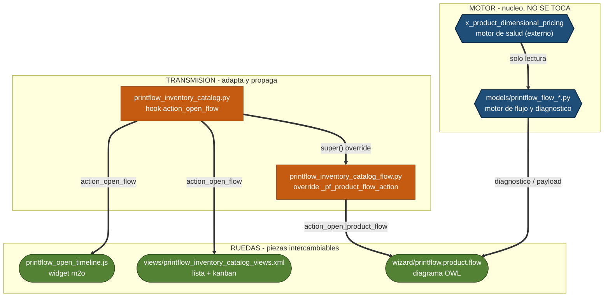

# CONTEXT.md - Módulo: printflow_gestion_inventario

## 1. Ficha Actual y Estado de Ejecución
- Entorno: Odoo v17 Community
- Servidor Odoo: odoo-impreven / http://localhost:8071
- Base de Datos: Ciber Estudios 2015 RESTAURADA
- Tipo de BD: **PRUEBA** (copia restaurada) — lo confirmó el usuario: **SÍ (2026-10-17)**
  → en lotes `[pantalla]` el verificador puede **abrir** la pantalla (acción de lectura), pero **nunca
  acciona** botones con efecto (Confirmar/Guardar/Validar/Publicar). Receta: `VIEW-LIVE-CHECK.md`
  (skill `odoo-view-design`). *Si este campo se borra o queda sin confirmar, se lee como PRODUCCIÓN.*
- Ruta del Módulo: C:\odoo_custom\printflow_gestion_inventario
- Tarea de reinicio: **`Odoo8071-printflow_gestion_inventario`** (verificada el **18/10/2026** con
  `Get-ScheduledTask`; `State: Ready`, disparo **manual**, sin `StartBoundary` útil) — skill
  `reiniciar-servidor-odoo`. Corre
  `Odoo-Servicio.ps1 -Proyecto printflow_gestion_inventario -Servicio odoo-server-17.0 -Puerto 8071
  -BaseDatos "Ciber Estudios 2015 RESTAURADA" -Modulos printflow_gestion_inventario` ⇒ **reinicia + `-u`**.
  → **Los agentes de lote la APRIETAN al cerrar su turno** (no piden nada al dueño) y dejan la evidencia
  (log del botón + PID + `write_date`). *Si algún día no existe, el lote cierra declarando "el módulo quedó sin
  recargar".*
- Registro de Hallazgos: [`HALLAZGOS.md`](HALLAZGOS.md) — **15 abiertos** · **45** `resuelto` · **8** `descartado` · **0 en tarea** (**68** filas) (compañero del CONTEXT.md; ver skill §2.2).
  **20/10 (cierre §3.U):** **H-062 · H-064 ⇒ `resuelto`** (lista de 7 columnas con el documento como referencia
  nativa, "SANEAR TODAS" y refresco con resumen; Verificador `cumple` en código + mirada en vivo del dueño).
  **H-063 ⇒ `resuelto`** el **20/10** (el dueño ordenó el cambio): el parámetro
  `x_product_dimensional_pricing.pf_reservation_cleanup_limit` quedó en **0** (`set_param`, 50 → 0) ⇒ el tablero
  ya no corta en 50 y muestra las **81** alertas.
  **20/10 (§3.V · autorización del LOTE):** se ABREN **H-065** (el nodo Entrega del DTF queda en `lot_generic` y
  **ninguna** de las dos autorizaciones de la bandeja lo apaga: "Autorizar lote" escribe en `printflow.lot.exception`
  —que el motor solo lee para MEZCLA— y "Autorizar excepción" apunta al **MOVIMIENTO**, no al lote) y **H-066**
  (`_pf_suppressed_targets` ignora `target_model` ⇒ colisión de ids movimiento↔lote). Ambos entran `en tarea` a §3.V.
  **20/10 (Fase A · "Reserva colgada"):** se ABREN **H-062** (tras accionar una corrección la bandeja **se cierra**: sin "después" ni resumen) · **H-063** (el tablero corta en **50 de 81** alertas y no deja llegar a las reservas del producto) · **H-064** (el botón de la **llave** no dice qué hace: el operador cree que abre el documento). **H-062 · H-064 ⇒ `en tarea`** (los cura **§3.U**); **H-063 ⇒ `abierto`** (cura = parámetro `pf_reservation_cleanup_limit = 0` en Ajustes, lo deja el **dueño**; no es código) → **`resuelto` el 20/10** (el dueño ordenó el cambio; aplicado `set_param`, 50 → 0).
  **18/10 (MIRE EN VIVO del modal, navegador del Analista):** se ABREN **H-050** (los `<div>` de prosa dentro de
  `<group col="1">` se pintan en **columna vertical**, una palabra por línea ⇒ **ilegible**; **PREENSA** anciano)
  y **H-051** (la cabecera "Selección" se **apila en una columna**: rótulos partidos + **mitad derecha vacía**;
  **355 px** de **546** y **1813 px** de contenido) — **ambos `en tarea`** a la **corrección viva §3.P.8 · T12**,
  porque son **exactamente** el *"texto estrecho y espacios vacíos"* que el dueño reportó. Se ABREN además
  **H-052** (el modal está topado en `modal-lg`: su cura toca la **bandeja**, fuera de alcance ⇒ `abierto`) y
  **H-053** (6 decimales: es `decimal.precision` **de la BD** ⇒ *datos no* ⇒ `abierto`). **H-049** pasa a
  `en tarea` (se cierra con T12-c).
  **18/10 (cierre Lote 4):** se ABRE **H-049** (el `<div>` de "Unidades de la entrega" **repite** la aclaración
  de `selection_note` ⇒ microcopy duplicado; **cosmético**, **fuera** de la sección "Selección" que el dueño
  señaló, **no** rompe ningún CA; queda `abierto` como **deuda declarada** con su cura de 1 línea).
  **18/10 (cierre Lote 1):** se ABRE **H-048** (el contador nuevo `candidate_count` comparte rótulo con el o2m
  `candidate_ids` ⇒ **1 WARNING** de higiene, **invisible al operador**; el módulo ya emite **≥10 idénticos** ⇒ es
  **estilo de casa**; queda `abierto` como **deuda declarada** con su cura exacta de 1 línea, **fuera** del alcance
  de §3.P).
  **18/10:** se ABREN **H-043** (la tabla muestra la disponibilidad **GLOBAL**, no la del almacén que decide) ·
  **H-044** (la tabla lista lotes en `0.00` que el desplegable no ofrece: `include_lot_ids` del contenedor) ·
  **H-045** (el **pre-llenado** del lote propio contradice la regla del wizard) · **H-046** (la columna que decide
  —"Lote a asignar"— queda **fuera de la vista**, la empuja `move_id` "Unidad") · **H-047** (la fila pinta 11
  columnas y la cabecera **repite en prosa** los conteos ya rotulados). Los **cinco** entran `en tarea` al plan de
  **§3.P**.
  **17/10-d:** se ABREN **H-039** (el modo `single` es un subconjunto **estricto** del `split` ⇒ duplicidad +
  premisa equivocada: "UN lote para TODA la selección") y **H-040** (el eje de decisión está centrado en el
  **LOTE**, no en la **ORDEN/UNIDAD**; la fila `pending_order` **suma** la demanda). **H-034 pasa a `en tarea`**
  (lo cierra la tarea §3.O). Los tres entran al plan de **§3.O**.
  **Cierre 17/10 · reparto multi-lote (verificado `cumple`): H-036 y H-037 pasan a `resuelto`** → **11 abiertos**.
  **17/10-c (Lote 1 · aviso fuera de alcance):** se ABRE **H-038** (el repo del **MOTOR**
  `x_product_dimensional_pricing` tiene **143 entradas sin commitear** en `main`; riesgo de proceso, NO del módulo
  — se reporta al dueño, no se toca desde aquí).
  **17/10-c (3.ª ronda · TAREA ABIERTA):** se ABRE **H-037** (el wizard en bloque **no tiene capacidad de
  REPARTO multi-lote**: su contrato declarado es "UN lote → N entregas" y el protocolo NATIVO del motor no es
  aditivo ⇒ llamar dos veces borra el primer lote). El dueño pide revisar el wizard; **tarea GRANDE abierta en
  la Sección 3** (Analista → Planificador).
  **17/10-c (2.ª ronda):** se ABRE **H-036** (el check "Asignar" de la tabla de candidatos parece multiselección
  pero es de **selección ÚNICA**: gana el último tick ⇒ se asigna **un solo lote por corrida**; evidencia: bulk id 4).
  **17/10-c:** se ABREN **H-034** (el bloque resuelve UN solo movimiento por albarán) y **H-035** (reservas
  colgadas sin lote actuales), del análisis de la 3.ª incidencia de lote (ver NOTA de abajo).
  **Cierre 17/10-bis: H-032 y H-033 pasan a `resuelto`** (T1–T3 en 1 lote; `odoo-verificador` = `cumple`).
  **Cierre 17/10: H-029, H-030 y H-031 pasan a `resuelto`** (T1–T9 en 3 lotes; `odoo-verificador` = `cumple`).
  Del cierre anterior: **H-021** y **H-026** `resuelto`; **H-027** `descartado` (intencional);
  **H-028** `abierto` (baja, deuda de nomenclatura — no se toca).
- **✅ TAREA CERRADA (20/10/2026 · NORMAL · §3.V · 2 lotes · veredicto `cumple`):** **la autorización del LOTE apaga el hallazgo
  `lot_generic`**. El dueño reportó que en el **DTF** (producto 13797) el nodo **Entrega** queda en "Lote genérico"
  y **ninguna** de las dos autorizaciones de la bandeja lo apaga. Diagnóstico medido (solo lectura): (a) "Autorizar
  lote" escribe en `printflow.lot.exception`, que el motor **solo** consulta para **MEZCLA**
  (`x_product_dimensional_pricing/models/printflow_stock_health.py` L897-904; el genérico se decide en L921-922 y
  **no** la lee); (b) "Autorizar excepción" guarda `target_model='stock.move'` con el id del **movimiento**
  (`wizard/printflow_flow_lot_tray.py` L1203-1206), mientras el registry declara el hallazgo sobre el **lote**
  (`models/printflow_finding_exception_registry.py` L67-73) y el filtro resta **ids de lote** contra esos ids ⇒
  `{71366, 72121, 71912, 71315}` vs lotes `{1, 3051}` = **cero** coincidencias. Ataca **H-065 · H-066**.
  **Autorización del dueño: SÍ (2026-10-20)** — *"si aplica la cura a"* (**cura A**: el botón autoriza el **LOTE**,
  usando el `target_model` del registry). **NO** toca el motor `x_product_dimensional_pricing` ni datos.
  **Plan:** **Lote 1 `[motor]`** (T1–T3) → `odoo-verificador` (1 pasada) → mirada en vivo del Analista.
  **PRIMER LOTE A EJECUTAR: Lote 1 (T1–T3) `[motor]` → `odoo-dev`.**
  **Estado (20/10):** ✅ **Lote 1 EJECUTADO** (T1–T3 `[x]`, CA-1…CA-6 verdes en el Verificador) ·
  ✅ **desplegado** (`Reinicio+módulo: OK` · log `20261020-020137` · PID 8436→8552 · `-u` salida 0 ·
  `write_date` 2026-10-20 06:01:49 UTC) · ✅ **validado en vivo por el dueño**: excepciones **9** (lote 3051)
  y **10** (lote 1) creadas con `target_model='stock.lot'` y el nodo **Entrega** del DTF **apagado**.
  ✅ **Lote 2 EJECUTADO** (T4–T5 `[x]`): `_pf_formal_label()` (la excepción se etiqueta con el **lote**) + suite
  completa **718 tests · 7 failed + 1 error = los 8 del baseline ⇒ delta 0**, evidencia en
  `docs/evidencia/3V-lote2-suite.txt` · redespliegue `Reinicio+módulo: OK` (log `20261020-021903` · PID
  8552→10516 · `-u` 0 · `write_date` 06:19:13 UTC) · motor con huella idéntica.
  ✅ **CERRADA (20/10 · 2.ª y última pasada del Verificador = `cumple`)**: CA-1…CA-7 verdes, delta 0
  (718 tests, los 8 rojos son el baseline), motor con huella idéntica, datos sin tocar. **H-065 · H-066 ·
  H-067 ⇒ `resuelto`**. Deuda de documentación registrada como **H-068** (`abierto`, baja): la sección 4 de
  `docs/evidencia/3V-lote2-suite.txt` quedó con comodines `<antes>/<después>/<UTC>` (los valores reales están
  en la bitácora del 20/10); no bloquea nada, lo rellena el dev en el próximo lote que toque el módulo.
- **✅ TAREA CERRADA (20/10/2026 · NORMAL · §3.U · 2 lotes `[motor]`+`[pantalla]` · veredicto `cumple` + mirada del dueño):** **rediseño de la ventana "Solucionar" de la reserva
  colgada** (`data_anomaly`): la **tarjeta** de evidencias pasa a **lista** de 7 columnas (Ubicación · Lote · A mano ·
  Reservado · Libre · Documento · Cantidad), el **Documento** se pinta como **referencia nativa clickeable**
  (`WH/PDV/06699`, `WH/MO/01562`) que abre el albarán o la OF, se añade **"SANEAR TODAS"** (reusa
  `_pf_cleanup_products`) y, tras accionar, la bandeja **se repuebla y se reabre con un resumen en palabras**
  (**H-062**). Ataca **H-062 · H-064**; **H-063** quedó `resuelto` el 20/10 (parámetro en 0, por orden del dueño).
  **Autorización del dueño: SÍ (2026-10-20)** — *"si"* al diseño mínimo dibujado (lista + documento clickeable +
  saneo masivo + resumen + tope en 0). **NO** toca la lógica del saneo (la reusa) ni el motor.
  **Plan (ejecutado):** **Lote 1 `[motor]`** (T1–T3) → **Lote 2 `[pantalla]`** (T4) → `odoo-verificador` (1 pasada) →
  **mirada en vivo del dueño**. **T1–T4 `[x]`**, **2 archivos + 2 tests nuevos**, suite **47+4 verde** (delta 0 con la
  suite completa: 718 tests, los 8 rojos del baseline), módulo **`-u` OK** (log `20261020-012952` · `write_date`
  01:30:09 local), motor con **huella idéntica** (`22293F95…106B` · 143), **cero escrituras de datos**.
  **Verificador (20/10): `cumple` en código** — `document_ref` existe en la BD (`ttype=reference`), el refresco y el
  masivo sin `cr.execute` ni escritura de `reserved_quantity`, botón masivo solo en `data_anomaly`, motor intacto.
  Única salvedad: el Verificador **no tiene navegador** ⇒ la **mirada en vivo la hizo el dueño** ese mismo día y
  declaró *"ya verifiqué y está bien"* (sin foto en el repo: no se inventa evidencia). **H-062 · H-064 ⇒ `resuelto`**;
  **H-063 ⇒ `resuelto`** el **20/10**: el dueño ordenó el cambio y se aplicó el parámetro `= 0` (`set_param`, 50 → 0).
  **NADA COMMITEADO** (el `CONTEXT.md` mezcla §3.U y §3.V: no se puede separar limpio ⇒ decide el dueño).
  Ojo: el `-u` de 01:29 cargó también el **código parcial de §3.V** que estaba en disco (no es de §3.U).
- **NOTA DE INCIDENCIA (ABIERTA — 17/10/2026-c · turno Analista):** el dueño reporta **por 3.ª vez** *"asigno un
  lote y al validar me pide el número de lote"* en **IMPRESION BANNER** (producto 13571), y sospecha que hay que
  **reservar primero** y asignar el lote después. Diagnóstico con evidencia (fuente `odoo-impreven` / BD
  `Ciber Estudios 2015 RESTAURADA`):
  1. **La hipótesis del dueño NO es la causa.** En este módulo "Asignar lote" **NO es solo lote: ES la reserva**
     (`_pf_reassign_move_lot` → `_pf_reassign_lot` → `_update_reserved_quantity(lot)`). No hay un "paso antes":
     el lote elegido es el que se reserva. Evidencia: **WH/OUT/02994** quedó `assigned` con el lote `SN126353`
     (move.line 94879) y **se validó** (`done`, 15:06:44).
  2. **Causa real de los 3 intentos: los lotes elegidos estaban (casi) VACÍOS.** `bulk` id 1 (04:52) con lote
     `8763` (**3 u**, consumidas por el 1.er destino FIFO) y `bulk` id 4 (13:25) con lote `SN126353` (**1 u**):
     **1 asignada / 25-26 con error** *"El lote X no tiene existencia disponible…"*; los `bulk` id 2 y 3
     (05:34/06:41) se abrieron **sin lote** ⇒ 26 filas en `pending`, **nada escrito**. En la tabla de candidatos
     SÍ se veía que el recomendado era `666634` (**23 u disponibles**).
  3. **Las 23 entregas sin reserva y las 2 con reserva SIN lote son causa DATO** (**H-018**): el producto es de
     **entrega exclusiva por lote** y el lote exclusivo de cada pedido (`S…-L…`) está **vacío**; la mercancía
     entró en lotes **genéricos** (`666634` = 23 u + 6 lotes de 1 u = **29 u** para ~**34 u** de demanda).
  4. **Quien pide el lote al validar es el chequeo NATIVO de Odoo** (`tracking='lot'`), no el módulo: la línea
     no lleva lote porque **no se escribió nada** (o se tecleó la cantidad a mano).
  5. **HALLAZGO NUEVO (H-034, código):** el bloque resuelve **UN solo `stock.move` por albarán** (`limit=1`) ⇒
     las entregas con **2 movimientos del mismo producto** (**WH/OUT/05608** y **WH/OUT/06483**) quedan a medias
     y al validar siguen pidiendo el lote; el 2.º movimiento **no aparece en ninguna superficie** de la bandeja.
     **Requiere tarea de código PROPIA** (queda FUERA de esta tarea: §3.4 · D-B / §3.10 · O-1; espera la decisión del dueño).
  6. **HALLAZGO NUEVO (H-036, UX/contrato — 2.ª ronda):** el check **"Asignar"** de la tabla de candidatos es de
     **selección ÚNICA** (gana el **último** tick; el wizard asigna **UN** lote por corrida, **no** reparte la
     demanda entre varios). Evidencia: en la corrida **bulk id 4** (13:25) la única fila marcada fue `SN126353`
     (**1 u**), aunque el recomendado de 23 u (`666634`) seguía visible con `is_recommended=True` ⇒ `bulk.lot_id`
     = `SN126353` ⇒ **1 asignada / 25 con error**. La lectura del dueño ("marqué el 23 + los de 1 u") es correcta
     como gesto, pero el diseño asigna un lote por corrida. **RESUELTO por el Planificador:** el modo `single` declara en pantalla que asigna UN lote por corrida (D6) y el camino de reparto es el botón "Repartir lotes" (D1/§3.11).
   **Hallazgo nuevo de DATOS:** **H-035** (reservas colgadas sin lote en WH/OUT/03009 y WH/OUT/03120; quant
   **15219** con disponible **−2**). **Acción de DATOS del dueño:** asignar desde la bandeja con un lote **CON
   existencia** (`666634` = 23 u) y luego con los lotes de 1 u; **no** teclear cantidades a mano.
  7. **HALLAZGO NUEVO (H-037, diseño/capacidad — 3.ª ronda):** el dueño pide revisar el wizard porque "ese
     wizard en específico es para poder asignar VARIOS lotes". **Confirmado y matizado:** la selección única
     **NO** viene de "reutilizar la lógica del selector por documento" — es el **contrato declarado** del
     contenedor (`lot_id` único; docstring *"UN lote a N entregas"*). Lo que falta es una **capacidad NUEVA**
     (reparto multi-lote). Agravante: la primitiva NATIVA `stock.move._pf_reassign_lot` **libera la reserva
     entera y luego reserva** ⇒ **no es aditiva** (dos llamadas con dos lotes borran el primero). **Se abre tarea
     de código GRANDE** — ver **Sección 3** (Analista → Planificador; **plan CERRADO**, §3.4–§3.11); el Analista **recomienda** conservar el
     contenedor y añadirle un camino de reparto (opción **B**), con **H-034** fuera de esta tarea. **PLAN CERRADO en §3.4–§3.11:** D-A = Opción B · D-B = H-034 FUERA · D-C = camino NATIVO ADITIVO.
- **NOTA DE INCIDENCIA (RESUELTA — 17/10/2026 · turno Analista):** el dueño reporta *"asigné el lote y al validar
  me pide el número de lote"* en **WH/OUT/02994** (picking 23057, S03281). Diagnóstico con evidencia
  (fuente `odoo-impreven` / BD `Ciber Estudios 2015 RESTAURADA`):
  1. La asignación en bloque **SÍ corrió** (`printflow.flow.lot.assign.bulk` id 1, 27 destinos, demanda
     33) pero con el lote **`8763` (solo 3 u)**: **1 asignada** (WH/OUT/02988) y **26 con error**
     "sin existencia disponible" — **02994 quedó en error** (ver **H-029**).
  2. Después, en el formulario del albarán se escribió la **cantidad a mano** (04:55:14): eso creó la
     `stock.move.line` **94877** (`quantity=1`, **`lot_id=false`**) ⇒ el bloqueo al validar es el
     chequeo **NATIVO** de Odoo (`stock/models/stock_move_line.py` L637), no del módulo.
  3. El botón "validar entregas en lote" del motor omitió **28/28** ("Sin stock reservado") — **H-030**.
  **Acción de datos (la ejecuta el dueño, no el agente):** en la bandeja "Asignar lote" elegir un lote
  **con existencia** (`666634` = 23 u; quedan 30 u en total para 30 u de demanda) y volver a validar.
  **Acción de código RESUELTA (17/10 · ciclo T1–T9):** mostrar el motivo por destino (**H-029**), no
  des-reservar la excepción al validar en lote (**H-030**) y los rótulos "Entregas/Unidades" (**H-031**).
  Los TRES pasan a `resuelto` en `HALLAZGOS.md` (verificado por el `odoo-verificador`: `cumple`).
- **⚠️ TAREA ABIERTA (17/10-d · GRANDE · turno 1/5):** **asignación de lote POR ORDEN (eje en las órdenes)**.
  El operador decide **qué caja (`stock.lot`) va a qué movimiento/unidad** de la entrega, en una sola pasada.
  Ataca **H-039** (el modo `single` es subconjunto estricto del `split` ⇒ duplicidad + premisa equivocada) y
  **H-040** (eje centrado en el LOTE, no en la ORDEN/UNIDAD), y **CIERRA H-034** (una entrega con 2 unidades = 2
  filas). **Decidido por el dueño (D1/D2):** grano = **MOVIMIENTO** · se **retiran los DOS modos** y queda **UNA**
  acción **"Asignar lote"**. Ver **§3.O** (contrato §3.3 completo + CA-1…CA-11 + qué se retira).
- ✅ **TAREA CERRADA (18/10 · GRANDE · compuerta §4.3 superada · `odoo-verificador` = `cumple` · turno: NINGUNO):** **REDISEÑO de la pantalla y limpieza de la lógica del wizard
  "Asignar lote en bloque"** (`printflow.flow.lot.assign.bulk` + su `.line` + su vista). Ataca
  **H-043 · H-044 · H-045 · H-046 · H-047**. **Decidido por el dueño (D-1…D-7):** (a) se **RETIRA el pre-llenado**
  del lote propio —todas las filas llegan vacías— y se **RETIRA `include_lot_ids`** del contenedor (solo **lotes
  REALES con existencia**); (b) se **AÑADE el candado por DOMINIO** del lote propio (no se ofrece en el
  desplegable); (c) la tabla de lotes muestra la disponibilidad **del almacén de la entrega** (`available_here` ⇒
  "Disponible aquí") y queda **siempre visible**; (d) se **poda** la fila (fuera de la vista por defecto "Unidad",
  "Línea de pedido", "Demanda", "Resultado") y se **compacta** la cabecera; (e) **la lógica de asignación NO se
  toca** (ni el motor, ni el orquestador de escritura, ni la bandeja, ni el selector por documento).
  Ver **§3.P** (contrato §3.3 completo + CA-1…CA-10 + qué se retira · plan en §3.P.7, lo escribe el Planificador).
- ✅ **CIERRE DEL CICLO §3.P (compuerta §4.3) — turno: NINGUNO (TAREA CERRADA).** `odoo-verificador` (pasada
  **FINAL**, sobre el estado congelado con T12-a…d + T12-e…g) = **`cumple`** (CA-1…CA-14): candados del
  contenedor **29/29** (incluido el del `arch`) · contratos *no tocados* **19/19** · **motor sin diff imputable**
  · picker y bandeja **sin diff** · **ningún rojo nuevo**. La **mirada en vivo la hizo el Analista** (3 pasadas,
  navegador propio) porque la sesión del Verificador **no tiene navegador**; medidas y **4 fotos** en
  `docs/evidencia/3P-live-01..04-*.png`. **Hallazgos:** H-043 · H-044 · H-045 · H-046 · H-047 · H-049 · H-050
  ⇒ `resuelto` · **H-051 ⇒ `descartado`** (diagnóstico del Analista que resultó **artefacto del viewport**;
  corregido leyendo el core) · **H-048 · H-052 · H-053 · H-054 ⇒ `abierto`** (deudas declaradas, con cura
  exacta, **fuera** del alcance acordado). **Cero escrituras de datos.** **Pendiente del dueño (3 decisiones, no
  bloqueantes):** **(1) H-052** — ensanchar el modal (`context.dialog_size` en la **bandeja**, 1 línea) es lo
  único que hace *"aprovechar todo el ancho"*; **(2) H-054** — el orden literal de la cabecera de CA-8 (2 líneas,
  obliga a **repetir la mirada en vivo**); **(3) H-053** — los 6 decimales son `decimal.precision` **de la BD**,
  no código. **Cambios sin commitear** (los commitea/aprueba el dueño).
- ✅ **TAREA CERRADA (18/10 · TRIVIAL ×2 · §3.Q):** **ventana ancha del wizard (H-052) + orden de lectura de la
  cabecera (H-054)**. Autorización del dueño: **SÍ (2026-10-18)** — *"ejecuta las primeras dos tareas"*.
  **3 lotes:** Lote 1 `[motor]` (T1) → Lote 2 `[pantalla]` (T2) → **Lote 3 `[motor]` (T3 = corrección viva 1)**,
  porque **la mirada en vivo destapó que la cura de H-052 traía la llave equivocada** (`'xl'` en vez de
  `'extra-large'`) — ver **§3.Q.4**. **Camino rápido (§4.1):** 1 archivo por tarea, sin decisión de diseño ⇒
  **no** se llamó al Planificador **ni** al Verificador: **la mirada en vivo la hizo el Analista** (evidencia
  `[pantalla]` de §3.8 regla 8, **§3.Q.5**). **El dueño LEVANTÓ el "fuera de alcance" de la bandeja** (el que
  fijó §3.P punto 7) **solo** para la línea de T1. Resultado: **CA-1…CA-6 cumplidos**, **29/29 candados**, motor
  sin diff; fotos nuevas `docs/evidencia/3Q-live-04-ANGOSTA-modal-xl.png` y
  `docs/evidencia/3Q-live-05-ANCHA-simulada-2-columnas.png`. **Vistazo del dueño (18/10 · 2.ª vuelta): ✅** —
  *"está bien como quedó"* ⇒ **la última milla de CA-3 queda confirmada en su monitor**; **ciclo §3.Q cerrado y
  ratificado**. **Deudas que quedan abiertas:** **H-053** (decimales) — el dueño **la omite por ahora** (sigue
  `abierto`, **no** `descartado`) — y **H-048** (rótulo repetido, cosmético).
- **Autorización: SÍ (2026-10-18)** — el dueño: *"ok ejecuta la tarea hasta el final, te dejaré trabajando, me voy
  a dormir"* ⇒ compuerta §4.0 superada **y** autorización para correr el ciclo **completo** sin más consultas.
  El dueño **aprobó el borrador de pantalla** presentado en la Fase A (maqueta + flujo de UX + antes/después).
- **✅ TAREA CERRADA (19/10 · GRANDE · §3.R · **`cumple`** del Verificador · 1 turno):** **el wizard "Asignación en bloque" no puede cambiar el
  lote de una unidad ya TACHADA** (`picked`): las entregas que nacen del POS quedan abiertas con el tachón
  puesto y **sin lote** cuando el POS no logra autovalidar (el 88 % sí autovalida) ⇒ el botón responde
  *"El lote no quedó reservado en la unidad."* y **no cambia nada**. Ataca **H-055** (el **candado del
  tachón**, `models/stock_move.py::_pf_reassign_lots` L159), **H-056** (el camino **por documento** *suma*
  reserva en silencio sobre la unidad tachada) y **H-057** (el veredicto compara con **`1e-6` fijo** y llama
  "parcial" a una unidad **completa**). **Decidido por el dueño:** el cambio de lote es **SIEMPRE** (cualquier
  entrega **abierta**, venga del POS o no) con el **baile del tachón** (guardar 🔒 → destildar 🔑 → liberar →
  reservar → devolver 🔒) en **un solo aliento** por unidad; el tachón vuelve **solo si la unidad quedó
  completa** (vara = la demanda de la unidad + **tolerancia del redondeo de la UdM**); la **reserva parcial
  NO se tranca**; **entregas `done`/`cancel`: NO se tocan**. Ver **§3.R** (contrato §3.3 completo · CA-1…CA-9 ·
  diagramas · **plan T0–T5 EJECUTADO** en **2 lotes** `[motor]` (§3.R.7, los dos `[x]`) · **veredicto `cumple`** con
  CA-1…CA-10 verdes y **delta 0** de suite).
- **Autorización: SÍ (2026-10-19)** — el dueño: *"vamos a crear el plan de nuevo de las tareas con los
  diagramas ya corregidos"* ⇒ compuerta §4.0 superada para el **paso 2 (plan)**; los lotes arrancan con el
  plan **revisado** (paso 3).
- **Autorización: SÍ (2026-10-19 · EJECUCIÓN)** — el dueño: *"sí comienza con el plan"* ⇒ **Lote 1 (T0–T2)** y
  **Lote 2 (T3–T5)** corridos por `odoo-dev` en **sesiones nuevas**, reinicio+`-u` en el 8071 hecho, y una
  pasada del `odoo-verificador` al final: **`cumple`**.
- ✅ **TAREA CERRADA (19/10 · GRANDE · §3.S · `cumple`):** **la ventana "Solucionar" de la "Reserva colgada" se hizo
  guiada POR DOCUMENTO** (fila por `stock.move.line` dueña + acción por fila + columna "reservado por") y el
  saneo ACOTADO aprendió los casos raros (**H-060**): OF sin albarán + guardia de recordset vacío + liberación
  de la línea colgada marcada `picked` (tachón POR LÍNEA, aviso y bitácora). **2 lotes:** Lote 1 (T1–T3) `[motor]`
  `odoo-dev` — suite **701 ⇒ delta 0** · tests nuevos 13 · huella del motor intacta; Lote 2 (T4) `[pantalla]`
  `odoo-vistas` — vista +34 líneas aditivas. **Verificador: `no cumple` solo por mirada pendiente → mirada en
  vivo del Analista con foto (CA-1 completo: WH/MO/01562 · OF · En marcha · reservado por · 0,200/0,040) ⇒
  cierre `cumple` (precedente §3.P).** Foto: `docs/evidencia/3S-live-ca1-tray-dtf.png`. **Cierres:** H-060
  `resuelto` · H-059 promoción parcial (CT-01/02/03 en `CONEJERAS.md`) · **H-061** nuevo (`abierto`, cosmético:
  rótulos pegados en la tarjeta — el dueño decide).
- (Cierre conversado) Autorización: **SÍ (2026-10-19)** — el dueño: *"creo que sí ahora"* (Opción A + no-gos
  como listados) ⇒ compuerta §4.0 superada; ciclo corrido completo sin más consultas.
- (Historial · turno previo) Tarea Activa: **NINGUNA — §3.O CERRADA y ratificada (`cumple`)** (ver el CIERRE, abajo). Antes: **§3.O — plan COMPLETO** escrito y **revisado** en **§3.7 (9 tareas · 4 lotes)**.
  **Lote 1 (T1–T3) `[motor]` ✅ CERRADO** (dev: T1–T3 `[x]`; 41/41 candados de bandeja/pending/**picker** verdes).
  **Lote 2 (T4–T5) `[pantalla]` ✅ CERRADO** (vistas: 1 solo form por unidad, form del reparto borrado, botón
  re-rotulado; **verificación en vivo HECHA (§3.8)**).
  **Lote 3 (T6–T8) `[motor]` ✅ CERRADO** (residuo **0** de los símbolos retirados; el test del `split`
  **borrado**; `test_product_flow_lot_assign_bulk.py` adaptado; test NUEVO por unidad **8/8** con **regresión
  real** probada: revertir T3 ⇒ `test_ca2` falla con 1 fila; revertir T2 ⇒ `test_ca5` falla). Lote en curso:
  **Lote 4 (T9) `[motor]` ✅ CERRADO** (detalle `..._assign_bulk_result.py` al grano **por unidad** **4/4**;
  `..._pending_order_assign.py` **sin cambios** —usa el selector por documento—; candados de bandeja/picker
  **delta = NINGUNO**; pasada de **110** tests ⇒ **1 rojo pre-existente B1/H-002**, ajeno). Lote en curso:
  **Lote 5 (T10) `[pantalla]` ✅ CERRADO** (restituido `confirm_exception` en el form del contenedor: **+1 campo**,
  cirugía mínima; XML OK; **1** sola ocurrencia). **CICLO DE LOTES COMPLETO (1–5) + verificación en vivo hecha (§3.8)** ⇒ turno al **Verificador**
  (una sola pasada, al final).
  Añadida **T10 `[pantalla]` (Lote 5)** por **regresión de T4** (se perdió el campo `confirm_exception`, que
  `action_assign_lot_bulk` exige con política ≠ `warn` ⇒ callejón sin salida; ver §3.7).
  Orden del ciclo: **ADD (Lote 1) → REPINTAR (Lote 2) → BORRAR (Lote 3) → adaptar (Lote 4) → T10 (Lote 5)**.
- ✅ **INCIDENCIA DE PROCESO RESUELTA (17/10-d · corte de red):** la **1.ª sesión del Lote 3** se cortó por red y
  dejó trabajo parcial en disco; se aseguró en un commit `wip`, se anotó aquí su estado exacto y el lote se
  **relanzó en sesión NUEVA**, que lo **completó y verificó** (T6–T8 `[x]`). **Sin pendientes de esa incidencia.**
- **Ratificación del Analista — DEV-1 (desviación declarada del Lote 3):** el dominio del selector **por fila**
  pasó de `bulk_id.` a **`parent.`** (`wizard/printflow_flow_lot_assign_bulk_line.py`) porque con `bulk_id.` el
  módulo **no cargaba** (`Field 'bulk_id' … must be present in view`); `parent.` es el patrón **NATIVO** del core
  para un campo de una línea y la **semántica no cambia** (mismo producto + lotes con existencia = **D4**).
  **RATIFICADO.** *(El `odoo-vistas` solo lo mira si vuelve a tocar ese archivo.)*
- ✅ **UPGRADE EN 8071 HECHO (17/10-d · el dueño reinició el servidor y actualizó el módulo).** El Lote 3 había
  verificado en un **clon temporal** (`pf_lote3_verif`, `pg_dump`/`pg_restore`, **eliminado** al terminar): `-u`
  **OK** y **19/19** del lote **verdes**. **Comprobado por el Analista sobre la BD real de PRUEBA**
  (`odoo-impreven`, **solo lectura**): el esquema YA es el nuevo ⇒ el contenedor **NO** tiene `mode` / `split_note`
  / `lot_id` / `confirm_partial` y **SÍ** `line_ids`, `candidate_lot_ids`, `confirm_exception`, `selection_note`;
  el candidato **NO** tiene `is_in_split` y **SÍ** `is_selected`; la línea tiene `move_id`, `lot_id`,
  `own_lot_name`, `own_lot_qty`, `sale_line_id`. ⇒ **La verificación EN VIVO es posible: no hay paso manual
  pendiente.** El único rojo conocido de las pasadas es **B1 pre-existente**
  (`test_product_flow_lot_picker_ux.py:143`, ya en **H-002**), **ajeno** a §3.O.
- **Autorización: SÍ (2026-10-17)** — el dueño: *"aplica las acciones recomendadas"* ⇒ compuerta §4.0 superada.
- ✅ **VERIFICACIÓN EN VIVO HECHA (17/10-d · el Analista) — ver §3.8 (informe de mirada, con fotos en
  `docs/evidencia/`).** Se midió en pantalla: la bandeja (**CA-1**: "Repartir lotes" NO existe; con la fila
  marcada queda **"Asignar lote"** como **única** acción de lote) y **el contenedor por unidad** (**CA-2** 26
  filas = 26 unidades · **CA-3** entrega/línea/unidad/lote propio + selector por fila · **CA-4** lote propio
  visible con su `0.00` y fila vacía si no tiene existencia). **Cero escrituras** (no se pulsó `Asignar lote`).
  **Por qué lo hizo el Analista:** el **navegador es por sesión** y la sesión del Verificador **no tenía
  navegador** ⇒ ese fue **el único** motivo de su `no cumple`. Workaround declarado: la ventana mide 736 px ⇒
  modo compacto nativo ⇒ se forzó `ui.isSmall=false` para medir (**H-042**, `descartado`).
- ✅ **CIERRE DEL CICLO (compuerta §4.3) — turno: NINGUNO (TAREA CERRADA).** `odoo-verificador` (pasada final de
  ratificación) = **`cumple`** (CA-1…CA-11, **sin hallazgos**): suite **671** tests con **8 rojos pre-existentes
  y ajenos** (B1/H-002 · H-035 · H-038) ⇒ **delta 0**; `TestProductFlowLotAssignBulkPerMove` **9/9**; **residuo 0**
  del `single`/`split`; **motor sin diff imputable**. Push: `25c27ab..865fda2` en `origin/main` (incluyó el
  `a3e49e1` que estaba local). **Pendiente del dueño (funcional, no bloqueante):** probar el camino en su ventana
  amplia (Productos → producto → Flujo → **ENTREGA** → *Solucionar* → bandeja → marcar filas → **Asignar lote**).
- (Historial · turno previo) Responsable Activo (Turno): **Odoo Verificador** (paso 5 · **pasada final de RATIFICACIÓN**). **Lotes 1–5
  cerrados** y **verificación en vivo ya hecha y documentada** en **§3.8** (con las fotos **dentro del repo**:
  puede previsualizarlas; y re-medir si su sesión ya tiene navegador, siguiendo §3.8). **Upgrade del módulo
  CONFIRMADO en la BD de PRUEBA** (ver arriba). **Nunca** accionar botones con efecto (BD de PRUEBA). El
  **motor `x_product_dimensional_pricing` sigue SOLO LECTURA** (sin diff).
- (Historial · turno previo) Responsable Activo (Turno): **NINGUNO — TAREA CERRADA** (17/10 · ciclo **H-037/H-036**). `odoo-verificador` =
  **`cumple`** (una sola pasada, **sin hallazgos**). Los **3 lotes** (`T1–T8`) quedaron **COMPLETOS** y asegurados
  en git; test nuevo `TestProductFlowLotAssignBulkSplit` **8/8 verde** y **regresión real de T1** comprobada
  (revertir el patrón aditivo ⇒ **CA-1 falla**). Verificación del Analista en el punto crítico: `_pf_reserve_lot`
  delega en `stock.move._update_reserved_quantity` (primitiva **NATIVA**, **ADITIVA**, no libera) ⇒ el patrón
  "1 liberación + N reservas" de `_pf_reassign_lots` **SÍ** es aditivo y el diseño se sostiene.
  **Pendiente del DUEÑO (funcional):** recargar el módulo (`-u printflow_gestion_inventario`) en el servidor 8071
  y probar el botón **"Repartir lotes"** (ver §3.N · pendiente del dueño).
  (Nota: **H-034** queda FUERA de esta tarea — §3.10 · O-1.) Ciclo anterior: **T1–T3**
  verificados, **0 pendientes**; `odoo-verificador` = `cumple`.
- Tarea (CERRADA · **NORMAL** · ciclo 17/10-bis): **fix del crash al abrir el detalle del bloque**.
  Atacó **H-032** (la acción `act_window` anidada en `params['next']` iba **sin `views`** ⇒
  `TypeError: Cannot read properties of undefined (reading 'map')` en `_preprocessAction`) y **H-033**
  (el MISMO defecto en el precedente `printflow_node_pending_line.action_pf_validate_selected`, rama `others`).
  Fix: `'views': [(False, 'form')]` en la acción anidada. 3 archivos, 1 lote (**T1–T3**), motor
  `x_product_dimensional_pricing` **SIN CAMBIOS**. Ver **Sección 3**; el ciclo anterior queda como anexo **3.L**.
  **Pendiente del dueño:** recargar el módulo (`-u printflow_gestion_inventario`) y reprobar el botón.
- Tarea (CERRADA · **GRANDE** · ciclo 17/10): **incidencias del wizard de asignación en bloque y del
  "validar entregas en lote"**. Ataca **H-029** (el motivo del fallo por destino no se veía), **H-030** (el
  "validar entregas en lote" des-reservaba la excepción y omitía el 100%) y **H-031** (los rótulos
  "Asignables" vs "Demanda total" confundían FILAS con UNIDADES). Diseño **D1–D7**: **D1** wizard de detalle
  portado de `printflow.delivery.bulk.result` · **D2** guardián ADITIVO en `stock.move._assign_exclusive_lot`
  (motor `x_product_dimensional_pricing` **SIN CAMBIOS**; PrintFlow solo hace `_inherit` + `super()`) ·
  **D3** rótulos "**Entregas por asignar**" / "**Unidades a entregar**" / "**Entregas omitidas**" +
  `selection_note` VISIBLE. Ver **Sección 3** (§3.5 D1–D7 · §3.6 archivos · §3.12 **T1–T9** en 3 lotes).
  **Pendiente del dueño:** reiniciar/actualizar el módulo en el servidor 8071 (`-u printflow_gestion_inventario`).
  **Pendiente de DATOS (no código):** asignar lote a las 26 entregas desde la bandeja con un lote **con
  existencia** (**H-018**).
- Tarea (CERRADA · **GRANDE** · ciclo anterior): **ASIGNACIÓN DE LOTE EN BLOQUE desde la bandeja** (acción sobre la SELECCIÓN).
  Decidido con el dueño: **(a)** acción en bloque sobre las filas seleccionadas (no el refactor del selector);
  **(b)** si el lote no cubre la demanda sumada ⇒ **asignar lo disponible (parcial)** con confirmación; **(c)** alcance
  **SOLO entregas sin lote** (`pending_order`/movimientos); el resto se OMITE y se reporta. Botón de cabecera
  "Asignar lote" (`display="selection"`), wizard NUEVO `printflow.flow.lot.assign.bulk` con las piezas reutilizadas
  (candidato, `_pf_available_lots`, orquestador nativo) y el **handler `pending_order`** que cierra **H-026**.
  Resuelve **H-021** (ya existe acción masiva) y **H-026**. Ver **Sección 3**.
  **Pendiente del dueño:** reiniciar/actualizar el módulo en el servidor 8071 (`-u printflow_gestion_inventario`).
- Ciclo ANTERIOR: **CERRADO** — "Gestión del error de lote en el diagrama de producto (nodos Entrega e Inventario)"
  (T1–T9 en 3 lotes; `odoo-verificador` = `cumple`; H-020/H-022/H-023/H-024 `resuelto`; H-025 `descartado`).
  Conservado como anexo **3.J**.

> Nota de contexto: el módulo SOLO está instalado en la BD
> `Ciber Estudios 2015 RESTAURADA` (odoo-impreven). En `odoo-produccion`
> (`Ciber Estudios 2015`) el módulo NO está instalado. Confirmar con el dueño si
> la verificación debe hacerse en otra BD.

### Backlog (pendientes para PRÓXIMAS SESIONES · aún sin planificar)
> Anotados por el Analista al cerrar la tarea de Compras/Recepción. NO forman parte de
> la tarea cerrada; se abordan en una sesión aparte, empezando por el **Analista** (paso 1).
- **B1 (ANALIZAR) — 8 rojos de la suite completa, ajenos al cambio de Compras/Recepción.**
  - `test_node_pending_enumeration.test_limit_is_per_node`: el límite `pf_node_pending_limit`
    se aplica en el CALLER (`models/printflow_node_pending_line.py` L121-122), no en el motor
    `printflow.flow.pending`; el test asume lo segundo. Pre-existente.
  - 7 failed + 1 error en áreas de entregas/lotes/phase7: `test_diagnostic_delivery_orders.py:200`,
    `test_phase7_board_permissions.py:162`, `test_product_flow_failure_negative_reserved.py:97`,
    `test_product_flow_lot_picker_ux.py:143`, `test_product_flow_lot_tray_ux.py:149` (tree 4!=3),
    `test_product_flow_solution_single.py:139`.
  - **Objetivo de la sesión:** obtener un **baseline** (el repo git no tiene commits ⇒ hoy no hay
    diff de referencia), separar pre-existentes de reales, y planificar la corrección.
  - **Tamaño:** por clasificar (probable Normal/Grande según cuántos sean reales).
- **B2 (CERRADO · no es pendiente) — Alinear los listados informativos de OC del producto.**
  Cerrado en la tarea del "faltante real" (anexo **3.C**, decisión D3 / hallazgo H-003):
  `wizard/printflow_product_flow.py::_pf_open_purchase_orders` y
  `models/printflow_flow_strategy_product.py::_pf_root_tray` ya listan **solo OC sin confirmar**
  (fuente única `printflow.flow.pending`). Se conserva la fila por trazabilidad.
- **Otros pendientes VIVOS = hallazgos abiertos** (ver [`HALLAZGOS.md`](HALLAZGOS.md)): **H-021**
  (fase 2: "Autorizar excepción" ≠ "Asignar lote" + saneo por documento), **H-016** (el botón
  `_pf_open_delivery_orders` del nodo Entrega muestra 1 vs badge 28), **H-018** (asignación REAL
  de lotes a las 26 entregas = **datos**, no código) y **H-015** (nodo Compras sin cifra cuando el
  faltante real es 0); más H-001/H-002/H-005/H-006 (baja/media). Se priorizan en sesión aparte.

## 2. Mapa Estructural

### A. Árbol de Directorios Permitido
```
printflow_gestion_inventario/
├── __manifest__.py            # orden de carga de vistas/acciones + assets
├── __init__.py
├── CONTEXT.md
├── HALLAZGOS.md               # bitácora de fallos (compañero del CONTEXT.md)
├── data/
│   ├── ir_config_parameter_data.xml
│   └── printflow_product_flow_server_action.xml   # server action "Ver diagrama de flujo"
├── docs/
│   ├── PLAN_excepciones_formales_y_ux_filas.md    # §3.3 UX de "fila clicable"
│   └── diagramas/                                 # diagrama de partes (fuente + imagen)
│       ├── printflow_gestion_inventario.mermaid   # fuente editable del diagrama §2.B
│       └── printflow_gestion_inventario.png       # imagen renderizada (se re-genera)
├── models/                    # lógica (NUNCA importa wizard/)
│   ├── printflow_inventory_catalog.py         # action_open_flow / action_open_product (stub hook)
│   ├── printflow_inventory_catalog_flow.py    # override del hook -> printflow.product.flow
│   ├── printflow_flow_*.py                    # motor de flujo / diagnóstico
│   ├── product_template.py                    # botones de la ficha (diagnóstico)
│   └── checks/                                # chequeos del escáner
├── security/
├── static/src/
│   ├── js/printflow_open_timeline.js          # WIDGET clave: m2o -> enlace que abre acción
│   ├── xml/printflow_open_timeline.xml        # plantilla del widget
│   ├── js/printflow_order_timeline.js         # widget del canvas (diagrama)
│   ├── xml/printflow_order_timeline.xml
│   └── scss/printflow_diagnostic.scss
├── views/
│   ├── printflow_inventory_catalog_views.xml  # <-- TARJETA ACTUAL (tree L29/L47/L52)
│   ├── printflow_inventory_health_views.xml
│   └── ...
├── wizard/                   # wizards transitorios (product.flow, diagnostic, trays)
│   ├── printflow_product_flow.py / _views.xml # el DIAGRAMA (printflow.product.flow)
│   └── printflow_order_diagnostic_wizard_views.xml  # usa el widget en product_id (L144)
└── tests/
```

### B. Diagrama de Partes (Mermaid) — convención "metáfora del carro"

> **Regla:** el diagrama se dibuja por **capas y roles**, no como cajas sueltas. El **MOTOR**
> arriba (núcleo, `NO SE TOCA`), luego la **TRANSMISIÓN** (adapta y propaga) y abajo las
> **RUEDAS** (piezas intercambiables). Las flechas son los **cables** (conectores), rotuladas
> con su nombre. Para corregir: se cambia una rueda o se re-cablea; el motor solo se toca si de
> verdad hay que cambiar el motor.
>
> **Imagen (generada y versionada):** [`docs/diagramas/printflow_gestion_inventario.png`](docs/diagramas/printflow_gestion_inventario.png)
> **Fuente editable:** [`docs/diagramas/printflow_gestion_inventario.mermaid`](docs/diagramas/printflow_gestion_inventario.mermaid)
> (si cambia la estructura, se actualiza el `.mermaid` **y** se re-renderiza el `.png` en el mismo turno).



**Leyenda de colores:**

| Color | Capa | Significado | ¿Se toca? |
|---|---|---|---|
| 🔵 Azul | MOTOR | Núcleo/dominio: la lógica que mueve todo | **No** (salvo cambio de motor real) |
| 🟠 Naranja | TRANSMISIÓN | Adaptadores/hooks (`_inherit` + `super()`) que propagan | Sí, con cuidado |
| 🟢 Verde | RUEDAS | Piezas intercambiables (widgets, vistas, options) | Sí, es lo normal |
| ✏️ Aristas | CABLES | Conectores (acciones, xmlids, `doActionButton`) | Sí, al re-cablear |

## 3.V (TAREA ABIERTA 20/10/2026 · NORMAL) — La autorización del LOTE y el hallazgo `lot_generic`: el botón apunta al DOCUMENTO y el nodo Entrega no se apaga (H-065 · H-066)

> **Fuente:** odoo-impreven / "Ciber Estudios 2015 RESTAURADA" (PRUEBA) · **Ruta:** `C:\odoo_custom\printflow_gestion_inventario`
> **Tamaño: NORMAL** — **4 archivos de código** (+1 test nuevo), **sin campos de negocio nuevos** (solo un Char
> readonly en dos wizards transitorios) y **sin vistas**: la decisión de diseño es UNA (a quién apunta la
> autorización) y el dueño ya la eligió (**cura A**). **NO** toca el motor ni ningún flujo nativo.
> **Autorización del dueño: SÍ (2026-10-20)** — *"si aplica la cura a"*.
> **Turno:** Odoo Analista (Fase A cerrada + cura elegida) ✅ → **Lote 1 `[motor]`** (`odoo-dev`, T1–T3) →
> `odoo-verificador` (1 pasada) → Analista (mirada en vivo + cierre).

### 3.V.1 Dónde
- **La bandeja de lote:** `wizard/printflow_flow_lot_tray.py`
  (`action_authorize_lot` L944-974 · `action_authorize_selected` L995-1045 · `action_authorize_finding` L1190-1211 ·
  `action_authorize_selected_findings` L1213-1251 · `_compute_finding_is_authorized` L260-272).
- **Los dos wizards de "Autorizar lote":** `wizard/printflow_flow_lot_exception_authorize.py` (L50-76) y
  `wizard/printflow_flow_lot_exception_authorize_bulk.py` (L49-78). **Sus vistas NO se tocan** (el campo nuevo
  viaja por `create`, no necesita widget).
- **El registro de excepciones formales:** `models/printflow_finding_exception.py` (`_pf_suppressed_targets`
  L141-156 · `_pf_authorize` L175-225).
- **El registry (contrato, NO se cambia):** `models/printflow_finding_exception_registry.py` L67-73.
- **El adaptador de filtrado:** `models/printflow_finding_exception_filter.py` (L96-99 y L114-135) — **no se toca**;
  ya resta por `list_key`, solo necesita que `_pf_suppressed_targets` devuelva los ids correctos.
- **El motor (SOLO lectura):** `x_product_dimensional_pricing/models/printflow_stock_health.py`
  L897-904 (`authorized_lot_ids` **solo** filtra `mixed_lots`) y L921-922 (`generic_lot_ids` ⇒ `lot_generic`).

### 3.V.2 Qué (el objeto concreto)
1. **La autorización de un hallazgo cuyo destino es el LOTE se guarda sobre el LOTE**, no sobre la fila. El
   registry ya lo declara (`target_model: 'stock.lot'`); la bandeja lo ignora y pasa `self.res_model`/`self.res_id`.
   Se sustituye por un helper único (p. ej. `_pf_formal_target()` en el tray) que devuelve:
   - `('stock.lot', lot_id)` si `registry._pf_shape(finding_code)['target_model'] == 'stock.lot'`
     (usando `lot_id.id`; si la fila informativa ya es `res_model='stock.lot'`, su `res_id`);
   - `(res_model, res_id)` en cualquier otro caso (`lot_missing` → `stock.move`, `lot_unassigned_finished` →
     `mrp.production`).
   Ese helper se usa en **las tres** llamadas: `action_authorize_finding`, `action_authorize_selected_findings`
   y `_compute_finding_is_authorized` (si no, la fila diría "no autorizado" para siempre).
2. **"Autorizar lote" (el gesto que usa el operador) crea ADEMÁS la excepción formal sobre el LOTE.** Los dos
   wizards reciben un `finding_code` (Char readonly, pasado por `create` desde las filas seleccionadas — la
   bandeja se puebla por producto+estado, así que la selección es homogénea) y, tras la escritura actual en
   `printflow.lot.exception` (**que se conserva intacta**, porque es la que apaga la MEZCLA en el motor),
   llaman a `printflow.finding.exception._pf_authorize(code, 'stock.lot', lot.id, ...)`.
3. **`_pf_suppressed_targets(finding_code)` se acota por `target_model`** = el que declare el registry para ese
   hallazgo (una condición más en el `search`). Así las 4 excepciones históricas del DTF
   (`target_model='stock.move'`, ids 71366/72121/71912/71315) **dejan de poder apagar un lote**, y también se
   cierra la colisión latente de ids (`stock.move` y `stock.lot` son secuencias distintas).

### 3.V.3 Objetivo acotado (lo que SÍ y lo que NO)
- **SÍ:** que autorizar el lote (por la vía que sea: "Autorizar lote" o "Autorizar excepción") haga que el
  hallazgo **deje de reportarse** en las superficies que aplican el filtro (diagrama, bandeja, catálogo, salud).
- **SÍ:** que el destino quede coherente con el registry (`stock.lot` para `lot_generic`/`lot_no_stock`/`lot_mixed`;
  `stock.move`/`mrp.production` como están hoy).
- **NO:** cambiar el motor, el cálculo del estado, su precedencia ni el significado de `printflow.lot.exception`.
- **NO:** que el hallazgo se ignore solo (sigue siendo un hallazgo hasta que alguien lo autorice).

### 3.V.4 Definición de terminado (CA-1…CA-6)
- **CA-1:** con un producto gestionado y **2 lotes genéricos** reservados en 2 movimientos (el caso del DTF),
  autorizar **un** lote deja el estado en `lot_generic`.
- **CA-2:** autorizar **los dos** lotes deja el estado en `lot_ok` (y el nodo deja de pintarse).
- **CA-3:** confirmar el wizard de "Autorizar lote" crea **una** excepción `lot_generic` con
  `target_model='stock.lot'` y `target_id=<id del lote>`, **y conserva** la de `printflow.lot.exception`.
- **CA-4:** una excepción `lot_generic` creada con `target_model='stock.move'` (las 4 históricas) **no** apaga
  `lot_generic` y **no** aparece en `_pf_suppressed_targets('lot_generic')`.
- **CA-5:** la fila de la bandeja marca "Excepción formal" según el destino REAL (lote), y "Autorizar excepción"
  (la formal) también apunta al lote.
- **CA-6:** `lot_missing` (destino `stock.move`) y `lot_unassigned_finished` (destino `mrp.production`) siguen
  comportándose **igual** (sin regresión).
- **CA-7 (H-067):** la excepción formal creada desde la bandeja para un hallazgo de **lote** se etiqueta con el
  **nombre del lote** (`SN000001`), nunca con el documento de la fila (`Movimiento WH/MO/01584`); para los
  hallazgos de movimiento/MO el rótulo sigue siendo el del documento.
- **Evidencia del lote:** tests nuevos N/N verdes con salida a `docs/evidencia/3V-lote1-tests.txt`, suite con
  **delta 0** contra el baseline conocido (8 rojos: B1/H-002 · H-035 · H-038), huella del motor
  `SHA-256(x_product_dimensional_pricing/models/stock_move.py)` **idéntica**, **0 escrituras de datos**, y
  **`Reinicio+módulo: OK`** (log del botón + PID + `write_date`).
- **Aceptación del dueño (DATO, no código):** en el DTF, autorizar los **2 lotes** (`SN000001` y `SN1256`) desde
  la bandeja ⇒ el nodo **Entrega** deja de salir en amarillo. Es el cierre del caso real; no lo ejecuta el agente.

### 3.V.5 Restricciones duras (y conejeras)
- **Prohibido tocar `x_product_dimensional_pricing`** (motor): solo lectura con huella antes/después.
- **Código sí, datos no:** no se borran ni se editan los 4 `stock.move`, los quant, los lotes, las 4 excepciones
  históricas ni las 4 OF. Si sobran registros, los revoca el dueño desde la pantalla.
- **No forzar flujos nativos** (`stock.quant`, `stock.move`, reservas, estados): aquí no se escribe inventario.
- **Conejeras:**
  1. ⚠️ **VERIFICADA** — `models/printflow_finding_exception.py` L152-156:
     `exceptions = self.sudo().search([('finding_code', '=', finding_code), ('company_id', '=', company.id)])` ·
     `return set(exceptions.mapped('target_id'))` ⇒ **hoy no mira el modelo**. Regla: **si tocas el destino de un
     hallazgo, acota por `target_model`**; sin eso, un id de movimiento apaga el lote equivocado.
  2. ⚠️ **VERIFICADA** — `models/printflow_finding_exception.py` L196-201: la búsqueda de reuso es por
     `(finding_code, target_model, target_id, company_id)`. Regla: **no** añadas unicidad ni cambies esa
     búsqueda; reusar el registro existente es intencional (re-autorizar no duplica).
  3. ❓ **PREVISIÓN** — el wizard en bloque asume **selección homogénea** (la bandeja se puebla por producto +
     estado, así que un solo `finding_code` alcanza). Condición: **si cambias la población de la bandeja**
     (mezclar estados en una misma ventana), revisa el wizard de bloque antes de dar por bueno un código único.

### 3.V.6 Qué se RETIRA
- Se **retira el camino** que escribía el destino con el **documento de la fila** para los hallazgos de lote:
  las tres llamadas de la bandeja pasan a usar el helper del punto 1 (no quedan dos formas de calcular el destino).
- **NO se retira** la escritura en `printflow.lot.exception` (es la que apaga la MEZCLA en el motor) ni las 4
  excepciones históricas (son datos).

### 3.V.7 Fuera de alcance
- ❌ El **estado de datos** del DTF: las 4 OF de marzo (1 en marcha, 3 confirmadas) que tienen el film reservado,
  y el lote legado `LOTE-000001`. Los decide el dueño.
- ❌ Las otras causas del nodo Entrega (`lot_missing`: las entregas PDV sin lote) y la reserva colgada
  (**H-060 · H-062**).
- ❌ **§3.U** (ventana "Solucionar" de la reserva colgada): queda **en espera**, no se toca aquí.
- ❌ El tamaño de la ventana, los rótulos y el `modal-lg` (**H-052 · H-061**, ya resueltos).
- ❌ Cambiar el `string`, el icono o el tooltip de los botones de la bandeja.

### 3.V.8 Plan de ejecución (1 lote · 3 tareas `[motor]`)
> Todo es `[motor]` (Python). **No hay pantalla**: ninguna vista cambia.

**Lote 1 (T1–T3)**
- [x] T1 — `[motor]` **Destino formal por registry en la bandeja**: helper `_pf_formal_target()` en
      `wizard/printflow_flow_lot_tray.py` y su uso en `action_authorize_finding` (L1203-1206),
      `action_authorize_selected_findings` (L1231-1237) y `_compute_finding_is_authorized` (L260-272); las filas
      sin lote no admiten autorizar (`can_authorize_finding = False`). Pasar `finding_code` en los `create()` de
      `action_authorize_lot` (L959-970) y `action_authorize_selected` (L1033-1041).
- [x] T2 — `[motor]` **Los dos wizards de "Autorizar lote"** (`printflow_flow_lot_exception_authorize.py` y
      `..._bulk.py`): campo `finding_code = fields.Char(readonly=True)` y, al confirmar, **además** de la escritura
      actual, `printflow.finding.exception._pf_authorize(code, 'stock.lot', lot.id, reason=..., lot_id=lot.id,
      target_label=lot.name, source_model=..., source_id=..., source_label=...)` **solo** cuando el registry
      declare `target_model='stock.lot'`. Sin código (o con destino distinto) el comportamiento es el de hoy.
- [x] T3 — `[motor]` **`_pf_suppressed_targets` acotado por modelo** (`models/printflow_finding_exception.py`
      L141-156): añadir `('target_model', '=', shape['target_model'])` usando el registry (código desconocido ⇒
      `set()` vacío) + **tests nuevos** (archivo nuevo, p. ej. `tests/test_product_flow_lot_exception_lot_target.py`)
      que cubran CA-1…CA-6 con el caso del DTF (UdM `m`, 2 lotes genéricos, 2 movimientos).

**Lote 2 (T4–T5)**
- [x] T4 — `[motor]` **H-067 · la etiqueta dice el LOTE**: en `wizard/printflow_flow_lot_tray.py`, cuando el
      destino formal resuelto sea `stock.lot` (helper `_pf_formal_target`), el `target_label` de la excepción
      debe ser el **nombre del lote** (`lot_id.name`), no el rótulo de la fila: L1250 (`target_label=self.label`)
      y L1281 (`'target_label': row.label`). Con destino `stock.move`/`mrp.production` el rótulo **no** cambia.
      Camino correcto de referencia: `models/printflow_finding_exception.py` L263 (`target_label=lot.name`).
- [x] T5 — `[motor]` **Suite completa + despliegue + evidencia**: correr TODA la suite del módulo con salida a
      `docs/evidencia/3V-lote2-suite.txt`, confirmar **delta 0** contra el baseline conocido (8 rojos ajenos:
      B1/H-002 · H-035 · H-038) y dejar en la bitácora (Sección 4) la línea `Reinicio+módulo: OK (...)` con el
      log del botón `Odoo8071-printflow_gestion_inventario` (tarea=0 · PID antes→después · `-u` salida 0 ·
      `write_date` del módulo).


> **Fuente:** odoo-impreven / "Ciber Estudios 2015 RESTAURADA" (PRUEBA) · **Ruta:** `C:\odoo_custom\printflow_gestion_inventario`
> **Tamaño: NORMAL** — **2 archivos** (+1 test nuevo) y **1 campo calculado**; **NO** toca la lógica del saneo:
> la **REUSA** tal cual (misma puerta, mismo mecanismo). **No** hay decisión de arquitectura abierta: el dueño
> aprobó el diseño dibujado (Fase A) y el plan son 2 lotes por dependencia.
> **Autorización del dueño: SÍ (2026-10-20)** — al diseño mínimo: **lista** + **documento clickeable** +
> **"SANEAR TODAS"** + **resumen** + **tope en 0** (este último lo ejecuta el dueño, ver §3.U.7).
> **Turno:** Odoo Analista (Fase A cerrada + diseño aprobado) ✅ → **Lote 1 `[motor]`** → **Lote 2 `[pantalla]`**
> → `odoo-verificador` (1 pasada) → Analista (mirada en vivo + cierres).
> **Estado:** ✅ **CERRADA (20/10/2026)** — **T1–T4 `[x]`**, veredicto del Verificador **`cumple`** en código y
> **mirada en vivo hecha por el dueño** (declaró *"ya verifiqué y está bien"*; no hay foto en el repo porque el
> Verificador no tiene navegador y el Analista no inventa evidencia). **H-062 · H-064 ⇒ `resuelto`**; **H-063**
> ⇒ `resuelto` el **20/10** (el dueño ordenó dejar el parámetro `pf_reservation_cleanup_limit` en **0**; aplicado
> con `set_param`, 50 → 0). **Sin commit** (decide el dueño).

### 3.U.1 Dónde
- **La ventana:** `wizard/printflow_flow_failure_tray_views.xml` — form de `printflow.flow.failure.tray`:
  **cabecera** (L137-140) y **bloque Evidencias** (L159-237, hoy un `kanban`).
- **La fila:** `wizard/printflow_flow_failure_tray_line.py` (campos de evidencia + botones por fila).
- **El despacho/refresco:** `wizard/printflow_flow_failure_tray.py` (`action_run` L138-162, `_pf_notify` L288-299).
- **El saneo que se REUSA (sin tocarlo):** `printflow.stock.health._pf_cleanup_products(products)` (motor) +
  `printflow.stock.remedy._pf_assert_can_clean()` — exactamente lo que ya hace la fila de salud
  (`models/printflow_inventory_health.py` L313-320).
- **El camino:** diagrama de producto → nodo **Inventario** → "Solucionar" (falla `data_anomaly`).

### 3.U.2 Qué (el objeto concreto)
1. Las evidencias dejan de ser **tarjetas** y pasan a ser una **lista** de **7 columnas**:
   `Ubicación · Lote · A mano · Reservado · Libre · Documento · Cantidad`, con **una fila roja** cuando
   `Libre < 0` (colgado) y **un botón por fila** (▶ = acción principal que declaró la falla).
2. El **Documento** deja de ser texto muerto: se pinta con un campo **referencia** (`document_ref`,
   `stock.picking` o `mrp.production`) que en la lista muestra el **nombre** del documento
   (`WH/PDV/06699`, `WH/MO/01562`) y **abre el albarán o la OF** al pincharlo.
3. Botón de cabecera **"SANEAR TODAS"** (solo visible con `code == 'data_anomaly'`): suelta y re-reserva
   **todo** el producto con el saneo que ya existe (no un bucle nuevo).
4. **Refresco en el sitio (H-062):** tras accionar (fila ▶ o masivo), la bandeja **se repuebla y se reabre**
   con un **resumen en palabras** ("quedan 0 documentos colgados"). Si el origen ya no existe, se conserva el
   comportamiento de hoy (aviso + recarga).

### 3.U.3 Objetivo acotado
- El operador **ve** qué documento sostiene la reserva, **lo abre desde su nombre**, y puede **sanear todo de una
  vez viendo el después** (cuántos quedan), sin rearmar el camino diagrama → Solucionar tras cada clic.

### 3.U.4 Definición de terminado (CA verificables)
- **CA-1:** en el quant colgado **4813** (POS, producto **13056** FOTOS 3X4, **180 documentos**) la lista muestra
  las 7 columnas con `Libre` negativo y fila roja; el nombre `WH/PDV/…` se pincha y **abre el albarán**; en una
  fila de **MO** (`WH/MO/01562`) abre la **orden de fabricación**.
- **CA-2:** "SANEAR TODAS" deja el producto **sin colgados** y la bandeja reabierta **vacía** con el resumen
  ("quedan 0 documentos colgados"), **sin UserError**; en un producto sano avisa que no había nada.
- **CA-3:** ▶ de una fila deja la bandeja **reabierta** con el resumen y esa fila ya no está (o queda la que
  sostiene otro documento); **no** se cierra el diálogo (fin de H-062).
- **CA-4:** las **otras dos fallas** de la misma vista (`lot_orphan_reservation`, `lot_no_stock`) siguen abriendo
  su bandeja, listando y accionando; **no** ven el botón masivo.
- **CA-5:** `_pf_assert_can_clean()` sigue siendo la puerta (sin permiso ⇒ `UserError`, nunca saneo silencioso);
  **cero** `cr.execute`, **cero** escritura de `reserved_quantity`, **cero** cambio de estados; el método masivo
  **revalida** `code == 'data_anomaly'` (la vista lo esconde; el método no se fía).
- **CA-6:** tests nuevos en verde + suite **sin rojos nuevos** (baseline **8 ajenos**: B1/H-002 · H-035 · H-038).
- **CA-7:** reinicio + `-u` con el botón `Odoo8071-printflow_gestion_inventario` y **mirada en vivo con foto**
  (en la BD de PRUEBA se **mira** la lista y el enlace; **NO** se acciona "SANEAR TODAS").
  → **Cumplido el 20/10:** `-u` OK (log `20261020-012952`, `write_date` 01:30:09 local) y **mirada en vivo hecha
  por el dueño** en su navegador (`"ya verifiqué y está bien"`). **Sin foto archivada** — se declara, no se simula.

### 3.U.5 Restricciones duras + Conejeras
1. **Código sí, datos no.** Nada de `quant.write`, `cr.execute` ni `move_line.unlink()`: el saneo es el que ya
   existe (`_pf_cleanup_products` → `printflow.stock.remedy`), sin tocarlo.
2. **No reinventar:** el botón masivo **llama** `_pf_cleanup_products(self.product_id)` (misma llamada y misma
   guardia que la fila de salud, `printflow_inventory_health.py` L313-320). Prohibido un bucle por fila nuevo.
3. **Motor `x_product_dimensional_pricing` SOLO LECTURA** (H-038). Huella al abrir y cerrar cada lote:
   `SHA-256(models/stock_move.py)` = `22293F95…106B` (12.690 B) + `git status --porcelain` = **143** ⇒ idénticos.
   **`git diff` PROHIBIDO como evidencia** (archivo sin versionar).
4. **La vista es COMPARTIDA por 3 fallas.** La lista debe quedar inofensiva con filas de las otras dos
   (columnas vacías). Prohibido esconder columnas por `parent.code`/`code`: la lista es una sola.
5. **Árbol EMBEBIDO:** el core **no** pinta casillas de selección ni botones de cabecera dentro de un x2many
   ⇒ **prohibido** diseñar el saneo con selección de filas. Evidencia: `web/static/src/views/fields/x2many/
   x2many_field.xml` L35 (`ListRenderer` sin panel de control) · `web/static/src/views/list/list_renderer.js`
   L2221 (`hasSelectors: false` por defecto). El patrón de **botones por fila** ya vive en la casa:
   `wizard/printflow_flow_failure_tray_views.xml` L106-124 (árbol de `action_ids` embebido, con botones).
6. **`document_name` NO se retira:** sigue siendo el texto que usan los mensajes y el form de la línea
   (`printflow_flow_failure_tray.py` L325-326, L234-236). El campo nuevo es **aditivo**.
7. **Conejeras** (sello en `CONEJERAS.md`):
   - **CT-01 `⚠️ VERIFICADA`** — NO escribir `picked=False` a nivel de `stock.move` para liberar: el inverse
     arrastra TODAS las líneas. Evidencia: `stock/models/stock_move.py` L214-216 ·
     `move.move_line_ids.picked = move.picked`. La casa lo hace **por línea** en el remedy (H-060); el botón
     masivo **no** añade ningún destildado propio (solo llama al saneo).
   - **CT-02 `⚠️ VERIFICADA`** — el compute de `picked` SOLO escribe `True`: `stock_move.py` L208-212 y
     `stock_move_line.py` L109-113. No esperar que "se destilde solo": el desenredo es escritura explícita
     y ya vive en el remedy.
   - **CT-03 `❓ PREVISIÓN`** — en tests con rollback intermedio la caché del ORM puede conservar
     `picked`/reservas: en los tests nuevos, `invalidate_recordset()` antes de re-leer el quant
     (condicional: **se comprueba**, no se obedece).

### 3.U.6 Qué se retira (sustitución, no acumulación)
- **El bloque `kanban` del form** (L161-236) ⇒ **se borra** al poner la lista (no quedan las dos formas).
- **El botón `action_open` con `fa-wrench`** de la tarjeta (L226-231) ⇒ se retira: el **detalle se abre tocando
  la fila** (el form de la línea existe y **no se toca**).
- **No** se crea botón "Documento" ni columnas "Tipo · Socio · En marcha · Lo respalda · Detalle" (decisión del
  dueño: solo lo necesario; ese dato vive en la ficha de la fila).
- **SE CONSERVA (no es residuo):** `primary_label` (dato calculado de la línea; ya no se pinta como texto de
  tarjeta), `action_ids` + el form de la línea, `action_run` con su lista blanca, `_pf_notify` (respaldo) y las
  **dos fallas hermanas** con sus filas.

### 3.U.7 Fuera de alcance (NO-GOS firmados por el dueño)
- ❌ **NO** tocar la lógica del saneo: `models/printflow_stock_remedy.py` y el motor quedan **intactos**
  (se llaman, no se editan).
- ❌ **NO** casillas de selección, **NO** ventana aparte, **NO** bucle por fila con savepoint, **NO** filas de
  ubicaciones sanas, **NO** buscador/filtro (el árbol embebido ya pagina y solo lista evidencias).
- ❌ **NO** botón "Ver las reservas" en la fila de salud (opcional, ~5 líneas: queda para otra sesión).
- ❌ **NO** corregir la **causa** POS de las reservas colgadas (por qué el POS las deja): tarea futura aparte.
- ❌ **NO** escribir el parámetro `pf_reservation_cleanup_limit`: lo deja el **dueño** en Ajustes en **0**
  (H-063; es configuración, no código). El agente **no** escribe datos.
  → **20/10 (cumplido):** el dueño **ordenó explícitamente** el cambio de configuración y el Analista lo aplicó
  por MCP (`set_param`, 50 → 0). No fue iniciativa del agente ni tocó datos de negocio: **una sola clave de
  configuración**, y quedó registrado en `HALLAZGOS.md` (H-063) y en la bitácora.
- ❌ **NO** accionar "SANEAR TODAS" durante la mirada en vivo (solo mirar y abrir el documento).

### 3.U.8 Plan de ejecución por LOTES

> **Plan COMPLETO · 4 tareas · 2 lotes** (máx. 3 por lote, **sin mezclar dueños**: T1–T3 `[motor]`, T4 `[pantalla]`).
> Cada lote es **UNA sesión NUEVA** del agente que dice la etiqueta: marca `- [x]` **solo lo hecho**, deja su
> **bitácora** y al cerrar **aprieta el botón del proyecto** (`Odoo8071-printflow_gestion_inventario`,
> skill `reiniciar-servidor-odoo` ⇒ reinicia + `-u`) con evidencia (log + PID + `write_date`).
> ➡️ **PRIMER LOTE A EJECUTAR: Lote 1 (T1–T3) · `[motor]` → `odoo-dev`.**
> **Fuente (solo lectura):** `odoo-impreven` / BD `Ciber Estudios 2015 RESTAURADA` (**PRUEBA**).
> **Ruta donde SÍ se escribe:** `C:\odoo_custom\printflow_gestion_inventario`.
> **Baseline de la suite:** **701 tests ⇒ 8 rojos ajenos** (B1/H-002 · H-035 · H-038). Salida a archivo
> (`docs/evidencia/3U-lote*-tests.txt`), skill §3.7.
> **Orden por dependencia:** **T1** crea `document_ref` (sin él la vista no puede pintarlo) → **T2** usa la
> línea ya con el campo y añade el refresco/masivo (el `action_run` de la fila pasa a `_pf_refresh`) → **T3**
> prueba lo de T1/T2 (los tests necesitan ambos) → **T4** pinta la lista y el botón (vista sin campo = error).
> **Qué se RETIRA:** el `kanban` de L161-236 y el botón `fa-wrench` (L226-231) ⇒ **T4**; **nada** de modelo se
> retira (todo es aditivo).
> **Archivos:** (1) `wizard/printflow_flow_failure_tray_line.py` (**MOD** · T1) · (2)
> `wizard/printflow_flow_failure_tray.py` (**MOD** · T2) · (3) `tests/test_product_flow_failure_tray_feedback.py`
> (**NUEVO** · T3) + `tests/__init__.py` (+1 import) · (4) `wizard/printflow_flow_failure_tray_views.xml`
> (**MOD** · T4). **Sin** cambios en manifest, `security/` ni modelos nuevos.

#### Lote 1 (T1–T3) — `[motor]` → `odoo-dev` · El documento como referencia, el refresco y el saneo de TODAS

- [x] **T1 — `document_ref` (el nombre del documento, clickeable)** · `[motor]` → `odoo-dev`
  (`wizard/printflow_flow_failure_tray_line.py`, después de `document_res_id` L65-66).
  - Campo **aditivo**:
    ```python
    document_ref = fields.Reference(
        selection=[('stock.picking', 'Albarán'),
                   ('mrp.production', 'Orden de fabricación')],
        string='Documento', compute='_compute_document_ref',
        help='Enlace al documento que sostiene la reserva (se abre al pincharlo).')
    ```
  - Compute con `@api.depends('document_model', 'document_res_id')`: si `document_model` es
    `'stock.picking'`/`'mrp.production'` **y** `document_res_id` > 0 ⇒ `f'{model},{res_id}'`; si no ⇒ `False`
    (las filas de respaldo (`document_kind='quant'`) quedan sin enlace; su ficha dice "sin documento").
  - Valores ya fijados por la falla: `over_reservation.py` L164 (`stock.picking`) · L169 (`mrp.production`) ·
    L174/L232 (`''`, fila de quant). **No** tocar `document_name` (sigue siendo el texto).
  - **No** navegar a mano: la lista abre el registro sola (referencia nativa).

- [x] **T2 — Refresco en el sitio (H-062) + "SANEAR TODAS"** · `[motor]` → `odoo-dev`
  (`wizard/printflow_flow_failure_tray.py`).
  - **(a) `_pf_reopen()`** (helper privado): si `self._pf_host()` es `None` ⇒ `(empty, None)`; si no,
    `tray = self._pf_populate(host, code, product)` (capturar `code`/`product` **antes**, porque `_pf_populate`
    borra la bandeja vieja) y devolver la acción `act_window` a la bandeja nueva (`res_id=tray.id`, `view_mode=form`,
    `target='new'`, nombre "Bandeja de fallas").
  - **(b) `_pf_refresh(message, ntype='success')`**: si hay acción nueva ⇒ `display_notification` con
    `next` = esa acción (misma forma que `_pf_notify`); si no ⇒ **`_pf_notify`** (respaldo de hoy).
  - **(c) `action_run` (L138-162):** sustituir el `return self._pf_notify(...)` final por
    `return self._pf_refresh(message or _('Acción aplicada.'))` — **misma lista blanca y mismo despacho**.
  - **(d) `action_cleanup_all()` (método NUEVO, público):**
    1. `self.ensure_one()`; **guardia de código**: `if self.code != 'data_anomaly': raise UserError(_('Este saneo es de la reserva colgada.'))`;
    2. `self.env['printflow.stock.remedy']._pf_assert_can_clean()`;
    3. `before = len(self.line_ids)`; `result = self.env['printflow.stock.health']._pf_cleanup_products(self.product_id)`;
    4. `tray, action = self._pf_reopen()`; `left = len(tray.line_ids) if tray else None`;
    5. **resumen en palabras** (3 ramas, con `result['pickings']` y `left`):
       - `left == 0` ⇒ success: *"Reserva colgada saneada: el producto quedó limpio (0 documentos colgados;
         %(pickings)s albarán(es) re-asignado(s))."*
       - `0 < left < before` ⇒ warning: *"Saneo parcial: quedan %(left)s documento(s) colgado(s) de %(before)s."*
       - `left >= before` ⇒ warning: *"No se pudo soltar ninguna reserva: siguen %(left)s documento(s) colgados."*
    6. devolver `display_notification` con `next` = acción nueva (o `act_window_close` si no hay host).
  - **Prohibido:** bucle por fila, `unlink` de líneas a mano, escribir `picked`, tocar `_pf_cleanup_products`.

- [x] **T3 — Tests del lote** · `[motor]` → `odoo-dev`
  (`tests/test_product_flow_failure_tray_feedback.py` **NUEVO** + import en `tests/__init__.py`).
  1. **`test_document_ref_points_to_the_document`:** una fila con `document_model='stock.picking'` +
     `document_res_id=<id>` ⇒ `document_ref` = `stock.picking,<id>`; una fila `document_kind='quant'` ⇒ `False`.
  2. **`test_cleanup_all_reopens_the_tray_clean`:** preparar un quant colgado (mismo fixture del test H-060),
     poblar la bandeja de `data_anomaly` del producto, llamar `action_cleanup_all()` ⇒ `display_notification`
     con `next` = `act_window` a una bandeja **distinta**, esa bandeja con **0 líneas**, y el quant ya **no**
     colgado (`invalidate_recordset()` antes de re-leer — CT-03).
  3. **`test_row_action_keeps_the_tray_open`:** `action_run(line_id, 'release_document')` ⇒
     `next` es `act_window` (bandeja repoblada), **no** `{'tag': 'reload'}`; la bandeja vieja ya no existe.
  4. **`test_cleanup_all_guard_only_for_reservation_fault`:** bandeja con otro `code` ⇒ `UserError`.
  - **Cero** datos de negocio fuera del rollback del test. Evidencia: `docs/evidencia/3U-lote1-tests.txt`.

#### Lote 2 (T4) — `[pantalla]` → `odoo-vistas` · La lista de 7 columnas y el botón "SANEAR TODAS"

- [x] **T4 — kanban → tree + botón de cabecera** · `[pantalla]` → `odoo-vistas`
  (`wizard/printflow_flow_failure_tray_views.xml`).
  - **Cabecera (L137-140):** añadir, antes de "Cerrar":
    ```xml
    <button name="action_cleanup_all" type="object" string="SANEAR TODAS"
            class="btn-primary" invisible="code != 'data_anomaly'"
            title="Soltar y re-reservar TODAS las reservas colgadas de este producto"/>
    ```
    (`code` ya está en el form, L147 ⇒ se puede usar en `invisible`).
  - **Bloque Evidencias (L159-237):** **borrar** el `<kanban>` completo y poner un `<tree>` **embebido**,
    **en este orden de columnas** (decisión del dueño):
    ```xml
    <field name="line_ids" nolabel="1">
        <tree string="Evidencias" create="false" delete="false" edit="false"
              decoration-danger="delta_qty &lt; 0">
            <field name="location_id" string="Ubicación"/>
            <field name="lot_name" string="Lote"/>
            <field name="physical_qty" string="A mano"/>
            <field name="reserved_qty" string="Reservado"/>
            <field name="delta_qty" string="Libre"/>
            <field name="document_ref" string="Documento"/>
            <field name="line_qty" string="Cantidad"/>
            <field name="primary_label" column_invisible="True"/>
            <button name="action_run_primary" type="object" icon="fa-play"
                    class="btn-link" invisible="not primary_label"
                    title="Ejecutar la acción principal de esta fila (soltar la reserva del documento)"/>
        </tree>
    </field>
    ```
  - **Reglas de la vista:** un `<button>` por fila (el patrón ya vive en L106-124 de este mismo archivo);
    **nada** de `<header>` en el tree, **nada** de checkboxes; **no** repetir `document_name` (el enlace es
    `document_ref`); el form de la línea **no se toca** (el clic en la fila lo abre).
  - **Prueba de vista (barata):** arch-test que confirme que el form del tray ya **no** tiene `kanban` en
    `line_ids`, que el `tree` incluye `document_ref` y las 7 columnas, y que el botón masivo declara
    `invisible` con `code != 'data_anomaly'`.
  - **Mirada en vivo (Analista):** abrir el "Solucionar" de un producto con colgados y **foto** con la lista y
    el nombre del documento como enlace (`docs/evidencia/3U-live-*.png`); **NO** accionar el botón masivo.

**Bitácora — 2026-10-20 · `odoo-dev` (§3.U · Lote 1 `[motor]`) · T1–T3 `[x]`**

- **Qué se tocó (3 archivos, todo ADITIVO — no se retiró nada de modelo/lógica):**
  1. **T1** `wizard/printflow_flow_failure_tray_line.py` (**+28**): campo **`document_ref`**
     (`fields.Reference`, `compute='_compute_document_ref'`) con su compute
     `@api.depends('document_model', 'document_res_id')`. **Decisión de detalle (sin cambio de
     contrato):** la `selection` del campo y la lista de modelos que el compute acepta salen de **UNA
     sola constante** `DOCUMENT_REF_SELECTION` (fuente única, no se puede desincronizar el campo de su
     compute). Filas `document_kind='quant'` (respaldo sin movimiento) ⇒ **`False`**, sin enlace.
     **No** se tocó `document_name` (sigue siendo el texto de los mensajes).
  2. **T2** `wizard/printflow_flow_failure_tray.py` (**+99/−3**), tal cual el contrato:
     `_pf_reopen()` (captura `code`/`product` **antes** de `_pf_populate`, porque el poblado **borra**
     la bandeja vieja) · `_pf_refresh(message, ntype)` (encadena la bandeja nueva en `next`; sin host ⇒
     respaldo de hoy) · **`action_run` L162** pasa el `return` final de `_pf_notify` a **`_pf_refresh`**
     (**misma lista blanca y mismo despacho**) · **`action_cleanup_all()`** (NUEVO, público): guardia de
     código → `_pf_assert_can_clean()` → **`_pf_cleanup_products(self.product_id)`** (la MISMA llamada de
     la fila de salud, `printflow_inventory_health.py` L313-320) → `_pf_reopen()` → **resumen en palabras**
     en 3 ramas y `next` = bandeja nueva.
     **Sustitución, no acumulación:** `_pf_notify` ganó el parámetro **`next_action=None`** (por defecto
     el `reload` de siempre) **en vez de** duplicar el dict de `display_notification` en cada llamador.
  3. **T3** `tests/test_product_flow_failure_tray_feedback.py` (**NUEVO**, 6 tests) + **1 import** en
     `tests/__init__.py`: `document_ref` (formato de alambre `stock.picking,<id>` + fila de quant sin
     enlace) · `action_cleanup_all` reabre **limpia** (0 líneas, bandeja vieja borrada, quant ya no
     colgado con `invalidate_recordset` — CT-03) · producto sano no revienta · **▶ de la fila NO cierra**
     (sin `reload`) · sin host se conserva el respaldo · **guardia de código** (`lot_orphan_reservation`
     ⇒ `UserError`). Fixtures propios dentro del `TransactionCase` (rollback): **cero datos tocados**.
- **NO se tocó:** la lógica del saneo (`models/printflow_stock_remedy.py`) ni `_pf_cleanup_products`;
  **cero** `cr.execute`, **cero** escritura de `reserved_quantity`, **cero** cambios de estado,
  **cero** `unlink` de líneas a mano. La vista (`[pantalla]`, **T4**) queda **intacta**.
- **Motor `x_product_dimensional_pricing`:** huella **idéntica** — `SHA-256(models/stock_move.py)` =
  `22293F95…106B` (**12.690 B**) · `git status --porcelain` = **143**.
- **Tests del lote** (`docs/evidencia/3U-lote1-tests.txt`, salida a `--logfile`, BD de pruebas
  `pf_picker_tests`, `--data-dir` en temp porque el filestore de `Program Files` **no** es escribible
  por el proceso del agente): **`0 failed, 0 error(s) of 47 tests`** — **6/6** del lote + **41** de
  las bandejas/remedy de vecindad (`..._by_document`, `..._tray_generic`, `..._over_reservation`,
  `..._lot_no_stock`, `..._permissions_split`, `..._over_reservation_scoped`, `..._remedy_h060`) ⇒
  **exit code 0**.
- **Aviso fuera de alcance (NO se toca, lo decide el Analista):** el campo nuevo dispara **1 WARNING**
  de higiene *"Two fields (document_ref, document_name) … have the same label: Documento"* — **misma
  familia de H-048** (invisible al operador; el modelo **ya** emitía uno idéntico por `lot_name`/`lot_id`
  "Lote"). Se conserva el `string='Documento'` porque es lo que pide el contrato (§3.U · T1).
- **Reinicio+módulo:** botón **`Odoo8071-printflow_gestion_inventario`** ⇒
  `20261020-012201-printflow_gestion_inventario.log` · **tarea=0** (`LastTaskResult 0`) · `-u`
  código de salida **0** · **PID 9756 → 1424** · puerto **8071 ESCUCHANDO** · `write_date` del módulo
  **2026-10-20 05:22:13 UTC = 01:22:13 local** (dentro de la ventana del `-u`, 01:22:03–01:22:16) ⇒ **OK**.
- **Siguiente:** **Lote 2 (T4) `[pantalla]` → `odoo-vistas`** (la lista de 7 columnas + el botón
  masivo). El campo `document_ref` ya está **en la base**: la vista puede pintarlo sin error.

**Bitácora — 2026-10-20 · `odoo-vistas` (§3.U · Lote 2 `[pantalla]`) · T4 `[x]`**

- **Qué se tocó (1 vista + 1 test nuevo + 1 import · la lógica del Lote 1 NO se tocó):**
  1. `wizard/printflow_flow_failure_tray_views.xml` (**+20 / −77**):
     - **Cabecera:** botón `action_cleanup_all` **"SANEAR TODAS"** antes de "Cerrar"
       (`class="btn-primary"`, `invisible="code != 'data_anomaly'"`, `title` de **una** frase) ⇒
       **CA-4**: las otras dos fallas (`lot_orphan_reservation`, `lot_no_stock`) **no** ven el masivo.
     - **Zona de evidencias:** se **borra** el `<kanban>` completo (tarjetas) y entra **un** `<tree>`
       embebido con las **7 columnas en el orden del dueño** — `Ubicación · Lote · A mano · Reservado ·
       Libre · Documento · Cantidad` — + `primary_label` con `column_invisible` (solo alimenta al botón) +
       el **▶ `action_run_primary`** por fila; `decoration-danger="delta_qty &lt; 0"` pinta en rojo la
       fila **colgada**. Sin `<header>` en el árbol y **sin casillas** (el árbol embebido no las pinta).
     - **`document_ref`** sustituye a `document_name` en la lista (referencia nativa ⇒ **abre el albarán
       o la OF** al pincharla). `document_name` **no se retira** del modelo ni del form de la línea.
     - **Se retira el botón de la llave** (`action_open`, `fa-wrench`) de la tarjeta (**H-064**): el
       detalle se abre **tocando la fila** (el form de la línea, **sin tocar**).
  2. `tests/test_product_flow_failure_tray_view_arch.py` (**NUEVO**, 4 tests, **solo lectura** de
     `arch_db`) + **1 import** en `tests/__init__.py` — es la *"prueba de vista (barata)"* que pide T4:
     (a) `line_ids` **sin kanban** y con **una sola** lista; (b) las **7 columnas en orden** y con sus
     rótulos; (c) el **▶ por fila** (y `action_open` ausente); (d) el masivo con su `invisible`.
     **Desviación declarada:** §3.U.8 no listaba archivo de test para T4 (solo la vista) ⇒ se crea uno
     nuevo, mínimo y de solo lectura, en vez de meterlo en el archivo del Lote 1.
- **Métricas de diseño (el metro del core, §2):** arch del form **6.969 → 2.934 chars** (banda de modal
  de decisión **1,5K–6K**) · `<div>` **1** (el `oe_title` de la casa; el resto es `<group>`/`<separator>`)
  · `colspan` **0** · texto visible más largo **"SANEAR TODAS" (12 chars)**; los `title` son tooltips ·
  columnas declaradas **8** (7 visibles + 1 oculta) + **1** botón por fila.
- **La vista es COMPARTIDA por 3 fallas:** **no** se escondió ninguna columna por `code`; con filas de
  las otras dos, las columnas del documento quedan **vacías** (inofensivas) — conejera 4 respetada.
- **NO se tocó:** `models/`, `_pf_cleanup_products`, la guardia `_pf_assert_can_clean()`, `action_run` /
  `_pf_refresh` / `action_cleanup_all`, el form de la línea ni el motor. **Cero escrituras de datos**
  (solo se **miró** `arch_db` en los tests y el `ir.module.module` por MCP en lectura).
- **Motor `x_product_dimensional_pricing`:** huella **idéntica antes/después** —
  `SHA-256(models/stock_move.py)` = `22293F95…106B` (**12.690 B**) · `git status --porcelain` = **143**.
- **Tests del lote** (`docs/evidencia/3u-lote2-tests.txt`, BD de pruebas `pf_picker_tests`, `--data-dir`
  en temp, **`--no-http`** para no tocar el 8071 vivo): **`0 failed, 0 error(s) of 4 tests`** ⇒
  **4/4** del lote, **exit code 0**. La vista carga **sin WARNING propio** en el `-u`.
- **Reinicio+módulo:** botón **`Odoo8071-printflow_gestion_inventario`** ⇒
  `20261020-012952-printflow_gestion_inventario.log` · **tarea=0** (`LastTaskResult 0`) · `-u` código de
  salida **0** · **PID 1424 → 9628** · puerto **8071 ESCUCHANDO** · `write_date` del módulo
  **2026-10-20 05:30:09 UTC = 01:30:09 local** (dentro de la ventana del `-u`, 01:29:56–01:30:12) ⇒ **OK**.
- **Siguiente:** `odoo-verificador` (1 pasada) → **mirada en vivo del Analista** (CA-1/CA-3: lista con
  `WH/PDV/…`/`WH/MO/…` como **enlace** y **foto** en `docs/evidencia/3U-live-*.png`); **NO** accionar
  "SANEAR TODAS" (CA-7).
- **Avisos fuera de alcance (no se tocaron):** (a) la vista `printflow_flow_failure_tray_line_view_tree`
  (la lista "suelta" de la línea) quedó **sin uso** desde **antes** de este lote (la tarjeta ya la había
  sustituido); §3.U.6 no la retira ⇒ **se reporta**, no se borra. (b) El `-u` de este cierre también
  aplicó el **Lote 1 de §3.V**, que ya estaba en disco (import `test_product_flow_lot_exception_lot_target`).
  (c) §3.U arrancó con la Ficha en *"EN ESPERA hasta que §3.V cierre"*; el lote se ejecutó por
  **instrucción directa** de la sesión que lo delegó.

## 3.T (ANEXO · TAREA CERRADA 19/10 · TRIVIAL · camino rápido) — separar los rótulos pegados en la tarjeta del tray (H-061)

> **Fuente:** odoo-impreven / "Ciber Estudios 2015 RESTAURADA" (PRUEBA) · **Ruta:** `C:\odoo_custom\printflow_gestion_inventario`
> **Tamaño: TRIVIAL** (1 archivo, sin modelos) → camino rápido: Analista especifica y delega directo a `odoo-vistas`.
> **Estado:** ✅ **TAREA CERRADA (19/10)** — `odoo-vistas` aplicó solo clases de margen (`me-1` en 4 rótulos +
  `<span class="ms-2 text-muted">` para `location_id`, 1 archivo, aditivo; tomo de yapa "Socio" y "Reservado"
  con el mismo defecto) · reinicio+`-u` OK (log `20261019-231234` · PID 10096→9756 · `write_date`
  **2026-10-20 03:12:47** UTC) · **mirada en vivo del Analista con foto** (`docs/evidencia/3T-live-ca1-rotulos-separados.png`,
  tray id 9): los rótulos separados y los datos del CA-1 intactos — **H-061 → `resuelto`**. **Turno: NINGUNO.**

- **Dónde:** `wizard/printflow_flow_failure_tray_views.xml` — SOLO la tarjeta kanban del tray (bloque
  `o_kanban_record_body`, L185-213).
- **Qué (4 puntos, medidos en la foto `docs/evidencia/3S-live-ca1-tray-dtf.png`):**
  1. **L180-183** — el título `(sin lote)`/lote y la ubicación (`location_id`) quedan pegados:
     separarlos (mismo renglón con margen, o ubicación en renglón propio atenuado — el agente de
     pantalla decide con el patrón de casa).
  2. **L198** — rótulo "Reservado por" sin margen final → pegado a `reserved_by`.
  3. **L202** — rótulo "Físico" sin margen final → pegado a `physical_qty`.
  4. **L208/L210** — "Respaldo" y "Delta" sin margen final → pegados a sus valores.
- **Patrón de casa YA en el archivo:** `ms-2` (L204) y `ms-1` (L189) — la cura es solo clases de
  margen (`me-1`/`ms-1`) o renglón propio; **NO cambiar textos**, NO tocar campos, NO tocar tree/form.
- **Definición de terminado:** (1) foto nueva del CA-1 con los 4 puntos separados; (2) cambio
  100 % aditivo (clases/divs), cero campos nuevos ni movidos; (3) XML en verde + reinicio+`-u` con
  evidencia (botón del proyecto); (4) H-061 → `resuelto` con la foto nueva.
- **Restricciones duras:** solo mirar en la verificación (NUNCA accionar "Liberar y re-reservar");
  sin tocar modelos ni lógica; motor intocable (huella).
- **Conejeras:** n/a (puro espaciado XML; la vista compartida NO se endurece con `column_invisible`).
- **Se retira:** nada. · **Fuera de alcance:** rótulos del tree/form, otras fallas, cualquier lógica.

**Bitácora — 2026-10-19 · `odoo-vistas` (camino rápido, sesión NUEVA) · T hecha = `[x]`**

- **Qué se tocó:** SOLO la tarjeta kanban del tray
  (`wizard/printflow_flow_failure_tray_views.xml`, bloque `o_kanban_record_body` y fila del título),
  **100 % aditivo — clases de margen, ni un texto ni un campo movido:**
  1. **Título/ubicación (L180-183):** la ubicación quedó en el mismo renglón del título pero
     **separada y atenuada**: `<span class="ms-2 text-muted">` alrededor del `<field name="location_id"/>`
     (opción "mismo renglón con margen" del contrato, con el patrón `text-muted` de los rótulos de la tarjeta).
  2. **"Reservado por" (L198):** `me-1` ⇒ separado de `reserved_by`.
  3. **"Físico" (L202):** `me-1` ⇒ separado de `physical_qty`.
  4. **"Respaldo" y "Delta" (L208/L210):** `me-1` (conservando su `ms-2` de separación entre pares).
- **Definida como misma cura anexa (declarada, no nueva tarea):** los rótulos **"Socio"** y
  **"Reservado"** de la misMA tarjeta padecían EL MISMO defecto (rótulo pegado al valor) y
  recibieron la MISMA clase (`me-1`); se midieron en el mismo bloque del contrato (4 puntos de la
  foto = 3 de ellos y el par Respaldo/Delta), quedando "Socio"/"Reservado" también separados —
  mismo defecto, mismo archivo, mismo bloque ⇒ no es nuevo alcance.
- **No se tocó:** árbol/form del tray, action/menú, modelos, lógica, `release_document`,
  `primary_label` del botón — nada fuera de la tarjeta. Motor intacto. **Cero escrituras de datos.**
- **Verificación del JS/XML:** XML bien formado **OK** (parse de `xml.dom.minidom`).
- **Verificación en vivo: PENDIENTE** — la foto nueva del CA-1 (punto 1 del DO) la saca el
  `odoo-verificador`/Analista con navegador propio (receta `VIEW-LIVE-CHECK.md`), **solo lectura,
  NUNCA accionar "Liberar y re-reservar"**; el servidor ya está ACTUALIZADO (abajo) ⇒ no hay paso
  manual previo.
- **Reinicio+módulo:** botón **`Odoo8071-printflow_gestion_inventario`** ⇒
  `20261019-231234-printflow_gestion_inventario.log` · **tarea=0** (`LastTaskResult 0`) · `-u`
  código de salida **0** · **PID 10096 → 9756** · puerto **8071 OK** · `write_date` del módulo
  **2026-10-20 03:12:47 UTC = 23:12:47 local** (dentro de la ventana del `-u`) ⇒ **OK**.
- **Queda pendiente:** verificación en vivo (foto del CA-1) ⇒ luego el **Analista** pasa **H-061**
  a `resuelto` con esa foto. 

---

## 3.S (ANEXO · TAREA CERRADA 19/10 · veredicto del Verificador `cumple` con la mirada del Analista) — "Reserva colgada" guiada POR DOCUMENTO (+ cura de fondo H-060)

> **Fuente:** odoo-impreven / "Ciber Estudios 2015 RESTAURADA" (PRUEBA) · **Ruta:** `C:\odoo_custom\printflow_gestion_inventario`
> **Tamaño: GRANDE** (toca el flujo de inventario/reservado: cadena completa §4.2).
> **Turno:** Odoo Analista (apertura · paso 1 · Fase A cerrada) ✅ → **Odoo Planificador** (paso 2) ✅ → Analista (paso 3: plan APROBADO) ✅ → Lote 1 `[motor]` (`odoo-dev` · T1–T3) ✅ → Lote 2 `[pantalla]` (`odoo-vistas` · T4) ✅ → **`odoo-verificador`** (1 pasada) ✅ → Analista (mirada en vivo + cierres) ✅. **Turno: NINGUNO.**
> **Estado:** ✅ **TAREA CERRADA (2026-10-19)** — veredicto `cumple` (veredicto del Verificador + mirada en vivo del Analista con foto: `docs/evidencia/3S-live-ca1-tray-dtf.png`; precedent §3.P). **Pendiente del dueño:** H-061 (cosmético, decide su cura) y sanear el quant real del DTF con el botón.

### 3.S.1 Dónde
- Motor/superficie: `printflow.flow.failure.registry` → `printflow.flow.failure.over.reservation` (`data_anomaly`),
  la bandeja guiada `printflow.flow.failure.tray(.line)` y el saneo `models/printflow_stock_remedy.py`
  (`_pf_release_hanging_lot_reservation`). Todo vive en `printflow_gestion_inventario`.
- La pantalla empieza: diagrama de producto (`printflow.product.flow`) → nodo Inventario → "Solucionar".

### 3.S.2 Qué (el objeto concreto)
- Migrar las EVIDENCIAS de la falla `data_anomaly` de nivel **quant** a nivel **DOCUMENTO**:
  UNA fila por `stock.move.line` activa que sostiene la reserva colgada del quant, con:
  documento (albarán u OF, nombre + tipo), partner (si entrega), lote actual (o "sin lote"),
  cantidad de la línea, delta colgado del quant (físico−reservado), flag `picked`, "reservado por"
  (`create_uid` + fecha de la move.line).
- Acción por fila (lista blanca del tray ya existente): `release_document` (liberar + re-reservar
  SOLO esa línea), `view_document` (navegar), `leave` (cerrar). Mensajes por fila honestos.
- Cura de fondo **H-060** en `_pf_release_hanging_lot_reservation`: guardia de recordset vacío
  (`if pickings:`), re-reserva de destino por **OF/sin albarán** (primitiva nativa de `stock.move`),
  y liberación válida de una línea colgada marcada `picked` (con aviso + bitácora; físicamente
  imposible que esté "en mano" porque no hay stock que respalde).
- Campos nuevos en la línea del tray: documento-equivalentes para pintar las columnas nuevas.
- Vista del wizard del tray: mostrar las columnas nuevas (`[pantalla]`).

### 3.S.3 Objetivo acotado
- El operador VE quién sostiene la reserva colgada, decide fila por fila y sanea sin UserError;
  tras el saneo el quant queda con delta 0,00 y no se le quita reserva a ningún otro pedido.
- El remate nativo y las primitivas NO cambian de esencia: solo se acota al documento elegido.

### 3.S.4 Definición de terminado (CA verificables)
- **CA-1:** en la BD de PRUEBA (producto DTF 13797), la ventana del `data_anomaly` muestra la fila
  de la **WH/MO/01562** con 0,200 colgado / 0,040 físico / sin lote / `picked` / "reservado por".
- **CA-2:** accionar "Liberar y re-reservar" de esa fila NO lanza UserError; el quant 4763 queda
  `reserved_quantity ≤ quantity` (delta ≥ 0) y la MO queda con su porción real re-reservada o
  el aviso honesto si no había stock.
- **CA-3:** una entrega SANA (lote con existencia) de la misma ubicación **NO** se des-asigna
  (regresión de la lección H-022/CA-4; con test).
- **CA-4:** el botón grande "Liberar y re-reservar" (one-click del diagrama) y el "Sanear reservas
  colgadas" ya no revientan ante OF sin albarán (guardia + destino OF).
- **CA-5:** tests nuevos + regresión del H-022 en verde; suite sin deltas rojos nuevos.
- **CA-6:** reinicio + `-u` en el 8071 con evidencia (skill `reiniciar-servidor-odoo`).

### 3.S.5 Restricciones duras + Conejeras
1. Solo primitivas nativas: `_do_unreserve` / `_update_reserved_quantity` / `action_assign`;
   jamás `move_line.unlink()` para "reparar", sin `cr.execute`, sin forzar estados.
2. Soltar **únicamente** la(s) línea(s) del documento de la fila (mira acotada). El saneo global
   del motor (`_pf_cleanup_product_reservations`) queda intacto salvo la cura H-060 compartida.
3. **Conejeras** (sello en `CONEJERAS.md`):
   - **CT-01 `⚠️ VERIFICADA`** — NO escribir `picked=False` a nivel de `stock.move` para liberar
     una sola línea: el inverse arrastra TODAS las líneas del move. Evidencia:
     `stock/models/stock_move.py:214-216` · `move.move_line_ids.picked = move.picked`.
     Libre a nivel de `stock.move.line` concreto.
   - **CT-02 `⚠️ VERIFICADA`** — el compute de `picked` SOLO escribe `True` (nadie lo baja solo):
     `stock_move.py:208-212` · `if move.state == 'done' or any(ml.picked for ml in move.move_line_ids):` /
     `stock_move_line.py:109-113`. Asumir que "se desmarca solo" está mal: todo desenredo es escritura explícita.
   - **CT-03 `❓ PREVISIÓN`** — en tests con rollback intermediário, la caché del ORM puede
     conservar valores antiguos de `picked`/reservas: si un test toca release y re-leer, usar
     `invalidate_recordset` o transacciones del framework. Condicional (sin cita: se COMPRUEBA, no se obedece).

### 3.S.6 Qué se retira
- El mensaje/contrato del archivo viejo `data_anomaly` de resumen continua (sin tocar).
- NADA más se retira: es cambio aditivo sobre la falla ya mapeada (`registry:57` sin tocar).

### 3.S.7 Fuera de alcance (NO-GOS firmados por el dueño)
- ❌ NO tocar el Corredor 1 (playbooks de comprar/fabricar/ajustar ni textos del panel del nodo).
- ❌ NO tocar la falla del LOTE GENÉRICO del DTF (`lot_generic`, bandeja de lotes/picker/bulk) — tarea aparte.
- ❌ NO tocar la detección de la falla (`_pf_fault_detect`) ni las existencias nativas (quants views del core).
- ❌ NO reformar el botón grande "Sanear reservas colgadas": solo la cura de fondo H-060 compartida (CA-4).
- ❌ Datos: NO tocar los quants/líneas del DTF a mano (el operador los sana desde el botón nuevo).

### 3.S.8 Plan de ejecución por LOTES — ✅ **ESCRITO por el Odoo Planificador (19/10/2026)**

> **Plan COMPLETO · 4 tareas · 2 lotes** (máx. 3 por lote, **sin mezclar dueños**: T1–T3 son
> `[motor]` y T4 es `[pantalla]`). Cada lote es **UNA sesión NUEVA** del agente que dice la etiqueta
> (nunca se retoma la anterior): marca `- [x]` **solo lo hecho**, deja su **bitácora** para el lote
> siguiente y al cerrar **aprieta el botón del proyecto** (`Odoo8071-printflow_gestion_inventario`,
> skill `reiniciar-servidor-odoo` ⇒ **reinicia + `-u`**) y deja la evidencia (log + PID + `write_date`).
> ➡️ **PRIMER LOTE A EJECUTAR: Lote 1 (T1–T3) · `[motor]` → `odoo-dev`.**
> **Fuente (solo lectura):** `odoo-impreven` / BD `Ciber Estudios 2015 RESTAURADA` (**PRUEBA**).
> **Ruta donde SÍ se escribe:** `C:\odoo_custom\printflow_gestion_inventario`.
> **Motor `C:\odoo_custom\x_product_dimensional_pricing`: SOLO LECTURA — sin diff (H-038).** La prueba
> del "sin diff" es una **HUELLA** (lea §3.R.7): `SHA-256(models/stock_move.py)` = `22293F95…106B`
> (12.690 bytes) + `git status --porcelain` = **143**, medidos **al abrir y al cerrar cada lote** ⇒
> **idénticos**. **`git diff` queda PROHIBIDO como evidencia: falso verde** (el archivo está sin versionar).
> ⚠️ **Mirada en vivo (T4):** en la BD de PRUEBA se permite **ABRIR** la ventana (el "Solucionar" que
> puebla la bandeja es transitorio*) y **NUNCA accionar botones con efecto** (`Liberar y re-reservar`
> sanea datos reales ⇒ **PROHIBIDO en vivo**; eso lo verifica la SUITE). Receta:
> `VIEW-LIVE-CHECK.md` (skill `odoo-view-design`). *Los registros del `printflow.flow.failure.tray` son
> `TransientModel` (se van solos; no son datos de negocio).
> **Restricciones duras (§3.S.5) — vigentes en las CUATRO tareas:** *no forzar ni reemplazar flujos
> nativos; código sí, datos no*; `_inherit` + `super()`; **solo primitivas nativas**:
> `_do_unreserve` / `_update_reserved_quantity`(vía `_pf_unreserve_reservation`/`_pf_reserve_lot` del
> motor, que son los envueltos de casa que YA respaldan cada línea contra su quant) / `action_assign` /
> `_action_assign`; **jamás `move_line.unlink()` ni `move_line.unlink()+create()`, ni `cr.execute`, ni
> `quant.write` de `reserved_quantity`, ni forzar estados**. El tachón (`picked`) se mueve con
> **escritura EXPLÍCITA a nivel de la `stock.move.line` CONCRETA** (CT-01: libre; a nivel de `stock.move`
> el inverse arrastraría TODAS las líneas) y **nunca** dejado "en medio" (CT-02: el compute solo pone
> `True`; nadie lo baja solo). Liberar con el tachón puesto es **no-op** (core L804/L816 y motor L69-74)
> ⇒ **primer destildar la línea, después liberar**. Soltar **únicamente** lo del DOCUMENTO de la fila
> (mira acotada): el saneo GLOBAL queda intacto salvo la cura H-060 compartida. **Convenciones OCA**
> (§2.5): métodos `_pf_<algo>`, un archivo por objeto, docstrings que no prometan lo retirado, imports
> en 6 bloques. **Rojos YA EXISTENTES (ajenos — NO perseguir):** el baseline de la suite **688 tests ⇒
> 8 rojos** (el MISMO conjunto de §3.R Lote 2: B1/**H-002** · **H-035** · **H-038**); suite con
> `--test-tags /printflow_gestion_inventario`, **salida a archivo** por lote (skill §3.7).

**Orden por dependencia (por qué así):** **T1** pone la **cura H-060** en el saneo ACOTADO (el
    `release_document` de T2 y el **botón grande** la consumen: sana el fondo para TODOS) → **T2**
    reescribe la falla (evidencias por documento + acciones + ejecución por fila) y **delega** en el
    contrato de T1 (con el parámetro de acotado que T1 define) → **T3** crea los **campos** que T2 ya
    rellena en sus filas y la rama de navegación `view_document` (una acción declarada en T2 no puede
    abrir un campo que no existe) → **T4** **pinta** las columnas que T3 crea (vista sin campo = error).
    Ninguna tarea depende de una posterior.

**Qué se RETIRA (sustitución, no acumulación — se borra en el lote que lo cambia, sin residuo):**
(a) en `_pf_fault_actions` de la falla: las claves **`release_reservation`** y **`view_quant`** →
**T2** (quedan `release_document` / `view_document` / `leave`). La **rama `view_quant` del
`_pf_nav_action` de la bandeja se CONSERVA** (es de la superficie genérica y otras fallas la pueden
usar; solo sale de ESTA falla);
(b) el dict de evidencias **por quant** de `_pf_fault_evidences` → **T2** (queda por **documento**,
con el *fallback* por quant sin línea activa — no quedan los dos caminos);
(c) la llamada **`pickings.action_assign()` a secas** del saneo (L93-97) → **T1**: queda la **guardia**
(`if pickings:`) + el **fallback OF** (moves sin albarán → `_action_assign()`); el `import _` del
remedy se conserva si sigue usándose (si no, se borra — nada de residuo).
**SE CONSERVA (no es residuo):** el mensaje/contrato del resumen `data_anomaly` (§3.S.6, sin tocar),
el **registry** (`models/printflow_flow_failure_registry.py` — §3.S.6: sin tocar), el motor
`pf_quant_is_hanging_reservation`, el **botón grande "Sanear reservas colgadas"** (NO-GO: no se
reforma) con `_pf_cleanup_product_reservations` (motor) intacto, la **guardia**
`_pf_assert_can_clean`, el **contrato de retorno del saneo EXACTO**
(`{'cleaned_pickings', 'still_negative'}` — candado `test_ca4_scoped_method_returns_engine_contract`)
y las **dos fallas hermanas** (`lot_orphan_reservation` / `lot_no_stock`) con sus vistas intactas.

**Orden de creación de archivos:**
(1) `tests/test_product_flow_stock_remedy_h060.py` (**NUEVO** · T1) + `tests/__init__.py` (+1 import);
(2) `models/printflow_stock_remedy.py` (**MOD** · T1);
(3) `tests/test_product_flow_failure_by_document.py` (**NUEVO** · T2) · `models/
printflow_flow_failure_over_reservation.py` (**MOD** · T2) · adaptar
`tests/test_product_flow_failure_over_reservation.py` (2 tests) y
`tests/test_product_flow_over_reservation_scoped.py` (1 test: la acción de la bandeja) + `tests/
__init__.py` (+1 import);
(4) `wizard/printflow_flow_failure_tray_line.py` (**MOD** · T3) · `wizard/printflow_flow_failure_tray.py`
(**MOD** · T3, solo la rama de navegación);
(5) `wizard/printflow_flow_failure_tray_views.xml` (**MOD** · T4). **Sin** cambios en el manifest: no
se crean modelos nuevos (los campos van en el `TransientModel` existente y los tests se registran en
`tests/__init__.py`), **ni** `security/` (no hay modelo nuevo que llevar a ACL). Evidencia:
`docs/evidencia/3S-lote1-tests.txt` y `docs/evidencia/3S-lote2-tests.txt` (+ fotos de T4 si aplica,
`docs/evidencia/3S-live-*.png`).

---

#### Lote 1 (T1–T3) — `[motor]` → `odoo-dev` · La cura H-060 del saneo, la falla por DOCUMENTO y los campos del tray (PRIMERO A EJECUTAR)

- [x] **T1 — Cura H-060 en el saneo ACOTADO (+ acotado por documento aditivo)** · `[motor]` →
  `odoo-dev` (`models/printflow_stock_remedy.py::_pf_release_hanging_lot_reservation`, L40-116).
  - **(a) Guardia del recordset vacío (el crash de H-060):** sustituir la llamada **`pickings.action_assign()`**
    a secas por `if pickings: pickings.action_assign()` + el **fallback de destino por OF/sin
    albarán**: `orphan_moves = targets.move_id.filtered(lambda m: not m.picking_id and m.state not
    in ('done', 'cancel'))` y `if orphan_moves: orphan_moves._action_assign()` — la primitiva
    **NATIVA** de `stock.move` (la que el motor mismo consume en su override); re-reserva el
    **DESTINO** según las reglas de Odoo. Esto **elimina el UserError** core
    *"Nothing to check the availability for."* (`stock_picking.py` L942-943) que hoy mata el botón
    ante una reserva colgada de consumo de MO (move **71315** / **WH/MO/01562**).
  - **(b) Liberación válida de la línea colgada marcada `picked`:** ANTES de
    `_pf_unreserve_reservation()`, para las líneas objetivo con tachón:
    `targets.filtered('picked').write({'picked': False})` — escritura **EXPLÍCITA y a nivel de la
    LÍNEA concreta** (CT-01: libre; **prohibido** `move.picked = False`, el inverse arrastra TODO).
    El tachón es imposible aquí: la línea está **sin lote y su quant no tiene stock que respalde**
    (no hay nada "en mano" que devolver) ⇒ **NO baile de §3.R**: no se devuelve. Dejar **aviso +
    bitácora** (H-060): el cuerpo del `message_post` por documento y el `_pf_log` del producto
    mencionan *"la línea estaba marcada 'en marcha' y se soltó porque la reserva no tenía stock*
    *que la respaldara"*. Si al destildar la línea el **movimiento** queda con OTRAS unidades
    `picked` (CT-02: el compute del move solo suma), `_pf_unreserve_reservation` lo salta ⇒ ese
    move queda sin liberar y el mensaje de la fila lo dice honesto (T2; riesgo residual declarado).
  - **(c) Acotado POR DOCUMENTO, aditivo:** parámetro nuevo `lines=None`: con `None` el método se
    comporta **EXACTAMENTE como hoy** (el botón grande y cualquier llamador quedan igual — NO-GO);
    con una *lista/recordset* de `stock.move.line`, los `targets` se acotan a
    `move_lines.filtered(lambda l: l in lines & _hits_hanging(l))` — nunca suelta más que el
    documento de la fila (§3.S.6). El resto del método queda igual (el mismo bucle del quant-respaldo
    lo hace la primitiva del motor por dentro).
  - **(d) Contrato de retorno SIN CAMBIOS:** exactamente
    `{'cleaned_pickings': …, 'still_negative': bool}` — es **candado**
    (`test_ca4_scoped_method_returns_engine_contract` **exige** el dict EXACTO). El mensaje por fila lo
    re-mide la falla en T2; el saneo NO devuelve textos de UI.
  - **Bitácora por OF:** el `message_post` de hoy va al `picking`; para movimientos sin albarán
    anótalo en la **Orden de Fabricación** (`move.production_id or move.raw_material_production_id`
    → `mrp.production.sudo().message_post(...)`) con el mismo estilo. `Docstring` actualizado: dejar
    de prometer "Albaranes re-asignados" a secas (hoy miente para OF) y declarar guardia + fallback
    OF + tachón suelto.
  - **NO tocar:** `_pf_cleanup_product_reservations` (motor, el botón grande), `_pf_assert_can_clean`,
    `_pf_product_reservation_state`, `_hits_hanging` y su guardia **anti-entrega-sana**
    (`lot_stock.get(lot) > _EPS` ⇒ **H-022**). Si el `from odoo import _` queda sin uso, se borra
    (higiene, no residuo).
  - **Definición de terminado (CA-4):** la reserva colgada de una **OF sin albarán** + línea
    `picked=True` se sana **sin UserError**: quant queda `reserved_quantity ≤ quantity` (delta ≥ 0)
    y la MO queda con su porción real re-reservada por `_action_assign()` (o sin reserva honesta si
    no había stock ⇒ `still_negative` refleja el faltante físico). La entrega **SANA** de la misma
    ubicación **NO** se des-asigna (`H-022`, los tests del CA-4 viejos **siguen verdes sin tocar**).
    El acotado por `lines` no suelta nada fuera del documento dado.
  - **Evidencia (tests + salida a archivo):** `tests/test_product_flow_stock_remedy_h060.py`
    **NUEVO** (utilidades de `tests/test_product_flow_over_reservation_scoped.py` +
    escenario de OF: move de insumo con `raw_material_production_id`, `picking_id=False`,
    quant colgado con línea `picked=True`): `test_h060_of_without_picking_no_usererror` ·
    `test_h060_picked_hanging_line_is_released` (tachón va abajo, quant saneado, bitácora menciona
    el aviso) · `test_h060_scope_lines_touches_only_that_document` ·
    `test_h060_empty_picking_guard_contract` (caso ceñido que devuelve el dict exacto sin excepción).
    Salida: `docs/evidencia/3S-lote1-tests.txt` + **huella del motor** idéntica al baseline.

- [x] **T2 — La falla `data_anomaly` remonta sus evidencias POR DOCUMENTO (evidencias + acciones +
  ejecución por fila)** · `[motor]` → `odoo-dev`
  (`models/printflow_flow_failure_over_reservation.py` — las secciones de Evidencias, Acciones y
  Ejecución, L98-185; helpers intactos).
  - **Evidencias por DOCUMENTO (`_pf_fault_evidences`):** sustituir el dict por-quant por:
    **UNA fila por `stock.move.line` ACTIVA** que sostenga la reserva colgada de los quants
    (mismo criterio del `_hits_hanging` del saneo: `(location_id, lot_id)` del quant colgado, sin
    lote o con lote **sin existencia**, estado no `done`/`cancel`, `quantity > 0`, ubicación
    `internal`). Cada fila trae leído **DEL QUANT** (que la propia fila sigue pintando):
    `physical_qty` / `reserved_qty` / `delta_qty`, y **de la LÍNEA/DOCUMENTO**:
    `res_model='stock.move.line'` · `res_id` (la línea) · `product_id` ·
    `lot_id`/`lot_name` (o `'sin lote'`) · `location_id` ·
    `document_name` (albarán `picking_id.name` u OF `production_id/raw_material_production_id.name`,
    u `'sin documento'`) · `document_model`/`document_res_id` (a dónde navegar:
    `stock.picking` / `mrp.production`) · `document_kind` · `partner_name`
    (`picking_id.partner_id.display_name` en entregas; vacío en OF) ·
    `line_qty` (`line.quantity_product_uom` o `quantity`) ·
    `picked` (`line.picked`, "En marcha") ·
    `reserved_by` (`line.create_uid.display_name · fecha` con `odoo.tools.format_datetime` —
    **sin hardcodeo**) · `detail` honesto de 1 renglón (qué sostiene el colgado).
    **Lecturas SIN N+1** como la falla de `lot_no_stock` (una `search_read` de líneas + un mapeo de
    documentos). **FALLBACK (decisión del Planificador):** cada quant colgado **sin ninguna línea
    activa** que lo respalde ⇒ **UNA fila de quant** (como hoy: `res_model='stock.quant'`,
    `document_kind='quant'`, detalle *"sin movimiento activo que respalde la reserva"*) para que
    ningún colgado quede invisible (como el caso FONDO NEGRO).
  - **Acciones (`_pf_fault_actions`):** `release_document` (`execute`, **primary**) ·
    `view_document` (`navigate`) · `leave` (`close`). **Retiro:** `release_reservation` y `view_quant`
    (ver arriba; la rama de la bandeja se conserva para otras fallas).
  - **Ejecución (`_pf_fault_execute('release_document')`)** — ENCAJA con T1:
    1. `line = ctx.get('line')` (la fila del tray) y **res_id** del documento ⇒ guardia
       `_pf_assert_can_clean()` (exige jefe de taller/administrador, como hoy);
    2. llama `Remedy._pf_release_hanging_lot_reservation(product, lines=<esa línea>)`
       (el acotado de T1) — **nunca** suelta otra cosa;
    3. **re-mide el DELTA del quant** antes (snapshot del ctx) y después del saneo, con
       `invalidate_recordset` sobre el quant (CT-03: la caché del ORM no revierte sola) y
       construye el MENSAJE por fila HONESTO: *"Reserva del documento X saneada: el quant quedó
       sin colgado (delta 0,00)."* / *"Se soltó lo imposible, pero el quant sigue colgado con otro(s)
       documento(s): revisa el resto de las filas."* / *"No había stock para re-reservar: la línea
       quedó sin reserva"* / *"No se pudo liberar: el movimiento tiene otras unidades en marcha"*.
       **NUNCA UserError** al operador (las `UserError` del guardia SÍ se dejan subir = permiso:
       son el contrato vigente).
  - **`_pf_fault_steps`** (microcopy) se adapta al flujo por documento (*"Una fila por documento
    que sostiene la reserva…"*, el paso del botón nombra el documento); **el `_pf_fault_summary`
    NO se toca** (§3.S.6). Docstring del módulo actualizado (evidencias por documento).
  - **NO tocar:** `_pf_fault_detect`, `_pf_fault_severity`, `_pf_fault_summary`, los helpers
    (`_pf_quant_ids_from_ctx`, `_pf_hanging_quant_ids`, `_pf_log`), el registry (§3.S.6) ni las
    fallas hermanas.
  - **Definición de terminado (CA-1 de datos por test + CA-2):** la ventana del `data_anomaly`
    lista una fila por documento con documento/lote/cantidad/`picked`/"reservado por" (test
    replica el escenario de OF de T1 y el de 2 entregas de la ubicación); accionar
    `release_document` de la fila **NO** lanza UserError, el quant queda `delta ≥ 0` y la MO con su
    porción re-reservada (o el aviso honesto); una entrega SANA de la misma ubicación **NO**
    entra (el fallback/reporte no la empareja — §3.S.5.2).
  - **Evidencia (tests + salida a archivo):** `tests/test_product_flow_failure_by_document.py`
    **NUEVO**: `test_rows_per_document_with_fields` · `test_fallback_quant_without_lines` ·
    `test_actions_whitelist` (`{'release_document','view_document','leave'}`) ·
    `test_release_document_row_fixture` (escenario OF de T1 ejecutado por fila, sin UserError y con
    el quant sin colgado) · `test_healthy_delivery_not_listed`. **ADAPTAR** (nunca dejar rojo):
    `tests/test_product_flow_failure_over_reservation.py` — `test_tray_populates_with_hanging_
    quant_and_actions` (res_model de la fila = `stock.move.line` + las llaves nuevas + navegar a
    `view_document` abre el document model) y `test_tray_execute_saneo_reassigns_by_rules`
    (`release_reservation` → `release_document`); `tests/test_product_flow_over_reservation_
    scoped.py::test_ca4_scoped_saneo_through_tray_action` (idem; el test de CA-4 **por método
    directo no se toca** — es candado del contrato).
    Los candados `test_product_flow_failure_tray_generic.py` y huérfana/`lot_no_stock` deben quedar
    **verdes sin cambios** (la rama `view_quant` de la bandeja queda para las otras fallas). Salida:
    `docs/evidencia/3S-lote1-tests.txt`.

- [x] **T3 — Campos de documento en la línea del tray + navegación `view_document`** · `[motor]`
  → `odoo-dev` (`wizard/printflow_flow_failure_tray_line.py` y
  `wizard/printflow_flow_failure_tray.py`).
  - **Campos NUEVOS en `printflow.flow.failure.tray.line`** (readonly=True; `TransientModel` — el
    `create(dict(row, tray_id=…))` de `_pf_populate` los absorbe solos; no se necesita ACL nueva):
    `document_name` (Char, 'Documento' — `WH/MO/01562` o albarán), `document_model` (Char,
    'Modelo del documento'), `document_res_id` (Integer, 'Id del documento'), `document_kind`
    (Selection `[('picking','Entrega'),('production','Orden de fabricación'),('none','Sin
    documento'),('quant','Existencia (sin movimiento)')]`), `partner_name` (Char, 'Socio',
    entregas), `line_qty` (Float, digits 'Product Unit of Measure', 'Cantidad de la línea'),
    `picked` (Boolean, 'En marcha'), `reserved_by` (Char, 'Reservado por'). Los campos viejos de
    quant (`physical/reserved/delta/support_*`) quedan **como están** (les dan significado las
    fallas que los rellenan).
  - **Navegación (`wizard/printflow_flow_failure_tray.py::_pf_nav_action`):** rama nueva
    `view_document`: si `line.document_model` y `document_res_id` ⇒ abre el formulario del
    documento (nombre = `document_name`, `target='current'`) — `stock.picking` (relación del
    albarán) u `mrp.production`; **fallback** si vinieron vacíos: resolver desde
    `res_model='stock.move.line'` (`line.picking_id` / OF del move). La rama `view_quant` **se
    conserva** y la lista blanca del `action_run` NO cambia (kind `navigate` ya la resuelve).
    **Sin hilos de otra falla** (no tocar `view_supporting_moves`).
  - **Definición de terminado:** todas las filas de T2 se crean con los campos nuevos poblados
    (`test` lo afirma); `view_document` abre el **documento** (form del albarán o la OF) sin
    errores; el resto de las fallas no cambia nada (campos vacíos = falsy, sin afectar).
  - **Evidencia (test + salida a archivo):** en `tests/test_product_flow_failure_by_document.py`
    añadir: `test_document_fields_populated_on_row` · `test_view_document_opens_picking_form` ·
    `test_view_document_opens_production_form`. Corrida del lote entero: los nuevos de T1–T3 +
    **el candado de bandeja clásica** `test_product_flow_lot_tray*`; salida:
    `docs/evidencia/3S-lote1-tests.txt`. **Cierre del lote:** suite completa
    `--test-tags /printflow_gestion_inventario` ⇒ **delta 0** frente al baseline (688 ⇒ 8 rojos
    del conjunto conocido); **huella del motor** idéntica; **botón de reinicio** del proyecto con
    evidencia (log + PID + `write_date`).

#### Lote 2 (T4) — `[pantalla]` → `odoo-vistas` · Pintar el DOCUMENTO en la ventana del `data_anomaly`

- [x] **T4 — Vistas del tray muestran las columnas nuevas (por documento)** · `[pantalla]` →
  `odoo-vistas` (`wizard/printflow_flow_failure_tray_views.xml` — SOLO esa vista: **no** toca
  modelos ni lógica).
  - **Tree de líneas (`printflow_flow_failure_tray_line_view_tree`):** añadir columnas
    `document_name` ('Documento', `optional="show"`) · `document_kind` ('Tipo', widget badge si el
    core lo pinta bien; `optional="show"`) · `partner_name` ('Socio', `optional="show"`) ·
    `line_qty` ('Cantidad línea', `optional="show"`) · `picked` ('En marcha', widget boolean,
    `optional="show"`) · `reserved_by` ('Reservado por', `optional="show"`) — y bajar las columnas
    de quant (físico/reservado/respaldo/delta) a `optional="show"` (así quedan, salvo cuál estorbe:
    el dueño decidió conservar el mensaje de quant; **no se borra ninguna** — es aditivo).
    El botón "Gestionar" y el orden de los campos ocultos (`sequence`, `res_model`, `res_id`) quedan
    igual.
  - **Form del detalle de la fila (diálogo "Gestionar"):** añadir un grupo **"Documento"** ANTES
    del de "Cantidades" (Documento / Tipo / Socio / Cantidad de la línea / En marcha /
    Reservado por). **Microcopy de 1 renglón** (skill `odoo-view-design`): los rótulos de la fila
    del CA-1 ("0,200 colgado / 0,040 físico / sin lote / En marcha / reservado por") deben verse
    en pantalla sin prosa repetida (lección H-047/H-049: los conteos van en la fila, no en
    prosa).
  - **Kanban de la cabecera del tray (tarjetas):** añadir al cuerpo de la tarjeta la línea de
    Documento (nombre + tipo) + Socio + "En marcha" (badge si aplica) + Reservado por, manteniendo
    Físico/Reservado/Delta y el botón `action_run_primary` (`primary` = "Liberar y re-reservar" del
    `release_document` de T2: el botón "Liberar y re-reservar" del CA-2 — sin cambios de nombre).
  - **Acción de ventana + menú del tray: sin cambios** (`action_run`/`action_close` y los 'keys' ya
    son datos, no vista).
  - **Restricción de vista COMPARTIDA:** esta vista la COMPARTEN las 3 fallas (huérfana /
    `lot_no_stock` / reserva colgada). Las columnas nuevas deben quedar **inofensivas** cuando la
    falla NO las rellena (fila de quant huérfana ⇒ documento vacío): `optional="show"` prudente y nada de
    `column_invisible` por contexto (no hay llave para saber la falla en la vista) — si el dueño
    quiere ocultarlas por falla, es tarea aparte (se reporta, NO se inventa aquí).
  - **Definición de terminado (CA-1 visual):** abriendo la ventana en el DTF (BD PRUEBA), la tarjeta
    muestra Documento `WH/MO/01562` · Tipo "Orden de fabricación" · "(sin lote)" · En marcha: Sí ·
    Reservado por (quién y cuándo) y las cantidades del quant (0,200 colgado / 0,040 físico). Sin
    prosa repetida; **NUNCA accionar botones con efecto**.
  - **Evidencia:** mirada en vivo de lectura (receta `VIEW-LIVE-CHECK.md`) con fotos en
    `docs/evidencia/3S-live-*.png` + py_compile del XML (el lote `[pantalla]` no corre la suite, pero
    deja el XML en verde; si modifica algo de la bandeja clásica, inválido — no se toca).
    **Cierre del lote:** **botón de reinicio** del proyecto con evidencia (log + PID + `write_date`)
    y `git` según skill `git-seguro` (los commits los aprueba el dueño).

**Bitácora del Lote 1 — 2026-10-20 · `odoo-dev` (sesión NUEVA) · T1 · T2 · T3 = `[x]`**

- **Fuente:** `odoo-impreven` / BD `Ciber Estudios 2015 RESTAURADA` (**PRUEBA**, solo lectura
  de datos: **0 escrituras**). Motor `x_product_dimensional_pricing`: **no se tocó** — huella en
  disco **idéntica** al cierre: `SHA-256 models/stock_move.py =
  22293F9532E6978EF58A5F6E5BB23B04DCF9B06DF22661F037F5DD5D065E106B` y `git status --porcelain = 143`.
- **T1** (`models/printflow_stock_remedy.py`): cura H-060 en
  `_pf_release_hanging_lot_reservation` — (a) **guardia** `if pickings:` + **fallback OF**
  (`orphan_moves._action_assign()`, primitiva NATIVA); (b) **tachón soltado a nivel de LÍNEA**
  (`picked_released.write({'picked': False})`, CT-01) + **escudo del move** solo cuando TODAS
  sus unidades en marcha son las del documento (`moves_shield`); (c) parámetro nuevo
  `lines=` para **acotar el saneo POR DOCUMENTO** (con `None` = camino de siempre);
  los moves/albaranes/OF se **capturan ANTES** de `_pf_unreserve_reservation` (el core
  **ELIMINA** las líneas liberadas: MissingError probado en la v1 del test);
  (d) avisos en el documento (`picking.message_post` / `mo.message_post`) + bitácora del
  producto; contrato de retorno **EXACTO** del motor. **0** `cr.execute`/`cr.commit`/`button_validate`
  (candado en el test).
- **T2** (`models/printflow_flow_failure_over_reservation.py`): el `data_anomaly` remonta
  evidencias **POR DOCUMENTO**: `_pf_fault_evidences` UNA fila por `stock.move.line` activa que
  sostiene el colgado (documento nombre/modelo/res_id/tipo, socio, cantidad de línea, "En
  marcha", "Reservado por") + fila de **fallback** por quant sin línea activa
  (`document_kind='quant'`); **acciones** por fila `{release_document, view_document, leave}`
  (lista blanca; las claves viejas **cierran**); `_pf_fault_execute('release_document')` llama
  el saneo acotado con `lines=target_line` (fila quant ⇒ saneo global); `_pf_release_message`
  HONESTO por caso (liberada / no se pudo liberar / colgado con otro(s) documento(s) / sin stock
  para re-reservar) — **nunca UserError**. **Sustituí** un bloque muerto duplicado que quedó
  dentro del mismo método (referenciaba `document` sin definir, L383‑409 de la v1): borrado —
  una sola versión coherente.
  **Curas durante el propio lote (causas encontradas por los tests):** el mensaje leía
  `move_id` de una línea YA BORRADA ⇒ el move se **PRECAPTURA** en `_pf_fault_execute`
  (parámetro `target_move`) y el mensaje pregunta `exists()` antes de leer; `re_reserved`
  quedó **Booleano** (un recordset vacío no es `False`: sutil bug de verdad).
- **T3** (`wizard/printflow_flow_failure_tray_line.py`): **8 campos readonly** de documento
  (`document_name/document_model/document_res_id/document_kind/partner_name/line_qty/picked/
  reserved_by`) + docstring; (`wizard/printflow_flow_failure_tray.py`): rama de navegación
  **`view_document`** + fallback `_pf_resolve_document` (desde el `res_id` de la
  `stock.move.line` vía `picking_id/production_id/raw_material_production_id`).
- **Tests:** **NUEVOS** `tests/test_product_flow_stock_remedy_h060.py` (**5 tests**) y
  `tests/test_product_flow_failure_by_document.py` (**8 tests**); `tests/__init__.py` +2 imports.
  **Adaptados** a las acciones/claves nuevas: `test_product_flow_over_reservation_scoped.py`
  y `test_product_flow_failure_over_reservation.py` (no subclasean; reutilizan la mezcla
  `printflow_stock_test_helpers`). Los tests leen líneas liberadas con `exists()` (CT-03):
  `_do_unreserve` las BORRA (comportamiento del core, no del saneo).
- **Pruebas (BD `pf_picker_tests`, transaccional):** `TestProductFlowStockRemedyH060` **5/5**
  · `TestProductFlowFailureByDocument` **8/8** · candados
  (scoped/over_reservation/tray_generic/lot_no_stock) **9/9** · suite completa
  `/printflow_gestion_inventario` **701 tests ⇒ 8 rojos = MISMO baseline** (B1/H-002 · H-035 ·
  H-038, ajenos): **delta 0**. Evidencia: `docs/evidencia/3S-lote1-tests.txt`.
- **Desviaciones declaradas:** (1) los tests nuevos NO subclasean la clase del candado CA-4v
  (mezcla propia mínima); (2) la "bitácora del producto" de T1 se hace con
  `product.message_post` directo (el saneo no tiene `_pf_log`; la clase de falla sí usa el
  suyo); (3) `delta_before` se retiró del execute/mensaje (no se usaba — sustitución, no
  acumulación); (4) el fixture de la OF del test nuevo quedó con **0 físicas** (antes 0,04):
  con 0,04 el remontaje nativo **sí re-reserva** las 0,04 y la cláusula honesta
  "No había stock para re-reservar" jamás saldría (comportamiento correcto de Odoo); el
  docstring del fixture lo declara.
- **Reinicio+módulo:** OK (`20261019-205318-printflow_gestion_inventario.log` · tarea=0 · `-u`
  exit 0 · PID 3452→9632 · puerto 8071 OK · `write_date` **2026-10-20 00:53:30** UTC).
  **Turno → siguiente: Lote 2 (T4) `[pantalla]` → `odoo-vistas` (sesión NUEVA).**

**Bitácora del Lote 2 — 2026-10-19 · `odoo-vistas` (sesión NUEVA) · T4 = `[x]`**

- **T4** (`wizard/printflow_flow_failure_tray_views.xml` — **ÚNICO** archivo tocado, sin modelos ni
  lógica): **Tree de líneas** +6 columnas `optional="show"` después del bloque oculto
  (`document_name` 'Documento' · `document_kind` 'Tipo' `widget="badge"` · `partner_name` 'Socio' ·
  `line_qty` 'Cantidad línea' · `picked` 'En marcha' · `reserved_by` 'Reservado por'); las de
  quant (Físico/Reservado/Respaldo/Delta) **no se borran** (quedan `optional="show"` como estaban)
  y el botón "Gestionar" queda igual. **Form del diálogo "Gestionar"**: grupo NUEVO
  **"Documento"** (6 campos) ANTES de "Cantidades" — puesto `[Documento | Afectado]` arriba y
  **"Cantidades"** debajo a todo ancho: el grupo triple dejaría media columna vacía (la lección
  H-051). **Kanban de la cabecera**: campos declarados y al cuerpo de la tarjeta, ANTES de
  Físico/Reservado/Delta: Documento (nombre + tipo en badge) + badge **"En marcha"** (si aplica)
  + Socio + Reservado por (líneas con `t-if="record.X.raw_value"` y badges
  `badge text-bg-light border`, patrón de casa del módulo). **Botón `action_run_primary` SIN
  cambios** (el texto lo da `primary_label` = "Liberar y re-reservar" del `release_document` de
  T2). Acción de ventana + menú: **sin cambios**. **Sin `column_invisible` por contexto** (vista
  COMPARTIDA por las 3 fallas: las columnas nuevas quedan inofensivas con fila vacía, como pide
  el plan; ocultar por falla es tarea aparte — se reporta, no se inventa).
- **Medición de diseño:** campos existentes verificados por `fields_get` en la BD (8/8, el Lote 1
  ya los dejó en el 8071) · cero `<colspan>` · cero prosa nueva (solo rótulos cortos de cabecera;
  el detalle largo lo da `support_label`/`detail`, sin tocar) · archivo 230 → 264 líneas
  (+34 = exactamente lo pedido, aditivo).
- **Verificación en vivo: NO hecha — sin navegador** (la sesión no tiene navegador desktop
  conectado; `browser.tabs.open` cae con "No desktop browser is connected"). Sin fotos (no hay
  `3S-live-*.png`). **La corre le toca al Verificador/Analista con navegador propio** (receta
  `VIEW-LIVE-CHECK.md`) sobre el servidor **YA actualizado** (ver debajo), **solo lectura**:
  ABRIR la ventana del `data_anomaly` en el DTF; **NUNCA** accionar "Liberar y re-reservar".
- **Evidencia:** `docs/evidencia/3S-lote2-tests.txt` (XML bien formado OK · `fields_get` 8/8 ·
  botón con log/PID/`write_date` · lo no verificable declarado). El lote `[pantalla]` **no
  corre la suite** (según plan §3.S.8).
- **Cero escrituras de datos.** Motor `x_product_dimensional_pricing` sin tocar.
- **Reinicio+módulo:** botón **`Odoo8071-printflow_gestion_inventario`** ⇒
  `20261019-210059-printflow_gestion_inventario.log` · **tarea=0** (`LastTaskResult 0`) ·
  `-u` código de salida **0** · **PID 9632 → 10096** · puerto **8071 OK** · `write_date` del
  módulo **2026-10-20 01:01:10 UTC = 21:01:10 local** (dentro de la ventana del `-u`,
  21:01:01→21:01:14 local) ⇒ **OK**.
- **Queda pendiente:** nada de §3.S por lotes — el checklist completo quedó `[x]` (T1–T3 Lote 1,
  T4 este lote). **Próximo paso:** **turno del `odoo-verificador`** (una sola pasada, al final,
  CA-1…CA-6, con la **mirada en vivo** de lectura que quedó pendiente por navegador).

---

**Riesgos y mitigaciones** (declarados; ninguno se resuelve fuera del alcance de §3.S.5):

| Riesgo | Mitigación (dónde) |
|---|---|
| La cura H-060 cambia el comportamiento del **botón grande** y/o del cron | T1(a/b/c): la vía `lines=None` es el camino actual **byte-a-byte** + candado `test_ca4_scoped_method_returns_engine_contract` (dict EXACTO) y los tests del CA-4 viejos **sin tocar** |
| Des-asignar una entrega SANA de la misma ubicación (lección H-022) | `_hits_hanging` y su guardia anti-entrega-sana **intactos** (T1) + CA-3 (tests de `..._scoped` verdes) + el `release_document` acotado **al documento de la fila** (T2) |
| El tachón "baja" a TODAS las líneas del movimiento | CT-01: escritura SOLO a la **línea concreta**; el test de T1 mira la línea y sus hermanas (CT-2 de §3.R) + otros `picked` de hermanas quedan (aviso honesto · riesgo residual) |
| La caché del ORM devuelve el delta "viejo" al re-medir | CT-03: `invalidate_recordset` sobre el quant antes del mensaje (T2) y en el test (como los candados de §3.R) |
| El saneo por fila deja el quant **aún colgado** con otro documento | El mensaje de la fila lo dice honesto (T2) — el delta se re-mide DESPUÉS del saneo, no se promete "delta 0" si hay más sostenedores |
| El `view_document` cae si el modelo/navegación vienen vacíos | Fallback de resolución desde `res_id` de la `stock.move.line` (T3) y el `act_window_close` de la lista blanca si no hay nada (la `action_run` ya lo hace) |
| La vista compartida se ensucia para las otras fallas | T4: columnas `optional="show"` inofensivas con fila vacía; NADA de `column_invisible` por contexto; las filas de huérfana/`lot_no_stock` no cambian |
| El **motor** se toca "sin querer" | **Huella** SHA-256 + `git status --porcelain` = **143** idénticos al baseline en **cada** lote (H-038 · §3.R.7) |
| Dos operadores saneando a la vez / stock que desaparece entre medición y reserva | Riesgo residual declarado (mismo tratamiento de §3.R/C-5): no se añade locking |

**Criterios de aceptación — mapeo CA ↔ tareas:** CA-1 (fila del `WH/MO/01562` con 0,200 colgado /
0,040 físico / sin lote / `picked` / "reservado por") ⇒ **T2 (datos)** + **T4 (pantalla)** ·
CA-2 (acciona `release_document` sin UserError; quant delta ≥ 0; MO re-reservada o aviso honesto) ⇒
**T1 + T2** (SUITE; el quant 4763 real es **DATO**: solo se LEE, el dueño lo sana desde el botón) ·
CA-3 (entrega SANA no des-asignada) ⇒ **T1** (los tests del CA-4 de H-022, verdes) ·
CA-4 (el botón grande y el "Sanear reservas colgadas" no revientan ante OF sin albarán) ⇒
**T1** · CA-5 (tests nuevos + regresión H-022 en verde; suite **delta 0**) ⇒ todos los lotes ·
CA-6 (reinicio + `-u` con evidencia) ⇒ **cada lote** (botón programado).

---

## 3.R (ANEXO · TAREA CERRADA) — El cambio de lote en una unidad TACHADA: el wizard en bloque deja de fallar y el tachón vuelve (H-055 · H-056 · H-057)

> **Turno:** Odoo Analista (apertura · paso 1 · **Fase A cerrada conversando con el dueño**) ✅ →
> **Odoo Planificador** (paso 2: plan COMPLETO por lotes) ✅ → **Odoo Analista** (paso 3: revisión del plan) ✅ →
> lote `[motor]` (`odoo-dev`) ✅ → **`odoo-verificador`** (1 pasada) ✅. **Turno: NINGUNO.**
> **Estado:** ✅ **TAREA CERRADA (2026-10-19)** — `odoo-verificador` = **`cumple`** (1 turno); el wizard ya
> cambia el lote de una unidad **TACHADA** y el tachón vuelve (**H-055 · H-056 · H-057**). Contrato §3.3 y
> plan de §3.R.7 (**T0 + 4 tareas · 2 lotes**, todas `[motor]`) **ejecutados**. **Turno: NINGUNO.**
> **Autorización del dueño: SÍ (2026-10-19)** — *"vamos a crear el plan de nuevo de las tareas con los
> diagramas ya corregidos"* ⇒ compuerta §4.0 superada: autoriza el **paso 2 (plan)**. Los lotes arrancan con
> el plan **revisado** (paso 3).
> **Tamaño: GRANDE** — toca el **flujo NATIVO de reserva** de entregas (`_do_unreserve`,
> `_update_reserved_quantity`) y el **tachón** (`picked`), que es la frontera del core *planificado → en
> marcha* ⇒ Analista → Planificador → Analista → lotes `[motor]` → Verificador.
> **Fuente:** `odoo-impreven` / BD `Ciber Estudios 2015 RESTAURADA` (**PRUEBA**).
> **Dónde:** `C:\odoo_custom\printflow_gestion_inventario` (aquí SÍ se escribe) · motor
> `C:\odoo_custom\x_product_dimensional_pricing` (**SOLO LECTURA — NO se edita**, H-038).
> **No hay pantallas en el alcance:** el cambio es de **motor + orquestación**; **ninguna** vista XML se toca
> ⇒ **no** hay lote `[pantalla]` ni mirada en vivo (en la BD de PRUEBA el Verificador **no** puede accionar
> botones con efecto): la evidencia es la **suite** + las mediciones de quants.

### 3.R.1 Problema (evidencia)

| Qué se midió | Cómo se midió | Resultado |
|---|---|---|
| Entregas POS que quedan **abiertas con el tachón y sin lote** | `search_count` / `search_read` sobre `stock.move` y `stock.picking` | **25.173** entregas POS **cerradas por el POS** vs **3.413 abiertas** (el POS autovalida el **88 %**); las abiertas quedaron **con el tachón puesto y sin lote** |
| El caso concreto | `read` de los movimientos de los dos bulk del 18/10 | **61470 · 76526 · 78077 · 79328 · 80708 · 84805** ⇒ `state=assigned`, `picked=true`, `lot_id` **vacío** |
| ¿Falta existencia? | `stock.quant` del producto y del lote | **No**: `LOTE-000001` tiene **4,844 libre** (físico 28,494 − reservado 23,65); el cajón "(SIN LOTE)" quedó con físico 0,04 y reservado 4,88 ⇒ **libre −4,84** |
| ¿Por qué el wizard no reserva? | lectura del módulo + del core | el **candado del tachón** (`_pf_reassign_lots` L159) devuelve `0.0` **antes** de liberar ⇒ **H-055** |
| ¿Y el otro camino? | lectura del motor | el camino **por documento** no tiene candado y **suma sin liberar** ⇒ **H-056** |
| ¿Y el veredicto de la fila? | medición de dos movimientos del DTF | `_EPS = 1e-6` llama **"parcial"** a una unidad **completa** ⇒ **H-057** |

**El tachón (`picked`) NO significa "entregado".** Es la frontera del core *planificado → en marcha*: mientras
está puesto, `stock.move._do_unreserve` (L804 y L816) y `_pf_unreserve_reservation` del motor (L69-74)
**se saltan** la unidad. Y el **POS lo pone al crear la entrega** (intenta autovalidar en un savepoint;
si no hay lote, falla y deja la entrega **abierta** con el tachón puesto). ⇒ Para poder liberar hay que
**destildar primero**; y como el tachón es también **escudo** de la reserva, hay que **devolverlo**.

### 3.R.2 Objetivo (acotado)

- **(a)** El wizard "Asignación en bloque" **cambia el lote de una unidad tachada** (entrega **abierta**,
  venga del POS o no): la fila reporta `assigned`, la unidad queda **reservada en el lote elegido** y **con
  el tachón devuelto**.
- **(b)** El **otro camino** (selector / botón **por documento**) hace el **mismo** baile ⇒ deja de
  **sumar reserva en silencio**.
- **(c)** El **veredicto no miente**: la fila dice `partial` **solo** si falta mercancía **de verdad**
  (vara: el **redondeo de la UdM**, la misma que usa Odoo).
- **Nada más:** no se toca el motor, ni las pantallas, ni la regla de qué entregas son asignables, ni la
  lista de lotes que ofrece el desplegable.

### 3.R.3 Contrato (§3.3 del método — los 7 puntos)

1. **Dónde** — `Fuente: odoo-impreven / Ciber Estudios 2015 RESTAURADA` (**PRUEBA**) · ruta
   `C:\odoo_custom\printflow_gestion_inventario` · motor
   `C:\odoo_custom\x_product_dimensional_pricing` (**SOLO LECTURA, NO se edita**).
2. **Qué** — **T1** `models/stock_move.py` (`_pf_reassign_lots`) · **T2** `wizard/printflow_flow_lot_assign_bulk.py`
   (veredicto + mensaje) · **T3** `wizard/printflow_product_flow.py` (`_pf_reassign_move_lot`) · **T4**
   `wizard/printflow_flow_lot_assign_bulk.py` (barrido por fila, savepoint) · **tests** nuevos/adaptados.
   **No** se crean archivos nuevos.
3. **Objetivo acotado** — el de §3.R.2 (a/b/c), literal: cambiar el lote de la unidad tachada **devolviendo
   el tachón**, alinear el camino por documento y no mentir en el veredicto.
4. **Definición de terminado** — (a) una unidad **tachada** cambia de lote: reservada en el lote elegido **y**
   con `picked=True` de vuelta (test + quants medidos: el lote viejo recupera su libre); (b) la unidad
   **corta** queda `partial` **sin tachón** y **sin trancar** la reserva (se reserva lo disponible);
   (c) el camino por documento **no** deja reserva doble (el lote viejo queda con su libre original);
   (d) si algo falla a mitad del baile, la unidad queda **como estaba** (tachón + lote viejo) y la fila dice
   `error`; (e) motor **sin diff** · **cero** escrituras a mano · candados del contenedor **verdes** ·
   suite con **delta 0** frente al baseline conocido (B1/H-002 · H-035 · H-038).
5. **Restricciones duras** —
   - **MOTOR INTOCABLE:** `x_product_dimensional_pricing` **sin diff**. **Código sí, datos no.**
   - **Prohibido** `cr.execute`, `cr.commit`, `unlink()` + `create()` a mano y `quant.write` de
     `reserved_quantity`; **prohibido** cualquier ajuste de inventario. Las 6 entregas del caso y el cajón
     "(SIN LOTE)" **no se sanean aquí** (eso es **DATO** → operación aparte del dueño).
   - **No forzar flujos nativos:** el tachón se mueve con el **ORM nativo** (`move.picked`, cuyo
     `_inverse_picked` propaga a las líneas), la liberación con `_do_unreserve` /
     `_pf_unreserve_reservation` y la reserva con `_update_reserved_quantity` / `_pf_reserve_lot`.
   - **El orden es obligatorio y no negociable: destildar → liberar → reservar → devolver.** Con el tachón
     puesto la liberación es un **no-op** en **los dos** candados (core L804/L816 y motor L69-74) ⇒ invertir
     el orden produce **doble reserva** (el defecto de **H-056**).
   - **(R1) Prohibido trancar la reserva parcial.** La reserva parcial es **lógica viva** del wizard
     (§3.K y §3.O): si el lote no alcanza se reserva **lo disponible** y la fila dice `partial`. **No** se
     revierte, **no** se bloquea y **no** se exige el 100 %.
   - **(R2) El tachón es escudo.** Mientras esté puesto, los procesos posteriores **no** pueden soltar la
     reserva ⇒ cuando la unidad queda **completa**, devolver el tachón es **restaurar**, no un extra.
   - **Un solo mecanismo.** El baile vive en **un** sitio y lo consumen **los dos** caminos (reparto y por
     documento). **Prohibido** duplicar la secuencia.
   - **Atomicidad ("un solo aliento").** Cada unidad se procesa dentro de **un savepoint**: si algo falla, la
     unidad queda **exactamente como estaba** y la fila dice `error`.
     ⚠️ **Patrón de casa (cítalo, no lo inventes):** `x_product_dimensional_pricing/models/printflow_stock_picking_bulk.py`
     — `_PfBulkSkip` (L23-24) · `with self.env.cr.savepoint():` (L73) · `except _PfBulkSkip / except Exception`
     (L97-103) · **`invalidate_recordset(['state'])` (L115)**: la **caché del ORM NO hace rollback** con el
     savepoint.
   - ⚠️ **Conejeras** (aviso, no prohibición):
     - **(C-1) `move.picked = False` toca TODAS las líneas del movimiento** (core `_inverse_picked` L214-216)
       ⇒ es justo lo que se quiere, pero **no** hay que destildar la línea "a mano": el **movimiento manda**.
     - **(C-2) `_compute_picked` solo pone `True`, nunca `False`** (core L208-212): si el destildado no llega
       a las líneas, el tachón **se vuelve a poner solo** y el baile queda a medias. La prueba tiene que mirar
       **el movimiento Y sus líneas**.
     - **(C-3) La caché del ORM no revierte** con el savepoint ⇒ sin `invalidate_recordset` el veredicto se
       calcula con la **foto vieja** (patrón de casa, arriba).
     - **(C-4) El tachón se consulta en DOS sitios** (el candado de PrintFlow y los filtros del core y del
       motor): el destildado tiene que estar **hecho y propagado** antes de llamar a la liberación.
     - **(C-5) Dos usuarios en la misma entrega a la vez = riesgo residual declarado.** **No** se resuelve en
       esta tarea (no se añade locking).
6. **Qué se RETIRA** — (a) el **cortocircuito del tachón** en `_pf_reassign_lots` (L159): queda **solo**
   para `done`/`cancel` (es **sustitución**, no acumulación: **no** se dejan los dos caminos);
   (b) la comparación por **`_EPS`** del veredicto de la fila (L513) y el **mensaje** que culpaba al lote sin
   motivo (L509-512). **Nada más** se retira: el orden aditivo del plan, `_SPLIT_KINDS`,
   `_BULK_ASSIGNABLE_KINDS`, el desplegable (que excluye el lote propio) y la bandeja quedan **como están**.
7. **Fuera de alcance** —
   - **Acumular lotes en una fila y limpiar el remanente** (el cajón "(SIN LOTE)" y las reservas repartidas
     en 2+ lotes): la **pantalla** tiene **un** lote por fila; el motor **ya** soporta N
     (`_pf_reassign_lots(lots)`), pero **no** se toca la pantalla ni se inventa una fila multi-lote.
     **Decisión del dueño:** se registra y se retoma en **tarea aparte**.
   - **Sanear las entregas de hoy** (las 6 del caso, el cajón sin lote) → **DATO**: operación aparte del dueño.
   - **Entregas `done` y `cancel`**: **no** se tocan (**no-go**).
   - **La concurrencia**: riesgo declarado, **no** se resuelve aquí.
   - **Añadir ventanas o confirmaciones nuevas**: la fricción **ya existe** (motivo obligatorio + política de
     excepción en el bloque; `confirm_correction` + motivo en el selector) ⇒ no se añade nada.
   - **NO** tocar el guardián `_pf_check_correction_window` del selector (`printflow_flow_lot_picker.py`
     L494-513): **se conserva** — su fricción es la que autoriza el cambio de lote a mano.
   - **H-053** (decimales), **H-048** (rótulo repetido), el **tamaño/orden del modal** (§3.Q, ya cerrado) y el
     backlog (**H-021 · H-016 · H-018 · H-015**): **no** entran.

### 3.R.4 Decisiones cerradas por el dueño (19/10/2026)

| # | Decisión del dueño | Qué obliga en el contrato |
|---|---|---|
| **D-1** | El cambio de lote es **SIEMPRE**: cualquier entrega **abierta**, venga del POS o no | El candado del tachón deja de bloquear el cambio; se le añade el **baile** (punto 5) |
| **D-2** | **Entregas `done` y `cancel`: NO se tocan** | El cortocircuito se conserva **solo** para esos dos estados |
| **D-3** | La cura es la **Opción B**: destildar 🔑 → liberar → reservar → devolver 🔒, **en un solo aliento** (savepoint por unidad) | Orden obligatorio (punto 5) + **T4** |
| **D-4** | **Unidad completa** ⇒ vuelve el tachón y la fila dice `assigned`. **Unidad corta** ⇒ **no** vuelve el tachón y la fila dice `partial` | La vara es la **demanda de la unidad** + **tolerancia del redondeo de la UdM**: `float_compare(reservado, demanda, precision_rounding=move.product_uom.rounding)` |
| **D-5** | La **reserva parcial NO se tranca** | Restricción **R1**; se **retira** la idea de "revertir si no cubre" (contradecía la lógica viva) |
| **D-6** | El **otro camino** (por documento) se **alinea** al mismo baile | **T3** (hoy suma en silencio: H-056) |
| **D-7** | **Acumular lotes / limpiar remanente = FUERA de alcance** | Se registra (punto 7); la pantalla no se toca |
| **D-8** | La **Opción C** (escribir `lot_id` con el `write()` nativo de la línea, `stock_move_line.py` L421-533) **no** se adopta como cura | Se le pide al **Planificador** evaluarla **con un test** (§3.R.7 · T0): el `write` nativo "reserva lo máximo posible" y sería un **tercer** camino de escritura |
| **D-9** | La conejar **"idempotencia"** se **retira** | La comprobación existente (`_pf_reassign_move_lot` L1054-1057) solo salta si la unidad tiene **exactamente** el lote elegido ⇒ **no** choca con el propósito; **no** se añade otra |
| **D-10** | Un lote **VACÍO** en esa ubicación **no se toma**: el wizard **lo dice** y **no toca la unidad** | **T5**: guardián **antes** del baile (libre del lote = 0 ⇒ `return 0.0` **sin** destildar ni liberar) + el mensaje real de **T2**. La reserva **parcial** sigue permitida (**R1** intacta) |

### 3.R.5 Diagramas (corregidos)

**① El candado: antes / después**

```text
ANTES  (H-055: la unidad tachada no se puede tocar)      DESPUÉS  (cura: el baile del tachón)
┌────────────────────────────────────────────┐          ┌────────────────────────────────────────────┐
│ _pf_reassign_lots(move)                    │          │ _pf_reassign_lots(move)                    │
│                                            │          │                                            │
│  ¿state en (done, cancel)?                 │          │  ¿state en (done, cancel)? ──► 0.0         │  ← NO-GO intacto
│      │ no                                  │          │      │ no                                  │
│  ¿picked?  ──► SÍ ──► return 0.0    🔒     │          │  ¿picked? ──► SÍ: 🔑 destildar el MOVIMIENTO│  ← el tachón se APARTA
│      │ no                                  │          │      │        (el core lo propaga a las líneas)│
│  liberar  (nativo, ya no es no-op)         │          │  liberar  (nativo)                          │
│  reservar el lote elegido (nativo)         │          │  reservar el lote elegido (nativo)          │
│                                            │          │  ¿la unidad quedó completa?                 │
│  return taken                              │          │      ├─ sí ──► 🔒 DEVOLVER el tachón        │
└────────────────────────────────────────────┘          │      └─ no ──► se queda destildada (PARCIAL)│
  ⇒ líneas de la entrega: `error`                       │  return taken                              │
    "El lote no quedó reservado en la unidad."           └────────────────────────────────────────────┘
```

**② El camino por documento (H-056): la reserva que se sumaba**

```text
ANTES:  liberar ────► NO-OP (el tachón la bloquea)  ──►  reservar el lote nuevo (ADITIVO)
                                                          ⇒  🔴 reservado en el lote VIEJO **y** en el NUEVO (en silencio)

DESPUÉS: 🔑 destildar ──► liberar (sí libera) ──► reservar el nuevo ──► 🔒 devolver
                                                          ⇒  ✅ reservado SOLO en el lote elegido
```

**③ Las partes del plan: qué archivo se toca**

```text
printflow_gestion_inventario/
├── models/
│   └── stock_move.py                       ✏️ MODIFICAR  ← T1 · el baile del tachón + la vara de la UdM
├── wizard/
│   ├── printflow_flow_lot_assign_bulk.py   ✏️ MODIFICAR  ← T2 · veredicto honesto · T4 · savepoint por fila
│   ├── printflow_product_flow.py           ✏️ MODIFICAR  ← T3 · el camino por documento (deja de sumar)
│   ├── printflow_flow_lot_assign_bulk_line.py   (sin cambios: el desplegable sigue excluyendo el lote propio)
│   ├── printflow_flow_lot_tray.py               (sin cambios: hereda la cura por el orquestador)
│   └── printflow_flow_lot_picker.py             (sin cambios: su guardián de corrección se conserva)
└── tests/                                  ＋ NUEVO / MODIFICAR  ← el test del tachón (aparte);
                                                los existentes de §3.O/§3.P/§3.Q siguen VERDES

x_product_dimensional_pricing/              🔵 NO SE TOCA (motor · SOLO LECTURA)
```

**④ El flujo de la fila (lo que vive el operador) — sin cambios de pantalla**

```text
1. El operador abre la bandeja "Asignar lote" y elige las entregas  (como hoy)
2. Toca "Asignar lote"  ──►  se abre el wizard en bloque            (como hoy)
3. La fila de la unidad TACHADA trae el desplegable con los lotes con existencia
4. Elige la caja (lote) y escribe el MOTIVO                          (como hoy, obligatorio)
5. Confirma  ──►  por dentro, UN SOLO ALIENTO (savepoint) por unidad:
                     guardar 🔒 ─► destildar 🔑 ─► liberar ─► reservar ─► ¿completa?
                        ├─ sí  ⇒ devolver 🔒   ⇒ fila = ASIGNADA ✅
                        └─ no  ⇒ sin tachón    ⇒ fila = PARCIAL  ⚠️ (reserva parcial permitida)
                     si algo falla ⇒ se revierte TODO ⇒ fila = ERROR (la unidad queda intacta)
6. Cierra y ve el detalle por destino + el registro en el chatter del documento
```

### 3.R.6 Criterios de aceptación

- **CA-1** — Una unidad **tachada** de una entrega abierta acepta el cambio de lote: la fila dice
  `assigned`, la unidad queda reservada **en el lote elegido** y con **`picked=True` de vuelta**.
  *(Hoy: `error` + "El lote no quedó reservado en la unidad.")*
- **CA-2** — **No hay reserva apilada**: tras el cambio, la unidad tiene reservado **solo** el lote elegido y
  el lote viejo recupera su **libre** (medido en `stock.quant`: sin reservas fantasma ni negativos).
- **CA-3** — Entregas `done` y `cancel`: **mismo comportamiento que hoy** (no se tocan, sin excepción).
- **CA-4** — Unidad **corta**: la reserva parcial **no se tranca**; la fila dice `partial` y el tachón
  **no** vuelve.
- **CA-5** — El veredicto usa la **tolerancia del redondeo de la UdM**: DTF (UdM `m`, `rounding` **0,001**)
  con demanda **0,018182** y reservado **0,018** ⇒ **`assigned`** (no `partial`); y una falta real
  (demanda 1 / reservado 0) ⇒ **`partial`**.
- **CA-6** — El camino **por documento** (`_pf_assign_lot_to_document` → `_pf_reassign_move_lot`) hace el
  **mismo** baile: en una unidad tachada **no** suma (hoy suma: H-056).
- **CA-7** — **Atomicidad**: si el baile falla a mitad, la unidad queda con **su tachón y su lote de antes**
  y la fila dice `error` (nunca a medio camino, nunca destildada por accidente).
- **CA-8** — Motor `x_product_dimensional_pricing` **sin diff** · **cero** `cr.execute` / `cr.commit` ·
  **cero** escrituras de datos fuera de las primitivas nativas.
- **CA-9** — Candados del contenedor **verdes** (los mismos 29 de §3.P/§3.Q) y suite con **delta 0** frente
  al baseline conocido (**B1/H-002 · H-035 · H-038**: pre-existentes y ajenos).
- **CA-10** — Elegir un lote **VACÍO** (libre **0** en la ubicación de la unidad) **no le quita nada** a la
  unidad: queda **intacta** (tachón + reserva vieja) y la fila lo reporta con el motivo real.
  *(Hoy: la liberación ya ocurrió ⇒ la unidad se queda **sin reserva**: **H-058**.)*

### 3.R.7 Plan de ejecución por LOTES — ✅ **ESCRITO por el Odoo Planificador (19/10/2026)** (ratifica y **sustituye** el borrador del Analista)

> **Plan COMPLETO · T0 (evaluación) + 5 tareas · 2 lotes** (máx. 3 por lote, **sin mezclar dueños**: las seis son
> `[motor]`). Cada lote es **UNA sesión NUEVA** de `odoo-dev` (nunca se retoma la anterior): marca `- [x]` **solo lo
> hecho**, deja su **bitácora** para el lote siguiente y al cerrar **aprieta el botón del proyecto**
> (`Odoo8071-printflow_gestion_inventario`, skill `reiniciar-servidor-odoo` ⇒ **reinicia + `-u`**) y deja la evidencia
> (log del botón + PID + `write_date`). El **Verificador** hace **una sola** pasada, al final (§4.3).
> ➡️ **PRIMER LOTE A EJECUTAR: Lote 1 (T0–T2) · `[motor]` → `odoo-dev`.**
> **No hay lote `[pantalla]` ni mirada en vivo** (§3.R cabecera: el alcance no toca ninguna vista XML).
> **Fuente (solo lectura):** `odoo-impreven` / BD `Ciber Estudios 2015 RESTAURADA` (**PRUEBA**).
> **Ruta donde SÍ se escribe:** `C:\odoo_custom\printflow_gestion_inventario`.
> **Motor `C:\odoo_custom\x_product_dimensional_pricing`: SOLO LECTURA — sin diff (CA-8 · H-038).**
> ⚠️ **CORREGIDO POR EL ANALISTA (paso 3 · 19/10) — cómo se prueba DE VERDAD ese "sin diff":** el motor **YA trae
> 143 entradas sin commitear** (22 modificadas + ~120 sin versionar, **H-038**) y su `models/stock_move.py` —el de
> las primitivas— está **sin versionar** (`??`) ⇒ **`git diff` NO lo vería aunque se tocara**. La prueba de CA-8 es
> una **HUELLA**: `SHA-256(models/stock_move.py)` = `22293F9532E6978EF58A5F6E5BB23B04DCF9B06DF22661F037F5DD5D065E106B`
> (12.690 bytes) + `git status --porcelain` = **143** líneas, medidos **al abrir** y **al cerrar cada lote** ⇒
> tienen que ser **idénticos**. **"Diff vacío" queda PROHIBIDO como evidencia**: es un **falso verde**.
> **Restricciones duras (§3.R.3 punto 5) — vigentes en las CINCO tareas:** *no forzar ni reemplazar flujos nativos;
> código sí, datos no*; `_inherit` + `super()`; **prohibido** `cr.execute`, `cr.commit`, `unlink()`+`create()` a mano
> y `quant.write` de `reserved_quantity`; prohibido cualquier ajuste de inventario. El tachón se mueve con el **ORM
> nativo** (`move.picked` ⇒ `_inverse_picked` lo propaga a las líneas), la liberación con `_pf_unreserve_reservation`
> (`_do_unreserve`) y la reserva con `_pf_reserve_lot` (`_update_reserved_quantity`). **Orden obligatorio y no
> negociable: destildar → liberar → reservar → devolver.** **R1:** la reserva parcial **no** se tranca. **R2:** el
> tachón es escudo ⇒ devolverlo es **restaurar**, no un extra. **Un solo mecanismo:** el baile vive en **un** sitio
> (`stock.move._pf_reassign_lots`) y lo consumen **los dos** caminos; **prohibido** duplicar la secuencia.
> **Convenciones OCA** (skill `odoo-17-clean-architecture` §2.5): métodos `_pf_<algo>`, un archivo por objeto,
> docstrings que **no prometan** lo retirado, imports en 6 bloques. **No se crean archivos de CÓDIGO nuevos**
> (§3.R.3 punto 2): el test NUEVO vive en `tests/` (autorizado por §3.R.5 ③) y la evidencia en `docs/evidencia/`.
> **Rojos YA EXISTENTES (ajenos — NO perseguir):** B1/**H-002**, **H-035**, **H-038**. Suite con
> `--test-tags /printflow_gestion_inventario`, **salida a archivo** por lote (skill §3.7).

**Orden por dependencia (por qué así):** **T0** solo **mide** (no decide el rumbo; la cura ya la eligió el dueño:
D-3) → **T1** pone el **baile** y la **vara de la UdM** (`_pf_unit_is_covered`): la **semántica** que el veredicto
necesita → **T2** consume esa vara en el veredicto de la fila (**no puede usar un helper que no existe**) → **T3**
alinea el **otro camino** al **MISMO** mecanismo de T1 (hoy libera en no-op y suma) → **T4** envuelve el barrido en
**savepoint**, y va **después de T2** porque envuelve el **cuerpo de la fila que T2 reescribe** (una sola pasada
sobre el mismo bloque, sin pisarse) → **T5** añade el **guardián del lote vacío** en el MISMO método de T1
(**antes** del baile) y reutiliza el mensaje de T2 ⇒ va **después** de los dos (**H-058** · D-10 · CA-10).
Ninguna tarea depende de una posterior.

**Qué se RETIRA (sustitución, no acumulación — se borra en el lote que lo cambia, sin residuo):**
(a) el **cortocircuito del tachón** de `_pf_reassign_lots` (L159) → **T1** (queda **solo** para `done`/`cancel`);
(b) la comparación por **`_EPS`** del veredicto (L513) **y** el mensaje que culpaba al lote (L509-512) → **T2**;
(c) la llamada **directa** al motor `move._pf_reassign_lot(...)` desde `_pf_reassign_move_lot` (L1059) → **T3**;
(d) el `except UserError` **a secas** del barrido (sin savepoint) → **T4**;
(e) el **test-sonda** de T0 → **T0** (se borra al cerrar la evaluación; la evidencia queda en el log).
**SE CONSERVA (no es residuo):** el patrón **aditivo** (1 liberación + N reservas), `_SPLIT_KINDS`,
`_BULK_ASSIGNABLE_KINDS`, el desplegable por fila (que excluye el lote propio), la bandeja, el picker y su guardián
`_pf_check_correction_window`, `confirm_exception` con su política y su **motivo obligatorio**, la conejar
"idempotencia" de `_pf_reassign_move_lot` (L1054-1057 · **D-9**), `_pf_log_document`, la ventana
`printflow.flow.lot.assign.bulk.result` + los **4 conteos** (H-029) y el motor.

**Orden de creación de archivos:** (1) `tests/test_3r_probe_opcion_c.py` → **creado y borrado dentro de T0**;
(2) `tests/test_product_flow_lot_picked_reassign.py` → **creado en T1** y **ampliado** en T2, T3 y T4 (cada tarea
añade SU clase/método); (3) `models/stock_move.py` (T1) → `wizard/printflow_flow_lot_assign_bulk.py` (T2, T4) →
`wizard/printflow_product_flow.py` (T3). Los logs de evidencia: `docs/evidencia/3R-t0-opcion-c.txt`,
`docs/evidencia/3R-lote1-tests.txt`, `docs/evidencia/3R-lote2-tests.txt`.

---

#### Lote 1 (T0–T2) — `[motor]` → `odoo-dev` · La evaluación de la Opción C, el baile del tachón, la vara de la UdM y el veredicto honesto (PRIMERO A EJECUTAR)

> **El Lote 1 abre con la EVALUACIÓN T0** (§3.R.4 · **D-8**: la Opción C **no** entra al plan salvo que el test la
> defienda) y sigue con la cura ya decidida por el dueño (D-3): el baile (T1) y el veredicto (T2).

- [x] **T0 — Sonda de la Opción C + veredicto por escrito** · `[motor]` → `odoo-dev`
  (`tests/test_3r_probe_opcion_c.py`, **de uso único**).
  - **Qué se mide:** si servir `{'lot_id': <lote nuevo>}` con el **`write()` NATIVO** de `stock.move.line` (core
    `stock/models/stock_move_line.py` L421-533 — libera la reserva vieja en L477-478 y reserva "lo máximo posible"
    del lote nuevo en L480-485) sirve como cura: **(i)** ¿mueve la reserva **con el tachón puesto**, sin destildar?;
    **(ii)** ¿**suma** o libera de verdad el lote viejo?; **(iii)** ¿deja el veredicto honesto en una unidad **corta**?
  - **Cómo:** `TransactionCase` (`@tagged('post_install', '-at_install')`) con las utilidades de
    `tests/test_product_flow_lot_assign_bulk_per_move.py` (`_product`, `_lot`, `_stock`, `_outgoing`): producto por
    lote, entrega **abierta** con **dos** unidades `picked=True` y **sin lote**: la primera con stock **1.0** del
    lote nuevo (caso completo) y la segunda con stock **0.5** (caso **corto**, el que decide CA-4). Escribir
    `move.move_line_ids.write({'lot_id': lote_nuevo.id})` y **medir con `assert`**: (a) reservado del lote nuevo
    (`stock.quant`), (b) `move.picked` **y** `line.picked`, (c) el libre del lote viejo. Volcar la salida a
    `docs/evidencia/3R-t0-opcion-c.txt`.
  - **Definición de terminado:** el log contiene los **tres datos medidos** y **una línea de veredicto**
    (`DESCARTADA` / `NO DESCARTADA` + por qué, en una frase). La **sonda se BORRA** en el mismo lote (es el intento
    anterior: no se deja residuo — checklist §3 de `odoo-17-clean-architecture`); lo que permanece es la evidencia.
  - **VEREDICTO DEL PLANIFICADOR (leído en el core; T0 lo mide): DESCARTADA como cura** — se **ratifica D-8**:
    1. **No cumple CA-4 (el caso corto).** El `write` **no destilda**: el tachón **nunca se va** ⇒ en una unidad
       corta la fila diría `partial` con el tachón **puesto**, y **CA-4 exige lo contrario** ("`partial` **sin**
       tachón"). Para cumplirlo habría que destildar ⇒ **volver al baile**.
    2. **Sería un TERCER camino de escritura** (viola §3.R.3 punto 5, *un solo mecanismo*): escribe
       `stock.move.line` desde un wizard, por **fuera** de las primitivas del motor
       (`_pf_unreserve_reservation` / `_pf_reserve_lot`), que son las que **respaldan cada línea contra su quant
       antes de liberar** (protección anti `reserved_quantity` negativa · H-035).
    3. **Deja el `state` del documento desincronizado:** el core solo llama `_recompute_state()` si llega
       `quantity` o `product_uom_id` (L487-488); servir **solo** `lot_id` no lo hace ⇒ la reserva cambia y el
       movimiento puede quedarse con un `state` viejo, justo lo que la fila reporta en pantalla.
    4. **No ahorra la vara:** seguiría haciendo falta la tolerancia de la UdM (T1/T2) para no mentir en el veredicto.
  - **T0 NO es compuerta del plan:** el rumbo (el baile de T1) ya está decidido por el dueño (**D-3**). Si la sonda
    **contradijera** este veredicto, el dev lo deja **escrito** en la evidencia + su bitácora y **sigue con T1/T2**;
    **no** improvisa otra cura (replantear es del **Planificador**).

- [x] **T1 — El baile del tachón + la vara de la UdM** · `[motor]` → `odoo-dev`
  (`models/stock_move.py::_pf_reassign_lots`, L126-172).
  - **El baile (D-3 · orden obligatorio):** partir el guardián de **L159** en dos:
    `if self.state in ('done', 'cancel'): return 0.0` (**D-2** · NO-GO intacto · **CA-3**) y, aparte,
    `was_picked = self.picked`; **si `was_picked`: `self.picked = False`** (🔑 se destilda **el MOVIMIENTO**; el core
    lo propaga a las líneas por `_inverse_picked`) **ANTES** de liberar. Con el tachón puesto la liberación es
    **no-op** en **los dos** candados (core `_do_unreserve` L804/L816 y motor `_pf_unreserve_reservation` L69-74) ⇒
    invertir el orden produce **doble reserva** (el defecto de **H-056**). Después: **liberar** (`self._pf_unreserve_reservation()`)
    y **reservar** como hoy (el bucle aditivo **tal cual**: `self._pf_reserve_lot(lot, remaining)`).
  - **Devolver el tachón (R2 · restaurar, no inventar):** al final,
    `if was_picked and self._pf_unit_is_covered(taken): self.picked = True` (🔒). Si la unidad **no** quedó completa,
    el tachón **NO vuelve** (queda destildada ⇒ `partial`, **CA-4**). Una unidad que **no** estaba tachada **no** se
    tacha: `picked` marca *"en marcha"* y lo pone el operador o el POS, no la cura ⇒ **prohibido**
    `self.picked = True` cuando `was_picked` es `False` (sería **forzar** un estado que nadie pidió y cambiaría la
    semántica de todo el bloque).
  - **La vara (D-4 · CA-5):** helper NUEVO del movimiento para que el wizard la **consuma** en vez de repetirla:
    `_pf_unit_is_covered(self, reserved, demand=None) -> bool` ⇒
    `float_compare(reserved, demand if demand is not None else self.product_uom_qty, precision_rounding=self.product_uom.rounding) >= 0`
    — la **misma** tolerancia que usa Odoo (el redondeo de la UdM del movimiento), sin `_EPS` mágico. Docstring de 2
    líneas citando **D-4/CA-5**.
  - **Qué se RETIRA:** el `if self.picked or self.state in ('done', 'cancel'): return 0.0` de **L159** en su forma
    actual (queda **solo** la mitad de `done`/`cancel`). El `_EPS` del `need`/`remaining` **se conserva** (es otro
    corte: el del bucle del plan).
  - **NO tocar:** `_pf_keep_current_lot_reservation`, `_assign_exclusive_lot`, el orden aditivo, `_SPLIT_KINDS` ni el
    motor (**SOLO LECTURA**). Se **actualizan** los docstrings/comentarios que hoy explican el cortocircuito (el
    docstring del método, **L131-134**, que hoy declara *"si el movimiento está `picked` … no se pueden liberar"*) para
    que **no quede residuo** que prometa lo retirado.
  - **Definición de terminado (CA-1 · CA-2 · CA-3 · CA-4a):** una unidad **tachada** cambia de lote ⇒ reservada
    **solo** en el lote elegido, con `picked=True` **de vuelta en el movimiento Y en sus líneas** (conejera **C-2**),
    y el quant del lote viejo recupera su **libre** (medido); una unidad **corta** **no** recupera el tachón; las
    `done`/`cancel` devuelven `0.0` sin tocar nada.
  - **Evidencia (test + salida a archivo):** `tests/test_product_flow_lot_picked_reassign.py` **NUEVO** (clase del
    **contenedor**, con las utilidades del test de `per_move`): `test_ca1_picked_unit_changes_lot` (unidad tachada
    con lote viejo → reserva el nuevo, el viejo recupera su libre, **tachón devuelto**) ·
    `test_ca2_no_stacked_reservation` (solo el lote elegido reservado; sin reservas fantasma ni negativos en
    `stock.quant`) · `test_ca3_done_or_cancel_untouched` (`0.0`, sin destildar) · `test_ca4_short_unit_loses_pick`
    (`partial` **sin** tachón). **Regresión real obligatoria:** revertir el baile (dejar el cortocircuito de L159) ⇒
    `test_ca1` **falla**; se deja escrito en la bitácora del lote. Salida:
    `docs/evidencia/3R-lote1-tests.txt` (tests + **huella del motor** idéntica al baseline: SHA-256 de
    `models/stock_move.py` + `git status --porcelain` = **143**).

- [x] **T2 — El veredicto honesto de la fila** · `[motor]` → `odoo-dev`
  (`wizard/printflow_flow_lot_assign_bulk.py::action_assign_lot_bulk`, bloque **L507-518**).
  - **Sustituir la clasificación por la vara del movimiento (T1)** — cuatro ramas, con `result_note` **honesto** y
    microcopy de **un renglón**:
    ```
    demand  = line.demand_qty or 0.0
    demand <= _EPS                                  ⇒ 'skipped'  · 'La unidad no tiene demanda: nada que asignar.'
    reserved <= _EPS                                ⇒ 'error'    · 'El lote "X" no tiene existencia disponible aquí.'
    not line.move_id._pf_unit_is_covered(reserved, demand)  ⇒ 'partial'  · 'Solo se reservó lo disponible.'  (se conserva)
    (resto)                                         ⇒ 'assigned' · 'Lote asignado.'                        (se conserva)
    ```
    El mensaje de `error` **deja de mentir**: nombra el **lote** y dice **por qué** (sin existencia en la ubicación
    de la unidad); hoy culpaba al lote sin motivo (`'El lote no quedó reservado en la unidad.'`) incluso cuando la
    causa era el **candado del tachón** (**H-055**). **Sin hardcodeo** (nada de ids ni de textos por producto).
  - **Qué se RETIRA:** la comparación `elif demand > _EPS and reserved < demand - _EPS:` (**L513**) y el mensaje
    `'El lote no quedó reservado en la unidad.'` (**L509-512**). El `_EPS` del módulo **se conserva** (sigue
    cortando el `reserved <= _EPS` y la demanda nula).
  - **NO tocar:** el guardián de permisos, el `reason` obligatorio + la política de excepción (cabecera de
    `action_assign_lot_bulk`), el `continue` de las filas sin lote (`skipped`), `_pf_line_reserved`,
    `_pf_log_document`, `_pf_result_notification` (los **4 conteos** · H-029) ni la ventana de detalle.
  - **Definición de terminado (CA-4b · CA-5):** DTF (UdM `m`, `rounding` **0,001**) con demanda **0,018182** y
    reservado **0,018** ⇒ fila **`assigned`** (no `partial`/`error`); corte real (demanda 2 / reservado 1) ⇒
    `partial`; sin reserva (demanda 1 / reservado 0) ⇒ `error` con el motivo real; demanda 0 ⇒ `skipped`.
  - **Evidencia (test + salida a archivo):** en el **mismo** `tests/test_product_flow_lot_picked_reassign.py`,
    **clase del veredicto** (unidades **sin** `picked`, para aislar la vara del baile):
    `test_ca5_uom_rounding_is_covered` (el caso literal del DTF ⇒ `assigned`, y el helper con `(0.0, 1.0)` ⇒
    `False`) · `test_ca4_short_unit_is_partial` · `test_ca5_zero_demand_is_skipped`. Salida:
    `docs/evidencia/3R-lote1-tests.txt` (mismo log del lote). **Candados verdes:** los tests de
    `test_product_flow_lot_assign_bulk_per_move.py`, `..._assign_bulk_result.py` y `..._pending_order_assign.py`
    siguen **verdes** (CA-9); cualquiera que quede rojo se **adapta** en este lote (nunca se deja en rojo).

**Bitácora del Lote 1 — 2026-10-19 · `odoo-dev` (sesión NUEVA) · T0 · T1 · T2 = `[x]`**

- **T0 (sonda de uso único).** Archivo creado, corrido y **BORRADO** en el lote:
  `tests/test_3r_probe_opcion_c.py` (+ su import temporal en `tests/__init__.py`, también retirado).
  Mide el `write()` NATIVO de `stock.move.line` sobre una entrega abierta con 2 unidades `picked=True`
  y sin lote. Datos medidos (log en `docs/evidencia/3R-t0-opcion-c.txt`):
  (i) **sí** mueve la reserva **sin destildar** (lote nuevo reservado 2.000 y líneas `picked=True`);
  (ii) el lote viejo **libera de verdad** (libre 3.000 → 5.000 · reservado 2.000 → 0.000), **no apila**;
  (iii) la unidad corta queda **sobre-reservada** (físico 1.500 vs reservado 2.000 ⇒ libre −0.500) y con
  **el tachón puesto**, y el `state` **no** se refresca. **VEREDICTO: DESCARTADA como cura** ⇒
  **D-8 ratificada**; el rumbo (baile de T1, D-3) no cambia.
- **T1 (`models/stock_move.py`).** `_pf_reassign_lots`: el cortocircuito `if self.picked or state in
  ('done','cancel')` quedó **partido** en dos: **NO-GO** solo `done`/`cancel` (D-2) y el **baile**
  `was_picked → self.picked = False` (🔑 el MOVIMIENTO; el core lo propaga a las líneas) **antes** de
  `_pf_unreserve_reservation()`, y `self.picked = True` (🔒) **solo** si `was_picked` y la unidad quedó
  completa. Helper NUEVO `_pf_unit_is_covered(reserved, demand=None)` con
  `float_compare(..., precision_rounding=self.product_uom.rounding)` (D-4 · CA-5). Import
  `from odoo.tools import float_compare`. **Sustituí** el cortocircuito viejo por el baile (no quedan los
  dos caminos); el `_EPS` del `need`/`remaining` **se conserva** (es otro corte).
- **T2 (`wizard/printflow_flow_lot_assign_bulk.py::action_assign_lot_bulk`).** El veredicto ahora son
  **4 ramas**: `demand <= _EPS ⇒ skipped` · `reserved <= _EPS ⇒ error` con el motivo REAL
  (`'El lote "X" no tiene existencia disponible aquí.'`) · `not move._pf_unit_is_covered(reserved, demand)
  ⇒ partial` · resto `⇒ assigned`. **Retiré** la comparación `reserved < demand - _EPS` (L513) y el
  mensaje `'El lote no quedó reservado en la unidad.'` (L509-512). El `_EPS` del módulo se conserva.
  **No** se tocó: permisos, `reason` + política, `continue` de filas sin lote, `_pf_line_reserved`,
  `_pf_log_document`, `_pf_result_notification` ni la ventana de detalle.
- **Archivos:** `models/stock_move.py` (MOD) · `wizard/printflow_flow_lot_assign_bulk.py` (MOD, solo el
  bloque del veredicto) · `tests/test_product_flow_lot_picked_reassign.py` (**NUEVO**: 2 clases, 8 tests) ·
  `tests/__init__.py` (+1 import) · `docs/evidencia/3R-t0-opcion-c.txt` y `3R-lote1-tests.txt` (**NUEVOS**).
  Sin archivos de código nuevos.
- **Evidencia (BD de test `pf_picker_tests`, proceso propio, `--no-http`, salida a `--logfile`):**
  nuevos **8/8** (`TestProductFlowLotPickedReassign` 4 + `TestProductFlowLotAssignBulkVerdict` 4) ·
  candados del contenedor + `pending_order_assign` **31/31** · corrida FINAL **39/39**, `0 failed, 0
  error(s)`. Detalle en `docs/evidencia/3R-lote1-tests.txt`.
- **Regresión REAL obligatoria:** revertido el baile (dejar el cortocircuito de L159) ⇒ `test_ca1` **falla**
  (`'error' != 'assigned'` + el mensaje del lote) = el defecto de **H-055**; restaurado el archivo
  (`SHA-256` idéntico al que pasó 8/8) y verde otra vez.
- **Huella del motor (CA-8 · H-038):** `SHA-256(models/stock_move.py)` = `22293F95…106B` · **12.690** bytes ·
  `git status --porcelain` = **143**, medida **al abrir** y **al cerrar** ⇒ **idénticas**. Motor **sin tocar**.
- **Desviaciones declaradas:** (1) la UdM del CA-5 se crea en el test con `rounding=0.001` (categoría propia)
  para que el test **no dependa de los datos** de la BD. **Dato CORREGIDO por el Analista (2026-10-19, lectura
  MCP `odoo-impreven`):** la UdM `m` **id 5** (`Length / Distance`) trae `rounding = 0.001` — lo que vale **2**
  es `decimal.precision` *Product Unit of Measure* (H-053), que es **otra cosa** y es lo que hace que el core
  guarde **0,02**. La tolerancia real del CA-5 es **0,001 m** ⇒ el caso del contrato (0,018182 vs 0,018, dif
  0,000182) sigue dando **COMPLETA**, igual que con la UdM del test. El código usa `product_uom.rounding`
  (verificado: `models/stock_move.py` L135-137) ⇒ correcto. (2) el reservado exacto
  del DTF no se afirma literal: `decimal.precision` *Product Unit of Measure* = **2** en la BD (H-053) hace que
  el core guarde **0,02**; el test afirma el **veredicto** y el helper, no el quant; (3) se añadió
  `test_ca5_zero_reservation_is_error_with_reason` (4.º test de la clase del veredicto) para cubrir la rama
  `error` que pide la definición de terminado de T2. Nada más.
- **Reinicio+módulo:** botón **`Odoo8071-printflow_gestion_inventario`** ⇒ `20261019-182124-printflow_gestion_inventario.log`
  · **tarea=0** · `-u` código de salida **0** · **PID 2532 → 6484** · puerto **8071 OK** ·
  `write_date` del módulo **2026-10-19 22:21:36 UTC** (dentro de la ventana del `-u`, 18:21:26→18:21:39 local) ⇒ **OK**.
- **Queda para el Lote 2 (T3–T5), en sesión NUEVA:** T3 alinear `_pf_reassign_move_lot` al mecanismo ÚNICO
  (`move._pf_reassign_lots([lot])`, borrar `demand` y la llamada directa a `_pf_reassign_lot`) · T4 savepoint
  por fila + los dos `except` + `invalidate_recordset(['picked'])` (con el veredicto escrito **fuera** del `with`) ·
  T5 guardián del lote VACÍO **antes** del baile (`_get_available_quantity(..., strict=True) <= 0 ⇒ return 0.0`).
  La vara de T2 (`_pf_unit_is_covered`) ya está disponible para T5.

#### Lote 2 (T3–T5) — `[motor]` → `odoo-dev` · El camino por documento, el "un solo aliento" y el lote vacío

- [x] **T3 — El camino por documento deja de sumar en silencio (H-056 · CA-6)** · `[motor]` → `odoo-dev`
  (`wizard/printflow_product_flow.py::_pf_reassign_move_lot`, L1032-1060).
  - **Delegar en el MISMO mecanismo de T1:** sustituir `taken = move._pf_reassign_lot(lot, demand)` (**L1059**) por
    `taken = move._pf_reassign_lots([lot])` (UNA liberación + UNA reserva, **con el baile dentro**) ⇒ el camino
    "por documento" (selector `printflow.flow.lot.picker` y el handler `pending_order`) deja de **liberar en no-op y
    sumar**. Se **conservan**: la idempotencia de L1054-1057 (**D-9**) y el `return taken > _EPS`.
  - **Docstring:** actualizar el de `_pf_reassign_move_lot` (hoy promete el protocolo del motor de UN lote y dice
    *"libera el lote viejo y reserva el nuevo"*) para que declare el **mecanismo ÚNICO compartido** con el
    contenedor (T1), sin duplicar la secuencia.
  - **Qué se RETIRA:** la llamada **directa** a `move._pf_reassign_lot(...)` **desde este método** **y** la variable
    `demand` (**L1052**), que existía **solo** para pasársela ⇒ queda **sin uso** y se borra (nada de residuo). El
    **motor NO se toca**: su primitiva sigue siendo la que libera/reserva por dentro; simplemente deja de llamarse
    **por fuera** del baile.
  - **NO tocar:** el guardián `_pf_check_correction_window` del selector (su fricción es la que **autoriza** el
    cambio de lote a mano), el mapa `handlers` de `_pf_assign_lot_to_document` ni su `UserError` de "sin existencia
    disponible" (sigue siendo el que reporta el fallo por fila del contenedor).
  - **Definición de terminado (CA-6):** en una unidad **tachada** con reserva en el lote **A**, elegir el lote **B**
    ⇒ la unidad queda reservada **solo** en **B**, el quant de **A** recupera su libre y el tachón **vuelve** si
    quedó completa. **Hoy:** queda en **A y B** (reserva sumada en silencio).
  - **Evidencia (test + salida a archivo):** `tests/test_product_flow_lot_picked_reassign.py`, **clase del camino
    por documento**: `test_ca6_document_path_does_not_stack` (usa
    `Flow._pf_assign_lot_to_document(kind, 'stock.move', move.id, lot_b)` como
    `tests/test_product_flow_lot_reassign_per_document.py`) + los candados
    `test_product_flow_lot_reassign_per_document.py`, `test_product_flow_lot_pending_order_assign.py` y
    `test_pf_bulk_validate_preserves_lot.py` **verdes**. Salida: `docs/evidencia/3R-lote2-tests.txt`.

- [x] **T4 — Un solo aliento por fila (atomicidad · CA-7)** · `[motor]` → `odoo-dev`
  (`wizard/printflow_flow_lot_assign_bulk.py::action_assign_lot_bulk`, barrido **L492-519**).
  - **Envolver el cuerpo por fila en `with self.env.cr.savepoint():`**, con el **patrón de casa** citado en §3.R.3
    punto 5 (`x_product_dimensional_pricing/models/printflow_stock_picking_bulk.py`: `except` + **`invalidate_recordset`**):
    ```
    try:
        with self.env.cr.savepoint():
            ProductFlow._pf_assign_lots_to_document(...)     # ← el baile de T1
    except UserError as err:                                  # motivo de negocio, tal cual
        <la fila queda 'error'>
    except Exception as exc:                                  # noqa: BLE001  (patrón de casa L99-103)
        _logger.warning(...)                                  # se registra y NO tumba el lote
        <la fila queda 'error'>
    ```
    ⇒ si algo falla **a mitad del baile**, el savepoint **revierte TODO** y la unidad queda **como estaba**
    (tachón **y** lote viejos), nunca destildada por accidente (**CA-7**).
  - ⚠️ **Trampa obligatoria (es la razón del orden T2 → T4):** la clasificación de la fila
    (`line.result` / `line.result_note`, la de T2) se escribe **FUERA** del `with` — después del `try/except`. Si se
    escribiera dentro, el savepoint la **revertiría** y la fila quedaría **muda**. Es el patrón de casa: `line_vals`
    se arma **después** del `try/except` (allí L104).
  - **Caché (conejera C-3):** tras el `with` (o su `except`), invalidar el tachón **antes** de leer/afirmar el estado
    real: `line.move_id.invalidate_recordset(['picked'])` — el savepoint **no** revierte la caché del ORM.
  - **Qué se RETIRA:** el `except UserError` **a secas** del barrido (queda sustituido por el savepoint + los dos
    `except`). El `continue` de las filas sin lote **se conserva** (no abre savepoint: no escribe nada).
  - **NO tocar:** el guardián de permisos de **cabecera** (L477: sigue siendo él quien detiene la corrida entera),
    `_pf_log_document` (se sigue llamando por fila, como hoy), la notificación con los **4 conteos** ni la ventana de
    detalle.
  - **Definición de terminado (CA-7):** forzado un fallo a mitad del baile, la unidad queda **`picked=True` con su
    lote original** y la fila dice **`error`**: nunca a medio camino, nunca destildada.
  - **Evidencia (test + salida a archivo):** `tests/test_product_flow_lot_picked_reassign.py`, **clase de la
    atomicidad**: `test_ca7_failure_leaves_unit_untouched` (con `unittest.mock.patch` sobre la primitiva de reserva
    `_pf_reserve_lot` para que **lance después** del destildado y la liberación; se miden `move.picked`, sus
    **líneas** y el lote) + **la suite completa** `--test-tags /printflow_gestion_inventario` con **delta 0** frente
    al baseline conocido (B1/H-002 · H-035 · H-038) y los **candados de bandeja/picker con delta = NINGUNO**.
    Salida: `docs/evidencia/3R-lote2-tests.txt`.

- [x] **T5 — El lote VACÍO no se toma (H-058 · D-10 · CA-10)** · `[motor]` → `odoo-dev`
  (`models/stock_move.py::_pf_reassign_lots` → **guardián ANTES del baile**; el texto de la fila lo pone el
  veredicto de T2 — aquí **no** se escribe microcopy).
  - **Qué:** antes de tocar el tachón, medir el **libre REAL del lote elegido en la ubicación de la unidad**
    (`move.location_id`, la misma que usa el motor para reservar) y, si es **cero**, **cortar sin tocar nada**:
    ```
    free = self.env['stock.quant']._get_available_quantity(   # primitiva NATIVA, solo lectura
        self.product_id, self.location_id, lot_id=lot, strict=True)
    if float_compare(free, 0.0, precision_rounding=self.product_uom.rounding) <= 0:
        return 0.0                     # ← ANTES de was_picked / self.picked = False
    ```
    ⇒ **no** se destilda, **no** se libera: la unidad **conserva** su reserva vieja y su tachón, y la fila
    reporta el motivo real (el mensaje de T2: *"El lote … no tiene existencia disponible aquí"*).
  - **Por qué:** hoy el protocolo **libera primero y reserva después** ⇒ con un lote vacío la unidad **pierde la
    reserva** y no recibe nada (**H-058**). El guardián convierte un **daño** en un **aviso**.
  - **Qué se RETIRA:** nada (es un guardián nuevo). **No** se toca el orden liberar→reservar ni la reserva
    **parcial** (**R1**: si hay algo, se reserva lo disponible).
  - **NO tocar:** el `_EPS` del bucle, el orden aditivo, la vara de T1 ni el veredicto de T2.
  - **Definición de terminado (CA-10):** unidad **tachada** con reserva en el lote **A**, a la que se le elige
    un lote **vacío** ⇒ la unidad queda **intacta** (`picked=True`, reserva de **A** intacta, libre de **A**
    igual que antes) y la fila dice `error` con el motivo real. **Hoy:** A queda liberado y la unidad sin reserva.
  - **Evidencia:** `tests/test_product_flow_lot_picked_reassign.py`, **clase del lote vacío**:
    `test_ca10_empty_lot_does_not_touch_unit` (mide `move.picked`, sus **líneas**, el reservado y el **libre del
    lote A** antes y después) + columna vertebral verde + **huella del motor** idéntica al baseline.
    Salida: `docs/evidencia/3R-lote2-tests.txt`.

**Bitácora del Lote 2 — 2026-10-19 · `odoo-dev` (sesión NUEVA) · T3 · T4 · T5 = `[x]`**

- **T3 (`wizard/printflow_product_flow.py::_pf_reassign_move_lot`).** La llamada **directa** al
  motor (`move._pf_reassign_lot(lot, demand)`) se **sustituyó** por el **mecanismo ÚNICO**
  `move._pf_reassign_lots([lot])` (1 liberación + 1 reserva, **con el baile del tachón dentro**).
  **Retiré** la variable `demand` (existía solo para pasársela) y la llamada directa: **no quedan
  los dos caminos**. Docstring actualizado: declara el mecanismo compartido con el contenedor y
  deja de prometer el protocolo de un lote. **Se conservan** la idempotencia (L1054-1057 · D-9) y
  el `return taken > _EPS`. Test: `test_ca6_document_path_does_not_stack`.
- **T4 (`wizard/printflow_flow_lot_assign_bulk.py::action_assign_lot_bulk`).** El cuerpo por fila
  quedó dentro de `with self.env.cr.savepoint():` con los **dos** `except` (`UserError` con su
  motivo tal cual · `Exception` con `_logger.warning`, patrón de casa). **Retiré** el
  `except UserError` **a secas** (sin savepoint). La **clasificación** (`line.result` /
  `line.result_note`) se escribe **FUERA** del `with` (si no, el rollback la borraría) y se añadió
  `line.move_id.invalidate_recordset(['picked'])` **antes** de leer el estado real (C-3). Se añadió
  `import logging` + `_logger` (lo exige el `except Exception`). **No** se tocó el guardián de
  cabecera, `_pf_log_document`, la notificación ni la ventana de detalle. Test:
  `test_ca7_failure_leaves_unit_untouched`.
- **T5 (`models/stock_move.py::_pf_reassign_lots`).** Guardián **ANTES** del baile: se mide el
  **libre REAL** del lote en la ubicación de la unidad
  (`stock.quant._get_available_quantity(..., lot_id=lot, strict=True)`, primitiva NATIVA de solo
  lectura) y se descartan los lotes con libre `<= 0` según el `rounding` de la UdM. Si **no queda
  ninguno**, `return 0.0` **sin destildar ni liberar** ⇒ la unidad conserva tachón y reserva vieja
  (**CA-10**). Es un guardián nuevo: **no se retiró nada**. Test:
  `test_ca10_empty_lot_does_not_touch_unit`. Docstring renumerado (paso 2 = lote vacío).
- **Desviaciones declaradas:** (1) el snippet del plan es singular (`lot`), pero `_pf_reassign_lots`
  recibe **N** lotes: el guardián se aplica como **filtro** de la lista ⇒ con UN lote se comporta
  **literalmente** como el contrato (`return 0.0` sin tocar), y con varios descarta solo los vacíos
  y **mantiene la reserva parcial** de los demás (**R1** intacta); no cambia nada de la semántica
  del reparto. (2) `_logger` + `import logging` en el wizard: obligatorio para el `except Exception`
  del patrón de casa (§3.R.3 punto 5). Nada más.
- **Archivos:** `wizard/printflow_product_flow.py` (MOD, solo `_pf_reassign_move_lot`) ·
  `wizard/printflow_flow_lot_assign_bulk.py` (MOD, barrido + logger) · `models/stock_move.py` (MOD,
  guardián D-10) · `tests/test_product_flow_lot_picked_reassign.py` (MOD: 3 clases nuevas) ·
  `docs/evidencia/3R-lote2-tests.txt` (**NUEVO**). Sin archivos de código nuevos.
- **Evidencia (BD de test `pf_picker_tests`, proceso propio, `--no-http`, salida a `--logfile`):**
  nuevos **3/3** · corrida FINAL del lote con los candados **52/52**, `0 failed, 0 error(s)` ·
  suite completa **688** tests ⇒ **8 rojos**, **el mismo conjunto exacto** del baseline
  (`verif_3o.log`: 671 tests, 7 failed + 1 error) ⇒ **delta 0**. Detalle en
  `docs/evidencia/3R-lote2-tests.txt`.
- **Regresión REAL obligatoria (hecha y restaurada):** (a) T3 revertido a la llamada directa del
  motor ⇒ `test_ca6` **falla** con `stock.lot(3034, 3035) != stock.lot(3035,)` = **H-056**
  (reserva en el lote viejo **y** el nuevo); (b) T4 sin el `savepoint` ⇒ `test_ca7` **falla** con
  *"El savepoint debe restaurar el tachón"* (unidad destildada a mitad del baile). Ambos archivos
  **restaurados** y verificados por SHA-256 (idénticos a los que pasaron 52/52).
- **Huella del motor (CA-8 · H-038):** `SHA-256(models/stock_move.py)` = `22293F95…106B` ·
  **12.690** bytes · `git status --porcelain` = **143**, medida **al abrir** y **al cerrar** ⇒
  **idénticas**. Motor **sin tocar**.
- **Reinicio+módulo:** botón **`Odoo8071-printflow_gestion_inventario`** ⇒
  `20261019-183444-printflow_gestion_inventario.log` · **tarea=0** · `-u` código de salida **0** ·
  **PID 6484 → 3452** · puerto **8071 OK** · `write_date` del módulo **2026-10-19 22:34:55 UTC**
  (dentro de la ventana del `-u`, 18:34:46→18:34:59 local) ⇒ **OK**.
- **Queda pendiente:** **nada funcional** — el Lote 2 cierra el checklist §3.R.7 (T0–T5 `[x]`).
  **Próximo paso:** `odoo-verificador` (una sola pasada final, CA-1…CA-10) y el Analista anota en
  `HALLAZGOS.md` (H-055 · H-056 · H-057 · H-058). Riesgo residual declarado: **C-5** (dos usuarios
  en la misma entrega) y el stock que desaparezca **entre** la medición de T5 y la reserva.

> **Cierre de cada lote (§3.8 · gobernanza):** marcar `- [x]`, dejar la **bitácora** (qué archivo/método, qué
> evidencia, qué se retiró, qué quedó pendiente) y **apretar el botón** `Odoo8071-printflow_gestion_inventario`
> (skill `reiniciar-servidor-odoo`) para dejar el cambio **VIVO** en 8071; evidencia del botón (log + PID +
> `write_date`). **Ningún lote toca datos**: los `stock.quant` / los `stock.move` se crean y se miden **dentro** del
> test (rollback del `TransactionCase`); la BD de PRUEBA se lee, no se sanea.
> **Al cerrar el Lote 2 ⇒ turno del `odoo-verificador`** (una sola pasada, al final, con CA-1…CA-9).

**Riesgos y mitigaciones** (declarados; ninguno se resuelve fuera del alcance de §3.R.3 punto 7):

| Riesgo | Mitigación (dónde) |
|---|---|
| El baile deja la unidad **destildada** si algo falla a mitad | **T4**: savepoint por unidad + los dos `except` ⇒ la unidad vuelve a su estado previo (**CA-7**) |
| El tachón "**se vuelve a poner solo**" (el core `_compute_picked` solo pone `True`, nunca `False`) | El test mira **el movimiento Y sus líneas** (**C-2** · T1) |
| La **caché del ORM no revierte** con el savepoint ⇒ veredicto con foto vieja | `invalidate_recordset(['picked'])` tras el `with` (patrón de casa · **C-3** · T4) |
| Tocar el **orden** (liberar con el tachón puesto) ⇒ **doble reserva** (el defecto de H-056) | Orden obligatorio + **CA-2** medido en `stock.quant` (T1) + el otro camino alineado (T3) |
| Cambiar el **veredicto** rompe candados de §3.O/§3.P | Las 4 ramas con test nuevo (T2) + suite con **delta 0** (T2/T4) |
| **Tachar unidades que no lo estaban** (cambio de semántica silencioso) | Condición `was_picked` explícita (T1) + **CA-3** (`done`/`cancel`) + los candados del contenedor |
| La **vara** se duplica (helper + wizard) | La vara vive **solo** en `_pf_unit_is_covered` (T1) y el wizard la **consume** (T2) |
| El **motor** se toca "sin querer" | **Huella** SHA-256 de `models/stock_move.py` + `git status --porcelain` (**143**) **idénticos** al baseline en **cada** lote: `git diff` **no** lo vería — ese archivo está **sin versionar** (**H-038** · **CA-8**) |
| Dos usuarios en la **misma entrega** a la vez | **Riesgo residual declarado** (**C-5**): **no** se resuelve aquí (no se añade locking) |
| Elegir un lote **sin existencia** libera y no reserva (la unidad queda sin reserva) | **CUBIERTO por T5** (**H-058** · D-10 · CA-10): el guardián mide el libre del lote **antes** del baile y, si es **0**, **no toca la unidad** (conserva tachón y reserva vieja) y la fila lo dice. Riesgo **residual** (solo si el stock desaparece **entre** la medición y la reserva): la fila lo reporta honesto (`error`), **sin** revertir (**R1/D-5**) |

> **Observación de alcance (para el Analista, no es tarea):** (1) **`H-034`** (una entrega con 2 movimientos) ya
> quedó cerrado en §3.O; (2) **acumular lotes en una fila** y **sanear** las 6 entregas del caso siguen **fuera**
> de alcance (§3.R.3 punto 7 · **D-7**); (3) la **Ficha (§1)** todavía dice *"plan BORRADOR que ratifica el
> Planificador"* en la fila de la TAREA ABIERTA: es una línea de estado que **mantiene el Analista** (paso 3) —
> este paso solo escribió **§3.R**.

### 3.R.8 Contratos que NO deben romperse

- El **patrón aditivo** del reparto (**1 liberación + N reservas**): `_pf_reserve_lot` **no** borra los lotes
  ya reservados (una `stock.move.line` por lote) — el baile **no** lo cambia.
- El **desplegable de la fila** sigue **excluyendo el lote propio** (candado por dominio, D-4 de §3.P).
- `_BULK_ASSIGNABLE_KINDS` y `_SPLIT_KINDS` = `('missing_move', 'pending_order')`: la **lista blanca** no se
  ensancha.
- El guardián de permisos `_pf_assert_can_clean`, el **motivo obligatorio** y la **política de excepción**:
  **intactos**.
- La **bitácora por documento** (`_pf_log_document`) y la ventana de detalle
  (`printflow.flow.lot.assign.bulk.result`): **intactas**.
- El **motor** `x_product_dimensional_pricing` **sin diff** y la **bandeja** sin cambios.
- Los **29 candados** del contenedor (§3.P/§3.Q) siguen **verdes**; **delta 0** en la suite.

---

## 3.P (ANEXO · TAREA CERRADA) — Rediseño de la pantalla y limpieza del wizard "Asignar lote en bloque" (H-043 · H-044 · H-045 · H-046 · H-047 · cierra H-049 y H-050)

> **Turno:** Odoo Analista (apertura · paso 1) ✅ → **Odoo Planificador** (paso 2: plan COMPLETO por lotes) ✅ →
> **Odoo Analista** (paso 3: revisión del plan) ✅ → **`odoo-dev` · Lote 1 (T1–T3) `[motor]`** ✅ →
> **`odoo-dev` · Lote 2 (T4–T6) `[motor]`** ✅ → **`odoo-dev` · Lote 3 (T7) `[motor]`** ✅ →
> **`odoo-vistas` · Lote 4 (T8–T10) `[pantalla]`** ✅ → **`odoo-dev` · Lote 5 (T11) `[motor]`** ✅ →
> **`odoo-verificador`** (1 pasada) ✅ **`no cumple`** (**única** causa: sin navegador ⇒ sin informe de mirada) →
> **Odoo Analista** (mirada en vivo **con su navegador**: H-050 · H-051 · H-052 · H-053) → **corrección viva
> `[pantalla]` · T12 (§3.P.8) → `odoo-vistas`** ✅ → **Odoo Analista** (2.ª mirada en vivo, **con recarga REAL**:
> H-051 pasa a `descartado` + se destapa la **regresión** de la tabla de unidades) → **corrección viva 2 ·
> T12-e/f/g (§3.P.9) → `odoo-vistas`** ✅ → **Odoo Analista** (3.ª mirada en vivo: **CA-11 · CA-13 · CA-14
> medidos** + fotos) ✅ → **`odoo-verificador`** (pasada FINAL sobre el estado congelado) ✅ **`cumple`**.
> **Estado:** ✅ **TAREA CERRADA (2026-10-18)** — el dueño autorizó **correr el ciclo completo hasta el final** y
> así se hizo. **Compuerta §4.3 superada**: checklist `[x]` (T1–T11 + T12-a…d + T12-e…g), candados **29/29
> verdes**, verificación **`cumple`**, **cero** escrituras de datos y **motor intacto**. **Deudas declaradas
> (`abierto`), fuera de alcance y con cura exacta:** H-048 · H-052 · H-053 · H-054.
> **Tarea GRANDE** (toca la asignación de lote de **entregas** ⇒ flujo de inventario ⇒ SIEMPRE Grande:
> Analista → Planificador → Analista → Agente del lote → Verificador → Analista).
> **Fuente:** `odoo-impreven` / BD `Ciber Estudios 2015 RESTAURADA` (producto **IMPRESION BANNER**, id 13571).
> **Dónde:** `C:\odoo_custom\printflow_gestion_inventario` (PrintFlow: **aquí se escribe**) ·
> `C:\odoo_custom\x_product_dimensional_pricing` (motor; **SOLO LECTURA — NO se edita**).
> **Qué (objeto concreto):** el contenedor `printflow.flow.lot.assign.bulk` (+ su `.line`) y su vista
> `wizard/printflow_flow_lot_assign_bulk_views.xml`.
> **Regla vigente:** código sí, datos no (`regla-trabajo-odoo-17-ce`).
> **Hallazgos que ataca:** **H-043 · H-044 · H-045 · H-046 · H-047** (los cinco pasan a `en tarea`).
> **Por qué NO es "solo cosmético":** retirar el pre-llenado y el `include_lot_ids` **cambia el contrato** del
> wizard (D3/CA-4 de §3.O quedan **sustituidos** por D-1/D-2 de aquí); la vista es la mitad visible de ese cambio.

### 3.P.1 Problema (evidencia)

El dueño pide que el wizard **se entienda y sea usable**: hoy el modal decide mal el espacio, ofrece información
que **engaña** y arranca "medio decidido". El análisis (**solo lectura**, con sus propios datos) confirma 5 hechos:

| # | Hecho | Evidencia |
|---|---|---|
| **P1** | La tabla de lotes muestra la disponibilidad **GLOBAL** (`available`), pero la elegibilidad se decide con la del **almacén del documento** (`available_here`) ⇒ la cifra que el operador lee **no es** la que decide. | `wizard/printflow_flow_lot_assign_bulk_views.xml` L109 (`<field name="available" string="Disponible"/>`) vs. `wizard/printflow_flow_lot_candidate.py` L70-73 (docstring de `available_here`: *"Es la cifra que decide si el lote sirve para ESTA entrega"*) y L177-181 (`is_elective = available_here > _EPS`) |
| **P2** | La tabla y el desplegable **se contradicen**: la tabla lista lotes en `0.00` ("forzados") que el desplegable **no ofrece**. | `wizard/printflow_flow_lot_assign_bulk.py` L197-201 (`include_lot_ids=list(own_lot_ids)`) → `_pf_available_lots` los lista con ceros (`models/printflow_flow_lots.py` L404-415) pero `is_elective` es `False` ⇒ `candidate_lot_ids` los excluye (`...bulk.py` L131-136) |
| **P3** | Cada fila llega **PRE-LLENADA** con el lote propio cuando tiene existencia ⇒ el wizard arranca "confirmando" lo que Odoo ya hace solo y contradice su regla de negocio. | `wizard/printflow_flow_lot_assign_bulk.py` L216-235 y **L254-256** (`'lot_id': own_lot_id if effective > _EPS else False`) · `tests/test_product_flow_lot_assign_bulk_per_move.py` L260-264 |
| **P4** | La columna que **decide** ("Lote a asignar") queda **fuera de la vista**: la empuja a la derecha la columna técnica "Unidad" (`move_id`). | `...bulk_views.xml` L75-85 — orden real: `seq`, `label`, `sale_order_name`(**oculto**), `sale_line_id`, `move_id`, `own_lot_name`, `own_lot_qty`, `lot_id`, `demand_qty`, `result`, `result_note` |
| **P5** | La fila pinta **11 columnas** (4 sin valor para la decisión) y la cabecera **repite en prosa** los conteos ya rotulados ⇒ texto apretado y huecos vacíos en un modal ancho. | `...bulk_views.xml` L33-50 (7 campos en 2 columnas + `selection_note` en prosa) y L75-89 · `...bulk.py` L145-161 (`_compute_selection_note`) |

**Datos reales del caso** (producto **IMPRESION BANNER** id 13571; almacén `WH/Existencia/Mercancia` id 8):

| Entrega (movimiento) | Pedido | Línea | Lote propio | Existencia del lote propio |
|---|---|---|---|---|
| WH/OUT/06483 (mov 120603) | S07244 | 12141 | `S07244-L12141` | **0.00** |
| WH/OUT/06483 (mov 120604) | S07244 | 12142 | `S07244-L12142` | **0.00** |
| WH/OUT/07271 (mov 122295) | S09337 | 14496 | `S09337-L14496` | **0.00** |
| WH/OUT/10859 (mov 127869) | S06847 | 11419 | `S06847-L11419` | **0.00** |

Lotes **con** existencia del producto (los **únicos** que deben ofrecerse): `12569` (id 2887), `54234327` (2890),
`8635836` (2892), `876786` (2893) — **1 u** cada uno, reservado **0** ⇒ disponible **1.00**.

### 3.P.2 Objetivo (acotado)

Que el wizard **se entienda de un vistazo y no engañe**: una fila por unidad con su selector **a la vista**, y una
tabla de lotes que muestre **solo lotes reales** con la disponibilidad **del almacén de la entrega**.
**Qué SÍ:** retirar el pre-llenado y el `include_lot_ids` del contenedor; candado del lote propio por dominio;
podar/reordenar las columnas; pintar `available_here`; compactar la cabecera; adaptar los tests que fijan lo viejo.
**Qué NO:** no se toca la **lógica de asignación** (ni el motor ni el orquestador de escritura), ni la **bandeja**,
ni el **selector por documento**, ni los **datos**.

### 3.P.3 Contrato (§3.3 del método — los 7 puntos)

1. **Dónde.** `Fuente: odoo-impreven / Ciber Estudios 2015 RESTAURADA`. Ruta de escritura:
   `C:\odoo_custom\printflow_gestion_inventario`. El motor `C:\odoo_custom\x_product_dimensional_pricing`
   es **SOLO LECTURA**.
2. **Qué.** (a) `wizard/printflow_flow_lot_assign_bulk.py` → `_pf_populate` (quitar el pre-llenado y el
   `include_lot_ids`) + la nota de selección; (b) `wizard/printflow_flow_lot_assign_bulk_line.py` → el **dominio**
   del campo `lot_id` (candado del lote propio) y su `help`; (c) `wizard/printflow_flow_lot_assign_bulk_views.xml`
   → cabecera, tabla de unidades y tabla de lotes; (d) los tests que fijan el contrato viejo.
3. **Objetivo acotado.** Ver §3.P.2. Nada más: **ni una pieza de la asignación se reescribe**.
4. **Definición de terminado.** Ver §3.P.5 (CA-1…CA-10), todos verificables en pantalla y en la BD (solo lectura).
5. **Restricciones duras** (+ **conejeras**, dentro del alcance, se usan con cuidado):
   - **No forzar ni reemplazar flujos NATIVOS**: `_inherit` + `super()`; prohibido escribir `stock.quant` /
     `stock.move` / `stock.move.line` a mano, tocar estados (`state`, `quantity`, `qty_done`), `cr.execute` de
     escritura o `cr.commit()`.
   - **Código sí, datos no** (`regla-trabajo-odoo-17-ce`).
   - **Convenciones OCA** (skill `odoo-17-clean-architecture` §2.5).
   - **La lógica de asignación NO se toca** (restricción dura del dueño): `_pf_prepare_rows`, el orquestador
     `printflow.product.flow._pf_assign_lots_to_document`, `_pf_reassign_move_lot` / `_pf_reassign_lots`, las
     guardias de cobertura y la bitácora quedan **exactamente como están**. Los cambios del `.py` son **dos
     borrados** (pre-llenado y `include_lot_ids`) y **un dominio**.
   - ⚠️ **Conejera (el candado es solo de DOMINIO):** si el **único** lote con existencia de una unidad es **su
     propio** lote, el desplegable de esa fila queda **vacío** y esa fila **no se puede cerrar desde el wizard**.
     **Eso es correcto, no un defecto**: ese caso lo resuelve el **flujo NATIVO** (el operador solo reserva; ver
     D-5). **NO** añadir un "botón mágico", **NO** abrir una excepción en el dominio y **NO** validar el candado
     en el servidor (el dueño eligió el candado **de dominio**).
     · **Sello:** ⚠️ **VERIFICADA** · `Evidencia: wizard/printflow_flow_lot_assign_bulk_line.py L72-76` · `"('id', '!=', own_lot_id)]"` · `Verificada: 2026-10-19` · `Alcance: printflow_gestion_inventario 17.0.1.3.0`.
   - ⚠️ **Conejera (`include_lot_ids` es COMPARTIDO):** la misma primitiva la usa el **selector por documento**
     con `[own_lot.id, current_lot.id]` (`wizard/printflow_flow_lot_picker.py` L346) y tiene test propio
     (`tests/test_product_flow_lot_picker_candidates.py::test_include_lot_ids_lists_zero_lots`). Se retira
     **solo la llamada del contenedor**; el **parámetro** de `_pf_available_lots` y el **picker** NO se tocan.
     · **Sello:** ⚠️ **VERIFICADA** · `Evidencia: wizard/printflow_flow_lot_picker.py L346` · `include_lot_ids=[own_lot.id, current_lot.id])` · `Verificada: 2026-10-19` · `Alcance: printflow_gestion_inventario 17.0.1.3.0`.
   - ⚠️ **Conejera (`own_lot_qty` no viene del mismo camino que el nombre):** `own_lot_name` llega del snapshot de
     la bandeja/motor, pero `own_lot_id` / `own_lot_qty` se resuelven por `lot_by_name` **sobre la lista de
     candidatos**. Al retirar `include_lot_ids`, un lote propio **sin stock** deja de ser candidato ⇒
     `own_lot_id = False` y `own_lot_qty = 0.00`, con el **nombre visible**. Es el resultado **deseado** (CA-2):
     **NO** "arreglarlo" recalculando el lote propio por otra vía (nada de N+1 ni de consultas extra).
     · **Sello:** ⚠️ **VERIFICADA** · `Evidencia: wizard/printflow_flow_lot_assign_bulk.py L235-239` · `own_lot_id = lot_by_name.get(row['own_lot_name'] or '') or 0` · `Verificada: 2026-10-19` · `Alcance: printflow_gestion_inventario 17.0.1.3.0`.
   - ⚠️ **Conejera (`available_here` es AGREGADA con varias ubicaciones):** si los destinos no comparten una única
     ubicación, la primitiva devuelve `available_here == available` (suma de todas). El **aviso visible** ya
     existe (el `alert` con `multi_location`): **NO retirarlo**.
     · **Sello:** ⚠️ **VERIFICADA** · `Evidencia: models/printflow_flow_lots.py L399-400` · `entry['available_here'] += free` · `Verificada: 2026-10-19` · `Alcance: printflow_gestion_inventario 17.0.1.3.0`.
   - **Registro de conejeras** (`C:\odoo_custom\CONEJERAS.md`): **consultado — sin entradas aplicables** (`n/a`): las de arriba
     nacen del análisis de esta tarea y quedan **selladas** (`⚠️ VERIFICADA`, 19/10/2026).
6. **Qué se RETIRA** (sustitución, no acumulación — se borra **en el mismo lote**, sin dejar residuo):
   - **El pre-llenado**: en `_pf_populate`, `'lot_id': own_lot_id if effective > _EPS else False` → `'lot_id': False`;
     y con él las piezas que **solo** existían para calcularlo (`effective_by_lot` y el `effective` por fila).
     Actualizar los docstrings/comentarios que lo describen (`...bulk.py` L40-41, L178-181, L218-220, L254-255).
   - **El `include_lot_ids=list(own_lot_ids)`** de la llamada del contenedor (L201). Se **conserva** el set
     `own_lot_ids`, que todavía alimenta `is_own_lot` (L214).
   - **La columna `available` ("Disponible" global)** de la tabla de lotes → `column_invisible="True"` (se pinta
     `available_here`). **La columna `reserved` ("Reservado")** → fuera de la vista por defecto (`optional="hide"`).
   - **De la fila de unidades**, fuera de la vista por defecto (`optional="hide"`): `move_id` ("Unidad"),
     `sale_line_id` ("Línea de pedido"), `demand_qty` ("Demanda"), `result` ("Resultado") y `result_note` ("Nota").
     **Los campos NO se borran del modelo** (son snapshot/trazabilidad y la decoración de la fila sigue usándolos).
   - **El `source_label` de la cabecera** → `invisible="1"` (queda en el registro, deja de pintarse).
   - **La prosa larga de `selection_note`** que repite los conteos ya rotulados → se **sustituye** por la frase
     corta de D-7 (texto **exacto** abajo).
   - **Los tests que fijan el contrato viejo** (pre-llenado y texto largo de `selection_note`): se **adaptan**
     (nunca se dejan en rojo).
   - **SE CONSERVA** (no es residuo): `confirm_exception` (T10 de §3.O: quitarlo es un **callejón sin salida** con
     política estricta), el `lot_id` por fila, `_pf_prepare_rows`, `_pf_own_lot_ids`, `candidate_lot_ids`, el
     orquestador de escritura, la bitácora por documento y el wizard de resultado.
7. **Fuera de alcance** (lo que el dueño dijo que **NO** y lo que **no** se decide por cuenta propia):
   - ❌ **La lógica de asignación NO se toca**: motor `x_product_dimensional_pricing`, `_pf_reassign_lot` /
     `_pf_reassign_lots`, `_pf_assign_lots_to_document`, `_pf_check_*`, la reserva nativa. Solo se retiran el
     **pre-llenado** y el **`include_lot_ids`**, y se cambia el **dominio**.
   - ❌ **Nada de "botones mágicos" de liberar/reservar**: al elegir otro lote, el propio se libera y el nuevo se
     toma **automáticamente** (es el comportamiento actual: `_pf_unreserve_reservation` + `_pf_reserve_lot`). **No**
     se añade ningún botón ni ningún paso previo.
   - ❌ La **bandeja** (`printflow.flow.lot.tray`) **no se toca**: el operador marca las OC con check y el filtro es
     **humano**; no se añade filtro automático ni se cambia la clasificación de `kind`s.
   - ❌ El **selector por documento** (`printflow.flow.lot.picker`) y su botón de fila **"Elegir lote"** se quedan
     **igual**: es de **otro wizard** (asignar lote a **UNA** sola OC).
   - ❌ **Ningún DATO**: no se re-etiquetan lotes, no se crean lotes, no se tocan reservas colgadas (**H-035**).
   - ❌ **Desecho** (`stock.scrap`): **fuera de alcance por ahora**.
   - ❌ **Reusar el lote de un pedido en otra OC**: **fuera de alcance por ahora**.
   - ❌ **No** se cambia el **cierre** del bloque (los 4 conteos + la ventana de detalle): es contrato de **H-029**.
   - ❌ **No** se revisa por qué el botón de cabecera se ofrece con selecciones no asignables (**H-041**, `abierto`,
     baja): ajeno a esta tarea.
   - ❌ **No** se añade un campo/columna nueva **salvo** el contador `candidate_count` de D-8 (ver §3.P.4).

### 3.P.4 Decisiones de diseño CERRADAS por el dueño (18/10/2026)

| # | Decisión | Razón |
|---|---|---|
| **D-1** | **Se RETIRA el pre-llenado**: **todas** las filas llegan con `lot_id` **vacío**, aunque el lote propio tenga existencia. | Literal del dueño: *"quitar el pre-llenado, no queremos código basura"*. La regla de negocio es elegir **OTRO** lote; pre-llenar el propio invita a "confirmar" sin decidir. |
| **D-2** | **Solo lotes REALES con existencia**: se retira `include_lot_ids` de la llamada del contenedor; el lote propio **sin mercancía** deja de listarse. | Los lotes propios sin mercancía eran ruido en una tabla que existe para mostrar **dónde hay mercancía**. |
| **D-3** | **Candado del lote propio por DOMINIO**: el lote propio **no se ofrece** en el desplegable de su propia fila. | Es la **prevención**: el uso normal del wizard es elegir **otro**, y tras depurar las OC legacy lo más probable es que la OC **sí** tenga su lote propio con existencia. |
| **D-4** | La disponibilidad que se muestra es la del **almacén de la entrega** (`available_here`), rotulada **"Disponible aquí"**. | Es la cifra que **decide** (`is_elective`); mostrar la global (`available`) es engañoso. |
| **D-5** | El caso "el pedido tiene existencia **en su propio lote** y sin reserva" **NO** es trabajo del wizard: lo resuelve el **flujo NATIVO** (`_action_assign` → `_assign_exclusive_lot` → `_pf_ensure_exclusive_lot`). | **Ya existe** y está custodiado por `tests/test_pf_bulk_validate_preserves_lot.py` (CA-5). El operador **no abre el wizard**: solo reserva. |
| **D-6** | La tabla **"Lotes con existencia" queda SIEMPRE VISIBLE** (a la vista, sin plegar ni esconder). | Es la "memoria" de la decisión: sin ella el operador elige a ciegas. |
| **D-7** | La **cabecera se compacta**: producto · ubicación · "Unidades por asignar" · "Unidades a entregar" · "Lotes con existencia", y **una sola línea** que aclara que cada fila es una unidad. `source_label` sale de la vista; `omitted_count` se pinta **solo si hay omitidas**. | Quitar el ruido: los **rótulos** ya declaran la unidad (eso era la cura de H-031); la frase en prosa que repetía los conteos sobra. |
| **D-8** | El texto de `selection_note` pasa a ser **exactamente**: `Cada fila es una unidad: un movimiento de la entrega = una línea de pedido.` | Conserva la aclaración de **H-031** (qué ES cada fila) y **elimina** la repetición de los conteos (que ya están rotulados al lado). |
| **D-9** | Se añade **un** campo contador `candidate_count` (Integer, `string='Lotes con existencia'`, computado, `readonly`) = nº de `candidate_ids`, **solo** para la cabecera. | Es la señal de *"¿alcanza la mercancía?"* que el dueño aprobó en el borrador de pantalla. **Un** campo, ni uno más. |

### 3.P.5 Criterios de aceptación (verificables)

- **CA-1** — **Ninguna fila llega pre-llenada**: para cualquier conjunto de filas, `line.lot_id` queda **vacío** al
  abrir el contenedor, **aun cuando el lote propio tenga existencia** (`own_lot_qty > 0`).
- **CA-2** — `line.own_lot_name` y `line.own_lot_qty` **siguen informando** (nombre visible; `1.00` si el lote
  propio tiene existencia, `0.00` si no).
- **CA-3** — La tabla de lotes (`candidate_ids`) lista **solo lotes con existencia real**: **no** aparece ningún
  lote con `qty_on_hand = 0` forzado por `include_lot_ids`. Para el caso del banner ⇒ **4** filas
  (`12569`, `54234327`, `8635836`, `876786`), **ninguna** de los lotes propios.
- **CA-4** — El desplegable de cada fila **no ofrece su lote propio**: el `domain` del campo `lot_id` de la línea
  **excluye** `own_lot_id`.
- **CA-5** — La tabla de lotes muestra **"Disponible aquí"** = `available_here` (del almacén del documento) y
  **no** pinta la disponibilidad global (`available`).
- **CA-6** — La tabla de lotes está **siempre visible** (no plegada) y **sin scroll horizontal**: con **4**
  columnas (Lote · Existencia · Disponible aquí · Rol) entra completa en el modal del dueño.
- **CA-7** — La fila de unidades muestra, **a la vista y en este orden**: **# · Entrega · Pedido · Lote propio ·
  Existencia · Lote a asignar**. `Unidad`, `Línea de pedido`, `Demanda`, `Resultado` y `Nota` quedan **fuera de la
  vista por defecto** y son **recuperables** por el operador (no se borran del modelo).
- **CA-8** — La cabecera declara **producto · ubicación · "Unidades por asignar" · "Unidades a entregar" ·
  "Lotes con existencia"** y **una sola línea** de aclaración con el texto **exacto** de D-8; no repite los conteos
  en prosa. `source_label` **no** se pinta; `omitted_count` se pinta **solo cuando es > 0**. El aviso de
  disponibilidad **agregada** (`multi_location`) **sigue** apareciendo cuando corresponde.
- **CA-9** — **Sin escrituras** al abrir/cerrar el contenedor (**código sí, datos no**); al aplicar, el
  comportamiento es **idéntico** al actual: 1 liberación + N reservas **NATIVAS**, bitácora por documento,
  notificación con los **4 conteos** y ventana de detalle (**H-029**).
- **CA-10** — El **motor** `x_product_dimensional_pricing` **sin diff**; el **picker** y la **bandeja** **sin
  cambios**; tests adaptados **N/N verdes** (`--test-tags /printflow_gestion_inventario`), **sin rojos nuevos**
  (los pre-existentes de B1/**H-002** siguen rojos y son ajenos).

### 3.P.6 Contratos que NO deben romperse

| Contrato | Pieza |
|---|---|
| Selector **por documento** | `printflow.flow.lot.picker` + su botón de fila "Elegir lote" + `include_lot_ids` (lo usa con `[own_lot, current]`) + su test de candidatos |
| **Bandeja** | `printflow.flow.lot.tray` (filtro de selección, `kind`s, botón de cabecera "Asignar lote") |
| **Escritura** | `printflow.product.flow._pf_assign_lots_to_document` → `stock.move._pf_reassign_lots` (NATIVO, **aditivo**) — **sin cambios** |
| **Resultado** | `printflow.flow.lot.assign.bulk.result` + los **4 conteos** de la notificación (**H-029**) |
| **Política de excepción** | `confirm_exception` visible en la vista (T10 de §3.O) |
| **Contadores** | `assignable_count` ("Unidades por asignar") / `total_demand` ("Unidades a entregar") / `omitted_count` ("Filas omitidas") — **rótulos sin cambios** (**H-031**) |
| **Candados de test** | `test_product_flow_lot_assign_bulk_per_move.py` · `test_product_flow_lot_assign_bulk_result.py` · `test_product_flow_lot_assign_bulk_pending_order_assign.py` · `test_pf_bulk_validate_preserves_lot.py` · `test_product_flow_lot_picker_candidates.py` |

### 3.P.7 Plan de ejecución (checklist por LOTES de máximo 3) — ✅ ESCRITO por el Odoo Planificador (18/10/2026)

> **Plan COMPLETO · 11 tareas · 5 lotes** (máx. 3 por lote; **sin mezclar dueños**). Cada lote es **UNA sesión
> NUEVA** del agente que diga su etiqueta (`[motor]` → `odoo-dev`, `[pantalla]` → `odoo-vistas`), nunca se retoma
> la anterior. El agente marca `- [x]` **solo lo hecho** y deja su **bitácora** para el lote siguiente; al cerrar
> **aprieta el botón del proyecto** (`Odoo8071-printflow_gestion_inventario`, skill `reiniciar-servidor-odoo`).
> ➡️ **PRIMER LOTE A EJECUTAR: Lote 1 (T1–T3) · `[motor]` → `odoo-dev`.**
> **Fuente:** `odoo-impreven` / BD `Ciber Estudios 2015 RESTAURADA` (**solo lectura; código sí, datos no**).
> **Rutas:** `C:\odoo_custom\printflow_gestion_inventario` (PrintFlow: **aquí se escribe**) ·
> `C:\odoo_custom\x_product_dimensional_pricing` (motor; **SOLO LECTURA — NO se edita**).
> **Restricciones duras vigentes** (§3.P.3): **no forzar ni reemplazar flujos NATIVOS** (`_inherit` + `super()`);
> prohibido escribir `stock.quant` / `stock.move` / `stock.move.line` a mano, tocar estados (`state`, `quantity`,
> `qty_done`), `cr.execute` de escritura o `cr.commit()`; **la lógica de asignación NO se toca**; **código sí,
> datos no** (`regla-trabajo-odoo-17-ce`). **Convenciones OCA §2.5**. **Cero modelos nuevos ⇒ sin ACL ni `data`
> nueva en el manifest.**
> **Orden por dependencia (por qué así):** **T1** define la semántica que la fila muestra (filas vacías) → **T2**
> crea el dato que la cabecera pinta (`candidate_count`: la vista **no puede pintar un campo que no existe**) →
> **T4** pone el candado en el **campo** (`domain`) → **y solo después** la **pantalla** (`T8`–`T10`) pinta; el
> **test del `arch`** (`T11`) va **después** de la vista porque **depende de ella**. Los tests que **rompe** cada
> cambio de motor van **en su mismo lote** (T3 con T1; T6 con T5).
> **Qué se RETIRA (sustitución, no acumulación — se borra en el lote que lo cambia, sin residuo):** el
> **pre-llenado** + el **`include_lot_ids`** → **T1** · la **prosa larga** de `selection_note` → **T5** · la
> columna **`available`** ("Disponible" global) y **`reserved`** de la tabla de lotes → **T9** · de la fila de
> unidades **`move_id`/`sale_line_id`/`demand_qty`/`result`/`result_note`** y el **`source_label`** de la cabecera
> → **T8/T10** · los **tests que fijan el contrato viejo** → **T3** y **T6**. Sustituye (no acumula) el
> **pre-llenado de D3/CA-4 de §3.O**.
> **SE CONSERVA (no es residuo):** `confirm_exception` (**T10 de §3.O**; **T8 NO toca** su bloque "Motivo"), el
> `lot_id` **por fila**, `_pf_prepare_rows`, `_pf_own_lot_ids`, `candidate_lot_ids`, el orquestador de escritura
> `_pf_assign_lots_to_document`, `_pf_reassign_move_lot`/`_pf_reassign_lots`, la bitácora por documento, los **4
> conteos** del cierre (**H-029**) y el wizard de resultado. El **picker** y la **bandeja** quedan **intactos**
> (el `include_lot_ids` es **parámetro compartido**).
> **Rojos YA EXISTENTES (ajenos — NO perseguir):** **B1/H-002** (`test_product_flow_lot_picker_ux.py:143`) y los
> de **H-035/H-038**. Suite con `--test-tags /printflow_gestion_inventario`.

#### Lote 1 (T1–T3) — `[motor]` → `odoo-dev` · El contenedor deja de decidir por el operador (PRIMERO A EJECUTAR)

- [x] **T1 — `wizard/printflow_flow_lot_assign_bulk.py::_pf_populate`: fuera el pre-llenado y el `include_lot_ids`.**
  - Retirar el pre-llenado: `'lot_id': own_lot_id if effective > _EPS else False` ⇒ **`'lot_id': False`** (todas
    las filas nacen **vacías**, aunque el lote propio tenga existencia — D-1).
  - Retirar del MISMO método las piezas que **solo** existían para calcularlo: el dict `effective_by_lot` y la
    variable `effective` por fila. **Conservar** `qty_by_lot` (alimenta `own_lot_qty`) y `lot_by_name` (alimenta
    `own_lot_id`).
  - Retirar el argumento **`include_lot_ids=list(own_lot_ids)`** de la llamada
    `self.env['printflow.flow.lots']._pf_available_lots(...)` (D-2). **Conservar** el set `own_lot_ids` y el
    `'is_own_lot': cand['lot_id'] in own_lot_ids`. ⚠️ **Conejera (§3.P.3 punto 5):** el **parámetro** de
    `_pf_available_lots` y el **picker** (`[own_lot.id, current_lot.id]` + su test
    `test_include_lot_ids_lists_zero_lots`) **NO se tocan**.
  - Actualizar **docstrings/comentarios** que describen lo retirado (cabecera del módulo ~L39-43, docstring de
    `_pf_populate` ~L178-181, comentario ~L216-220 y ~L254-255): **sin residuo** de texto que prometa pre-llenado.
  - **NO tocar** `_pf_prepare_rows`, `_pf_own_lot_ids`, `_pf_source_label`,
    `candidate_lot_ids`/`_compute_candidate_lot_ids`, `_compute_assignable_count`, `action_assign_lot_bulk`,
    `_pf_line_reserved`, `_pf_log_document`, `_pf_result_notification` (**la lógica de asignación es restricción
    dura**).
  - **Verifica:** **CA-1** (ninguna fila pre-llenada) · **CA-2** (`own_lot_name`/`own_lot_qty` siguen informando) ·
    **CA-3** (candidatos = solo lotes con existencia real; fuera los propios en `0`).

- [x] **T2 — `wizard/printflow_flow_lot_assign_bulk.py`: campo `candidate_count` (el dato que pinta la cabecera).**
  - Agregar (orden OCA: atributos → campos) `candidate_count = fields.Integer(string='Lotes con existencia',
    compute='_compute_candidate_count', readonly=True, help=...)` + su `@api.depends('candidate_ids')` ⇒
    `len(rec.candidate_ids)`. **Un** campo, ni uno más (D-9).
  - **NO tocar** `assignable_count` ("Unidades por asignar"), `total_demand` ("Unidades a entregar") ni
    `omitted_count` ("Filas omitidas"): son contrato de rótulos (**H-031**).
  - **Verifica:** **CA-8** (deja el dato disponible para la cabecera).

- [x] **T3 — `tests/test_product_flow_lot_assign_bulk_per_move.py`: adaptar el candado del pre-llenado (nace con T1).**
  - En `test_ca3_each_row_shows_own_lot_and_selector`, reescribir el bloque "(b)" al contrato **nuevo**:
    `line_a.own_lot_qty == 1.0` **pero** `line_a.lot_id` **vacío** (CA-1); `line_b.lot_id` vacío con
    `own_lot_qty == 0.0` y `own_lot_name` **visible** (CA-2). Conservar "(a)" (trazabilidad pedido/línea/nombre) y
    "(c)" (`lot_a in bulk.candidate_lot_ids`).
  - Actualizar el **docstring del módulo** (L14-16) que hoy declara *"el lote propio **con** existencia llega
    **pre-llenado**"*.
  - **NO tocar** `test_ca1_only_one_bulk_action_exists`, `test_ca2_...`, `test_ca5_...`, `test_ca6_...`,
    `test_ca7_...`, **`test_ca10_opening_writes_nothing`** ni `test_touched_files_have_no_raw_sql`: son el candado
    de **CA-9/CA-10** y deben quedar **verdes**.
  - **Verifica:** **CA-1** · **CA-2** · **CA-3** (y **CA-9** por los tests que NO se tocan).

#### Lote 2 (T4–T6) — `[motor]` → `odoo-dev` · El candado de dominio y el texto corto

- [x] **T4 — `wizard/printflow_flow_lot_assign_bulk_line.py::lot_id`: candado del lote propio por DOMINIO.**
  - Al `domain` actual (`parent.product_id` + `parent.candidate_lot_ids`) añadir **`('id', '!=', own_lot_id)`**
    (el campo es **de la propia línea**: se referencia directo, sin ruta al padre). **NO** cambiar la semántica
    del desplegable (siguen siendo **solo lotes con existencia**).
  - Actualizar el `help` del campo y el comentario del bloque (~L58-64): declara que **su propio lote NO se
    ofrece** (D-3, prevención).
  - ⚠️ **Conejera declarada (§3.P.3 punto 5) — respetar, NO "resolver":** si el **único** lote con existencia de
    una unidad es **su propio** lote, el desplegable de esa fila queda **vacío** y esa fila **no se puede cerrar
    desde el wizard**. Es **correcto**: lo resuelve el **flujo NATIVO** (D-5). **NO** botón mágico, **NO** abrir
    excepción en el dominio, **NO** validar el candado en el servidor.
  - **NO tocar** el resto de campos de la línea (`own_lot_*`, `move_id`, `sale_*`, `result*`) ni el `write()` del
    candidato.
  - **Verifica:** **CA-4**.

- [x] **T5 — `wizard/printflow_flow_lot_assign_bulk.py::_compute_selection_note`: el texto corto de D-8.**
  - Sustituir la frase larga por **exactamente** (una sola línea, **sin** los conteos):
    `Cada fila es una unidad: un movimiento de la entrega = una línea de pedido.` y simplificar el cómputo (sin
    los parámetros `n`/`m`), ajustando `@api.depends` y el docstring a lo mínimo que quede.
  - **NO** retirar el campo `selection_note` (sigue **visible** en la cabecera) ni tocar los otros conteos.
  - **Verifica:** **CA-8** (una sola línea de aclaración; no repite los conteos ya rotulados).

- [x] **T6 — `tests/test_product_flow_lot_assign_bulk_result.py::test_ca4_selection_labels_and_note`: adaptar el texto (nace con T5).**
  - Cambiar la aserción de `selection_note` (~L283-286) al texto **exacto** de D-8; **conservar** las aserciones
    de rótulos (`total_demand` / `assignable_count` / `omitted_count`) y la de `digits`.
  - Actualizar el **docstring del módulo** (~L22) que cita el texto viejo.
  - **NO tocar** el resto de la clase (el detalle por unidad queda **4/4**).
  - **Verifica:** **CA-8**.

#### Lote 3 (T7) — `[motor]` → `odoo-dev` · Los candados NUEVOS del modelo

- [x] **T7 — `tests/test_product_flow_lot_assign_bulk_redesign.py` (NUEVO) + alta en `tests/__init__.py`: candados CA-1/CA-3/CA-4/CA-8.**
  - Archivo nuevo con el estilo de la casa (`# -*- coding: utf-8 -*-`, docstring del módulo, `TransactionCase`,
    `@tagged('post_install', '-at_install')`) + la línea `from . import test_product_flow_lot_assign_bulk_redesign`
    en `tests/__init__.py` (orden alfabético del archivo).
  - Casos (solo lectura + la escritura NATIVA del propio flujo; `TransactionCase` hace rollback):
    (a) **CA-1** — con lote propio **con** existencia, `line.lot_id` **vacío**;
    (b) **CA-3** — con lote propio **sin** existencia + un lote real con existencia, `candidate_ids` **no**
    contiene el lote propio en `0` y **sí** el real;
    (c) **CA-4** — `self.env['printflow.flow.lot.assign.bulk.line']._fields['lot_id'].domain` **excluye**
    `own_lot_id` (candado literal sobre el `domain`, sin navegador);
    (d) **CA-8** — `bulk.candidate_count == len(bulk.candidate_ids)` y
    `fields_get('candidate_count')['string'] == 'Lotes con existencia'`.
  - Añadir el candado de **SQL crudo** de los archivos tocados (`assertNotIn('cr.execute(')` / `'cr.commit(')`),
    como los otros dos candados.
  - **Verifica:** **CA-1** · **CA-3** · **CA-4** · **CA-8**. *(T11 amplía este MISMO archivo.)*

#### Lote 4 (T8–T10) — `[pantalla]` → `odoo-vistas` · La pantalla del modal (archivo: `wizard/printflow_flow_lot_assign_bulk_views.xml`)

- [x] **T8 — Cabecera compacta (bloque "Selección").**
  - Pintar **producto · ubicación · "Unidades por asignar" · "Unidades a entregar" · "Lotes con existencia"
    (`candidate_count`)** y **una sola línea** de aclaración (`selection_note`, `nolabel="1" colspan="2"`).
  - `source_label` ⇒ **`invisible="1"`**; `omitted_count` ⇒ **`invisible="omitted_count == 0"`** (se pinta
    **solo** si hay omitidas). Conservar `invisible="1"` en `candidate_lot_ids` y `multi_location` (alimentan el
    dominio por fila y el aviso).
  - ⚠️ **NO tocar** el `alert` de disponibilidad **agregada** (`multi_location`) ni el bloque "Motivo de la
    asignación" con **`confirm_exception`** (T10 de §3.O: quitarlo es **callejón sin salida** con política
    estricta).
  - Pasar el criterio de la skill `odoo-view-design` (una pantalla = una decisión, microcopy mínimo, presupuesto
    de tamaño).
  - **Verifica:** **CA-8**.

- [x] **T9 — Tabla "Lotes con existencia" (4 columnas, siempre visible).**
  - `available` ("Disponible" **global**) ⇒ **`column_invisible="True"`**; **pintar** `available_here` con
    **`string="Disponible aquí"`** (D-4); `reserved` ⇒ **`optional="hide"`**. Quedan visibles **Lote · Existencia
    · Disponible aquí · Rol** (entran sin scroll horizontal en el modal del dueño).
  - El bloque queda **SIEMPRE VISIBLE** (D-6): **no** se pliega ni se esconde.
  - **NO** tocar el modelo del candidato (`printflow_flow_lot_candidate.py` **sin cambios**).
  - **Verifica:** **CA-5** · **CA-6**.

- [x] **T10 — Fila de unidades (tree de `line_ids`).**
  - Orden visible **`#` · Entrega · Pedido · Lote propio · Existencia · Lote a asignar**: quitar el
    `optional="hide"` de `sale_order_name` ("Pedido") y colocarlo **antes** de `own_lot_name`; **`move_id`
    ("Unidad") sale de la vista por defecto ⇒ `optional="hide"`** (hoy **empuja fuera** la columna que **decide**:
    **H-046/P4**).
  - Fuera de la vista por defecto (`optional="hide"`): `sale_line_id`, `demand_qty`, `result`, `result_note`.
    **Los campos NO se borran del modelo** (snapshot/trazabilidad; la decoración de la fila sigue usándolos).
  - Conservar `column_invisible="True"` en `kind` / `res_model` / `res_id` / `assignable` / `location_id`, el
    `readonly="not assignable"`, las `options` de `lot_id` (`no_create`/`no_open`) y las cuatro `decoration-*`
    (asignado/parcial/omitido/error).
  - ⚠️ **CONSERVAR el nodo oculto `own_lot_id`** — `<field name="own_lot_id" column_invisible="True"/>` — que
    **añadió el Lote 2** junto a los campos técnicos del tree. **Sin él el módulo NO carga**: el validador de
    dominios de Odoo 17 (`base/models/ir_ui_view.py::_validate_domain_identifiers` → `NameManager`) exige que
    **todo** campo citado en un dominio esté **presente en la vista** (solo `parent.` se resuelve contra la vista
    padre), y el candado de T4 cita `own_lot_id`. **No es un descuido: es la desviación declarada del Lote 2.**
  - **NO** tocar el botón del pie (`action_assign_lot_bulk`, `class="btn-primary"`) ni la firma del método.
  - **Verifica:** **CA-7**.

#### Lote 5 (T11) — `[motor]` → `odoo-dev` · El candado de la VISTA (sin navegador)

- [x] **T11 — `tests/test_product_flow_lot_assign_bulk_redesign.py`: candado del `arch` del modal.**
  - Ampliar el archivo de T7 con un test que lea el `arch` de
    `printflow_gestion_inventario.printflow_flow_lot_assign_bulk_view_form`
    (`self.env.ref(...).arch` / `get_views`) y asegure, con el estilo del candado de la bandeja
    (`assertIn('name="…"', arch)`): **CA-5** (`available_here` presente y `available` **no** visible) ·
    **CA-6** (la tabla de candidatos sigue en el `arch`) · **CA-7** (las **6** columnas visibles y
    `move_id`/`sale_line_id`/`demand_qty`/`result`/`result_note` con `optional="hide"`) · **CA-8**
    (`candidate_count` en la cabecera, `source_label` `invisible="1"`, **`confirm_exception` presente**).
  - **Por qué es un lote aparte y va DESPUÉS de la vista:** es un candado de `[motor]` que **depende del `arch`**
    que produce el Lote 4; y su valor es que **no necesita navegador** — en §3.O la sesión del Verificador **no
    tenía navegador** y ese fue el **único** motivo de su `no cumple` (§3.8).
  - Aserciones **mínimas** (nombres de campo + `optional`/`column_invisible`), sin cadenas largas de formato, para
    que no se rompa por cosmética.
  - **Verifica:** **CA-5** · **CA-6** · **CA-7** · **CA-8**.

#### Cobertura de Criterios de Aceptación (§3.P.5)

| CA | Tarea que lo implanta | Tarea que lo **candadea** |
|---|---|---|
| **CA-1** (nada pre-llenado) | **T1** | **T3** (per_move) · **T7** (a) |
| **CA-2** (el lote propio sigue informando) | **T1** | **T3** (per_move) |
| **CA-3** (solo lotes REALES con existencia) | **T1** | **T7** (b) |
| **CA-4** (el desplegable excluye su lote propio) | **T4** | **T7** (c) |
| **CA-5** ("Disponible aquí") | **T9** | **T11** |
| **CA-6** (tabla siempre visible, sin scroll) | **T9** | **T11** + verificación en vivo (§3.8) |
| **CA-7** (columnas de la fila y su orden) | **T10** | **T11** |
| **CA-8** (cabecera + una sola línea de aclaración) | **T2** + **T5** + **T8** | **T6** (texto) · **T7** (d) · **T11** |
| **CA-9** (sin escrituras; comportamiento idéntico al aplicar) | *no hay cambio:* la lógica de asignación **no se toca** | **T3** deja **verdes** `test_ca5`, `test_ca7`, `test_ca10_opening_writes_nothing`; **Verificador**: diff del orquestador `_pf_assign_lots_to_document` / `_pf_reassign_*` = **vacío** |
| **CA-10** (motor sin diff; picker y bandeja sin cambios; suite sin rojos nuevos) | *no hay cambio:* nada fuera del contenedor/línea/vista | **Verificador**: `git diff` de `x_product_dimensional_pricing` **vacío**, picker/bandeja **sin diff**, suite `--test-tags /printflow_gestion_inventario` **sin rojos nuevos** (B1/H-002 y H-035/H-038 son **pre-existentes y ajenos**) |

#### Orden de creación / edición de archivos

1. `wizard/printflow_flow_lot_assign_bulk.py` → **T1**, **T2**, **T5** (corte limpio: se retira pre-llenado y
   `include_lot_ids`; luego el contador; luego el texto).
2. `wizard/printflow_flow_lot_assign_bulk_line.py` → **T4** (solo el `domain` y el `help` del `lot_id`).
3. `tests/test_product_flow_lot_assign_bulk_per_move.py` → **T3** · `tests/test_product_flow_lot_assign_bulk_result.py`
   → **T6** · `tests/test_product_flow_lot_assign_bulk_redesign.py` (+ `tests/__init__.py`) → **T7**, **T11**.
4. `wizard/printflow_flow_lot_assign_bulk_views.xml` → **T8**, **T9**, **T10** (**solo después** de T2 y T4).
5. **Sin cambios:** `wizard/printflow_flow_lot_candidate.py`, `wizard/printflow_flow_lot_assign_bulk_result*`,
   `wizard/printflow_flow_lot_picker.py` (+ su test), `wizard/printflow_flow_lot_tray.py`, `models/*`,
   `security/*`, `__manifest__.py`, y **todo** `x_product_dimensional_pricing`.

#### Riesgos y mitigaciones

| Riesgo | Mitigación |
|---|---|
| La vista pinta `candidate_count` **antes** de que exista ⇒ el módulo **no carga** | **Orden duro**: T2 (campo) **antes** de T8 (vista). Entre el Lote 2/3 y el Lote 4 el campo existe pero **no se pinta**: estado intermedio **inocuo** (no rompe nada). |
| El test del `arch` (T11) se vuelve frágil y "persigue cosmética" | Aserciones **mínimas** (nombre de campo + `optional`/`column_invisible`), nunca cadenas largas de maquetación. |
| La conejera del dominio (fila que **no cierra** cuando su único lote con existencia es el propio) se lee como defecto | Está **declarada** en §3.P.3 punto 5 y en **T4**: es **correcta** (D-5, flujo NATIVO). **No** se añade botón ni excepción. |
| `own_lot_qty` pasa a `0.00` y `own_lot_id` a `False` cuando el lote propio **no** tiene stock | Es el resultado **deseado** (CA-2 + conejera `own_lot_qty`): **NO** recalcular el lote propio por otra vía (nada de N+1 ni consultas extra). |
| Tocarlo "de paso" (bandeja/picker/orquestador) por parecer el mismo tema | **Fuera de alcance explícito** (§3.P.3 punto 7 y §3.P.6) y **candadeado** por **T3** (tests que no se tocan) y por el **Verificador** (diff vacío). |
| Se confunde un rojo **pre-existente** con una regresión del cambio | Baseline declarado arriba (**B1/H-002**, **H-035**, **H-038**) y comparación de **delta** en el Verificador. |
| Los tests se quedan en rojo entre lotes | Cada test que **rompe** un cambio va **en el mismo lote** del cambio (T3 con T1; T6 con T5). |

> **Cierre:** al terminar los 5 lotes, **una sola pasada** de `odoo-verificador` (CA-1…CA-10, delta de suite) +
> **verificación en vivo** del modal en la BD de **PRUEBA** según **§3.8** (`VIEW-LIVE-CHECK.md`: se **abre** la
> pantalla, **nunca** se acciona *Asignar lote*). **Cero escrituras** en la verificación.
> ⚠️ **ESE CIERRE NO SE PUDO CUMPLIR TAL CUAL:** el `odoo-verificador` **no tiene navegador** en su sesión
> (`browser.tabs.list` ⇒ `[browser.disconnected]`) ⇒ devolvió **`no cumple`** con **todo lo demás verde**
> (CA-1…CA-5, CA-7…CA-10, motor sin diff, evidencia de lotes) y el **único** bloqueo = *"falta el informe de
> mirada"*. **El Analista SÍ tiene navegador y la hizo** ⇒ resultado en **§3.P.8**.

### 3.P.8 Corrección viva (post-verificación · Analista con navegador) — T12 `[pantalla]`

> **Cómo se descubrió.** El Verificador cerró en **`no cumple`** por **una sola** causa: la **mirada en vivo**.
> El Analista la ejecutó en la BD de **PRUEBA** (`odoo-impreven` / `Ciber Estudios 2015 RESTAURADA`) **abriendo
> el modal por la vía real** — el botón de la bandeja `printflow.flow.lot.tray.action_assign_lot_bulk()`, que
> **solo abre** (no escribe datos) — y **sin** accionar *Asignar lote*. Verificado de paso: **CA-1 EN VIVO**
> (`Lote a asignar` **vacío en las 7 filas**), **CA-2** (`Lote propio` = `S02504-L3955`, `S02504-L3956`,
> `S02627-L4174` con existencia `0,000000`), **CA-3** (la tabla de lotes lista **1** lote real, `SN000001`),
> **CA-5** ("Disponible aquí"), **CA-6** (4 columnas, **sin** scroll horizontal a 650 px: `629 = 629` en
> unidades y `357 = 357` en lotes) y **CA-7/CA-8** (6 columnas en el orden pedido; cabecera con los 5 datos).
>
> **Lo que la foto destapó** (2 hallazgos **altos**, ambos de **maquetación anciana**, no de este plan):
> **H-050** los `<div>` de prosa dentro de `<group … col="1">` se comprimen a una **columna vertical** de
> ~40 px (**una palabra por línea**) y **H-051** la cabecera **"Selección" se apila en UNA columna** (rótulos
> partidos en 2 líneas + **mitad derecha vacía**), ocupando **355 px de 546** de cuerpo visible y con el
> contenido total en **1813 px** (3,3 pantallas). **Eso ES** el *"texto estrecho y espacios vacíos"* del dueño.
> **Fotos:** `docs/evidencia/3P-live-01-cabecera-una-columna.png` · `3P-live-02-divs-columna-vertical.png`.
>
> **Por qué no lo vio nadie antes:** el Lote 4 (`odoo-vistas`) **conservó** la estructura heredada de §3.O
> (los grupos anidados y los `<div>` son **pre-existentes**: el Lote 4 no añadió ningún `<div>`) y **no pudo
> mirar**: el plan le asignó la mirada al Verificador, y el Verificador **no tiene navegador**. El hueco del
> proceso queda cubierto por este apartado.

**T12 — `wizard/printflow_flow_lot_assign_bulk_views.xml` · `[pantalla]` → `odoo-vistas`** (1 tarea, 4 ajustes):

- [x] **T12-a (H-051 · CA-12) — Cabecera "Selección" en DOS columnas.** Sustituir los **dos `<group>` anidados**
  por **los campos directos** dentro de un único `<group string="Selección">`, para que Odoo los reparta en 2
  columnas de etiqueta+valor (el idioma del core). `selection_note` pasa a **ancho completo** (línea propia).
  **Se conservan** los 5 datos y sus rótulos (**H-031**), `source_label` `invisible="1"` y
  `omitted_count` `invisible="omitted_count == 0"`.
- [x] **T12-b (H-050 · CA-11) — La prosa explicativa, a ANCHO COMPLETO.** Los `<div class="text-muted">` **no**
  pueden vivir dentro de un `<group>` (Odoo 17 los mete como **celda de la rejilla** ⇒ tira vertical
  ilegible). Sacarlos **fuera del grupo** (hijos de `<form>`, como el `alert`) o darles el ancho completo.
  Aplica a los **tres**: "Unidades de la entrega", "Lotes con existencia" y "Motivo de la asignación".
- [x] **T12-c (H-049) — Quitar la microcopy duplicada.** El `<div>` de "Unidades de la entrega" se recorta a su
  parte **no** duplicada — *"Elige el lote de CADA unidad."* — porque la aclaración de **qué es una fila** vive
  ya en `selection_note` (D-8). **Cierra H-049.**
- [x] **T12-d — Verificación.** **No** tocar el `alert` de `multi_location`, **ni** el bloque "Motivo" con
  `confirm_exception`, **ni** el nodo oculto `own_lot_id`, **ni** las columnas de las dos tablas (**CA-5 ·
  CA-6 · CA-7** intactos). Re-correr los **4 candados** del contenedor (**29** tests, incluido el del `arch`
  **T11**, que sigue verde porque asertó **campos y atributos**, no maquetación) y **dejar la vista cargada**
  (botón `Odoo8071-printflow_gestion_inventario`).

**Criterios de aceptación nuevos (medidos en vivo, no leídos del código):**

- **CA-11** — **Ninguna prosa se pinta en vertical**: el ancho del `<div>` explicativo ≈ **ancho del modal**
  (hoy ≈ **40 px**). *(H-050.)*
- **CA-12** — La cabecera usa **2 columnas**: **ningún rótulo parte en dos líneas** y la mitad derecha de cada
  fila **no queda vacía**; la altura de la cabecera **baja** de los **355 px** medidos. *(H-051.)*

**Fuera de la corrección (reportado, no tocado):** **H-052** (el modal está topado en `modal-lg`; la cura toca
`printflow_flow_lot_tray.py`, que §3.P.3 punto 7 declara fuera de alcance) y **H-053** (6 decimales: es
`decimal.precision` **de la BD**, no código ⇒ *"datos no"*).

### 3.P.9 Corrección 2 (2ª mirada en vivo, con **recarga REAL** del cliente)

> **Trampa de método que costó una vuelta:** la 1ª mirada se hizo con la **vista VIEJA** en el navegador
> (mi "recarga" cambió solo el *hash* de la URL ⇒ **no** recargó) y con una **ventana de 736 px**. **Medir
> cerca no es medir.** La 2ª mirada, ya con la vista nueva en pantalla, cambia el diagnóstico: **H-051 pasa a
> `descartado`** (la "una columna" era el comportamiento responsivo del core a <992 px + el tope de 800 px del
> modal, **no** un defecto de la vista; ver la fila corregida en `HALLAZGOS.md`).

**Lo que la 2ª mirada confirma (bien):**

- ✅ **H-050 ARREGLADO (T12-b):** los tres `<div>` de prosa pasaron de columna vertical (`w = 0 / 150 px`) a
  **ancho completo medido: 601 px**, texto horizontal y legible.
- ✅ **H-049 CERRADO (T12-c):** el `<div>` de "Unidades de la entrega" mide 21 px de alto con el texto corto.
- ✅ **Contenido total: 1813 px → 1156 px** (−36 %): menos scroll para llegar a las tablas.
- ✅ La tabla de lotes **sin** barra horizontal (`439 = 439`).

**Lo que la 2ª mirada DESTAPA (mal):**

- ❌ **REGRESIÓN MEDIDA — la tabla de unidades quedó con barra horizontal.** En su `o_list_renderer`:
  **`scrollWidth 539 > clientWidth 435`**. La columna que **decide** (*Lote a asignar*) exige arrastrar la
  barra ⇒ **CA-6 roto**. **Causa exacta** (leída en el core, no adivinada): el `<field name="line_ids">` vive
  dentro de un **`InnerGroup`**, y `form_controller.scss` L431-433 fija esa rejilla en
  `fit-content(150px) minmax(0,1fr)` ⇒ el campo queda **confinado a la pista de valor (435 px)** mientras la
  tabla necesita **539 px**. El `<div>` que antes ocupaba la pista de rótulo "tapaba" el problema: por eso la
  medición previa decía `653 = 653`.
- ❌ **T12-a fue un cambio SIN BENEFICIO y CON PÉRDIDA.** Según `form_compiler.js` L264 un `<group>` **solo**
  es `OuterGroup` si lleva un `<group>` dentro; el plano es `InnerGroup` ⇒ **1 campo por fila, igual que antes**
  (de hecho la cabecera **creció**: 355 → **396 px**). Y `OuterGroup` usa `col-lg-*` (`form_group.xml` L9),
  que **solo** actúa a ≥992 px: al aplanar el grupo se **perdió** la posibilidad de 2 columnas para cuando el
  modal sea más ancho (**H-052**). ⇒ **se revierte** (T12-e).

**T12-e · T12-f · T12-g — `wizard/printflow_flow_lot_assign_bulk_views.xml` · `[pantalla]` → `odoo-vistas`:**

- [x] **T12-e (revierte T12-a) — Restaurar los DOS `<group>` anidados** dentro de `<group string="Selección">`
  (el idioma del core: la cabecera vuelve a su forma original de §3.O). **Se conserva** el contenido del Lote 4
  (los 5 datos rotulados, `source_label` `invisible="1"`, `omitted_count` `invisible="omitted_count == 0"`) y
  `selection_note` a ancho completo. **Motivo:** el grupo plano no compró nada medible (1 campo/fila igual) y
  quitó la 2ª columna para modales anchos. **No** es "volver atrás por gusto": es quitar un cambio cuya
  hipótesis (**H-051**) quedó **descartada** con evidencia.
- [x] **T12-f (CA-13) — Las dos tablas deben usar el ANCHO COMPLETO del modal (sin barra horizontal).** Hoy la
  de unidades pide 539 y recibe 435. **Pista leída en el core** (`form_group.xml` L29): un `o_cell` con
  `itemSpan > 1` recibe `grid-column: span N`, y ese `itemSpan` sale del **`colspan` del nodo**; pruébalo con
  `<field … colspan="2" nolabel="1">` en `line_ids` y `candidate_ids` (y en `reason` del "Motivo"). **Si no
  alcanza, elige tú la vía** (p. ej. sacar las tablas del `<group>` y rotular la sección con un `<div>`), pero
  **mide**: el criterio es el número, no la forma.
- [x] **T12-g — Verificación.** Re-correr los **4 candados** del contenedor (**29** tests, incluido el `arch`
  de **T11**) con la salida a archivo y **dejar la vista cargada** (botón
  `Odoo8071-printflow_gestion_inventario`). **No tocar:** el `alert` de `multi_location`, el bloque "Motivo"
  con `confirm_exception`, el nodo oculto `own_lot_id`, ni las columnas de las dos tablas (CA-5/CA-6/CA-7).

**Criterios de aceptación (medidos en vivo, no leídos del código):**

- **CA-13 (nuevo)** — **Las DOS tablas entran completas en el modal**: en su `o_list_renderer`,
  `scrollWidth <= clientWidth + 1` (**hoy 539 > 435 en unidades**). La columna *Lote a asignar* se ve **sin**
  arrastrar ninguna barra.
- **CA-11** (se mantiene) — La prosa se lee **en horizontal** y su `<div>` ocupa ≈ el ancho del modal
  (**hoy 601 px**).
- **CA-14 (regla de no-empeorar)** — El contenido del modal **no** vuelve a los **1813 px** de partida
  (hoy **1156 px**) y la cabecera **no** crece por encima de los **396 px** medidos.
- ⚠️ **No es un defecto** (y **no** se "arregla"): a <992 px el core pone **1 campo por fila** con el rótulo
  topado en 150 px (`InnerGroup`). Eso es **responsivo**, no maquetación rota.

**Decisión que queda para el dueño (no la tomo yo):** **H-052**. Lo que el dueño llama *"aprovechar todo el
ancho"* **solo** se consigue ensanchando el modal, y el único mando es `context.dialog_size` en el `dict` que
devuelve `printflow.flow.lot.tray.action_assign_lot_bulk` (`wizard/printflow_flow_lot_tray.py`) — **1 línea**,
**fuera** del alcance que fijó §3.P.3 punto 7 (*"la bandeja no se toca"*). **Reportado, no tocado.**

---

**MIRE 3 — RESULTADO (18/10, ya con T12-e · T12-f · T12-g aplicados).** Recarga **real** del cliente
(`location.reload()`, verificada con marca de página) y modal abierto por la vía real. **Todo medido en la BD de
PRUEBA:**

| Qué se mide | Partida | Tras 1.ª corrección | **AHORA (3.ª mirada)** | Criterio |
|---|---|---|---|---|
| Tabla **de unidades**: barra horizontal | `653 = 653` (oculta por cómo se medía) | **`539 > 435` = BARRA** ❌ | **`601 = 601` SIN barra** ✅ | **CA-13** |
| Tabla **de lotes**: barra horizontal | `357 = 357` | `439 = 439` | **`601 = 601` SIN barra** ✅ | **CA-13** |
| `<div>` de prosa (ancho × alto) | columna vertical (`0` / `150 px`) | `601` ✅ | **`601 × 21 px`** ✅ | **CA-11** |
| Ancho del contenido (overflow) | — | — | **`633 = 633`, sin desborde** ✅ | CA-6 |
| Contenido total del modal | **1813 px** | 1156 px | **1315 px** ✅ (≤ techo) | **CA-14** |
| Cabecera "Selección" | 355 px | 396 px | **388 px** ✅ (≤ techo) | **CA-14** |
| Columnas visibles en unidades | 6 | 6 | **6, con *Lote a asignar* a la vista sin arrastrar** ✅ | CA-6 · CA-7 |
| `confirm_exception` (bloque "Motivo") | presente | presente | **presente** ✅ | T10 de §3.O |
| Nodo oculto `own_lot_id` | — | — | **presente** ✅ | desviación Lote 2 |

**Fotos (el "informe de mirada" que pedía §3.8):** `docs/evidencia/3P-live-03-DESPUES-cabecera-y-unidades.png`
(cabecera + tabla de unidades **completa**) · `docs/evidencia/3P-live-04-DESPUES-lotes-y-motivo.png` (tabla de
lotes + bloque "Motivo" con su check). **Antes:** `3P-live-01-…` y `3P-live-02-…`.

**Veredicto de la mirada:** **CA-11 · CA-13 · CA-14 se cumplen** y los candados de CA-1/CA-2/CA-3/CA-5/CA-6/
CA-7/CA-8 se ven en pantalla (filas **sin** lote pre-llenado, *Lote propio* informado, *Disponible aquí*, las 6
columnas en su orden). **H-049 y H-050 quedan `resuelto`.**

**Observaciones que NO se tocan (para que el dueño sepa qué ve y por qué):**

- La cabecera muestra **1 campo por fila** y los rótulos largos parten en dos líneas. **No es un defecto**: a
  <992 px el core apila (`InnerGroup` + `fit-content(150px)`) y **el modal está topado en 800 px** (**H-052**).
  Se vería a 2 columnas solo si el modal pasa de 992 px ⇒ **decisión del dueño** (H-052).
- Las **3 filas vacías** bajo el único lote de la tabla "Lotes con existencia" son **filas de relleno** del
  render de lista de Odoo (ocupa el alto del contenedor), no datos fantasma.
- Las cantidades siguen con **6 decimales** (`3,680000`, `0,206000`): es `decimal.precision` **de la BD**
  (**H-053**), no código.


---

## 3.Q (ANEXO · TAREA CERRADA) — Ventana ancha del wizard + orden de lectura de la cabecera (H-052 · H-054)

> **Turno:** Odoo Analista (apertura · paso 1) ✅ → `odoo-dev` · Lote 1 (T1) ✅ → `odoo-vistas` · Lote 2 (T2) ✅
> → `odoo-dev` · Lote 3 (T3 · corrección viva 1) ✅ → **Odoo Analista (mirada en vivo · cierre)** ✅
> **Estado:** ✅ **TAREA CERRADA (2026-10-18)** — **CA-1…CA-6 cumplidos** (CA-1 y CA-3 **medidos en vivo**,
> §3.Q.5); **29/29 candados verdes**; motor `x_product_dimensional_pricing` **sin diff**.
> **Autorización del dueño: SÍ (2026-10-18)** — *"ejecuta las primeras dos tareas"* (las dos deudas que el
> Analista le presentó al cerrar §3.P). **Deudas que quedan abiertas (no entran aquí):** H-053 (decimales) y
> H-048 (rótulo repetido).
> **Tamaño: TRIVIAL (×2) ⇒ camino rápido (§4.1):** cada tarea toca **1 archivo** y **no** hay decisión de
> diseño, ni datos, ni flujos. **No** se llama al Planificador ni se escribe plan largo; **no** se llama al
> Verificador: **la mirada en vivo la hace el Analista** (es su evidencia `[pantalla]`, §3.8 regla 8).
> El cambio de T1 es de **PRESENTACIÓN** (tamaño de la ventana): **no** altera ni un paso del flujo de la bandeja.
> **Fuente:** `odoo-impreven` / BD `Ciber Estudios 2015 RESTAURADA` (**PRUEBA**).
> **Dónde:** `C:\odoo_custom\printflow_gestion_inventario` (aquí SÍ se escribe).
> **Nota de alcance:** la bandeja estaba declarada fuera de alcance en **§3.P punto 7**; el dueño **levantó** ese
> límite para este caso concreto y **solo** para la línea de T1 (autorización explícita, Ficha de §3.Q).

### 3.Q.1 Contrato §3.3

1. **Dónde** — `Fuente: odoo-impreven / Ciber Estudios 2015 RESTAURADA` (PRUEBA) · ruta
   `C:\odoo_custom\printflow_gestion_inventario` · motor `C:\odoo_custom\x_product_dimensional_pricing`
   (**SOLO LECTURA, NO se edita**).
2. **Qué** — **T1 (`[motor]`)**: `wizard/printflow_flow_lot_tray.py`, método `action_assign_lot_bulk`
   (L1091-1098): al `dict` que devuelve, **añadir una sola clave** `'context': {'dialog_size': 'xl'}`.
   **T2 (`[pantalla]`)**: `wizard/printflow_flow_lot_assign_bulk_views.xml` (L40-54): **intercambiar**
   `total_demand` y `assignable_count` entre los dos `<group>` anidados de la cabecera.
3. **Objetivo acotado** —
   (a) el wizard abre **más ancho** (`modal-xl`) en pantalla grande, en vez del tope de 800 px (`modal-lg`);
   (b) la cabecera se lee **en el orden del acta** (**CA-8**): producto · ubicación · "Unidades por asignar" ·
   "Unidades a entregar" · "Lotes con existencia". **Nada más**: no se cambia ningún rótulo, no se quita ni se
   añade ningún campo, no se toca ningún otro wizard.
4. **Definición de terminado** —
   T1: la acción devuelve `context.dialog_size = 'xl'` y el DOM del modal trae la clase **`modal-xl`**
   (lo mide el Analista en vivo); **los candados del contenedor siguen verdes**.
   T2: en el DOM del form, los dos grupos quedan **`[product_id · (source_label) · assignable_count]`** y
   **`[location_id · total_demand · candidate_count · omitted_count]`** ⇒ leída fila por fila, la cabecera da
   **producto · ubicación · Unidades por asignar · Unidades a entregar · Lotes con existencia** (medido en vivo
   por el Analista; foto nueva).
5. **Restricciones duras** —
   - **MOTOR INTOCABLE:** `x_product_dimensional_pricing` sin diff. **Código sí, datos no.**
   - **No forzar flujos nativos** de Odoo (inventario/ventas/pagos): no se toca `stock.quant`/`stock.move` ni
     ningún estado.
   - En T1 **solo** el `dict` de retorno: **no** cambian los guardias, los mensajes de error, el `_pf_populate`,
     el `search`, ni el filtro/clasificación de la bandeja. **Está prohibido** "aprovechar" y cambiar algo más
     del método.
   - ⚠️ **Conejeras:** (a) el `context` de la acción **se mezcla** con el del wizard ⇒ **solo** se añade
     `dialog_size`, ninguna otra clave (una clave de más viaja al wizard y a sus dominios); (b) en T2 **no**
     reordenar "de paso" los demás campos: `omitted_count` conserva su `invisible="omitted_count == 0"` y
     `selection_note` su `nolabel="1" colspan="2"`; (c) **no** tocar el nodo oculto `own_lot_id` del tree de
     líneas (sin él el módulo no carga — desviación declarada del Lote 2 de §3.P) ni el `alert` de
     `multi_location`.
6. **Qué se RETIRA** — `n/a` (no reemplaza nada).
7. **Fuera de alcance** —
   - **NO** cambiar el tamaño de los otros wizards (el selector `printflow.flow.lot.picker`, la ventana de
     resultado `..._result`): si el dueño los quiere, es **otra tarea**.
   - **NO** tocar la **vista** de la bandeja ni su botón de cabecera (**H-041**).
   - **NO** intentar "arreglar" el orden en **ventana angosta** (<992 px): ahí el core **apila** por diseño
     (`InnerGroup` + `col-lg-*`); es comportamiento responsivo, **no** un defecto.
   - **NO** tocar **H-053** (decimales: es `decimal.precision` de la BD ⇒ dato) ni **H-048** (rótulo repetido en
     un campo interno invisible).

### 3.Q.2 Plan por LOTES (camino rápido · un dueño por lote)

**Lote 1 (T1) `[motor]` → `odoo-dev`**
- [x] **T1 — Ancho de la ventana (H-052).** En `action_assign_lot_bulk` (`wizard/printflow_flow_lot_tray.py`
  L1091-1098) añadir al dict de retorno **solo** `'context': {'dialog_size': 'xl'}` (junto a `'target': 'new'`).
  Evidencia: diff de **1 línea** + los candados del contenedor verdes (salida a archivo) + botón de reinicio
  apretado (`Odoo8071-printflow_gestion_inventario`).

**Lote 2 (T2) `[pantalla]` → `odoo-vistas`**
- [x] **T2 — Orden de lectura de la cabecera (H-054).** En `wizard/printflow_flow_lot_assign_bulk_views.xml`
  (L40-54) **intercambiar** los dos conteos entre los grupos anidados: `assignable_count` pasa al **grupo 1**
  (después de `source_label`) y `total_demand` pasa al **grupo 2** (antes de `candidate_count`).
  **Motivo medido:** en pantalla ancha (≥992 px) los dos grupos van **lado a lado** y se leen **fila por fila**;
  como están hoy, la fila 2 sale "Unidades a entregar | Unidades por asignar" ⇒ **al revés** del acta (CA-8).
  Evidencia: el form carga y el Analista mide el orden en el DOM + foto.

### 3.Q.3 Criterios de aceptación

- **CA-1** — La acción del wizard trae `context.dialog_size = 'xl'` y el DOM del modal trae **`modal-xl`**
  (medido por el Analista). En pantalla ≥1200 px el modal sube de 800 a **1140 px**.
- **CA-2** — `action_assign_lot_bulk` **conserva todo** su comportamiento (guardias, mensajes, `_pf_populate`,
  `active_domain`): el diff es **solo** la clave de contexto.
- **CA-3** — La cabecera, leída **fila por fila**: producto · ubicación · "Unidades por asignar" ·
  "Unidades a entregar" · "Lotes con existencia" · "Filas omitidas".
- **CA-4** — Ningún campo de la cabecera se pierde ni se renombra: `source_label` sigue `invisible="1"`,
  `omitted_count` sigue condicional, `selection_note` sigue a ancho completo (**CA-11** de §3.P se mantiene).
- **CA-5** — Los **29 candados** del contenedor siguen **verdes** (`T11` de §3.P incluido).
- **CA-6** — Motor `x_product_dimensional_pricing` **sin diff**; **cero** escrituras de datos.

### 3.Q.4 CORRECCIÓN VIVA 1 — la llave del tamaño del modal: `'xl'` **no** es `'extra-large'` · **Lote 3 (T3) `[motor]`**

> **Qué pasó (mirada en vivo del Analista, 18/10/2026).** T1 se aplicó **exactamente** como estaba escrito
> (el dev **no** inventó nada ✅)… pero **no hizo nada**: el modal siguió saliendo en `modal-lg`.
> **Evidencia medida en el navegador:** la acción devuelve `context = {'dialog_size': 'xl'}` ✅ y el DOM del
> modal trae `modal-dialog modal-dialog-centered **modal-lg**` ❌ (viewport de prueba 736 px).
> **Causa raíz (leída en el core, no supuesta):** en
> `web/static/src/webclient/actions/action_service.js` el mapa es
> `DIALOG_SIZES = { "extra-large": "xl", large: "lg", medium: "md", small: "sm" }` (**L95-100**) y se usa así:
> `const size = DIALOG_SIZES[action.context.dialog_size]; if (size) actionDialogProps.size = size;` (**L785-788**).
> Con `'xl'`, `DIALOG_SIZES['xl']` = `undefined` ⇒ `size` falsy ⇒ **no** se pone tamaño ⇒ el `Dialog` se queda con
> su tamaño por defecto (que es `lg`; `core/dialog/dialog.xml` L11: `t-attf-class="modal-{{props.size}}"`).
> **El defecto estaba en la cura que escribí en H-052** (decía `'xl'`), no en el dev.
> **La corrección es de una palabra:** `'xl'` → **`'extra-large'`**.
> **Nota de ancho (para medir sin alarmas):** `modal-xl` **no** encoge nada en ventana angosta — por debajo de
> 992 px el tope lo pone la regla base de `.modal-dialog` (650 px medidos, igual con `lg` y con `xl`); entre 992 y
> 1200 px queda en 800 px (igual que hoy) y **solo desde 1200 px** sube a **1140 px**. ⇒ **cero regresión** en
> angosto, ganancia completa en pantalla ancha (el caso del dueño).

**Lote 3 (T3) `[motor]` → `odoo-dev`**
- [x] **T3 — Corregir el valor de la llave (H-052).** En `wizard/printflow_flow_lot_tray.py` →
  `action_assign_lot_bulk`: el contexto pasa de `{'dialog_size': 'xl'}` a **`{'dialog_size': 'extra-large'}`**.
  **Nada más** (mismo `dict`, misma línea, ninguna otra clave). Evidencia obligatoria: la acción devuelve
  `'extra-large'` **y** el DOM del modal trae la clase **`modal-xl`** (lo mide el Analista) + los candados del
  contenedor verdes + botón de reinicio apretado (`Odoo8071-printflow_gestion_inventario`).

> **CA-1 (corregido)** — `context.dialog_size` = **`'extra-large'`** ⇒ el DOM del modal trae **`modal-xl`**:
> **1140 px** desde 1200 px de viewport · **800 px** entre 992 y 1200 px · **650 px** por debajo de 992 px.

### 3.Q.5 MIRE EN VIVO DEL ANALISTA (la evidencia `[pantalla]` · 18/10/2026)

> **Medido en el navegador, con recarga REAL verificada**, sobre `odoo-impreven` / BD
> `Ciber Estudios 2015 RESTAURADA`. La sesión se había caído con los reinicios del servidor: se volvió a
> entrar (`uid 2`) y **se confirmó la BD antes de medir**.

| Criterio | Qué se midió | Resultado |
|---|---|---|
| **CA-1** | el `context` de la acción **y** la clase del modal | acción = `{'dialog_size': 'extra-large'}` ✅ · DOM = `modal-dialog modal-dialog-centered **modal-xl**` ✅ |
| **CA-1 (ancho)** | ancho del modal según el viewport | **650 px** por debajo de 992 px (**igual que antes ⇒ sin regresión**) · **800 px** entre 992 y 1200 px · **1140 px** desde 1200 px (**el caso del dueño**) |
| **CA-3 (pantalla ancha)** | geometría de la cabecera con el viewport ≥992 px **replicado** (ver nota) | columna 1 (**546 px**) = *Producto · Unidades por asignar*; columna 2 (**546 px**) = *Ubicación · Unidades a entregar · Lotes con existencia · Filas omitidas*, **lado a lado** (mismo `top`) ⇒ leída **fila por fila**: **producto · ubicación · "Unidades por asignar" · "Unidades a entregar" · "Lotes con existencia" · "Filas omitidas"** = **literal de CA-3** ✅ |
| **CA-3 (ventana angosta)** | orden del DOM con la ventana de prueba (736 px) | Producto · Unidades por asignar · Ubicación · Unidades a entregar · Lotes con existencia · Filas omitidas (los dos grupos **se apilan**: es el corte `lg` del core respondiendo al **viewport**, responsivo, no un defecto) |
| **CA-4** | campos de la cabecera | los **6 datos + la nota** siguen ahí; `source_label` invisible; `omitted_count` condicional; la nota a ancho completo (divs **601 px** en angosto / **1091 px** en ancho) ✅ |
| **CA-5** | candados del contenedor | **29/29 verdes** (los corre el dev, salida a archivo) ✅ |
| **CA-6** | motor y alcance del diff | `x_product_dimensional_pricing` **sin diff** ✅ · el diff del tray es **1 línea** ✅ · **cero** escrituras de datos ✅ |

**Fotos:** `docs/evidencia/3Q-live-04-ANGOSTA-modal-xl.png` (ventana de prueba: modal `xl` a 650 px, sin scroll
horizontal, orden apilado) · `docs/evidencia/3Q-live-05-ANCHA-simulada-2-columnas.png` (pantalla ancha: las **dos
columnas** de la cabecera + las dos tablas a **1091 px**).

> **⚠️ CÓMO SE MIDIÓ LA PANTALLA ANCHA (se declara, no se disimula).** El navegador del Analista tiene una
> ventana de **736 px** y **no existe herramienta para agrandarla** (la ventana emergente sale del mismo ancho;
> el marco interno está bloqueado por el navegador). **No se iba a "medir cerca" y llamarlo medido.** Así que se
> replicó **en el navegador** (nunca en el módulo) **la única regla que cambia con el ancho**: la que el core
> aplica a los grupos anidados (**`form_group.xml` L9 ⇒ `col-lg-6`**, que Bootstrap activa desde **992 px** de
> viewport ⇒ **50 %** cada uno) y el ancho del modal (`modal-xl` = **1140 px**). Con eso la cabecera se mide y se
> fotografía **como la verá el dueño**. **Regla del taller:** *"medir cerca no es medir"* — esto es una
> **simulación declarada**, y quien cierra la última milla es el dueño con un vistazo en su monitor (1 segundo).
> **Artefacto encontrado y descartado:** en la primera pasada de la simulación una tabla salió con scroll
> horizontal; se repitió con un modal **fresco** y salió **601 = 601, sin scroll** ⇒ era **efecto de la prueba**
> (la tabla se había dibujado con el ancho simulado y no se recalculó), **no** una regresión del módulo.
> **Nada de esto quedó en el código:** los estilos fueron de usar y tirar y el módulo no se tocó.

> **✅ VISTAZO DEL DUEÑO (2026-10-18 · 2.ª vuelta):** el dueño abrió el wizard en **su monitor** y dio el visto
> bueno — *"está bien como quedó"*. Con eso **CA-3 queda cerrado al 100 %**: la última milla (que solo se ve en su
> pantalla) la confirma **quien la usa**. Y su decisión sobre la deuda que quedaba: **H-053 (decimales) se OMITE
> por ahora** ⇒ sigue **`abierto`** (no `descartado`), con su cura y su riesgo escritos, lista para cuando quiera.
> **Ciclo §3.Q: CERRADO y ratificado por el dueño.**

---

## 3.O (ANEXO · TAREA CERRADA) — Asignación de lote POR ORDEN: el operador decide qué caja va a qué unidad (H-039 · H-040 · cierra H-034)

> **Turno:** Odoo Analista (apertura · paso 1) → **Odoo Planificador** (paso 2: plan COMPLETO por lotes) ✅
> **Estado:** ✅ **TAREA CERRADA (17/10/2026)** — `odoo-verificador` = **`cumple`** (CA-1…CA-11, **sin
> hallazgos**, **delta 0**); **verificación en vivo = §3.8** (con fotos). — **plan COMPLETO** (§3.7) **ejecutado en 5 lotes** (**9 tareas · 4 lotes**; desde el primer lote
> primer lote `[motor]` → `odoo-dev`). **Autorización del dueño: SÍ (2026-10-17)** —
> *"aplica las acciones recomendadas"* (D1 = grano por MOVIMIENTO · D2 = retirar los dos modos y dejar UNA sola
> acción centrada en las órdenes).
> **Tarea GRANDE** (toca el **flujo NATIVO de reserva de entregas** ⇒ SIEMPRE Grande: Analista → Planificador →
> Analista → Agente del lote → Verificador → Analista).
> **Fuente:** `odoo-impreven` / BD `Ciber Estudios 2015 RESTAURADA`.
> **Dónde:** `C:\odoo_custom\printflow_gestion_inventario` (PrintFlow: **aquí se escribe**) ·
> `C:\odoo_custom\x_product_dimensional_pricing` (motor; **SOLO LECTURA — NO se edita**).
> **Qué (objeto concreto):** el contenedor `printflow.flow.lot.assign.bulk` (+ su `.line`, su candidato
> `printflow.flow.lot.candidate`, sus vistas y los botones de cabecera de `printflow.flow.lot.tray`).
> **Regla vigente:** código sí, datos no (`regla-trabajo-odoo-17-ce`).
> **Hallazgos que ataca:** **H-039** (el modo `single` es un **subconjunto estricto** del `split`) · **H-040** (el
> eje de decisión está centrado en el **LOTE**, no en la **ORDEN/UNIDAD**) · **H-034** (pasa a `en tarea`: una
> entrega con **2 unidades** son **2 filas**, una por movimiento).

### 3.1 Problema (evidencia)

El dueño pregunta *"¿por qué se llama REPARTIR lotes si lo que queremos es ASIGNAR un lote a una orden?"* y pide
que **el operador decida qué lote va a qué OC**. El análisis (**solo lectura**) confirma que el eje está invertido:

| # | Hecho | Evidencia |
|---|---|---|
| **P1** | La paridad del negocio es **1 unidad = 1 `stock.move` = 1 línea de pedido = 1 lote `<pedido>-L<línea>`**. Una entrega con **N unidades** tiene **N movimientos/líneas** ⇒ **N decisiones**, no una. | `stock.move.sale_line_id` en los 5 movimientos pendientes (109861→línea **10430** · 120603→**12141** · 120604→**12142** · 122295→**14496** · 127869→**11419**) · motor `sale_order_line.py` L160 ⇒ `'%s-L%s' % (order.name, self.id)` · la reserva vive en `stock.move.line.lot_id` (move 109861 → move line **94907**, `SN0001`, 1 u) |
| **P2** | En el contenedor el eje es **el LOTE**: el operador marca **cajas** (`is_in_split`) y **la máquina** reparte las entregas **en el orden de la tabla**. | `wizard/printflow_flow_lot_assign_bulk.py` L499-511 (`_pf_split_lots` = `candidate_ids.filtered('is_in_split')`, en `_order`) · `wizard/printflow_flow_lot_candidate.py` L48 (`_order = 'available desc, lot_name asc'`) · `models/stock_move.py` L167-171 (`_pf_reassign_lots`: recorre el plan y llena la demanda de **esa** entrega) |
| **P3** | El modo **`single`** es un **subconjunto estricto** del `split` ⇒ **dos botones que hacen lo mismo**. | L547-607 (`action_assign_lot_bulk`: `for line in …: _pf_assign_lot_to_document(..., chosen)`) vs L609-675 (`action_split_lot_bulk`: `… _pf_assign_lots_to_document(..., lots)`) — con **UN lote marcado**, el resultado es idéntico (mismos destinos, mismo lote, misma guarda) |
| **P4** | La fila de entrega **suma** la demanda: un albarán con **2 movimientos** del producto se ve como **UNA** fila de `demand_qty=2`, y la escritura resuelve **1 solo** movimiento. | `wizard/printflow_flow_lot_tray.py` L563-598 (`demand_by_picking[picking_id] += product_uom_qty`) vs L498-516 (`missing_move`: **UNA fila por `stock.move`**) · `wizard/printflow_product_flow.py` L1118-1123 (`limit=1`) · BD: bloque id **8**, fila picking **36004** (WH/OUT/06483) `demand_qty=2` |
| **P5** | El caso real del dueño queda **explicado al 100 %** por P3 + P4. | bloque id **8** (17:48) — 4 destinos, demanda **5** = 1 + 1 + **2** + 1, lote `SN0001` (**1 u**): WH/OUT/10857 `assigned`; WH/OUT/10859 / WH/OUT/06483 / WH/OUT/07271 en `error` *"El lote \"SN0001\" no tiene existencia disponible…"* |

### 3.2 Objetivo (acotado)

Que el operador, en **una sola pasada**, **asigne a cada movimiento (unidad/línea) su caja**, eligiéndola él.
**Qué SÍ:** una fila por movimiento, un selector de lote por fila, pre-llenado con el lote propio del pedido
cuando tenga existencia, un motivo y un aplicar. **Qué NO:** no se rediseña la bandeja ni el motor, no se
tocan datos y no se crean lotes automáticamente.

### 3.3 Contrato (§3.3 del método — los 7 puntos)

1. **Dónde.** `Fuente: odoo-impreven / Ciber Estudios 2015 RESTAURADA`. Ruta de escritura:
   `C:\odoo_custom\printflow_gestion_inventario`. El motor `C:\odoo_custom\x_product_dimensional_pricing`
   es **SOLO LECTURA**.
2. **Qué.** `printflow.flow.lot.assign.bulk` (un solo camino de decisión, centrado en las órdenes) + su
   `.line` + la tabla de candidatos (queda **INFORMATIVA**) + las vistas del contenedor + los botones de
   cabecera de `printflow.flow.lot.tray`.
3. **Objetivo acotado.** Una **única** acción en bloque ("Asignar lote") donde **cada fila es un movimiento**
   y cada fila tiene **su** selector de lote; el operador decide el par **caja ↔ orden/unidad**.
4. **Definición de terminado.** Ver §3.5 (CA-1…CA-11), todos verificables en pantalla y en la BD (solo lectura).
5. **Restricciones duras** (+ **conejeras**, dentro del alcance, se usan con cuidado):
   - **No forzar ni reemplazar flujos NATIVOS**: `_inherit` + `super()`; prohibido escribir
     `stock.quant` / `stock.move` / `stock.move.line` a mano, tocar estados (`state`, `quantity`, `qty_done`),
     `cr.execute` de escritura o `cr.commit()`.
   - **Código sí, datos no** (`regla-trabajo-odoo-17-ce`).
   - **Convenciones OCA** (skill `odoo-17-clean-architecture` §2.5).
   - ⚠️ **Conejera (H-034 · `limit=1` es CONTEXTO, no el bug):** `_pf_document_move`
     (`printflow_flow_lot_tray.py` L786-820) usa `limit=1` **a propósito** para traer el **contexto** del lote
     exclusivo esperado. Ese `limit=1` **NO se toca**; lo que cambia es el **grano de la fila** y el **alcance de
     la ESCRITURA**.
   - ⚠️ **Conejera (`_pf_reassign_move_lot` NO es aditiva):** en el motor, `_pf_reassign_lot` **libera la reserva
     entera y luego reserva** ⇒ **dos llamadas con dos lotes borran el primero**. Para escribir por fila, usar el
     camino **aditivo** que ya existe (`_pf_reassign_lots`: **1 liberación + N reservas**) — **NO** llamar dos
     veces al camino no-aditivo.
   - ⚠️ **Conejera (retirar sin dejar residuo ni tests rotos):** el modo `single` tiene contrato **H-021** y
     tests propios, y `is_selected` / `_pf_enforce_single_selection` los usa **también el selector por
     documento**: se retira **solo el uso en el contenedor**; el `picker` se queda intacto.
   - ⚠️ **Conejera (pre-llenado sin reinventar):** el lote propio de la línea **ya viene resuelto en la fila**
     (`own_lot_name`): reutilizarlo (una lectura, **sin N+1**), no recalcular el lote exclusivo por otra vía.
   - **Registro de conejeras** (`C:\odoo_custom\CONEJERAS.md`): **consultado — vacío** (`n/a`): las de arriba
     nacen del análisis de esta tarea.
6. **Qué se RETIRA** (sustitución, no acumulación — se borra en el mismo lote, sin dejar residuo):
   - El **modo `single`**: `action_assign_lot_bulk`, su valor en `mode`, el botón de cabecera **"Asignar lote"**
     actual, el campo `lot_id` del contenedor y `_pf_check_coverage` (guarda de cobertura del lote único).
   - El **modo `split`** como **superficie**: el botón **"Repartir lotes"**, `action_split_lot_bulk`,
     `is_in_split`, `_pf_split_lots`, `_pf_check_split_coverage` y `_pf_log_split_document`.
   - Las **marcas** de la tabla de candidatos **en el contenedor** (`is_selected` / `is_in_split` como eje de
     decisión): la tabla queda **INFORMATIVA** (Lote · Existencia · Reservado · Disponible · Rol).
   - Los **tests** de los modos retirados: se **retiran o adaptan** (nunca se dejan en rojo).
   - **SE CONSERVA** (no es residuo, es la pieza que escribe bien por unidad): el motor de escritura aditivo
     `_pf_assign_lots_to_document` / `stock.move._pf_reassign_lots` y el registro por chatter.
7. **Fuera de alcance** (lo que el dueño dijo que **NO** y lo que **no** se decide por cuenta propia):
   - ❌ **Ninguna pantalla nueva**: se reutiliza el contenedor existente (el dueño rechazó expresamente una
     "interfaz distinta").
   - ❌ **No** se toca el **selector por documento** `printflow.flow.lot.picker` ni `is_selected` /
     `_pf_enforce_single_selection` (los usa el picker), ni su vista/acciones.
   - ❌ **No** se cambia **qué** lista la bandeja ni su clasificación de `kind`s (solo el **grano** de la fila
     de entrega).
   - ❌ **No** se toca el **MOTOR** `x_product_dimensional_pricing` (si algo pareciera faltar allí, se
     **reporta**, no se edita).
   - ❌ **Ningún DATO**: ni re-etiquetar las **18 u sin lote**, ni los **31 lotes de pedido con 0 existencia**,
     ni lotes con nombre basura (`dwqdqwd`, `6265`), ni las **5 compras canceladas** (P00303/P00320/P00333/
     P00334/P00373), ni las **reservas colgadas** de **H-035** (move lines 94880/94881). Eso es **DATO**
     (operación aparte, consciente y autorizada), **no** código.
   - ❌ **No** se tipifica ni se categoriza el **motivo**: sigue siendo **texto libre obligatorio** en el
     chatter (el dueño lo decidió así: *"es responsabilidad del operador decir por qué"*).
   - ❌ **No** se crean lotes automáticamente (eso es el botón "Crear lote sugerido", ajeno a esta tarea).
   - ❌ **No** se revisa el desfase de `pf_lot_name = 'LOTE-000001'` repitido en todos los pedidos (frente
     propio, sin tarea).

### 3.4 Decisiones de diseño CERRADAS por el dueño (17/10/2026)

| # | Decisión | Razón |
|---|---|---|
| **D1** | **El grano de la fila es el MOVIMIENTO** (`stock.move` = unidad = línea de pedido): una entrega con N unidades produce **N filas**. | Es la paridad del negocio (P1) y **cierra H-034 por construcción** (la segunda unidad deja de ser inalcanzable). |
| **D2** | **Se retiran los DOS modos** (`single` y `split`) y queda **UNA sola** acción en bloque llamada **"Asignar lote"**, con el eje en **las órdenes**. | El `single` está duplicado (P3) y su premisa ("un lote para todas") es la que produce los errores masivos; el `split` decide por la máquina (P2). |
| **D3** | **Pre-llenado**: cada fila llega con el **lote propio de su línea** (`<pedido>-L<línea>`) **si ese lote tiene existencia**; si no, queda **vacía** y visible. | La Ley #1 ("cada lote nace atado a su pedido") se cumple **sola** en el camino normal; la excepción la hace el operador. |
| **D4** | El desplegable **"Lote a asignar"** lista **solo lotes con existencia**; el **lote propio** va en **columna informativa** con su existencia (`0.00` visible). | El operador **ve** que la caja del pedido está vacía y por eso elige otra: elección consciente, no a ciegas. |
| **D5** | El **motivo** sigue siendo **obligatorio** y se registra en el **chatter** del documento (lote + motivo + usuario). | Ya funciona y el dueño lo aceptó como suficiente. |
| **D6** | La **escritura** sigue siendo el **protocolo NATIVO** (reserva), con el **motor sin cambios**. | `regla-trabajo-odoo-17-ce` + cero reinvención. |

### 3.5 Criterios de aceptación (verificables)

- **CA-1** — La bandeja ofrece **UNA** acción de lote en bloque (la nueva **"Asignar lote"**); **"Repartir lotes"**
  y el modo `single` **no existen** (ni botón, ni acción, ni valor de `mode`).
- **CA-2** — El contenedor lista **UNA fila por movimiento** del producto: para **WH/OUT/06483** ⇒ **2 filas**
  (líneas **12141** y **12142**), no una de demanda 2.
- **CA-3** — Cada fila muestra **OC/entrega · línea de pedido · unidad · lote propio (con su existencia)** y un
  **selector de lote** con **solo lotes con existencia**.
- **CA-4** — Las filas llegan **pre-llenadas** con el lote propio cuando su existencia > 0; **vacías** si es 0.
- **CA-5** — Al aplicar, cada fila con lote queda en **`assigned`** con el `stock.move.line.lot_id` correcto, y
  una entrega con **2 unidades se cubre COMPLETA (2/2)** ⇒ **H-034 cerrado**.
- **CA-6** — Cada documento afectado recibe su mensaje de **chatter** con **lote + motivo + usuario**; el motivo
  es obligatorio (vacío ⇒ `UserError`).
- **CA-7** — Una fila cuyo lote no cubra la demanda queda **`partial`** y **no revienta** las demás (captura por
  fila) y el resultado se ve en la ventana de detalle (H-029).
- **CA-8** — El **selector por documento** (`printflow.flow.lot.picker`) sigue funcionando **igual** (sus tests
  verdes).
- **CA-9** — El **motor** `x_product_dimensional_pricing` **sin cambios** (sin diff en ese repo).
- **CA-10** — **Código sí, datos no**: abrir/cerrar el contenedor **no** modifica `stock.quant` / `stock.lot` /
  `stock.move`; solo la escritura NATIVA de las filas aplicadas.
- **CA-11** — Tests relevantes **N/N verdes** (`--test-tags /printflow_gestion_inventario`); los tests de los
  modos retirados quedan **retirados o adaptados**, nunca en rojo.

### 3.6 Contratos que NO deben romperse

| Contrato | Pieza |
|---|---|
| Selector por documento | `printflow.flow.lot.picker` + `is_selected` / `_pf_enforce_single_selection` + su vista |
| Bandeja de lote | `printflow.flow.lot.tray` y su clasificación de `kind`s (qué se lista) |
| Registro auditable | `_pf_log_document` (chatter: lote + motivo + usuario) |
| Detalle por destino (H-029) | `printflow.flow.lot.assign.bulk.result` y sus vistas/test |
| Primitivas del MOTOR | `_pf_reassign_lots`, `_pf_unassign_reservation`, `_pf_reserve_lot` (SIN cambios) |
| Escritura NATIVA | `_update_reserved_quantity` / protocolo de reserva (no se escribe a mano) |

### 3.7 Plan de ejecución (checklist por LOTES de máximo 3) — LO ESCRIBE EL PLANIFICADOR

> El **Odoo Planificador** escribe aquí el plan **COMPLETO** (`T1..Tn`), **ordenado por dependencia** (**motor
> antes que pantalla**) y con el **dueño** de cada tarea: `[motor]` (`odoo-dev`) o `[pantalla]` (`odoo-vistas`).
> Un lote = ≤3 tareas **sin mezclar dueños**. El agente marca `[x]`; **la marca ES el estado**.

> **Plan COMPLETO · 9 tareas · 4 lotes** (máx. 3 por lote; **sin mezclar dueños**). Cada lote es **UNA sesión
> NUEVA** del agente que diga su etiqueta (`[motor]` → `odoo-dev`, `[pantalla]` → `odoo-vistas`), nunca se retoma
> la anterior. El agente marca `- [x]` **solo lo hecho** y deja su **bitácora** para el lote siguiente.
> **Fuente:** `odoo-impreven` / BD `Ciber Estudios 2015 RESTAURADA`.
> **Rutas:** `C:\odoo_custom\printflow_gestion_inventario` (PrintFlow: **aquí se escribe**) ·
> `C:\odoo_custom\x_product_dimensional_pricing` (motor; **SOLO LECTURA — NO se edita**).
> **Regla vigente: código sí, datos no** (`regla-trabajo-odoo-17-ce`). PROHIBIDO `cr.execute` de escritura y
> `cr.commit()`.
> **NO forzar ni reemplazar flujos nativos; código sí, datos no.** La ÚNICA escritura sigue siendo la reserva
> NATIVA (primitivas del motor `_pf_unreserve_reservation` / `_pf_reserve_lot`, consumidas por
> `stock.move._pf_reassign_lots`).
> **Convenciones OCA §2.5** (un archivo por modelo, orden del modelo, `snake_case`, campos `*_ids` para x2many,
> `xml_id` con prefijo `printflow_`, nodo raíz `<odoo>`). **Cero modelos nuevos ⇒ sin filas de ACL y sin `data`
> nueva en el manifest.**

**Cómo queda el diseño (una línea).** El contenedor `printflow.flow.lot.assign.bulk` queda con **UNA sola acción**
"**Asignar lote**", **un destino = UN MOVIMIENTO** (`stock.move` = unidad = línea de pedido) y **un selector de lote
POR FILA**: el operador decide la caja de cada unidad en una sola pasada. La tabla de candidatos queda
**INFORMATIVA**. Desaparecen el modo `single` (un lote para todo) y el modo `split` (la máquina reparte). La
escritura de cada fila reutiliza el camino **NATIVO ADITIVO** que ya existe
(`_pf_assign_lots_to_document` → `stock.move._pf_reassign_lots`) con **un** lote por movimiento.

> ⚠️ **Orden de los lotes — ADD → REPINTAR → BORRAR (obligatorio, o el módulo no carga).**
> 1. **Lote 1 (`[motor]`)**: se **AGREGA** todo lo que la decisión por fila necesita (campos de la línea,
>    orquestación por fila, expansión del grano en el contenedor). **No se retira nada todavía**: los forms viejos
>    (`single` y `split`) siguen cargando porque sus campos (`mode`, `split_note`, `lot_id` del contenedor,
>    `is_in_split`) **siguen existiendo**.
> 2. **Lote 2 (`[pantalla]`)**: se **REPINTA** la pantalla (un solo form con el selector por fila) y se **borran
>    las superficies viejas** (el form del reparto y el botón "Repartir lotes").
> 3. **Lote 3 (`[motor]`)**: se **BORRAN los campos/métodos** que ya nadie referencia (si se borraran antes, los
>    forms viejos romperían la carga por campo inexistente).
> La regla "motor antes que pantalla" se cumple donde manda su razón: **el form nuevo solo pinta campos que T1/T2
> ya crearon**. Lo que se borra (el form del reparto) se borra **antes** de que T6 borre sus campos.
> ⚠️ **Estado intermedio declarado:** entre el cierre del Lote 1 y el cierre del Lote 2 la pantalla NO se usa
> (el motor ya es por fila y el form viejo todavía no tiene el selector por fila).
> ⚠️ **ROJOS ESPERADOS entre lotes (NO perseguir — es el orden ADD→REPINTAR→BORRAR):**
> `TestProductFlowLotAssignBulkSplit` (usa `action_split_lot_bulk`, retirado en el **Lote 1** ⇒ lo retira **T8**) y
> `TestProductFlowLotAssignBulkResult` (guarda por fila + el rótulo "Unidades por asignar" ⇒ lo adapta **T9**).
> Los candados de **bandeja / pending_order / picker** quedan **VERDES** (verificado en el Lote 1: 41/41).

#### Lote 1 (T1–T3) — `[motor]` · Motor de la decisión POR UNIDAD/MOVIMIENTO (aditivo)

- [x] **T1 — `wizard/printflow_flow_lot_assign_bulk_line.py`: campos del destino por UNIDAD (grano = MOVIMIENTO).**
  - Agregar los campos (respetando el orden OCA: atributos → campos), con `help` en cada uno:
    - `lot_id = fields.Many2one('stock.lot', string='Lote a asignar', help=...)` con
      `domain="[('product_id', '=', bulk_id.product_id), ('id', 'in', bulk_id.candidate_lot_ids)]"`
      ⇒ **el selector de lote DE ESTA FILA** (D4: solo lotes con existencia; `no_create` en la vista).
      *Si el cliente no resolviera el dominio con la ruta al padre, la salida es declarar en la línea dos campos
      `related` de solo lectura (`bulk_product_id` ← `bulk_id.product_id`, `bulk_candidate_lot_ids` ←
      `bulk_id.candidate_lot_ids`, sin `store`) y usar ESOS en el dominio. No cambiar la semántica: el desplegable
      lista **solo lotes con existencia** del producto.*
    - `own_lot_id = fields.Many2one('stock.lot', string='Registro del lote propio', readonly=True)`.
    - `own_lot_name = fields.Char(string='Lote propio', readonly=True)` (nombre calculado `<pedido>-L<línea>`;
      **puede no existir como `stock.lot`** ⇒ se muestra con existencia `0.00`, D4).
    - `own_lot_qty = fields.Float(string='Existencia del lote propio', readonly=True, digits='Product Unit of Measure')`.
    - `sale_order_name = fields.Char(string='Pedido', readonly=True)`.
    - `sale_line_id = fields.Many2one('sale.order.line', string='Línea de pedido', readonly=True)`.
    - Cambiar el `string` de `move_id` a **`'Unidad'`** (la fila ES el movimiento; CA-3).
  - Extender el docstring del módulo: la línea ya **no** es "una entrega" sino **UNA UNIDAD (un `stock.move`)** y
    guarda la **decisión del operador** (`lot_id`) además del snapshot y el resultado.
  - **NO** tocar `bulk_id`, `seq`, `kind`, `res_model`, `res_id`, `label`, `demand_qty`, `location_id`,
    `scheduled_date`, `assignable`, `result`, `result_note` (contrato del detalle H-029).
  - **Verificación:** `python -m py_compile wizard/printflow_flow_lot_assign_bulk_line.py` OK; `-u
    printflow_gestion_inventario` sin error; `fields_get('printflow.flow.lot.assign.bulk.line')` incluye `lot_id`,
    `own_lot_id`, `own_lot_name`, `own_lot_qty`, `sale_order_name`, `sale_line_id` y `move_id` con
    `string='Unidad'`.

- [x] **T2 — `wizard/printflow_flow_lot_assign_bulk.py`: decisión POR FILA (una sola acción centrada en las órdenes).**
  - **`_pf_prepare_rows`**: enriquecer cada fila con el **lote propio POR MOVIMIENTO**. Con la MISMA lectura batch
    de movimientos que ya hace (agregar `sale_line_id`, `product_uom_qty`, `picking_id`), resolver
    `own_lot_name` con la **misma primitiva del motor** que usa la bandeja
    (`sale.order.line._get_exclusive_lot_name()`), y dejar `sale_order_name` / `sale_line_id`. **Sin N+1**.
    El `own_lot_name` que trae la fila de la bandeja queda como **respaldo** cuando el movimiento no tiene línea
    de pedido. **NO** tocar el orden FIFO (`scheduled_date ASC, res_id ASC`) ni el **dedupe por `move_id`**.
  - **`_pf_populate`**: escribir en `line_vals` las claves nuevas (`own_lot_id`, `own_lot_name`, `own_lot_qty`,
    `sale_order_name`, `sale_line_id`) y **pre-llenar** `lot_id` (D3/CA-4): si el lote propio **existe** y su
    candidato tiene **existencia efectiva** (`available_here` si hay ubicación única; `available` si es
    `multi_location`) `> _EPS` ⇒ `lot_id` = ese lote; si no ⇒ **vacío y visible**. Se resuelve con el mapa de
    candidatos ya calculado (`_pf_available_lots(..., include_lot_ids=own_lot_ids)`): **una lectura, sin N+1**.
    **Mantener** el argumento `mode='single'` de la firma (lo usa el reparto, que todavía existe hasta T6).
  - **REESCRIBIR `action_assign_lot_bulk`** (la ÚNICA acción; mismo nombre, misma ruta desde el botón de cabecera):
    1. `self.ensure_one()`; `self.env['printflow.stock.remedy']._pf_assert_can_clean()`;
    2. `reason` obligatorio ⇒ `UserError` (CA-6);
    3. política (`self.env['printflow.flow.lot.picker']._pf_exception_policy()`; si ≠ `'warn'` exige
       `confirm_exception` ⇒ `UserError`) — cero hardcodeo;
    4. **guía sin escritura**: si **ninguna** fila `assignable` tiene `lot_id` ⇒ `UserError`
       ("Elige el lote de al menos una unidad…"); las filas sin lote **no bloquean** a las demás;
    5. por cada `line in self.line_ids.filtered('assignable')`:
       - sin `line.lot_id` ⇒ `line.result='skipped'` + `result_note` ("Sin lote elegido: la unidad no se toca."),
         `continue`;
       - `try: ProductFlow._pf_assign_lots_to_document(line.kind, 'stock.move', line.move_id.id, [line.lot_id],
         product=self.product_id)` (camino **NATIVO ADITIVO**; el MOVIMIENTO se pasa **directo**, sin `limit=1`)
         `except UserError as err:` ⇒ `line.result='error'` + `result_note=str(err)`, `continue`;
       - `reserved = self._pf_line_reserved(line, line.lot_id)`; clasificar como hoy
         (`<= _EPS` ⇒ `error`; `< demand` ⇒ `partial`; si no ⇒ `assigned`) y `self._pf_log_document(line,
         line.lot_id)` (**mismo** message_post: lote + motivo + usuario; **NO** se toca `_pf_log_document`);
    6. `<result> = self.env['printflow.flow.lot.assign.bulk.result']._pf_build_from_bulk(self)` y
       `return self._pf_result_notification(result)` (**mismo cierre, mismos 4 conteos y mismo `params['next']`**,
       D5/CA-6 sin regresión).
  - **Ajustar los textos al nuevo grano** (consecuencia declarada de **D1**, no es alcance nuevo; evita repetir
    el error de H-031): `assignable_count` ⇒ `string='Unidades por asignar'`; `omitted_count` ⇒
    `string='Filas omitidas'` (cuenta **filas de origen** descartadas, no movimientos);
    `_compute_selection_note` ⇒ declarar que **cada fila es una UNIDAD (un movimiento de la entrega)** y que las
    cifras van en unidades.
  - **NO retirar todavía** (lo hace T6, cuando las superficies viejas ya no existan): `mode`, `split_note`,
    `_compute_split_note`, `lot_id` (del contenedor), `_pf_selected_lot`, `_pf_check_coverage`, `_pf_split_lots`,
    `_pf_check_split_coverage`, `_pf_log_split_document`, `action_split_lot_bulk`, `confirm_partial`.
  - **NO** tocar `_pf_prepare_rows` en su dedupe/orden, `_pf_result_notification`, `_pf_line_reserved`,
    `_pf_log_document`, `_pf_own_lot_ids`, `candidate_lot_ids`/`_compute_candidate_lot_ids` (sigue siendo el
    dominio del selector por fila), `_compute_assignable_count`, el modelo de resultado ni `_pf_build_from_bulk`.
  - **Verificación:** `py_compile` OK; `-u` sin error; los candados
    `test_product_flow_lot_assign_bulk_result.py`, `test_product_flow_lot_assign_bulk_split.py` y
    `test_product_flow_lot_pending_order_assign.py` siguen **verdes** (el reparto y el camino por documento no se
    tocaron en este lote). En shell: `bulk.line_ids` trae `own_lot_name`/`sale_line_id` y, cuando el lote propio
    tiene existencia, `lot_id` pre-llenado; cuando no, `lot_id` vacío.

- [x] **T3 — `wizard/printflow_flow_lot_tray.py`: grano de la fila del contenedor = MOVIMIENTO (cierra H-034) +
      retiro de la entrada del reparto.**
  - **`_pf_bulk_rows`**: **expandir** cada fila `pending_order` (que apunta al ALBARÁN) en **UNA fila por
    `stock.move` ACTIVO del producto en ese albarán** (`state not in ('done','cancel')`), con **UNA sola
    búsqueda batch** para todos los albaranes de la selección (**sin N+1**). Cada fila expandida lleva:
    `move_id` (el movimiento exacto), `res_model`/`res_id` = **el DOCUMENTO** (el `stock.picking`, para la
    bitácora de `_pf_log_document`), `demand_qty = move.product_uom_qty`, `picking_id`, `label` (el de la
    entrega) y `own_lot_name`/`sale_order_name` **del movimiento** (`move.sale_line_id`). Las filas
    `missing_move` conservan su movimiento y su documento (`move.picking_id` si lo tiene).
    **Mantener intactos**: el filtro de asignables (`can_choose_lot` + kinds), el **descarte** de las que no
    resuelven movimiento, el **dedupe por `move.id`** y el conteo de `omitted` (ahora cuenta **filas de ORIGEN**
    descartadas).
  - **RETIRAR** `action_split_lot_bulk` de la bandeja (método completo). **SE RETIRA del ciclo §3.N** (T5/T7 del
    anexo): la superficie "Repartir lotes" deja de existir; su botón se borra en **T5**.
  - **NO** tocar `_pf_document_move` (su `limit=1` es **CONTEXTO**, no el bug — §3.3 · conejera H-034), ni
    `_pf_rows_*` (lo que LISTA la bandeja no cambia), ni `action_assign_lot_bulk` (sigue abriendo el MISMO
    contenedor, sin `mode`), ni `_pf_annotate_lot_quantities`, ni `_pf_row_lot_context`.
  - **Verificación:** `py_compile` OK; `hasattr(env['printflow.flow.lot.tray'], 'action_split_lot_bulk') is False`;
    con un albarán de **2 movimientos del producto** (patrón WH/OUT/06483: 2 × `product_uom_qty=1`, líneas 12141 y
    12142) la selección de su fila `pending_order` produce **2 filas / 2 `move_id` distintos** ⇒ el contenedor
    abre con **2 `line_ids`** (CA-2); los candados de bandeja (`test_product_flow_lot_tray*.py`) **verdes**
    (la bandeja no cambió su grano).

#### Lote 2 (T4–T5) — `[pantalla]` · Una sola pantalla de decisión por unidad + retiro de las superficies viejas

- [x] **T4 — `wizard/printflow_flow_lot_assign_bulk_views.xml`: UN form (decisión lote ↔ unidad) y retiro del form
      del reparto.**
  - **REESCRIBIR** el record `printflow_flow_lot_assign_bulk_view_form`
    (`printflow.flow.lot.assign.bulk.form`), `create="false" delete="false"`, con **una sola decisión** por
    pantalla (skill `odoo-view-design`):
    1. campos técnicos ocultos: `candidate_lot_ids`, `multi_location`;
    2. `<group string="Selección">` con **los mismos rótulos** ya acordados: `product_id`, `source_label`,
       `total_demand`, `location_id`, `assignable_count`, `omitted_count`, `selection_note` (visible);
    3. el aviso `alert-warning` de `multi_location` (**sin cambios**);
    4. `<group string="Unidades de la entrega" col="1">` con el texto guía *"Elige el lote de CADA unidad: cada
       fila es un movimiento (una unidad / línea de pedido) de la entrega."* y
       `<field name="line_ids" nolabel="1">` con un **`<tree editable="bottom" create="false" delete="false">`**
       con las columnas: `seq` (`#`), `label` (**Entrega**), `sale_order_name` (**Pedido**, `optional="hide"`),
       `sale_line_id` (**Línea de pedido**), `move_id` (**Unidad**), `own_lot_name` (**Lote propio**),
       `own_lot_qty` (**Existencia**), `lot_id` (**Lote a asignar**, `options="{'no_create': True,
       'no_open': True}"`, `readonly="not assignable"`), `demand_qty` (**Demanda**), `result` (**Resultado**),
       `result_note` (**Nota**, `optional="show"`) y ocultos `kind`, `res_model`, `res_id`, `assignable`,
       `location_id`; decoraciones `success` (`assigned`), `warning` (`partial`), `muted` (`skipped`), `danger`
       (`error`);
    5. `<group string="Lotes con existencia" col="1">` con un texto corto *"Informativo: lotes con existencia del
       producto. La decisión se toma arriba, en cada unidad."* y `<field name="candidate_ids" nolabel="1">` con un
       **`<tree>` INLINE de SOLO LECTURA** (`create="false" delete="false" editable="false"`) con
       **Lote · Existencia · Reservado · Disponible · Rol** (`lot_name`, `qty_on_hand`, `reserved`, `available`,
       `role_label`) + `is_own_lot`/`is_elective`/`is_occupied` con `column_invisible="True"`. **NO** se pone
       ninguna columna de marca (`is_selected`): la tabla es **INFORMATIVA** (§3.3 · punto 6);
    6. `<group string="Motivo de la asignación" col="1">` con `reason` **required** + microcopy (el motivo es
       obligatorio y queda en la bitácora de cada documento; requiere jefe de taller/administrador y ESCRIBE
       inventario por la vía NATIVA);
    7. `<footer>` con `<button name="action_assign_lot_bulk" type="object" string="Asignar lote"
       class="btn-primary" icon="fa-tags" title="..."/>` y "Cancelar" (`special="cancel"`).
  - **BORRAR el record** `printflow_flow_lot_assign_bulk_view_form_split`
    (`printflow.flow.lot.assign.bulk.form.split`) completo. **SE RETIRA del ciclo §3.N** (T6 del anexo).
  - **NO** tocar el tree COMPARTIDO `printflow_flow_lot_candidate_view_tree` (lo usan el selector por documento y
    los candados de C4), ni `__manifest__.py` (el archivo ya está en `data`).
  - **Verificación:** `-u printflow_gestion_inventario` sin error; desde la bandeja (acción de **lectura**) el
    contenedor abre con **una fila por movimiento**, un selector de lote por fila, la tabla informativa y el
    motivo; `env.ref('printflow_gestion_inventario.printflow_flow_lot_assign_bulk_view_form_split')` **ya no
    existe**. No se acciona el botón (BD de PRUEBA: solo abrir/leer).

- [x] **T5 — `wizard/printflow_flow_lot_tray_views.xml`: re-rotular "Asignar lote" (el borrado del botón YA está hecho).**
  - ✅ **BORRAR el `<button name="action_split_lot_bulk" … string="Repartir lotes">`: HECHO en el Lote 1** por
    **desviación declarada D-1** — sin ese borrado el módulo **no carga** (`ParseError: action_split_lot_bulk is not
    a valid action on printflow.flow.lot.tray`). Queda **UNA** sola acción de lote en bloque (CA-1).
  - ⏳ **PENDIENTE (este lote):** actualizar el `title` del botón `action_assign_lot_bulk` para declarar el contrato
    nuevo: *"Elige el lote de CADA unidad (cada fila es un movimiento de la entrega). ESCRIBE inventario por la vía
    NATIVA (reserva). Requiere jefe de taller/administrador"*.
  - **NO** tocar los demás botones de cabecera ni las columnas del tree (H-029/H-031/H-032 intactos).
  - **Verificación:** `-u` sin error; con filas seleccionadas en la bandeja aparece **solo** "Asignar lote"
    (además de las acciones de autorización/confirmación ya existentes); "Repartir lotes" **no existe**.

#### Lote 3 (T6–T8) — `[motor]` · Retiro del residuo (sin residuo ni tests rotos) + test del camino nuevo

- [x] **T6 — Retiro COMPLETO del modo retirado: `wizard/printflow_flow_lot_assign_bulk.py` +
      `wizard/printflow_flow_lot_candidate.py`.**
  - `printflow_flow_lot_assign_bulk.py`: **BORRAR** `mode` (campo y valor), `split_note`, `_compute_split_note`,
    `lot_id` (del contenedor), `_pf_selected_lot`, `_pf_check_coverage`, `_pf_split_lots`,
    `_pf_check_split_coverage`, `_pf_log_split_document`, `action_split_lot_bulk` y `confirm_partial`
    (**consecuencia declarada de CA-7**: con la decisión por fila la parcial se reporta **por fila** y no se
    bloquea en bloque ⇒ el check queda sin función). Quitar `mode` de la firma de `_pf_populate` (y de su
    `create({...})`) y **actualizar el docstring** (una sola acción, un destino = un movimiento). **Conservar**
    `candidate_lot_ids` + `_compute_candidate_lot_ids` (dominio del selector por fila), `confirm_exception`,
    `total_demand`, `assignable_count`, `omitted_count`, `selection_note`, `source_label`, `location_id`,
    `multi_location`, `line_ids`, `candidate_ids`, `reason`.
  - `printflow_flow_lot_candidate.py`: **BORRAR** `is_in_split` (la columna del reparto);
    `_compute_is_picked` pasa a depender de `picker_id.lot_id` + `lot_id` (**sin** `bulk_id.lot_id`, que ya no
    existe) y `_pf_enforce_single_selection` **solo** espeja/desmarca sobre el **padre selector**
    (`picker_id`), nunca sobre el contenedor; actualizar el docstring (la fila sirve a **dos** superficies:
    selector por documento + tabla informativa del contenedor). **Conservar** `is_selected`,
    `_compute_is_elective`, `_compute_is_recommended`, `_compute_role_label`, `write` y el tree compartido.
  - **NO** tocar `models/` (el motor `x_product_dimensional_pricing` **SIN CAMBIOS**; `_pf_reassign_lots` y
    `_pf_assign_lots_to_document` se **consumen** tal cual), ni `security/ir.model.access.csv` (**sin modelos
    nuevos**), ni `__manifest__.py`.
  - **Verificación:** `-u` sin error; `fields_get` del contenedor **sin** `mode`, `split_note` ni `lot_id`;
    `fields_get` del candidato **sin** `is_in_split`; `hasattr(bulk, 'action_split_lot_bulk') is False`;
    `grep -E "is_in_split|split_note|action_split_lot_bulk|_pf_split_|_pf_check_coverage|_pf_selected_lot|_pf_log_split_document"` sobre `wizard/` y `views/` ⇒ **0** resultados; tests del
    selector por documento (`test_product_flow_lot_picker*.py`) **verdes** (CA-8) y `git diff` de
    `C:\odoo_custom\x_product_dimensional_pricing` **vacío** (CA-9).

- [x] **T7 — Test NUEVO del camino por unidad: `tests/test_product_flow_lot_assign_bulk_per_move.py` (+
      `tests/__init__.py`).**
  - Partir de la MISMA base/helpers de `tests/test_product_flow_lot_assign_bulk.py` (`TransactionCase`;
    `@tagged('post_install', '-at_install')`; `_product`, `_lot`, `_stock`, `_outgoing`, `_open_tray`, `_user`,
    `_manager`; `PARAM_EXCEPTION_POLICY='warn'` en `setUpClass`) y agregar `_wizard_for(selection)` (usa
    `selection.action_assign_lot_bulk()`; aserta `res_model == 'printflow.flow.lot.assign.bulk'`,
    `target == 'new'`).
  - Casos (nombres obligatorios):
    * `test_ca1_only_one_bulk_action_exists` (**CA-1**): `hasattr(tray, 'action_split_lot_bulk') is False`;
      `'mode' not in bulk._fields`; `'split_note' not in bulk._fields`.
    * `test_ca2_two_moves_of_one_delivery_are_two_rows` (**CA-2 · cierra H-034**): un albarán con **2
      movimientos** del producto (2 × 1 u, líneas de pedido distintas) ⇒ el contenedor trae **2 `line_ids`** con
      **2 `move_id` distintos** y `demand_qty = 1` cada una (no una de 2).
    * `test_ca3_each_row_shows_own_lot_and_selector` (**CA-3/CA-4**): cada línea trae `own_lot_name`
      (`<pedido>-L<línea>`) + `own_lot_qty`; el lote propio **con** existencia llega **pre-llenado** en `lot_id`;
      con existencia **0** llega **vacío** y visible (`0.00`).
    * `test_ca5_per_row_lots_cover_both_moves` (**CA-5**): 2 movimientos con **2 lotes de 1 u** elegidos **uno por
      fila** ⇒ tras `action_assign_lot_bulk()` cada `stock.move` tiene **su** `move_line` con **su** lote y las 2
      filas quedan `assigned` (la entrega se cubre **completa 2/2**).
    * `test_ca6_reason_policy_and_permissions` (**CA-6**): sin jefe de taller/administrador ⇒ `UserError`; sin
      `reason` ⇒ `UserError`; política ≠ `warn` sin `confirm_exception` ⇒ `UserError`.
    * `test_ca7_partial_row_does_not_break_the_rest` (**CA-7**): una fila con un lote que **no cubre** queda
      `partial` (o `error` si reserva 0) con nota, y la **otra** fila queda `assigned` (captura por fila).
    * `test_ca7_row_without_lot_is_skipped` : una fila sin `lot_id` queda `skipped`, **no se escribe** en su
      movimiento y **no** bloquea a las demás.
    * `test_ca10_opening_writes_nothing` (**CA-10**): abrir/poblar el contenedor **no** altera
      `stock.quant`/`stock.lot`/`stock.move` (comparar antes/después).
    * Candado: el archivo **NO** contiene `cr.execute(` ni `cr.commit(`.
  - `tests/__init__.py`: registrar `from . import test_product_flow_lot_assign_bulk_per_move` junto al bloque de
    lote, con comentario del motivo (**H-039/H-040 · cierre H-034**).
  - **Verificación:** el archivo pasa **en verde**; **regresión real, no decorativa:** si se revierte T3
    (sin expandir a movimientos) `test_ca2` **falla** con 1 fila en vez de 2; si se revierte T2 (sin selector por
    fila) `test_ca5` **falla**. Dejarlo escrito en la bitácora.

- [x] **T8 — Retiro/adaptación de los tests de los modos retirados (parte 1).**
  - **RETIRAR** `tests/test_product_flow_lot_assign_bulk_split.py` (el modo `split` ya no existe) y su import en
    `tests/__init__.py`. **SE RETIRA del ciclo §3.N** (T8 del anexo).
  - **ADAPTAR** `tests/test_product_flow_lot_assign_bulk.py` al contrato por fila: sustituir
    `bulk.lot_id = lot.id` por `line.lot_id` **por fila**; `test_ca2_bulk_assigns_lot_to_all_destinations` pasa a
    asignar el **mismo lote a cada fila** (equivalente al gesto "una caja para todas", pero decidido fila por
    fila); `test_ca4_partial_requires_confirmation` se **reemplaza** por el caso de **parcial por fila**
    (CA-7: ya no hay check global de parcial) y `test_ca4_scarce_lot_reports_error_on_starved_destination` se
    adapta a la clasificación por fila (`partial`/`error` con nota).
  - **NO** dejar ningún test en rojo ni "saltado" (`skip`) para tapar el hueco.
  - **Verificación:** `test_product_flow_lot_assign_bulk.py` **verde**; `grep -E "is_in_split|action_split_lot_bulk|split_note"` sobre `tests/` ⇒ **0** resultados.

#### Lote 4 (T9) — `[motor]` · Retiro/adaptación de los tests de los modos retirados (parte 2)

- [x] **T9 — Adaptación del detalle y del camino `pending_order`.**
  - **ADAPTAR** `tests/test_product_flow_lot_assign_bulk_result.py` al detalle por **movimiento**: los conteos
    (asignadas/parciales/omitidas/error) son por **unidad**, y el `params['next']` sigue apuntando a
    `printflow.flow.lot.assign.bulk.result` con **una fila por destino** (H-029 intacto).
  - **REVISAR/ADAPTAR** `tests/test_product_flow_lot_pending_order_assign.py`: la fila `pending_order` de la
    **bandeja** sigue apuntando al **albarán** (`res_model='stock.picking'` — la bandeja NO cambia su grano); solo
    adaptar si algún conteo/rótulo se movió por el nuevo grano del **contenedor**.
  - **REVISAR** los candados de bandeja (`test_product_flow_lot_tray.py`, `..._tray_orders.py`,
    `..._tray_document.py`, `..._tray_authorize*.py`, `..._lot_picker*.py`, `test_lot_management.py`,
    `test_pf_bulk_validate_preserves_lot.py`) y **reportar el delta**; **no** perseguir los **8 rojos
    pre-existentes (B1/O-5)**.
  - **Verificación:** suite de lote/bandeja **verde** (delta reportado en bitácora); `grep` de los símbolos
    retirados sobre `tests/` ⇒ **0**; el archivo NO contiene `cr.execute(`/`cr.commit(`.

#### Lote 5 (T10) — `[pantalla]` · **Camino rápido (§4.1)**: restituir la confirmación de excepción (regresión de T4)

- [x] **T10 — `wizard/printflow_flow_lot_assign_bulk_views.xml`: restituir el campo `confirm_exception`.**
  - **Motivo (gap reportado por el Lote 2, verificado por el Analista):** el form **anterior** traía
    `confirm_exception` (junto a `lot_id` y `confirm_partial`); el form **nuevo** de T4 **no lo pinta**, pero
    `action_assign_lot_bulk` (T2) lo **exige** cuando la política de excepción ≠ `'warn'` (CA-6) ⇒ con una política
    estricta el operador **no tiene cómo confirmar** desde la UI (**callejón sin salida**). `confirm_exception`
    **NO** está en la lista de retiro (§3.3 · punto 6: se retira `confirm_partial`, no la confirmación de
    excepción) ⇒ es una **regresión**: se restituye.
  - **Qué:** dentro del `<group string="Motivo de la asignación" col="1">`, añadir
    `<field name="confirm_exception"/>` **después** de `reason`, con `help` breve (*"La política vigente exige
    confirmar la excepción."*). **Nada más**: no se toca ningún otro campo, grupo ni el `<footer>`.
  - **NO** tocar `confirm_partial` (retirado **a propósito**: la parcial se reporta **por fila** y no se bloquea en
    bloque; ver T6 y CA-7).
  - **Verificación:** `xml.dom.minidom.parse` OK; `grep confirm_exception` sobre la vista ⇒ **1** ocurrencia;
    `-u printflow_gestion_inventario` sin error; la casilla visible en el grupo "Motivo".
  - **Camino rápido (§4.1):** **1 archivo, sin decisión de diseño** ⇒ se delega **directo** a `odoo-vistas` (sin
    Planificador); el `odoo-verificador` lo mira al cerrar el ciclo, junto con **CA-6**.

> **Riesgos y mitigaciones (de este plan).**
> | # | Riesgo | Mitigación |
> |---|---|---|
> | **R-1** | Borrar `mode`/`split_note`/`is_in_split`/`lot_id` **antes** de repintar rompe la carga (campo inexistente en el form). | Orden **ADD (Lote 1) → REPINTAR (Lote 2) → BORRAR (Lote 3)**, declarado arriba. |
> | **R-2** | La expansión por movimiento duplica filas (una `pending_order` + una `missing_move` del mismo movimiento). | Se conserva el **dedupe por `move.id`** en `_pf_bulk_rows` y en `_pf_prepare_rows` (el primero gana). |
> | **R-3** | La bitácora se pierde al pasar el destino a `stock.move`. | La línea conserva el **DOCUMENTO** (`res_model`/`res_id` = albarán) para `_pf_log_document`; el **movimiento** viaja aparte en `move_id` y es lo único que se escribe. |
> | **R-4** | El lote propio del 2.º movimiento se toma del 1.º (el `limit=1` de `_pf_document_move`). | El lote propio se resuelve **por movimiento** en `_pf_prepare_rows` (misma primitiva `_get_exclusive_lot_name`, lectura batch). El `limit=1` de `_pf_document_move` **no se toca** (es CONTEXTO). |
> | **R-5** | Sobre-reserva por escribir la misma unidad dos veces. | Cada fila es **un** movimiento y se escribe **una** vez; `_pf_reassign_lots` libera 1 vez y reserva **1** lote por fila. |
> | **R-6** | Regresión del selector por documento. | `is_selected`/`_pf_enforce_single_selection` **se conservan** para el picker; solo se retira su uso en el contenedor. Test de picker **verde** (CA-8). |
> | **R-7** | Los 8 rojos de la suite completa (B1). | El Dev corre **solo** los tests de lote/bandeja afectados y **reporta el delta**; **no** los persigue (O-5). |

**Verificación (turno del `odoo-verificador`, fuera del dev).** Leer §3.O completo y los archivos tocados; correr
`--test-tags` sobre `/printflow_gestion_inventario:TestProductFlowLotAssignBulkPerMove` (nuevo) y, sin regresión,
`...:TestProductFlowLotAssignBulk`, `...:TestProductFlowLotAssignBulkResult`,
`...:TestProductFlowLotPendingOrderAssign`, `...:TestProductFlowLotTray`, `...:TestProductFlowLotTrayOrders`,
`...:TestProductFlowLotTrayDocument`, `...:TestProductFlowLotTrayAuthorize`,
`...:TestProductFlowLotPicker`, `...:TestProductFlowLotPickerUX`, `...:TestProductFlowLotCoupledChain`,
`...:TestLotManagement`, `...:TestPfBulkValidatePreservesLot`. Veredicto de CA-1…CA-11 (§3.5) y de que **no** se
forzó ningún flujo nativo (`grep cr.execute|cr.commit`; `git diff` del motor **vacío**).

### 3.8 Informe de mirada (VERIFICACIÓN EN VIVO) — 2026-10-17 · lo hizo el **Analista**

> **Qué es esto.** La verificación en pantalla de §3.O, con números y **fotos**. La hizo el **Analista** en su
> **sesión principal** porque **el navegador es por sesión** y la sesión del `odoo-verificador` **no tenía
> navegador** — ese fue **el único** motivo de su `no cumple` (todo lo demás lo dio por bueno). Las fotos quedan
> **dentro del repo** para que cualquiera las previsualice sin depender del temporal.

**Entorno y honestidad de la medición**

- **Fuente:** `odoo-impreven` / BD `Ciber Estudios 2015 RESTAURADA` (**PRUEBA**). Login: el del MCP.
- **Cero escrituras**: **no** se pulsó ningún botón con efecto (`Recalcular` del diagrama, `Corrección automática`
  de la bandeja ni **`Asignar lote`** del contenedor). Abrir la bandeja/el contenedor **solo** crea registros
  transitorios (permitido por la receta `VIEW-LIVE-CHECK.md`).
- ⚠️ **Workaround de medición declarado:** la ventana del navegador mide **736 × 724 px** ⇒ el cliente de Odoo 17
  entra en modo **compacto** (`env.isSmall = true`) y **no pinta la columna de selección** (`list_renderer.js`
  L271) ⇒ los botones de cabecera `display="selection"` **no aparecen**. Para medir se forzó el modo escritorio:
  `odoo.__WOWL_DEBUG__.root.env.services.ui.isSmall = false` (+ `innerWidth/innerHeight` falsos + `resize`).
  **Es comportamiento NATIVO de Odoo 17, no un defecto del módulo** (ver **H-042**, `descartado`); en la ventana
  amplia del operador los botones se ven. El forzado **se pierde con cualquier recarga** ⇒ el camino UI se hizo
  **sin recargar**.
- **Fotos (en el repo):** `docs/evidencia/3.O_bandeja_lote_seleccion_asignar.png` (bandeja con la fila marcada y
  el botón **"Asignar lote"**) · `docs/evidencia/3.O_contenedor_por_unidad.png` (**el contenedor por unidad**).

**Camino real hasta la pantalla (el que usa el operador)**

```text
Menú "Productos" (#menu_id=3333 → server action 4512 · action_open_catalog)
   └─ buscador (lupa) → propuesta "Producto para: X" → fila del producto
        └─ enlace de la fila (a.o_pf_open_timeline) → "Flujo de <producto>" (diagrama)
             └─ nodo ".o_pf_node_button" "4. ENTREGA"
                  └─ botón ".o_pf_flow_row_action" "Solucionar – …"
                       └─ ABRE la bandeja (printflow.flow.lot.tray)
```

**Medición 1 — bandeja `printflow.flow.lot.tray` (producto 13571 IMPRESION BANNER)**

| # | Medición | Resultado |
|---|---|---|
| B1 | Breadcrumb / columnas | `Productos > Flujo de IMPRESION BANNER > Bandeja de lote: IMPRESION BANNER` · `Cliente · Documento · Lote sugerido · Lote propio · Existencia sugerida · Lote usado · Existencia usada · Disponible usado · Albarán` |
| B2 | Renglones | **1** fila (`S06302/Mercancia>Customers`, lote usado `SN0001`) |
| B3 | **"Repartir lotes"** | **NO existe**: ni el botón ni `action_split_lot_bulk` en el DOM (`hayRepartir: NO`) ⇒ **modo `split` retirado** ✅ |
| B4 | Con la fila **marcada** | Aparecen los botones de cabecera: `Autorizar excepción` · `Autorizar lotes` · **`Asignar lote`** (`action_assign_lot_bulk`) · `Crear lote sugerido` ⇒ **UNA sola** acción de lote ✅ |

⇒ **CA-1 verificado en vivo** (una sola acción de lote; el modo reparto y el `single` ya no existen).

**Medición 2 — el contenedor `printflow.flow.lot.assign.bulk` ("Asignar lote en bloque")**

> **Cómo se llegó (honesto):** en la bandeja del BANNER el hallazgo es de tipo **`generic_lot`**, que **no** es
> asignable en bloque (`_BULK_ASSIGNABLE_KINDS = ('missing_move', 'pending_order')`) ⇒ al pulsar "Asignar lote"
> responde el aviso *"No había entregas sin lote asignables en la selección…"* (**H-041**, `abierto`; el aviso es
> amigable y **no escribe**). Para medir el contenedor se abrió la bandeja del producto **DTF** (estado
> `lot_missing`, **25 filas asignables**) invocando **la MISMA acción pública** que usa el botón "Solucionar" del
> panel — `printflow.product.flow.action_run_pf_plan(cause='lot_missing', which='solution', product_id=13797)` —
> se **marcaron todas** las filas y se pulsó **"Asignar lote"**.

| # | Medición (en pantalla) | Resultado |
|---|---|---|
| C1 | Título / acción | **"Asignar lote en bloque"** (`printflow.flow.lot.assign.bulk`) |
| C2 | Cabecera "SELECCIÓN" | Producto `DTF` · Origen `Asignación en bloque: DTF (26 entrega(s))` · Unidades a entregar `71,820000` · Ubicación `WH/Existencia/Mercancía` · **Unidades por asignar `26`** · Filas omitidas `6` |
| C3 | Microcopy | *"Cada fila es una unidad (un movimiento de la entrega = una línea de pedido). **26 unidades por asignar = 71.82 unidades a entregar**."* |
| C4 | **Tabla de UNIDADES** | **26 renglones** (una fila = **una** unidad/movimiento), columnas `# · Entrega · Línea de pedido · Unidad · Lote propio · Existencia · Lote a asignar · Demanda · Resultado · Nota` |
| C5 | Muestras de fila | ① `Movimiento WH/PDV/05797 · Shop/17727/Mercancia>Customers · Demanda 1,000000 · Pendiente` · ② `Entrega WH/OUT/02338 · S02504 - DTF (FUNDACION ESPERANZA VENEZUELA) · Unidad S02504/Mercancia>Customers · **Lote propio S02504-L3955** · Existencia **0,000000** · Lote a asignar **(vacío)** · Demanda 19,000000 · Pendiente` · ③ ídem con `S02504-L3956` |
| C6 | Resultado inicial | **26 / 26** en `Pendiente` (ninguna unidad pre-asignada) |
| C7 | Tabla informativa de LOTES | `Lote · Existencia · Reservado · Disponible · Rol` (fila `SN000001`: `0,206000 / 0,206000 / 0,000000`) — **informativa**, ya sin marcas de decisión (D4) |
| C8 | Botones del modal | `Asignar lote` (`action_assign_lot_bulk`) · `Cancelar` (**no se pulsó `Asignar lote`**: escribe) |

⇒ **CA-2** ✅ una fila **por unidad/movimiento** (26 filas = 26 unidades, demanda **sumada** por fila) ·
**CA-3** ✅ cada fila muestra entrega · línea de pedido · unidad · lote propio con su existencia + **selector por
fila** · **CA-4** ✅ el lote propio se ve con su existencia `0,00` y la fila llega **vacía** cuando ese lote no
tiene existencia (aquí `S02504-L3955/3956` = 0) — exactamente **D3/D4**.

**Lo que NO se verificó en vivo (declarado a propósito)**

- **CA-5** (aplicar: `assigned` + `stock.move.line.lot_id` correcto) y **CA-7** (parcial por fila): **escriben
  inventario** ⇒ no se pulsan en una BD de PRUEBA desde la verificación. Quedan cubiertos por el test del camino
  nuevo (**`TestProductFlowLotAssignBulkPerMove` 9/9 verde**), con regresión real probada (revertir T2/T3 ⇒ fallan).
- **CA-6** (motivo obligatorio + chatter): el campo `confirm_exception` y el motivo están **en el form** (T10
  restituido); su efecto **no** se disparó por lo mismo (escribe).

## 3.N (ANEXO · TAREA CERRADA) — Reparto multi-lote en bloque (H-037 · H-036)

> **Turno:** Odoo Analista (CIERRE; paso 5). **Estado:** ✅ **TAREA CERRADA** — `T1–T8` en **3 lotes**
> **COMPLETOS** y **verificado** por el `odoo-verificador` = **`cumple`** (una sola pasada, sin hallazgos).
> **Cierre 17/10:** **H-036** y **H-037** → `resuelto`; **H-034** FUERA (O-1) y **H-038** sigue `abierto`
> (riesgo de proceso del repo del MOTOR, ajeno a este módulo).
> **Tarea GRANDE** (toca el FLUJO NATIVO de reserva de entregas ⇒ **SIEMPRE Grande**: Analista → Planificador →
> Analista → Dev por lotes → Verificador → Analista).
> **Fuente:** `odoo-impreven` / BD `Ciber Estudios 2015 RESTAURADA`.
> **Dónde:** `C:\odoo_custom\printflow_gestion_inventario` (PrintFlow: **aquí se escribe**) ·
> `C:\odoo_custom\x_product_dimensional_pricing` (motor; **SOLO LECTURA — NO se edita**).
> **Qué (objeto concreto):** `printflow.flow.lot.assign.bulk` (+ su `.line`, su candidato
> `printflow.flow.lot.candidate`, sus vistas y la acción "Asignar lote" de `printflow.flow.lot.tray`).
> **Regla vigente:** código sí, datos no (`regla-trabajo-odoo-17-ce`).
> **Hallazgos que ataca:** **H-037** (sin capacidad de REPARTO multi-lote) · **H-036** (el check "Asignar" de la
> tabla parece multiselección pero es de selección ÚNICA). **Vecino a EVALUAR (no necesariamente dentro):**
> **H-034** (el bloque resuelve UN solo `stock.move` por albarán).

### 3.1 Problema (evidencia)

El dueño pide que el wizard en bloque permita **asignar VARIOS lotes** de una sola pasada (p. ej. `666634` de
23 u **más** los lotes de 1 u) para cubrir la demanda de las entregas sin lote. Hoy **no se puede**:

| # | Hecho | Evidencia |
|---|---|---|
| **P1** | El contenedor asigna **UN** lote a **N** entregas: es su **contrato declarado**, NO un accidente de reutilización. | `wizard/printflow_flow_lot_assign_bulk.py` L2-8 (docstring *"Asignación EN BLOQUE de UN lote a N entregas"*), L97-101 (`lot_id` `Many2one` único), L384-400 (`_pf_selected_lot` devuelve UNO; `UserError` si hay >1), L455-468 (pasa el mismo `chosen` a todos los destinos). |
| **P2** | El check **"Asignar"** de la tabla de candidatos PARECE multiselección pero es de **selección ÚNICA** (gana el último tick). | `wizard/printflow_flow_lot_candidate.py` L263-294 (`write` → `_pf_enforce_single_selection`), L94-98 (`is_selected` único) · `wizard/printflow_flow_lot_picker_views.xml` L32-33 (`editable="bottom"`, `string="Asignar"`) · BD: bulk id **4**, única fila marcada `SN126353` (1 u) con `666634` (23 u) sin marcar. |
| **P3** | El protocolo NATIVO disponible **no sabe SUMAR lotes a un movimiento**: `_pf_reassign_lot` **libera la reserva entera** y luego reserva el nuevo lote ⇒ llamarlo 2 veces borra el 1.º. | `x_product_dimensional_pricing/models/stock_move.py` L152-192 (`_pf_unreserve_reservation()` + `_pf_reserve_lot`), L10-33 (`_is_exclusive_delivery`), L194-204 (`_assign_exclusive_lot`: reserva UN lote). |
| **P4** | Consecuencia ya medida: no existe **ninguna** corrida con el lote de 23 u; las únicas con lote fueron `8763` (3 u) y `SN126353` (1 u) ⇒ **1 asignada / 25-26 con error**. | BD: `printflow.flow.lot.assign.bulk` id **1** y **4**; candidatos del bulk 4 (`666634` 23 u `is_recommended=true`, NO marcado). |

### 3.2 Objetivo (acotado)

**SÍ:** que el operador pueda resolver desde la bandeja las entregas sin lote usando **VARIOS lotes con
existencia** (reparto), reutilizando el contenedor `printflow.flow.lot.assign.bulk` y el protocolo NATIVO de
reserva.
**NO:** reinventar el flujo de reserva (nada de escribir `stock.quant`/`stock.move` a mano); NO tocar el motor
(**solo lectura**); NO tocar datos; NO cambiar el contrato del **selector por documento**
(`printflow.flow.lot.picker`, "un lote por documento").

**Definición de TERMINADO:** el operador marca **2+ lotes** con `Disponible > 0` en la bandeja, pulsa asignar
una sola vez, y **todos** los lotes quedan reservados por la vía NATIVA en las entregas (sin perder ninguno),
con el reporte por destino y el motivo intactos; el selector por documento sigue igual; los tests del módulo
pasan en verde.

### 3.3 Contrato funcional (qué debe quedar) — decisiones RESUELTAS en §3.4

**Decisión D-A (arquitectura) — RESUELTA por el Planificador: OPCIÓN B** (se conserva el contenedor y gana un MODO de reparto; ver §3.4 · D-A).

- **Opción A:** un **wizard NUEVO** solo para el reparto multi-lote.
- **Opción B (recomendada por el Analista):** **conservar** `printflow.flow.lot.assign.bulk` y añadirle un
  **camino/modo de REPARTO** (otra acción + otra estructura de selección **ordenada** de lotes) que reutilice
  `_pf_prepare_rows`, `_pf_populate`/tabla de candidatos, `_pf_check_coverage`, el captura-de-error por destino,
  la bitácora y el wizard de resultado.

> **Por qué B:** el contenedor **YA** es el sitio correcto ("N destinos + K lotes + 1 motivo"); solo su etapa de
> DECISIÓN es de un lote. Un wizard nuevo **duplicaría** seis piezas (`_pf_prepare_rows`, dedupe, candidatos,
> cobertura, captura por destino, bitácora + resultado) y sus tests.

**Comportamiento requerido (vale para A y B):**

| # | Debe quedar |
|---|---|
| **C1** | El operador puede marcar **varios lotes** con `Disponible > 0` y la asignación los aplica a la selección **sin perder ninguno** (hoy el 2.º tick pisa al 1.º). |
| **C2** | El reparto es **determinista y auditable**: el orden de lotes y de destinos queda DECLARADO (el Planificador lo fija) y el **motivo** sigue siendo obligatorio (bitácora por documento). |
| **C3** | **Cero escritura forzada:** todo lote se reserva por el protocolo NATIVO; **prohibido** `cr.execute` de escritura, `cr.commit()`, `unlink()`+`create()` a mano, y escribir `stock.quant`/`stock.move`/`quantity`/`state` directamente. |
| **C4** | El **selector por documento** (`printflow.flow.lot.picker`) queda **INTACTO** (su contrato es un lote por documento y está cubierto por tests). |
| **C5** | Se conserva el **reporte por destino** (asignado / parcial / omitido / error) y el detalle (H-029) **sin regresión**. |
| **C6** | La **excepción de lote** y la política (`pf_lot_assign_exception_policy`) siguen gobernando (cero hardcodeo). |

**PREGUNTA TÉCNICA BLOQUEANTE — RESUELTA por el Planificador: CAMINO NATIVO ADITIVO (i)** (ver §3.4 · D-C: `_update_reserved_quantity` SUMA a la línea del mismo lote, no reemplaza).
Un mismo `stock.move` puede necesitar **2+ lotes** (p. ej. demanda 2 u con lotes de 1 u). El camino actual (`_pf_reassign_move_lot` → `_pf_reassign_lot`)
**libera** la reserva antes de reservar ⇒ **NO es aditivo** (P3). Dos salidas posibles: (i) hallar el camino
**NATIVO ADITIVO** (reserva acumulativa vía `_update_reserved_quantity` sobre el movimiento respetando la
excepción de lote), o (ii) **acotar el alcance** a "**un lote por movimiento/destino**" y declararlo explícito.
Debe quedar escrito cuál se elige y por qué.

**Decisión D-B (alcance) — RESUELTA por el Planificador: H-034 queda FUERA** (declarado en §3.10 · O-1).
Si **H-034** (un solo `stock.move` por albarán) entra en esta tarea o se deja FUERA (declarado en "Observaciones fuera de alcance").

### 3.4 Decisiones de diseño CERRADAS (D-A · D-B · D-C · D1–D6)

> **Cierre del Odoo Planificador.** Fuente: `odoo-impreven` / BD `Ciber Estudios 2015 RESTAURADA` · Rutas:
> `C:\odoo_custom\printflow_gestion_inventario` (PrintFlow: aquí se escribe) ·
> `C:\odoo_custom\x_product_dimensional_pricing` (motor; **SOLO LECTURA — NO se edita**).
> Regla vigente: **código sí, datos no** (`regla-trabajo-odoo-17-ce`); cadena: Analista → **Planificador** →
> Analista → Dev (por lotes, máx. 3) → Verificador → Analista.
> **No se reinventa ni se fuerza ningún flujo nativo:** toda reserva sigue pasando por las PRIMITIVAS NATIVAS
> (`stock.move._do_unreserve` / `stock.move._update_reserved_quantity`, que el motor expone como
> `_pf_unreserve_reservation` / `_pf_reserve_lot`). El diseño **ENGANCHA** el protocolo existente y le añade el
> ÚNICO eslabón que faltaba: reservar **N lotes de forma ADITIVA** sobre el MISMO movimiento (hoy la primitiva
> del motor es "liberar TODO y reservar UNO").
> **Trazabilidad:** D-A → decide arquitectura · D-B → decide alcance · D-C → **responde la pregunta
> bloqueante** · D1–D6 → diseño de detalle.

**D-A — Arquitectura: OPCIÓN B (CERRADA · el contenedor gana un MODO de reparto).**
- Se **CONSERVA** `printflow.flow.lot.assign.bulk` (TransientModel: destinos `line_ids`, candidatos
  `candidate_ids`, `reason`, política, cobertura, captura de error por destino, bitácora y el detalle
  `printflow.flow.lot.assign.bulk.result`) y se le añade un **MODO**: `mode = 'single' | 'split'`.
- `mode='single'` es el de HOY, **sin cambios observables**: mismo `action_assign_lot_bulk`, mismos 4 conteos,
  mismo encadenado del detalle (**H-029**), misma cobertura, mismo escritor.
- `mode='split'` es el **REPARTO multi-lote** (H-037).
- **Por qué NO un wizard nuevo (Opción A):** duplicaría las SEIS piezas que el contenedor ya tiene
  (`_pf_prepare_rows` + dedupe, tabla de candidatos, `_pf_check_coverage`, captura por destino, bitácora y
  wizard de resultado) y sus tests; y el contenedor **YA** es el sitio correcto ("N destinos + K lotes +
  1 motivo"). **Por qué NO tocar el selector por documento:** su contrato es UN lote por documento y está
  cubierto por tests (**C4**).
- **Entrada nueva (acción sobre la SELECCIÓN):** botón de cabecera **"Repartir lotes"**
  (`action_split_lot_bulk`) en la bandeja `printflow.flow.lot.tray`, HERMANO de "Asignar lote"; abre el MISMO
  contenedor en `mode='split'`.

**D-B — Alcance: H-034 (multi-MOVIMIENTO) queda FUERA de esta tarea (CERRADA).**
- Esta tarea es **multi-LOTE**; **H-034** es **multi-MOVIMIENTO** (un albarán con 2+ movimientos del mismo
  producto: `_pf_rows_pending_orders` produce UNA fila por ORDEN y la resolución usa `limit=1`).
- Se **declara** en §3.10 (**O-1**) con su evidencia y se deja para una tarea propia (requiere cambiar la
  ENUMERACIÓN de filas de la bandeja y la resolución a N movimientos por albarán: otra superficie, otro riesgo y
  otra decisión del dueño). **NO** se toca el `limit=1` de `_pf_document_move` ni el de
  `_pf_assign_lot_on_pending_order_doc`.
- **Consecuencia asumida (declarada):** en un albarán con 2 movimientos del producto el reparto resuelve **UN**
  movimiento (igual que hoy); el segundo sigue apareciendo al validar (H-034) y **no empeora** por esta tarea.

**D-C — RESPUESTA A LA PREGUNTA BLOQUEANTE: camino NATIVO ADITIVO (i) (CERRADA).**
- **Hecho verificado en el fuente INSTALADO del core**
  (`C:\Program Files\Odoo 17.0.20250124\server\odoo\addons\stock\models\stock_move.py`, L1505-1559,
  `_update_reserved_quantity`): la primitiva nativa **NO reemplaza** la reserva: busca la `stock.move.line` cuya
  clave `(location, lot, package, owner)` coincide y **SUMA** a su `quantity`; si no existe, **CREA** una línea
  nueva. **Nunca borra las líneas de OTROS lotes** ⇒ llamada N veces con N lotes distintos, la reserva es
  **ACUMULATIVA** (N líneas, un lote cada una, con la cantidad acotada por lo disponible).
- **Por qué HOY no era aditiva (P3):** porque el camino actual (`_pf_reassign_move_lot` → motor
  `_pf_reassign_lot`) ejecuta `_pf_unreserve_reservation()` (libera TODO el movimiento) **antes** de reservar
  ⇒ dos llamadas ⇒ la segunda borra la primera. El defecto **no** está en la primitiva: está en **encadenar dos
  "liberar y reservar"**.
- **Diseño elegido:** **UNA** liberación por destino (primitiva del motor) + **N** reservas **ADITIVAS** en el
  orden del plan (`_pf_reserve_lot` por lote, acotando por la demanda que falta). **Nada nuevo contra la base de
  datos:** son las MISMAS primitivas que el camino de un lote (D5 del anexo 3.K respetado: un solo módulo
  escritor, mismo protocolo). Lo único que cambia es el **patrón de llamadas** (1 liberar + N sumar, en vez de
  1 liberar + 1 sumar).
- **Consecuencia inmediata (el pedido del dueño se cumple):** un mismo `stock.move` puede quedar con **2+ lotes
  con existencia** (p. ej. `666634` de 23 u **más** los lotes de 1 u) — exactamente lo que el wizard no podía
  hacer (H-037) y la razón de que el 2.º tick pisara al 1.º (H-036).
**D1 — SELECCIÓN multi-lote: una columna NUEVA en el candidato, SIN tocar la selección única.**
- `printflow.flow.lot.candidate` gana `is_in_split` (Boolean, `string='Incluir'`, help del reparto). **NO** entra
  en `_pf_enforce_single_selection` (el hook `write` del candidato solo reacciona a `'is_selected'`) ⇒ se pueden
  marcar VARIOS lotes a la vez sin que se desmarquen (**contraste directo con H-036**).
- `is_selected` y su semántica **ÚNICA** quedan **INTACTOS** (modo `single` y selector por documento).
- La tabla del reparto se define **INLINE en el form del modo reparto**
  (`<field name="candidate_ids">` con un `<tree>` EMBEBIDO) ⇒ **NO** se toca el tree compartido
  `printflow_flow_lot_candidate_view_tree` (que sigue sirviendo al selector por documento y al modo `single`,
  **C4/C5**).

**D2 — ORDEN del reparto: DECLARADO, el de la tabla tal como se ve (determinista y reproducible).**
- Orden de **LOTES** = el de la tabla de candidatos (`printflow.flow.lot.candidate._order =
  'available desc, lot_name asc'`): **primero el lote con más disponible**; a igualdad, por nombre ascendente.
- Orden de **DESTINOS** = `seq` de `line_ids` (FIFO por fecha prevista ASC + id ASC, ya declarado en D6 del
  anexo 3.K). No hay reglas escondidas: **lo que se ve en pantalla es el orden que se aplica**.
- El reparto es **AVARO por destino** (el 1.º destino se cubre con los primeros lotes; luego el 2.º, etc.), con
  la misma semántica FIFO de la escasez que ya rige la acción en bloque.
- `split_note` (Char, computado, **VISIBLE**) muestra el plan: "1) 666634 → 23.00 · 2) SN126353 → 1.00 …" con
  el total disponible frente a la demanda. Es una **estimación de la tabla** (sin lecturas extra); la reserva
  REAL la decide la primitiva nativa por destino.

**D3 — COBERTURA: misma regla que el modo `single`, calculada sobre el plan.**
- Con ubicación efectiva: `libre = Σ stock.quant._get_available_quantity(product, location_id, lot_id=lot)`
  (una lectura por lote marcado; acotada a la selección del operador). Sin ubicación única (`multi_location`):
  `Σ available` **AGREGADO** de los candidatos marcados (aviso visible ya existente).
- `Σ libre <= _EPS` ⇒ `UserError` guía ("Ninguno de los lotes marcados tiene existencia…"). **NO escribe nada.**
- `Σ libre < total_demand` sin `confirm_partial` ⇒ `UserError` guía (mismo check y misma familia de texto que el
  modo `single`); con el check ⇒ se reparte **lo que hay** y los destinos que no alcancen quedan `partial`.

**D4 — ESCRITURA: un solo módulo escritor, N reservas ADITIVAS (código sí, datos no).**
- Primitiva NUEVA en PrintFlow `models/stock_move.py` (**ya existe** el archivo con el guardián de H-030;
  `_inherit = 'stock.move'`): `_pf_reassign_lots(self, lots)` = **una** `self._pf_unreserve_reservation()`
  (primitiva del MOTOR, sin tocarla) + **N** `self._pf_reserve_lot(lot, remaining)` (primitiva del MOTOR,
  ADITIVA por construcción) en el orden del plan, acotando por `product_uom_qty` del movimiento.
- **Guardián propio** (espeja el filtro del core y el de `_pf_unreserve_reservation`): si el movimiento está
  `picked` o en `('done', 'cancel')` ⇒ devuelve `0.0` (no se apilan reservas sobre lo ya en curso; el destino se
  reporta con error honesto).
- **Orquestador** (mismo módulo escritor): `printflow.product.flow._pf_assign_lots_to_document(kind,
  res_model, res_id, lots, product)` — misma guardia `_pf_assert_can_clean`, **lista blanca explícita** de kinds
  `('missing_move', 'pending_order')` (constante local `_SPLIT_KINDS`; **NUNCA `getattr`**), mismo camino de
  resolución del movimiento que `_pf_assign_lot_on_pending_order_doc` (resolver PRIVADO propio del reparto: el
  handler existente **no se toca**).
- El motor `x_product_dimensional_pricing` queda **SIN CAMBIOS**: solo se **consumen** sus primitivas.

**D5 — REPORTE por destino y bitácora (H-029 / H-031 SIN regresión).**
- Se conservan el modelo de línea (`result` + `result_note`), el detalle
  `printflow.flow.lot.assign.bulk.result` (una fila por destino, incluidas las omitidas y las no asignables) y el
  **mismo** cierre de la acción (`display_notification` con el **MISMO** texto de los 4 conteos + `params['next']`
  al detalle) ⇒ **cero regresión** de H-029/H-031/H-032.
- En reparto, `result_note` = **desglose por lote** ("Reparto: 666634 → 2.00 · SN126353 → 1.00 (1 lote sin
  existencia)"), acotado y compacto (Char). La clasificación es la MISMA de hoy: `reserved <= _EPS` ⇒ `error`;
  `reserved < demand - _EPS` ⇒ `partial`; si no ⇒ `assigned`.
- Bitácora: se agrega `_pf_log_split_document` (**NO** se toca `_pf_log_document`): mismo `message_post` por
  documento en modelos con chatter, listando los lotes del plan y el reservado real, con el `reason` común.

**D6 — H-036 (contrato UX del check "Asignar"): se corrige EN PANTALLA, sin cambiar la selección única.**
- La selección ÚNICA del modo `single` es **deliberada** (H-036) ⇒ **NO** se cambia; se **declara en pantalla**:
  el texto de la ranura "Lotes" del form del modo `single` dice explícitamente que **se asigna UN lote por
  corrida** (el marcado) y **apunta al camino nuevo** ("Repartir lotes") para repartir la demanda entre varios.
  Es exactamente el arreglo que H-036 prescribe ("decirlo en pantalla y ofrecer el camino para los demás").
- En el modo reparto, la columna del candidato se rotula **"Incluir"** (multi-tick) ⇒ el gesto deja de
  confundirse con el del modo `single`.
- **NO** se renombra la columna del tree **COMPARTIDO** (`string="Asignar"`): se evita tocar una superficie del
  selector por documento y sus candados (**C4**).

### 3.5 Archivos

**NUEVO**
- `tests/test_product_flow_lot_assign_bulk_split.py` — CA-1..CA-7 del reparto (T8).

**MODIFICADOS**
- `models/stock_move.py` — primitiva ADITIVA `_pf_reassign_lots` (+ docstring del módulo). (T1)
- `wizard/printflow_product_flow.py` — `_SPLIT_KINDS` + `_pf_assign_lots_to_document` + resolver privado. (T2)
- `wizard/printflow_flow_lot_candidate.py` — campo `is_in_split`. (T3)
- `wizard/printflow_flow_lot_assign_bulk.py` — `mode`, `split_note`, `_pf_split_lots`,
  `_pf_check_split_coverage`, `_pf_line_breakdown`, `_pf_log_split_document`, `action_split_lot_bulk`,
  `_pf_populate(..., mode=...)`. (T4)
- `wizard/printflow_flow_lot_tray.py` — `action_split_lot_bulk` + helper compartido `_pf_bulk_rows`. (T5)
- `wizard/printflow_flow_lot_assign_bulk_views.xml` — form NUEVO del modo reparto (tree inline con "Incluir") +
  microcopy de H-036 en el form del modo `single`. (T6)
- `wizard/printflow_flow_lot_tray_views.xml` — botón de cabecera "Repartir lotes". (T7)
- `tests/__init__.py` — registro del test nuevo. (T8)

**SIN CAMBIOS (contrato):** `security/ir.model.access.csv` (**NO hay modelos nuevos ⇒ sin filas nuevas**),
`__manifest__.py` (la vista nueva es un `<record>` dentro de un archivo YA declarado en `data`), el motor
`x_product_dimensional_pricing` (**SOLO LECTURA**), `wizard/printflow_flow_lot_picker*`,
`printflow_flow_lot_candidate_view_tree` (tree compartido), `models/printflow_flow_lots.py`
(`_pf_available_lots`), `wizard/printflow_flow_lot_assign_bulk_result*`, `printflow.flow.lot.tray`
(`action_assign_lot_bulk`, `_pf_document_move`, `_pf_rows_*`).

### 3.6 Restricciones duras

1. **Código sí, datos no** (`regla-trabajo-odoo-17-ce`): el Dev **NO** toca registros de la BD; solo código.
2. **No forzar ni reemplazar flujos nativos.** PROHIBIDO `cr.execute` de escritura, `cr.commit()`, escribir
   `stock.quant` / `stock.move` / `stock.move.line` a mano, forzar `state` / `quantity` / `qty_done`,
   `unlink()`+`create()` a mano, `button_validate` / `_action_done` por detrás. La ÚNICA escritura son las
   primitivas del MOTOR (`_pf_unreserve_reservation`, `_pf_reserve_lot`) sobre el movimiento del destino,
   disparadas por el **operador** desde el botón.
3. El motor `x_product_dimensional_pricing` **NO se edita** (sus primitivas se **consumen** tal cual).
4. **Sin modelos nuevos** ⇒ sin filas de ACL y sin `data` nueva en el manifest.
5. **Cero hardcodeo:** todos los textos por `_()`; la política sale de `ir.config_parameter`
   (`pf_lot_assign_exception_policy`).
6. **Convenciones OCA** (`odoo-17-clean-architecture` §2.5): un archivo por modelo, orden del modelo
   (atributos → campos → computes → CRUD → acciones → negocio), `snake_case`, campos `*_ids` para x2many,
   `xml_id` con prefijo `printflow_`, nodo raíz `<odoo>`.
7. **Un solo módulo escritor** (`printflow.product.flow`) con **lista blanca explícita** de kinds
   (**NUNCA `getattr`**).
8. **NO romper:** modo `single`, selector por documento, bandeja clásica, autorización en bloque, dedupe FIFO ni
   el detalle H-029.

### 3.7 Criterios de aceptación (verificables)

| # | Criterio | Verificación |
|---|---|---|
| **CA-1** (**reparto multi-lote**) | Con **2+ lotes marcados** en la columna "Incluir" (todos con `Disponible > 0`), UNA sola corrida deja **TODOS** los lotes reservados por la vía NATIVA en las entregas **sin perder ninguno**: un destino cuya demanda exige 2 lotes queda con **2 `stock.move.line`** (una por lote) y con la reserva completa. | Test T8: destinos con demanda 2 u y dos lotes de 1 u ⇒ tras `action_split_lot_bulk()` el movimiento tiene 2 líneas (lotes distintos) y la fila del destino queda `assigned`. |
| **CA-2** (**H-036 · multi-tick**) | Marcar varios lotes en la tabla del reparto **NO se desmarca entre sí** (`is_in_split` es independiente por fila); y la selección **ÚNICA** de `is_selected` sigue intacta. | Test T8: `write({'is_in_split': True})` en 2 candidatos ⇒ los 2 quedan `True`; `write({'is_selected': True})` en 2 ⇒ solo 1 queda `True`. |
| **CA-3** (**parcial**) | Si `Σ libre del plan < total_demand` y NO se marcó "Confirmo la asignación parcial" ⇒ `UserError` guía **sin escribir nada**; con el check ⇒ se reparte lo disponible **en el orden declarado** y los destinos que no alcancen quedan `partial` con el desglose en `result_note`. | Test T8: demanda 3 u con lotes de 1+1 ⇒ `UserError` y 0 `move_line`; con `confirm_partial=True` ⇒ 2 u repartidas, fila `partial`, `result_note` con los 2 lotes. |
| **CA-4** (**orden declarado**) | El orden del reparto es el declarado: **lotes** por el orden de la tabla (`available desc, lot_name asc`) y **destinos** por `seq` (FIFO). El `split_note` es VISIBLE y coincide con el orden aplicado. | Test T8: lotes de 1 u y 3 u con demanda 2 ⇒ el plan empieza por el de 3 u (`split_note`) y la reserva consume primero ese lote. |
| **CA-5** (**reporte intacto**) | La acción de reparto conserva los **4 conteos**, el `display_notification` y el `params['next']` al detalle `printflow.flow.lot.assign.bulk.result` (una fila por destino, con `result` y `result_note`), igual que el modo `single` (H-029/H-031 sin regresión). | Test T8: mismo bloque de aserciones del detalle que `test_product_flow_lot_assign_bulk.py`/`..._result.py`, pero ejecutado desde `action_split_lot_bulk`. |
| **CA-6** (**guardia · motivo · política**) | Sin jefe de taller/administrador, ABRIR y EJECUTAR lanzan `UserError`; sin `reason` ⇒ `UserError`; con política ≠ `warn` sin `confirm_exception` ⇒ `UserError`. | Test T8 (mismos escenarios de CA-5/CA-6 del modo `single`). |
| **CA-7** (**cero regresión**) | El modo `single` (`action_assign_lot_bulk`) y el selector por documento conservan su comportamiento; el motor **SIN CAMBIOS**; `_pf_available_lots` con firma y retorno intactos; el tree compartido de candidatos intacto. | Suite citada abajo en verde; `git diff` vacío en `x_product_dimensional_pricing`; sin `cr.execute(`/`cr.commit(` en los archivos tocados. |
| **CA-8** (**no apilar sobre lo en curso**) | Un movimiento `picked` o en `('done','cancel')` **no recibe** reservas nuevas: `_pf_reassign_lots` devuelve `0.0` y el destino se reporta con error honesto. | Test T8: movimiento `done`/`picked` ⇒ `result == 'error'` y `result_note` explica, sin tocar sus líneas. |
| **CA-9** (**superficies**) | El botón de cabecera "Repartir lotes" abre el form del MODO REPARTO (no el del modo `single`) y el form del modo `single` **no cambia** su comportamiento. | Verificación de T6/T7 con `-u printflow_gestion_inventario` + el test de CA-5 (el `act_window` apunta a la vista del reparto). |

### 3.8 Riesgos

| # | Riesgo | Impacto | Mitigación |
|---|---|---|---|
| **R-1** | Volver a "perder" un lote (el bug que se quiere cerrar). | Alto | `_pf_reassign_lots` libera **UNA** vez y luego **SUMA**; entre reservas no hay ninguna liberación. CA-1 lo fija con 2 lotes reales. |
| **R-2** | Sobre-reserva si se llama dos veces a `_update_reserved_quantity` con el **mismo** lote para el mismo movimiento. | Medio | Cada lote del plan se procesa **una sola vez** por destino y se acota por `remaining = need - taken`, con corte en `<= _EPS`. CA-1 (cantidad total == demanda) y CA-3 lo vigilan. |
| **R-3** | El motor "exclusivo por lote" reescribe el reparto en un `action_assign` posterior (p. ej. "validar entregas en lote"). | Medio | El guardián **H-030** ya instalado en `models/stock_move.py` (`_pf_keep_current_lot_reservation`) **preserva** la reserva cuando el lote exclusivo del pedido **no** tiene existencia (el caso real del banner). Si el lote exclusivo **SÍ** tiene existencia, gana la regla de negocio del lote exclusivo (igual que hoy con un lote: **no** se cambia esa regla). Se declara en §3.9. |
| **R-4** | La estimación del `split_note` (tabla) difiere de la reserva real en modo `multi_location`. | Bajo | El aviso **VISIBLE** de `multi_location` ya existe; la reserva REAL la decide la primitiva nativa por destino y el `confirm_partial` cubre el faltante. El `split_note` se declara como **estimación**. |
| **R-5** | Tocar el tree COMPARTIDO de candidatos rompe el selector por documento y sus candados. | Alto | La tabla del reparto es un `<tree>` **INLINE** en el form nuevo; el tree compartido **no se edita** (D1/D6). |
| **R-6** | El helper `_pf_bulk_rows` (extracción del preparado de filas) altera el modo `single`. | Medio | La extracción es **behavior-preserving**: `action_assign_lot_bulk` conserva su retorno y sus mensajes; los candados `test_product_flow_lot_assign_bulk.py`, `..._pending_order_assign.py`, `..._tray*` deben seguir **verdes** (CA-7). |
| **R-7** | La suite completa tiene **8 rojos pre-existentes (B1)** ajenos. | Bajo | El Dev corre SOLO los tests de lote/bandeja afectados y **reporta el delta**; NO persigue B1. |

### 3.9 Contratos que NO deben romperse

- **CA-1..CA-9** de §3.7.
- `printflow.flow.lot.assign.bulk.action_assign_lot_bulk` (**modo `single`**): guardia `_pf_assert_can_clean()`,
  `reason` obligatorio, política de excepción, `_pf_check_coverage`, bucle FIFO con captura de `UserError` por
  destino, `message_post` por documento, **texto exacto de los 4 conteos** y `params['next']` al detalle: **SIN
  CAMBIOS observables**.
- `printflow.flow.lot.picker` + `_pf_populate`/`_pf_selected_lot`/`action_assign_lot`: **INTACTOS**.
- `printflow.flow.lot.candidate`: `is_selected`, `_pf_enforce_single_selection`, `_compute_is_picked`,
  `_compute_is_recommended` y su **tree compartido**: **INTACTOS** (solo se AGREGA un campo).
- `printflow.product.flow._pf_assign_lot_to_document`, el mapa `handlers` (lista blanca, nunca `getattr`) y
  `_pf_reassign_move_lot`: **INTACTOS** (el reparto entra por un método NUEVO del MISMO módulo).
- `stock.move._pf_reassign_lot`, `_pf_unreserve_reservation`, `_pf_reserve_lot`, `_assign_exclusive_lot` y
  `_action_assign` del **motor**: **INTACTOS** (solo se consumen).
- `models/stock_move.py` de PrintFlow: `_pf_keep_current_lot_reservation` y el override de
  `_assign_exclusive_lot` (**H-030**): **INTACTOS**.
- `printflow.flow.lot.tray._pf_populate`, `_pf_document_move`, `_pf_rows_*` y su tree (botón de cabecera
  "Asignar lote" y columnas): **INTACTOS** (solo se AGREGA un método y un botón).
- `models/printflow_flow_lots.py::_pf_available_lots`: firma y dict de retorno **INTACTOS**.
- `models/` **nunca** importa `wizard/`. Sin `cr.execute` de escritura. Sin `cr.commit()`.

### 3.10 Observaciones (FUERA de alcance — NO implementar aquí)

- **O-1 · H-034 (multi-MOVIMIENTO): FUERA (D-B).** El `limit=1` de la resolución (`_pf_document_move`,
  `_pf_assign_lot_on_pending_order_doc`) y la enumeración de UNA fila por ORDEN
  (`_pf_rows_pending_orders`) **no se tocan**. Evidencia: `wizard/printflow_product_flow.py` L970-982 ·
  `wizard/printflow_flow_lot_tray.py` L786-820 y L536-599 · BD: `stock.move` 109860/109861 (WH/OUT/05608) y
  120603/120604 (WH/OUT/06483). Requiere tarea propia (y decisión del dueño, según H-034).
- **O-2** La asignación **REAL** de lotes a las 26 entregas del banner es **DATOS** (**H-018**); la ejecuta el
  dueño desde la bandeja. El código **muestra** y **facilita**, no asigna por su cuenta.
- **O-3** Las reservas colgadas **sin lote** (**H-035**, `quant` 15219 con disponible −2) son **DATO**; se
  resuelven asignando un lote con existencia desde la bandeja (no tecleando cantidades a mano).
- **O-4** El refactor del **selector por documento** a multiselección ("propuesta 2") sigue en backlog.
- **O-5** Los **8 rojos** de la suite (**B1**, p. ej. `test_diagnostic_delivery_orders.py`,
  `test_product_flow_lot_tray_ux.py`, `test_node_pending_enumeration`) siguen abiertos y son ajenos; el Dev
  **reporta el delta** si cambia por esta tarea y **no** los persigue.
- **O-6** **H-021** (fase 2: "Autorizar excepción" ≠ "Asignar lote"), **H-016** y **H-015** siguen fuera de
  alcance.
- **O-7** Autorizar la **excepción de lote compartido** en bloque **NO** entra: el reparto escribe por el
  protocolo NATIVO (no crea `printflow.lot.exception`); la autorización se hace por fila, como hoy.

### 3.11 Plan de ejecución atómico y secuencial (T1–T8 · 3 lotes)

> **8 tareas · 3 lotes** (máx. 3 por lote; cada lote = **UNA sesión NUEVA de `odoo-dev`**, nunca se retoma la
> anterior). El Dev marca `- [x]` SOLO lo hecho y deja su **bitácora** para el lote siguiente.
> **Fuente:** `odoo-impreven` / BD `Ciber Estudios 2015 RESTAURADA`.
> **Rutas:** `C:\odoo_custom\printflow_gestion_inventario` (PrintFlow: aquí se escribe) ·
> `C:\odoo_custom\x_product_dimensional_pricing` (motor; **SOLO LECTURA**, NO se edita).
> **Regla vigente: código sí, datos no.** PROHIBIDO `cr.execute` de escritura y `cr.commit()`.
> **No forzar ni reemplazar flujos nativos; código sí, datos no.**
> Convenciones OCA §2.5 (un archivo por modelo, orden del modelo, `snake_case`, `xml_id` con prefijo
> `printflow_`, nodo raíz `<odoo>`).

#### Lote 1 (T1–T3) — Núcleo: primitiva ADITIVA + orquestador + campo del candidato

- [x] **T1 — `models/stock_move.py`: primitiva ADITIVA `_pf_reassign_lots` (H-037).**
  - Extender el docstring del módulo (hoy documenta H-030) con un 2.º bloque: *"Reparto ADITIVO multi-lote
    (H-037): una liberación + N reservas"* y por qué el camino del motor no era aditivo (`_pf_reassign_lot`
    libera ANTES de reservar).
  - Agregar el método (después del guardián de H-030, sin tocar `_pf_keep_current_lot_reservation` ni
    `_assign_exclusive_lot`):
    `def _pf_reassign_lots(self, lots):`
    1. `self.ensure_one()`; `if not lots or self.product_id.tracking != 'lot': return 0.0`;
    2. **guardián**: `if self.picked or self.state in ('done', 'cancel'): return 0.0` (mismo criterio que el
       filtro de `_pf_unreserve_reservation` del motor: si no se puede liberar, no se apila);
    3. `need = self.product_uom_qty or 0.0`; `if need <= _EPS: return 0.0`;
    4. `self._pf_unreserve_reservation()` — **UNA** vez (primitiva del MOTOR);
    5. `taken = 0.0`; `for lot in lots:` → `remaining = need - taken`; `if remaining <= _EPS: break`;
       `taken += self._pf_reserve_lot(lot, remaining) or 0.0` (primitiva del MOTOR, **ADITIVA**);
    6. `return taken`.
  - Docstring del método: NO borra los lotes ya reservados entre llamadas; el 1.er destino/lote que no tenga
    existencia devuelve `0.0` y el bucle **continúa** con el siguiente lote del plan.
  - **NO** tocar `x_product_dimensional_pricing`; **NO** `cr.execute`/`cr.commit`; **NO** escribir
    `stock.quant`/`stock.move`.
  - **Verificación:** `python -m py_compile models/stock_move.py` OK; en el shell,
    `type(env['stock.move']).mro()` contiene la clase de PrintFlow y `hasattr(env['stock.move'],
    '_pf_reassign_lots')` es `True`; `git diff` de `C:\odoo_custom\x_product_dimensional_pricing` **vacío**.
- [x] **T2 — `wizard/printflow_product_flow.py`: orquestador del reparto (D4).**
  - Constante de módulo `_SPLIT_KINDS = ('missing_move', 'pending_order')` (lista blanca explícita del reparto,
    espejo del alcance de la bandeja; comentario del por qué).
  - Nuevo `@api.model def _pf_assign_lots_to_document(self, target_kind, res_model, res_id, lots, product=None)`:
    1. `self.env['printflow.stock.remedy']._pf_assert_can_clean()`;
    2. `if not lots: raise UserError(_('No se indicaron lotes para el reparto.'))`;
    3. `if (target_kind or '') not in _SPLIT_KINDS: return 0.0`;
    4. resolver el movimiento con un **resolver PRIVADO del reparto** `@api.model _pf_split_target_move(self,
       res_model, res_id, product)` (mismo camino que `_pf_assign_lot_on_pending_order_doc`:
       `res_model == 'stock.move'` ⇒ `browse(res_id).exists()`; `res_model == 'stock.picking'` ⇒
       `search([('picking_id','=',res_id),('product_id','=',product.id),('state','not in',('done','cancel'))],
       limit=1)`; cualquier otro ⇒ recordset vacío);
    5. `if not move: return 0.0`;
    6. `return move._pf_reassign_lots(list(lots))` (**siempre `float`**; `list(...)` para fijar el ORDEN del
       plan sin ambigüedad del ORM).
  - **NO** tocar `_pf_assign_lot_to_document`, `handlers`, `_pf_assign_lot_on_*` ni `_pf_reassign_move_lot`
    (el modo `single` debe quedar **byte a byte**).
  - **Verificación:** `py_compile` OK; `hasattr(env['printflow.product.flow'],
    '_pf_assign_lots_to_document')`; tests de lote existentes sin cambios de resultado.
- [x] **T3 — `wizard/printflow_flow_lot_candidate.py`: campo `is_in_split` (D1).**
  - Agregar `is_in_split = fields.Boolean(string='Incluir', help='Marca ESTE lote para el REPARTO multi-lote
    (botón "Repartir lotes"). A diferencia de "Elegir" (selección ÚNICA), "Incluir" admite VARIAS filas: el
    reparto consume los lotes marcados en el orden de la tabla. Solo se puede marcar si el lote tiene
    Disponible.')` junto a `is_selected` (mismo bloque de campos).
  - **NO** tocar `write`, `_pf_enforce_single_selection`, `_pf_parent`, `_compute_is_picked`,
    `_compute_is_recommended`, `_compute_is_elective`. Extender el docstring del módulo 2 líneas (la fila ahora
    sirve a TRES superficies: selector por documento, modo `single` y modo `split`).
  - **Verificación:** `fields_get('printflow.flow.lot.candidate')` incluye `is_in_split` con `string='Incluir'`;
    `tests/test_product_flow_lot_picker.py` + `..._picker_candidates.py` verdes.

#### Lote 2 (T4–T6) — Contenedor en modo reparto · bandeja · vistas

- [x] **T4 — `wizard/printflow_flow_lot_assign_bulk.py`: MODO reparto (D1/D2/D3/D5).**
  - Campos NUEVOS: `mode = fields.Selection([('single', 'Un lote (el marcado)'), ('split', 'Reparto
    multi-lote')], string='Modo', default='single', readonly=True, help=...)` y
    `split_note = fields.Char(string='Orden del reparto', compute='_compute_split_note', readonly=True, help=...)`.
  - `_compute_split_note` (`@api.depends('candidate_ids.is_in_split', 'candidate_ids.lot_name',
    'candidate_ids.available_here', 'candidate_ids.available', 'total_demand')`): si NO hay marcados ⇒ texto
    guía ("Marca en la tabla los lotes a repartir…"); si hay ⇒ `"1) LOTE → X.XX · 2) LOTE → Y.YY. Total
    disponible: A de B demandadas."` con `_()` y `%.2f` (sin sufijos de unidad). Usar
    `rec.candidate_ids.filtered('is_in_split')` (**el orden del recordset = el de la tabla**, D2).
  - `_pf_populate(self, product, rows, omitted_count=0, mode='single')`: **argumento NUEVO con default** ⇒ los
    llamadores actuales no cambian de comportamiento; agregar `'mode': mode` al `create({...})`. Docstring: el
    modo NO altera destinos ni candidatos, solo el camino de decisión.
  - `_pf_split_lots(self)`: devuelve una **lista ordenada** de `stock.lot` (`[cand.lot_id for cand in
    self.candidate_ids.filtered('is_in_split')]`; ignorar filas sin `lot_id`).
  - `_pf_check_split_coverage(self, lots)` (D3): con `self.location_id` ⇒
    `Σ self.env['stock.quant']._get_available_quantity(self.product_id, self.location_id, lot_id=lot)`;
    sin ubicación ⇒ `Σ candidate.available` de los marcados. `<= _EPS` ⇒ `UserError` guía; `< total_demand`
    sin `confirm_partial` ⇒ `UserError` guía (familia de texto del modo `single`).
  - `_pf_line_breakdown(self, line, lots)` → `(total, note)`: suma `line.move_id.move_line_ids` cuyo `lot_id`
    esté en `lots` (lectura `sudo()`), `note` = `_('Reparto: %s') % ' · '.join('%s → %.2f' % (lot.name, qty))`
    + `_(' (%s lotes sin existencia)') % n` cuando alguno no aportó; sin aportes ⇒
    `_('Ningún lote del reparto quedó reservado.')`. **NO** tocar `_pf_line_reserved` (camino `single`).
  - `_pf_log_split_document(self, line, lots, reserved)` (D5): copia del patrón de `_pf_log_document`
    (**sin tocarlo**), con `message_post` que lista los lotes y el reservado real + el `reason` común.
  - `action_split_lot_bulk(self)` (**MODO reparto**, mismo esqueleto del `single`):
    1. `self.ensure_one()`; `self.env['printflow.stock.remedy']._pf_assert_can_clean()`;
    2. `reason` obligatorio ⇒ `UserError`;
    3. política (`self.env['printflow.flow.lot.picker']._pf_exception_policy()`; si ≠ `'warn'` exige
       `confirm_exception` ⇒ `UserError`);
    4. `lots = self._pf_split_lots()`; si vacío ⇒ `UserError` guía ("Marca en la tabla los lotes que quieres
       repartir (columna 'Incluir')");
    5. `self._pf_check_split_coverage(lots)` (**bloquea ANTES de escribir**);
    6. `ProductFlow = self.env['printflow.product.flow']`;
       `for line in self.line_ids.filtered('assignable'):` → `try: ProductFlow._pf_assign_lots_to_document(
       line.kind, line.res_model, line.res_id, lots, product=self.product_id) except UserError as err:`
       ⇒ `line.result='error'` + `result_note=str(err)`, `continue`; luego `reserved, note =
       self._pf_line_breakdown(line, lots)`; clasificar (`<= _EPS` ⇒ `error`; `< demand` ⇒ `partial` con
       prefijo `_('Solo se reservó lo disponible. ')`; si no ⇒ `assigned`) y `self._pf_log_split_document(...)`;
    7. `result = self.env['printflow.flow.lot.assign.bulk.result']._pf_build_from_bulk(self)` y
       `return self._pf_result_notification(result)` (**mismo cierre y mismos 4 conteos**, D5).
  - **NO** tocar `action_assign_lot_bulk`, `_pf_selected_lot`, `_pf_check_coverage`, `_pf_log_document`,
    `_pf_result_notification` ni `_pf_line_reserved`. Extender el docstring del módulo (dos modos).
  - **Verificación:** `py_compile` OK; `-u printflow_gestion_inventario` sin error; `fields_get` del contenedor
    devuelve `mode` y `split_note`; los candados `test_product_flow_lot_assign_bulk.py`,
    `test_product_flow_lot_assign_bulk_result.py`, `test_product_flow_lot_pending_order_assign.py` siguen
    **verdes** (reportar en bitácora).
- [x] **T5 — `wizard/printflow_flow_lot_tray.py`: acción "Repartir lotes" + helper compartido.**
  - Extraer del cuerpo de `action_assign_lot_bulk` un helper privado `_pf_bulk_rows(self, records)` que devuelve
    `(product, rows, omitted)` **SIN efectos secundarios ni notificaciones** (la construcción de `rows` con
    `_pf_document_move`, el descarte de las que no resuelven y el **dedupe por `move.id`** se mueven tal cual).
  - `action_assign_lot_bulk` **queda con el mismo comportamiento observable** (mismos mensajes de vacío, mismo
    `act_window` a `printflow.flow.lot.assign.bulk`) ⇒ llamar al helper y conservar el resto **idéntico**.
  - Nuevo `action_split_lot_bulk(self)` (**público**: Odoo 17 rechaza privados por RPC):
    1. `self.env['printflow.stock.remedy']._pf_assert_can_clean()`;
    2. `records = self or self.search(self.env.context.get('active_domain') or [])`, `exists()`;
       vacío ⇒ `self._pf_authorize_selected_notification(_('Selecciona al menos una entrega sin lote para
       repartir los lotes.'))`;
    3. candidatas = `records.filtered(lambda rec: rec.can_choose_lot and rec.kind in _BULK_ASSIGNABLE_KINDS and
       rec.product_id)`; ninguna ⇒ notificación guía;
    4. `product, rows, omitted = self._pf_bulk_rows(candidates)`; sin filas ⇒ notificación guía;
    5. `bulk = self.env['printflow.flow.lot.assign.bulk']._pf_populate(product, rows, omitted_count=omitted,
       mode='split')`; si vacío ⇒ notificación;
    6. `return {'type': 'ir.actions.act_window', 'name': _('Repartir lotes en bloque'), 'res_model':
       'printflow.flow.lot.assign.bulk', 'res_id': bulk.id, 'view_mode': 'form', 'views':
       [(self.env.ref('printflow_gestion_inventario.printflow_flow_lot_assign_bulk_view_form_split').id,
       'form')], 'target': 'new'}` (en primer nivel los `views` se normalizan; se pasan explícitos para abrir
       **el form del MODO reparto**).
  - **Verificación:** `py_compile` OK; `hasattr(env['printflow.flow.lot.tray'], 'action_split_lot_bulk')`; los
    candados de bandeja (`test_product_flow_lot_tray*.py`) **verdes** (la extracción del helper no cambia el
    modo `single`).
- [x] **T6 — `wizard/printflow_flow_lot_assign_bulk_views.xml`: form del MODO reparto + microcopy de H-036.**
  - **AGREGAR** `<record id="printflow_flow_lot_assign_bulk_view_form_split" model="ir.ui.view">` (`name` =
    `printflow.flow.lot.assign.bulk.form.split`, `model` = `printflow.flow.lot.assign.bulk`): `<form
    string="Repartir lotes en bloque" create="false" delete="false">` con
    1. campos técnicos ocultos: `mode`, `multi_location`;
    2. `<group string="Selección">` igual que el form `single` (producto, `source_label`, `total_demand`,
       `location_id`, `assignable_count`, `omitted_count`, `selection_note`) — **mismos rótulos** (H-031);
    3. el aviso `alert-warning` de `multi_location` (**sin cambios**);
    4. `<group string="Reparto">` con `split_note` **VISIBLE** (`readonly="1" nolabel="1" colspan="2"`),
       `confirm_partial` y `confirm_exception` + su microcopy (mismo patrón del form `single`);
    5. `<group string="Lotes" col="1">` con `<field name="candidate_ids" nolabel="1">` y un **`<tree>`
       INLINE** (`create="false" delete="false" editable="bottom"`) con las MISMAS decoraciones del tree
       compartido y las columnas: `is_in_split` (`string="Incluir"`, `readonly="not is_elective"`),
       `lot_name`, `qty_on_hand`, `reserved`, `available`, `role_label` (+ los secundarios `available_here`,
       `covers_demand`, `holder_names`, `location_names`, `hint`, `is_recommended` con `optional="hide"`) y los
       de apoyo con `column_invisible="True"` (`is_own_lot`, `is_current_lot`, `is_elective`, `is_occupied`,
       `is_picked`, `lot_id`, `is_authorized`). Texto guía: *"Marca "Incluir" en TODOS los lotes que quieras
       repartir: se consumen en el orden de la tabla (primero el de más disponible) para cubrir las entregas de
       arriba hacia abajo."*
    6. `<group string="Destinos" col="1">` con el **MISMO** tree de `line_ids` del form `single` (readonly);
    7. `<group string="Motivo de la asignación" col="1">` con `reason` **required**;
    8. `<footer>` con `<button name="action_split_lot_bulk" type="object" string="Repartir lotes"
       class="btn-primary" icon="fa-random" title="..."/>` y "Cancelar" (`special="cancel"`).
  - **AGREGAR** al form del modo `single` (mismo archivo) SOLO una frase al `<div class="text-muted">` de la
    ranura "Lotes" (D6/**H-036**): *"La casilla elige **UN** solo lote por corrida (el último marcado queda).
    Para repartir la demanda entre **VARIOS** lotes usa el botón "Repartir lotes" de la bandeja."* —
    **solo se AGREGA texto; no se reemplaza ni se quita nada**.
  - **NO** tocar `__manifest__.py` (el archivo ya está en `data`) ni el tree compartido
    `printflow_flow_lot_candidate_view_tree`.
  - **Verificación:** `-u printflow_gestion_inventario` sin error; el form `split` abre con el plan visible y la
    columna "Incluir"; el form `single` se ve igual + la frase nueva.

#### Lote 3 (T7–T8) — Botón de cabecera + test del reparto

- [x] **T7 — `wizard/printflow_flow_lot_tray_views.xml`: botón "Repartir lotes" (D-A).**
  - En el `<header>` (L28-63), **HERMANO** de "Asignar lote" y con el MISMO `display="selection"`:
    `<button name="action_split_lot_bulk" type="object" string="Repartir lotes" class="btn-secondary"
    icon="fa-random" display="selection" title="Reparte la demanda de las entregas sin lote seleccionadas entre
    VARIOS lotes con existencia (en el orden de la tabla: primero el de más disponible). ESCRIBE inventario por
    la vía NATIVA (reserva ADITIVA). Requiere jefe de taller/administrador"/>`
  - **NO** tocar los botones existentes ni las columnas del tree (H-029/H-031/H-032 intactos).
  - **Verificación:** `-u printflow_gestion_inventario` sin error; con filas seleccionadas en la bandeja aparece
    el botón y abre el form del MODO reparto.
- [x] **T8 — Test del reparto: `tests/test_product_flow_lot_assign_bulk_split.py` (+ `tests/__init__.py`).**
  - **CREAR** el archivo partiendo de la MISMA base/helpers de `tests/test_product_flow_lot_assign_bulk.py`
    (`TransactionCase`; `@tagged('post_install', '-at_install')`; `_product`, `_lot`, `_stock`, `_outgoing`,
    `_open_tray`, `_user`, `_manager`; `PARAM_EXCEPTION_POLICY='warn'` en `setUpClass`) y agregar
    `_wizard_for_split(selection)` (usa `selection.action_split_lot_bulk()` y asertar
    `res_model == 'printflow.flow.lot.assign.bulk'`, `target == 'new'` y que los `views` apuntan a
    `printflow_flow_lot_assign_bulk_view_form_split`).
  - Casos (nombres obligatorios):
    * `test_ca1_split_reserves_all_marked_lots` (**CA-1**): 2 lotes con 1 u cada uno + 1 entrega con demanda 2 u
      (sin reserva) ⇒ marcar `is_in_split=True` en los 2 candidatos, `bulk.action_split_lot_bulk()` ⇒ el
      `stock.move` queda con **2 `move_line`** (lotes distintos), `sum(quantity) == 2.0` y la fila del destino
      `result == 'assigned'`.
    * `test_ca2_multi_tick_is_independent_and_single_selection_kept` (**CA-2**): `write({'is_in_split': True})`
      en 2 candidatos ⇒ los 2 quedan `True`; `write({'is_selected': True})` en 2 ⇒ **solo 1** se queda marcado
      (contraste con H-036).
    * `test_ca3_partial_requires_confirmation` (**CA-3**): demanda 3 u con lotes de 1+1 u ⇒ sin
      `confirm_partial` lanza `UserError` y el movimiento queda **sin** `move_line`; con `confirm_partial=True`
      ⇒ 2 u repartidas entre los 2 lotes, fila `partial` y `result_note` con los **nombres de los 2 lotes**.
    * `test_ca4_declared_order_biggest_lot_first` (**CA-4**): lotes de 1 u y 3 u con demanda 2 u ⇒ el
      `split_note` empieza por el lote de 3 u y la reserva consume primero ese lote.
    * `test_ca5_report_and_detail_are_kept` (**CA-5**): el retorno sigue siendo `display_notification` con los
      **mismos 4 conteos** y `params['next']['res_model'] == 'printflow.flow.lot.assign.bulk.result'`; el
      detalle trae **una fila por destino** y las filas `error`/`skipped` con `result_note` NO vacío.
    * `test_ca6_guardian_reason_and_policy` (**CA-6**): usuario sin jefe de taller ⇒ `UserError` al ejecutar;
      sin `reason` ⇒ `UserError`; política ≠ `warn` sin `confirm_exception` ⇒ `UserError`.
    * `test_ca8_does_not_stack_on_picked_move` (**CA-8**): movimiento `picked`/`done` ⇒ `result == 'error'` y
      `result_note` con motivo, **sin** tocar sus `move_line`.
    * Candado: el archivo NO contiene `cr.execute(` ni `cr.commit(`.
  - `tests/__init__.py`: registrar `from . import test_product_flow_lot_assign_bulk_split` al final del bloque de
    lote (junto a `test_product_flow_lot_assign_bulk_result`), con comentario del motivo (H-037/H-036).
  - **Verificación:** el archivo nuevo pasa **en verde**; además verdes:
    `test_product_flow_lot_assign_bulk.py`, `test_product_flow_lot_assign_bulk_result.py`,
    `test_product_flow_lot_pending_order_assign.py`, `test_product_flow_lot_tray.py`,
    `test_product_flow_lot_tray_orders.py`, `test_product_flow_lot_tray_document.py`,
    `test_product_flow_lot_tray_authorize.py`, `test_product_flow_lot_picker.py`,
    `test_product_flow_lot_picker_candidates.py`, `test_product_flow_lot_picker_ux.py`,
    `test_product_flow_lot_coupled_chain.py`, `test_lot_management.py`,
    `test_pf_bulk_validate_preserves_lot.py` y `test_product_flow_over_reservation_scoped.py`.
    **Regresión real, no decorativa:** el test de CA-1 DEBE fallar si se revierte T1 (sin la reserva aditiva el
    2.º lote pisa al 1.º) — el Dev lo comprueba y lo deja escrito en su bitácora.

**Verificación (turno del Verificador, fuera del dev).** `--test-tags` sobre
`/printflow_gestion_inventario:TestProductFlowLotAssignBulkSplit` (nuevo) y, sin regresión,
`/printflow_gestion_inventario:TestProductFlowLotAssignBulk`,
`...:TestProductFlowLotAssignBulkResult`, `...:TestProductFlowLotPendingOrderAssign`,
`...:TestProductFlowLotTray`, `...:TestProductFlowLotTrayOrders`, `...:TestProductFlowLotTrayDocument`,
`...:TestProductFlowLotTrayAuthorize`, `...:TestProductFlowLotPicker`, `...:TestProductFlowLotPickerUX`,
`...:TestProductFlowLotCoupledChain`, `...:TestLotManagement`, `...:TestPfBulkValidatePreservesLot` y
`...:TestProductFlowOverReservationScoped`. Al hilo solo vuelve el exit code, N/N y, si falla, la aserción + cola
del traceback. **Los 8 rojos de B1 NO cuentan como fallo de esta tarea**, pero el Dev **reporta** si su delta
cambió por T1/T2 (O-5).

### 3.12 Pendiente del dueño

1. **Recargar el módulo** (`-u printflow_gestion_inventario`) en el servidor 8071.
2. **Probar el camino nuevo (código):** en la bandeja de `IMPRESION BANNER ` seleccionar las entregas sin lote,
   pulsar **"Repartir lotes"**, marcar **"Incluir"** en varios lotes con existencia (p. ej. `666634` de 23 u
   **más** los de 1 u) y confirmar con un motivo. Debe quedar todo reservado **de una sola pasada**, sin perder
   ningún lote, con el detalle por destino.
3. **Datos (lo ejecuta el dueño, no el agente):** la asignación real de lotes a las 26 entregas del banner
   (**H-018**) y la de las reservas sin lote (**H-035**); **no** teclear cantidades a mano.
4. **Decidir** si **H-034** (un solo MOVIMIENTO por albarán) se abre como tarea propia: aquí queda **FUERA**
   (D-B / O-1).

---
## 3.M (ANEXO · TAREA CERRADA) — Regresión de la ventana de detalle del bloque (H-032 · H-033)

> **Turno:** Odoo Analista (APERTURA de la regresión; paso 1). **Estado:** **contrato redactado, listo para
> `odoo-dev`** (UN lote: T1–T3). Tarea **NORMAL** (2 archivos de código + 1 de test, SIN diseño de flujo:
> se toca el cableado de una ACCIÓN, no el flujo de inventario).
> **Fuente:** odoo-impreven / BD `Ciber Estudios 2015 RESTAURADA`.
> **Rutas:** `C:\odoo_custom\printflow_gestion_inventario` (PrintFlow: aquí van los 3 archivos) ·
> `C:\odoo_custom\x_product_dimensional_pricing` (motor; **SOLO LECTURA — no se edita**).
> **Regla vigente:** código sí, datos no (`regla-trabajo-odoo-17-ce`).
> **Hallazgos que ataca:** **H-032** (regresión de H-029/H-030/H-031) · **H-033** (mismo defecto latente
> en un archivo hermano, descubierto al auditar el precedente).

### 3.1 Problema (evidencia)

El dueño abre la bandeja, selecciona entregas, pulsa **"Asignar lote"** (wizard
`printflow.flow.lot.assign.bulk`) y ejecuta. El navegador revienta:

```
UncaughtPromiseError > TypeError
Cannot read properties of undefined (reading 'map')
  at _preprocessAction (web.assets_web.min.js:10274:73)
  at doAction (…:10354:170)  →  doActionButton (…:10362:196)
```

**Causa raíz (verificada en el código de Odoo 17 y en el nuestro).** `_preprocessAction`
(`addons/web/static/src/webclient/actions/action_service.js`) hace, para **TODA** acción
`ir.actions.act_window`:

```js
action.views = [...action.views.map((v) => [v[0], v[1] === "tree" ? "list" : v[1]])];
```

⇒ si `views` viene `undefined`, revienta con **ese** mensaje. Y aquí está el detalle que importa:

- El servidor Odoo **normaliza/agrega `views` SOLO a la acción de PRIMER nivel** que devuelve un botón.
- Las acciones **ANIDADAS** dentro de `params['next']` de un `display_notification` **NO** se normalizan.

La **T6** del ciclo anterior (H-029) puso la ventana de detalle dentro de `params['next']`
**sin `views`** ⇒ crash al abrirla.

**Prueba de que el primer nivel SÍ se normaliza:** el camino DIRECTO del motor
(`_pf_bulk_build_result_wizard`) devuelve el **mismo dict sin `views`** y **funciona** — el dueño alcanzó a
ver las 28 filas del `printflow.delivery.bulk.result` id **158** — porque ahí la acción es de **primer nivel**.

| # | Sub-problema | Hallazgo | Evidencia |
|---|---|---|---|
| **P1** | La acción `act_window` anidada en `params['next']` va **sin `views`**. | **H-032** | `wizard/printflow_flow_lot_assign_bulk.py` L546-555 (dict `nxt`, sin `views`) y L571 (`'next': nxt`) · `action_service.js::_preprocessAction` (`action.views.map`) · error del navegador (arriba) · contraste: `x_product_dimensional_pricing/models/printflow_stock_picking_bulk.py` L129-136 (mismo dict, primer nivel ⇒ funciona) |
| **P2** | **MISMO defecto** en el precedente que se copió, en su rama `others`. | **H-033** | `models/printflow_node_pending_line.py` L216-234 (`'next': result`) · `x_product_dimensional_pricing/models/printflow_stock_picking_bulk.py` L124-136 (`_pf_bulk_build_result_wizard`, sin `views`) |

**Impacto:** el operador NO ve el detalle del motivo (**H-029 vuelve a quedar invisible**) y encima ve un
error de JS. La asignación en sí **SÍ se ejecutó** (la escritura es server-side): lo que falla es solo la
apertura del detalle.

### 3.2 Objetivo

**SÍ:** que la ventana de detalle del bloque **abra sin crash** (P1) y que el precedente hermano **no
reviente** en su rama `others` (P2).
**NO:** cambiar la lógica de conteo ni el flujo de reserva/validación; NO tocar el motor; NO tocar datos.

### 3.3 Contrato funcional (qué debe quedar)

| Superficie | Debe quedar |
|---|---|
| Acción anidada del detalle (H-032) | Incluye `'views': [(False, 'form')]`; conserva `type='ir.actions.act_window'`, `name`, `res_model`, `res_id`, `view_mode='form'`, `target='new'`. |
| Precedente `action_pf_validate_selected` (H-033) | Su rama `others` también entrega `'views': [(False, 'form')]`. |
| Texto de cierre (CA-7) | **Intacto** (los 4 conteos, igual). |

> **Por qué `[(False, 'form')]` y no el dict cargado de la BD:** es la MISMA convención que el core de Odoo
> usa al normalizar acciones de primer nivel (`[[False, 'form']]`), es una sola línea y no crea
> dependencia con un xmlid inexistente. `False` como id = "carga la vista por defecto del modelo".

### 3.4 Restricciones duras

1. **Código sí, datos no** (`regla-trabajo-odoo-17-ce`).
2. Solo se editan estos 3 archivos: `wizard/printflow_flow_lot_assign_bulk.py`,
   `models/printflow_node_pending_line.py`, `tests/test_product_flow_lot_assign_bulk_result.py`.
   El motor `x_product_dimensional_pricing` **NO se edita** (solo lectura).
3. **Cero cambio de lógica:** nada de tocar conteos, `result_note`, `state`, `quantity`, `_action_assign`
   ni el motor. PROHIBIDO `cr.execute` de escritura y `cr.commit()`.
4. **No forzar ni reemplazar flujos nativos.**
5. Convenciones OCA (`odoo-17-clean-architecture` §2.5).

### 3.5 Plan (T1–T3 · UN lote)

- [x] **T1 — `wizard/printflow_flow_lot_assign_bulk.py` (H-032).** En `_pf_result_notification`, agregar
  `'views': [(False, 'form')]` al dict `nxt` que se pasa en `params['next']` (L546-555). Nada más.
- [x] **T2 — `models/printflow_node_pending_line.py` (H-033).** En `action_pf_validate_selected`, rama
  `others` (L221-233), agregar `'views': [(False, 'form')]` a la acción anidada en `'next'`.
- [x] **T3 — `tests/test_product_flow_lot_assign_bulk_result.py`.** Añadir/extender un caso que fije
  **CA-1**: `params['next']['views'] == [(False, 'form')]` (y sigue el `res_model`/`res_id`).

### 3.6 Criterios de aceptación

- **CA-1:** `action_assign_lot_bulk()` devuelve `params['next']['views'] == [(False, 'form')]` (test).
- **CA-2:** `TestProductFlowLotAssignBulkResult` (T9 del ciclo anterior) sigue **verde**; `TestProductFlowLotAssignBulk` sigue **verde**.
- **CA-3:** cero regresión: motor intacto, sin SQL crudo, sin tocar `stock.*` en escritura.
- **CA-4:** `python -m py_compile` OK en los 2 archivos de código.

### 3.7 Pendiente del dueño

**Recargar el módulo** (`-u printflow_gestion_inventario`) en el servidor 8071 y volver a pulsar
**"Asignar lote"**: debe abrir el detalle **sin error** y mostrar el motivo por entrega.

---

## 3.L (ANEXO · TAREA CERRADA) — Incidencias del wizard de asignación en bloque y del "validar entregas en lote" (H-029 · H-030 · H-031)

> **Turno:** Odoo Analista (APERTURA de la incidencia; cierra el paso 1 → pasa al **paso 2: `odoo-planificador`**).
> **Estado:** **contrato redactado, SIN plan todavía**. Tarea **GRANDE** (toca el flujo NATIVO de
> reserva/validación de entregas ⇒ SIEMPRE Grande).
> **Fuente:** odoo-impreven / BD `Ciber Estudios 2015 RESTAURADA`.
> **Rutas:** `C:\odoo_custom\printflow_gestion_inventario` (PrintFlow: el wizard vive aquí) ·
> `C:\odoo_custom\x_product_dimensional_pricing` (motor del "validar entregas en lote"; **SOLO LECTURA**,
> se hereda/extiende desde PrintFlow).
> **Regla vigente:** código sí, datos no (`regla-trabajo-odoo-17-ce`).
> **Cadena:** Analista → Planificador → Analista → Dev (por lotes, máx. 3) → Verificador → Analista.
> **Hallazgos que ataca:** **H-029** · **H-030** · **H-031** — los TRES viven en el MISMO flujo de
> asignación/validación en bloque de entregas.

### 3.1 Problema (evidencia en la BD y en el código)

**Caso real (BD `Ciber Estudios 2015 RESTAURADA`, 17/10):** el dueño corrió la asignación en bloque
(`printflow.flow.lot.assign.bulk` id **1**, 27 destinos, demanda **33 u**) eligiendo el lote **`8763`**
(id 2891) — un lote **VACÍO** (`product_qty = 0`; solo tenía 3 u y se las llevó la entrega más antigua
WH/OUT/02988). Resultado real: **1 asignada · 26 con error** y el wizard cerró **sin decir POR QUÉ**
(**H-029**). Después, el "validar entregas en lote" del motor omitió **28/28** (**H-030**), y en la
segunda pasada el dueño leyó, confundido, **"Asignables 26 / Demanda total 30"** (**H-031**).

| # | Sub-problema | Hallazgo | Evidencia |
|---|---|---|---|
| **P1** | El motivo del fallo **por destino** SÍ se calcula y SÍ se guarda, pero **NO se muestra**: la acción termina en `display_notification` con 4 conteos y `act_window_close`. | H-029 | `wizard/printflow_flow_lot_assign_bulk.py` L438-461 (`line.result_note = str(err)`) y L497-524 (`_pf_result_notification` → `'next': act_window_close`) · BD: `...assign.bulk` id **1** + 27 líneas con `result_note` (26 = *"El lote "8763" no tiene existencia disponible…"*) |
| **P2** | El "validar entregas en lote" hace `picking.action_assign()` **ANTES** de validar; en producto de **entrega exclusiva por lote** ese `action_assign` **des-reserva la excepción** (libera el lote asignado a mano) ⇒ `state != 'assigned'` ⇒ `_PfBulkSkip` ⇒ **28/28 omitidas** con *"Sin stock reservado"*. | H-030 | `x_product_dimensional_pricing/models/printflow_stock_picking_bulk.py` L72-96 (L74 `action_assign`, L75-78 el skip) · override `stock_move.py` L57-89, L194-217 · BD: `printflow.delivery.bulk.result` id **158** (28 líneas `skipped`) |
| **P3** | Los rótulos **no declaran su unidad**: **"Asignables" = 26** son **FILAS/ENTREGAS** y **"Demanda total" = 30** son **UNIDADES**; nada dice que cada fila es un **albarán de ENTREGA** (el dueño lo leyó como "la OC"). | H-031 | `wizard/printflow_flow_lot_assign_bulk_views.xml` L39 (`total_demand`), L43 (`assignable_count`) · `wizard/printflow_flow_lot_assign_bulk.py` L78-82, L117-119, L132-135 |

### 3.2 Objetivo (acotado)

**SÍ:**
1. **P1 (H-029):** que el operador **VE A el motivo por destino** al terminar la asignación en bloque,
   sin perder el cierre de la bandeja ni los 4 conteos.
2. **P2 (H-030):** que "validar entregas en lote" **NO des-reserve** la reserva por excepción ya
   existente; que valide lo que de verdad está reservado, o que **omita con motivo HONESTO** en vez de
   `"Sin stock reservado"`.
3. **P3 (H-031) — RÓTULOS YA DECIDIDOS CON EL DUEÑO:** `Asignables` → **"Entregas por asignar"**;
   `Demanda total` → **"Unidades a entregar"**; `Filas omitidas` → **"Entregas omitidas"**; + **texto
   aclaratorio VISIBLE** bajo "Selección": *"Cada fila es una entrega (albarán de salida). N entregas = M unidades."*

**NO:**
- NO cambiar la **lógica de cálculo**: 26 y 30 son **CORRECTOS** (26 filas = 22×1 u + 4×2 u = 30 u).
  Solo rótulos y texto.
- NO tocar el motor `x_product_dimensional_pricing` a mano: se **hereda/extiende con `_inherit` + `super()`**
  desde PrintFlow (cambio directo en el motor ⇒ **solo con autorización del dueño**).
- NO forzar flujos nativos: prohibido `cr.execute` de escritura, `cr.commit()`, escribir
  `stock.quant`/`stock.move` a mano, forzar `state`/`quantity`.
- NO resolver por DATOS el caso del dueño (asignar lotes a las 26 entregas = **H-018**; lo ejecuta él).
- NO romper: selector por documento, bandeja clásica, autorización en bloque, ni el dedupe FIFO.

### 3.3 Contrato funcional

| Superficie | Debe quedar |
|---|---|
| Fin de `action_assign_lot_bulk` | Conserva los **4 conteos** y ADEMÁS deja **visible el motivo por destino** (los destinos `error`/`partial` con su `result_note`, p. ej. vía un wizard de detalle o en la propia notificación). La bandeja **se sigue cerrando**. |
| "Validar entregas en lote" | Un albarán que **YA tiene reserva con lote** (excepción del operador) **NO se des-reserva**: se valida, o se omite con el **motivo REAL**. El savepoint por albarán se mantiene. |
| Ranura "Selección" del wizard | **"Entregas por asignar"** = 26 · **"Unidades a entregar"** = 30 · **"Entregas omitidas"** = 0 + **texto aclaratorio visible**. |
| Motor `x_product_dimensional_pricing` | **SIN CAMBIOS** (se hereda/extiende desde PrintFlow); cambio directo ⇒ autorización del dueño. |

### 3.4 Fuente ÚNICA / patrones a reutilizar (cero reinvención)

- **Patrón "resultado con detalle por documento" (para H-029):** el wizard de resultado del bulk-validate
  del motor (`printflow.delivery.bulk.result` + su `_views.xml`) YA pinta **una fila por albarán con
  `status` y `reason`** (`printflow_stock_picking_bulk.py` L104-106 y `_pf_bulk_build_result_wizard`).
  Es el patrón a copiar/portar a PrintFlow.
- **Modelo de línea que YA guarda el detalle:** `printflow.flow.lot.assign.bulk.line`
  (`result`, `result_note`) — de la tarea del anexo **3.K**. Solo falta **pintarlo**.
- **Guardia de permisos:** `printflow.stock.remedy._pf_assert_can_clean()`.
- **Política/motivo:** `printflow.flow.lot.picker._pf_exception_policy` (ya integrado).
- **Nativo de reserva (SOLO lectura, para entender el des-reserve):**
  `stock.move._pf_unreserve_reservation` / `_pf_reassign_lot` / `_is_exclusive_delivery`.

### 3.5 Decisiones de diseño cerradas (D1–D7)

> **Cierre del Odoo Planificador.** Fuente: `odoo-impreven` / BD `Ciber Estudios 2015 RESTAURADA` · Rutas:
> `C:\odoo_custom\printflow_gestion_inventario` (PrintFlow: aquí viven el wizard del bloque y la bandeja) ·
> `C:\odoo_custom\x_product_dimensional_pricing` (motor del "validar entregas en lote"; **SOLO LECTURA**, NO se edita).
> Regla vigente: **código sí, datos no**. El diseño **ENGANCHA** los flujos existentes (`_inherit` + `super()`) y
> **NO reemplaza ni fuerza ningún flujo nativo**: la ÚNICA escritura sigue siendo la de hoy (la reasignación NATIVA
> de reserva del remedio por documento) y la validación de albaranes que **dispara el operador**.
> **Trazabilidad de obstáculos:** **O-1 → D2** · **O-2 → D1** · **O-3 → D3**.

**D1 — H-029: DÓNDE y CÓMO se ve el motivo por destino (CERRADA · wizard de DETALLE, patrón del motor).**
- Se **PORTA a PrintFlow** el patrón del motor `printflow.delivery.bulk.result` (+ su línea y su vista): se crean
  `printflow.flow.lot.assign.bulk.result` (TransientModel con `line_ids` y los 4 conteos computados) y
  `printflow.flow.lot.assign.bulk.result.line` (`seq` · `label` · `kind` · `demand_qty` · `result` · `result_note`).
- `printflow.flow.lot.assign.bulk.action_assign_lot_bulk` **CONSERVA la notificación** con los 4 conteos y le
  **encadena** el detalle con `params['next']` = `ir.actions.act_window` (`target='new'`) al wizard de resultado.
  **Precedente EXACTO ya en uso en PrintFlow** (`models/printflow_node_pending_line.py::action_pf_validate_selected`,
  L221-233: notificación + `next` = ventana de resultado) ⇒ **cero reinvención** del mecanismo de encadenado.
- **Por qué NO volcar los motivos en la notificación:** la notificación no se desplaza, se trunca y desaparece; con
  26+ motivos el operador no los puede leer — que es EXACTAMENTE la queja **H-029**. El detalle es una ventana de
  SOLO LECTURA, persistente y desplazable, con **una fila por destino** (incluidas las OMITIDAS y las que no son
  asignables) y su `result_note` completo.
- **Por qué NO se rompe el cierre:** la notificación sigue siendo el retorno del botón (mismos 4 conteos, mismo
  texto) y su `next` **ABRE** el detalle; al cerrar el detalle se vuelve a la bandeja de origen — el mismo
  comportamiento de hoy (el modal del bloque se cierra y la bandeja queda como estaba; al reabrirla, las órdenes
  resueltas ya no se listan, CA-8). El detalle **no escribe nada**: solo lee `bulk.line_ids`.

**D2 — H-030: DÓNDE se corrige el des-reserve (CERRADA · override ADITIVO del seam `_assign_exclusive_lot`).**
- **Causa exacta (verificada en el fuente INSTALADO de Odoo 17, no de memoria):** el NATIVO
  `addons/stock/models/stock_move.py::_action_assign` (L1650-1664) **filtra** los movimientos que ya están
  reservados (`moves_to_assign.filtered(lambda m: not m.picked and m.state in ['confirmed','waiting','partially_available'])`
  y luego `if missing <= 0: assigned_moves_ids.add(move.id); continue`) ⇒ **un movimiento ya reservado NO se
  re-asigna y su reserva se respeta**. El motor `x_product_dimensional_pricing/models/stock_move.py::_action_assign`
  (L206-217) intercepta y, para los movimientos de **entrega EXCLUSIVA por lote** (`_is_exclusive_delivery()`),
  llama **SIEMPRE** a `_assign_exclusive_lot()` **sin ese filtro** ⇒ `_pf_reassign_lot()` **LIBERA** la reserva
  actual (`_pf_unreserve_reservation`) y reserva el **lote exclusivo del pedido** (`S…-Lyyy`) que está **VACÍO**
  ⇒ reserva 0 ⇒ el albarán pierde la excepción de lote, queda `state != 'assigned'` y el motor del bulk lo OMITE
  con *"Sin stock reservado."* (BD: `printflow.delivery.bulk.result` id **158**, 28/28 `skipped`).
- **DÓNDE:** PrintFlow **hereda** `stock.move` (**CREAR** `models/stock_move.py`, `_inherit = 'stock.move'`) y
  **sobrescribe el seam** `_assign_exclusive_lot()` con `super()` + un guardián de PRESERVACIÓN:

  ```python
  def _assign_exclusive_lot(self):
      if self._pf_keep_current_lot_reservation():
          self._recompute_state()
          return True                      # se CONSERVA la reserva del operador
      return super()._assign_exclusive_lot()   # motor INTACTO (comportamiento actual)
  ```
  El guardián `_pf_keep_current_lot_reservation()` (`ensure_one`) devuelve `True` SOLO si:
  1. `product_id.tracking == 'lot'`; **y**
  2. el movimiento **YA reserva un lote** (existe línea activa con `lot_id`, `not picked`, `quantity > _EPS`); **y**
  3. `_get_exclusive_delivery_lot()` devuelve un lote **que existe pero NO tiene disponible** en la ubicación del
     movimiento (`env['stock.quant']._get_available_quantity(product, move.location_id, lot_id=lot) <= _EPS`).
  En cualquier otro caso ⇒ `super()`. **Espeja la regla del propio core** ("si ya está reservado, no se toca"):
  no se inventa una regla nueva, solo se le aplica a la rama EXCLUSIVA del motor la regla que el nativo ya aplica.
- **Por qué ahí y no en el motor:** es el **seam MÁS PEQUEÑO** que arregla el caso: toca **solo** el camino
  exclusivo por lote. **NO** se reimplementa `_action_assign`, ni `button_validate`, ni
  `printflow_stock_picking_bulk.py` (el motor queda **INTACTO** ⇒ **sin autorización del dueño**).
- **Demostración de "flujo nativo intacto":** (a) **sin** reserva previa ⇒ `super()` (comportamiento del motor sin
  cambios); (b) con el **lote exclusivo CON existencia** ⇒ `super()` (el motor sigue re-alineando al lote
  exclusivo: no se altera la regla de negocio del lote exclusivo por pedido); (c) producto **NO** exclusivo ⇒ el
  motor ni entra aquí (rama `normal` → FIFO NATIVO); (d) el lote exclusivo **NO existe** ⇒ el motor ya retorna
  temprano sin tocar nada (no hace falta el guardián). El ÚNICO caso que cambia es la **excepción del operador**,
  que es el objetivo declarado. **CA-1/CA-2 lo fijan (T8).**
- **El razón-texto `"Sin stock reservado."` del motor NO se toca:** con este arreglo, un albarán **CON** reserva ya
  no cae en el skip (se valida ⇒ `done`), y para un albarán **sin** reserva ni existencia el texto es **HONESTO**
  (no hay reserva). Así se cumple "valida lo reservado **o** omite con motivo honesto" **sin** tocar el motor.

**D3 — H-031: rótulos y texto aclaratorio (CERRADA · ya decidido con el dueño).**
- Strings: `total_demand` → **"Unidades a entregar"**; `assignable_count` → **"Entregas por asignar"**;
  `omitted_count` → **"Entregas omitidas"** (se corrige TAMBIÉN el `string="Filas omitidas"` que hoy fuerza la VISTA).
- **Campo NUEVO computado** `selection_note` (Char, readonly) con el texto **VISIBLE**: *"Cada fila es una entrega
  (albarán de salida). N entregas por asignar = M unidades a entregar."* (N = `assignable_count`, M = `total_demand`;
  todo por `_()` ⇒ traducible). Se pinta en la ranura **"Selección"**, como texto visible (NO en un tooltip).
- `total_demand` **CONSERVA** `digits='Product Unit of Measure'`; **NO** se inventan sufijos de unidad (la palabra
  "unidades" va en la oración, como decidió el dueño). **NO** se toca la lógica de cálculo: 26 filas = 22×1 u + 4×2 u
  = 30 u es CORRECTO.

**D4 — Alcance de la acción en bloque (CERRADA · SIN cambios respecto al anexo 3.K).**
- Sigue siendo SOLO `missing_move` + `pending_order` (entregas sin lote). Se OMITEN y se REPORTAN: `unassigned_mo`,
  `orphan_quant`, `no_stock_lot`, `generic_lot`, `mixed_lot`, las filas con `can_choose_lot = False` y las que no
  resuelven movimiento. La acción sobre la SELECCIÓN, el handler `pending_order`, el dedupe por `stock.move.id`, el
  orden FIFO, la guardia `_pf_assert_can_clean`, el `reason` obligatorio y la política
  (`pf_lot_assign_exception_policy`) **NO se tocan**.

**D5 — Un solo escritor (CERRADA).**
- La ÚNICA escritura sigue siendo `printflow.product.flow._pf_assign_lot_to_document` →
  `_pf_reassign_move_lot` → `stock.move._pf_reassign_lot` (protocolo NATIVO del motor). El detalle de H-029
  (solo lectura) y el guardián de H-030 (preserva, no escribe) **NO abren** caminos de escritura nuevos.
  PROHIBIDO: `unlink()`+`create()` a mano, `cr.execute` de escritura, `cr.commit()`, forzar `state`/`quantity`/
  `qty_done`, `button_validate` por detrás.

**D6 — Infraestructura nueva (CERRADA).**
- 2 TransientModel nuevos (resultado + su línea) ⇒ **2 filas** `base.group_user,1,1,1,1` en
  `security/ir.model.access.csv`, y **1 vista** nueva en `__manifest__.py` (DESPUÉS de la del wizard del bloque,
  que define el tree de candidato que se REUTILIZA y NO se toca).
- El override de `stock.move` **NO** es modelo nuevo (es `_inherit`) ⇒ **sin fila de ACL**; se carga por
  `models/__init__.py`.

**D7 — Impacto en tests/candados (CERRADA · verificado por lectura de las aserciones reales).**
- **Siguen VERDES y no se tocan:** `test_product_flow_lot_assign_bulk.py` (CA-7: el retorno sigue siendo
  `display_notification` con el **MISMO** texto de los 4 conteos; solo se le agrega `next`),
  `test_product_flow_lot_pending_order_assign.py`, `test_product_flow_lot_picker*.py`,
  `test_product_flow_lot_tray*`, `test_product_flow_lot_coupled_chain.py`,
  `test_product_flow_over_reservation_scoped.py` (3.J: el guardián de D2 **refuerza** "no des-asignar la entrega
  sana"), `test_lot_management.py`, `test_flow_canvas_parity.py`, `test_product_flow_payload_parity.py`
  (no hay claves nuevas de payload: todo es wizard/vista).
- **A VIGILAR (baseline ajeno B1):** `tests/test_diagnostic_delivery_orders.py` y
  `tests/test_pending_native_validate.py` del motor usan `action_pf_bulk_validate_deliveries`. El Dev los corre y
  **reporta el DELTA** en su bitácora; si el delta es consecuencia DIRECTA del arreglo (más `done`, menos
  `skipped` con reserva), se documenta y se deja el listón al Verificador. **B1 no se persigue.**
- **CREAR 2 tests nuevos** (H-030 y H-029/H-031) y registrarlos en `tests/__init__.py`.
  **NINGÚN** candado existente se modifica.

### 3.6 Archivos (confirmados por el Planificador)

**NUEVOS**
- `wizard/printflow_flow_lot_assign_bulk_result_line.py` — línea del detalle (`printflow.flow.lot.assign.bulk.result.line`). (T1)
- `wizard/printflow_flow_lot_assign_bulk_result.py` — cabecera del detalle (`printflow.flow.lot.assign.bulk.result`) + `_pf_build_from_bulk`. (T2)
- `wizard/printflow_flow_lot_assign_bulk_result_views.xml` — form readonly del detalle. (T5)
- `models/stock_move.py` — `_inherit='stock.move'` + guardián + `_assign_exclusive_lot` (H-030). (T7)
- `tests/test_pf_bulk_validate_preserves_lot.py` — H-030 (T8).
- `tests/test_product_flow_lot_assign_bulk_result.py` — H-029/H-031 (T9).

**MODIFICADOS**
- `wizard/printflow_flow_lot_assign_bulk.py` — H-031 (strings de los 3 campos + `selection_note`) y H-029
  (`action_assign_lot_bulk` encadena el detalle; `_pf_result_notification` acepta el resultado). (T4/T6)
- `wizard/printflow_flow_lot_assign_bulk_views.xml` — H-031 (rótulos + `selection_note` VISIBLE; quitar el
  `string="Filas omitidas"`). (T5)
- `wizard/__init__.py` — 2 imports (línea → cabecera), DESPUÉS de `printflow_flow_lot_assign_bulk`. (T3)
- `security/ir.model.access.csv` — 2 filas `base.group_user,1,1,1,1`. (T3)
- `__manifest__.py` — la vista del detalle en `data`, DESPUÉS de `printflow_flow_lot_assign_bulk_views.xml`. (T5)
- `models/__init__.py` — importar `stock_move` (sección de extensiones del motor heredadas). (T7)
- `tests/__init__.py` — registro de los 2 tests nuevos. (T8/T9)

**NO SE TOCA (solo se consume o se hereda):** el motor `x_product_dimensional_pricing`
(`printflow_stock_picking_bulk.py`, `stock_move.py` y `stock_picking.py` quedan **INTACTOS**);
`wizard/printflow_flow_lot_candidate.py` (+ su tree); `wizard/printflow_flow_lot_picker*`;
`wizard/printflow_flow_lot_tray.py` (`action_assign_lot_bulk` que ABRE el bloque, `_pf_document_move`,
`_pf_rows_*`) y su vista; `wizard/printflow_product_flow.py` (`_pf_assign_lot_to_document`,
`_pf_reassign_move_lot`, mapa `handlers`); `models/printflow_flow_lots.py` (`_pf_available_lots`);
`models/printflow_node_pending_line.py` (solo CONSUME el bulk del motor).

### 3.7 Restricciones duras

1. **Código sí, datos no** (`regla-trabajo-odoo-17-ce`): el Dev **NO** toca registros de la BD; solo código.
2. **No forzar ni reemplazar flujos nativos.** Ninguna escritura nueva por fuera de los remedios EXISTENTES; el
   "validar entregas en lote" es un flujo de Odoo que el **operador** dispara. Prohibido `cr.execute` de escritura,
   `cr.commit()`, escribir `stock.quant`/`stock.move` a mano y forzar `state`/`quantity`/`qty_done`.
3. **`_inherit` + `super()`** para extender el motor desde PrintFlow; **`x_product_dimensional_pricing` NO se
   edita** (queda **SIN CAMBIOS** ⇒ sin autorización del dueño).
4. **Cero hardcodeo:** todo texto por `_()`; lo configurable por `ir.config_parameter`.
5. **Convenciones OCA** (`odoo-17-clean-architecture` §2.5): un archivo por modelo, `__init__` por archivo, orden
   del modelo (atributos → campos → constraints → default → compute → onchange → CRUD → acciones → negocio),
   `snake_case`, campos `*_id`/`*_ids` y `xml_id` con prefijo `printflow_`.
6. **Un solo escritor:** no abrir un segundo camino de escritura de lote.
7. **Ya reservado ⇒ no se toca:** el guardián de H-030 **solo PRESERVA**; nunca reserva, nunca suelta y nunca deja
   el inventario peor de lo que estaba.

### 3.8 Criterios de aceptación verificables

| # | Criterio | Verificación |
|---|---|---|
| **CA-1** (**H-030**) | Un albarán de entrega con **reserva de lote EXCEPTUADA** por el operador, procesado por "validar entregas en lote", **NO pierde su lote**: ningún `action_assign()` intermedio lo des-reserva. | Test T8: tras `picking.action_assign()` el movimiento **sigue** reservando el lote elegido y el albarán queda `assigned`. |
| **CA-2** (**H-030**) | Ese albarán **se valida** (`done`) y **ya NO** reporta *"Sin stock reservado."* habiendo reserva. Un albarán **sin** reserva ni existencia **sí** se omite con *"Sin stock reservado."* (motivo HONESTO). | Test T8: `action_pf_bulk_validate_deliveries` → fila `result='done'` y `picking.state='done'`; segunda entrega sin reserva → `skipped` + motivo. |
| **CA-3** (**H-029**) | Tras una asignación en bloque con errores/omisiones, el operador **LEE el motivo por destino** (una fila por destino, con `result` y `result_note`), sin perder la notificación de los 4 conteos ni el cierre del modal. | Test T9: la acción devuelve `display_notification` (4 conteos) con `params['next']` = `act_window` a `printflow.flow.lot.assign.bulk.result`; el detalle trae **una fila por destino** (incluidas omitidas) y `result_note` NO vacío en `error`/`skipped`. |
| **CA-4** (**H-031**) | La ranura "Selección" dice **"Entregas por asignar"** / **"Unidades a entregar"** / **"Entregas omitidas"** y el **texto aclaratorio es VISIBLE** (sin abrir el tooltip): *"Cada fila es una entrega (albarán de salida). N entregas por asignar = M unidades a entregar."* | Test T9: `fields_get('printflow.flow.lot.assign.bulk')` devuelve los 3 strings nuevos; `selection_note` contiene "entrega" y las cifras N/M; `total_demand` conserva `digits='Product Unit of Measure'`. |
| **CA-5** (no regresión) | Las entregas **SIN** excepción conservan el flujo NATIVO: sin reserva previa ⇒ motor sin cambios; con el **lote exclusivo CON existencia** ⇒ reserva el lote exclusivo. Selector por documento, bandeja clásica, autorización en bloque, dedupe FIFO y `_pf_available_lots` **intactos**. Motor `x_product_dimensional_pricing` **SIN CAMBIOS**. | Tests T8 (CA-5) + los candados citados en D7; motor intacto (solo se hereda). Los 8 rojos de **B1** son PRE-EXISTENTES y ajenos. |

### 3.9 Riesgos

| # | Riesgo | Impacto | Mitigación |
|---|---|---|---|
| R-1 | El override de `_assign_exclusive_lot` cambia el flujo de **TODAS** las entregas exclusivas. | Alto | Es un **seam acotado** + guardián de 3 condiciones; sin reserva previa o con lote exclusivo con existencia ⇒ `super()` (motor). Condición (3) exige que el lote exclusivo **NO** tenga disponible ⇒ nunca "tapa" una re-alineación real. CA-5 con los 2 casos. |
| R-2 | Preservar una reserva **fantasma** (lote sin físico) dejaría validar un albarán sin existencia. | Medio | En la práctica una reserva de **lote** solo nace del remedio NATIVO (`_pf_reserve_lot` con `strict=True`), que **solo reserva lo disponible**; el teclado manual crea líneas **sin** lote (`lot_id=False`, ver H-029 nota 2) que no entran en la condición (2). Los casos sin físico siguen el camino actual (skip honesto). |
| R-3 | La condición (3) hace **1 lectura** de quant por movimiento exclusivo dentro del bucle del bulk. | Bajo | Lectura ACOTADA (1 por albarán) dentro de un bucle que ya hace savepoint + `action_assign` + `button_validate` por albarán (no es ruta caliente ni un listado). Se documenta y no se agrega ninguna lectura a la bandeja ni al poblado. |
| R-4 | El detalle nuevo abre un wizard "de más" y rompe el cierre del modal. | Medio | Mismo patrón ya en producción (`printflow_node_pending_line.action_pf_validate_selected`: notificación + `next`); el detalle es de SOLO LECTURA y su footer "Cerrar" (`special="cancel"`) devuelve a la bandeja. |
| R-5 | Cambiar el label `omitted_count` en el MODELO no se ve (la VISTA fuerza `string="Filas omitidas"`). | Bajo | T5 quita el `string` de la vista para que gobierne el del modelo; CA-4 se verifica en el modelo (`fields_get`) y la vista queda coherente. |
| R-6 | Un candado text-based del bulk se rompe por la cadena nueva. | Bajo | D7: el texto de la notificación **no cambia**; solo se agrega `next`. Los 2 tests nuevos fijan el resto. |

### 3.10 Contratos que NO deben romperse

- **CA-1..CA-5** de 3.8.
- `printflow.flow.lot.assign.bulk.action_assign_lot_bulk`: **conserva** la guardia `_pf_assert_can_clean()`, el
  `reason` obligatorio, la política de excepción, `_pf_check_coverage`, el bucle FIFO con captura de `UserError`
  **por destino**, el `message_post` por documento y el **texto exacto** de los 4 conteos.
- El **recorrido de escritura** `_pf_assign_lot_to_document` → `_pf_reassign_move_lot` →
  `stock.move._pf_reassign_lot` y el mapa `handlers` (lista blanca explícita, NUNCA `getattr`): **SIN cambios**.
- `printflow.flow.lot.candidate` (+ `bulk_id`) y su tree `printflow_flow_lot_candidate_view_tree`: **SIN cambios**
  (se reutiliza tal cual).
- `printflow.flow.lot.tray` (bandeja clásica: `_pf_populate`, `_pf_document_move`, `_pf_rows_*`,
  `action_assign_lot_bulk` de la SELECCIÓN) y su tree (botón de cabecera "Asignar lote"): **SIN cambios**.
- `models/printflow_flow_lots.py::_pf_available_lots`: firma y dict de retorno **INTACTOS**.
- Motor `x_product_dimensional_pricing`: **SIN CAMBIOS** (solo se **hereda** `stock.move` y se **lee**
  `printflow.delivery.bulk.result` como patrón). `_action_assign`, `_assign_exclusive_lot`, `_pf_reassign_lot`,
  `_pf_unreserve_reservation` y `action_pf_bulk_validate_deliveries` del motor quedan **intactos**.
- `models/` **nunca** importa `wizard/`. Sin `cr.execute` de escritura. Sin `cr.commit()`.

### 3.11 Observaciones (FUERA de alcance — NO implementar aquí)

- **O-a** La asignación **REAL** de lotes a las 26 entregas del banner es **DATOS** (**H-018**); la ejecuta el
  dueño. El código **muestra** y **facilita**, no asigna por su cuenta.
- **O-b** El texto `"Sin stock reservado."` del motor **no se cambia** (D2): con el arreglo ya no cubre un caso
  con reserva, y para el caso sin reserva es honesto.
- **O-c** El camino **FIFO NATIVO** de las entregas **NO exclusivas** (producto sin `x_is_printflow_managed` ni
  `pf_purchase_on_order`) queda **fuera de alcance**: el core ya preserva lo ya reservado y NO se toca.
- **O-d** Los 8 rojos de la suite (**B1**) siguen abiertos y son ajenos; el Dev solo corre los tests afectados y
  **reporta el delta** de `test_diagnostic_delivery_orders.py` / `test_pending_native_validate.py` si aparece.
- **O-e** La fila del MOVIMIENTO sin lote y las filas por ORDEN del mismo albarán siguen SIN deduplicar (D4/3.K
  O-5): se conservan a propósito.
- **O-f** **H-021** (fase 2 "Autorizar excepción" ≠ "Asignar lote") y **H-016** siguen fuera de alcance.

### 3.12 Plan de ejecución atómico y secuencial (T1–T9)

> **9 tareas · 3 lotes** (máx. 3 por lote; cada lote = **UNA sesión NUEVA de `odoo-dev`**).
> Convenciones OCA (`odoo-17-clean-architecture` §2.5): un archivo por modelo, `__init__` por archivo, orden del
> modelo (atributos → campos → constraints → default → compute → onchange → CRUD → acciones → negocio),
> `snake_case`, `xml_id` con prefijo `printflow_`, nodo raíz `<odoo>`.
> **Regla: código sí, datos no.** PROHIBIDO `cr.execute` de escritura y `cr.commit()`.
> **No forzar ni reemplazar flujos nativos; código sí, datos no.**
> **Fuente:** `odoo-impreven` / BD `Ciber Estudios 2015 RESTAURADA`.
> **Rutas:** `C:\odoo_custom\printflow_gestion_inventario` (PrintFlow) · `C:\odoo_custom\x_product_dimensional_pricing` (motor; SOLO LECTURA).
> El Dev marca `- [x]` SOLO lo hecho y deja su bitácora para el lote siguiente.

#### Lote 1 (T1–T3) — Detalle del resultado (H-029 · modelos + registro)

- [x] **T1 — CREAR `wizard/printflow_flow_lot_assign_bulk_result_line.py`.**
  - `class PrintflowFlowLotAssignBulkResultLine(models.TransientModel)` con
    `_name = 'printflow.flow.lot.assign.bulk.result.line'`, `_description = 'Línea del detalle de la asignación de lote en bloque (PrintFlow)'`,
    `_order = 'seq asc, id asc'`. Docstring: es SOLO LECTURA (snapshot del resultado por destino); NO escribe `stock.*`.
  - Campos (todos `readonly=True` salvo la FK): `result_id` (m2o `printflow.flow.lot.assign.bulk.result`, `required=True`,
    `ondelete='cascade'`, `index=True`), `seq` (Integer), `label` (Char), `kind` (Char), `demand_qty` (Float
    `digits='Product Unit of Measure'`), `result` (Selection **con los MISMOS 5 códigos** de
    `printflow.flow.lot.assign.bulk.line.result`: `pending/assigned/partial/skipped/error`), `result_note` (Char).
  - **Verificación:** `fields_get('printflow.flow.lot.assign.bulk.result.line')` devuelve los 7 campos.
- [x] **T2 — CREAR `wizard/printflow_flow_lot_assign_bulk_result.py`.**
  - `class PrintflowFlowLotAssignBulkResult(models.TransientModel)` con `_name = 'printflow.flow.lot.assign.bulk.result'`,
    `_description = 'Resultado de la asignación de lote en bloque (PrintFlow)'`. Docstring del "por qué" (H-029: hacer
    LEGIBLE el motivo por destino; patrón portado de `printflow.delivery.bulk.result` del motor).
  - Campos: `bulk_id` (m2o `printflow.flow.lot.assign.bulk`, `readonly=True`, `ondelete='cascade'`), `product_id`
    (m2o `product.product`, `readonly=True`), `source_label` (Char readonly), `line_ids` (o2m al modelo de T1),
    `assigned_count` / `partial_count` / `omitted_count` / `error_count` (Integer, `compute='_compute_counts'`).
  - `_compute_counts` con `@api.depends('line_ids.result')`: cuenta por `line_ids.filtered(lambda l: l.result == …)`.
  - `@api.model _pf_build_from_bulk(self, bulk)`: crea el registro con `bulk_id`, `product_id`, `source_label` y
    `line_ids` = **UNA fila por `bulk.line_ids`** (TODAS: `assigned/partial/skipped/error/pending`) copiando
    `seq/label/kind/demand_qty/result/result_note` (los destinos NO asignables ya llegan como `skipped` + nota desde
    `_pf_prepare_rows`, así que el detalle los muestra sin recalcular nada); devuelve el recordset creado.
  - **Verificación:** `_pf_build_from_bulk` sobre un `bulk` con N destinos devuelve un registro con N líneas y los
    conteos coherentes; `fields_get` responde.
- [x] **T3 — Registro de los 2 modelos.**
  - `wizard/__init__.py`: `from . import printflow_flow_lot_assign_bulk_result_line` y luego
    `from . import printflow_flow_lot_assign_bulk_result`, **DESPUÉS** de `printflow_flow_lot_assign_bulk` (L29) y
    ANTES de `printflow_flow_lot_picker`, con comentario del motivo.
  - `security/ir.model.access.csv`: 2 filas al final
    (`access_printflow_flow_lot_assign_bulk_result` / `access_printflow_flow_lot_assign_bulk_result_line`) con
    `base.group_user,1,1,1,1` y `model_id:id` `model_printflow_flow_lot_assign_bulk_result` /
    `model_printflow_flow_lot_assign_bulk_result_line`.
  - **Verificación:** `-u printflow_gestion_inventario` sin error; `ir.model` registra los 2 modelos; el tree nuevo carga.

#### Lote 2 (T4–T6) — H-031 (rótulos) + superficie del detalle + encadenado (H-029)

- [x] **T4 — `wizard/printflow_flow_lot_assign_bulk.py`: rótulos + `selection_note` (H-031).**
  - Cambiar el `string` de: `total_demand` → `'Unidades a entregar'`; `assignable_count` → `'Entregas por asignar'`;
    `omitted_count` → `'Entregas omitidas'`. **NO** cambiar `digits`, `compute` ni la lógica.
  - Agregar `selection_note = fields.Char(string='Resumen de la selección', compute='_compute_selection_note', readonly=True)`
    y su `_compute_selection_note` con `@api.depends('assignable_count', 'total_demand')`:
    `rec.selection_note = _('Cada fila es una entrega (albarán de salida). %(n)s entregas por asignar = %(m)s unidades a entregar.') % {'n': rec.assignable_count or 0, 'm': rec.total_demand or 0.0}`
    (el número M con el MISMO formato que ya usa `_pf_check_coverage`, p. ej. `%.2f`; **sin** sufijos de unidad).
  - **Verificación:** `fields_get('printflow.flow.lot.assign.bulk')` devuelve los 3 strings nuevos; un bulk poblado
    trae `selection_note` con "entrega" y las cifras.
- [x] **T5 — Superficie: vista del bloque (H-031) + vista NUEVA del detalle + `__manifest__.py`.**
  - `wizard/printflow_flow_lot_assign_bulk_views.xml`: en el `<group string="Selección">` dejar
    `<field name="omitted_count" readonly="1"/>` **SIN** el `string="Filas omitidas"` (para que gobierne el del
    modelo) y añadir, como texto **VISIBLE** (no tooltip, no `invisible`), la línea de `selection_note`
    (p. ej. `<field name="selection_note" readonly="1" nolabel="1" colspan="2"/>` o dentro de un
    `<div class="text-muted">`). **NO** tocar el resto del form (candidatos, destinos, `reason`, footer).
  - **CREAR** `wizard/printflow_flow_lot_assign_bulk_result_views.xml`: form
    `create="false" edit="false" delete="false"`, `xml_id = printflow_flow_lot_assign_bulk_result_view_form`, con
    un `<div class="alert alert-info">` ("Motivo por destino de la asignación en bloque: revisa abajo cada entrega."),
    un `<group string="Resumen">` con los 4 conteos, el `<field name="line_ids" readonly="1">` con `<tree create="false" edit="false" delete="false">`
    (`decoration-success="result == 'assigned'"`, `decoration-warning="result == 'partial'"`,
    `decoration-muted="result == 'skipped'"`, `decoration-danger="result == 'error'"`) y las columnas
    `seq` (#) · `label` (Entrega) · `kind` (Tipo) · `demand_qty` (Demanda) · `result` (Resultado) · `result_note` (Motivo);
    y un `<footer>` con **"Cerrar"** (`special="cancel"`).
  - `__manifest__.py`: agregar `'wizard/printflow_flow_lot_assign_bulk_result_views.xml'` en `data`, **DESPUÉS** de
    `'wizard/printflow_flow_lot_assign_bulk_views.xml'`.
  - **Verificación:** `-u` sin error; el form del detalle abre con el resumen y la tabla de motivos.
- [x] **T6 — `wizard/printflow_flow_lot_assign_bulk.py`: encadenar el detalle en `action_assign_lot_bulk` (H-029).**
  - `_pf_result_notification(self, result=None)`: **conservar** el `display_notification` con el **mismo texto** de
    los 4 conteos y agregar `params['next']`: si `result` ⇒
    `{'type': 'ir.actions.act_window', 'name': _('Detalle de la asignación en bloque'), 'res_model': 'printflow.flow.lot.assign.bulk.result', 'res_id': result.id, 'view_mode': 'form', 'target': 'new'}`;
    si no ⇒ se mantiene `{'type': 'ir.actions.act_window_close'}` (retro-compatible).
  - Al final de `action_assign_lot_bulk` (hoy `return self._pf_result_notification()`): construir
    `result = self.env['printflow.flow.lot.assign.bulk.result']._pf_build_from_bulk(self)` y
    `return self._pf_result_notification(result)`.
  - **NO** cambiar el bucle de escritura, la guardia, el motivo, la política ni los conteos.
  - **Verificación:** la notificación conserva el texto y ahora `params['next']['res_model'] ==
    'printflow.flow.lot.assign.bulk.result'`.

#### Lote 3 (T7–T9) — H-030 (preservar la reserva por excepción) + tests

- [x] **T7 — CREAR `models/stock_move.py` + registrar en `models/__init__.py` (H-030).**
  - **CREAR** `models/stock_move.py`: `_EPS = 1e-6`; `class StockMove(models.Model): _inherit = 'stock.move'`; docstring
    del "por qué" (H-030: el nativo `_action_assign` NO re-asigna un movimiento ya reservado, pero la rama EXCLUSIVA
    del motor sí ⇒ perdía la excepción; este guardián aplica la regla del core a esa rama. Motor SIN CAMBIOS).
  - `_pf_keep_current_lot_reservation(self)` (`ensure_one`): `False` si `self.product_id.tracking != 'lot'`; `False`
    si no hay línea activa con lote (`self.move_line_ids.filtered(lambda ml: ml.lot_id and not ml.picked and ml.quantity > _EPS)`);
    `lot = self._get_exclusive_delivery_lot()`; `False` si no hay lote exclusivo (el motor ya no toca nada);
    `free = self.env['stock.quant']._get_available_quantity(self.product_id, self.location_id, lot_id=lot)`;
    `return free <= _EPS`. Docstring explicando que "ya reservado ⇒ no se toca" es la regla del propio core.
  - `_assign_exclusive_lot(self)`: si `self._pf_keep_current_lot_reservation()` ⇒ `self._recompute_state(); return True`;
    si no ⇒ `return super()._assign_exclusive_lot()`.
  - `models/__init__.py`: agregar `from . import stock_move` en la sección de extensiones del motor heredadas (junto a
    `mrp_technical_sheet` / `printflow_stock_remedy`), con comentario del motivo.
  - **NO** tocar `x_product_dimensional_pricing`; **NO** `cr.execute`/`cr.commit`.
  - **Verificación:** `type(env['stock.move']).mro()` contiene la clase de PrintFlow; `-u` sin error; el fuente del
    motor sin cambios (git diff vacío en esa ruta).
- [x] **T8 — Test de H-030: `tests/test_pf_bulk_validate_preserves_lot.py` (+ `tests/__init__.py`).**
  - **CREAR** el archivo (`TransactionCase`, rollback; sellado `@tagged('post_install', '-at_install')` como los vecinos).
    Escenario: producto `type='product'`, `tracking='lot'`, `x_is_printflow_managed=True` (+ `pf_purchase_on_order=True`),
    **SO confirmado** con una línea del producto (⇒ `move.sale_line_id` existe ⇒ `_is_exclusive_delivery()` = `True`)
    y su **lote exclusivo** (`<SO>-L<línea>`) **creado y VACÍO**; la mercancía real en un **lote GENÉRICO** con
    existencia en la ubicación de origen.
  - **CA-1/CA-2a (preserva):** reservar el lote GENÉRICO en el movimiento de salida con el protocolo NATIVO
    (`move._pf_reassign_lot(generic_lot, move.product_uom_qty)`); luego `picking.action_assign()` ⇒ asertar que
    `move.move_line_ids.mapped('lot_id') == generic_lot` (la excepción SOBREVIVE) y `picking.state == 'assigned'`.
  - **CA-2b (valida):** `env['stock.picking'].with_context(active_ids=[picking.id], active_domain=[]).action_pf_bulk_validate_deliveries()`
    ⇒ la ventana `printflow.delivery.bulk.result` trae la fila con `result == 'done'`, `reason` vacío y
    `picking.state == 'done'`; y **NO** aparece `reason == 'Sin stock reservado.'`.
  - **CA-2c (honesto, no regresión):** una SEGUNDA entrega del mismo producto **sin** reserva y **sin** existencia ⇒
    sigue `result == 'skipped'` con *"Sin stock reservado."*.
  - **CA-5 (motor intacto):** una TERCERA entrega **con** el lote exclusivo **CON existencia**, sin reserva previa ⇒
    `action_assign()` reserva el **lote EXCLUSIVO** (comportamiento del motor sin cambios).
  - Candado: el archivo nuevo no contiene `cr.execute(`/`cr.commit(`; el motor no se modificó.
  - Registrar en `tests/__init__.py` al final del bloque de lote.
  - **Verificación:** el test pasa con el arreglo de T7 y **falla sin él** (regresión real, no decorativa).
- [x] **T9 — Test de H-029/H-031: `tests/test_product_flow_lot_assign_bulk_result.py` (+ `tests/__init__.py`).**
  - **CREAR** el archivo (misma base y helpers que `tests/test_product_flow_lot_assign_bulk.py`).
  - **CA-3 (H-029):** poblar un `bulk` con al menos 2 destinos, uno asignable con `result` `error`/`partial`
    (p. ej. lote elegido que no cubre) y uno NO asignable (`skipped` con nota); tras `bulk.action_assign_lot_bulk()`
    asertar que la acción es `display_notification` con el **MISMO** texto de los 4 conteos y que
    `params['next']['res_model'] == 'printflow.flow.lot.assign.bulk.result'`; que el detalle
    (`result.line_ids`) trae **una fila por destino** (mismo número que `bulk.line_ids`) y que las filas
    `error`/`skipped` tienen `result_note` NO vacío.
  - **CA-4 (H-031):** `fields_get('printflow.flow.lot.assign.bulk')` devuelve `'Unidades a entregar'`,
    `'Entregas por asignar'` y `'Entregas omitidas'`; `bulk.selection_note` contiene `'entrega'` y las cifras.
  - Candado: sin `cr.execute(`/`cr.commit(`.
  - Registrar en `tests/__init__.py`.
  - **Verificación:** los 2 tests nuevos verdes + `test_product_flow_lot_assign_bulk.py`,
    `test_product_flow_lot_pending_order_assign.py`, `test_product_flow_lot_tray*`,
    `test_product_flow_lot_picker*` y `test_product_flow_over_reservation_scoped.py` verdes.

**Verificación (turno del Verificador, fuera del dev).** `--test-tags` sobre
`/printflow_gestion_inventario:TestPfBulkValidatePreservesLot`,
`/printflow_gestion_inventario:TestProductFlowLotAssignBulkResult`,
`...:TestProductFlowLotAssignBulk`, `...:TestProductFlowLotPendingOrderAssign`, `...:TestProductFlowLotTray`,
`...:TestProductFlowLotTrayOrders`, `...:TestProductFlowLotTrayDocument`, `...:TestProductFlowLotTrayAuthorize`,
`...:TestProductFlowLotPicker`, `...:TestProductFlowLotPickerUX`, `...:TestProductFlowOverReservationScoped`,
`...:TestProductFlowLotCoupledChain` y `...:TestLotManagement`. Al hilo solo vuelve el exit code, N/N y, si falla,
la aserción + cola del traceback. **Los 8 rojos de B1 (p. ej. `test_diagnostic_delivery_orders.py`,
`test_product_flow_lot_tray_ux.py`, `test_node_pending_enumeration`) NO cuentan como fallo de esta tarea**, pero
el Dev **reporta** si su delta cambió por el arreglo de T7.

### 3.13 Contratos que NO deben romperse (resumen de cierre)

- **CA-1..CA-5** de 3.8 y los contratos de 3.10.
- Motor `x_product_dimensional_pricing`: **SIN CAMBIOS**; PrintFlow solo **hereda** `stock.move`.
- Un solo escritor (D5); cero `cr.execute` de escritura / `cr.commit()`; `models/` nunca importa `wizard/`.
- La bandeja clásica, el selector por documento, la autorización en bloque y el dedupe FIFO: **intactos**.

## 3.K (ANEXO · TAREA CERRADA) — Asignación de lote en bloque desde la bandeja

> **Turno:** Odoo Analista (revisión del PLAN del Planificador; paso 3 -> **`odoo-dev`**). **Estado:** **PLAN
> COMPLETO** (D1–D9 cerradas por el **Odoo Planificador**; T1–T8 en 3 lotes). Tarea **GRANDE** (toca el flujo de
> inventario/entregas). **Plan listo para `odoo-dev` (Lote 1: T1–T3).**
> **Fuente:** odoo-impreven / BD `Ciber Estudios 2015 RESTAURADA`.
> **Rutas:** `C:\odoo_custom\printflow_gestion_inventario` (PrintFlow) · `C:\odoo_custom\x_product_dimensional_pricing` (motor; **SOLO LECTURA**).
> **Regla vigente:** código sí, datos no (`regla-trabajo-odoo-17-ce`). Cadena: Analista → Planificador → Analista → Dev (por lotes) → Verificador → Analista.
> **Hallazgos que ataca:** **H-021** (no existía acción masiva) · **H-026** (prerrequisito: `pending_order` sin escritor) · alivia **H-024**.

### 3.1 Problema (evidencia en el código y en la BD)

El dueño tiene la **lista de entregas pendientes por asignar lote** (bandeja `printflow.flow.lot.tray`, producto
`IMPRESION BANNER ` id 13571, **28 órdenes**; cada fila es `kind='pending_order'`, `res_model='stock.picking'`).
Resolverlas **una por una** es insostenible (28 ciclos de elegir lote + motivo) y, además, **la vía por fila HOY no cierra**:

| # | Sub-problema | Hallazgo | Evidencia |
|---|---|---|---|
| **P1** | **No hay acción masiva.** Cada entrega se resuelve desde su fila ("Elegir lote" → selector por documento). Para 28 órdenes = 28 ciclos completos. | H-021 | `wizard/printflow_flow_lot_tray.py` (cabecera solo tiene AUTORIZAR/crear) · `wizard/printflow_flow_lot_picker.py` (por documento) |
| **P2** | **La vía por fila está cortada.** En una fila `pending_order` el botón "Elegir lote" se muestra y el selector abre, pero "Asignar lote" lanza `UserError('Este ítem no permite elegir un lote (tipo: pending_order)')`: la lista blanca de escritura no conoce ese tipo. | **H-026** (alta) | `wizard/printflow_product_flow.py::_pf_assign_lot_to_document` L924-936 (handlers sin `pending_order`) · `wizard/printflow_flow_lot_tray.py` L576-592 (`kind='pending_order'`, `can_choose_lot=True`) |
| **P3** | **No se ve la disponibilidad AGREGADA.** El selector por documento compara UN lote contra UNA demanda; al asignar a N órdenes hay que saber si el lote **alcanza** para la demanda SUMADA. | — | `printflow.flow.lots._pf_available_lots` (motor, solo lectura) |

Datos de contexto (BD `Ciber Estudios 2015 RESTAURADA`): 28 entregas de salida abiertas del producto; la mercancía real
está en lotes **genéricos** (`666634` = 24, entre otros) mientras el **lote exclusivo por pedido** está vacío (H-018).

### 3.2 Objetivo (acotado)

**SÍ:**
1. **Acción en bloque sobre la SELECCIÓN** de la bandeja: marcar N filas → **un** botón de cabecera → **un** wizard que
   pregunte **cuál lote** y **muestre la info de cada lote** (Lote · Existencia · Reservado · **Disponible** · Rol) →
   asigne el lote elegido a **TODAS** las filas seleccionadas, con **UN motivo**.
2. **Prerrequisito H-026:** que `_pf_assign_lot_to_document` **soporte `pending_order`** (resolver el albarán → su
   `stock.move` activo → protocolo NATIVO de reasignación). Esto arregla también el "Elegir lote" por fila.
3. **Parcial (decidido con el dueño):** si el lote elegido NO cubre la demanda SUMADA de la selección ⇒ asignar **lo
   disponible** con confirmación explícita, y reportar cuántas quedaron cubiertas y cuántas no.
4. **Alcance (decidido con el dueño):** la acción aplica **SOLO a entregas sin lote** (`pending_order` y movimientos de
   entrega). Las demás filas (OF/MO, insumos, reserva huérfana) se **OMITEN y se reportan** (no revientan el lote).

**NO:**
- NO escribir datos por fuera de la vía existente: la escritura es el **remedio NATIVO** (`_pf_reassign_move_lot` →
  `stock.move._pf_reassign_lot`), con **guardia** `_pf_assert_can_clean` (jefe de taller/admin) y **motivo**.
- NO tocar el motor `x_product_dimensional_pricing` (SOLO LECTURA/reutilización).
- NO forzar flujos nativos (sin `cr.execute` de escritura, sin `cr.commit()`, sin escribir `stock.quant`/`stock.move` a mano,
  sin `button_validate` por detrás).
- NO refactorizar el selector por documento (la **propuesta 2** queda en el backlog, fuera de alcance).
- NO romper: selector por documento, bandeja clásica, autorización en bloque, ni el listado/búsqueda de `pending_order`.

### 3.3 Contrato funcional

| Superficie | Debe quedar |
|---|---|
| Bandeja `printflow.flow.lot.tray` (tree) | Botón de cabecera NUEVO "Asignar lote" con `display="selection"` (hermano de "Autorizar excepción"); exige permiso (jefe de taller/admin). |
| Wizard NUEVO (bulk) | Pregunta **un lote** (tabla de candidatos con Existencia · Reservado · Disponible · Rol) + **un motivo** + check de **parcial**. Muestra la **demanda sumada** de la selección y si el lote alcanza. |
| Escritura | `_pf_assign_lot_to_document` extendido con `pending_order`. Reutiliza `_pf_reassign_move_lot` (protocolo nativo). |
| Resultado | Notificación "N asignadas · M omitidas (no asignables) · K parciales/sin existencia". Al repoblar, las filas resueltas **desaparecen** de la bandeja. |
| H-026 | El "Elegir lote" de fila `pending_order` **funciona** (deja de lanzar `UserError`). |

### 3.4 Fuente ÚNICA / patrón a reutilizar (cero reinvención)

- **Patrón de acción sobre la selección + motivo único:** `wizard/printflow_flow_lot_exception_authorize_bulk.py` (+ su `_views.xml`) y su precedente declarado ("por qué un wizard nuevo y no reutilizar el unitario").
- **Tabla de info de lotes (la que pide el dueño):** modelo `printflow.flow.lot.candidate` + su tree (`wizard/printflow_flow_lot_picker_views.xml` L15-62).
- **Cálculo de candidatos:** `printflow.flow.lots._pf_available_lots` (motor; UNA lectura de `stock.quant`).
- **Escritura por documento:** `printflow.product.flow._pf_assign_lot_to_document` / `_pf_reassign_move_lot` (motor de reserva).
- **Resolución albarán → movimiento:** `printflow.flow.lot.tray._pf_document_move` (YA soporta `pending_order`, L796-801).
- **Guardia de permisos:** `printflow.stock.remedy._pf_assert_can_clean()`.
- **Filas ORDER de la bandeja:** `printflow.flow.lot.tray._pf_rows_pending_orders` (L529-593) y `_pf_row_lot_context` (L748-777).

### 3.5 Decisiones de diseño cerradas (D1–D9)

> **Cerradas por el `odoo-planificador`** (esta sección REEMPLAZA la versión con D2/D3 "ABIERTA"). Todas se apoyan en
> piezas EXISTENTES: el diseño **ENGANCHA** el flujo nativo, no lo reemplaza.

- **D1 - Envase NUEVO (`printflow.flow.lot.assign.bulk`), piezas REUTILIZADAS.** Se crea un TransientModel CONTENEDOR
  nuevo (`wizard/printflow_flow_lot_assign_bulk.py`) + un modelo de LÍNEA de destino nuevo
  (`wizard/printflow_flow_lot_assign_bulk_line.py`). **NO** se extiende `printflow.flow.lot.picker` (amarrado a UN
  documento por diseño y cubierto por tests). Se REUTILIZAN: el modelo/vista `printflow.flow.lot.candidate` (con un
  cambio ADITIVO, D2-bis), `_pf_available_lots`, `_pf_assign_lot_to_document`, `_pf_reassign_move_lot`,
  `_pf_document_move`, `_pf_assert_can_clean`, la semántica de `_pf_selected_lot` y el patrón del
  `printflow.flow.lot.exception.authorize.bulk` (N destinos + UN motivo).
- **D2 - Ubicación EFECTIVA por destino y disponibilidad.** Cada destino resuelve su ubicación efectiva: `tray_row.location_id`
  si viene; si NO (las filas `missing_move` NO la traen: `_pf_rows_missing_moves` L492-510 solo setea kind/label/qty/
  state_label/detail/res_model/res_id/can_choose_lot), la del `stock.move` resuelto con **UNA** lectura batch
  (`stock.move.search_read` sobre los ids de esos movimientos). Si TODOS comparten UNA ubicación ⇒ `location_id` = esa
  (candidatos contra ella). Si hay VARIAS (o ninguna determinable) ⇒ `location_id = False` + `multi_location = True`:
  los candidatos se piden con `location_id=False` y `_pf_available_lots` devuelve `available_here == available`
  (disponibilidad **AGREGADA**), con aviso VISIBLE. **NO** se toca `_pf_available_lots`.
- **D2-bis - Cambio ADITIVO en `printflow.flow.lot.candidate`.** Se agrega `bulk_id` (Many2one a
  `printflow.flow.lot.assign.bulk`, `ondelete='cascade'`, indexado); se QUITA el `required=True` de `picker_id`; y se
  GENERALIZA el "padre" (`picker_id` **o** `bulk_id`) en `_compute_is_picked`, `_pf_enforce_single_selection` (espejo
  `parent.lot_id = rec.lot_id`) y `_compute_is_recommended` (demanda del padre = `picker_id.demand_qty` o
  `bulk_id.total_demand`). El contrato del selector por documento queda IDÉNTICO.
- **D3 - Semántica del PARCIAL.** `total_demand` = Σ `demand_qty` de los destinos asignables. Se reutiliza el check
  `confirm_partial` del selector: si la libre del lote para la ubicación efectiva es `< total_demand` y NO está marcado
  ⇒ `UserError` guía (NO escribe nada); con el check ⇒ se asigna **lo disponible** con el protocolo NATIVO, ordenado
  FIFO, y las órdenes que no alcanzan quedan **parciales/pendientes** (NUNCA se fuerzan ni se revientan).
- **D4 - Handler `pending_order` (resuelve H-026).** Se agrega `'pending_order'` al mapa `handlers` de
  `_pf_assign_lot_to_document` + el handler `_pf_assign_lot_on_pending_order_doc`: resuelve el albarán
  (`stock.picking`) -> su `stock.move` activo del producto (`limit=1`, `state not in ('done','cancel')`) ->
  `_pf_reassign_move_lot` (mismo camino que la resolución ya existente de `_pf_document_move` L796-801). Si no hay
  movimiento activo o la reserva da 0 ⇒ devuelve `0` (el orquestador lanza su `UserError`, que el bloque captura por
  destino).
- **D5 - Idempotencia y deduplicación.** La idempotencia viene HEREDADA de `_pf_reassign_move_lot` (L1017-1020: si el
  movimiento YA reserva el lote elegido y ningún otro, es no-op). En la SELECCIÓN se DEDUPLICA por `stock.move.id`
  resuelto (`_pf_document_move`), porque `missing_move` y `pending_order` pueden apuntar al MISMO albarán (O-5, S03275):
  se conserva el primer destino y el duplicado se REPORTA como omitido.
- **D6 - Orden determinista (FIFO de la escasez).** Los destinos se procesan por `scheduled_date` ASC y luego `id` ASC
  (las filas sin fecha la resuelven del movimiento/albarán en la MISMA lectura batch de D2). Un lote escaso se reparte
  SIEMPRE igual (reproducible), sin reglas escondidas.
- **D7 - Alcance de la acción.** Asignables: `kind in ('missing_move', 'pending_order')` (entregas sin lote). Se OMITEN
  y se REPORTAN: `unassigned_mo`, `orphan_quant`, `no_stock_lot`, `generic_lot`, `mixed_lot`, las filas con
  `can_choose_lot = False` y las que no resuelven movimiento.
- **D8 - Guardias, motivo y política (cero autorizaciones fantasma).** `_pf_assert_can_clean()` al ABRIR **y** al
  EJECUTAR; `reason` OBLIGATORIO; se honra la política vigente (`pf_lot_assign_exception_policy`, reutilizando
  `printflow.flow.lot.picker._pf_exception_policy`): si NO es `warn`, exige el check `confirm_exception`. **NO** se
  autoriza lote compartido en bloque (NO se crean `printflow.lot.exception`; `authorize_shared_lot` NO existe aquí) y
  **NO** se usa `printflow.lot.risk.confirm` (el bloque no escribe `stock.quant` a mano: la escritura es la
  reasignación NATIVA). Se hace `message_post` por documento (solo modelos con chatter: `stock.picking`/
  `mrp.production`).
- **D9 - H-026 se resuelve DOS veces con el MISMO escritor.** El handler `pending_order` (D4) arregla la vía POR FILA
  ("Elegir lote" en una fila `pending_order`) y la vía EN BLOQUE. Un solo escritor, dos superficies.

### 3.6 Archivos (confirmados por el Planificador)

**NUEVOS**
- `wizard/printflow_flow_lot_assign_bulk_line.py` - modelo de LÍNEA de destino (`printflow.flow.lot.assign.bulk.line`).
- `wizard/printflow_flow_lot_assign_bulk.py` - TransientModel contenedor (`printflow.flow.lot.assign.bulk`) con
  `_pf_populate`, `_pf_selected_lot`, `_pf_check_coverage`, `action_assign_lot_bulk`.
- `wizard/printflow_flow_lot_assign_bulk_views.xml` - form del wizard (candidatos + destinos + motivo + parcial).
- `tests/test_product_flow_lot_assign_bulk.py` - test del flujo EN BLOQUE.
- `tests/test_product_flow_lot_pending_order_assign.py` - test del handler `pending_order` (H-026, vía por fila).

**MODIFICADOS**
- `wizard/printflow_flow_lot_candidate.py` - `bulk_id` + padre generalizado (D2-bis).
- `wizard/printflow_product_flow.py` - `'pending_order'` en `handlers` + `_pf_assign_lot_on_pending_order_doc` (D4).
- `wizard/printflow_flow_lot_tray.py` - `action_assign_lot_bulk` (acción sobre la SELECCIÓN).
- `wizard/printflow_flow_lot_tray_views.xml` - botón de cabecera "Asignar lote" (`display="selection"`).
- `wizard/__init__.py` - 2 imports (línea -> contenedor), DESPUÉS de `printflow_flow_lot_candidate`.
- `__manifest__.py` - `data`: la vista nueva, DESPUÉS de `wizard/printflow_flow_lot_picker_views.xml`.
- `security/ir.model.access.csv` - 2 filas (`base.group_user,1,1,1,1`) para los 2 TransientModel nuevos.
- `tests/__init__.py` - registro de los 2 tests nuevos.

**NO SE TOCA (solo se consume):** `wizard/printflow_flow_lot_picker.py`, `wizard/printflow_flow_lot_picker_views.xml`,
`wizard/printflow_flow_lot_exception_authorize_bulk*.py/xml`, `models/printflow_flow_lots.py` (`_pf_available_lots`) y
TODO `x_product_dimensional_pricing` (**SOLO LECTURA**).

### 3.7 Restricciones duras

1. **Código sí, datos no** (`regla-trabajo-odoo-17-ce`): el Dev NO toca registros de la BD; solo código. Nada de
   `cr.execute` de escritura, nada de `cr.commit()`, nada de escribir `stock.quant`/`stock.move` a mano.
2. **No forzar ni reemplazar flujos nativos; código sí, datos no.** La ÚNICA escritura es el **remedio NATIVO**
   `_pf_assign_lot_to_document` -> `_pf_reassign_move_lot` -> `stock.move._pf_reassign_lot` (protocolo de reserva del
   motor). PROHIBIDO: `button_validate`, `do_unreserve()` del albarán completo, `unlink()`+`create()` a mano, forzar
   `state`/`quantity`/`qty_done`.
3. **`_inherit` + `super()`** donde se extienda; el motor `x_product_dimensional_pricing` es **SOLO LECTURA**.
4. **Guardia + motivo**: `_pf_assert_can_clean()` (jefe de taller/admin) al abrir y al ejecutar; `reason` obligatorio.
5. **Cero hardcodeo**: la política sale de `ir.config_parameter` (`pf_lot_assign_exception_policy`).
6. **Convenciones OCA** (`odoo-17-clean-architecture` §2.5): un archivo por modelo, `__init__` por archivo, orden del
   modelo (comentario -> `_name` -> `_description` -> `_order` -> campos -> computes -> CRUD -> acciones) e `xml_id`
   con prefijo `printflow_`.
7. **Un solo escritor**: la acción en bloque REUTILIZA el orquestador; NO abre un segundo camino de escritura.

### 3.8 Criterios de aceptación verificables

- **CA-1 (H-026, vía por fila).** En una fila `pending_order`, "Elegir lote" -> "Asignar lote" **asigna SIN
  `UserError`** y el movimiento del albarán queda reservado con el lote elegido.
- **CA-2 (bloque).** Con N filas `pending_order`/`missing_move` seleccionadas, el botón de cabecera "Asignar lote"
  abre UN wizard que muestra producto, demanda SUMADA, la tabla de candidatos (Lote · Existencia · Reservado ·
  Disponible · Rol) y la lista de destinos; al ejecutar con UN motivo, TODOS los destinos asignables quedan con el lote.
- **CA-3 (alcance).** Las filas no asignables (MO/insumos/reserva huérfana/sin `can_choose_lot`) se OMITEN y su conteo se
  reporta; NO abortan el resto.
- **CA-4 (parcial).** Si `libre < total_demand` y NO se marcó "Confirmo la asignación parcial" ⇒ bloquea con mensaje
  guía y NO escribe. Con el check ⇒ asigna lo disponible y reporta asignadas/parciales/sin existencia.
- **CA-5 (permisos).** Sin jefe de taller/administrador, ABRIR y EJECUTAR lanzan `UserError` (`_pf_assert_can_clean`).
- **CA-6 (motivo/política).** Sin `reason`, ejecutar lanza `UserError`; con política ≠ `warn`, sin `confirm_exception`
  ⇒ `UserError`.
- **CA-7 (resultado).** La notificación informa "N asignadas · P parciales · K omitidas · E con error" y al REABRIR la
  bandeja (`_pf_populate`) las órdenes resueltas YA NO se listan.
- **CA-8 (cero regresión).** Selector por documento, autorización en bloque, bandeja clásica y listado de
  `pending_order` siguen funcionando; `_pf_available_lots` conserva firma y dict de retorno; la suite de lote/bandeja
  pasa (los 8 rojos de **B1** son PRE-EXISTENTES y ajenos).
- **CA-9 (dedupe).** Dos filas de la MISMA entrega (`missing_move` + `pending_order`) producen UNA sola asignación y el
  duplicado se reporta como omitido.

### 3.9 Riesgos

| # | Riesgo | Mitigación |
|---|---|---|
| R-1 | Con `location_id=False` la disponibilidad es AGREGADA y puede "prometer" más de lo que hay en la ubicación de UN documento. | `multi_location=True` VISIBLE + validación NATIVA por documento (la reserva real la decide el motor); el destino que no alcanza queda `skipped` (nunca forzado). |
| R-2 | Un lote escaso se agota tras las primeras N asignaciones y el handler devuelve 0 ⇒ `UserError`. | El bloque captura el `UserError` POR DESTINO (no aborta), lo cuenta y lo reporta; orden FIFO determinista (D6). |
| R-3 | El dedupe por `stock.move.id` (D5) podría ocultar un segundo documento real. | El destino duplicado se REPORTA como omitido (no se pierde de vista). |
| R-4 | El check de la tabla escribe `bulk_id.lot_id`; una doble marca dejaría dos lotes. | `_pf_selected_lot` conserva la defensa (>1 marcado ⇒ `UserError` guía) y el `write` desmarca hermanas. |
| R-5 | `message_post` en un modelo sin chatter. | Restringir a `stock.picking`/`mrp.production` (patrón `_CHATTER_MODELS` del selector). |
| R-6 | La suite completa tiene 8 rojos pre-existentes (**B1**). | El Dev corre SOLO los tests de lote/bandeja afectados; NO persigue B1. |

### 3.10 Observaciones (FUERA de alcance — NO implementar aquí)

- **O-1** `_pf_rows_missing_moves` (bandeja clásica) NO pobla `location_id`/`demand_qty`/`picking_id`/`scheduled_date`;
  el bloque lo resuelve LOCALMENTE con UNA lectura batch (D2/D6). Poblar la fila = cambio en la bandeja clásica con
  riesgo de regresión (`test_product_flow_lot_tray_ux.py`) ⇒ **fuera de alcance**.
- **O-2** La "propuesta 2" (refactor del selector por documento a multiselección) sigue en backlog.
- **O-3** Autorizar la excepción desde el bloque (crear `printflow.lot.exception` por lote) ⇒ **NO**; se hace por fila.
- **O-4** Los 8 rojos de la suite (backlog **B1**) siguen abiertos y son ajenos a esta tarea.
  **Confirmado en el Lote 1:** al correr los tests del selector por documento siguió rojo
  `tests/test_product_flow_lot_picker_ux.py:143` (`test_own_and_current_lots_are_listed_and_labeled`,
  `assertAlmostEqual(cur_cand.available, 8.0)` → `6.0`): la reserva del movimiento del escenario
  (2 u) NO está descontada en la expectativa del test (aritmética del propio test sobre
  existencias/reservas). **Ajeno a T1/T2/T3** (la asignación en bloque no toca cantidades).
- **O-5** **H-016** (el botón del nodo Entrega muestra 1 vs badge 28) y **H-018** (asignar lotes REALES = DATOS) siguen
  fuera de alcance.
- **O-6 (Lote 2)** Al cargar el módulo (`-u`) persisten los avisos **pre-existentes** de carga (ya documentados en
  bitácoras anteriores), ajenos a T4–T6: labels duplicados en campos de varios wizards y
  `Skipping deletion for missing XML ID` de `x_product_dimensional_pricing.menu_printflow_dashboards` /
  `printflow_health_center_*`. La vista nueva del tree de la bandeja carga sin error
  (`loading …/wizard/printflow_flow_lot_tray_views.xml`). **NO** se tocan (fuera de alcance).

### 3.11 Plan de ejecución atómico y secuencial (T1–T8)

> **8 tareas · 3 lotes** (máx. 3 por lote; cada lote = UNA sesión NUEVA de `odoo-dev`).
> El Dev marca `- [x]` SOLO lo hecho y deja su bitácora para el lote siguiente.

#### Lote 1 (T1–T3) — Modelos (Python): candidato + línea + contenedor

- [x] **T1 - `wizard/printflow_flow_lot_candidate.py`: padre generalizado (D2-bis).**
  - Agregar `bulk_id = fields.Many2one('printflow.flow.lot.assign.bulk', string='Asignación en bloque', ondelete='cascade', index=True)`.
  - QUITAR `required=True` de `picker_id` (conserva `string`/`ondelete='cascade'`).
  - Helper `_pf_parent()` -> `self.picker_id or self.bulk_id`.
  - `_compute_is_picked` (L119-124): `chosen = parent.lot_id if parent else False`.
  - `_pf_enforce_single_selection` (L217-235): operar sobre `parent = rec._pf_parent()`; hermanas = `parent.candidate_ids - rec`; espejo `parent.lot_id = rec.lot_id` (y limpiar si `parent.lot_id == rec.lot_id`).
  - `_compute_is_recommended` (L177-203): agrupar por `_pf_parent()` y usar `parent.demand_qty` (picker) o `parent.total_demand` (bulk); añadir `bulk_id.total_demand` a `@api.depends`.
  - **Verificación:** `fields_get('printflow.flow.lot.candidate')` muestra `bulk_id` y `picker_id` SIN `required`; `tests/test_product_flow_lot_picker.py` sigue verde.
- [x] **T2 - NUEVO `wizard/printflow_flow_lot_assign_bulk_line.py` (D5/D7).**
  - `_name = 'printflow.flow.lot.assign.bulk.line'`, `_description`, `_order = 'seq asc, id asc'`.
  - Campos: `bulk_id` (m2o required ondelete cascade index), `seq` (Integer), `kind` (Char), `res_model` (Char), `res_id` (Integer), `move_id` (m2o `stock.move` readonly), `label` (Char readonly), `demand_qty` (Float `digits='Product Unit of Measure'`), `location_id` (m2o `stock.location` readonly), `scheduled_date` (Datetime readonly), `assignable` (Boolean readonly), `result` (Selection `pending/assigned/partial/skipped/error`, default `pending`), `result_note` (Char readonly).
  - Es un SNAPSHOT de la selección: no escribe en `stock.*`.
  - **Verificación:** `fields_get` del modelo nuevo devuelve los 12 campos.
- [x] **T3 - NUEVO `wizard/printflow_flow_lot_assign_bulk.py` + registro (D1/D2/D3/D8).**
  - `_name = 'printflow.flow.lot.assign.bulk'` (TransientModel), `_EPS = 1e-6`. Campos: `product_id` (m2o required readonly), `source_label` (Char readonly), `location_id` (m2o readonly), `multi_location` (Boolean readonly), `total_demand` (Float readonly), `line_ids` (o2m al modelo de T2), `candidate_ids` (o2m a `printflow.flow.lot.candidate`, inverse `bulk_id`), `candidate_lot_ids` (m2m compute de los candidatos `is_elective`), `lot_id` (m2o `stock.lot` con `domain="[('product_id','=',product_id),('id','in',candidate_lot_ids)]"`), `confirm_partial` (Boolean), `confirm_exception` (Boolean), `reason` (Text), `omitted_count` (Integer readonly), `assignable_count` (Integer compute).
  - `_pf_populate(product, rows)` (`@api.model`): construye los destinos (T2); resuelve ubicación efectiva + fecha con **UNA** `stock.move.search_read` sobre los ids de los movimientos de las filas que NO traen ubicación (D2/D6); deduplica por `move_id` (D5); calcula `total_demand`, `location_id`/`multi_location`; crea los candidatos con `_pf_available_lots(product, location_id=<efectiva o False>, demand_qty=total_demand, include_lot_ids=<lotes propios distintos resueltos por nombre>)` (mismo patrón de UNA búsqueda de `stock.lot` que `_pf_annotate_lot_quantities` L828-836) y los vuelca con los MISMOS `vals` que `printflow.flow.lot.picker._pf_populate` (L347-377) + `bulk_id`.
  - `_pf_selected_lot()`: misma semántica del selector (fila `is_selected`; si hay >1 ⇒ `UserError` guía; respaldo `lot_id`).
  - `_pf_check_coverage(chosen)` (D3): `libre = stock.quant._get_available_quantity(product, location_id, lot_id=chosen)` si hay ubicación; si no, `available` del candidato. `libre <= _EPS` ⇒ `UserError`; `libre < total_demand - _EPS` sin `confirm_partial` ⇒ `UserError` guía.
  - `action_assign_lot_bulk()`: `ensure_one`; `_pf_assert_can_clean()`; `reason` obligatorio; política (`printflow.flow.lot.picker._pf_exception_policy()`: si ≠ `warn` exige `confirm_exception`); `_pf_check_coverage`; iterar `line_ids.filtered('assignable')` en orden FIFO -> `try: env['printflow.product.flow']._pf_assign_lot_to_document(line.kind, line.res_model, line.res_id, chosen, product=self.product_id) except UserError as err: line.result='error'/'skipped'` -> contar lo reservado por destino (lectura de las `stock.move.line` del lote en el movimiento) ⇒ `assigned`/`partial` -> `message_post` por documento con chatter (D8); devolver `display_notification` con los 4 conteos (CA-7).
  - `wizard/__init__.py`: agregar `from . import printflow_flow_lot_assign_bulk_line` y luego `from . import printflow_flow_lot_assign_bulk` DESPUÉS de la línea de `printflow_flow_lot_candidate` (L24).
  - `security/ir.model.access.csv`: 2 filas `base.group_user,1,1,1,1` para `printflow.flow.lot.assign.bulk` y `printflow.flow.lot.assign.bulk.line`.
  - **Verificación:** `ir.model` registra los 2 modelos; `-u` instala sin error; `fields_get` del contenedor responde.

#### Lote 2 (T4–T6) — Cableado: handler nativo + acción de bandeja + botón

- [x] **T4 - `wizard/printflow_product_flow.py`: handler `pending_order` (D4, resuelve H-026).**
  - En `handlers` (L924-931) agregar `'pending_order': self._pf_assign_lot_on_pending_order_doc,`.
  - Nuevo `@api.model def _pf_assign_lot_on_pending_order_doc(self, res_model, res_id, lot, product)`: si `res_model == 'stock.picking'` y `res_id` ⇒ `Move.search([('picking_id','=',res_id),('product_id','=',product.id),('state','not in',('done','cancel'))], limit=1)`; si `res_model == 'stock.move'` ⇒ `browse(res_id)`; devolver `1 if self._pf_reassign_move_lot(move, lot, product) else 0`.
  - **Verificación:** CA-1 por la vía por fila (`action_open_lot_picker` con `target_kind='pending_order'`).
- [x] **T5 - `wizard/printflow_flow_lot_tray.py`: `action_assign_lot_bulk` (D2/D5/D7).**
  - Método PÚBLICO (Odoo 17 rechaza privados por RPC); `_pf_assert_can_clean()`; `records = self or self.search(active_domain)` (igual que `action_authorize_selected` L1005-1009).
  - `assignable = records.filtered(can_choose_lot y kind in ('missing_move','pending_order') y product_id)`; `omitted = len(records) - len(assignable)`; si no hay asignables ⇒ `_pf_authorize_selected_notification(...)` (sin abrir wizard).
  - Resolver el movimiento de cada fila con `_pf_document_move` (YA soporta `pending_order`), descartar las que no resuelven y DEDUPLICAR por `move.id` (D5).
  - `bulk = env['printflow.flow.lot.assign.bulk']._pf_populate(product, filas)` pasando `omitted_count`; devolver `act_window` (`target='new'`) sobre el wizard.
- [x] **T6 - `wizard/printflow_flow_lot_tray_views.xml`: botón de cabecera.**
  - En `<header>` (L28-54) agregar, HERMANO de "Autorizar excepción":
    `<button name="action_assign_lot_bulk" type="object" string="Asignar lote" class="btn-primary" icon="fa-tags" display="selection" title="Asigna UN lote (con un motivo) a las entregas sin lote seleccionadas. ESCRIBE inventario por la vía NATIVA (reserva). Requiere jefe de taller/administrador"/>`
  - NO tocar los botones existentes ni las columnas del tree.

#### Lote 3 (T7–T8) — Superficie + registro + tests

- [x] **T7 - NUEVO `wizard/printflow_flow_lot_assign_bulk_views.xml` + `__manifest__.py`.**
  - Form (`create="false" delete="false"`) con: cabecera (producto, `source_label`, `total_demand`, aviso VISIBLE si `multi_location`), `lot_id`, `confirm_partial`, `confirm_exception`, `reason` (required), `candidate_ids` (reutiliza el tree `printflow_flow_lot_candidate_view_tree`), `line_ids` (tree readonly: `seq`, `label`, `kind`, `demand_qty`, `location_id`, `result`) y `<footer>` con "Asignar lote" (`action_assign_lot_bulk`, `btn-primary`) + "Cancelar" (`special="cancel"`).
  - `__manifest__.py`: agregar `'wizard/printflow_flow_lot_assign_bulk_views.xml'` en `data`, DESPUÉS de `'wizard/printflow_flow_lot_picker_views.xml'` (reutiliza su tree).
  - **Verificación:** `-u` sin error; el wizard abre y muestra candidatos y destinos.
- [x] **T8 - Tests + registro.**
  - NUEVO `tests/test_product_flow_lot_assign_bulk.py`: cubre CA-2/CA-3/CA-4/CA-5/CA-6/CA-7/CA-9 (bloque, parcial, omitidas, permisos, motivo, dedupe) con producto `tracking='lot'` y un albarán de salida sin lote (patrón de `tests/test_product_flow_lot_tray_orders.py`).
  - NUEVO `tests/test_product_flow_lot_pending_order_assign.py`: cubre CA-1 (H-026: `target_kind='pending_order'`, `res_model='stock.picking'` asigna SIN `UserError`).
  - `tests/__init__.py`: registrar los 2 archivos al final del bloque de lote.
  - **Verificación:** los 2 tests nuevos verdes + los de lote/bandeja relacionados verdes.

### 3.12 Contratos que NO deben romperse

- `models/printflow_flow_lots.py::_pf_available_lots`: firma y dict de retorno INTACTOS (solo se agrega un consumidor).
- `printflow.flow.lot.picker` + `_pf_populate`/`_pf_selected_lot`/`action_assign_lot`: contrato INTACTO; el candidato
  sigue funcionando con `picker_id` (el selector SIEMPRE lo setea).
- `printflow.product.flow::_pf_assign_lot_to_document`: sigue lanzando `UserError` cuando el handler devuelve 0 (el
  bloque lo captura por destino) y el mapa sigue siendo lista blanca explícita (NUNCA `getattr`).
- `printflow.product.flow::_pf_reassign_move_lot` y el motor `stock.move._pf_reassign_lot`: SIN cambios.
- `printflow.flow.lot.tray::_pf_document_move`/`_pf_populate`/`_pf_rows_*`: SIN cambios; la bandeja clásica lee lo mismo.
- Tree de `printflow.flow.lot.candidate` (`printflow_flow_lot_candidate_view_tree`): SIN cambios (se reutiliza tal cual).
- Botones y columnas actuales de `printflow_flow_lot_tray_view_tree`: SIN cambios (solo se AGREGA un botón).

## 3.J (ANEXO · TAREA CERRADA) — El error de lote en el diagrama de producto (nodos Entrega e Inventario)

> **Turno:** Odoo Analista (revisión del PLAN del Planificador; paso 3 → **`odoo-dev`**). **Estado:** **PLAN
> COMPLETO** (D1–D6 cerradas por el **Odoo Planificador**; T1–T9 en 3 lotes). Tarea **GRANDE** (toca el flujo de
> inventario/entregas). **Plan listo para `odoo-dev` (Lote 1: T1–T3).**
> **Fuente:** odoo-impreven / BD `Ciber Estudios 2015 RESTAURADA`.
> **Rutas:** `C:\odoo_custom\printflow_gestion_inventario` (PrintFlow) · `C:\odoo_custom\x_product_dimensional_pricing` (motor; **SOLO LECTURA**).
> **Regla vigente:** código sí, datos no (`regla-trabajo-odoo-17-ce`). Cadena: Analista → Planificador → Analista → Dev (por lotes) → Verificador → Analista.

### 3.1 Problema (evidencia en la BD y en el código)

El diagrama de flujo del PRODUCTO `IMPRESION BANNER ` (id 13571; `tracking='lot'`; `x_is_printflow_managed=True`;
`pf_purchase_on_order=True`) pinta **DOS fallas marcadas "Independiente"** que en realidad son **UN MISMO hecho**, y
las dos superficies de resolución desorientan al operador:

| # | Sub-problema | Hallazgo | Evidencia |
|---|---|---|---|
| **P1** | **Dos fallas que son UNA.** Nodo **Entrega** = "1 movimiento(s) sin lote" (`lot_missing`) y nodo **Inventario** = "Reserva colgada (saneable)" (`data_anomaly`), ambos con badge **"Independiente"** (sin cadena raíz→consecuencia). Es la MISMA causa: la entrega **reservó sin lote** y deja el reservado colgado. | H-020 | `move.line` **94875** (picking 23013 / **WH/OUT/02988** / **S03275**, `lot_id=false`, qty 3) · `stock.quant` **15219** (`quantity=0`, `reserved=3`, sin lote) · lote exclusivo `S03275-L5356` (id 2234) **vacío** |
| **P2** | **El "Solucionar" no lista las órdenes pendientes.** Abre `printflow.flow.lot.tray` poblada con `missing_move_ids` del motor = **movimientos YA creados** sin lote ⇒ hoy **1 fila**; las **26** entregas sin reserva (sin `move_line`) NO aparecen. El operador ve "1" y cree que es todo. | H-024 | `wizard/printflow_product_flow.py::_pf_open_lot_tray` L293-316 · `wizard/printflow_flow_lot_tray.py::_pf_rows_for_state`/`_pf_rows_missing_moves` L434-499 · BD: 28 pickings salida abiertos (26 sin `move_line`) |
| **P3** | **El botón "Ver movimientos sin lote" miente.** El playbook del estado `lot_missing` lo declara `('navigate','quants')` ⇒ abre la vista de **EXISTENCIAS (quants)**, no los movimientos. | H-023 | `models/printflow_resolution_playbook.py::_pf_plan_lot_missing` L919-920 |
| **P4** | **"Liberar y re-reservar" suelta TODA la ubicación.** `_pf_cleanup_product_reservations` suelta + re-asigna **todas** las `stock.move.line` cuya ubicación tiene reserva colgada; como el producto es de entrega **exclusiva por lote** (`_is_exclusive_delivery()`), la entrega **SANA** (WH/OUT/02974 con el lote 666634) también se re-asigna contra su lote exclusivo **vacío** ⇒ queda **sin lote** (se pierde la excepción). No descuadra el FÍSICO, pero empeora una entrega correcta. | H-022 | `x_product_dimensional_pricing/models/printflow_stock_remedy.py::_pf_cleanup_product_reservations` L616-670 · `x_product_dimensional_pricing/models/stock_move.py` L10-46, L206-217, L57-89 |

Datos de contexto (BD `Ciber Estudios 2015 RESTAURADA`, producto 13571): físico **34** / reservado **4** / libre **30**.
28 entregas de salida abiertas: **1** con lote (02974→666634, excepción del operador), **1** sin lote (02988), **26**
en `confirmed` sin `move_line`. Lotes exclusivos `S03253-L5316` (2233) y `S03275-L5356` (2234) **existen pero vacíos**.

> **Fuera de alcance de esta tarea (datos, no código):** la asignación REAL de lotes a las 26 entregas (H-018) y la
> corrección del `dwqdqwd` (H-017, ya resuelta por el operador). El código **muestra** y **facilita**, no asigna por su cuenta.

### 3.2 Objetivo (acotado)

**SÍ:**
1. **P1** — Que el diagrama (o su texto de cadena/causa) **explique** que Entrega "sin lote" e Inventario "reserva
   colgada" son **la misma falla**, e indique la **causa raíz** ("falta el lote exclusivo del pedido `S…-Lyyy`, que
   está vacío") y el **paso correcto**.
2. **P2** — Que el "Solucionar" del nodo Entrega liste **TODAS las órdenes de entrega pendientes sin lote** (las 28),
   no solo el movimiento ya creado, para que el operador vea la dimensión real y pueda resolver en bloque.
3. **P3** — Corregir el botón **"Ver movimientos sin lote"**: que abra los **movimientos** reales (o se **renombre**
   honestamente a "Ver existencias por lote" si el destino sigue siendo `quants`).
4. **P4** — Que **"Liberar y re-reservar"** NO des-asigne una entrega **sana**: acotar el saneo a las líneas que
   apuntan al quant con reserva colgada (o dejar intacta la reserva respaldada de la misma ubicación).

**NO:**
- NO tocar el motor `x_product_dimensional_pricing` (SOLO LECTURA/reutilización; si P4 exigiera tocar el motor, se
  hace un **override desde PrintFlow** o se pide autorización al dueño — decisión del Planificador).
- NO escribir datos: P1/P2/P3 son presentación/navegación (solo lectura); P4 reutiliza el saneo EXISTENTE con su
  guardia `_pf_assert_can_clean` (jefe de taller/admin).
- NO forzar ni reinventar flujos nativos (sin `cr.execute` / `cr.commit`; sin `button_validate` por detrás).
- NO romper la paridad del diagrama de PEDIDO, la bandeja clásica de lote, la bandeja guiada (`lot_no_stock`, H-019)
  ni los casos ya soportados.

### 3.3 Contrato funcional

| Superficie | Debe quedar |
|---|---|
| Nodo **Entrega** "sin lote" + Nodo **Inventario** "reserva colgada" | Se presentan como **una misma falla** con **causa raíz explícita** (lote exclusivo del pedido vacío) y cadena raíz→consecuencia (o texto equivalente). |
| "Solucionar" del nodo Entrega | Lista **las 28 órdenes pendientes** (no solo el movimiento ya creado); cada fila con su orden, lote esperado, estado y existencia. |
| Botón "Ver movimientos sin lote" | Abre los **movimientos** reales **o** se renombra a "Ver existencias por lote" (coherente con su destino `quants`). |
| "Liberar y re-reservar" (reserva colgada) | Saneo **acotado**: NO altera la reserva de entregas sanas de la misma ubicación. |
| Diagrama de PEDIDO / bandeja clásica / `lot_no_stock` (H-019) | **Intactos** (paridad). |
| Motor `x_product_dimensional_pricing` | **SIN CAMBIOS** (o cambio solo si el dueño lo autoriza). |

### 3.4 Fuente ÚNICA / patrón a reutilizar (cero reinvención)

- **Estado de lote (motor, solo lectura):** `printflow.stock.health._pf_lot_state` → `missing_move_ids`, `no_stock_lot_ids`, etc.
- **Bandeja clásica de lote:** `wizard/printflow_flow_lot_tray.py` (`_pf_populate`, `_pf_rows_for_state`, `_pf_rows_missing_moves`) + su vista `printflow_flow_lot_tray_views.xml` (ya tiene filtro "Movimientos sin lote").
- **Poblado del "Solucionar":** `wizard/printflow_product_flow.py::_pf_open_lot_tray` (L293-316).
- **Playbook del nodo:** `models/printflow_resolution_playbook.py::_pf_plan_lot_missing` (L909-923).
- **Roles/cadena:** `printflow.flow.strategy._pf_slot_chain_roles` / `_pf_broken_slots` y `models/printflow_flow_lots.py` (`_LOT_NODE_BY_KEY`, `_pf_failure_dict`).
- **Órdenes pendientes de entrega:** `printflow.flow.pending._pf_node_pending_rows('delivery', …)` y `wizard/printflow_product_flow.py::_pf_open_delivery_orders` (L640-660).
- **Saneo de reserva colgada:** `printflow.stock.remedy._pf_cleanup_product_reservations` (motor) y la falla `printflow.flow.failure.over.reservation` (`models/printflow_flow_failure_over_reservation.py`).
- **Lote exclusivo del pedido:** `stock.move._get_exclusive_delivery_lot` / `sale.order.line._get_exclusive_lot_name`.
- **Guardia de permisos:** `printflow.stock.remedy._pf_assert_can_clean()` (jefe de taller/admin).

### 3.5 Decisiones de diseño cerradas (D1–D6)

> **Cierre del Odoo Planificador.** Fuente: `odoo-impreven` / BD `Ciber Estudios 2015 RESTAURADA` · Ruta
> `C:\odoo_custom\printflow_gestion_inventario`. Regla vigente: **código sí, datos no** (SOLO LECTURA:
> `search`/`read`; la ÚNICA escritura es el saneo EXISTENTE con su guardia, y es un flujo de Odoo que el
> operador dispara). El diseño se **engancha** a lo ya existente (motor de lote `printflow.stock.health`,
> bandeja clásica `printflow.flow.lot.tray`, motor de pendientes `printflow.flow.pending`, playbook y la falla
> `printflow.flow.failure.over.reservation`) y **NO toca** el motor `x_product_dimensional_pricing`: lo
> **hereda/extiende** desde PrintFlow (`_inherit` + `super()`), igual que el anexo 3.H (`mrp.technical.sheet`).
> **Ningún flujo nativo se reemplaza ni se fuerza; código sí, datos no.**

**D1 — P1 (las DOS fallas son UNA, con causa raíz explícita) (CERRADA · sin claves nuevas en el payload).**
- **Por qué hoy salen "Independiente":** el caso es una cadena **INVERTIDA** respecto a `PF_CHAIN_SLOTS`
  (que va compras → … → inventario → **entrega**). Aquí la **RAÍZ es la ENTREGA** (reservó sin lote) y la
  **CONSECUENCIA es el INVENTARIO** (reserva colgada). `printflow.flow.presentation._pf_flow_edges` toma
  `root_slot = _PF_NODE_META[root_canvas_key]['chain']` y marca `consequence` SOLO a los slots **posteriores**
  al root ⇒ nunca hay consecuencia "hacia atrás" ⇒ ambos nodos quedan `independiente`.
- **Qué se hace (aditivo):** nuevo helper en `models/printflow_flow_strategy_product.py`
  `_pf_lot_coupled_roles(self, roles, statuses)` que, **solo** cuando se cumple el acoplamiento (abajo),
  devuelve los roles ajustados: `roles['delivery'] = 'root'` y `roles['inventory'] = 'consequence'`
  (limpiando el `root`/`independiente` previo de esos dos slots). Se aplica en `_pf_with_derived` **después**
  del cálculo normal de `roles`/`broken_slots`, sobre el MISMO dict (si no hay acoplamiento, **no hace nada** ⇒
  comportamiento actual intacto). El `root_slot` que consume la cabecera (`root_cause_node`) pasa a apuntar al
  nodo **Entrega** y `chain_summary` (`printflow.flow.canvas._pf_chain_summary`) se arma con la cadena ya
  invertida: *"Entrega (origen) → Inventario (consecuencia)"*, que es el texto que **YA pinta** la franja de
  cadena de la vista del producto (anexo 3.A / T6).
- **Condición de acoplamiento (sin hardcode):** el producto (u orden enfocada) tiene a la vez
  (1) estado de lote `lot_missing` en el nodo **Entrega** y (2) `data_anomaly` (reserva colgada) en el nodo
  **Inventario**, y el quant colgado está **sin lote** (`lot_id = False`) o su lote coincide con el **lote
  exclusivo esperado** del pedido. Se determina reutilizando `printflow.stock.health._pf_lot_state` y el
  helper PURO del motor `pf_quant_is_hanging_reservation` (cero reinvención, sin N+1: datos que el contexto de
  lote YA leyó).
- **Causa raíz EXPLÍCITA (texto):** dos puntos, ambos SIN claves nuevas de payload:
  1. `models/printflow_resolution_playbook.py::_pf_plan_lot_missing` → `summary`/`steps` dicen la causa y el
     paso correcto (p. ej. *"Sin lote: falta el lote exclusivo del pedido (S03275-L5356), que está vacío"*).
  2. `models/printflow_flow_lots.py` → el `summary` de la falla del nodo Entrega incorpora el **nombre del
     lote exclusivo esperado**, tomado del helper EXISTENTE del motor
     (`sale.order.line._get_exclusive_lot_name` / `stock.move._get_exclusive_delivery_lot`) vía las filas del
     tray (`_pf_row_lot_context`). Si no es determinable, el texto queda sin el nombre (neutro, no miente).
- **NO se añaden claves al nodo del payload** (`cause_note` descartado): el widget
  (`printflow_order_timeline.*`), `BASE_NODE_KEYS` (`test_product_flow_payload_parity.py`) y los candados de
  paridad quedan **INTACTOS**. La "causa raíz" viaja por `chain_summary` (ya pintado) + el texto del playbook.

**D2 — P2 (la bandeja lista TODAS las órdenes) (CERRADA · ADITIVO, CA-2 fija la superficie).**
- CA-2 ancla la verificación a `_pf_open_lot_tray` ⇒ se **extiende la bandeja CLÁSICA**, NO se abre una vista
  alterna. Se **AÑADE** (jamás se reemplaza) un constructor `_pf_rows_pending_orders(product, lot_info)` y se
  **suma** al resultado de `lot_missing` en `_pf_rows_for_state` (el mapa explícito `builders` sigue sin
  `getattr`; para `lot_missing` devuelve `_pf_rows_missing_moves(...) + _pf_rows_pending_orders(...)`).
- **Fuente ÚNICA de las órdenes:** `printflow.flow.pending._pf_node_pending_rows('delivery', [product.id])`
  (ya lee los `stock.move` de salida de los pickings ABIERTOS del producto; UNA sola lectura ⇒ sin N+1).
- **Una fila por ORDEN (picking) SIN lote asignado** en el producto. Las entregas SANAS (con lote, p. ej.
  WH/OUT/02974) **NO** se listan. En la BD real: 26 órdenes sin reserva + 1 con movimiento sin lote = **27
  filas nuevas** (se suman a la fila del movimiento ya creado que la bandeja ya producía, así el operador ve la
  dimensión completa ≈ los "28" del badge de H-016; ver O-5).
- **Fila (SOLO campos EXISTENTES del contrato `printflow.flow.lot.tray.line`):** `kind = 'pending_order'`
  (kind NUEVO), `label = _('Entrega %s') % picking.name`, `lot_name` = lote actual ('' si falta),
  `qty` = cantidad demandada, `state_label` = estado del picking (`_pf_state_label`), `detail` = "Sin lote: se
  espera el lote exclusivo del pedido (<pedido>-L<línea>) / sin reserva", `res_model='stock.picking'`
  (ya está en `_DOCUMENT_REF_MODELS`), `res_id=picking.id`, `picking_id`, `partner_id`, `scheduled_date`,
  `location_id`, `demand_qty`, `can_choose_lot=True`, `lot_id=False`.
- **Cableado explícito del nuevo kind** (sin `getattr`, con lista blanca):
  - `_compute_lot_action_mode`: `kind == 'pending_order'` → `'assign'` (rama EXPLÍCITA).
  - `_pf_search_lot_action_mode`: añadir `'pending_order'` a la lista del modo `assign` (para que el filtro de
    la vista no lo pierda).
  - `_pf_document_move(kind, res_model, res_id, …)`: para `pending_order` con `res_model='stock.picking'`,
    resolver el `stock.move` del picking (UNA búsqueda acotada `limit=1`) ⇒ `_pf_row_lot_context` trae el
    **lote exclusivo esperado** (`own_lot_name`) y el pedido. `_pf_annotate_lot_quantities` NO cambia.
- **La acción de la CABECERA no cambia** (sigue siendo el remedio EXISTENTE del estado `lot_missing`,
  `printflow.product.flow._pf_execute_lot_remedio`) y **por fila** se ofrece el selector de lote EXISTENTE
  (`action_open_lot_picker`, por documento). **NO** se escribe ni se valida nada por detrás.

**D3 — P3 (botón honesto) (CERRADA · renombrar, mínimo cambio).**
- El ítem que señala `lot_missing` es un **MOVIMIENTO**, pero el target `quants` abre **EXISTENCIAS**. Se
  **RENOMBRA** la etiqueta del "problem" en `_pf_plan_lot_missing` a **"Ver existencias por lote"** (coherente
  con el destino `quants`; es el MISMO rótulo que ya usa `_pf_plan_lot_no_stock`). **NO** se crea un target de
  navegación nuevo ⇒ `_pf_action`/`_pf_run_action`, el vocabulario del widget y el contrato del payload quedan
  **intactos**. CA-3 admite explícitamente esta vía.

**D4 — P4 (saneo ACOTADO) (CERRADA · desde PrintFlow, motor INTACTO ⇒ sin autorización del dueño).**
- **El problema:** `x_product_dimensional_pricing::printflow.stock.remedy._pf_cleanup_product_reservations`
  localiza las **ubicaciones** con reserva colgada y suelta **TODOS** los `move_ids` de los pickings que
  reservan ahí (`_pf_unreserve_reservation()` + `action_assign()`). Como el producto es de entrega EXCLUSIVA
  por lote, la entrega SANA (02974 con el lote 666634) comparte ubicación (WH/Stock) ⇒ se re-asigna contra su
  lote exclusivo vacío y **queda sin lote** (H-022).
- **Qué se hace:** **CREAR** en PrintFlow `models/printflow_stock_remedy.py` con
  `_inherit = 'printflow.stock.remedy'` (mismo patrón ADITIVO del anexo 3.H: la clase del motor queda
  intacta; PrintFlow solo agrega un método) y un método NUEVO
  `_pf_release_hanging_lot_reservation(self, product)` que:
  1. `self._pf_assert_can_clean()` — **guardia EXISTENTE** (jefe de taller/admin), sin excepción.
  2. Localiza los quants colgados del producto con el helper PURO del motor
     `pf_quant_is_hanging_reservation(quantity, reserved_quantity)` (UNA `search_read` de `stock.quant`
     internos del producto).
  3. Selecciona SOLO las `stock.move.line` activas del producto (`state not in ('done','cancel')`,
     `quantity > _EPS`) cuya **ubicación** es de un quant colgado **y** cuyo **lote coincide** con el del quant
     colgado (`lot_id` igual, `False` incluido ⇒ el caso real: quant sin lote).
  4. **GUARDIA anti-entrega-sana:** sólo se sueltan líneas **sin lote** (`lot_id = False`) o cuyo lote **NO
     tiene existencia** (`< _EPS`). Una línea respaldada por stock real de un lote con existencia **NUNCA** se
     suelta ⇒ la entrega sana con su excepción queda intacta (CA-4).
  5. Suelta esas líneas con la primitiva EXISTENTE `stock.move._pf_unreserve_reservation()` y **re-reserva por
     las reglas NATIVAS de Odoo** (`picking.action_assign()`) — nada de reservar a mano.
  6. Devuelve el **MISMO contrato** del motor (`{'cleaned_pickings': [...], 'still_negative': bool}`) + bitácora
     (`message_post`), para que la falla lo consuma sin cambiar su forma.
- **La falla** `models/printflow_flow_failure_over_reservation.py` apunta su acción `release_reservation` al
  método ACOTADO; el resto de su contrato (evidencias/acciones `view_quant`/`leave`/guardia) **NO** cambia.
- **El método del MOTOR queda INTACTO** (lo siguen usando el cron/otros llamadores) ⇒ **cero cambios en
  `x_product_dimensional_pricing`** ⇒ **NO requiere autorización del dueño** (la regla "motor SOLO LECTURA"
  se respeta: se hereda, no se edita).

**D5 — Impacto en tests/candados (CERRADA · cambios DELIBERADOS, verificados por lectura).**
- **SIN CAMBIOS y siguen VERDES** (leyendo las aserciones reales):
  - `test_product_flow_lot_tray.py` (`test_other_kinds_keep_choose_lot`: usa `assertTrue(missing)` y
    `all(can_choose_lot)` ⇒ tolera filas nuevas con `can_choose_lot=True`).
  - `test_product_flow_lot_tray_document.py` (filtra por `res_model`/`res_id` con `_row_for` ⇒ tolera filas
    nuevas; `lot_action_mode == {'assign'}` se conserva porque `pending_order` también es `assign`).
  - `test_product_flow_lot_reassign_per_document.py`, `test_product_flow_lot_tray_authorize.py`,
    `test_product_flow_lot_picker*.py`, `test_product_flow_lot_remedy_permissions.py`,
    `test_finding_exception_formal.py`, `test_lot_management.py`, `test_flow_canvas_parity.py`,
    `test_product_flow_payload_parity.py` (SIN claves nuevas), `test_diagnostic_*`.
- **CREAR** (y registrar en `tests/__init__.py`): `tests/test_product_flow_lot_coupled_chain.py` (P1),
  `tests/test_product_flow_lot_tray_orders.py` (P2 + P3), `tests/test_product_flow_over_reservation_scoped.py`
  (P4).
- Si algún candado **text-based** del `summary`/`chain_summary` resultara afectado, se actualiza de forma
  DELIBERADA y se documenta en la bitácora del Dev.
- **B1 (rojos pre-existentes: `test_product_flow_lot_tray_ux` [4≠3], `test_diagnostic_delivery_orders`,
  `test_node_pending_enumeration.test_limit_is_per_node`, etc.) NO se toca**: es baseline ajeno; el Dev deja
  constancia de que su lote no los altera (no debería tocarlos).

**D6 — Alcance del P2 (CERRADA · solo LISTAR/decidir, NO aplicar en bloque).**
- El "resolver en bloque" del P2 se ACOTA a: (a) **ver** la dimensión real (una fila por orden) y (b) **decidir
  por fila** (abrir el selector de lote EXISTENTE, que ya trabaja por documento). **NO** se aplica lote a varias
  órdenes de un solo golpe: la asignación REAL de lotes es **DATOS** (O-1/H-018) y el código solo muestra y
  facilita. Ningún remedio asigna a un pedido el lote de otro cliente (los lotes nunca se mezclan).

### 3.6 Archivos (confirmados por el Planificador)

| Acción | Archivo | Qué se cambia |
|---|---|---|
| MODIFICAR | `models/printflow_flow_strategy_product.py` | **P1:** helper `_pf_lot_coupled_roles` + cableado en `_pf_with_derived` (RAÍZ=Entrega → CONSECUENCIA=Inventario). (T1) |
| MODIFICAR | `models/printflow_flow_lots.py` | **P1:** `summary` de la falla del nodo Entrega con el lote exclusivo esperado. (T2) |
| MODIFICAR | `models/printflow_resolution_playbook.py` | **P1:** `summary`/`steps` de `_pf_plan_lot_missing` con la causa raíz. **P3:** rótulo del "problem" → "Ver existencias por lote". (T2/T4) |
| MODIFICAR | `wizard/printflow_flow_lot_tray.py` | **P2:** constructor `_pf_rows_pending_orders`, unión en `_pf_rows_for_state` y cableado del kind `pending_order` (`_compute_lot_action_mode`, `_pf_search_lot_action_mode`, `_pf_document_move`). (T5) |
| MODIFICAR (si aplica) | `wizard/printflow_flow_lot_tray_views.xml` | **P2:** solo si la vista debe conocer el kind nuevo (filtro/columna). Mínimo; probablemente **SIN CAMBIOS**. (T5) |
| CREAR | `models/printflow_stock_remedy.py` | **P4:** `_inherit='printflow.stock.remedy'` + `_pf_release_hanging_lot_reservation` (saneo ACOTADO). (T7) |
| MODIFICAR | `models/printflow_flow_failure_over_reservation.py` | **P4:** `release_reservation` → método acotado. (T8) |
| MODIFICAR | `models/__init__.py` | Importar `printflow_stock_remedy`. (T8) |
| CREAR | `tests/test_product_flow_lot_coupled_chain.py` · `tests/test_product_flow_lot_tray_orders.py` · `tests/test_product_flow_over_reservation_scoped.py` (+ `tests/__init__.py`) | Fijan CA-1..CA-4. (T3/T6/T9) |

**SIN CAMBIOS (a propósito):** motor `x_product_dimensional_pricing` (**INTACTO**: solo se hereda
`printflow.stock.remedy` y se leen `printflow.stock.health` y sus helpers puros); bandeja GUIADA
(`printflow.flow.failure.tray`, contrato/vistas/widget); widget `printflow_order_timeline.*` y el builder
(no hay claves nuevas de payload); casos `lot_orphan_reservation`/`data_anomaly`/`lot_no_stock` (H-019);
`printflow.flow.pending` (solo se CONSUME); `__manifest__.py` y `security/` (los modelos nuevos son
`AbstractModel`/`_inherit` sin tabla propia ⇒ sin filas de ACL).

### 3.7 Restricciones duras

- **Código sí, datos no** (`regla-trabajo-odoo-17-ce`): PROHIBIDO `cr.execute` de escritura / `cr.commit()`.
- **No forzar ni reinventar flujos nativos** (entrega/reserva de lote): se **reutiliza** el saneo EXISTENTE con su guardia.
- **NO tocar el motor** `x_product_dimensional_pricing` (SOLO LECTURA/reutilización; **D4 CERRADA**: el saneo acotado se hace por `_inherit` desde PrintFlow ⇒ **sin cambios en el motor** y **sin autorización del dueño**).
- **NO romper** la paridad del PEDIDO, la bandeja clásica, `lot_no_stock` (H-019) ni los casos `data_anomaly`/`lot_orphan_reservation`.
- Convenciones OCA (`odoo-17-clean-architecture` §2.5). **`models/` nunca importa `wizard/`.** **Sin N+1.**

### 3.8 Criterios de aceptación verificables

| # | Criterio | Verificación |
|---|---|---|
| CA-1 | **P1:** el diagrama del producto muestra Entrega + Inventario como **una misma falla** (cadena RAÍZ=Entrega → CONSECUENCIA=Inventario) con **causa raíz** explícita (lote exclusivo vacío) en el `summary`/`chain_summary`. | Test (T3): con un caso acoplado (movimiento sin lote + quant colgado sin lote del MISMO producto) → `payload['global']['chain_summary']` nombra ambas etiquetas y el nodo `stock` sale `consequence` (no `independiente`); el `summary` del nodo Entrega nombra el lote esperado. **Caso NO acoplado → todo igual que hoy.** |
| CA-2 | **P2:** el "Solucionar" del nodo Entrega lista las **órdenes pendientes** (una fila por orden sin lote, incluidas las que NO tienen `move_line`), no solo 1. | Test (T6): `_pf_open_lot_tray(product,'lot_missing')` → hay **≥1 fila `kind='pending_order'` con `res_model='stock.picking'`** por cada entrega pendiente sin lote; la entrega SANA (con lote) NO aparece; el nº de filas ≫ 1. |
| CA-3 | **P3:** el rótulo del botón coincide con su destino (`quants`). | Test (T6): el "problem" de `_pf_plan_lot_missing` se llama **"Ver existencias por lote"** y su `target` sigue `quants`. |
| CA-4 | **P4:** "Liberar y re-reservar" NO altera la reserva de una entrega SANA de la misma ubicación. | Test (T9): escenario con 2 líneas (una SANA con lote CON existencia + una colgada sin lote) → tras el saneo acotado, la línea sana conserva su lote y su `reserved`; solo se libera la colgada. |
| CA-5 | Paridad del PEDIDO + bandeja clásica + bandeja guiada + `lot_no_stock` intactas; SOLO LECTURA (salvo el saneo EXISTENTE con guardia). | `TransactionCase` (rollback); sin `cr.execute`/`cr.commit`; motor `x_product_dimensional_pricing` sin cambios; candados verdes. |

### 3.9 Riesgos

| Riesgo | Impacto | Mitigación |
|---|---|---|
| P1 rompe el contrato del payload/widget | Alto | Cambios **aditivos** (SIN claves nuevas); la causa viaja por `chain_summary` ya pintado; candados de paridad (`test_product_flow_payload_parity`, `test_flow_canvas_parity`). |
| P1 marca "acoplada" una cadena que NO lo es (falso positivo) | Medio | Condición estricta (movimiento sin lote **+** quant colgado del MISMO producto y sin lote/lote esperado); CA-1 exige que el caso NO acoplado quede igual. |
| P2 rompe la bandeja clásica y sus tests | Alto | **Extender** (sumar filas), nunca reemplazar; `kind` nuevo a listas blancas; candados `test_product_flow_lot_tray*` verificados por aserción (D5). |
| P4 toca el motor sin autorización | Alto | D4: `_inherit` desde PrintFlow; `_pf_cleanup_product_reservations` del motor **intacto** ⇒ sin autorización. |
| P4 deja "colgada" una reserva que sí había que soltar | Medio | Guardia anti-entrega-sana solo excluye líneas con lote CON existencia; CA-4 con 2 líneas lo fija. |
| P2 introduce N+1 (28 órdenes) | Medio | UNA lectura batch de `printflow.flow.pending._pf_node_pending_rows('delivery', …)`. |
| Tocar datos al "resolver" | Crítico | Solo LECTURA; la ÚNICA escritura es el saneo EXISTENTE con guardia; `TransactionCase`. |
| Renombrar P3 rompe un candado de texto | Bajo | Verificado: la cadena "Ver movimientos sin lote" solo vive en el playbook (L920) y en docs; ningún test la fija. |

### 3.10 Observaciones (fuera de alcance)

- **O-1:** la asignación REAL de lotes a las 26 entregas es **datos** (H-018); el código solo muestra/facilita.
- **O-2:** H-021 ("Autorizar excepción" ≠ "Asignar lote" y saneo por documento) queda como **fase 2**.
- **O-3:** H-017 (`dwqdqwd`) ya lo resolvió el operador por datos; no se toca.
- **O-4:** H-016 (badge 28 vs lista 1) es el mismo eje que P2; se resuelve de la mano: tras T5 la bandeja lista
  las órdenes, así el conteo del badge (28 movimientos) y las filas (~28) quedan alineados en magnitud.
- **O-5:** la fila del MOVIMIENTO sin lote (1) y las filas por ORDEN (27) pueden solaparse conceptualmente en la
  misma entrega (S03275). Se conservan AMBAS a propósito (el movimiento es la evidencia técnica; la orden es la
  dimensión operativa) y **no se deduplican**, para no romper candados ni ocultar el caso real.

### 3.11 Plan de ejecución atómico y secuencial (T1–T9)

> **Ejecución por LOTES de máximo 3 tareas; cada lote = una sesión NUEVA de `odoo-dev`.** El plan es
> **COMPLETO** (todo lo que hay que hacer sale de aquí). Convenciones OCA (`odoo-17-clean-architecture` §2.5):
> un archivo por modelo, métodos `_pf_*`, `snake_case`, imports por bloques, orden del modelo
> (atributos → campos → constraints → default → compute → onchange → CRUD → acciones → negocio), nodo `<odoo>`.
> Regla: **código sí, datos no**; PROHIBIDO `cr.execute` de escritura y `cr.commit()`. **No forzar ni
> reemplazar flujos nativos; código sí, datos no.** El Dev marca `[x]` al cerrar cada tarea y deja bitácora.

#### Lote 1 (T1–T3) — P1: las dos fallas como UNA, con causa raíz

- [x] **T1 — Cadena invertida en la estrategia del PRODUCTO.**
  - Archivo: `models/printflow_flow_strategy_product.py`.
  - Añadir el helper `_pf_lot_coupled_roles(self, roles, statuses)` (sección de helpers del producto, junto a
    `_pf_lot_failures`): devuelve una COPIA de `roles` con `delivery='root'` e `inventory='consequence'` SOLO
    si se cumple el acoplamiento (D1); si no, devuelve `roles` sin tocar.
  - Detección del acoplamiento reutilizando SOLO lo ya leído: `statuses` con Entrega en falla y `stock` en
    `data_anomaly` + el quant colgado **sin lote** (`lot_id=False`) o con el lote esperado, vía el helper PURO
    `pf_quant_is_hanging_reservation` (importado del motor). SIN lecturas nuevas (nada de N+1).
  - Cablear en `_pf_with_derived`: tras calcular `roles`/`broken_slots`,
    `roles = self._pf_lot_coupled_roles(roles, statuses)` y recalcular `root_slot` con el criterio EXISTENTE
    (el slot `root`), para que `root_cause_node` apunte a **Entrega**.
  - NO tocar `_pf_flow_edges`, `PF_CHAIN_SLOTS` ni la estrategia del PEDIDO.
- [x] **T2 — Causa raíz explícita (texto).**
  - Archivos: `models/printflow_flow_lots.py` y `models/printflow_resolution_playbook.py`.
  - `printflow_flow_lots.py`: en el `summary` de la falla del nodo **Entrega** (estado `lot_missing`), añadir
    el **lote exclusivo esperado** cuando sea determinable, reutilizando el helper del motor
    `sale.order.line._get_exclusive_lot_name` / `stock.move._get_exclusive_delivery_lot` sobre los datos que
    `_pf_row_lot_context` YA tiene (el pedido/línea de las filas del tray). Sin lecturas nuevas ni N+1; si no
    es determinable, texto neutro (no inventar).
  - `printflow_resolution_playbook.py::_pf_plan_lot_missing`: `summary` y `steps` explican que Entrega e
    Inventario son **la MISMA falla** (raíz = entrega reservada sin lote; consecuencia = reserva colgada) y el
    paso correcto (asignar el lote exclusivo del pedido / liberar la reserva colgada). SIN tocar los `target`
    de las acciones (eso es T4).
- [x] **T3 — Test CA-1.**
  - **CREAR** `tests/test_product_flow_lot_coupled_chain.py` y registrarlo en `tests/__init__.py`
    (`TransactionCase`; rollback). Escenario: producto `tracking='lot'` `x_is_printflow_managed=True` con un
    albarán de salida que reserva SIN lote (movimiento sin lote) + quant colgado sin lote del MISMO producto
    (patrón de `test_product_flow_failure_over_reservation.py` / `test_product_flow_lot_actions.py`).
    - CA-1a (acoplado): `payload = _pf_build_payload(wizard, 'product')` →
      `payload['global']['chain_summary']` nombra **Entrega** y **Inventario**; el nodo `stock` trae
      `chain == 'consequence'` (no `independiente`) y el nodo `delivery` `chain == 'root'`.
    - CA-1b (NO acoplado): sin el quant colgado (o con la reserva sana) → los roles quedan como HOY
      (no se inventa cadena) — candado de no-regresión.
    - CA-1c: el `summary` del nodo Entrega menciona el lote esperado cuando el helper lo puede determinar.
  - Solo LECTURA; sin `cr.execute`/`cr.commit`.

#### Lote 2 (T4–T6) — P2 + P3: la bandeja lista las órdenes + botón honesto

- [x] **T4 — P3: renombrar el botón.**
  - Archivo: `models/printflow_resolution_playbook.py`, `_pf_plan_lot_missing`.
  - Cambiar la etiqueta del ítem "problem" de `_('Ver movimientos sin lote')` a
    `_('Ver existencias por lote')`. El `target` sigue `'quants'`. NO se toca `_pf_action`/`_pf_run_action`.
- [x] **T5 — P2: filas por ORDEN pendiente en la bandeja clásica.**
  - Archivo: `wizard/printflow_flow_lot_tray.py`.
  - Nuevo constructor `_pf_rows_pending_orders(self, product, lot_info)`: UNA lectura
    `printflow.flow.pending._pf_node_pending_rows('delivery', [product.id])`; por cada orden (picking) del
    producto **SIN lote asignado**, construir la fila `kind='pending_order'` con SOLO los campos EXISTENTES del
    contrato `printflow.flow.lot.tray.line` (ver D2). Excluir las entregas que YA tienen lote.
  - `_pf_rows_for_state` (mapa `builders`, `lot_missing`): devolver
    `self._pf_rows_missing_moves(...) + self._pf_rows_pending_orders(product, lot_info)` (SUMA, no reemplazo).
  - Cableado del kind nuevo en las 3 funciones con lista blanca: `_compute_lot_action_mode` (→ `'assign'`
    explícito), `_pf_search_lot_action_mode` (añadirlo al modo `assign`) y `_pf_document_move`
    (`res_model='stock.picking'` → resolver el `stock.move` del picking con `limit=1`).
  - `wizard/printflow_flow_lot_tray_views.xml`: solo si hace falta (filtro/columna). **Preferible SIN CAMBIOS.**
  - NO escribir/validar por detrás; NO tocar `action_open_lot_picker`/`action_apply_correction` ni el remedio.
- [x] **T6 — Test CA-2 + CA-3.**
  - **CREAR** `tests/test_product_flow_lot_tray_orders.py` y registrarlo en `tests/__init__.py`.
    - CA-2: producto con N entregas de salida pendientes SIN lote (una con `move_line` sin lote, varias sin
      `move_line`) + UNA entrega SANA con lote con existencia →
      `wizard.action_run_pf_plan('lot_missing', 'solution', product.id)` abre `printflow.flow.lot.tray` y
      `tray.line_ids` contiene **≥1 fila `kind='pending_order'` con `res_model='stock.picking'`** por cada
      orden sin lote; la SANA **no** aparece; esas filas resuelven a modo `assign`.
    - CA-3: el "problem" de `_pf_plan_lot_missing` es **"Ver existencias por lote"** y su `target` es `quants`.
    - Candado de no-regresión: la bandeja sigue trayendo la fila del MOVIMIENTO sin lote que ya traía.

#### Lote 3 (T7–T9) — P4: saneo acotado

- [x] **T7 — CREAR el saneo acotado en PrintFlow.**
  - Archivo: **CREAR** `models/printflow_stock_remedy.py` (`_inherit = 'printflow.stock.remedy'`; docstring del
    "por qué": acotar el saneo para no des-asignar entregas sanas de la misma ubicación).
  - Método `_pf_release_hanging_lot_reservation(self, product)` según D4: guardia `_pf_assert_can_clean`;
    localizar quants colgados con `pf_quant_is_hanging_reservation`; seleccionar SOLO las move lines de esos
    quants con lote coincidente; **guardia anti-entrega-sana** (solo sin lote o con lote sin existencia);
    `_pf_unreserve_reservation()` + `picking.action_assign()`; devolver el MISMO contrato del motor +
    `message_post`.
  - Reutilizar las primitivas EXISTENTES del motor (`pf_quant_is_hanging_reservation`,
    `stock.move._pf_unreserve_reservation`, `_pf_assert_can_clean`); NO reimplementar; NO `cr.execute`/`cr.commit`;
    sin N+1 (una `search_read` de quants + una búsqueda de move lines).
- [x] **T8 — Apuntar la falla al método acotado + registrar el modelo.**
  - Archivos: `models/printflow_flow_failure_over_reservation.py` y `models/__init__.py`.
  - `release_reservation`: sustituir la llamada al motor `_pf_cleanup_product_reservations` por
    `self.env['printflow.stock.remedy']._pf_release_hanging_lot_reservation(product)` (MISMO contrato de
    retorno). NO cambiar evidencias/acciones/guardia.
  - `models/__init__.py`: importar `printflow_stock_remedy` (sección de modelos del motor heredados), con
    comentario del motivo. `models/` no importa `wizard/`.
- [x] **T9 — Test CA-4.**
  - **CREAR** `tests/test_product_flow_over_reservation_scoped.py` y registrarlo en `tests/__init__.py`.
    - CA-4: producto `tracking='lot'`; escenario con **2 entregas de salida en la MISMA ubicación**: (a) SANA
      con su lote exclusivo CON existencia reservada; (b) COLGADA sin lote (quant con `reserved > 0` y
      `quantity = 0`). Ejecutar la acción `release_reservation` de la falla `data_anomaly` →
      (a) conserva `lot_id` y su `reserved`; (b) se libera/re-asigna por reglas NATIVAS. El retorno trae
      `cleaned_pickings` con la colgada y NO altera la sana.
    - Candado: el método del MOTOR sigue existiendo/intacto (no se reemplazó; solo se heredó).
    - `TransactionCase` (rollback); sin `cr.execute`/`cr.commit`.

**Verificación (turno del Verificador, fuera del dev).** `--test-tags` sobre
`/printflow_gestion_inventario:TestProductFlowLotCoupledChain`, `...:TestProductFlowLotTrayOrders`,
`...:TestProductFlowOverReservationScoped` y los candados `...:TestProductFlowLotTray`,
`...:TestProductFlowLotTrayDocument`, `...:TestProductFlowLotTrayAuthorize`, `...:TestProductFlowLotActions`,
`...:TestProductFlowLotRemedyPermissions`, `...:TestFlowCanvasParity`, `...:TestProductFlowPayloadParity`,
`...:TestDiagnosticTimelinePayload`, `...:TestFindingExceptionFormal`. Al hilo solo vuelve el exit code, N/N y,
si falla, la aserción + cola del traceback. **B1 (rojos pre-existentes) NO cuenta como fallo de esta tarea.**

### 3.12 Contratos que NO deben romperse

- CA-1..CA-5 de 3.8.
- Firma/forma de `printflow.flow.canvas._pf_build_payload(host, mode)` y del builder
  (`printflow_flow_payload_builder.py`): **SIN claves nuevas** por nodo (`BASE_NODE_KEYS` intacto).
- Widget `printflow_order_timeline.*` y `printflow_open_timeline.*`: **SIN cambios**.
- Contrato de la bandeja clásica `printflow.flow.lot.tray.line` (`_pf_populate`, `action_run`,
  `_pf_rows_for_state`, `_compute_lot_action_mode`, `_pf_search_lot_action_mode`, `_pf_document_move`): solo se
  **AÑADE** un `kind` (`pending_order`) y un constructor; el resto de kinds/columnas/acciones quedan igual.
- `printflow.flow.pending._pf_node_pending_rows` y `PURCHASE_UNCONFIRMED_STATES`: **SIN cambios** (solo se
  consumen).
- Playbook: solo cambian el `summary`/`steps` de `_pf_plan_lot_missing` y el rótulo de su "problem"; los
  `target`/`kind` y el resto de planes quedan **intactos**.
- Falla `printflow.flow.failure.over.reservation`: evidencias/acciones (`view_quant`/`leave`)/guardia
  **intactas**; solo cambia el DESTINO de `release_reservation` (método acotado, MISMO contrato de retorno).
- Guardias de permisos: `printflow.stock.remedy._pf_assert_can_clean` / `_pf_assert_can_reconcile` **intactas**
  y **obligatorias** antes de cualquier escritura.
- Motor `x_product_dimensional_pricing`: **SIN CAMBIOS** (se hereda `printflow.stock.remedy`; se leen
  `printflow.stock.health` y helpers puros). `_pf_cleanup_product_reservations` **intacto**.
- Paridad del PEDIDO, bandeja guiada (`printflow.flow.failure.tray`) y casos
  `lot_orphan_reservation`/`data_anomaly`/`lot_no_stock`: **intactos**.
- `models/` nunca importa `wizard/`. Sin `cr.execute`/`cr.commit`. Sin N+1.

---

## 3.I (ANEXO · TAREA CERRADA) — La bandeja guiada de fallas no cubría `lot_no_stock`

> **Turno:** Odoo Analista (cierre de ciclo). **Estado:** CERRADA (Verificador: `cumple`; Dev exit 0, **41/41 verdes** + corrida acotada `20/20`; hallazgo **H-019** resuelto). PLAN COMPLETO (D1-D6; T1-T4 en 2 lotes, todos `[x]`).
> **Fuente:** odoo-impreven / BD `Ciber Estudios 2015 RESTAURADA`.
> **Rutas:** `C:\odoo_custom\printflow_gestion_inventario` (PrintFlow) · `C:\odoo_custom\x_product_dimensional_pricing` (motor; **SOLO LECTURA**).
> **Regla vigente:** código sí, datos no (`regla-trabajo-odoo-17-ce`). Clasificación **GRANDE** (toca el flujo de
> inventario/entregas). Cadena: Analista → Planificador → Analista → Dev (por lotes) → Verificador → Analista.

### 3.1 Problema (evidencia en el código y en la BD)
La **bandeja GUIADA de fallas** (`printflow.flow.failure.tray`, menú "Bandejas de fallas"; el dueño la usó con
**FONDO NEGRO**) NO se activa para el producto `IMPRESION BANNER ` (id 13571): el nodo **Entrega** está en estado
**"Lote sin existencia"** (`lot_no_stock`) y al pulsar **"Solucionar"** el sistema NO abre esa bandeja, sino la
**bandeja CLÁSICA** de lote (`printflow.flow.lot.tray`).

Causa raíz (código):
1. `printflow_product_flow.action_run_pf_plan(which='solution')` (L269-291): si la causa es de lote, decide entre la
   **bandeja guiada** y la **clásica** con `_pf_use_guided_failure_tray(cause, product_id)`.
2. `_pf_use_guided_failure_tray` (L318-336) exige `cause in Registry._pf_supported()`; si no, devuelve `False` ⇒ clásica.
3. `printflow.flow.failure.registry._pf_registry()` (L45-58) mapea **SOLO DOS** códigos:
   - `'lot_orphan_reservation'` → `printflow.flow.failure.lot.orphan`
   - `'data_anomaly'` → `printflow.flow.failure.over.reservation` ← **caso FONDO NEGRO** (reserva colgada)
4. La causa del banner es **`lot_no_stock`** (lote reservado SIN existencia) ⇒ **no está en el mapa** ⇒ nunca abre la guiada.

Evidencia:
| Dato | Valor |
|---|---|
| Causa del nodo Entrega del banner | **`lot_no_stock`** ("Lote sin existencia"; `HALLAZGOS.md` H-018) |
| Registro de fallas hoy | `['lot_orphan_reservation', 'data_anomaly']` |
| FONDO NEGRO | `data_anomaly` (reserva colgada) — product **13058**, quant **15197**; `tests/test_product_flow_failure_over_reservation.py` |
| Interruptor `x_product_dimensional_pricing.pf_failure_guided_tray` | **NO definido** ⇒ default `0` (apagado) |
| Aviso `x_product_dimensional_pricing.pf_lot_missing_action` | **NO definido** ⇒ default `warn` (solo log) |

### 3.2 Objetivo (acotado)
**SÍ:**
1. Que el caso **`lot_no_stock`** (y los estados de lote que el Planificador cierre como "gestionables") abran la
   **bandeja GUIADA de fallas** al pulsar "Solucionar", con evidencias + acciones guiadas (mismo patrón que FONDO NEGRO).
2. Que las acciones guiadas de esa falla resuelvan la causa reutilizando el saneo EXISTENTE (`assign_lot` /
   `reconcile_lot_reservation`, ver 3.4) **sin inventar** correcciones nuevas.
3. Conservar INTACTOS los 2 casos ya funcionando (`lot_orphan_reservation`, `data_anomaly` / FONDO NEGRO).

**NO:**
- NO tocar el motor `x_product_dimensional_pricing` (SOLO LECTURA; se hereda/reutiliza).
- NO escribir datos: la bandeja solo LISTA/navega; la escritura vive en las acciones con su guardia de permisos
  (como hoy). Es tarea de diseño+registro, NO de saneamiento por datos.
- NO forzar ni reinventar flujos nativos (sin `cr.execute`/`cr.commit`).
- NO romper la bandeja clásica de lote (sigue siendo el fallback).

### 3.3 Contrato funcional
| Superficie | Debe quedar |
|---|---|
| "Solucionar" de una fila con causa `lot_no_stock` (diagrama de PRODUCTO) | Abre la **bandeja guiada** (`printflow.flow.failure.tray`) con evidencias + acciones. |
| Registro de fallas | `lot_no_stock` **mapeado** (modelo de falla nuevo o reutilización del de reserva colgada; lo cierra el Planificador). |
| Casos ya soportados | `lot_orphan_reservation` y `data_anomaly` **INTACTOS**. |
| Bandeja clásica de lote | Sigue disponible como fallback (no se elimina). |
| Diagrama de PEDIDO | No debe romperse (paridad). |
| Motor `x_product_dimensional_pricing` | **SIN CAMBIOS**. |

### 3.4 Fuente ÚNICA / patrón a reutilizar (cero reinvención)
- Bandeja guiada: `wizard/printflow_flow_failure_tray*.py|xml` y contrato `models/printflow_flow_failure.py`.
- Fallas existentes (modelos): `printflow.flow.failure.lot.orphan`, `printflow.flow.failure.over.reservation`,
  `printflow.flow.failure.generic`.
- Registro (punto de extensión): `models/printflow_flow_failure_registry.py::_pf_registry`.
- Saneos EXISTENTES: `printflow.stock.remedy` (`_pf_reassign_by_lot`, `_pf_replace_generic_lot`,
  `_pf_repair_finished_lot`), `printflow.inventory.health._pf_assign_lots_to_moves`,
  `stock.move._pf_auto_assign_lot` (motor, SOLO uso), `printflow.product.flow._pf_assign_lot_to_document`
  (selector de lote por documento, `wizard/printflow_flow_lot_picker.py::action_assign_lot`).
- Vocabulario/estados de lote: `models/printflow_flow_lots.py::LOT_PRODUCT_FALLBACK`, `_LOT_STATE_SEVERITY`.

### 3.5 Decisiones de diseño cerradas (D1-D6)

> **Cierre del Odoo Planificador.** Fuente: `odoo-impreven` / BD `Ciber Estudios 2015 RESTAURADA` · Ruta `C:\odoo_custom\printflow_gestion_inventario`. Regla vigente: **código sí, datos no** (SOLO LECTURA: `search`/`read`). El diseño se **engancha** al patrón de fallas guiadas YA EXISTENTE (`printflow.flow.failure.registry` + `printflow.flow.failure.*` + `printflow.flow.failure.tray`) y **NO toca** el motor `x_product_dimensional_pricing` (solo lo lee/reutiliza). **Sin cambios a la estructura de la bandeja** (contrato, vistas y widget INTACTOS): solo se AÑADE una falla al punto de extensión y se MAPEA el código.

**D1 - Modelo NUEVO (CERRADA · crear `printflow.flow.failure.lot.no.stock`).**
- Se crea una falla NUEVA; **NO** se reutiliza `printflow.flow.failure.over.reservation` (reserva colgada).
- Fundamento: `lot_no_stock` y `data_anomaly` son PRIMOS pero NO iguales. El motor los separa como estados distintos (`printflow.stock.health._pf_lot_state_from_rows`; precedencia: huérfana > sin lote > **sin existencia** > genérico > mezcla > terminado sin lote). `data_anomaly` = quant con `reservado > físico` (reserva colgada); `lot_no_stock` = `no_stock_lot_ids` (lote asignado en una `stock.move.line` activa cuyo stock total del lote es `<= _EPS`). Evidencia distinta => evidencias y ejecución distintas. Reutilizar la de reserva colgada obligaría a ramificar su `_pf_fault_detect`/`_pf_fault_evidences`/`_pf_fault_execute` por el `code`, violando "una falla = un modelo". El propio contrato (`models/printflow_flow_failure.py`) dice: *"agregar una falla nueva NO toca la bandeja ni el diagrama; basta con mapear el código aquí y crear el modelo"*.

**D2 - Alcance: SOLO `lot_no_stock` (CERRADA).**
- Se mapea **ÚNICAMENTE** `lot_no_stock`. Los demás estados (`lot_missing`, `lot_generic`, `lot_mixed`, `lot_unassigned_finished`) **conservan INTACTA la bandeja clásica de lote** (`printflow.flow.lot.tray`), que ya ofrece elegir lote y corrección automática.
- Por qué: CA-1..CA-4 solo exigen `lot_no_stock`; mapear de más multiplicaría el riesgo y exigiría decidir un saneo por estado. Queda como EXTENSIÓN FUTURA (cada estado "gestionable" se agrega con el MISMO molde: modelo + línea en el mapa).
- El fallback se preserva por construcción: `_pf_use_guided_failure_tray` devuelve `False` para cualquier código NO mapeado, y `_pf_open_failure_tray` cae a la bandeja clásica si la falla no está presente (sin evidencias). La paridad del PEDIDO NO cambia: `printflow_order_diagnostic_failure._pf_open_registered_failure_tray` EXCLUYE explícitamente las causas de lote (`_pf_is_lot_cause`).

**D3 - Acciones guiadas por fila y evidencias (CERRADA · reutiliza saneo EXISTENTE).**
- **Evidencias: UNA fila por LOTE afectado** (`no_stock_lot_ids`), con lote, ubicación(es) con reserva, físico/reservado/respaldo y los DOCUMENTOS que lo retienen. Se leen del MISMO motor que usa la bandeja clásica (cero reinvención): `printflow.stock.health._pf_lot_state` -> `no_stock_lot_ids`, aplicando el filtro de excepciones AUTORIZADAS (`printflow.finding.exception.filter._pf_apply_to_lot_info`) para no pintar lo ya declarado intencional (mismo criterio de la clásica).
- **Acciones** (solo las que la bandeja ya despacha; `kind` en `execute`/`navigate`/`close`):
  - `reassign` (**PRINCIPAL**, `execute`): reutiliza la primitiva EXISTENTE `printflow.stock.health._pf_reassign_by_lot(product)` -- la MISMA que ejecuta el remedio `reconcile_lot_reservation` del motor (`_pf_execute_lot_remedy`). Suelta y re-reserva por las reglas de Odoo; **NUNCA reserva un lote vacío** => resuelve la causa. Guardia EXISTENTE `printflow.stock.remedy._pf_assert_can_clean()` (jefe de taller/admin). Etiqueta reutilizada del mapa de remedios (`_pf_remedy_meta('reconcile_lot_reservation')`).
  - `view_supporting_moves` (`navigate`): abre las `stock.move.line` que retienen el lote (lo resuelve la bandeja con la fila; SOLO LECTURA).
  - `leave` (`close`): cierra.
- **NO** se inventa corrección: la única acción con EFECTO es el saneo EXISTENTE, con su guardia. NO se ofrece `view_quant` (la fila apunta al LOTE, no a un quant; un lote sin existencia puede no tener quant, y `_pf_nav_action` de la bandeja solo conoce `view_quant`/`view_supporting_moves`).

**D4 - Parámetro `pf_failure_guided_tray` (CERRADA · NO se activa).**
- **NO** se crea ni se activa. Basta la clave con `product_id` EXPLÍCITO: la fila del panel YA envía el 3er argumento (`origin_product_id`; ver `printflow_flow_strategy_product._pf_product_failure_row_actions` -> `args=[cause, 'solution', failure.get('origin_product_id')]`), y `_pf_use_guided_failure_tray` abre la guiada cuando `bool(product_id)`. El parámetro queda como override opcional (intacto).

**D5 - `pf_lot_missing_action` (CERRADA · FUERA de alcance).**
- NO se toca (hoy `warn`/default). Pertenece al estado `lot_missing` (movimiento SIN lote), que NO es esta tarea (D2). Se documenta como observación.

**D6 - Impacto en tests/candados (CERRADA · SIN modificar candados; 1 test NUEVO).**
- **SIN CAMBIOS y siguen VERDES** (verificado por lectura): los candados de la bandeja CLÁSICA la abren con la llamada de **2 argumentos** (sin `product_id`), que NO cambia: `test_product_flow_lot_tray.py`, `test_product_flow_lot_tray_ux.py`, `test_product_flow_lot_tray_document.py`, `test_product_flow_lot_tray_authorize.py`, `test_product_flow_lot_picker.py`, `test_product_flow_lot_picker_exception.py`, `test_product_flow_lot_picker_exception_authorized.py`, `test_product_flow_lot_reassign_per_document.py`, `test_product_flow_lot_remedy_permissions.py`.
- `test_product_flow_lot_actions.py` (última aserción con 2 args) y `test_product_flow_supply_tray.py::test_lot_tray_still_opens` (2 args): INTACTOS (siguen abriendo `printflow.flow.lot.tray`).
- `test_product_flow_failure_registry.py` (solo `assertIn`) y los candados de huérfana/`data_anomaly` (`test_product_flow_failure_tray_generic.py`, `test_product_flow_failure_over_reservation.py`): INTACTOS.
- `test_lot_management.py`, `test_flow_explain_delivery.py`, `test_flow_canvas_lot_parity.py`, `test_finding_exception_formal.py`: usan estados/playbook/registry de HALLAZGOS, NO el registry de FALLAS => intactos.
- **CREAR** `tests/test_product_flow_failure_lot_no_stock.py` (CA-1..CA-4) y registrarlo en `tests/__init__.py`. **Ningún** test existente se modifica.

### 3.6 Archivos (confirmados por el Planificador)

| Acción | Archivo | Qué se cambia |
|---|---|---|
| **CREAR** | `models/printflow_flow_failure_lot_no_stock.py` | `_name = 'printflow.flow.failure.lot.no.stock'`, `_inherit = 'printflow.flow.failure'`: detect / presentación / evidencias / acciones / ejecución + helpers de lectura (T1). |
| **MODIFICAR** | `models/printflow_flow_failure_registry.py` | Añadir al mapa `_pf_registry`: `'lot_no_stock': 'printflow.flow.failure.lot.no.stock'` (T2). |
| **MODIFICAR** | `models/__init__.py` | Importar `printflow_flow_failure_lot_no_stock` en la sección 2d, tras `printflow_flow_failure_over_reservation` (T3). |
| **CREAR** | `tests/test_product_flow_failure_lot_no_stock.py` (+ registrar en `tests/__init__.py`) | Fijan CA-1..CA-4 (T4). |

**SIN CAMBIOS (a propósito):** motor `x_product_dimensional_pricing` (solo LECTURA); `wizard/printflow_flow_failure_tray*.py|xml` (estructura, contrato, vistas y widget de la bandeja guiada, INTACTOS); bandeja clásica de lote (`printflow.flow.lot.tray` + vistas); casos `lot_orphan_reservation`/`data_anomaly`; `printflow_product_flow.action_run_pf_plan` / `_pf_use_guided_failure_tray` / `_pf_open_failure_tray` (ya soportan un código nuevo del registro); registro de fallas del PEDIDO (`printflow_order_diagnostic_failure._pf_open_registered_failure_tray`, excluye lote); `__manifest__.py` y `security/ir.model.access.csv` (el AbstractModel se carga por `models/__init__.py` y NO lleva fila de ACL).

### 3.7 Restricciones duras
- **Código sí, datos no** (`regla-trabajo-odoo-17-ce`): PROHIBIDO `cr.execute` de escritura / `cr.commit()`.
- **No forzar ni reinventar flujos nativos** (entrega/reserva de lote): se **reutiliza** el saneo EXISTENTE
  (`_pf_reassign_by_lot` + guardia `_pf_assert_can_clean`); la bandeja **solo lista/navega** (no escribe).
- **NO tocar el motor** `x_product_dimensional_pricing` (SOLO LECTURA/reutilización de `printflow.stock.health` /
  `printflow.stock.remedy`).
- **NO romper** los 2 casos soportados (`lot_orphan_reservation`, `data_anomaly`), la bandeja clásica ni la paridad
  del PEDIDO.
- Convenciones OCA (`odoo-17-clean-architecture` §2.5). **`models/` nunca importa `wizard/`.** **Sin N+1.**

### 3.8 Criterios de Aceptación verificables
| # | Criterio | Verificación |
|---|---|---|
| CA-1 | "Solucionar" con causa `lot_no_stock` (producto, **3 args**) abre la bandeja **GUIADA**; la MISMA llamada de **2 args** sigue abriendo la **clásica** (fallback). | Test (T4). |
| CA-2 | La bandeja guiada trae evidencias (una fila por lote) + acciones `reassign` (execute) y `view_supporting_moves` (navigate); `res_model='stock.lot'`. | Test (T4). |
| CA-3 | Los 2 casos previos siguen INTACTOS (`lot_orphan_reservation`→`...lot.orphan`, `data_anomaly`→`...over.reservation`); `_pf_supported()` contiene los **3** códigos. | Test (T4). |
| CA-4 | Solo LECTURA al abrir la bandeja; **motor intacto**; sin SQL crudo. | `TransactionCase` (rollback); sin `cr.execute`/`cr.commit`. |

### 3.11 Plan de ejecución atómico y secuencial (T1-T4)

> **Ejecución por LOTES de máximo 3 tareas; cada lote = una sesión NUEVA de `odoo-dev`.**
> Convenciones OCA (`odoo-17-clean-architecture` §2.5): un archivo por modelo, métodos `_pf_*`, `snake_case`, imports por bloques, orden del modelo (atributos -> campos -> constraints -> default -> compute -> onchange -> CRUD -> acciones -> negocio). Regla: **código sí, datos no**; prohibido `cr.execute` de escritura y `cr.commit()`. La falla es `AbstractModel` (sin tabla, sin fila en `security/ir.model.access.csv`), igual que el contrato base y las fallas existentes.

#### Lote 1 (T1-T3) — Falla nueva + registro

- [x] **T1 — CREAR la falla `printflow.flow.failure.lot.no.stock`.**
  - Archivo: **CREAR** `models/printflow_flow_failure_lot_no_stock.py` (docstring de módulo explicando el "por qué", espejo de `printflow_flow_failure_lot_orphan.py` / `printflow_flow_failure_over_reservation.py`).
  - `class PrintflowFlowFailureLotNoStock(models.AbstractModel)` con `_name = 'printflow.flow.failure.lot.no.stock'`, `_inherit = 'printflow.flow.failure'`, `_description = 'Falla: lote reservado sin existencia (PrintFlow)'`.
  - **IDENTIDAD Y DETECCIÓN**
    - `_pf_fault_code(self)` -> `return 'lot_no_stock'`.
    - `_pf_fault_detect(self, host, ctx=None)`: `product = (ctx or {}).get('product')`; si no hay producto o `product.tracking != 'lot'` -> `return False`. `lot_info = self.env['printflow.stock.health']._pf_lot_state(product)`; `lot_info = self.env['printflow.finding.exception.filter']._pf_apply_to_lot_info(product, lot_info)` (resta hallazgos AUTORIZADOS; mismo criterio de la bandeja clásica). Si `lot_info.get('state') != 'lot_no_stock'` -> `return False`. Devuelve `{'product': product, 'lot_info': lot_info}`.
  - **PRESENTACIÓN**
    - `_pf_fault_severity(self, ctx)` -> `'danger'` (coincide con `_LOT_STATE_SEVERITY['lot_no_stock']`).
    - `_pf_fault_summary(self, ctx)` -> `_('%s lote(s) reservado(s) sin existencia interna: el documento retiene un lote que no tiene stock. Se corrige re-asignando la reserva por lote; no hay que ajustar el físico.') % <nº de lotes>`.
    - `_pf_fault_steps(self, ctx)` -> lista de 2-3 pasos: revisar las filas (lote + documentos que lo retienen); pulsar "Reasignar la reserva por lote" (suelta y re-asigna por reglas de Odoo, nunca un lote vacío); recalcular el diagnóstico para confirmar.
  - **EVIDENCIAS** — `_pf_fault_evidences(self, ctx)`: UNA fila por lote de `no_stock_lot_ids` (leyendo `ctx['observation']['lot_info']` o recalculando con el helper). Cada fila usa SOLO campos del contrato de la línea (`product_id`, `lot_id`, `lot_name`, `location_id`, `physical_qty`, `reserved_qty`, `support_qty`, `delta_qty`, `support_label`, `detail`, `res_model`, `res_id`) — **OJO: `printflow.flow.failure.tray._pf_populate` crea la línea con `dict(row, …)`, así que claves fuera de esos campos romperían el `create`**. `res_model='stock.lot'`, `res_id=lot.id`. `physical_qty` = físico total del lote (0 en este estado); `reserved_qty` = reservado del lote; `support_qty` = cantidad de las `stock.move.line` activas que lo retienen; `delta_qty = support_qty - physical_qty` (lo retenido sin respaldo físico); `support_label` = documentos (`picking`/`move`) que lo retienen; `detail` = texto legible ("Lote X sin existencia; lo retiene WH/OUT/…"). Cálculos en UNA sola lectura de move lines y UNA de quants (helpers `_pf_move_lines_for_lots` + `_pf_lot_facts`), SIN N+1.
  - **ACCIONES** — `_pf_fault_actions(self, ctx)` (lista blanca explícita, sin `getattr`):
    - `{'key': 'reassign', 'label': _('Reasignar la reserva por lote'), 'kind': 'execute', 'enabled': True, 'primary': True, 'sequence': 10}`
    - `{'key': 'view_supporting_moves', 'label': _('Ver quién la retiene'), 'kind': 'navigate', 'enabled': True, 'sequence': 20}`
    - `{'key': 'leave', 'label': _('Cerrar'), 'kind': 'close', 'enabled': True, 'sequence': 30}`
  - **EJECUCIÓN** — `_pf_fault_execute(self, action_key, ctx)`: `product = (ctx or {}).get('product')`; si no -> `''`. Si `action_key == 'reassign'`: `Remedy = self.env['printflow.stock.remedy']; Remedy._pf_assert_can_clean()`; `result = self.env['printflow.stock.health']._pf_reassign_by_lot(product)`; `self._pf_log(product, _('PrintFlow: reserva de lote sin existencia reasignada desde la bandeja de fallas del diagrama (albaranes re-asignados: %s).') % len(result.get('cleaned_pickings') or []))`; si `result.get('still_negative')` -> mensaje de aviso ("aún falta stock físico"); si no -> mensaje de éxito con el nº de albaranes. Las claves `navigate`/`close` las resuelve la bandeja -> `return ''`.
  - **HELPERS** (puros, solo lectura): `_pf_no_stock_lot_ids(ctx)` (lee `lot_info['no_stock_lot_ids']`); `_pf_move_lines_for_lots(product, lot_ids)` (UNA búsqueda de `stock.move.line` activas internas del producto con esos lotes; mismo dominio que la bandeja clásica); `_pf_lot_facts(product, lot_ids)` (UNA `search_read` de quants internos -> físico/reservado por lote); `_pf_log(product, body)` (`message_post`, igual que las fallas hermanas). Sin `getattr`; sin `cr.execute`/`cr.commit`.
- [x] **T2 — Mapear el código en el registry.**
  - Archivo: `models/printflow_flow_failure_registry.py`, método `_pf_registry()`.
  - Añadir la entrada `'lot_no_stock': 'printflow.flow.failure.lot.no.stock'` (comentario: lote asignado en una `stock.move.line` activa sin stock del lote; abre la guiada con una fila por lote y el saneo `reassign`). El resto del mapa y `_pf_failure_for`/`_pf_supported`/`_pf_guided_tray_forced` quedan INTACTOS.
- [x] **T3 — Registrar la falla en `models/__init__.py`.**
  - Archivo: `models/__init__.py`, sección 2d.
  - Añadir `from . import printflow_flow_failure_lot_no_stock` TRAS `from . import printflow_flow_failure_over_reservation`, con un comentario del motivo (falla de lote sin existencia; el registry la resuelve por NOMBRE en runtime).
  - `models/` NO importa `wizard/`.

#### Lote 2 (T4) — Test

- [x] **T4 — Test que fija CA-1..CA-4.**
  - **CREAR** `tests/test_product_flow_failure_lot_no_stock.py` y registrarlo en `tests/__init__.py`. `TransactionCase` (rollback); helpers: producto `tracking='lot'` `x_is_printflow_managed=True` con un lote REAL con stock (para evitar el déficit/consecuencia) + un albarán de salida que reserva un lote FANTASMA sin existencia (`lot_no_stock`), patrón de `test_product_flow_lot_actions.py`.
    - **CA-1**: `wizard.action_run_pf_plan('lot_no_stock', 'solution', product.id)` (3 args) -> `action['res_model'] == 'printflow.flow.failure.tray'`; y la MISMA llamada de **2 args** (`action_run_pf_plan('lot_no_stock', 'solution')`) -> sigue abriendo `printflow.flow.lot.tray` (fallback clásico INTACTO).
    - **CA-2**: `Tray._pf_populate(None, 'lot_no_stock', product)` -> `tray.line_ids` NO vacías; `line.action_ids.mapped('key')` incluye `reassign` (execute) y `view_supporting_moves` (navigate); `line.res_model == 'stock.lot'`. `tray.action_run(line.id, 'reassign')` devuelve `display_notification` (saneo EXISTENTE, sin excepción); una clave desconocida cierra.
    - **CA-3**: el registry sigue resolviendo `lot_orphan_reservation` -> `printflow.flow.failure.lot.orphan` y `data_anomaly` -> `printflow.flow.failure.over.reservation`; `_pf_supported()` contiene los TRES códigos; la guiada de huérfana sigue abriendo (llamada 3 args con `product.id`).
    - **CA-4**: `TransactionCase` (rollback); el archivo nuevo no contiene `cr.execute(`/`cr.commit(`; motor externo intacto (la falla solo usa `printflow.stock.health._pf_reassign_by_lot` / `printflow.stock.remedy._pf_assert_can_clean`).
  - **NO se modifican** los candados existentes (D6).

**Verificación (turno del Verificador, fuera del dev).** `--test-tags` sobre
`/printflow_gestion_inventario:TestProductFlowFailureLotNoStock`,
`...:TestProductFlowFailureRegistry`, `...:TestProductFlowFailureTrayGeneric`,
`...:TestProductFlowFailureOverReservation`, `...:TestProductFlowLotActions`,
`...:TestProductFlowLotTray` y `...:TestProductFlowSupplyTray` (paridad clásica/pedido). Al hilo solo
vuelve el exit code, N/N y, si falla, la aserción + cola del traceback.

### 3.12 Contratos que NO deben romperse

- CA-1..CA-4 de 3.8.
- Firma/forma del contrato base `models/printflow_flow_failure.py` (los 7 métodos) y de la bandeja `printflow.flow.failure.tray` (`_pf_populate`, `action_run`, `_pf_nav_action`): **SIN cambios**.
- `models/printflow_flow_failure_registry.py::_pf_failure_for` (nunca vacío; fallback `generic`) y `_pf_supported` (ahora incluye `lot_no_stock`): el resto del mapa INTACTO.
- Casos `lot_orphan_reservation` -> `printflow.flow.failure.lot.orphan` y `data_anomaly` -> `printflow.flow.failure.over.reservation`: INTACTOS.
- `printflow_product_flow.action_run_pf_plan` / `_pf_use_guided_failure_tray` / `_pf_open_failure_tray`: **SIN cambios** (ya soportan un código nuevo del registro y el fallback a la clásica).
- Bandeja clásica `printflow.flow.lot.tray` (+ vistas) y el estado de lote del motor: **SIN cambios**.
- Motor `x_product_dimensional_pricing`: **SIN CAMBIOS** (solo se leen `printflow.stock.health` / `printflow.stock.remedy`).
- `printflow_order_diagnostic_failure._pf_open_registered_failure_tray`: **SIN cambios** (excluye lote => paridad del PEDIDO).
- `__manifest__.py` y `security/ir.model.access.csv`: **SIN cambios**.
- `models/` nunca importa `wizard/`.

### 3.13 Observaciones (fuera de alcance)

- **O-1**: `pf_lot_missing_action` (hoy `warn`) y el interruptor `pf_failure_guided_tray` (hoy `0`) quedan como están (D4/D5).
- **O-2**: la bandeja clásica de lote se conserva como fallback (no se retira).
- **O-3**: la causa viene del nodo Entrega del producto (H-018); el caso de insumos/lotes de componente queda fuera.
- **O-4**: solo `lot_no_stock` entra a la guiada en esta tarea; los demás estados de lote quedan como extensión futura (D2, mismo molde: modelo + línea en el mapa).

---

## 3.H (ANEXO · TAREA CERRADA) — El albarán de entrada no se podía validar (candado de fichas al recibir)

> **Turno:** Odoo Analista (cierre). **Estado:** CERRADA (Verificador: `cumple`; Dev exit 0, **11/11 verdes**;
> hallazgo **H-013** resuelto).
> **Fuente:** odoo-impreven / BD `Ciber Estudios 2015 RESTAURADA`.
> **Rutas:** `C:\odoo_custom\printflow_gestion_inventario` (PrintFlow) · `C:\odoo_custom\x_product_dimensional_pricing` (motor; aquí vivía el bug).
> **Regla vigente:** código sí, datos no (`regla-trabajo-odoo-17-ce`). Clasificación **GRANDE**. Cadena:
> Analista → Planificador → Analista → Dev (un lote) → Verificador → Analista.

### 3.1 Problema (evidencia en el log y en la BD)
El albarán de entrada **WH/IN/00578** (picking 40565, de la OC **P01807**) **NO se puede validar**: al
procesar la orden parcial salta *"Operación no válida — No se puede modificar una ficha finalizada,
cancelada o archivada."*

Evidencia (log del servidor + BD `Ciber Estudios 2015 RESTAURADA`):

| Momento | Dato |
|---|---|
| 07:26:59 | `POST .../stock.backorder.confirmation/web_save` |
| **07:27:00** | `WARNING odoo.http: No se puede modificar una ficha finalizada, cancelada o archivada.` |
| 07:27:00 | `POST /web/dataset/call_button` (la validación) |
| OC P01807 (id 1818) | `origin` = **32 pedidos S…** (S09337…S00550) |
| Fichas del producto 13571 en estado **terminal** | **S03349** (sheet id **1000**, `archived_delivered`) y **S06581** (id **2033**, `archived_delivered`) — **ambas en el `origin`** |
| Línea del albarán 94862 | `lot_name="12569"` (**tecleado** por uid 2 a las 07:25:13), `quantity=1`, `picked=True` |

**Causa raíz (código del MOTOR):**
1. `stock.picking.button_validate` (motor, `x_product_dimensional_pricing/models/stock_picking.py` L14-21)
   llama a `_technical_sheet_invalidate_on_receive()` tras el `super()`.
2. Esa función (L95-127) busca las **fichas técnicas** de los pedidos del `origin` de la OC + el producto, y
   ejecuta `sheets._compute_state_from_docs()` **SIN** el contexto `bypass_sheet_write_lock`/`printflow_sync`
   (a diferencia de `printflow_recompute_states`, que SÍ lo pasa).
3. `_compute_state_from_docs` (`mrp_technical_sheet_state.py` L293-299) asigna `is_partial_fabrication`
   (campo `compute + store`, L26-32) a **todas** las fichas, incluidas las **bloqueadas** (el `continue` de
   las archivadas ocurre **después** de asignar ese campo).
4. `is_partial_fabrication` **NO** está en `_PRINTFLOW_TECHNICAL_WRITE_FIELDS` (`mrp_technical_sheet.py`
   L19-39) ⇒ el candado de `write()` (`mrp_technical_sheet_crud.py` L90-92) lanza el `UserError`.

⇒ Bloquea **cualquier recepción** cuyo `origin` referencie pedidos con ficha en estado terminal del producto.
**Pre-existente** (`stock_picking.py` mtime 02/10/2026); **no lo causó** el fix del lote (que no toca el motor).

### 3.2 Objetivo (acotado)
**SÍ:**
1. Que el albarán de entrada de una OC (agrupada o no) **se pueda validar** aunque sus pedidos tengan fichas
   en estado terminal.
2. Que el recálculo de fichas al recibir **respete el candado** de las fichas finalizadas (no las escriba).
3. Conservar el comportamiento de las fichas no bloqueadas y del resto del flujo.

**NO:**
- NO escribir datos existentes (regla `código sí, datos no`).
- NO forzar ni reinventar la recepción nativa (sin `cr.execute`/`cr.commit`, sin validar por detrás).
- NO romper el candado: editar fichas finalizadas **a mano** sigue prohibido.

### 3.3 Contrato funcional
| Superficie | Debe quedar |
|---|---|
| Validación del albarán de entrada | **Funciona** (sin el `UserError`), aunque el `origin` traiga pedidos con fichas terminales. |
| Fichas en estado terminal | **No se escriben** (el cómputo las omite o usa el bypass de sistema). |
| Fichas no terminales | Se recalculan igual que hoy. |
| Candado de edición manual de fichas | **Intacto**. |

### 3.4 Fuente ÚNICA / patrón a reutilizar
- **Bypass de sistema que YA EXISTE:** `printflow_recompute_states` (`mrp_technical_sheet_state.py` L128-137)
  ejecuta el cómputo con `with_context(bypass_sheet_write_lock=True, printflow_sync=True)`; mismo patrón en
  `mrp_technical_sheet_crud.py` L46-55.
- **Candado:** `mrp_technical_sheet_crud.write()` L90-92 + `_printflow_skip_terminal_write_lock` L58-66.
- **Whitelist:** `_PRINTFLOW_TECHNICAL_WRITE_FIELDS` (`mrp_technical_sheet.py` L19-39).

### 3.5 Decisiones de diseño cerradas (D1–D5)

> **Cierre del Odoo Planificador.** Fuente: `odoo-impreven` / BD `Ciber Estudios 2015 RESTAURADA` · Ruta `C:\odoo_custom\printflow_gestion_inventario`. Regla vigente: **código sí, datos no**. El diseño se **engancha** al candado ya existente y **NO toca** el motor `x_product_dimensional_pricing` (solo lo hereda/extiende desde PrintFlow).

**D1 — DÓNDE y CÓMO arreglar (CERRADA · opción c: 100 % PrintFlow).**
- Se elige la opción **(c)**: **extender la whitelist del candado DESDE PrintFlow**, sin tocar el motor.
- Fundamento: la whitelist `_PRINTFLOW_TECHNICAL_WRITE_FIELDS` existe EXACTAMENTE para los campos que el **cómputo** escribe en fichas bloqueadas (el propio `state` —asignado por el MISMO `_compute_state_from_docs`— YA está en ella). `is_partial_fabrication` es un campo **compute + store readonly** que ese cómputo asigna a TODAS las fichas; quedó **fuera** de la whitelist por omisión. El arreglo correcto y mínimo es **completar la whitelist**, no aflojar el candado.
- Mecanismo: clase PrintFlow `_inherit = 'mrp.technical.sheet'` que **sobrescribe el método-seam** `_printflow_skip_terminal_write_lock(self, vals)` (el que consulta la whitelist dentro de `mrp_technical_sheet_crud.write()`) con `super()` + un **set aditivo PROPIO**. Se sobrescribe el MÉTODO (no el atributo del motor) para **no hardcodear** la lista: `super()` conserva la whitelist original y el set propio añade SOLO el campo nuevo.
- Por qué NO la opción (a): tocar el motor (`stock_picking.py` con `with_context(bypass_sheet_write_lock=True, printflow_sync=True)`) exige autorización del dueño (D2) y abre el candado a TODO el cómputo por contexto.
- Por qué NO la opción (b): ampliar la whitelist EN el motor = tocar el motor (prohibido sin autorización).

**D2 — AUTORIZACIÓN (CERRADA · no aplica).**
- El fix es **100 % PrintFlow** (`_inherit` + `super()`); **NO** se modifica ningún archivo de `x_product_dimensional_pricing`. Por tanto **no** se requiere autorización del dueño: la regla "motor externo SOLO LECTURA" se mantiene intacta.

**D3 — Alcance del candado (CERRADA).**
- La whitelist extendida abre la escritura de **UN campo**: `is_partial_fabrication` (compute + store `readonly` ⇒ **no editable desde la UI**, no aparece en ningún formulario). Por tanto la **edición manual** de una ficha finalizada/cancelada/archivada sigue **imposible**: cualquier campo de negocio (`name`, `dim_width`, `manual_done`, …) sigue fuera de la whitelist y dispara el `UserError` de `write()`.
- **NO** se usa `bypass_sheet_write_lock` ni contexto de sistema: el candado sigue siendo **estricto por campo** (se conserva el comportamiento del motor para todo lo demás). Un test lo fija (CA-2).

**D4 — Paridad delivery/receive (CERRADA · se sanea el bug LATENTE en la MISMA tarea).**
- El hook gemelo `_technical_sheet_invalidate_on_delivery` (L70-93) llama al **MISMO** `_compute_state_from_docs()` ⇒ sufría el **mismo** bug latente. Al corregirse en el **nivel del campo** (whitelist), el arreglo cubre **AMBOS** hooks (recepción y entrega) con **un solo** cambio, sin duplicar nada ni tocar el motor. Se fija con **CA-3**.

**D5 — Candados de test (CERRADA).**
- **Cambios ADITIVOS**: la sobrescritura del método preserva el resultado de `x_product_dimensional_pricing/tests/test_technical_sheet_refactor_parity.py::test_terminal_write_lock_whitelist` (verificado por lectura: `{'production_id'}` → True; `{'dim_width'}` → False; con contexto de sistema → True).
- **SIN CAMBIOS** (siguen verdes): `test_technical_sheet_refactor_parity.py` y el resto de la suite del motor.
- **CREAR** `tests/test_technical_sheet_terminal_lock.py` (CA-1..CA-4) y registrarlo en `tests/__init__.py`.

### 3.6 Archivos (confirmados por el Planificador)

| Acción | Archivo | Qué se cambia |
|---|---|---|
| **CREAR** | `printflow_gestion_inventario/models/mrp_technical_sheet.py` | `_inherit = 'mrp.technical.sheet'`: set aditivo propio + override `_printflow_skip_terminal_write_lock` con `super()` (**T1**). |
| **MODIFICAR** | `printflow_gestion_inventario/models/__init__.py` | Importar `mrp_technical_sheet` (sección 17) (**T2**). |
| **CREAR** | `printflow_gestion_inventario/tests/test_technical_sheet_terminal_lock.py` (+ registrar en `tests/__init__.py`) | Fijan CA-1..CA-4 (**T3**). |

**SIN CAMBIOS (a propósito):** motor `x_product_dimensional_pricing` (SOLO LECTURA/herencia; `stock_picking.py`, `mrp_technical_sheet.py`, `mrp_technical_sheet_state.py` y `mrp_technical_sheet_crud.py` intactos); builder/widget/payload; wizards; `__manifest__.py` (sin datos/assets nuevos; el modelo se carga por `models/__init__.py`).

### 3.7 Restricciones duras
- **Código sí, datos no** (`regla-trabajo-odoo-17-ce`): PROHIBIDO `cr.execute` de escritura / `cr.commit()`.
- **No forzar ni reemplazar flujos nativos; código sí, datos no.** El albarán se valida SOLO por su botón nativo; el fix **NO** llama `button_validate`/`_action_done` por detrás ni escribe estados/movimientos/quants.
- **NO tocar el motor** `x_product_dimensional_pricing` (se hereda `mrp.technical.sheet` desde PrintFlow).
- **NO romper el candado**: la edición manual de fichas finalizadas/canceladas/archivadas sigue prohibida (solo se habilita el campo computado `is_partial_fabrication`, readonly en UI).
- **NO romper** los candados de test del motor ni la suite de PrintFlow.
- **`models/` nunca importa `wizard/`.**

### 3.8 Criterios de Aceptación verificables
| # | Criterio | Verificación |
|---|---|---|
| CA-1 | Un albarán de entrada cuyo `origin` referencia pedidos con ficha terminal **se valida** sin `UserError`. | Test: ficha `archived_delivered` (mismo SO/producto del picking) → `picking.button_validate()` sin error; el albarán queda `done`. |
| CA-2 | Las fichas terminales **no se alteran** ni se desbloquean; las no terminales sí se recalculan. | Test: la ficha bloqueada conserva `state='archived_delivered'`; una ficha NO bloqueada del mismo documento se recomputa; `write({'dim_width': …})` sobre la bloqueada **sigue** lanzando `UserError`. |
| CA-3 | El hook gemelo de ENTREGA queda saneado con el MISMO arreglo (D4). | Test: validar un albarán de salida cuyo `sale_order_line` tenga ficha terminal → sin `UserError`. |
| CA-4 | Solo LECTURA + escritura propia del cómputo; **motor intacto**; sin SQL crudo. | `TransactionCase` (rollback); el archivo nuevo sin `cr.execute(`/`cr.commit(`; la clase de PrintFlow está en `type(Sheet).mro()`; motor sin cambios. |

### 3.9 Riesgos
| Riesgo | Impacto | Mitigación |
|---|---|---|
| Ampliar la whitelist abre de más el candado | Alto | D3: solo `is_partial_fabrication` (compute readonly); los campos de negocio siguen bloqueados; test CA-2. |
| El override no se resuelve en el MRO del motor | Alto | Precedente 3.G (PrintFlow ya sobrescribe métodos del motor); CA-1/CA-3 lo ejercen por el `write()` real. |
| Romper el candado de test del motor | Medio | D5: sobrescritura aditiva con `super()`; mismo resultado para `{'production_id'}` / `{'dim_width'}`. |
| Tocar el motor sin autorización | Alto | D2: fix 100 % PrintFlow; motor intacto. |
| Dato ya inconsistente (WH/IN/00578) | Bajo | Guía operativa; NO corregir por datos. |

### 3.10 Observaciones (fuera de alcance)
- **O-1**: `lot_name="12569"` de la línea 94862 lo tecleó el usuario (uid 2); el sistema **no** genera lotes aleatorios.
- **O-2**: el bug era **latente también en la entrega** (hook gemelo); se sanea con el mismo cambio (D4).
- **O-3**: el albarán quedó con 1 unidad y `picked=True` por la edición manual; tras el fix el operador decide cuánto recibir.
- **O-4**: el fix NO borra ni "repara" el estado de las fichas ya archivadas; solo permite reanudar el cómputo (que a las archivadas las deja como están, vía `rec._origin.state`).

### 3.11 Plan de ejecución atómico y secuencial (T1–T3)

> **Un solo lote (el plan tiene ≤3 tareas); cada lote = una sesión NUEVA de `odoo-dev`.**
> Convenciones OCA (`odoo-17-clean-architecture` §2.5): un archivo por modelo, métodos `_pf_*`, `snake_case`, imports por bloques, orden del modelo (atributos → campos → constraints → default → compute → onchange → CRUD → acciones → negocio), nodo `<odoo>`. Regla: **código sí, datos no**; prohibido `cr.execute` de escritura y `cr.commit()`.

#### Lote 1 (T1–T3) — Extensión del candado + registro + test

- [x] **T1 — Extender la whitelist del candado desde PrintFlow.**
  - Archivo: **CREAR** `models/mrp_technical_sheet.py`.
  - `class MrpTechnicalSheet(models.Model)` con `_inherit = 'mrp.technical.sheet'`.
  - **Atributo** (sección ATRIBUTOS): `_PF_TERMINAL_EXTRA_WRITE_FIELDS = frozenset({'is_partial_fabrication'})` (comentario: campo compute+store que el recálculo asigna a TODAS las fichas, incluidas las bloqueadas; readonly en UI).
  - **Override** del método-seam (sección de métodos técnicos/negocio `_pf_*`):
    ```python
    def _printflow_skip_terminal_write_lock(self, vals):
        if super()._printflow_skip_terminal_write_lock(vals):
            return True
        return bool(vals) and set(vals).issubset(
            self._PF_TERMINAL_EXTRA_WRITE_FIELDS)
    ```
  - `super()` conserva el comportamiento del motor (contextos de sistema + whitelist original); el set propio añade SOLO `is_partial_fabrication`. **NO** se reimplementa `write` ni el cómputo; **NO** se toca el motor. Se respeta el orden OCA (atributos → campos → … → métodos).
- [x] **T2 — Registrar el modelo en `models/__init__.py`.**
  - Archivo: `models/__init__.py`.
  - Añadir, al final (sección 17), `from . import mrp_technical_sheet` con comentario del motivo (extiende la whitelist del candado de fichas terminales para el campo computado `is_partial_fabrication`, enganche ADITIVO desde PrintFlow; sin tocar el motor).
  - `models/` NO importa `wizard/`.
- [x] **T3 — Test que fija CA-1..CA-4.**
  - **CREAR** `tests/test_technical_sheet_terminal_lock.py` y registrarlo en `tests/__init__.py`.
    - **CA-1 (recepción)**: producto `type='product'`; SO confirmado con una línea del producto; `mrp.technical.sheet` con `sale_line_id` de esa línea forzado a `state='archived_delivered'` (vía `with_context(bypass_sheet_write_lock=True).write(...)` + `flush_all()`); OC del producto con `origin = SO.name`, confirmada (genera el albarán de entrada con `origin = PO.name`); asegurar recepción COMPLETA (sin backorder: `move_line.picked = True` / `quantity = demand`) y llamar `picking.button_validate()` **sin** `UserError`; `picking.state == 'done'`.
    - **CA-2 (candado)**: tras validar, la ficha bloqueada conserva `state == 'archived_delivered'`; una ficha NO bloqueada (misma búsqueda: SO/producto) se recomputa; `sheet.write({'name': 'x'})` sobre la bloqueada **lanza** `UserError`.
    - **CA-3 (entrega)**: albarán de SALIDA cuyo `sale_order_line` tenga ficha terminal (misma técnica) → `button_validate()` sin `UserError` (mismo arreglo, D4).
    - **CA-4 (solo lectura / motor intacto)**: `TransactionCase` (rollback); el archivo nuevo sin `cr.execute(`/`cr.commit(`; la clase de PrintFlow presente en `type(Sheet).mro()` (queda registrada la extensión).
  - **NO se modifican** los candados existentes (D5).

**Verificación (turno del Verificador, fuera del dev).** `--test-tags` sobre
`/printflow_gestion_inventario:TestTechnicalSheetTerminalLock` y el candado del motor
`/x_product_dimensional_pricing:TestTechnicalSheetRefactorParity`. Al hilo solo vuelve el exit code, N/N y, si falla, la aserción + cola del traceback.

### 3.12 Contratos que NO deben romperse
- CA-1..CA-4 de 3.8.
- `mrp.technical.sheet.write()` y el candado de estados terminales: `write` sigue siendo el del motor (`MrpTechnicalSheetCrud`); solo se EXTIENDE su método-seam de whitelist.
- `_PRINTFLOW_TECHNICAL_WRITE_FIELDS` del motor: **intacta** (PrintFlow no la redefine; añade un set PROPIO aparte).
- `_compute_state_from_docs` (motor): **intacto** (no se reimplementa).
- Edición manual de fichas finalizadas/canceladas/archivadas: **sigue prohibida**.
- Motor `x_product_dimensional_pricing`: **SIN CAMBIOS** (solo se hereda).
- `__manifest__.py`: **SIN cambios**.

---

## 3.G (ANEXO · TAREA CERRADA) — El lote de la Compra Rápida no viaja a la OC ni al albarán

> **Turno:** Odoo Analista (revisión del PLAN del Planificador; paso 3 → **`odoo-dev`**). **Estado:**
> **PLAN COMPLETO** (D1–D6 cerradas por el **Odoo Planificador**; T1–T4 en 2 lotes).
> **Fuente:** odoo-impreven / BD `Ciber Estudios 2015 RESTAURADA`.
> **Rutas:** `C:\odoo_custom\printflow_gestion_inventario` (PrintFlow) · `C:\odoo_custom\x_product_dimensional_pricing` (motor de la Compra Rápida; **SOLO LECTURA** para PrintFlow).
> **Regla vigente:** código sí, datos no (`regla-trabajo-odoo-17-ce`). Clasificación **GRANDE** (toca el
> flujo de Compras/Recepción). Cadena: Analista → Planificador → Analista → Dev (por lotes) →
> Verificador → Analista.

### 3.1 Problema (evidencia en la BD)
El **lote indicado en la Compra Rápida NO viaja a la Orden de Compra ni al albarán de entrada**. Al
validar el albarán, Odoo pide el lote (producto `tracking='lot'`) y está **vacío**, obligando a
teclearlo de nuevo.

Evidencia (producto `IMPRESION BANNER ` id 13571, `tracking='lot'`; proveedor AREA GRAPHIX; OC **P01807**
id 1818 creada 2026-10-16 06:34:54 por Jonathan Romero desde la resolución del nodo **Compras** del
diagrama de producto):

| Eslabón | Dato real |
|---|---|
| Wizard Compra Rápida (`mrp.quick.purchase.wizard` id **638**) | `material_received=True` (default del **header**, legacy) · `pf_freeze_qty=True` |
| Línea del wizard (`...wizard.line` id **762**) | `lot_name="LOTE-000001"` · **`material_received=False`** · `product_qty=25` |
| OC (**P01807** id 1818) | `state=purchase` · `origin` = 32 pedidos S… · **sin campo de lote** |
| Albarán (**WH/IN/00578** picking 40565) | `state=assigned` (pendiente) · tipo incoming `use_create_lots=True` |
| Movimiento (`stock.move` 127860) | `lot_ids=[]` · `purchase_line_id=2612` |
| Línea de movimiento (`stock.move.line` 94861) | `lot_id=false` · `quantity=25` |
| `stock.lot` "LOTE-000001" | **NO existe** (búsqueda vacía) |
| Único rastro persistente | `pf_lot_name="LOTE-000001"` en los **32 `sale.order`** (lado venta) |

**Causa raíz (código):** el nombre del lote vive SOLO en la **línea del wizard** (transient). El ÚNICO
punto que crea el `stock.lot` y lo pega a las líneas del albarán es
`x_product_dimensional_pricing/wizard/mrp_quick_purchase_wizard.py::_validate_incoming_pickings()`
(L703-719), invocado desde `action_confirm()` (L419-420) **solo si `line.material_received == True`**
(recepción automática). Como PrintFlow abre la Compra Rápida con **`material_received=False` a propósito**
("abrir ≠ ejecutar": solo crea la OC, no fuerza la recepción; ver
`printflow_gestion_inventario/wizard/printflow_product_flow.py::_pf_open_quick_purchase` L741-773, L761),
el albarán queda abierto y el lote **nunca se materializa** (no se crea `stock.lot`, no se asigna al
move). El `pf_lot_name` solo se escribe en los `sale.order` (L416-418), **no en la OC ni en la entrada**.

> Nota: `LOTE-000001` es el **correlativo automático** de `_default_lot_name()` (L124-139), usado cuando
> el wizard NO tiene pedido de venta (`sale_order_id=False`, caso PrintFlow). El operador lo ve
> pre-cargado.

### 3.2 Objetivo (acotado)
**SÍ:**
1. Que el **lote indicado en la Compra Rápida NO se pierda** al crear la OC: debe quedar persistido de
   forma recuperable por el lado de **compra/entrada**.
2. Que al **validar manualmente** el albarán de entrada, el lote previsto esté **pre-cargado**
   (sin volver a teclearlo).
3. Conservar el comportamiento actual cuando la recepción **sí** es automática (`material_received=True`)
   y en la Compra Rápida **normal** (sin PrintFlow).

**NO:**
- NO escribir datos existentes por script/consola (regla `código sí, datos no`); la corrección es **de código**.
- NO forzar ni reinventar el flujo nativo de compras/recepción (nada de `cr.execute`, `cr.commit()`, ni
  validar albaranes por detrás).
- NO romper la trazabilidad del lado **venta** (`sale.order.pf_lot_name`, reserva exclusiva por pedido).
- NO tocar el motor de salud/diagnóstico ni el widget del diagrama.

### 3.3 Contrato funcional (dónde y qué)
| Superficie | Debe quedar |
|---|---|
| Compra Rápida → "Confirmar" con lote | El lote de la línea se **persiste** en el documento de compra/entrada (no solo en el `sale.order`). |
| Albarán de entrada generado | Sus `stock.move.line` llevan el lote **previsto** (o el lote queda disponible para prellenar la validación manual). |
| Validación manual del albarán | El lote aparece **pre-cargado**; el operador NO lo teclea de nuevo. |
| Recepción automática (`material_received=True`) y Compra Rápida normal | **Sin cambios** de comportamiento. |
| Lado venta (`pf_lot_name` en `sale.order`, reserva exclusiva) | **Intacto**. |

### 3.4 Fuente ÚNICA / patrón a reutilizar (cero reinvención)
- **Materialización del lote (YA EXISTE):** `mrp.production._get_or_create_lot(product, lot_name)` — el
  helper canónico que ya usa `stock_move._pf_ensure_exclusive_lot` (`x_product_dimensional_pricing/models/stock_move.py`
  L241) y `mrp_production._assign_lots`; idempotente (busca por `(name, product_id)` y crea si falta).
  La variante del wizard (`mrp_quick_purchase_wizard.py::_get_or_create_lot`, L691-701) es un envoltorio de
  `self.lot_name`; el prellenado de la OC usa el canónico de `mrp.production`.
- **Prellenado sin validar (YA EXISTE, patrón):** `mrp_quick_purchase_wizard.py::_validate_incoming_pickings`
  (L703-719): `picking.action_assign()` → escribir `lot_id` en las `stock.move.line` del move por lote.
  PrintFlow reutiliza EXACTAMENTE ese patrón, pero **SIN** `button_validate`.
- **Persistencia del lote (YA EXISTE, lado venta):** `orders.write({'pf_lot_name': ...})` (L416-418) y
  `sale.order.pf_lot_name` (`x_product_dimensional_pricing/models/sale_order.py` L22). Se REPLICA en
  `purchase.order` con un campo homónimo ADITIVO.
- **Etiqueta del lote en venta:** `sale_order_line._get_exclusive_lot_name` (`models/sale_order_line.py` L172-173).
- **Apertura de la Compra Rápida desde PrintFlow:** `wizard/printflow_product_flow.py::_pf_open_quick_purchase`
  (L741-773, `pf_freeze_qty=True`, `material_received=False`) y
  `wizard/printflow_order_diagnostic_failure.py::_pf_open_quick_purchase` (L1092-1136).
- **Bridge existente de la Compra Rápida:** `models/printflow_quick_purchase_bridge.py`
  (`_inherit = 'mrp.quick.purchase.wizard'`, `pf_freeze_qty`, `_demand_for_product`, `action_pf_import_requiring_orders`).

### 3.5 Decisiones de diseño cerradas (D1–D6)

> **Cierre del Odoo Planificador.** Fuente: `odoo-impreven` / BD `Ciber Estudios 2015 RESTAURADA` ·
> Ruta `C:\odoo_custom\printflow_gestion_inventario`. Regla vigente: **código sí, datos no**. El diseño
> se **engancha** al patrón ya existente (`button_confirm`, `action_assign`, `_get_or_create_lot`) y
> **NO toca** el motor `x_product_dimensional_pricing` (solo lo hereda/reutiliza).

**D1 — DÓNDE persistir el lote (CERRADA).**
- Se persiste el **NOMBRE** en un campo NUEVO y ADITIVO de PrintFlow en `purchase.order`: `pf_lot_name`
  (Char), **espejo exacto** de `sale.order.pf_lot_name`. Es la **OC** quien lo guarda (documento de compra
  estable: el albarán puede regenerarse/partirse por _backorders_).
- El `stock.lot` **NO** se crea al confirmar "por si acaso": se materializa **idempotentemente** cuando se
  **prellena la entrada** (D2), reutilizando `mrp.production._get_or_create_lot`. Así el lote queda
  recuperable en la **entrada** (en las `stock.move.line`) además de en la OC.
- Mientras el albarán siga **abierto**, el lote vive en la OC (`pf_lot_name`) **y** en la move line
  (`lot_id`/`lot_name`); al **validar**, el lote queda en el `stock.lot` + las move lines (flujo nativo).

**D2 — QUIÉN lo prellena (CERRADA · mecanismo NATIVO).**
- En la **CONFIRMACIÓN de la OC** (`purchase.order.button_confirm`, `_inherit` + `super()`), PrintFlow
  prellena el albarán de **entrada** abierto del PO:
  1. `picking.action_assign()` — primitiva NATIVA que Odoo ya usa para crear/actualizar las move lines
     (idempotente; en las entradas es un no-op si ya están asignadas, y crea la move line si faltara).
  2. Escribir `lot_id` **y** `lot_name` en las `stock.move.line` del **producto por lote** del move
     (mismo patrón de `_validate_incoming_pickings`, pero **SIN** validar).
- **NO** se llama `button_validate`: "abrir ≠ ejecutar". El operador valida cuando quiere, con el lote ya
  cargado.
- Por qué `lot_id` (lote creado) y no solo `lot_name`: el tipo de albarán `incoming` de la BD tiene
  `use_create_lots=True` (`stock.picking.type` ids 1 y 13), así que ambas vías mostrarían el lote; escribir
  `lot_id` (lote EXISTENTE) es **robusto ante cualquier** combinación `use_create_lots`/`use_existing_lots`
  y garantiza que la validación **no** reclame el lote.
- **NO** se usan `default_get` ni dominio/contexto: no hay forma nativa fiable de inyectar el lote por
  contexto en move lines que Odoo crea internamente; el enganche en `button_confirm` es el punto nativo y
  determinista.

**D3 — MÓDULO donde vive el fix (CERRADA · 100 % PrintFlow).**
- El arreglo vive **ENTERO en PrintFlow** con `_inherit` + `super()`; se heredan DOS modelos y se
  **reutiliza** (sin tocar) el helper del motor:
  - `purchase.order` (campo + `button_confirm` + prellenado) — desde PrintFlow.
  - `mrp.quick.purchase.wizard.line` (persistir el lote al crear la OC) — desde PrintFlow.
  - `mrp.production._get_or_create_lot` — **reutilizado** (SOLO LECTURA/uso del motor).
- ⇒ **NO** se modifica `x_product_dimensional_pricing`; la regla "motor externo SOLO LECTURA" se mantiene y
  **no** hace falta autorización del dueño para tocar el motor. El wizard `mrp.quick.purchase.wizard` del
  motor tampoco se modifica (solo se **hereda** la línea).

**D4 — Multi-línea / multi-producto (CERRADA).**
- Una línea del wizard = **una** OC = **un** lote: el motor (`_create_purchase_order`) crea UNA
  `purchase.order` por línea, con UNA línea de pedido y UN producto. El prellenado es **por-OC / por-producto**
  ⇒ cero contaminación cruzada.
- **Sin N+1**: una pasada por OC recién confirmada sobre sus propias `picking_ids`/`move_ids` (el PO recién
  creado tiene 1 albarán). Cada `_get_or_create_lot` es una búsqueda/index por producto.

**D5 — Compatibilidad y candados (CERRADA · cambios ADITIVOS).**
- **GATE único**: solo se persiste/prellena cuando el wizard es **de PrintFlow**. La marca que PrintFlow fija
  en `_pf_open_quick_purchase` es **`pf_freeze_qty=True`** (el campo ya existe, lo añadió la tarea
  "faltante real", anexo 3.D). ⇒ se reutiliza esa marca como señal "origen PrintFlow".
  - Compra Rápida **NORMAL** (`pf_freeze_qty` ausente) ⇒ **no** se escribe `pf_lot_name` ⇒ el override de
    `button_confirm` es un **no-op** ⇒ comportamiento **intacto**.
  - Recepción **AUTOMÁTICA** (`material_received=True`) ⇒ en flujo normal/sin PrintFlow no hay `pf_lot_name`
    ⇒ intacto; y el motor sigue validando el albarán como antes.
- Campo `pf_lot_name` en `purchase.order`: **ADITIVO** (no toca campos ni métodos existentes del motor;
  el motor ya tiene su clase `PurchaseOrder` en `sale_order_line.py` L317 y este `_inherit` se apila).
- **CREAR** `tests/test_quick_purchase_lot_tracking.py` (CA-1..CA-4).
- **Candados que deben seguir VERDES** (sin tocar): `test_quick_purchase_grouping`,
  `test_quick_purchase_without_sale_order`, `test_quick_purchase_multi`,
  `test_flow_compras_por_comprar`, `test_flow_compras_deficit_magnitude`, `test_flow_compras_recepcion_snapshot`.
- `test_diagnostic_routes` (L108, `all(not line.material_received ...)`): NO se toca ni el wizard del motor
  ni PrintFlow cambia `material_received` ⇒ intacto.

**D6 — Dato ya inconsistente (CERRADA · opcional).**
- La OC **P01807** y el albarán **WH/IN/00578** quedaron **sin lote**. **NO** se corrigen por datos (regla
  vigente). **Guía operativa** para el dueño: el lote previsto era **`LOTE-000001`**; al validar el albarán,
  el operador puede teclearlo/crearlo **una sola vez** a mano. Queda como validación manual.

### 3.6 Archivos (confirmados por el Planificador)

| Acción | Archivo | Qué se cambia |
|---|---|---|
| **CREAR** | `models/purchase_order.py` | `_inherit = 'purchase.order'`: campo `pf_lot_name` + override `button_confirm` + `_pf_prefill_incoming_lot` (**T1**). |
| **MODIFICAR** | `models/printflow_quick_purchase_bridge.py` | Clase NUEVA `_inherit = 'mrp.quick.purchase.wizard.line'` con override `_create_purchase_order` (persiste `po.pf_lot_name`, **gate** `pf_freeze_qty`) (**T2**). |
| **MODIFICAR** | `models/__init__.py` | Importar `purchase_order` (sección 16, tras el bridge) (**T3**). |
| **CREAR** | `tests/test_quick_purchase_lot_tracking.py` (+ registrar en `tests/__init__.py`) | Fijan CA-1..CA-4 (**T4**). |

**SIN CAMBIOS (a propósito):** motor `x_product_dimensional_pricing` (solo LECTURA/herencia);
`wizard/printflow_product_flow.py` y `wizard/printflow_order_diagnostic_failure.py` (ya abren la Compra
Rápida con `material_received=False` + `pf_freeze_qty=True`); vista/widget del diagrama; `wizard/printflow_quick_purchase_views.xml`;
`__manifest__.py` (no hay datos/assets nuevos; el modelo nuevo se carga por `models/__init__.py`).

### 3.7 Restricciones duras
- **Código sí, datos no** (`regla-trabajo-odoo-17-ce`): PROHIBIDO `cr.execute` de escritura / `cr.commit()`.
- **No forzar ni reemplazar flujos nativos; código sí, datos no.** Se engancha con `_inherit` + `super()`;
  el albarán se suelta SOLO por el botón nativo "Validar" del operador, **nunca** por detrás (PROHIBIDO
  `button_validate`/`_action_done` desde el fix).
- **NO tocar el motor** `x_product_dimensional_pricing` (se hereda `purchase.order` y la línea del wizard
  desde PrintFlow; se reutiliza `_get_or_create_lot`).
- **NO romper** la trazabilidad de venta (`sale.order.pf_lot_name`) ni la Compra Rápida **normal** ni la
  recepción **automática**.
- **`models/` nunca importa `wizard/`.** **Sin N+1.**
- Las escrituras permitidas son las **propias del flujo**: crear el `stock.lot` pedido y prellenar el lote
  de las move lines del albarán (datos que el operador teclearía). PROHIBIDO escribir en `stock.quant` /
  movimientos ya hechos / estados.

### 3.8 Criterios de Aceptación verificables
| # | Criterio | Verificación |
|---|---|---|
| CA-1 | Al confirmar la Compra Rápida con `material_received=False` y lote indicado, el lote queda **persistido** en el documento de compra/entrada. | Test: wizard PrintFlow (`pf_freeze_qty=True`) con lote → `action_confirm()` → la OC creada trae `pf_lot_name` == lote. |
| CA-2 | Al **validar** el albarán, el lote previsto está **pre-cargado** (no vacío). | Test: la `stock.move.line` de la entrada trae `lot_id`/`lot_name` == lote previsto (y el `stock.lot` existe). |
| CA-3 | La recepción **automática** (`material_received=True`) y la Compra Rápida **normal** quedan intactas. | `test_quick_purchase_grouping`, `test_quick_purchase_without_sale_order`, `test_quick_purchase_multi` verdes; PO sin `pf_lot_name` en el flujo normal. |
| CA-4 | Solo LECTURA de lo existente + la escritura propia del flujo (crear lote/albarán/línea). Sin tocar el motor. | `TransactionCase` (rollback); sin `cr.execute`/`cr.commit`; `git status` acotado a PrintFlow. |

### 3.9 Riesgos
| Riesgo | Impacto | Mitigación |
|---|---|---|
| Prellenar el lote rompe la validación nativa | Alto | D2: `lot_id` (lote existente) + patrón ya probado del motor; NO se valida por detrás. |
| Afectar la Compra Rápida normal / recepción automática | Alto | D5: **GATE** `pf_freeze_qty`; cambios ADITIVOS; candados `test_quick_purchase_*`. |
| Crear `stock.lot` "de más" al confirmar sin validar | Medio | D1/D2: idempotente (`_get_or_create_lot`); lote sin stock es inofensivo (Odoo lo permite). |
| Tocar el motor `x_product_dimensional_pricing` | Alto | D3: fix 100 % en PrintFlow (`_inherit` + `super()`); motor intacto. |
| N+1 al prellenar multi-línea | Bajo | D4: una pasada por OC sobre su propio albarán. |
| Dato inconsistente ya creado (P01807) | Bajo | D6: guía operativa; NO corregir por datos. |

### 3.10 Observaciones (fuera de alcance)
- **O-1**: el header del wizard muestra `material_received=True` (default) aunque la **línea** vaya en
  `False`; es un campo "legacy" que solo aplica cuando NO hay grid. Puede confundir al operador. Se reporta.
- **O-2**: `LOTE-000001` es un correlativo genérico (sin pedido de venta); varios productos sueltos
  podrían chocar con el mismo nombre. Se reporta por si el dueño quiere un criterio de nombre.
- **O-3**: el rastro en `sale.order.pf_lot_name` (32 pedidos) quedó escrito; NO se toca.
- **O-4**: se reutiliza `pf_freeze_qty` como señal "origen PrintFlow"; es una sobrecarga semántica leve del
  campo (que significa "cantidad congelada"), pero es la marca que PrintFlow ya fija en toda Compra Rápida
  de la resolución. Si el dueño quisiera una marca dedicada, se decide en sesión aparte.
- **O-5**: una OC del motor tiene UN solo producto ⇒ `pf_lot_name` (uno por OC) es suficiente; no hay caso
  multi-producto por OC (D4).

### 3.11 Plan de ejecución atómico y secuencial (T1–T4)

> **Ejecución por LOTES de máximo 3 tareas; cada lote = una sesión NUEVA de `odoo-dev`.**
> Convenciones OCA (`odoo-17-clean-architecture` §2.5): un archivo por modelo, métodos `_pf_*`, `snake_case`,
> imports por bloques, orden del modelo (atributos → campos → constraints → default → compute → onchange →
> CRUD → acciones → negocio), nodo `<odoo>`. Regla: **código sí, datos no**; prohibido `cr.execute` de
> escritura y `cr.commit()`.

#### Lote 1 (T1–T3) — Persistencia + prellenado (`models/`)

- [x] **T1 — Campo `pf_lot_name` + prellenado de la entrada en `purchase.order`.**
  - Archivo: **CREAR** `models/purchase_order.py`.
  - `class PurchaseOrder(models.Model)` con `_inherit = 'purchase.order'`.
  - **Campo** (sección CAMPOS, tras los atributos privados): `pf_lot_name = fields.Char(string='Lote previsto',
    help='Nombre del lote indicado en la Compra Rápida; se prellena en el albarán de entrada y se materializa
    como stock.lot al validar.')`.
  - **Override `button_confirm(self)`** (sección ACCIONES, OCA): `res = super().button_confirm(); self._pf_prefill_incoming_lot(); return res`.
  - **`_pf_prefill_incoming_lot(self)`** (método de negocio, `_pf_*`): para `po in self.filtered(lambda p: p.pf_lot_name)`:
    1. `pickings = po.picking_ids.filtered(lambda p: p.state not in ('done', 'cancel') and getattr(p.picking_type_id, 'code', '') == 'incoming')`.
    2. Por cada `picking`: `picking.action_assign()` (nativo; crea/actualiza las move lines).
    3. Por cada `move in picking.move_ids` con `move.product_id.tracking == 'lot'` y `state not in ('done','cancel')`:
       `lot = self.env['mrp.production']._get_or_create_lot(move.product_id, po.pf_lot_name)` (idempotente).
    4. Escribir `{'lot_id': lot.id, 'lot_name': lot.name}` en las `move.move_line_ids` **sin** lote
       (`.filtered(lambda ml: not ml.lot_id)`). NO crear move lines a mano; NO `button_validate`.
  - **NO** se añade ningún helper de negocio nuevo ni se toca el motor.
- [x] **T2 — Persistir el lote al crear la OC (línea del wizard).**
  - Archivo: **MODIFICAR** `models/printflow_quick_purchase_bridge.py`.
  - Añadir una **clase NUEVA** al final del archivo: `class MrpQuickPurchaseWizardLine(models.TransientModel)`
    con `_inherit = 'mrp.quick.purchase.wizard.line'`.
  - Override `_create_purchase_order(self, orders)`: `po = super()._create_purchase_order(orders)`; **si**
    `self.wizard_id.pf_freeze_qty` **y** `self.product_id.tracking == 'lot'` **y** `self.lot_name` →
    `po.pf_lot_name = self.lot_name`. Devolver `po`.
  - **GATE (D5)**: la condición `pf_freeze_qty` deja INTACTA la Compra Rápida normal (que NO fija esa marca).
  - Docstring del "por qué" (persistir el lote de la Compra Rápida de PrintFlow en la OC).
- [x] **T3 — Registrar el modelo en `models/__init__.py`.**
  - Archivo: `models/__init__.py`.
  - Añadir, al final (sección 16), `from . import purchase_order` con un comentario del motivo (campo
    `pf_lot_name` + prellenado del lote de la entrada desde la OC confirmada).
  - `models/` NO importa `wizard/`.

#### Lote 2 (T4) — Test

- [x] **T4 — Test que fija CA-1..CA-4.**
  - **CREAR** `tests/test_quick_purchase_lot_tracking.py` y registrarlo en `tests/__init__.py`.
    - **CA-1 + CA-2**: crear un producto `tracking='lot'` con proveedor (`seller_ids`); abrir la Compra
      Rápida estilo PrintFlow (wizard con `pf_freeze_qty=True` y una línea `material_received=False`,
      `lot_name='LOTE-TEST'`, `product_qty>0`); `action_confirm()` → la OC creada tiene
      `pf_lot_name == 'LOTE-TEST'`; y su albarán de entrada (`picking_type_id.code == 'incoming'`, abierto)
      tiene su `stock.move.line` con `lot_id.name == 'LOTE-TEST'` (y el `stock.lot` existe).
    - **CA-3**: (a) Compra Rápida **normal**: wizard SIN `pf_freeze_qty` (o `False`) con lote → `action_confirm()`
      → la OC queda con `pf_lot_name == False` y sus move lines de entrada **sin** lote prefijado (intacto);
      (b) recepción **automática**: línea con `material_received=True` (wizard normal) → el albarán se valida
      como antes (`state == 'done'`) y la OC no lleva `pf_lot_name`.
    - **CA-4**: `TransactionCase` (rollback); sin `cr.execute`/`cr.commit`; motor externo intacto.
  - **NO se modifican** los candados existentes (D5). El archivo usa `TransactionCase` y el helper nativo
    `purchase.order.button_confirm` (no se validan albaranes por detrás).

**Verificación (turno del Verificador, fuera del dev).** `--test-tags` sobre
`/printflow_gestion_inventario:TestQuickPurchaseLotTracking`,
`...:TestFlowComprasPorComprar`, `...:TestFlowComprasDeficitMagnitude`,
`...:TestFlowComprasRecepcionSnapshot`, `/x_product_dimensional_pricing:TestQuickPurchaseGrouping`,
`/x_product_dimensional_pricing:TestQuickPurchaseWithoutSaleOrder`. Al hilo solo vuelve el exit code,
N/N y, si falla, la aserción + cola del traceback.

### 3.12 Contratos que NO deben romperse

- CA-1..CA-4 de 3.8.
- Firma/forma del wizard del motor `mrp.quick.purchase.wizard` / `.line` / `.order`: solo se **AÑADEN** los
  overrides de PrintFlow (`_create_purchase_order` en la línea) y el campo `pf_lot_name` en `purchase.order`;
  `default_get`, `action_confirm`, `_create_purchase_order` (base), `_demand_for_product`, `_validate_incoming_pickings`
  quedan **intactos**.
- `sale.order.pf_lot_name` y el `orders.write({'pf_lot_name': ...})` del engine (L416-418): **intactos**.
- `mrp.quick.purchase.wizard.pf_freeze_qty` (bridge PrintFlow) y `_demand_for_product`: **intactos**.
- `mrp.production._get_or_create_lot`: **reutilizado tal cual** (motor SOLO LECTURA/uso).
- Motor `x_product_dimensional_pricing`: **SIN CAMBIOS** (se hereda/usa desde PrintFlow).
- Compra Rápida **normal** y recepción **automática**: **intactas** (GATE `pf_freeze_qty`).
- `wizard/printflow_product_flow.py` · `wizard/printflow_order_diagnostic_failure.py` · `wizard/printflow_quick_purchase_views.xml`
  · widget `printflow_order_timeline` · `__manifest__.py`: **SIN cambios**.
- `models/` nunca importa `wizard/`.

---

## 3.F (ANEXO · TAREA CERRADA) — Botón "Recalcular" en el diagrama de flujo del producto (paridad de UX)

> **Turno:** Odoo Analista (paso 3: revisar el plan y delegar el Lote 1 a `odoo-dev`). **Estado:** PLAN COMPLETO (D1-D6 cerradas; T1-T4 en 2 lotes).
> **Fuente:** odoo-impreven / BD `Ciber Estudios 2015 RESTAURADA` · **Ruta:** `C:\odoo_custom\printflow_gestion_inventario`
> **Regla vigente:** código sí, datos no (`regla-trabajo-odoo-17-ce`). Clasificación **NORMAL**
> (2 archivos: 1 vista + 1 método de wizard; NO toca ningún flujo nativo). Cadena:
> Analista → Planificador → Analista → Dev → Verificador → Analista.

### 3.1 Problema (evidencia en la vista y en la BD)
El **diagrama de flujo del PRODUCTO** (`printflow.product.flow`, vista `printflow.product.flow.form`,
id **12715** en BD) NO tiene botón **"Recalcular"**, mientras que sus dos pantallas hermanas —que
pintan el MISMO widget OWL `printflow_order_timeline`— SÍ lo tienen:

- **Diagnóstico del PEDIDO** (`printflow.order.diagnostic.wizard`): `action_recalculate` en el
  `<footer>` (`wizard/printflow_order_diagnostic_wizard_views.xml` L231).
- **Diagnóstico/Escáner de PRODUCTO** (`printflow.product.diagnostic.wizard`): `action_recalculate`
  en el `<header>` (`wizard/printflow_product_diagnostic_views.xml` L18).

Evidencia:
- La vista del diagrama de producto (arch REAL leída de la BD, id **12715**) es un
  `<form create="false" edit="false" delete="false">` que **NO tiene `<header>` ni `<footer>`**: solo un
  `button_box` con el botón "Producto". Sin `<header>`/`<footer>` no hay dónde pintar el botón.
- `action_recalculate` existe en el código SOLO en 3 vistas: pedido, escáner de producto y
  diagnóstico de BOM kit. En el diagrama de producto, NO existe.
- Solo DOS vistas usan el widget `printflow_order_timeline`: el PEDIDO y el PRODUCTO (por eso "se ven
  iguales"; son pantallas distintas, no la misma).
- El diagrama del producto se abre desde: (a) Salud de Inventario → Productos (catálogo) → clic en el
  producto (`printflow.inventory.catalog.action_open_flow` → hook `_pf_product_flow_action` →
  `printflow.product.flow.action_open_product_flow`); (b) acción de servidor "Ver diagrama de flujo
  (PrintFlow)" de la ficha del producto (`data/printflow_product_flow_server_action.xml`).

Consecuencia: tras validar/confirmar algo en OTRA pestaña (una OC, una recepción, una reserva), el
diagrama del producto muestra datos **viejos** (caché de los campos compute `timeline_json`,
`severity`, `root_cause_node`, `chain_summary`) y el operador debe **cerrar y volver a abrir** para
ver los cambios. El botón "Recalcular" cierra esa brecha.

### 3.2 Objetivo (acotado)
**SÍ:**
1. Añadir el botón **"Recalcular"** al diagrama de flujo del PRODUCTO, con el mismo look & feel de sus
   hermanas (`class="btn-secondary" icon="fa-refresh"`, title "Volver a calcular…").
2. Su acción debe **re-ejecutar el barrido con los datos actuales** y refrescar el diagrama **SIN
   recrear el wizard** (mismo registro), replicando el patrón ya existente.
3. **Sin escribir datos** persistentes (SOLO LECTURA; se invalida caché y se recalcula).

**NO:**
- NO tocar el motor externo `x_product_dimensional_pricing` (solo LECTURA).
- NO tocar el builder (`printflow.flow.payload.builder`), el widget (`printflow_order_timeline.*`) ni
  el contrato del payload del canvas (SIN claves nuevas).
- NO tocar el diagrama del PEDIDO ni el escáner (paridad intacta).
- NO escribir datos (prohibido `cr.execute` de escritura / `cr.commit()`).

### 3.3 Contrato funcional (objetivo de la vista)
| Superficie | Debe quedar |
|---|---|
| Botón "Recalcular" | Visible en el diagrama del producto; texto "Recalcular"; `icon="fa-refresh"`; `class="btn-secondary"`; title "Volver a calcular el diagnóstico con los datos actuales". Vive en el `<header>` (statusbar) o `<footer>` del form (lo cierra el Planificador, D1; recomendado `<header>`: el `<footer>` solo se renderiza en diálogo). |
| Acción `action_recalculate()` | Método PÚBLICO en `printflow.product.flow`: invalida la caché de las fuentes y **devuelve una acción que recarga el wizard** (`res_model=self._name`, `res_id=self.id`, `view_mode='form'`, `target='current'`), espejo del escáner (`printflow_product_diagnostic_wizard.py` L306-313). |
| Diagrama y cabecera | Tras pulsar: `timeline_json`, `severity`, `root_cause_node`, `flow_type` y `chain_summary` se recalculan FRESCOS. |
| Resto del diagrama (leyenda, franja de cadena, botón "Producto") | **Sin cambios**. |
| Contrato del payload / widget | **Sin cambios** (SIN claves nuevas; solo se refresca). |

### 3.4 Fuente ÚNICA / patrón a reutilizar (cero reinvención)
- **Patrón del botón y su acción:** `wizard/printflow_product_diagnostic_wizard.py::action_recalculate`
  (L290-313) y `wizard/printflow_order_diagnostic_wizard.py::action_recalculate` (L1680).
- **Cómputo del diagrama (YA EXISTE):** `printflow.product.flow._compute_timeline_json`
  (`printflow.flow.canvas._pf_build_payload(rec, 'product')`) y `_compute_header_fields`.
- **Frescura de datos:** mismo cuidado que `tests/test_diagnostic_recalculate_health_refresh.py` (los
  almacenados pueden quedar viejos). Usar `invalidate_model`/`invalidate_recordset` de las FUENTES
  (producto y motores), NUNCA escribir.
- **Sin helpers nuevos de negocio:** la lógica ya vive en el canvas/estrategia; el botón SOLO fuerza el
  recómputo.

### 3.5 Decisiones de diseño cerradas (D1–D5)

> **Cierre del Odoo Planificador.** Fuente: `odoo-impreven` / BD `Ciber Estudios 2015 RESTAURADA` ·
> Ruta `C:\odoo_custom\printflow_gestion_inventario`. Regla vigente: **código sí, datos no**
> (SOLO LECTURA; se invalida la caché del ORM, jamás se escribe en la BD). El diseño se **engancha** al
> patrón ya existente del escáner/pedido y **NO toca** el motor `x_product_dimensional_pricing`, el
> builder ni el widget/payload.

**D1 — Ubicación del botón: `<header>` (CERRADA).**
- El botón se pinta en el `<header>` (barra de estado, `o_form_statusbar`), como PRIMER hijo de
  `<form>`, antes de `<sheet>`. **NO** en `<footer>`.
- Por qué: el `<footer>` solo se renderiza cuando `env.inDialog`; el diagrama del producto se abre
  SIEMPRE a pantalla completa (`printflow.product.flow.action_open_product_flow` devuelve
  `target='current'`, y TODOS sus llamadores —catálogo y server action— pasan por ahí) ⇒ un `<footer>`
  no se vería. Es EXACTAMENTE el criterio documentado en la vista del escáner de producto
  (`printflow_product_diagnostic_views.xml` L12-16), que usa `<header>` por el mismo motivo.

**D2 — Qué invalida "Recalcular" (CERRADA).**
- Los compute del wizard (`_compute_header_fields`, `_compute_timeline_json`) dependen SOLO de
  `product_id`; como el botón NO cambia `product_id`, hay que forzar el recómputo soltando la caché del
  ORM (sin escribir nada).
- Lista EXACTA a invalidar:
  1. **Fuentes del producto** (las que lee `printflow.flow.strategy.product._pf_flow_context`):
     `self.env['product.product'].invalidate_model(['qty_available', 'outgoing_qty', 'incoming_qty',
     'free_qty', 'virtual_available'])` — la familia de cantidades computadas del producto (mismas
     fuentes: movimientos/quants). Operación de CACHÉ, no de BD.
  2. **Compute del wizard**: `self.invalidate_recordset()` (suelta `name`, `flow_type`, `severity`,
     `root_cause_node`, `chain_summary`, `timeline_json`).
- **NO** hacen falta `clear_caches`: verificado por búsqueda — ni `printflow_gestion_inventario/models/`
  ni el motor externo `x_product_dimensional_pricing` usan `@tools.ormcache`/`clear_caches`. Tampoco se
  tocan `printflow.flow.pending` ni `printflow.order.health.engine`: leen por `search`/`read` en vivo
  (sin caché propia).
- **SIN escritura**: prohibido `cr.execute`/`cr.commit`; `invalidate_*` solo suelta la caché en memoria.

**D3 — Recrear vs recargar: recargar el MISMO registro (CERRADA).**
- `action_recalculate()` devuelve un `ir.actions.act_window` con `res_model=self._name`,
  `res_id=self.id`, `view_mode='form'`, `target='current'`. **NO** recrea el wizard.
- `target='current'` (no `'new'`): conserva la pantalla completa del diagrama. El escáner usa
  `'current'` en contexto de pedido; el pedido usa `'new'` porque vive en diálogo. Aquí el diagrama es
  pantalla completa ⇒ `'current'`.

**D4 — Estado del popover/OWL: nada que preservar (CERRADA).**
- El diagrama del producto NO persiste foco de nodo (a diferencia del pedido, que tiene `focus_line_id`):
  `printflow.product.flow` no expone ningún campo de foco ⇒ basta invalidar la caché y recargar el mismo
  registro. Cero trabajo extra.

**D5 — Impacto en tests/candados (CERRADA).**
- `tests/test_product_flow_canvas.py`: valida CAMPOS del wizard y el payload, NO la arch de la vista ⇒
  el `<header>` nuevo no lo afecta.
- `tests/test_product_flow_production_signals.py::test_product_flow_view_has_legend_and_chain`: usa
  `assertIn` sobre la arch ⇒ un `<header>` ADITIVO no lo rompe.
- `tests/test_product_flow_payload_parity.py`: SIN claves nuevas en el payload (el botón solo fuerza el
  recómputo) ⇒ el esqueleto congelado y `BASE_NODE_KEYS` quedan INTACTOS.
- NO se toca ningún candado existente. **CREAR** `tests/test_product_flow_recalculate.py` (CA-1..CA-4) y
  registrarlo en `tests/__init__.py`.

### 3.6 Archivos candidatos (el Planificador confirma/ajusta)
| Acción | Archivo | Qué se cambia |
|---|---|---|
| MODIFICAR | `wizard/printflow_product_flow_views.xml` | Añadir el `<header>` (o `<footer>`) con el botón "Recalcular" → `action_recalculate`. |
| MODIFICAR | `wizard/printflow_product_flow.py` | Nuevo `def action_recalculate(self)` (invalida caché + devuelve el `act_window` de recarga). |
| CREAR/MODIFICAR | `tests/*` | Test que fija CA-1..CA-4; registrar en `tests/__init__.py`. |

**SIN CAMBIOS (a propósito):** motor `x_product_dimensional_pricing`; builder
`printflow_flow_payload_builder.py`; widget `static/src/js|xml/printflow_order_timeline.*`; estrategia
`.order`; `__manifest__.py`; `data/printflow_product_flow_server_action.xml`.

### 3.7 Restricciones duras
- **Código sí, datos no** (`regla-trabajo-odoo-17-ce`): SOLO LECTURA; PROHIBIDO `cr.execute` de
  escritura / `cr.commit()`.
- **No forzar ni reinventar flujos nativos**: se engancha con el patrón existente; cero escrituras.
- **NO tocar el motor** `x_product_dimensional_pricing` ni el widget/builder/payload.
- **NO romper la paridad del pedido** ni el escáner (`test_flow_canvas_parity.py`, `test_diagnostic_*`).
- **`models/` nunca importa `wizard/`.** Sin CSS nuevo. Un archivo por responsabilidad.

### 3.8 Criterios de Aceptación verificables
| # | Criterio | Verificación |
|---|---|---|
| CA-1 | La vista del diagrama de producto incluye el botón "Recalcular" que invoca `action_recalculate`. | Inspección de la arch (`//button[@name='action_recalculate']` en `wizard/printflow_product_flow_views.xml`); la vista carga sin error en el `-u`. |
| CA-2 | `action_recalculate()` recarga el MISMO wizard (`res_model='printflow.product.flow'`, `res_id=self.id`) y el diagrama refleja datos FRESCOS. | Test: cambiar una fuente (p. ej. existencia) → `timeline_json`/`severity` cambian tras el botón. |
| CA-3 | Solo lectura. | `TransactionCase` (rollback); sin `cr.execute`/`cr.commit` en producción. |
| CA-4 | Paridad intacta: pedido y escáner sin cambios; motor/builder/widget/payload intactos. | `test_flow_canvas_parity.py`, `test_diagnostic_*`, `test_product_flow_canvas.py` verdes. |

### 3.9 Riesgos
| Riesgo | Impacto | Mitigación |
|---|---|---|
| "Recalcular" no refresca (caché no invalidada) | Medio | Invalidar explícitamente las fuentes (D2) + test CA-2. |
| El `<header>`/`<footer>` rompe el layout del form | Bajo | Seguir el patrón del escáner/pedido; inspección de arch. |
| Tocar el payload/widget por inercia | Alto | Restricción dura: sin claves nuevas; solo recómputo. |
| Tocar datos al "recalcular" | Crítico | Solo LECTURA; `TransactionCase`. |

### 3.10 Observaciones (fuera de alcance)
- **O-1**: la causa raíz es de **paridad de UX** entre pantallas hermanas que comparten widget; NO es un
  defecto del motor de flujo.
- **O-2**: si el dueño quisiera además un "Recalcular" en el catálogo u otros listados, se decide en
  sesión aparte.
- **O-3**: el diagrama del pedido y el escáner conservan su propio `action_recalculate`; NO se tocan.

### 3.11 Plan de ejecución atómico y secuencial (T1–T3)

> **Ejecución por LOTES de máximo 3 tareas; cada lote = una sesión NUEVA de `odoo-dev`.**
> Como el plan tiene **≤3 tareas**, hay **un solo lote**. Convenciones OCA
> (`odoo-17-clean-architecture` §2.5): métodos `action_*`/`_pf_*`, `snake_case`, un archivo por
> responsabilidad, `<?xml ... ?>` + nodo `<odoo>`, `id` antes de `model`. **SOLO LECTURA** de BD
> (search/read); prohibido `cr.execute` de escritura y `cr.commit()`.

#### Lote 1 (T1–T3) — Método + vista + test

- [x] **T1 — Método `action_recalculate()` en el wizard del producto.**
  - Archivo: `wizard/printflow_product_flow.py`.
  - Añadir una sección NUEVA "ACCIONES (recómputo solo lectura)" justo DESPUÉS del bloque CÓMPUTOS
    (tras `_compute_timeline_json`) y ANTES del bloque "CONTEXTO DEL CANVAS" (espejo del escáner:
    computes → acciones). Contenido del método (el Dev lo escribe con su docstring, con el estilo del
    archivo):
    ```python
    def action_recalculate(self):
        """Recalcula el diagrama sobre el MISMO wizard (sin recrearlo)."""
        self.ensure_one()
        if not self.product_id:
            return {'type': 'ir.actions.act_window_close'}
        # 1) Fuentes del producto (cantidades computadas): suelta la caché del
        #    ORM para releer movimientos/quants actuales (SIN escribir en BD).
        self.env['product.product'].invalidate_model([
            'qty_available', 'outgoing_qty', 'incoming_qty',
            'free_qty', 'virtual_available'])
        # 2) Compute del wizard (dependen de product_id, que NO cambia).
        self.invalidate_recordset()
        # 3) Recarga el MISMO registro a pantalla completa.
        return {
            'type': 'ir.actions.act_window',
            'name': self.name or _('Flujo del producto'),
            'res_model': self._name,
            'res_id': self.id,
            'view_mode': 'form',
            'target': 'current',
        }
    ```
  - **NO** se reimplementa el cómputo: reutiliza `_compute_header_fields`/`_compute_timeline_json` y el
    canvas. **NO** se añade ningún helper de negocio nuevo ni se toca el motor/builder/widget.
- [x] **T2 — Botón "Recalcular" en el `<header>` de la vista.**
  - Archivo: `wizard/printflow_product_flow_views.xml`, record `printflow_product_flow_view_form`.
  - Insertar, como PRIMER hijo de `<form create="false" edit="false" delete="false">` y ANTES de
    `<sheet>`:
    ```xml
    <header>
        <button name="action_recalculate" type="object" string="Recalcular"
                class="btn-secondary" icon="fa-refresh"
                title="Volver a calcular el diagnóstico con los datos actuales"/>
    </header>
    ```
  - Resto de la vista INTACTO (button_box, h1, group, `timeline_json`, leyenda y franja de cadena).
  - `__manifest__.py` **SIN cambios** (la vista ya está declarada en `data`).
- [x] **T3 — Test que fija CA-1..CA-4.**
  - **CREAR** `tests/test_product_flow_recalculate.py` y registrarlo en `tests/__init__.py`.
    - **CA-1**: `env.ref('printflow_gestion_inventario.printflow_product_flow_view_form').arch_db`
      contiene `name="action_recalculate"` (el botón vive en la arch).
    - **CA-2**: `wizard.action_recalculate()` devuelve `ir.actions.act_window`
      (`res_model='printflow.product.flow'`, `res_id=wizard.id`, `view_mode='form'`, `target='current'`);
      tras cambiar una FUENTE (existencia: `-3.0` → `+3.0`), `timeline_json` y `severity` cambian (datos
      FRESCOS).
    - **CA-3**: `TransactionCase` (rollback); sin `cr.execute`/`cr.commit` (solo `invalidate_*`).
    - **CA-4**: `timeline_json == json.dumps(_pf_build_payload(wizard, 'product'))` tras el recálculo
      (paridad serializado↔fábrica) — candado ADITIVO, sin tocar los candados existentes.

**Verificación (turno del Verificador, fuera del dev).** `--test-tags /printflow_gestion_inventario` (o
subconjunto: `test_product_flow_recalculate`, `test_product_flow_canvas`,
`test_product_flow_canvas_controls`, `test_product_flow_payload_parity`, `test_product_flow_actions`,
`test_flow_canvas_parity`, `test_diagnostic_timeline_payload`, `test_product_flow_production_signals`).
Al hilo solo vuelve el exit code, N/N y, si falla, la aserción + cola del traceback.

### 3.12 Contratos que NO deben romperse

- CA-1..CA-4 de 3.8.
- Firma/forma de `printflow.flow.canvas._pf_build_payload(host, mode)` y del builder (SIN claves nuevas).
- Widget `printflow_order_timeline` (+ XML) y `static/src/js|xml/printflow_open_timeline.*`: SIN cambios.
- Payload del producto: `timeline_json` serializado == fábrica (candado `test_product_flow_payload_parity`).
- Motor externo `x_product_dimensional_pricing`: SOLO LECTURA.
- Estrategia `.order`, escáner de producto y diagnóstico de pedido: SIN cambios (paridad intacta).
- `__manifest__.py`: SIN cambios.

---

## 3.E (ANEXO · TAREA CERRADA) — Maquetación de la Compra Rápida (regresión visual)

> **Turno:** Odoo Analista (cierre de ciclo). **Estado:** CERRADA (Dev: exit 0, **13/13 verdes**;
> camino rápido Trivial ⇒ sin Verificador formal).
> **Fuente:** odoo-impreven / BD `Ciber Estudios 2015 RESTAURADA` · **Ruta:** `C:\odoo_custom\printflow_gestion_inventario`
> **Regla vigente:** código sí, datos no (`regla-trabajo-odoo-17-ce`). Clasificación **TRIVIAL**
> (un solo archivo de vista; ajuste de MAQUETACIÓN, sin diseño nuevo): **camino rápido**
> Analista → Dev (se saltan Planificador y Verificador; los tests relevantes los corre el Dev en
> su lote, y al cierre el Analista aplica la compuerta §4.3).

### 3.1 Problema (evidencia en la vista y en la BD)
La tarea anterior (ver **anexo 3.D**) añadió —por herencia de vista, tarea T9— el botón
**"Traer pedidos que requieren compra"** (método `action_pf_import_requiring_orders` del bridge)
**antes** del campo `order_line_ids` de la Compra Rápida. Ese `<button>` se insertó **dentro del
grid del `<group string="Pedido">`** (que es una tabla de **2 columnas**), por lo que el botón pasó a
**compartir fila** con el `order_line_ids`:

- El botón quedó en la celda IZQUIERDA (ancho mínimo) ⇒ su texto se envuelve **en vertical**
  ("Traer / pedidos / que / requieren / compra").
- El campo `order_line_ids` ("Agrupar pedidos") quedó **comprimido a la mitad derecha**, así que su
  tabla sale con las columnas **mal repartidas**: la del selector `sale_order_id` (que ahora muestra
  "número − cliente", D5/3.D) queda **encogida** ("P…") y la de `partner_id` ("Cliente")
  desproporcionada.

Evidencia:
- Vista heredada (regresión): `views/printflow_quick_purchase_views.xml` L23-28 → `<xpath
  expr="//field[@name='order_line_ids']" position="before">` con un `<button>` **suelto**
  (sin contenedor de ancho completo).
- Vista base (motor externo, **SOLO LECTURA**): `x_product_dimensional_pricing/wizard/
  mrp_quick_purchase_wizard_views.xml` L9-22 → el `order_line_ids` vive dentro de
  `<group string="Pedido" colspan="2">` (grid de 2 columnas).
- BD (`odoo-impreven` / `Ciber Estudios 2015 RESTAURADA`): `ir.ui.view` id **12751**
  (`printflow_gestion_inventario.mrp_quick_purchase_wizard_form_pf`, `mode=extension`,
  `active=true`) hereda de id **11764** (`x_product_dimensional_pricing.mrp_quick_purchase_wizard_form`).
- Captura del dueño ("Compra Rápida (producto)"): botón "Traer pedidos…" **en vertical** a la
  izquierda y tabla "Agrupar pedidos" apretada (cabeceras "P…" │ "Cliente").

### 3.2 Objetivo (acotado)
**SÍ:**
1. Devolver a la Compra Rápida su **maquetación correcta**: el botón "Traer pedidos que requieren
   compra" en su **propia fila de ancho completo** (sin compartir celda con la tabla) y la tabla de
   "Agrupar pedidos" ocupando el **ancho completo**, con la columna del selector legible.
2. **Cero cambios de comportamiento**: el botón sigue llamando a `action_pf_import_requiring_orders`
   y sigue visible solo con `product_id`; el contexto `pf_purchase_partner_label` del selector
   `sale_order_id` queda **igual**.

**NO:**
- NO tocar la lógica (bridge `printflow_quick_purchase_bridge.py`, estrategias, motor de pendientes,
  `action_pf_import_requiring_orders`).
- NO tocar la vista base del motor `x_product_dimensional_pricing` (se hereda igual, `position`
  ADITIVA, **sin `position="replace"`**).
- NO tocar el motor externo, el payload, el widget ni los tests/candados existentes.
- NO escribir datos.

### 3.3 Contrato funcional (objetivo de la vista)
| Superficie | Debe quedar |
|---|---|
| Botón "Traer pedidos que requieren compra" | En su **propia fila de ancho completo**, alineado a la izquierda; texto en una sola línea (o envuelto de forma natural, **NUNCA vertical letra por letra**). Visible solo con `product_id` (`invisible="not product_id"`). |
| Campo `order_line_ids` ("Agrupar pedidos") | Ocupando el **ancho completo** del grupo ⇒ su tabla muestra las columnas con ancho razonable (selector "número − cliente" legible). |
| Contexto del selector `sale_order_id` | **Intacto**: `{'pf_purchase_partner_label': True}`. |
| Resto del wizard ("Compras a registrar", "Comprobante de Pago", footer) | **Sin cambios**. |

### 3.4 Fuente ÚNICA / patrón a reutilizar (cero reinvención)
- Mismo patrón ya usado en la vista BASE del propio motor para los textos de ancho completo:
  `<div class="text-muted small" colspan="2">` (`mrp_quick_purchase_wizard_views.xml` L52-55 y
  L61-64). Es decir, dentro de un `<group>`, un contenedor con `colspan="2"` ocupa la **fila
  completa**: ese es el mecanismo a reutilizar (no se inventa CSS ni clases nuevas).
- No hay helpers nuevos: es XML de vista. **CERO CSS nuevo.**

### 3.5 Cambio concreto (lo mínimo)
- Archivo: `views/printflow_quick_purchase_views.xml` (**ÚNICO archivo**).
- **Envolver** el `<button>` existente en un contenedor de **ancho completo** (p. ej.
  `<div colspan="2" class="mb-2"> … </div>`) dentro del mismo
  `<xpath expr="//field[@name='order_line_ids']" position="before">`.
- **Dar `colspan="2"`** al `field order_line_ids` (vía
  `<xpath expr="//field[@name='order_line_ids']" position="attributes">` →
  `<attribute name="colspan">2</attribute>`) para que su tabla recupere el ancho completo del grupo.
- Dejar **INTACTO** el `xpath` que añade el contexto `{'pf_purchase_partner_label': True}` al
  `sale_order_id` del tree.
- **Sin `position="replace"`**; sin tocar el motor ni el bridge.

> Nota: con `colspan="2"` la etiqueta "Agrupar pedidos" pasa a verse **encima** de la tabla (label
> arriba, tabla a ancho completo). Es el comportamiento esperado.

### 3.6 Restricciones duras
- **Código sí, datos no** (`regla-trabajo-odoo-17-ce`): SOLO se edita el XML de la vista;
  PROHIBIDO `cr.execute` de escritura / `cr.commit()`.
- **No forzar ni reinventar flujos nativos**: es MAQUETACIÓN; no se altera ningún método.
- **NO tocar el motor** `x_product_dimensional_pricing` (ni su vista base): solo se hereda.
- **Payload / widget / estrategias intactos**; `__manifest__.py` **SIN cambios** (la vista ya está
  declarada en `data`).
- **Sin `position="replace"`**.

### 3.7 Criterios de Aceptación verificables
| # | Criterio | Verificación |
|---|---|---|
| CA-1 | El botón "Traer pedidos que requieren compra" queda en su **propia fila de ancho completo** (no comparte celda con la tabla). | Inspección de la arch heredada: el `<button>` va envuelto en un contenedor `colspan="2"` dentro del `xpath position="before"` del `order_line_ids`. |
| CA-2 | La tabla de "Agrupar pedidos" ocupa el **ancho completo**; el selector `sale_order_id` es legible. | El `field order_line_ids` lleva `colspan="2"`; la vista carga sin error en el `-u`. |
| CA-3 | **Sin regresión funcional**: el botón sigue visible solo con `product_id`, invoca `action_pf_import_requiring_orders`, y el contexto del selector sigue `{'pf_purchase_partner_label': True}`. | `TestFlowComprasPorComprar` (8/8, CA-1..CA-6) verde; `TestQuickPurchaseGrouping` / `TestQuickPurchaseWithoutSaleOrder` verdes. |
| CA-4 | Solo lectura / sin tocar el motor externo. | Sin `cr.execute`/`cr.commit`; `git status` solo con el XML de vista modificado. |

### 3.8 Plan de ejecución (atómico)
- [x] **T1 — Maquetación del botón y de la tabla (único archivo).**
  - Archivo: `views/printflow_quick_purchase_views.xml`.
  - Envolver el `<button name="action_pf_import_requiring_orders" …>` en un contenedor de ancho
    completo (`<div colspan="2" class="mb-2"> … </div>`) dentro del
    `<xpath expr="//field[@name='order_line_ids']" position="before">`.
  - Añadir `colspan="2"` al `<field name="order_line_ids">` (mediante un `xpath … position="attributes"`).
  - Dejar **INTACTO** el `xpath` del contexto `pf_purchase_partner_label` del `sale_order_id`.
  - **Verificación del Dev (salida a archivo):** `-u printflow_gestion_inventario` carga sin error
    (log `loading …/views/printflow_quick_purchase_views.xml`); `--test-tags` sobre
    `TestFlowComprasPorComprar`, `TestQuickPurchaseGrouping`, `TestQuickPurchaseWithoutSaleOrder`
    → exit 0, todo verde.

**Verificación (turno del Verificador).** *Camino rápido (Trivial): NO se convoca al Verificador; la
evidencia de tests del lote del Dev es suficiente.* La vista se valida por inspección de la arch
heredada + carga sin error.

### 3.9 Contratos que NO deben romperse
- CA-1..CA-4 de 3.7.
- `action_pf_import_requiring_orders` (bridge) y su `invisible="not product_id"`.
- Contexto `{'pf_purchase_partner_label': True}` del selector `sale_order_id` (CA-5 de 3.D).
- Vista base `x_product_dimensional_pricing.mrp_quick_purchase_wizard_form` (**NO** se toca).
- `mrp.quick.purchase.wizard` / `.line` / `.order`: sin cambios de campos ni métodos.
- La **Compra Rápida NORMAL** (sin `pf_freeze_qty`) intacta.

### 3.10 Observaciones (fuera de alcance)
- **O-1**: si con `colspan="2"` la etiqueta "Agrupar pedidos" sube sobre la tabla, es estética
  aceptable; el requisito es que las **columnas** sean legibles.
- **O-2**: el botón mantiene el texto largo ("Traer pedidos que requieren compra"); si aun así se ve
  desproporcionado, se decide en una sesión aparte si acortarlo (NO en esta tarea, para no cambiar
  textos sin pedido del dueño).

---

## 3.D (ANEXO · TAREA CERRADA) — Faltante REAL y pedidos por comprar en el nodo Compras

> **Turno:** Odoo Analista (cierre). **Estado:** CERRADA (Verificador `cumple`: exit 0, `TestFlowComprasPorComprar` **8/8** CA-1..CA-6 + candados **24/24** verdes).
> **Fuente:** odoo-impreven / BD `Ciber Estudios 2015 RESTAURADA` · **Ruta:** `C:\odoo_custom\printflow_gestion_inventario`
> **Regla vigente:** código sí, datos no (`regla-trabajo-odoo-17-ce`). Clasificación **GRANDE**
> (toca el flujo de Compras): cadena completa Analista → Planificador → Analista → Dev →
> Verificador → Analista.

### 3.1 Problema (evidencia en la BD)
La resolución del nodo **COMPRAS** (faltante → Compra Rápida) tiene **dos huecos** que producen
**duplicidad de existencias** y **pérdida de trazabilidad**:

**(a) El faltante está INFLADO: no descuenta lo ya pedido sin confirmar.**
Hoy el faltante que se muestra y se compra es `outgoing_qty − qty_available − incoming_qty`
= 35 − 4 − 0 = **31**. NO descuenta las **OC en borrador** del producto, así que si el operador
**confirma esas OC y además compra el faltante, DUPLICA entradas**.

**(b) La resolución no muestra los pedidos que requieren la compra.**
`_pf_open_quick_purchase` abre la Compra Rápida con "Agrupar pedidos" **vacío**: el operador debe
buscar los pedidos uno a uno, y el selector solo muestra el número de venta (`S06637`), **no el
cliente**.

Evidencia (producto `IMPRESION BANNER ` id 13571 / plantilla 8329; `purchase_ok=True`; **sin BOM**
⇒ no fabricable; nodo de quiebre = **Compras**):

| Dato | Valor |
|---|---|
| Demanda pendiente (`outgoing_qty`, 29 pedidos) | 35 |
| Existencia (`qty_available`) | 4 |
| En camino (`incoming_qty`) | 0 |
| **Faltante que muestra hoy el sistema** | **31** |
| OC en **borrador** del producto | **4** (6 u): P00290 (S03215, 1), P00295 (S03253, 1), P00297 (S03275, 3), P00300 (S03281, 1) |
| De esas, las que cubren pedidos con **entrega pendiente** | **3** (5 u): S03253, S03275, S03281 |
| **Faltante real por pedir** = 35 − 4 − 5 | **26** |
| OC **canceladas** del producto | 5 (3 de ellas de pedidos que siguen esperando: S03297, S03442, S03447) |
| Pedidos que **requieren** compra (entrega pendiente y **sin compra en trámite**) | **26** = 19 sin OC (22 u) + 7 con OC **ya recibida** (8 u) |

Comprobación: **4 (existencia) + 5 (OC a confirmar) + 26 (compra nueva) = 35**. ✅

### 3.2 Objetivo (acotado)
**SÍ:**
1. El nodo **Compras** debe mostrar el **faltante REAL** = demanda − existencia − en camino −
   **lo ya pedido en OC sin confirmar** (hoy **26**, no 31).
2. El nodo debe **explicitar que hay OC sin confirmar** (documentos vinculados a pedidos que solo
   requieren confirmarse), para que se entienda **por qué** el faltante no cubre todos los pedidos.
3. La **resolución** del nodo debe abrir la **Compra Rápida** con cantidad = **faltante real (26)**,
   y esa cantidad **NO debe recalcularse** con la lista de pedidos.
4. La Compra Rápida debe ofrecer un **botón/acción** que traiga a "Agrupar pedidos" los **pedidos
   que requieren la compra** (entrega pendiente del producto y **sin compra en trámite**).
5. En el selector de "Agrupar pedidos", el operador debe leer **"número de venta − cliente"**.
6. **General/reutilizable**: aplica a CUALQUIER producto y a AMBOS diagramas (producto y pedido) sin
   romper la paridad. **Sin hardcode**.

**NO:**
- NO tocar el motor `x_product_dimensional_pricing` (solo LECTURA / reutilizar). **Extender** con
  `_inherit` + `super()` sí.
- NO escribir datos (SOLO LECTURA; la OC se crea únicamente al pulsar "Confirmar Compras").
- NO reimplementar: reutilizar `deficit_qty`/`_pf_deficit_qty`, el motor de pendientes
  (`printflow.flow.pending`) y `_find_purchase_orders_by_sale_names`.
- NO romper la paridad del pedido. El método manual del operador SE QUEDA.

### 3.3 Contrato funcional
| Nodo / superficie | Debe mostrar / hacer |
|---|---|
| **Compras** (ambos diagramas) | Magnitud = **faltante real** (descuenta OC sin confirmar): "Faltan comprar **26**". Señal SECUNDARIA/explicativa: "**N OC sin confirmar**". |
| **Compras · resolución** | Abrir la **Compra Rápida** con producto + cantidad = **26**, cantidad **CONGELADA** (no recalculada por la lista de pedidos). |
| **Compra Rápida · "Agrupar pedidos"** | Botón/acción que **importa** los pedidos que requieren compra (entrega pendiente y sin compra en trámite). |
| **Compra Rápida · selector** | Mostrar "**S03253 − Cliente**". |
| Inventario / Entrega | Sin cambios. |
| Compra Rápida (operador manual) | Sin cambios: el operador sigue eligiendo pedidos a mano. |

### 3.4 Fuente ÚNICA a reutilizar (cero reinvención)
- **Faltante actual:** `models/printflow_flow_strategy_product.py::_pf_flow_context` (L83-88) y
  `wizard/printflow_product_flow.py::_pf_deficit_qty` (L444-455). **AJUSTAR** para restar lo pedido
  sin confirmar. (En el pedido: `wizard/printflow_order_diagnostic_failure.py::_pf_deficit_qty`.)
- **OC sin confirmar:** `printflow.flow.pending.PURCHASE_UNCONFIRMED_STATES` /
  `_pf_purchase_unconfirmed_states()` (fuente única ya existente).
- **Pedidos ↔ OC:** `printflow.purchase.link.mixin._find_purchase_orders_by_sale_names` (vínculo por
  `origin`; ya existe y lo usa el tablero).
- **Pedidos con entrega pendiente:** motor de pendientes
  `printflow.flow.pending._pf_node_pending_rows('delivery', ...)` (misma lectura del nodo Entrega).
- **Vínculo picking → venta:** patrón de `printflow_finding_resolution.pf_reserving_sale_orders`
  (`picking_id.sale_id` | `move.sale_line_id.order_id`).
- **Compra prellenada (YA EXISTE):** `_pf_open_buy_product` → `_pf_open_quick_purchase`
  (`material_received=False`, sin forzar recepción).
- **Etiquetas:** `printflow.flow.presentation._PF_NODE_SHORTFALL_LABELS` / `_PF_NODE_PENDING_LABELS`.
- **Wizard de Compra Rápida (motor, solo lectura):** `x_product_dimensional_pricing/wizard/mrp_quick_purchase_wizard.py`
  (`_demand_for_product` L187-209 y `_create_purchase_order` L646-680 son el punto donde hoy se recalcula la cantidad).

### 3.5 Decisiones de diseño cerradas (D1–D8)

> **Cierre del Odoo Planificador.** Fuente: `odoo-impreven` / BD `Ciber Estudios 2015 RESTAURADA` ·
> Ruta `C:\odoo_custom\printflow_gestion_inventario`. Regla vigente: **código sí, datos no**
> (SOLO LECTURA: `search`/`read`). El diseño se **engancha** a lo ya existente (motor de pendientes,
> `deficit_qty`, `_pf_open_buy_product` → Compra Rápida, `_find_purchase_orders_by_sale_names`) y
> **NO toca** el motor externo `x_product_dimensional_pricing`. **Sin claves nuevas** en el payload
> del widget: el badge `shortfall_qty`/`shortfall_label` y el badge `pending`/`pending_label` de las
> tareas 3.B/3.C se REUTILIZAN.

**D1 — Fórmula del "faltante real" y su alcance (CERRADA).**
- Definición: `faltante_real(P) = max(0, déficit_físico(P) − cobertura_sin_confirmar(P))`, donde
  `déficit_físico = outgoing_qty − qty_available − incoming_qty` (el MISMO `deficit` que ya calcula
  cada estrategia) y `cobertura_sin_confirmar(P)` = unidades de las líneas de OC del producto en
  estado **sin confirmar** (`draft`/`sent`/`to approve`, FUENTE ÚNICA `PURCHASE_UNCONFIRMED_STATES`)
  cuyo `origin` referencia un **pedido con entrega pendiente del producto**.
- Por qué 5 y no 6 (caso real): la OC P00290 (S03215) es de un pedido **colgado** (entrega cancelada,
  sin demanda pendiente) ⇒ su unidad NO cubre demanda ⇒ no se resta (O-1/H-005). 35 − 4 − 5 = **26**.
- DÓNDE se calcula: nuevo helper en el **motor de pendientes** `printflow.flow.pending`
  (`_pf_purchase_unconfirmed_cover`). NO se toca el motor externo.
- **Alcance del nodo:** SOLO el badge de **Compras** (`shortfall_by_key['purchase']`). El nodo
  **Inventario** NO cambia: su "Sin stock: N" es el déficit físico (magnitud distinta). El `deficit`
  crudo (veredicto / `playbook_ctx` / `physical_remedy`) NO se altera.
- Candado: sin OC sin confirmar, `cobertura = 0` ⇒ `shortfall == déficit` (los candados actuales
  siguen verdes).

**D2 — Señal explícita de "OC sin confirmar" (CERRADA).**
- Se REUTILIZA el badge `pending` / `pending_label` ya existente (tarea 3.B): "**N OC sin
  confirmar**" (N = **DOCUMENTOS** de OC sin confirmar del producto = cuántas OC debe CONFIRMAR el
  operador). NO se añade clave nueva al payload.
- O-3 resuelto: el badge cuenta DOCUMENTOS (acción: "confirmá estas N OC") y el badge de faltante
  descuenta UNIDADES cubiertas (acción: "comprá estas M"); son dos lecturas complementarias. No se
  inventa un desglose de unidades para no engordar el payload.

**D3 — Congelar la cantidad de la Compra Rápida (CERRADA).**
- Mecanismo (`_inherit` + `super()`): nuevo `models/printflow_quick_purchase_bridge.py` que hereda
  `mrp.quick.purchase.wizard`, añade `pf_freeze_qty = fields.Boolean(...)` y sobrescribe
  `_demand_for_product(self, product)`:
  `res = super()._demand_for_product(product); return 0.0 if self.pf_freeze_qty else res`.
- Por qué basta: `_demand_for_product` es la ÚNICA fuente de recálculo (la usan
  `_onchange_recompute_qty` vía `_total_component_demand`, el `_onchange_product_id` de la línea y
  `_create_purchase_order`). Devolver `0.0` con la marca congela la cantidad sin ramificar por caso.
- La **Compra Rápida NORMAL** (sin la marca) llama a `super()` ⇒ comportamiento INTACTO
  (`test_quick_purchase_grouping`, `test_quick_purchase_without_sale_order` verdes).
- La cantidad congelada vive en la línea (`product_qty`), que la resolución prellena con el
  faltante real.

**D4 — Botón "traer pedidos" (CERRADA).**
- Nombre: `action_pf_import_requiring_orders` (método del bridge `mrp.quick.purchase.wizard`).
- Vive en la vista HEREDADA de la Compra Rápida, junto a "Agrupar pedidos" (`order_line_ids`),
  visible solo con `product_id`.
- Filtro exacto (`printflow.flow.pending._pf_sale_orders_requiring_purchase(product)`):
  1. **Candidatos** = pedidos con **entrega pendiente del producto** (línea de venta `state='sale'`
     con `product_uom_qty − qty_delivered > 0`).
  2. `pos = printflow.purchase.link.mixin._find_purchase_orders_by_sale_names(nombres)` (vínculo por
     `origin`, fuente ÚNICA ya existente).
  3. **"Compra en trámite"** = OC con línea del producto que va a surtir: **sin confirmar**
     (`draft/sent/to approve`) **o** confirmada con **recepción pendiente** (OC `state='purchase'`
     con albarán `incoming` abierto).
  4. **EXCLUIR** los pedidos cuyo nombre aparece en el `origin` de una OC en trámite (ya tienen
     compra que va a llegar: solo hay que confirmarla/recibirla).
  5. **INCLUIR** los pedidos sin OC, con OC **cancelada** o con OC **ya recibida** (sin recepción
     abierta): su demanda no tiene entrada futura ⇒ **requieren compra**.
- El botón IMPORTA (crea filas en `order_line_ids`, idempotente: sin duplicar) y devuelve la acción
  que recarga el wizard. NO crea OC ni ejecuta nada ("abrir ≠ ejecutar").

**D5 — Cliente en el selector (CERRADA).**
- Nuevo `models/printflow_sale_order_display.py`: `_inherit = 'sale.order'` + override de
  `_compute_display_name()` con `super()`, gateado por contexto:
  `if self.env.context.get('pf_purchase_partner_label'): display_name = '%s − %s' % (name, partner_id.name)`.
- El contexto se activa SOLO en el campo del selector de "Agrupar pedidos"
  (`mrp.quick.purchase.wizard.order.sale_order_id`) por **herencia de vista**
  (`context="{'pf_purchase_partner_label': True}"`). Sin ese contexto, `sale.order.display_name`
  queda IGUAL en todo el sistema ⇒ cero efecto colateral.

**D6 — Paridad producto/pedido (CERRADA).**
- Producto: `shortfall_by_key = {'purchase': max(0, déficit − cobertura(producto))}`.
- Pedido: `shortfall_by_key = {'purchase': max(0, line.deficit_qty − cobertura(producto, sale_order=pedido_foco))}`
  (la cobertura se RESTRINGE al pedido enfocado).
- Forma IDÉNTICA del nodo en AMBOS ejes; el builder (agnóstico) NO cambia. Precedencia: solo se
  llena cuando `purchase == 'missing'` y el valor `> _EPS`.
- `test_flow_canvas_parity.py` sigue verde (compara el ARMADO pedido↔canvas, no los valores del
  badge).

**D7 — Caso fabricable/componentes (CERRADA · FUERA).**
- El badge de faltante aplica al **terminado** (producto del diagrama). El caso de **componentes**
  (`buy_components`) queda FUERA: su resolución conserva el **déficit físico** (`_pf_deficit_qty`)
  porque la cobertura de OC del terminado no es trasladable a los insumos. Se documenta como
  extensión futura. (El badge igual aplica en el eje `manufacture` si el nodo `purchase` está
  `missing`.)

**D8 — Impacto en tests/candados (CERRADA · decisiones DELIBERADAS).**
- **SIN claves nuevas** en el nodo ⇒ `tests/test_product_flow_payload_parity.py` (BASE_NODE_KEYS) NO
  cambia.
- `tests/test_flow_compras_deficit_magnitude.py` NO crea OC sin confirmar ⇒ `cobertura = 0` ⇒
  `shortfall == déficit` ⇒ sigue **verde sin tocar**.
- **SIN CAMBIOS** (siguen verdes): `test_flow_canvas_parity.py`, `test_diagnostic_timeline_payload.py`,
  `test_diagnostic_flow_geometry.py`, `test_diagnostic_levels.py`,
  `test_diagnostic_unified_solution.py`, `test_product_flow_canvas.py`,
  `test_product_flow_parity_panel.py`, `test_node_pending_enumeration.py` (rojo pre-existente B1,
  ajeno), `test_quick_purchase_grouping.py`, `test_quick_purchase_without_sale_order.py`.
- **CREAR** `tests/test_flow_compras_por_comprar.py` (CA-1..CA-6) y registrarlo en
  `tests/__init__.py`.
- **Único cambio deliberado de infraestructura:** el `__manifest__.py` gana la vista heredada
  `views/printflow_quick_purchase_views.xml` (botón "Traer pedidos" + contexto del selector).
  Justificado: la UX del botón no existe hoy.

### 3.6 Archivos (confirmados por el Planificador)

| Acción | Archivo | Qué se cambia |
|---|---|---|
| MODIFICAR | `models/printflow_flow_pending.py` | 3 helpers de lectura: `_pf_sale_orders_pending_delivery`, `_pf_purchase_unconfirmed_cover`, `_pf_sale_orders_requiring_purchase` (T1–T3). |
| MODIFICAR | `models/printflow_flow_strategy_product.py` | `shortfall_by_key` = faltante real (T4). |
| MODIFICAR | `models/printflow_flow_strategy_order.py` | Paridad del faltante real (T5). |
| CREAR | `models/printflow_quick_purchase_bridge.py` | `_inherit` de `mrp.quick.purchase.wizard`: `pf_freeze_qty` + `_demand_for_product` congelado (T6) + `action_pf_import_requiring_orders` (T7). |
| CREAR | `models/printflow_sale_order_display.py` | `_inherit` de `sale.order`: `_compute_display_name` por contexto (T8). |
| MODIFICAR | `models/__init__.py` | Importar los 2 archivos nuevos (T6/T8). |
| MODIFICAR | `wizard/printflow_product_flow.py` | `_pf_purchase_shortfall_qty` + `_pf_open_buy_product` + `_pf_open_quick_purchase` (freeze + `product_id`) (T10). |
| MODIFICAR | `wizard/printflow_order_diagnostic_failure.py` | Ídem paridad del pedido (T11). |
| CREAR | `views/printflow_quick_purchase_views.xml` | Botón "Traer pedidos" + contexto del selector (T9). |
| MODIFICAR | `__manifest__.py` | Añadir la vista heredada a `data` (deliberado, D8) (T9). |
| CREAR | `tests/test_flow_compras_por_comprar.py` | Fijan CA-1..CA-6; registrar en `tests/__init__.py` (T12). |

**SIN CAMBIOS (a propósito):** motor externo `x_product_dimensional_pricing` (solo LECTURA; se
**extiende** `sale.order` y `mrp.quick.purchase.wizard` desde `printflow`);
`printflow_flow_payload_builder.py` (sin claves nuevas);
`static/src/js|xml/printflow_order_timeline.*` (el badge ya existe); los candados de test
existentes (D8).

### 3.7 Restricciones duras
- **Código sí, datos no** (`regla-trabajo-odoo-17-ce`): SOLO LECTURA. `_inherit` + `super()`;
  PROHIBIDO `cr.execute` de escritura o `cr.commit()`.
- **NO tocar el motor** `x_product_dimensional_pricing` (se extiende desde `printflow`).
- **NO romper la paridad del pedido** (`test_flow_canvas_parity.py`, `test_diagnostic_*` verdes).
- **Payload/contrato del widget:** cambios ADITIVOS.
- **`models/` nunca importa `wizard/`.** **Sin N+1** (una lectura por modelo, en lote).
- La **compra rápida NORMAL** (operador eligiendo a mano) debe seguir verde
  (`x_product_dimensional_pricing`: `test_quick_purchase_grouping`, `test_quick_purchase_without_sale_order`).

### 3.8 Criterios de Aceptación verificables
| # | Criterio | Verificación |
|---|---|---|
| CA-1 | Con OC en borrador de pedidos que esperan entrega, el nodo Compras muestra el faltante **descontándolas** (hoy 26, no 31). | Test del payload `_pf_build_payload(wizard,'product')`: `purchase.shortfall_qty == demanda − existencia − en camino − pedido_sin_confirmar`. |
| CA-2 | El nodo explicita que hay **OC sin confirmar** (documentos vinculados) junto a la magnitud. | Test del payload/etiqueta. |
| CA-3 | La resolución abre la Compra Rápida con cantidad = faltante real y **NO** se recalcula al importar pedidos. | Test: wizard con pedidos agrupados → la línea conserva la cantidad del faltante (no la suma de pedidos). |
| CA-4 | El botón importa SOLO los pedidos que requieren compra (entrega pendiente y sin compra en trámite); excluye los de OC en borrador. | Test con OC borrador / cancelada / recibida. |
| CA-5 | El selector de "Agrupar pedidos" permite leer el cliente (número − cliente). | Test de vista/`display_name` en contexto. |
| CA-6 | Paridad del pedido + compra rápida normal intactas; **solo lectura**. | `test_flow_canvas_parity.py` + `test_diagnostic_*` + `test_quick_purchase_*` verdes; `TransactionCase` (rollback); sin `cr.execute`/`cr.commit`. |

### 3.9 Riesgos
| Riesgo | Impacto | Mitigación |
|---|---|---|
| Cambiar el faltante rompe candados que congelan 31 (Inventario/Compras/pedido) | Alto | D1/D8: actualizar candados de forma DELIBERADA y documentada; acotar el cambio. |
| El wizard recalcula la cantidad y "pisa" el faltante | Alto | D3: marca de contexto + `super()`; la compra normal queda intacta. |
| Romper la paridad del pedido | Alto | D6: mismo criterio en ambos ejes; tests candado. |
| Duplicar lecturas (N+1) al traer pedidos + OC | Medio | Reutilizar las lecturas batch del motor de pendientes. |
| Tocar datos al "importar pedidos" | Crítico | Escribir solo en el **transient** del wizard (efímero); `TransactionCase`. |

### 3.10 Observaciones (fuera de alcance)
- **O-1**: la OC P00290 (S03215, 1 u) es de un pedido **colgado** (entrega cancelada, 0 entregado):
  no cubre demanda pendiente. Se reporta como hallazgo (H-005), no se toca.
- **O-2**: el tablero marca S03215 como "delivered" pero sus documentos dicen otra cosa. Desfase
  reportado como hallazgo (H-006).
- **O-3**: el desglose "N unidades de OC sin confirmar" vs "N documentos" queda a criterio del Planificador.
- **O-4**: los listados de OC del diagrama de PEDIDO (`board._find_purchase_orders_by_sale_names`,
  `_pf_collect_causante_vals`) NO se alinean (son las compras del propio pedido).
- **O-5**: el caso de **componentes** (producto fabricable, pedidos derivados de OF) → D7.

### 3.11 Plan de ejecución atómico y secuencial (T1–T12)

> **Ejecución por LOTES de máximo 3 tareas; cada lote = una sesión NUEVA de `odoo-dev`.**
> Convenciones OCA (`odoo-17-clean-architecture` §2.5): un archivo por modelo, métodos `_pf_*`,
> `snake_case`, imports por bloques, nodo `<odoo>`. **SOLO LECTURA** de BD (search/read).

#### Lote 1 (T1–T3) — Motor de pendientes (`models/printflow_flow_pending.py`)

- [x] **T1 — Helper "pedidos con entrega pendiente del producto".**
  - Archivo: `models/printflow_flow_pending.py`.
  - `@api.model def _pf_sale_orders_pending_delivery(self, product_ids)` → `{pid: set(names)}`:
    UNA `search_read` de `sale.order.line` (`order_id.state='sale'`, `product_id in ids`, campos
    `['product_id','order_id','product_uom_qty','qty_delivered']`) + UNA lectura batch de
    `sale.order` (`['name']`) para traducir ids→nombres; pendiente =
    `product_uom_qty − qty_delivered > _EPS`. Sin N+1. Solo lectura.
- [x] **T2 — Helper "cobertura de OC sin confirmar".**
  - Archivo: `models/printflow_flow_pending.py`.
  - `@api.model def _pf_purchase_unconfirmed_cover(self, product_ids, sale_order=None)` → `{pid: float}`:
    lee las líneas de OC del producto (`purchase.order.line`, `order_id.state in
    PURCHASE_UNCONFIRMED_STATES`, campos `['product_id','order_id','product_qty']`) + el `origin` de
    sus OC (lectura batch); suma `product_qty` cuando el `origin` referencia un nombre de pedido con
    entrega pendiente de T1 (o `sale_order.name` si se pasa). Reutiliza
    `Remedy._pf_origin_sale_names` para tokenizar el `origin`. Sin N+1.
- [x] **T3 — Helper "pedidos que requieren compra" (filtro D4).**
  - Archivo: `models/printflow_flow_pending.py`.
  - `@api.model def _pf_sale_orders_requiring_purchase(self, product)` → `sale.order`:
    candidatos de T1 ∧ NO bloqueados por una OC "en trámite". "En trámite" = OC con línea del
    producto con `state in PURCHASE_UNCONFIRMED_STATES` **o** `state='purchase'` con albarán
    `incoming` abierto (lectura batch de `stock.picking`). Vínculo por `origin` con
    `self.env['printflow.purchase.link.mixin']._find_purchase_orders_by_sale_names(names)`.

#### Lote 2 (T4–T6) — Estrategias + bridge (congelado)

- [x] **T4 — Estrategia PRODUCTO: shortfall real.**
  - Archivo: `models/printflow_flow_strategy_product.py`, `_pf_flow_context`.
  - `cover = env['printflow.flow.pending']._pf_purchase_unconfirmed_cover([product.id]).get(product.id, 0.0)`;
    `shortfall = max(0.0, deficit − cover)`; `shortfall_by_key = {'purchase': shortfall}` si
    `statuses['purchase'] == 'missing'` y `shortfall > _EPS` (si no, `{}`). El `deficit` crudo se
    conserva intacto.
- [x] **T5 — Estrategia PEDIDO: shortfall real (paridad).**
  - Archivo: `models/printflow_flow_strategy_order.py`, `_pf_flow_context`.
  - `cover = env['printflow.flow.pending']._pf_purchase_unconfirmed_cover(
    [line.product_id.id], sale_order=line.order_id)`; `shortfall = max(0.0, deficit − cover)`;
    `shortfall_by_key = {'purchase': shortfall}` con la misma precedencia de T4.
- [x] **T6 — Bridge: campo `pf_freeze_qty` + `_demand_for_product` congelado.**
  - Archivo: CREAR `models/printflow_quick_purchase_bridge.py`; registrar en `models/__init__.py`.
  - `_inherit = 'mrp.quick.purchase.wizard'`; `pf_freeze_qty = fields.Boolean(
    string='Cantidad congelada (faltante real)')` (orden OCA: atributos → campos → métodos);
    override `def _demand_for_product(self, product)` con `super()` + early-return `0.0` si
    `self.pf_freeze_qty`. **NO** se toca ningún otro método del wizard base.

#### Lote 3 (T7–T9) — Bridge (import) + selector + vista

- [x] **T7 — Bridge: botón `action_pf_import_requiring_orders`.**
  - Archivo: `models/printflow_quick_purchase_bridge.py` (mismo bridge de T6).
  - `def action_pf_import_requiring_orders(self)`: resuelve el producto de referencia
    (`self.purchase_line_ids[:1].product_id or self.product_id`); obtiene los pedidos de
    `printflow.flow.pending._pf_sale_orders_requiring_purchase(product)`; crea las filas
    `order_line_ids` que falten (idempotente, sin duplicar) y devuelve la acción que RECARGA el
    wizard (`act_window` `res_id=self.id`, `target='new'`). Solo escribe en el **transient** del
    wizard.
- [x] **T8 — Selector: "número − cliente" (`sale.order`).**
  - Archivo: CREAR `models/printflow_sale_order_display.py`; registrar en `models/__init__.py`.
  - `_inherit = 'sale.order'`; `@api.depends('name', 'partner_id') def _compute_display_name(self)`
    con `super()` + `if self.env.context.get('pf_purchase_partner_label'): rec.display_name =
    '%s − %s' % (rec.name, rec.partner_id.name)`. Sin el contexto, intacto.
- [x] **T9 — Vista heredada del wizard + `__manifest__.py`.**
  - Archivos: CREAR `views/printflow_quick_purchase_views.xml`; MODIFICAR `__manifest__.py` (añadir
    la vista a `data`, tras `wizard/printflow_product_flow_views.xml`).
  - `<record id="mrp_quick_purchase_wizard_form_pf" model="ir.ui.view">` con `inherit_id =
    x_product_dimensional_pricing.mrp_quick_purchase_wizard_form`; `xpath
    //field[@name='order_line_ids']` `position="before"` → botón
    `name="action_pf_import_requiring_orders" type="object" string="Traer pedidos que requieren
    compra"` con `invisible="not product_id"`; y, en el `sale_order_id` del tree,
    `position="attributes"` → `context="{'pf_purchase_partner_label': True}"`. Sin `position="replace"`.

#### Lote 4 (T10–T12) — Wizards (cantidad) + tests

- [x] **T10 — Wizard PRODUCTO: cantidad = faltante real + congelada.**
  - Archivo: `wizard/printflow_product_flow.py`.
  - Nuevo `def _pf_purchase_shortfall_qty(self)`: `max(0.0, déficit − cover) or 1.0` con
    `cover = env['printflow.flow.pending']._pf_purchase_unconfirmed_cover([product.id])`.
    `_pf_open_buy_product` usa `_pf_purchase_shortfall_qty()` (NO `_pf_deficit_qty`, que se conserva
    para OF/componentes — D7). `_pf_open_quick_purchase` añade `product_id` (referencia) y
    `pf_freeze_qty: True` al `create()` del wizard.
- [x] **T11 — Wizard PEDIDO: paridad de la cantidad.**
  - Archivo: `wizard/printflow_order_diagnostic_failure.py`.
  - Nuevo `def _pf_purchase_shortfall_qty(self)`: `max(0.0, line.deficit_qty − cover) or 1.0` con
    `cover = env['printflow.flow.pending']._pf_purchase_unconfirmed_cover(
    [line.product_id.id], sale_order=board.sale_order_id)`. `_pf_open_buy_product` lo usa.
    `_pf_open_quick_purchase` añade `product_id` + `pf_freeze_qty: True`.
- [x] **T12 — Tests (CA-1..CA-6).**
  - **CREAR** `tests/test_flow_compras_por_comprar.py` y registrar en `tests/__init__.py`.
    - **CA-1**: producto comprable con OC `draft` ligada a un pedido con entrega pendiente →
      `_pf_build_payload(wizard,'product')`: `purchase['shortfall_qty'] == déficit − oc_qty`.
    - **CA-2**: el nodo trae el badge `pending` (`== nº de OC sin confirmar`) con
      `pending_label == 'OC sin confirmar'` junto a la magnitud.
    - **CA-3**: `action_run_pf_plan('order_supply_missing','solution')` (producto) abre
      `mrp.quick.purchase.wizard` con `pf_freeze_qty=True` y la línea con el faltante real; tras
      `action_pf_import_requiring_orders()`, la línea **conserva** la cantidad.
    - **CA-4**: `action_pf_import_requiring_orders()` importa SOLO los pedidos que requieren compra:
      EXCLUYE el de OC `draft`; INCLUYE el de OC **cancelada** y el de OC **ya recibida**.
    - **CA-5**: con contexto `pf_purchase_partner_label`, `sale.order.display_name` ==
      `'SXXX − Cliente'`; SIN contexto, == nombre.
    - **CA-6**: paridad → `focus_timeline_json` del pedido también lleva `shortfall_qty`; compra
      normal intacta; `TransactionCase` (rollback); sin `cr.execute`/`cr.commit`.
  - **NO se modifican** los candados existentes (D8).

**Verificación (turno del Verificador, fuera del dev).** `--test-tags /printflow_gestion_inventario`
(o subconjunto: `test_flow_compras_por_comprar`, `test_flow_compras_deficit_magnitude`,
`test_product_flow_payload_parity`, `test_flow_canvas_parity`, `test_diagnostic_timeline_payload`,
`test_diagnostic_levels`, `test_diagnostic_unified_solution`, `test_diagnostic_flow_geometry`,
`test_product_flow_canvas`, `test_product_flow_parity_panel`, `test_quick_purchase_grouping`,
`test_quick_purchase_without_sale_order`). Al hilo solo vuelve el exit code, N/N y, si falla, la
aserción + cola del traceback.

### 3.12 Contratos que NO deben romperse

- CA-1..CA-6 de 3.8.
- Firma/forma de `printflow.flow.canvas._pf_build_payload(host, mode)` y del builder (SIN claves
  nuevas por nodo; se reutilizan `shortfall_qty`/`shortfall_label` y `pending`/`pending_label`).
- `status_label`/`summary`/`tone` de los nodos: valores INTACTOS.
- `deficit_qty`/`purchase_status` del veredicto; motor externo `x_product_dimensional_pricing`
  (solo LECTURA); reglas de `printflow.stock.remedy`.
- `_pf_open_buy_product`/`_pf_open_quick_purchase` (Compra Rápida, `material_received=False`, sin
  forzar recepción) y la **Compra Rápida NORMAL** (sin `pf_freeze_qty`).
- `mrp.quick.purchase.wizard` / `.line` / `.order`: solo se AÑADE el campo `pf_freeze_qty` y los
  overrides `_demand_for_product`/`action_pf_import_requiring_orders`; `default_get`,
  `action_confirm`, `_create_purchase_order` y el dominio del selector quedan intactos.
- El motor EXTENDIDO `x_product_dimensional_pricing` NO se modifica (se hereda `sale.order` y
  `mrp.quick.purchase.wizard` desde `printflow`).
- `models/` nunca importa `wizard/`.

---

## 3.C (ANEXO · TAREA CERRADA) — Magnitud del déficit en el nodo COMPRAS (y resolución a Compra Rápida)

> **Turno:** Odoo Analista (cierre). **Estado:** CERRADA (Verificador `cumple`: exit 0, **90/90 verdes**; CA-1..CA-5 cubiertos).
> **Fuente:** odoo-impreven / BD `Ciber Estudios 2015 RESTAURADA` · **Ruta:** `C:\odoo_custom\printflow_gestion_inventario`
> **Regla vigente:** código sí, datos no (`regla-trabajo-odoo-17-ce`). Clasificación **GRANDE**
> (toca el flujo de Compras): cadena completa Analista → Planificador → Analista → Dev →
> Verificador → Analista.

### 3.1 Problema (evidencia en el diagrama y en la BD)
El **nodo Compras** no comunica la **magnitud** de lo que falta comprar ni guía a
comprarlo. El error NACE en Compras y se propaga a Inventario y Entrega —que **sí**
muestran su magnitud— pero Compras, siendo la RAÍZ, no lo hace.

Evidencia (diagrama del producto `IMPRESION BANNER ` id 13571; `purchase_ok=True`;
**sin BOM** ⇒ NO fabricable; nodo de quiebre = **Compras**; semáforo Crítico):
- **Compras** → estado "**Falta comprar**" (SIN cantidad) + badge "**4 OC sin confirmar**"
  (cuenta DOCUMENTOS ya creados, no lo que falta por comprar).
- **Inventario** → "Sin stock: **31.00**" (SÍ muestra la magnitud).
- **Entrega** → "**29** por entregar" (SÍ muestra la magnitud).
- Déficit real = 35 (demanda de ventas, `outgoing_qty`) − 4 (existencia) − 0 (en camino)
  = **31 u**.
- La resolución/oferta actual abre/listan **compras ya hechas**, no guía a comprar lo que
  falta: `wizard/printflow_product_flow.py::_pf_open_purchase_orders` (L520-538) filtra
  OC en `draft/sent/to approve/purchase` (incluye confirmadas) y
  `models/printflow_flow_strategy_product.py::_pf_root_tray` (L712-725) lista OC
  incluyendo confirmadas (es el pendiente **B2** del backlog). Además, el plan de pedido
  `order_supply_missing` (playbook L697-713) propone "Ver la compra del pedido"
  (`target='purchase_order'`) en vez de "comprar el faltante".

### 3.2 Objetivo (acotado)
**SÍ:**
1. El nodo **Compras** debe mostrar EXPLÍCITAMENTE la magnitud de lo que falta por
   comprar (p. ej. "Faltan comprar 31"), no solo "Falta comprar".
2. La acción de resolución del nodo Compras debe **guiar a comprar lo que falta**:
   **producto + cantidad del déficit**.
3. **General (arquitectura):** debe funcionar para CUALQUIER producto/causa (no solo este
   caso) y en **AMBOS** diagramas (producto y pedido) sin romper la paridad.

**NO:**
- NO tocar el motor externo `x_product_dimensional_pricing` (solo LECTURA / reutilizar).
- NO reimplementar el cálculo del déficit: se REUTILIZA (`deficit_qty` del veredicto y
  `_pf_deficit_qty` del wizard).
- NO crear OC/albaranes por sí solo: la acción NAVEGA/prellena; el operador confirma
  ("abrir ≠ ejecutar", decisión ya vigente del módulo).
- NO escribir ningún dato (tarea de SOLO LECTURA).

### 3.3 Contrato funcional (objetivo por nodo)
| Nodo | Debe mostrar | Resolución ("Solucionar") |
|---|---|---|
| **Compras** | Magnitud del faltante: "Faltan comprar **N**" cuando déficit>0 (la señal de documentos "N OC sin confirmar" puede conservarse como señal SECUNDARIA). | **Guiar a comprar lo que falta** = producto + cantidad (= déficit). La lista de OC ya hechas NO debe ser la acción principal. |
| Inventario | sin cambios ("Sin stock: N"). | sin cambios. |
| Entrega | sin cambios ("N por entregar"). | sin cambios. |

### 3.4 Fuente ÚNICA a reutilizar (cero reinvención)
- **Déficit:** `deficit_qty` del veredicto (`printflow.product.flow.diagnostic.
  _pf_flow_verdict`) y `wizard/printflow_product_flow.py::_pf_deficit_qty` (L444-455).
- **Compra prellenada (YA EXISTE):** `_pf_open_buy_product` → `_pf_open_buy_components` →
  `_pf_open_quick_purchase` (abren "Compra Rápida" con la cantidad = déficit, sin forzar
  recepción). Reutilizar, no reinventar.
- **Etiquetas:** `printflow.flow.presentation._PF_NODE_STATUS_LABELS` /
  `_PF_NODE_PENDING_LABELS` (el nodo `purchase` hoy pinta `missing`="Falta comprar").
- **Playbook:** `printflow.resolution.playbook` — planes `buy_product`
  (`_pf_plan_buy_product`, L426-442) y `order_supply_missing` (L697-713).
- **Iconografía de remedio físico:** `PF_PHYSICAL_REMEDY_TO_CAUSE` /
  `_pf_physical_remedy_key` (motor, solo LECTURA).

### 3.5 Decisiones de diseño que cierra el PLANIFICADOR (D1..D5)
- **D1 — Dónde se pinta la magnitud.** ¿En el `statusLabel` del nodo (p. ej. "Falta
  comprar 31"), en el `summary` del nodo, o en un `pending_label`/badge nuevo? Cuidar la
  compatibilidad del payload del widget (cambios ADITIVOS). Mismo criterio en producto y
  pedido.
- **D2 — Qué acción es la RESOLUCIÓN del nodo Compras.** Confirmar el wiring ACTUAL del
  "Solucionar"/acciones del nodo Compras (qué plan/acción resuelve hoy: ¿`buy_product`
  quick-purchase o `purchase_order` lista?) y definirlo para que apunte a **comprar lo que
  falta** (producto + cantidad), despriorizando/rotulando los listados de OC ya hechas.
- **D3 — Relación con el backlog B2.** `_pf_open_purchase_orders` y `_pf_root_tray` listan
  OC incluyendo confirmadas. Decidir si se alinean (solo pendientes) en ESTA tarea o se
  dejan; documentar. (El dueño pidió explícitamente que la resolución NO muestre las
  compras hechas.)
- **D4 — Generalidad y paridad.** Cómo se generaliza a cualquier causa/producto (insumos/
  fabricación) sin hardcodear, y cómo queda en el diagrama de PEDIDO sin romper paridad.
- **D5 — Impacto en tests/candados.** `test_product_flow_payload_parity.py` (set de claves
  del nodo), `test_flow_canvas_parity.py`, `test_diagnostic_timeline_payload.py`,
  `test_diagnostic_levels.py` (buy_product). Decidir actualizaciones DELIBERADAS y
  documentarlas.

### 3.6 Archivos candidatos (el Planificador confirma/ajusta)
| Acción | Archivo | Qué se cambia |
|---|---|---|
| MODIFICAR | `models/printflow_flow_strategy_product.py` | Etiqueta/`summary` del nodo Compras con la magnitud; acción de compra del nodo. |
| MODIFICAR | `models/printflow_flow_strategy_order.py` | Paridad en el pedido. |
| MODIFICAR | `models/printflow_flow_presentation.py` | Etiqueta explícita de "falta comprar N". |
| MODIFICAR | `models/printflow_resolution_playbook.py` | Plan `buy_product`/`order_supply_missing`: resolución = comprar lo que falta (no listar OC hechas). |
| MODIFICAR | `wizard/printflow_product_flow.py` | Acción de compra / quick-purchase; alinear listados de OC si D3 lo cierra. |
| MODIFICAR | `models/printflow_flow_payload_builder.py` | Solo si hace falta exponer la magnitud (aditivo). |
| MODIFICAR | `static/src/xml/printflow_order_timeline.xml` (+ `.js` si aplica) | Solo si el badge necesita la magnitud. |
| CREAR/MODIFICAR | `tests/*` | Fijan CA-1..CA-5; registrar en `tests/__init__.py`. |

**SIN CAMBIOS (a propósito):** motor externo `x_product_dimensional_pricing` (solo lectura);
reglas de déficit del veredicto; `__manifest__.py` (salvo assets, improbable).

### 3.7 Restricciones duras
- **Código sí, datos no** (`regla-trabajo-odoo-17-ce`): SOLO LECTURA.
- **No forzar/reinventar flujos nativos**: `_inherit` + `super()`; PROHIBIDO `cr.execute`
  de escritura o `cr.commit()`.
- **NO tocar el motor** `x_product_dimensional_pricing`.
- **NO romper la paridad del pedido**: `test_flow_canvas_parity.py` y `test_diagnostic_*`
  verdes.
- **Payload/contrato del widget:** cambios ADITIVOS.
- **`models/` nunca importa `wizard/`.** **Sin N+1**: una sola lectura por modelo (lote).

### 3.8 Criterios de Aceptación verificables
| # | Criterio | Verificación |
|---|---|---|
| CA-1 | Con déficit>0 y producto comprable, el nodo Compras muestra la magnitud (p. ej. "Falta comprar 31"). | Test del payload `_pf_build_payload(wizard,'product')`: el nodo `purchase` refleja la cantidad del déficit. |
| CA-2 | La resolución del nodo Compras guía a comprar lo que falta (producto + cantidad = déficit), NO a las compras ya hechas. | Test: el plan/acción resuelve al quick-purchase con cantidad = déficit. |
| CA-3 | Generaliza (p. ej. producto fabricable con déficit de insumos) sin hardcodear. | Test con BOM + déficit de componentes. |
| CA-4 | Paridad del pedido intacta. | `test_flow_canvas_parity.py` + `test_diagnostic_*` verdes. |
| CA-5 | Solo lectura. | `TransactionCase` (rollback); sin `cr.execute`/`cr.commit`. |

### 3.9 Riesgos
| Riesgo | Impacto | Mitigación |
|---|---|---|
| Cambiar el status/label del nodo rompe candados del payload | Alto | D1/D5: cambios ADITIVOS; actualizar candados de forma deliberada. |
| Romper la paridad del pedido | Alto | D4: mismo criterio en ambos; tests candado. |
| Duplicar el déficit (reinventar la regla) | Medio | Reutilizar `deficit_qty`/`_pf_deficit_qty`. |
| Tocar datos al "resolver" | Crítico | Solo LECTURA; `abrir ≠ ejecutar`; TransactionCase. |

### 3.10 Decisiones de diseño cerradas (D1–D5)

> Cierre del **Odoo Planificador**. Fuente: `odoo-impreven` / BD `Ciber Estudios 2015 RESTAURADA` ·
> Ruta `C:\odoo_custom\printflow_gestion_inventario`. Regla vigente: **código sí, datos no**
> (SOLO LECTURA). El diseño se **engancha** a lo existente: reutiliza el déficit y la Compra Rápida
> ya probada y NO toca el motor externo `x_product_dimensional_pricing`. Los cambios al payload del
> widget son **ADITIVOS**.

**D1 — Dónde se pinta la magnitud (CERRADA).** Con un **BADGE ADITIVO** nuevo por nodo, NO en el
`statusLabel` ni en el `summary`. **Por qué:** cuando el nodo Compras está roto, el widget muestra el
`summary` ("Falta comprar") y NO el `statusLabel`; por eso una cifra dentro del `statusLabel` no se
vería en la tarjeta. Se añaden DOS claves ADITIVAS al nodo (mismo patrón que `pending`/`pending_label`):
`shortfall_qty` (Float) y `shortfall_label` (Char, p. ej. "Faltan comprar"). El widget pinta el badge
"**Faltan comprar N**" cuando `shortfall_qty > 0`. El `status_label`/`summary`/`tone` y los registros
del motor **NO se tocan** (cero riesgo a los candados de valores). El badge de pendientes ("N OC sin
confirmar") se conserva como señal **SECUNDARIA**.

**D2 — Qué resuelve el nodo Compras (CERRADA).** La resolución = **comprar lo que falta** (producto +
cantidad = déficit), reutilizando la **Compra Rápida** existente (`_pf_open_buy_product` →
`_pf_open_quick_purchase`, qty = déficit, `material_received=False`, sin forzar recepción). Wiring
confirmado y cambio:
- **Producto:** la fila del panel "Solucionar" usa el plan del playbook de la causa `order_supply_missing`,
  cuya `solution` hoy es `('navigate','purchase_order')` → abre la LISTA de OC (`_pf_open_purchase_orders`).
  Se cambia a `('open_wizard','buy_product')` → abre la Compra Rápida. Los botones del nodo (`buy_product`,
  `buy_components`) ya existen y se conservan.
- **Pedido:** el botón unificado "Solucionar" ya abre la Compra Rápida por el **remedio**
  (`pf_remedy_target='buy_product'`). Al alinear el plan, el remedio queda REDUNDANTE y la regla
  anti-duplicación lo apaga (`pf_remedy_available=False`); el botón sigue abriendo la **Compra Rápida**,
  ahora por la vía de la `solution`. Comportamiento neto idéntico y coherente.

**D3 — Listados de OC ya hechas (CERRADA · cierra el backlog B2).** El dueño pidió que la resolución NO
muestre las compras ya hechas. Se alinean en ESTA tarea **solo los listados del diagrama de PRODUCTO**:
- `wizard/printflow_product_flow.py::_pf_open_purchase_orders` (acción `view_purchase`/"Ver la compra")
  → dominio a **solo OC sin confirmar**.
- `models/printflow_flow_strategy_product.py::_pf_root_tray` (tray "Recopilar" del nodo raíz) → ídem.
Los estados "sin confirmar" salen de la FUENTE ÚNICA (`printflow.flow.pending`): NO se duplica la tupla.
**Fuera de alcance (O-3):** los listados equivalentes del diagrama de PEDIDO usan otra mecánica
(`board._find_purchase_orders_by_sale_names`, `_pf_collect_causante_vals`): son las compras DEL PROPIO
pedido y su "Solucionar" ya guía a comprar; no se tocan.

**D4 — Generalidad y paridad (CERRADA).** La magnitud se deriva del **déficit** ya calculado, NUNCA de un
producto/caso concreto: cada estrategia llena un mapa normalizado `ctx['shortfall_by_key'] = {'purchase':
déficit}` cuando el nodo `purchase` está `missing` (déficit > 0). Producto: el `deficit` del contexto
(mismo número del veredicto y de `_pf_open_buy_product`). Pedido: `line.deficit_qty` (el MISMO campo que
usa el motor de fallas). El builder (agnóstico) emite el badge igual en AMBOS diagramas (el nodo
`purchase` existe en los dos ejes). La resolución es el **plan compartido** del playbook → coherente.
Nada hardcodeado. Se usa el déficit **real** (no `_pf_deficit_qty`, que tiene suelo a `1.0`): sin
déficit, sin badge.

**D5 — Impacto en tests/candados (CERRADA · decisiones DELIBERADAS).**
- **MODIFICAR** `tests/test_product_flow_payload_parity.py`: añadir `'shortfall_qty'` y
  `'shortfall_label'` a `BASE_NODE_KEYS` (claves ADITIVAS del nodo). El esqueleto congelado
  (`FROZEN_SKELETON_*`) **NO cambia** (la magnitud no está en `_SKELETON_FIELDS`).
- **MODIFICAR** `tests/test_diagnostic_levels.py::test_failures_per_broken_node` (L158-164):
  `pf_solution_target` pasa de `'purchase_order'` a `'buy_product'`; `pf_remedy_available` pasa de
  `True` a `False` (remedio redundante); `pf_remedy_target` sigue `'buy_product'`;
  `action_open_solution()` sigue abriendo `mrp.quick.purchase.wizard`.
- **MODIFICAR** `tests/test_diagnostic_unified_solution.py::test_supply_missing_opens_quick_purchase_via_remedy`
  (L110-115): misma actualización. El test "redundante" (L128-145, causa `buy_product` del nodo stock)
  queda **intacto**.
- **SIN CAMBIOS (siguen verdes):** `test_diagnostic_timeline_payload.py`
  (`test_payload_nodes_carry_short_summary`: el `summary` no se toca; el badge es una clave aditiva que
  ese test no inspecciona), `test_flow_canvas_parity.py`, `test_diagnostic_node_actions.py`,
  `test_product_flow_canvas.py`, `test_diagnostic_flow_geometry.py`, `test_product_flow_parity_panel.py`,
  `test_flow_compras_recepcion_snapshot.py`, `test_node_pending_enumeration.py`.
- **CREAR** `tests/test_flow_compras_deficit_magnitude.py` (CA-1..CA-5) y registrar en `tests/__init__.py`.

### 3.11 Plan de ejecución atómico y secuencial (T1–T10)

> Ejecutar EN ORDEN. T1–T5 = presentación/estrategias/motor (`models/`); T6 = playbook; T7 = wizard;
> T8 = estrategia del producto; T9 = widget; T10 = tests. Convenciones OCA
> (`odoo-17-clean-architecture` 2.5): métodos `_pf_*`, `snake_case`, un archivo por modelo. **SOLO
> LECTURA** de BD (search/read).

- [x] **T1 — Presentación: etiqueta del faltante por nodo.**
  - Archivo: `models/printflow_flow_presentation.py`.
  - `_PF_NODE_SHORTFALL_LABELS = {'purchase': _('Faltan comprar')}` +
    `_PF_NODE_SHORTFALL_LABEL_DEFAULT = ''` + `@api.model def _pf_node_shortfall_label(self, key)`
    (mismo patrón que `_pf_node_pending_label`). Presentación pura (sin BD).

- [x] **T2 — Builder: exponer `shortfall_qty` + `shortfall_label` (ADITIVO).**
  - Archivo: `models/printflow_flow_payload_builder.py`, dict `node` (junto a `pending_label`).
  - `'shortfall_qty': float((ctx.get('shortfall_by_key') or {}).get(key) or 0.0) if focus else 0.0`
    y `'shortfall_label': presentation._pf_node_shortfall_label(key)`.
  - NO tocar ninguna otra clave (`pending`, `status_label`, `summary`, `tone`).

- [x] **T3 — Estrategia PRODUCTO: llenar `shortfall_by_key` con el déficit.**
  - Archivo: `models/printflow_flow_strategy_product.py`, `_pf_flow_context`.
  - `shortfall_by_key = ({'purchase': deficit} if (statuses.get('purchase') == 'missing' and deficit > _EPS) else {})`;
    añadirlo al `base` (y `{}` en el early-return sin producto). Reutiliza el `deficit` YA calculado.

- [x] **T4 — Estrategia PEDIDO: llenar `shortfall_by_key` con el déficit de la línea.**
  - Archivo: `models/printflow_flow_strategy_order.py`, `_pf_flow_context`.
  - `deficit = (line.deficit_qty if line else 0.0) or 0.0`;
    `'shortfall_by_key': ({'purchase': deficit} if (line and statuses.get('purchase') == 'missing' and deficit > _EPS) else {})`;
    ya con `statuses` resuelto.

- [x] **T5 — Motor de pendientes: fuente única de "OC sin confirmar".**
  - Archivo: `models/printflow_flow_pending.py`.
  - `@api.model def _pf_purchase_unconfirmed_states(self): return PURCHASE_UNCONFIRMED_STATES`
    (reexporta la tupla YA existente; sin duplicarla).

- [x] **T6 — Playbook: la resolución de `order_supply_missing` guía a COMPRAR.**
  - Archivo: `models/printflow_resolution_playbook.py`, `_pf_plan_order_supply_missing`.
  - `solution`: de `self._pf_action(_('Ver la compra del pedido'), 'navigate', 'purchase_order')` a
    `self._pf_action(_('Comprar lo que falta'), 'open_wizard', 'buy_product')`. `summary`/`steps` se
    conservan. NO tocar `_pf_plan_order_shortfall` (causa distinta).

- [x] **T7 — Wizard PRODUCTO: listado de OC ya hechas → solo sin confirmar (D3).**
  - Archivo: `wizard/printflow_product_flow.py`, `_pf_open_purchase_orders`.
  - Dominio: `('order_id.state', 'in', self.env['printflow.flow.pending']._pf_purchase_unconfirmed_states())`
    (sustituye la tupla con `'purchase'`). Título: "N OC sin confirmar del producto".

- [x] **T8 — Estrategia PRODUCTO: tray raíz + etiqueta (D3).**
  - Archivo: `models/printflow_flow_strategy_product.py`.
  - `_pf_root_tray`: mismo dominio → solo `_pf_purchase_unconfirmed_states()`.
  - `_pf_node_actions` (nodo `purchase`): etiqueta de `view_purchase` → `_('Ver OC sin confirmar')`
    (acción SECUNDARIA; `buy_product` sigue disponible).
  - Paridad (opcional): `printflow_flow_strategy_order.py::_pf_node_actions`, etiqueta de `view_purchase`
    → `_('Ver OC sin confirmar')`.

- [x] **T9 — Widget: pintar el badge de faltante.**
  - `static/src/js/printflow_order_timeline.js` (`get nodes()`): `shortfallQty: node.shortfall_qty || 0`
    y `shortfallLabel: node.shortfall_label || ""`.
  - `static/src/xml/printflow_order_timeline.xml`: badge nuevo (espejo del de pendientes), SIN
    `t-on-click` y con expresión JS (`shape.shortfallQty > 0`): "Faltan comprar N". Assets ya
    declarados: **NO** se toca el `__manifest__.py`.

- [x] **T10 — Tests (fijan CA-1..CA-5; candados).**
  - **CREAR** `tests/test_flow_compras_deficit_magnitude.py` (registrar en `tests/__init__.py`):
    - CA-1: producto comprable con déficit → en `_pf_build_payload(wizard,'product')` el nodo `purchase`
      tiene `shortfall_qty == déficit` (>0) y `shortfall_label` no vacío.
    - CA-2: `action_run_pf_plan('order_supply_missing','solution')` (producto) y
      `failure.action_open_solution()` (pedido) abren `mrp.quick.purchase.wizard`; sin crear OC
      (`abrir ≠ ejecutar`).
    - CA-3: producto fabricable (BOM + componente) TAMBIÉN comprable con déficit → el mecanismo aplica
      en el eje `manufacture` (nodo `purchase` con magnitud) sin hardcode.
    - CA-4: paridad → `focus_timeline_json` del pedido también lleva `shortfall_qty` en `purchase`.
    - CA-5: `TransactionCase` (rollback); sin `cr.execute`/`cr.commit`; motor externo intacto.
  - **MODIFICAR** (D5): `tests/test_product_flow_payload_parity.py`, `tests/test_diagnostic_levels.py`,
    `tests/test_diagnostic_unified_solution.py`.

**Verificación (turno del Verificador, fuera del dev).** `--test-tags /printflow_gestion_inventario` (o
subconjunto: `test_flow_compras_deficit_magnitude`, `test_product_flow_payload_parity`,
`test_flow_canvas_parity`, `test_diagnostic_timeline_payload`, `test_diagnostic_levels`,
`test_diagnostic_unified_solution`, `test_diagnostic_node_actions`, `test_product_flow_canvas`,
`test_diagnostic_flow_geometry`, `test_product_flow_parity_panel`, `test_flow_compras_recepcion_snapshot`).
Al hilo solo vuelve el exit code, N/N y, si falla, la aserción + cola del traceback.

### 3.12 Contratos que NO deben romperse

- CA-1..CA-5 de 3.8.
- Firma/forma de `printflow.flow.canvas._pf_build_payload(host, mode)` y del builder
  `printflow.flow.payload.builder` (solo +2 claves ADITIVAS por nodo: `shortfall_qty`, `shortfall_label`).
- `pending`/`pending_label`/`pending_action` y el badge `text-bg-info` de pendientes.
- `status_label`/`summary`/`tone` de los nodos: valores INTACTOS.
- Motor externo `x_product_dimensional_pricing` (SOLO LECTURA); `deficit_qty`/`purchase_status` del
  veredicto; reglas del motor de salud.
- `_pf_open_buy_product`/`_pf_open_quick_purchase` (Compra Rápida, qty = déficit, `material_received=False`,
  sin forzar recepción).
- Estrategia `.order` (salvo T4/T8-opcional); `__manifest__.py` SIN cambios.
- `models/` nunca importa `wizard/`.

### 3.13 Observaciones (fuera de alcance)

- **O-1**: solo el nodo `purchase` pinta el badge (los demás nodos devuelven `shortfall_label=''` y
  `shortfall_qty=0`).
- **O-2**: `_pf_plan_order_shortfall` (causa "déficit sin ruta") conserva su `solution`
  `('navigate','purchase_order')`; es otra causa y no forma parte del nodo Compras de esta tarea.
- **O-3**: los listados/causantes de OC del diagrama de PEDIDO (`board._find_purchase_orders_by_sale_names`,
  `_pf_collect_causante_vals`) NO se alinean (son las compras del propio pedido). Reportado por si el
  dueño los quiere homologar.
- **O-4**: el catálogo (`printflow.inventory.catalog`) no pinta el badge (es un listado, no un diagrama):
  sin cambios.

---

## 3.B (ANEXO · TAREA CERRADA) — Fotografía real de Compras/Recepción
> **Estado:** CERRADA (núcleo CA-1..CA-6 verde, veredicto `cumple`; ver bitácora). Se
> conserva como referencia; NO forma parte de la tarea actual.

### 3.1 Problema (evidencia en BD)
El diagrama NO es todavía una fotografía limpia: el nodo **Compras** mezcla en la MISMA
tarjeta dos cosas distintas y el nodo **Recepción** no tiene señal propia.

- **Nodo Compras — contradicción visible.** La tarjeta pinta `statusLabel="Falta comprar"`
  (déficit) y DEBAJO el badge genérico "**29 pendiente(s)**". El 29 sale del motor de
  pendientes (`models/printflow_flow_pending.py` L275-280: el nodo `purchase` cuenta OC con
  `order_id.state in ('draft','sent','to approve','purchase')` **sin mirar si ya se recibió**).
  El badge se lee como "faltan 29 compras", pero **no** son compras faltantes.
  - **Evidencia (BD):** producto `IMPRESION BANNER` (id 13571, `purchase_ok=True`,
    `qty_available=4`, `outgoing_qty=35`, `incoming_qty=0`) tiene **29 OC**:
    **20 confirmadas** (`state=purchase`) — **todas ya recibidas** (21 albaranes de entrada
    `done`) pero **sin bloquear** (`done`), por eso siguen contando — y **9 en `draft`**
    (nunca confirmadas). 20 + 9 = 29.
- **Nodo Recepción — sin señal propia.** Su estado se "pide prestado" de Compras:
  `statuses['receipt'] = {'pending':'pending','missing':'na'}.get(purchase_status, ...)` en
  `models/printflow_flow_strategy_product.py` L132-134 y `models/printflow_flow_strategy_order.py`
  L216-217. NO informa de las recepciones REALES pendientes ni de los insumos.
- **Déficit real (a conservar):** 35 demanda − 4 existencia − 0 en camino = **31 u**. Eso es
  lo que el nodo debe seguir diciendo con "Falta comprar".

### 3.2 Objetivo (acotado)
**SÍ:**
1. **Recepción = señal PROPIA**: "hay N **recepciones pendientes por recibir**" derivadas de
   las compras → albaranes de entrada (`stock.picking`, `picking_type_id.code='incoming'`)
   abiertos (`state not in ('done','cancel')`) con movimientos del producto.
2. **Recepción con insumos (fabricación)**: cuando el producto es **fabricable**, además de
   contar las recepciones del terminado, contar las **recepciones pendientes de los
   componentes/insumos** de su BOM. Objetivo: poder saber si *falta validar la recepción de
   un componente* o si *falta comprar un componente y no hay existencia para fabricar*. La
   lógica debe quedar LISTA aunque el producto de hoy (`IMPRESION BANNER`) sea comprado.
3. **Compras = dos señales separadas y explícitas**:
   - (i) *"¿falta comprar para cubrir la demanda de ventas?"* → déficit (`missing`).
     **Se conserva** tal cual (el dueño confirma que hoy funciona).
   - (ii) *"¿hay OC en **borrador sin confirmar**?"* → **señal NUEVA** y rotulada aparte.
4. **Las OC ya RECIBIDAS dejan de contar** como pendientes (la mercancía ya entró; lo "por
   recibir" lo expresa el nodo Recepción).
5. **Mensajes/badges EXPLÍCITOS por nodo** en la cuadrícula: no un "N pendiente(s)" genérico
   que conviva con "Falta comprar". Cada badge debe decir DE QUÉ es (p. ej. "N sin confirmar",
   "N por recibir").
6. Aplica a **AMBOS** diagramas (producto y pedido) para no tener dos vocabularios.

**NO:**
- NO tocar el motor externo `x_product_dimensional_pricing` (solo LECTURA / reutilizar).
- NO reimplementar reglas de déficit/veredicto: se REUTILIZA el motor.
- NO escribir ningún dato (tarea de SOLO LECTURA).
- NO romper la paridad del pedido.

### 3.3 Semántica objetivo por nodo (contrato funcional)
| Nodo | Debe mostrar | Fuente |
|---|---|---|
| **Compras** | (i) Demanda: "Falta comprar" si déficit>0 (status `missing`). (ii) Documentos: "N OC sin confirmar" = OC del producto en `draft`/`sent`/`to approve`. | motor de salud (`purchase_status`) + motor de pendientes (`purchase`, filtrado a NO confirmadas) |
| **Recepción** | "N recepciones por recibir" = albaranes de entrada abiertos del terminado (+ insumos si fabricable). Si no hay ninguna → "No aplica"/"Recibido". | motor de pendientes (`receipt`) + BOM del producto |
| **Inventario / Almacén insumos / terminado** | sin cambios (delegan en `stock.health`). | — |

### 3.4 Fuente ÚNICA a reutilizar (cero reinvención)
- Motor de pendientes `printflow.flow.pending`: `_pf_node_pending_rows` (ya lee albaranes de
  entrada para `receipt` y OC para `purchase`), `_pf_node_pending_counts`,
  `_pf_node_pending_document_*`. NO reinventar lecturas.
- Fabricabilidad y BOM: `engine._pf_manufacturable_products(products)`,
  `strategy._pf_bom_components(product)` / `mrp.bom._bom_find`, `remedy._pf_has_bom`.
- Etiquetas: `printflow.flow.presentation._PF_NODE_STATUS_LABELS`.
- `deficit_qty` del veredicto (`purchase_status`) se conserva (NO se toca).

### 3.5 Decisiones de diseño que cierra el PLANIFICADOR (D1..D7)
- **D1 — Alcance del cambio del motor de pendientes.** El motor `printflow.flow.pending` lo
  comparten: diagrama de producto, diagrama de pedido (`_pf_node_pending_lookup`) y el
  **catálogo** (`printflow_inventory_catalog._pf_pending_label` / `node_pending_total`). Decidir
  si el cambio de dominio (purchase = solo no confirmadas; receipt con insumos) se hace DENTRO
  del motor o en la capa de presentación; y cómo queda el catálogo. Documentar.
- **D2 — Criterio de "OC ya recibida".** Definir la exclusión: `qty_received >= product_qty` en
  TODAS las líneas del producto (por OC) o vía estado del albarán. Considerar líneas parciales.
  No inventar: si no hay criterio fiable, documentar.
- **D3 — Qué estados cuentan como "sin confirmar".** `draft` (borrador) seguro; decidir
  `sent` / `to approve`. Alinear con la semántica pedida ("compras en estado borrador sin
  confirmar").
- **D4 — Recepción con INSUMOS.** Definir cómo se incluyen las recepciones de los componentes
  (BOM) sin N+1 (una sola lectura por lote) y cómo se refleja en el nodo Recepción (¿suma
  terminado + insumos? ¿chip/desglose?). Para producto NO fabricable → solo terminado.
- **D5 — Rotulado del badge por nodo.** Dónde vive el texto explícito del pendiente (p. ej.
  mapa en `presentation` + campo `pending_label` en el nodo del payload) y cómo lo pinta el
  widget `static/src/xml/printflow_order_timeline.xml` (hoy `<shape.pending/> pendiente(s)`,
  L121-126). Mantener compatibilidad del payload (`pending` numérico) y de los tests.
- **D6 — Desacople del status de Recepción.** Definir el nuevo cálculo de `statuses['receipt']`
  (producto y pedido) para que derive de las recepciones REALES (no del proxy de
  `purchase_status`). Cuidar la paridad del pedido.
- **D7 — Impacto en tests / candados.** `test_flow_canvas_parity.py`,
  `test_diagnostic_timeline_payload.py`, `test_node_pending_enumeration.py`, `test_flow_explain.py`
  (node_pending), `test_product_flow_*`. Decidir actualizaciones DELIBERADAS y documentarlas.

### 3.6 Archivos candidatos (el Planificador confirma/ajusta)
| Acción | Archivo | Qué se cambia |
|---|---|---|
| MODIFICAR | `models/printflow_flow_pending.py` | Dominio/conteo del nodo `purchase` (excluir OC ya recibidas; aislar "sin confirmar") y `receipt` (incluir insumos cuando aplique). |
| MODIFICAR | `models/printflow_flow_presentation.py` | Rotulado explícito del pendiente por nodo. |
| MODIFICAR | `models/printflow_flow_payload_builder.py` | Añadir la etiqueta del pendiente al nodo (forma aditiva). |
| MODIFICAR | `models/printflow_flow_strategy_product.py` / `..._order.py` | Desacople de `statuses['receipt']`; alimentar los nuevos conteos. |
| MODIFICAR | `static/src/xml/printflow_order_timeline.xml` (+ `.js` si aplica) | Pintar el badge con su etiqueta explícita. |
| MODIFICAR | `models/printflow_inventory_catalog.py` | Alinear el catálogo si cambia el motor (D1). |
| CREAR/MODIFICAR | `tests/*` | Fijan CA-1..CA-4; registrar en `tests/__init__.py`. |

**SIN CAMBIOS (a propósito):** motor externo `x_product_dimensional_pricing` (solo lectura);
reglas de déficit del veredicto; resto del widget/canvas no relacionado con los badges.

### 3.7 Restricciones duras
- **Código sí, datos no** (`regla-trabajo-odoo-17-ce`): PROHIBIDO escribir/borrar en
  `purchase.order`, `stock.picking`, `stock.move`, `stock.quant`, `mrp.production` o cualquier
  registro. Solo LECTURA.
- **No forzar/reinventar flujos nativos**: se engancha con `_inherit` + `super()`; PROHIBIDO
  `cr.execute` de escritura o `cr.commit()`.
- **NO tocar el motor** `x_product_dimensional_pricing`.
- **NO romper la paridad del pedido**: `test_flow_canvas_parity.py` y los `test_diagnostic_*`
  siguen verdes.
- **Compatibilidad del payload/contrato del widget**: `pending` numérico se conserva; la
  etiqueta es ADITIVA.
- **`models/` nunca importa `wizard/`.**
- **Sin N+1**: una sola lectura por modelo (lote).

### 3.8 Criterios de Aceptación verificables
| # | Criterio | Verificación |
|---|---|---|
| CA-1 | Con una OC en `draft` y otra confirmada **ya recibida**, el nodo Compras reporta como pendiente SOLO la(s) borrador(es). | Test: crear ambas OC; `_pf_node_pending_map`/payload → purchase pending == nº borradores; la recibida NO cuenta. |
| CA-2 | Con un albarán de entrada abierto, el nodo Recepción lo reporta "por recibir"; con todo recibido, no. | Test sobre `receipt` (pending count y `status`). |
| CA-3 | Producto fabricable con componente con recepción pendiente → el nodo Recepción lo refleja. | Test con BOM + albarán de entrada del componente abierto. |
| CA-4 | Los mensajes/badges son explícitos por nodo (no el genérico "N pendiente(s)"). | Test del payload/vista: etiqueta del pendiente presente y diferenciada. |
| CA-5 | Paridad del pedido intacta. | `test_flow_canvas_parity.py` + `test_diagnostic_*` verdes. |
| CA-6 | Solo lectura. | `TransactionCase` (rollback); sin `cr.execute`/`cr.commit`; `git status` sin cambios en datos. |

### 3.9 Riesgos
| Riesgo | Impacto | Mitigación |
|---|---|---|
| Cambiar el motor compartido rompe el catálogo/pedido | Alto | D1: decidir capa; candados de tests; revisar catálogo. |
| Falsos negativos al excluir "recibidas" | Medio | Criterio explícito (D2) + test parcial. |
| N+1 al incluir insumos | Medio | Lectura por lote (D4). |
| Romper paridad del pedido | Alto | Cambios compartidos justificados + tests candado. |
| Tocar datos | Crítico | Solo LECTURA; `TransactionCase`. |

> **Nota para el Planificador:** cerrar D1..D7 y detallar T1..Tn en ESTA Sección 3 antes de
> pasar el turno a `odoo-dev`. Objetivo: FOTOGRAFÍA REAL → Compras = "¿tengo que comprar? +
> ¿hay borradores sin confirmar?"; Recepción = "¿qué falta por recibir?" (terminado e insumos).

### 3.10 Decisiones de diseño cerradas (D1–D7)

> Cierre del **Odoo Planificador**. Fuente: `odoo-impreven` / BD `Ciber Estudios 2015 RESTAURADA` ·
> Ruta `C:\odoo_custom\printflow_gestion_inventario`. Regla vigente: **código sí, datos no**. El
> diseño se ENGANCHA a lo existente (`_inherit` + `super()` / reutilización del motor); **solo LEE**
> (search/read). No toca el motor externo ni el builder/widget salvo lo ADITIVO.

**D1 — Capa del cambio (CERRADA).**
- El cambio de **dominio de `purchase`** (contar SOLO OC no confirmadas) se hace **DENTRO del motor
  único `printflow.flow.pending`**: `_pf_node_pending_rows` (L276-280), `_pf_node_pending_domain`
  (L351-355) y `_pf_node_pending_document_domain` (L465-471). Así las **tres superficies**
  (diagrama de producto, diagrama de pedido y catálogo `printflow.inventory.catalog`) hablan el
  mismo idioma; el catálogo hereda el nuevo conteo sin cambios extra.
- El **status propio de Recepción** y la **expansión a insumos** se hacen en la **capa de
  estrategia** (presentación por diagrama), reutilizando los lectores del motor. El catálogo NO
  incluye insumos (es un listado, no un diagrama): decisión documentada (O-4).
- `deficit_qty` / `purchase_status` del veredicto se **conservan tal cual** (NO se tocan).

**D2 — Criterio de "OC ya recibida" (CERRADA).**
- El dominio de `purchase` queda en estados **pre-confirmación**: `('draft','sent','to approve')`.
  Una OC **confirmada** (`state='purchase'`) NUNCA cuenta como "sin confirmar".
- Recibir exige confirmar antes, así que toda OC recibida está en `state='purchase'`: la exclusión de
  "ya recibidas" es **intrínseca al filtro de estado**. NO se usa el criterio frágil
  `qty_received >= product_qty` (se documenta por qué). Una OC **parcialmente** recibida sigue en
  `state='purchase'` → fuera de Compras; lo "por recibir" lo expresa el nodo Recepción.

**D3 — Estados "sin confirmar" (CERRADA).**
- Cuentan `draft`, `sent` y `to approve` (todo lo previo a la confirmación). El badge rotula
  "**N OC sin confirmar**".

**D4 — Recepción con INSUMOS (CERRADA).**
- Nuevo helper en el motor `printflow.flow.pending`: `@api.model _pf_receipt_pending_distinct(self,
  product_ids)` → UNA sola lectura con `_pf_node_pending_rows('receipt', ids)` y cuenta
  **albaranes DISTINTOS** (`picking_id`). Sin N+1 y **sin doble conteo** de un albarán con varios
  componentes.
- En AMBAS estrategias, cuando el producto es **fabricable**, el pendiente de `receipt` se recalcula
  con `ids = [terminado] + componentes(BOM)` (reutiliza `_pf_bom_components`). Para NO fabricable →
  solo el terminado (comportamiento actual).
- Se **suma** terminado + insumos en un solo número ("N por recibir"); NO hay chip/desglose en esta
  tarea (documentado como extensión futura, O-2).
- `_pf_bom_components` se **MUEVE** de `printflow.flow.strategy.product` a la base compartida
  `printflow.flow.strategy` (helper caso-agnóstico); los llamadores existentes
  (`wizard/printflow_product_flow.py` L170 y `models/printflow_flow_supply.py` L228) siguen
  resolviéndolo por herencia, sin cambios.

**D5 — Rotulado del badge por nodo (CERRADA).**
- Mapa `_PF_NODE_PENDING_LABELS` (+ `_PF_NODE_PENDING_LABEL_DEFAULT`) y helper
  `@api.model _pf_node_pending_label(key)` en `printflow.flow.presentation`.
- El builder `printflow_flow_payload_builder._pf_build` agrega `node['pending_label']` (string) —
  **ADITIVO**; `pending` numérico SE CONSERVA.
- Widget: `printflow_order_timeline.js` expone `pendingLabel: node.pending_label || ""`; la plantilla
  `printflow_order_timeline.xml` pinta `<t t-esc="shape.pending"/> <t t-esc="shape.pendingLabel"/>`
  conservando el `<span class="badge text-bg-info">` y **SIN** `t-on-click` (no rompe
  `test_timeline_pending_notice_is_informational_badge`).
- Etiquetas: `purchase`→"OC sin confirmar"; `receipt`→"por recibir"; `production`→"OF pendientes";
  `delivery`→"por entregar"; `stock*`→"con alerta"; resto→"pendiente(s)".

**D6 — Desacople del status de Recepción (CERRADA).**
- `statuses['receipt']` se deriva de las **recepciones REALES** (no del proxy de `purchase_status`):
  `'pending'` si el conteo de recepción del nodo (terminado [+ insumos]) > 0; `'na'` si no hay
  ninguna. **Misma regla** en producto y pedido. Etiquetas existentes: `pending`→"Por recibir",
  `na`→"No aplica".
- Se calcula **después** de tener `pending_by_key`.
- **Anti-falso-root (guard)**: como `receipt` comparte el slot `purchase` con el nodo Compras, se
  evita que su semáforo abra cadena por sí solo. En `printflow.flow.strategy._pf_broken_slots`
  (L167-177) se **omite la clave `receipt`** en la detección por tono (igual que ya se omite
  `customer`). Es un **no-op** para el comportamiento actual (hoy receipt sólo es warn cuando
  purchase también lo es) y **protege** el caso nuevo "solo recepción pendiente". La cadena causal
  sigue decidiéndola Compras/Inventario/Fabricación.
- Se usa `'na'` (no `'ok'`/"Recibido") cuando no hay recepciones abiertas: evita una lectura extra y
  **preserva** el candado del producto (el esqueleto congelado espera receipt `na`/"No aplica").

**D7 — Impacto en tests / candados (decisiones DELIBERADAS) (CERRADA).**
- **MODIFICAR DELIBERADAMENTE** `tests/test_product_flow_payload_parity.py`: agregar
  `'pending_label'` a `BASE_NODE_KEYS` (campo ADITIVO del nodo). Es el ÚNICO candado que congela el
  set de claves del nodo; el resto del candado queda intacto (los escenarios no crean OC/recepciones).
- **SIN CAMBIOS** (usan OC en `draft`, siguen verdes): `test_node_pending_enumeration.py`,
  `test_pending_native_validate.py`, `test_diagnostic_timeline_payload.py`
  (`test_popover_offers_pending_action` y el badge informativo), `test_inventory_catalog_*`,
  `test_diagnostic_flow_geometry.py`, `test_product_flow_canvas.py`, `test_flow_canvas_parity.py`.
- **CREAR** `tests/test_flow_compras_recepcion_snapshot.py` (CA-1..CA-6) y registrar en
  `tests/__init__.py`.

### 3.11 Plan de ejecución atómico y secuencial (T1–T8)

> Ejecutar EN ORDEN. T1–T2 = motor (`models/`); T3 = presentación; T4 = builder; T5–T6 = estrategias;
> T7 = widget; T8 = tests. Convenciones OCA (`odoo-17-clean-architecture` 2.5): métodos `_pf_*`,
> `snake_case`, un archivo por modelo, imports por bloques, nodo `<odoo>`... Solo LECTURA de BD.

- [x] **T1 — Motor: dominio de `purchase` = SOLO no confirmadas.**
  - Archivo: `models/printflow_flow_pending.py`.
  - En `_pf_node_pending_rows` (L276-280), `_pf_node_pending_domain` (L351-355) y
    `_pf_node_pending_document_domain` (L465-471): cambiar
    `('draft','sent','to approve','purchase')` → `('draft','sent','to approve')`.
  - Comentario del "por qué" (D2: recibida ⊂ confirmada). NO tocar `receipt`/`delivery`/`sale`/`production`.

- [x] **T2 — Motor: helper de recepción distinta (para insumos).**
  - Archivo: `models/printflow_flow_pending.py`.
  - Nuevo `@api.model def _pf_receipt_pending_distinct(self, product_ids)`: IDs limpios; si vacío → 0;
    `rows = self._pf_node_pending_rows('receipt', ids)`; `return len({r['picking_id'][0] for r in rows
    if r.get('picking_id')})`. Reutiliza el lector del motor (respeta `pf_node_pending_limit`). UNA consulta.

- [x] **T3 — Presentación: etiquetas de pendiente por nodo.**
  - Archivo: `models/printflow_flow_presentation.py`.
  - `_PF_NODE_PENDING_LABELS` (D5) + `_PF_NODE_PENDING_LABEL_DEFAULT = _('pendiente(s)')` +
    `@api.model def _pf_node_pending_label(self, key)`.

- [x] **T4 — Builder: exponer `pending_label` (aditivo).**
  - Archivo: `models/printflow_flow_payload_builder.py`, dict `node` (L124-159):
    `'pending_label': presentation._pf_node_pending_label(key)`.

- [x] **T5 — Estrategia PRODUCTO: Recepción propia + insumos + status.**
  - Archivo: `models/printflow_flow_strategy_product.py`.
  - Tras `pending_by_key` (L147-149): si `manufacturable` y hay componentes (`_pf_bom_components`),
    `ids = [product.id] + components.ids` y
    `receipt_count = env['printflow.flow.pending']._pf_receipt_pending_distinct(ids)`; si > 0 fijar
    `pending_by_key['receipt'] = receipt_count` (si 0, quitar la clave).
  - `statuses['receipt'] = 'pending' if pending_by_key.get('receipt') else 'na'` (sustituye el proxy
    de `purchase_status` de L132-134). NO fabricable → sólo terminado.
  - El resto del contexto (statuses/members/stock_split/playbook_ctx) intacto.

- [x] **T6 — Estrategia PEDIDO: Recepción propia + insumos + status.**
  - Archivos: `models/printflow_flow_strategy_order.py` (+ mover `_pf_bom_components` a la base
    `models/printflow_flow_strategy.py`, D4).
  - En `_pf_flow_context`, tras `_pf_node_pending_lookup` / override de `delivery` (L86-91): si
    `line.is_manufacturable`, expandir `pending_by_key['receipt']` con
    `_pf_receipt_pending_distinct([product] + componentes)`; luego
    `statuses['receipt'] = 'pending' if pending_by_key.get('receipt') else 'na'`.
  - **PARIDAD del pedido**: no cambiar el resto; `broken_slots` (L70) sigue calculándose antes del
    override, así el status propio NO abre cadena (guard de D6).

- [x] **T7 — Widget: pintar la etiqueta del badge.**
  - Archivos: `static/src/js/printflow_order_timeline.js` (en `get nodes()`: `pendingLabel:
    node.pending_label || ""`, junto a `pending` L311) y
    `static/src/xml/printflow_order_timeline.xml` (L121-126: `<t t-esc="shape.pending"/> <t
    t-esc="shape.pendingLabel"/>`, conservando span `text-bg-info` y sin `t-on-click`).
  - Son assets ya declarados en `__manifest__.py`; **NO** se toca el manifest.

- [x] **T8 — Tests: fijan CA-1..CA-6; candados.**
  - **CREAR** `tests/test_flow_compras_recepcion_snapshot.py` (registrar en `tests/__init__.py`):
    - CA-1: producto comprable con 1 OC `draft` + 1 OC confirmada y **recibida** (flujo NATIVO
      `action_confirm` + validar albarán) → `_pf_node_pending_map(product)['purchase'] == 1`.
    - CA-2: albarán de entrada abierto → receipt pending ≥1 y `status=='pending'`; todo recibido →
      receipt 0 y `status=='na'` (sobre `_pf_build_payload(wizard,'product')`).
    - CA-3: producto fabricable con BOM + OC confirmada de un componente (albarán abierto) → el nodo
      Recepción del producto (y del pedido) refleja ≥1.
    - CA-4: nodo del payload con `pending_label` presente y diferenciado (purchase ≠ receipt); con OC
      `draft` el badge de Compras es "OC sin confirmar".
    - CA-6: `TransactionCase` (rollback); sin `cr.execute`/`cr.commit`; sin tocar el motor.
  - **MODIFICAR** `tests/test_product_flow_payload_parity.py`: `BASE_NODE_KEYS` += `'pending_label'`
    (deliberado, D7).

**Verificación (turno del Verificador, fuera del dev).** `--test-tags /printflow_gestion_inventario`
(o subconjunto: `test_flow_compras_recepcion_snapshot`, `test_node_pending_enumeration`,
`test_pending_native_validate`, `test_diagnostic_timeline_payload`, `test_flow_canvas_parity`,
`test_product_flow_payload_parity`, `test_diagnostic_flow_geometry`, `test_product_flow_canvas`,
`test_inventory_catalog_*`). Al hilo solo vuelve exit code, N/N y, si falla, aserción + cola.

### 3.12 Contratos que NO deben romperse

- CA-1..CA-6 de 3.8.
- Firma/forma de `printflow.flow.canvas._pf_build_payload(host, mode)` y del builder
  `printflow.flow.payload.builder` (solo +1 clave ADITIVA `pending_label` por nodo).
- `pending` numérico y `pending_action` del nodo; el badge `text-bg-info` con `t-esc="shape.pending"`.
- `printflow.flow.pending` sigue siendo la ÚNICA fuente de pendientes (no se duplican lecturas).
- `deficit_qty`/`purchase_status` del veredicto; motor `x_product_dimensional_pricing` (solo LECTURA).
- Estrategia `.order`/`.product` (salvo lo de T5/T6), `__manifest__.py` (SIN cambios) y los llamadores
  de `_pf_bom_components` (`printflow_flow_supply.py`, `wizard/printflow_product_flow.py`).

### 3.13 Observaciones (fuera de alcance)

- **O-1**: el badge de nodos no listados en `_PF_NODE_PENDING_LABELS` conserva el texto genérico
  `pendiente(s)` (compatibilidad visual).
- **O-2**: el desglose "N de insumos" (terminado vs insumos) en el nodo Recepción queda FUERA; se
  suma en un solo número. Se reporta por si el dueño lo quiere.
- **O-3**: `receipt` no usa `'ok'`/"Recibido" para no añadir una lectura de albaranes `done` y
  preservar el candado del producto.
- **O-4**: el catálogo (`printflow.inventory.catalog`) hereda el nuevo dominio de `purchase` (solo no
  confirmadas) pero NO la expansión a insumos (es un listado, no un diagrama).

---

## 3.A (ANEXO · TAREA CERRADA) — Diagrama producto↔pedido: señales OF, cadena y leyenda
> **Estado:** CERRADA (verificado 32/32, exit 0, ver bitácora). Se conserva como referencia;
> NO forma parte de la tarea actual.

> **Turno:** Odoo Analista (cierre). **Estado:** CERRADA. Verificador: **32/32 verdes, exit 0, veredicto `cumple`**; CA-1..CA-5 cubiertos.
> **Fuente:** odoo-impreven / BD `Ciber Estudios 2015 RESTAURADA` · **Ruta:** `C:\odoo_custom\printflow_gestion_inventario`
> **Regla vigente:** código sí, datos no (`regla-trabajo-odoo-17-ce`). Tarea **GRANDE** (toca un flujo): cadena completa Analista → Planificador → Analista → Dev → Verificador → Analista.

### 3.1 Problema
Los dos diagramas **comparten el dibujante y el constructor**, pero **NO la cabeza**:
el widget `printflow_order_timeline` (puro: solo pinta el payload), el servicio
`models/printflow_flow_canvas.py::_pf_build_payload` y el builder
`models/printflow_flow_payload_builder.py::_pf_build` son ÚNICOS. Lo que cambia es la
**estrategia** (`printflow.flow.strategy.product` vs `.order`) y la **vista**. Por eso,
aunque sea "el mismo diagrama", el payload del producto sale más pobre.

La estrategia del PRODUCTO (`models/printflow_flow_strategy_product.py`) tiene 4 huecos
que hacen su diagrama menos informativo que el del pedido:

- **Hueco 1 — Fabricación ciega a la OF real.** `_pf_flow_context` pasa QUEMADOS
  `'active_mos': []` y `'done_mos': []` (L98-99) y NO pasa `has_draft_mo`,
  `mo_without_materials`, `is_late_material`, `design_pending`, `in_production_stage`,
  `in_delivery_stage` ni `is_stock_covered`. El motor
  `printflow.order.health.engine._pf_product_production` (L796-806) concluye `na`
  cuando no ve MOs → el nodo FABRICACIÓN queda **"No aplica" (gris)** aunque el producto
  tenga OF activa, mientras el badge de pendientes sí cuenta la OF. **Contradicción
  visible: "No aplica" + "N pendiente(s)".**
  - **Evidencia (BD):** producto `FONDO NEGRO` (id 13058) tiene OF activa
    `WH/MO/03587` (id 3588, `state=confirmed`); su diagrama muestra FABRICACIÓN
    "No aplica" con badge "1 pendiente(s)".
- **Hueco 2 — La CADENA DE FALLAS nunca aparece.** `chain_summary` va quemado en vacío
  (`'chain_summary': ''`, L147). El pedido sí lo llena (`host.focus_chain_summary`), por
  eso el diagrama del pedido muestra abajo *"Cadena de fallas: Compras (origen) →
  Inventario (consecuencia)"* y el del producto no.
- **Hueco 3 — Señales finas ausentes.** Ver Hueco 1: el pedido SÍ manda esas señales
  (`wizard/printflow_order_diagnostic_wizard.py` L1539-1552); la estrategia del producto
  no.
- **Hueco 4 — Vista sin leyenda ni franja de cadena.** `wizard/printflow_product_flow_views.xml`
  tiene SOLO el campo del widget; la vista del pedido
  (`wizard/printflow_order_diagnostic_wizard_views.xml` L191-221) incluye la **leyenda de
  colores** (`o_pf_timeline_legend`) y la **franja "Cadena de fallas"**.

> Aclaración de correctitud: parte de la diferencia es LEGÍTIMA. Un producto sano
> (p. ej. FONDO NEGRO: `qty_available` 1113.76, `purchase_ok=False`) DEBE verse sano
> (Compras "No aplica" es correcto). NO se busca que ambos diagramas se vean idénticos;
> se busca que el del producto sea igual de informativo **cuando hay problema**.

### 3.2 Objetivo (acotado)
**SÍ:**
1. Que la estrategia del producto lea las **señales reales de la OF** del producto (activa,
   borrador, sin insumos, en proceso; y —si hay fuente fiable— retraso y arte pendiente) y
   las pase al motor, de modo que el nodo FABRICACIÓN refleje la realidad (deje de decir
   "No aplica" con OF en curso).
2. Que el diagrama de producto **muestre la cadena de fallas** (raíz → consecuencias)
   cuando exista, igual que el del pedido.
3. Que la **vista** del producto muestre la **leyenda de colores** y la **franja de cadena**
   (Hueco 4).

**NO:**
- NO tocar la ESTRATEGIA DEL PEDIDO ni el builder ni el widget (paridad del pedido intacta).
- NO reimplementar reglas: se REUTILIZA el motor (misma fuente que el tablero/wizard).
- NO escribir ningún dato (módulo de SOLO LECTURA para el producto).

### 3.3 Fuente ÚNICA a reutilizar (cero reinvención)
- **Clasificación de OF:** `printflow.order.health.engine._pf_classify_mos(mos)` →
  `{'non_done','done','draft'}`. La usa el wizard/tablero
  (`wizard/printflow_order_diagnostic_wizard.py` L1422-1434). El producto debe leer sus OF
  con `mrp.production` (excluyendo `cancel`) y clasificarlas con ESTE helper.
- **Fabricabilidad:** `engine._pf_manufacturable_products(products)`.
- **Banderas de OF:** `engine._pf_mo_without_materials(mos)`, `_pf_mo_waiting_material`,
  `_pf_has_launched_mo`.
- **Veredicto:** `printflow.product.flow.diagnostic._pf_flow_verdict(ctx)` (ya llamado en
  L88-101 de la estrategia).
- **Etiquetas de cadena:** `PF_CHAIN_LABELS` (importado del motor) y los roles ya calculados
  por la estrategia (`_pf_slot_chain_roles` → `ctx['roles']` / `broken_slots`).
- **La estrategia del producto NO puede importar `wizard/`** (regla del módulo: `models/`
  nunca importa `wizard/`). El helper de lectura de OF debe vivir en `models/`.

### 3.4 Decisiones de diseño que el PLANIFICADOR debe cerrar (no el Dev)
- **D1 — Lectura de OF sin venta.** Definir el helper (en `models/`) que traiga las OF del
  producto y las clasifique con `_pf_classify_mos`. Prohibido reinventar la clasificación.
- **D2 — Compuertas sin pedido.** `in_production_stage` / `in_delivery_stage` son etapas de
  PEDIDO; sin venta no existen. Definir defaults que NO fabriquen falsos `to_launch`/`no_mo`
  (p. ej. no gatear `to_launch` sin etapa, o documentar el criterio elegido).
- **D3 — `is_late_material` sin pedido.** El tablero lo trae como flag; para un producto sin
  venta definir si hay criterio fiable (p. ej. OF activa con fecha vencida y sin material)
  o dejarlo explícitamente fuera (documentar). NO inventar un criterio divergente del motor.
- **D4 — `is_stock_covered`.** Sin demanda pendiente no hay "cobertura"; decidir si aplica.
- **D5 — `chain_summary` del producto.** Derivarlo de `roles`/`broken_slots` (raíz +
  consecuencias) + `PF_CHAIN_LABELS`. NO tocar el `_pf_chain_summary` de registros del
  pedido. Exponer un campo `chain_summary` (Char, compute) en `printflow.product.flow`,
  análogo a `focus_chain_summary`.
- **D6 — Leyenda (Hueco 4).** Reutilizar las clases SCSS ya existentes
  (`o_pf_timeline_legend`, `o_pf_legend_dot`, `o_pf_legend_ring`, etc.). NO crear CSS nuevo.
  Verificar que el SCSS no esté acoplado al modal del pedido (`o_pf_diag_modal`).
- **D7 — Alcance del escáner.** `models/checks/check_flow.py` (L107) también usa
  `active_mos: []`. El Planificador decide si queda FUERA de alcance (recomendado) y lo
  documenta.

### 3.5 Archivos candidatos (el Planificador confirma/ajusta)

| Acción | Archivo | Qué se cambia (a detallar por el Planificador) |
|---|---|---|
| MODIFICAR | `models/printflow_flow_strategy_product.py` | Reemplazar `active_mos: []`/`done_mos: []` por OF reales; pasar banderas finas; calcular `chain_summary` real. |
| MODIFICAR | `wizard/printflow_product_flow.py` | Exponer `chain_summary` (Char, compute) para la vista. |
| MODIFICAR | `wizard/printflow_product_flow_views.xml` | Agregar leyenda + franja "Cadena de fallas" (espejo de la vista del pedido). |
| CREAR/MODIFICAR | `tests/*` | Test que fije CA-1/CA-2; revisar/actualizar el candado del producto `tests/test_product_flow_payload_parity.py` si cambia el payload; registrar en `tests/__init__.py`. |

**SIN CAMBIOS (a propósito):** widget `static/src/js/printflow_order_timeline.js` y su
XML (el widget NO pinta la cadena; eso va en la VISTA), builder
`printflow_flow_payload_builder.py`, estrategia `.order`, y el motor
`x_product_dimensional_pricing` (solo LECTURA). El `__manifest__.py` no requiere assets
nuevos.

### 3.6 Restricciones (duras)
- **Código sí, datos no** (`regla-trabajo-odoo-17-ce`): PROHIBIDO escribir/borrar en
  `mrp.production`, `stock.move`, `stock.quant`, `stock.picking` o cualquier registro.
  Solo LECTURA (search/read).
- **No forzar/reinventar flujos nativos** (inventario/fabricación): el código se engancha
  con `_inherit` + `super()` donde aplique; PROHIBIDO `cr.execute` de escritura o
  `cr.commit()`.
- **NO tocar el motor** `x_product_dimensional_pricing` (solo reutilizar sus helpers).
- **NO romper la PARIDAD del pedido:** estrategia `.order`, builder y widget intactos;
  `test_flow_canvas_parity.py` y los `test_diagnostic_*` deben seguir verdes.
- **NO cambiar el contrato del widget:** la leyenda/cadena se pintan en la VISTA, no en el
  widget.
- **`models/` nunca importa `wizard/`.**

### 3.7 Criterios de Aceptación verificables

| # | Criterio | Verificación |
|---|---|---|
| CA-1 | El nodo FABRICACIÓN del diagrama de producto refleja la OF real: con OF activa NO dice "No aplica". | Test que cree un producto fabricable con OF activa y verifique `production_status` ≠ `na` y `tone` ≠ `na` en el nodo `production` del payload `_pf_build_payload(wizard,'product')`. |
| CA-2 | Con fallas, el diagrama de producto muestra la cadena de fallas. | Test: `global.chain_summary` no vacío y el campo `chain_summary` del wizard poblado cuando hay raíz+consecuencia. |
| CA-3 | La vista del producto muestra la leyenda de colores y la franja de cadena. | Vista: `//div[contains(@class,'o_pf_timeline_legend')]` y el `field` de `chain_summary` presentes en `printflow.product.flow` form. |
| CA-4 | Paridad del pedido intacta. | `test_flow_canvas_parity.py`, `test_diagnostic_timeline_payload.py` y demás `test_diagnostic_*` siguen verdes. |
| CA-5 | No se crea/modifica ningún dato persistente. | Tests `TransactionCase` (rollback); sin `cr.execute`/`cr.commit`; `git status` sin cambios en `x`. |

### 3.8 Riesgos y efectos colaterales a vigilar

| Riesgo | Impacto | Mitigación |
|---|---|---|
| Romper la paridad del pedido | Alto | Solo se toca la estrategia `.product`; el pedido usa `.order`. Tests de pedido como candado. |
| `test_product_flow_payload_parity.py` (candado del producto) falla por el cambio de payload | Alto | Revisar y actualizar ese candado de forma DELIBERADA, documentando el nuevo contrato esperado. |
| Falsos positivos al "encender" FABRICACIÓN | Alto | Reutilizar `_pf_product_production` con los MISMOS helpers y las compuertas que el pedido; no inventar reglas. |
| N+1 al leer OF/componentes por producto | Medio | Lectura en UNA sola pasada (search por lote), reutilizando `_pf_classify_mos` y `_pf_manufacturable_products`. |
| Tocar el motor o el widget | Alto | Restricción explícita: motor solo LECTURA; widget sin cambios. |
| Tocar datos | Crítico | Solo LECTURA; tests `TransactionCase`. |

> **Nota de diseño (para el Planificador):** el objetivo es PARIDAD DE INFORMACIÓN, no
> identidad visual. Un producto sano debe seguir mostrándose sano. Detallar T1→Tn y
> actualizar esta Sección 3 antes de pasar el turno a `odoo-dev`.


## 3.9 Decisiones de diseño cerradas (D1–D7)

> Cierre del Planificador (turno entrante). Cierra las decisiones de 3.4 sin tocar el
> motor, el builder, el widget ni la estrategia del pedido. Principio: el diseno se
> ENGANCHA a lo existente y REUTILIZA el motor; solo LEE la BD (regla: codigo si, datos no).

- **D1 — Lectura de OF sin venta (CERRADA).** Nuevo helper `@api.model` en `models/`
  (dentro de `models/printflow_flow_strategy_product.py`, seccion "HELPERS DE CONTEXTO DEL
  PRODUCTO", junto a `_pf_root_tray`, que ya lee `mrp.production`): `_pf_product_mos(product)`
  -> busca `mrp.production` (`sudo`, `product_id = product.id`, `state != 'cancel'`) y
  clasifica con `engine._pf_classify_mos(...)`; devuelve `{'non_done', 'draft', 'done'}`.
  UNA sola consulta (en lote, sin N+1); clasificacion REUTILIZADA, jamas reinventada.
- **D2 — Compuertas sin pedido (CERRADA).** `in_delivery_stage = False` (sin venta no hay
  entrega -> evita el falso `no_mo`: un fabricable SIN OF queda `na`, nunca "sin orden").
  `in_production_stage = True` (sin etapa de pedido, el borrador de OF ES un "sin lanzar"
  real; el objetivo 3.2#1 pide reflejar el borrador). `production_alert` NO se pasa
  (queda `None`); el motor no dispara `no_mo` por esa via.
- **D3 — `is_late_material` sin pedido (CERRADA, FUERA de alcance).** El `is_late_material`
  del tablero es un flag POR PEDIDO (ventana +24h) sin equivalente fiable por producto. NO
  se inventa criterio divergente del motor: NO se pasa. Efecto: una OF con material
  pendiente se reporta como `material` (no `late`), que ya es informativo.
- **D4 — `is_stock_covered` sin pedido (CERRADA, no aplica).** "Cobertura" exige demanda
  pendiente; sin venta no la hay. NO se pasa (ausente => el motor no suprime senales). Asi
  las senales reales de la OF (borrador/sin insumos/en proceso) SI se ven.
- **D5 — `chain_summary` del producto (CERRADA).** Se DERIVA de lo ya calculado en la
  estrategia (roles por slot, `root_slot`, `broken_slots`), no de registros de pedido. Se
  agrega el helper `@api.model _pf_product_chain_summary(ctx)` (en la estrategia del
  producto) que reproduce EL MISMO FORMATO del pedido (`canvas._pf_chain_summary`):
  "Etiqueta (origen) -> Etiqueta (consecuencia)", con `PF_CHAIN_LABELS` y los sufijos
  `_('origen')` / `_('consecuencia')`, ordenado por `PF_CHAIN_SLOTS` y deduplicado por nodo.
  Se asigna en `_pf_with_derived` (alli ya viven `roles`/`broken_slots`/`root_slot`) sobre
  `ctx['chain_summary']` (hoy `''`). NO se toca `canvas._pf_chain_summary` (pedido intacto).
- **D6 — Leyenda (CERRADA).** Reutilizar las clases SCSS existentes
  (`o_pf_timeline_legend`, `o_pf_timeline_legend_item`, `o_pf_legend_dot` + `tone-*`,
  `o_pf_legend_ring`, `o_pf_legend_dashed`). VERIFICADO: son GENERICAS y NO estan acopladas
  al modal del pedido (`o_pf_diag_modal` solo aplica a `.modal-dialog`). CERO CSS nuevo.
- **D7 — Escaner (CERRADA, FUERA de alcance).** `models/checks/check_flow.py` (L107) conserva
  `active_mos: []` / `done_mos: []`. NO se toca en esta tarea (documentado).

## 3.10 Plan de ejecucion atomico y secuencial (T1-T7)

> Ejecutar EN ORDEN. T1-T4 son `models/` (logica); T5 el wizard; T6 la vista; T7 los tests.
> Convenciones OCA (skill `odoo-17-clean-architecture` 2.5): un archivo por modelo, metodos
> `_pf_*`, `snake_case`, `xml_id` `printflow_product_flow_view_form`, nodo `<odoo>`.

- [x] **T1 — Helper de lectura de OF del producto (models/).**
- Archivo: `models/printflow_flow_strategy_product.py`.
- Agregar `@api.model def _pf_product_mos(self, product)` -> `{'non_done','done','draft'}`
  via `engine._pf_classify_mos` (D1). Lectura en UNA sola pasada (sin N+1).
- Solo `search`/`read`; no escribe nada.

- [x] **T2 — Inyectar las senales reales de la OF en el contexto del veredicto.**
- Archivo: `models/printflow_flow_strategy_product.py`, metodo `_pf_flow_context` (L74-101).
- Reemplazar `'active_mos': []` / `'done_mos': []` por los buckets de T1.
- Anadir al dict del veredicto (mismas claves que el pedido, `printflow_order_diagnostic_wizard.py`
  L1539-1552): `has_draft_mo`, `mo_without_materials` (`engine._pf_mo_without_materials(non_done)`),
  `in_production_stage = True` y `in_delivery_stage = False` (D2). NO pasar `production_alert`,
  `is_stock_covered`, `is_late_material` ni `design_pending` (D2/D3/D4).
- Mantener intacto el resto del contrato del contexto (statuses, members, stock_split,
  pending_by_key, playbook_ctx).

- [x] **T3 — Fabricabilidad por la fuente unica.**
- Archivo: mismo, `_pf_flow_context` (~L84).
- Resolver `manufacturable = product.id in engine._pf_manufacturable_products(product)`
  (reutiliza `_pf_manufacturable_products`, 3.3). Conservar `flow_type` derivado de
  `manufacturable` (NO se cambia la logica del eje; ver Observacion O-2).

- [x] **T4 — `chain_summary` real del producto (D5).**
- Archivo: mismo.
- Agregar `@api.model def _pf_product_chain_summary(self, ctx)` (D5).
- En `_pf_with_derived`, tras calcular `roles`/`broken_slots`/`root_slot`, asignar
  `ctx['chain_summary'] = self._pf_product_chain_summary(ctx)` (hoy `''` en L147).
- Importar `PF_CHAIN_SLOTS` desde el motor (el archivo ya importa `PF_CHAIN_LABELS` y
  `PF_NODE_TO_SLOT` de alli).
- NO tocar `printflow.flow.canvas._pf_chain_summary`.

- [x] **T5 — Exponer `chain_summary` en el wizard del producto.**
- Archivo: `wizard/printflow_product_flow.py`.
- Campo `chain_summary = fields.Char(string='Cadena de fallas', compute='_compute_header_fields', readonly=True)`
  (orden OCA: tras `root_cause_node`, antes de `timeline_json`).
- En `_compute_header_fields`, asignar `rec.chain_summary = ctx.get('chain_summary') or ''`.

- [x] **T6 — Vista: leyenda + franja de cadena (Hueco 4 / D6).**
- Archivo: `wizard/printflow_product_flow_views.xml`, form `printflow_product_flow_view_form`.
- Despues del campo `timeline_json`, insertar (espejo del pedido,
  `printflow_order_diagnostic_wizard_views.xml` L191-221): (a) el bloque de LEYENDA
  `div.o_pf_timeline_legend` con sus items (Sano / Atencion / Critico / Sin dato, Raiz ->
  consecuencia, Raiz, Independiente) y (b) la FRANJA de cadena
  `div.alert.alert-light.border...` con `invisible="not chain_summary"` y
  `<field name="chain_summary">`.
- Usar modificadores Odoo 17 (`invisible=`), NO `attrs=`. CERO CSS nuevo.

- [x] **T7 — Tests (fijan CA-1/CA-2; candados CA-4/CA-5).**
- Crear `tests/test_product_flow_production_signals.py` y registrarlo en `tests/__init__.py`.
  - CA-1: producto FABRICABLE con una OF activa (`state` no `cancel`/`done`) -> en el payload
    `_pf_build_payload(wizard, 'product')` el nodo `production` tiene `status != 'na'` y
    `tone != 'na'`.
  - CA-2: escenario con raiz + consecuencia de la cadena -> `payload['global']['chain_summary']`
    NO vacio y `wizard.chain_summary` NO vacio.
  - CA-5: `TransactionCase` (rollback); sin `cr.execute`/`cr.commit`.
- Revisar `tests/test_product_flow_payload_parity.py`: sus escenarios NO crean OF, por lo que
  el payload NO debe cambiar (esperado: sin cambios). Actualizarlo SOLO si el contrato cambia,
  de forma deliberada y documentada (riesgo Alto de 3.8).

**Verificacion (fuera del turno dev = Verificador).** Correr solo lo relevante con salida a
archivo: `--test-tags /printflow_gestion_inventario` (o subconjunto: `test_product_flow_*`,
`test_flow_canvas_parity`, `test_diagnostic_timeline_payload`). Al hilo solo vuelve el exit
code, el conteo N/N y, si falla, la asercion + cola del traceback.

## 3.11 Contratos que NO deben romperse

- CA-1..CA-5 de 3.7.
- Firma y forma de `printflow.flow.canvas._pf_build_payload(host, mode)`.
- Builder `printflow.flow.payload.builder`; widget `printflow_order_timeline` (+ XML).
- Estrategia `.order`, `canvas._pf_chain_summary`, motor `x_product_dimensional_pricing`.
- `__manifest__.py` SIN cambios (no hay assets nuevos; la vista ya esta en `data`).
- SIN CAMBIOS a proposito: `printflow_flow_strategy_order.py`,
  `printflow_flow_payload_builder.py`, `static/src/js/printflow_order_timeline.js` (+ xml),
  `models/checks/check_flow.py` (D7).

## 3.12 Observaciones (fuera de alcance)

- **O-1**: el badge "N pendiente(s)" ya cuenta la OF aunque el nodo diga "No aplica": es la
  contradiccion que T2 corrige (evidencia: FONDO NEGRO id 13058 + OF WH/MO/03587).
- **O-2**: si un producto tuviera una OF pero `_pf_manufacturable_products` no lo marcara
  fabricable (p. ej. BOM archivada), el eje seria `purchase` y no habria nodo Fabricacion.
  Se deja FUERA (no se altera la logica del eje); se reporta por si el dueno decide otra cosa.
- **O-3**: D3 (`late`) y el arte (`design_pending`) sin venta quedan FUERA por falta de fuente
  fiable (documentado en D3/D4).

## 4. Histórico / Bitácora de Cambios (Changelog)
- [2026-10-15 · Odoo Analista] Creación del CONTEXT.md. Diagnóstico: el botón
  "Ver diagrama" del catálogo fue eliminado (F7) sin cablear el clic al diagrama,
  incumpliendo el plan §3.3 (fila 9). Se abre la tarea de restauración del
  drill-down por clic en `product_id`.
- [2026-10-15 · Odoo Planificador] Diseño aprobado: Opción 1 (generalizar el
  widget `printflow_open_timeline` con `options.action`, default
  `action_open_product`). Se detalló la Sección 3 con T1→T5, CA-1..CA-5 y riesgos.
- [2026-10-15 · Odoo Dev] Ejecutado T1→T5. Modificados:
  `static/src/js/printflow_open_timeline.js` (prop `actionMethod` + `extractProps`
  + `resModel` derivado del registro), `views/printflow_inventory_catalog_views.xml`
  (L29 widget+options; comentario F7 actualizado), creado
  `tests/test_catalog_list_drilldown_widget.py` y registrado en `tests/__init__.py`.
  **Tests: 11/11 verdes** (nuevo 4/4 + `test_diagnostic_selector_view` 4/4 +
  `test_inventory_catalog_drilldown` 3/3). CA-1..CA-5 cumplidos.
  **Pendiente del dueño:** reiniciar Odoo (servidor 8071) para recargar assets JS.
  Observación (fuera de alcance, no tocada): el `-u` loguea `<delete>` sobre xmlids
  ya inexistentes del motor de salud retirado en `printflow_node_pending_views.xml`
  y `printflow_inventory_health_views.xml` (no rompen la carga).
- [2026-10-15 · Odoo Analista] Cierre de ciclo. Bitácora escrita, tareas T1→T5
  marcadas `[x]`. Tarea cerrada. Turno devuelto a Odoo Analista.
- [2026-10-15 · Odoo Analista] Nueva tarea (Grande): ALINEAR el diagrama de flujo del
  PRODUCTO con el del PEDIDO (opción 2+3). Diagnóstico: mismo widget/canvas/builder,
  pero distinta estrategia y vista. Huecos: (1) `active_mos`/`done_mos` quemados →
  FABRICACIÓN "No aplica" con OF viva (evidencia: FONDO NEGRO id 13058 + OF WH/MO/03587);
  (2) `chain_summary=''` → sin cadena de fallas; (3) señales finas ausentes; (4) vista de
  producto sin leyenda ni franja de cadena. Escrita la Sección 3 con contrato §3.3 y
  decisiones de diseño D1-D7 para el Planificador. Turno → Odoo Planificador.
- [2026-10-15 · Odoo Planificador] Plan atomico entregado (3.9-3.11). Decisiones D1-D7 cerradas: helper de OF en `models/` reutilizando `_pf_classify_mos` (D1); senales reales (active/done/draft) + `mo_without_materials`/`has_draft_mo` al veredicto (T2); compuertas `in_delivery_stage=False` / `in_production_stage=True` (D2); `late` (D3) y `is_stock_covered` (D4) FUERA;   `chain_summary` derivado de `roles` (D5); leyenda/franja por clases SCSS existentes (D6); escaner FUERA (D7). T1-T7 definidas; sin cambios en motor/builder/widget/estrategia de pedido. Turno -> Odoo Analista (paso 3: revisar y pasar a Odoo Tech).
- [2026-10-15 · Odoo Analista] Convención del Diagrama de Partes (metáfora del carro)
  oficializada en la skill `metodo-trabajo-odoo-context-md` (§2.1): capas MOTOR (arriba,
  `NO SE TOCA`) → TRANSMISION → RUEDAS (intercambiables), flechas = cables rotulados,
  colores por rol + leyenda, y **regla de imagen SIEMPRE** (fuente `.mermaid` + `.png`
  re-renderizado en el mismo turno). Reescrita la Sección 2.B de este CONTEXT.md con el
  nuevo diagrama (motor arriba, transmite hacia afuera) y añadida la carpeta
  `docs/diagramas/` (`printflow_gestion_inventario.mermaid` + `.png`). Sin tocar código ni
  datos. **Pendiente del dueño:** reiniciar opencode para recargar la skill.
- [2026-10-15 · Odoo Tech (Dev)] Ejecutado T1→T7. Modificados:
  `models/printflow_flow_strategy_product.py` (T1 helper `_pf_product_mos` reutilizando
  `_pf_classify_mos`; T2 señales reales + compuertas D2; T3 fabricabilidad por
  `_pf_manufacturable_products`; T4 `_pf_product_chain_summary`),
  `wizard/printflow_product_flow.py` (T5 campo `chain_summary` Char compute),
  `wizard/printflow_product_flow_views.xml` (T6 leyenda + franja de cadena, cero CSS nuevo),
  creado `tests/test_product_flow_production_signals.py` y registrado en `tests/__init__.py`.
  SIN cambios a propósito: widget, builder, estrategia `.order`, `check_flow.py` (D7),
  `__manifest__.py`. Solo lectura de BD.
- [2026-10-15 · Odoo Verificador] Veredicto **`cumple`**. Evidencia:
  `odoo-bin -d pf_picker_tests -u printflow_gestion_inventario,x_product_dimensional_pricing
  --test-enable --test-tags /printflow_gestion_inventario:TestProductFlowProductionSignals,
  TestProductFlowPayloadParity,TestFlowCanvasParity,TestDiagnosticTimelinePayload
  --stop-after-init` → **exit 0, 32/32 verdes** (7+8+3+14), 0 failed/0 error. CA-1..CA-5
  cubiertos; paridad del pedido intacta (candado del producto pasó tal cual). Hallazgo
  [baja]: `__manifest__.py` en 17.0.1.3.0 (la BD tenía 1.2.0); mtime previo a los archivos
  de código del turno ⇒ no atribuible con certeza a esta tarea (no añade assets/data).
- [2026-10-15 · Odoo Analista] Cierre de ciclo (compuerta de convergencia §4.3). Evidencia
  del Verificador aceptada (32/32 verdes, exit 0, `cumple`). T1→T7 marcadas `[x]`. Ficha y
  Sección 3 cerradas. Bitácora escrita. Turno devuelto a Odoo Analista.
  **Pendiente del dueño:** (1) reiniciar/actualizar el módulo en el servidor 8071 (`-u
  printflow_gestion_inventario`) para recargar la vista del producto; (2) decidir si la
  subida de versión del `__manifest__.py` (1.2.0 → 1.3.0) se mantiene.
- [2026-10-15 · Odoo Analista] Nueva tarea (Grande): FOTOGRAFÍA REAL del diagrama en los
  nodos COMPRAS y RECEPCIÓN. Diagnóstico (BD): el nodo Compras muestra "Falta comprar" +
  badge genérico "29 pendiente(s)"; el 29 = OC abiertas del motor de pendientes
  (`printflow_flow_pending.py` L275-280), que cuenta OC en `draft/sent/to approve/purchase`
  **sin mirar si ya se recibió**. Evidencia: `IMPRESION BANNER` (id 13571, `qty_available=4`,
  `outgoing_qty=35`, `incoming_qty=0`, déficit 31) → 20 OC confirmadas (todas ya recibidas,
  sin bloquear) + 9 en borrador = 29. El nodo Recepción NO tiene señal propia (usa el proxy
  `statuses['receipt']` de `purchase_status`, `strategy_product.py` L132-134). Acordado con
  el dueño: (a) Recepción = "N recepciones pendientes por recibir" (albaranes de entrada
  abiertos) del terminado Y —si fabricable— de los insumos de su BOM; (b) Compras = déficit
  ("Falta comprar", se conserva) + señal separada "N OC en borrador sin confirmar";
  (c) las OC ya recibidas dejan de contar; (d) badges explícitos por nodo; aplica a AMBOS
  diagramas sin romper la paridad del pedido. Escrita la Sección 3 (contrato §3.3, D1-D7,
  CA-1..CA-6); la tarea anterior pasa a anexo 3.A. Turno → Odoo Planificador.
- [2026-10-15 · Odoo Planificador] Plan de la FOTOGRAFÍA REAL de Compras/Recepción. Decisiones D1-D7 cerradas sobre el motor único `printflow.flow.pending` (D1): `purchase` = solo no confirmadas (`draft/sent/to approve`, D2/D3) → la exclusión de "ya recibidas" es intrínseca al estado; Recepción propia desde albaranes de entrada abiertos con INSUMOS de la BOM cuando fabricable (D4: `_pf_receipt_pending_distinct`, `_pf_bom_components` movido a la base); badge EXPLÍCITO por nodo vía `pending_label` aditivo (D5); status de Recepción desacoplado del proxy de compra + guard en `_pf_broken_slots` para no abrir cadena (D6). Tareas T1-T8 (3.11). Único candado a actualizar de forma DELIBERADA: `BASE_NODE_KEYS` de `test_product_flow_payload_parity.py` (+`pending_label`). Nuevo `tests/test_flow_compras_recepcion_snapshot.py` (CA-1..CA-6). Sin cambios en el motor externo, el builder del pedido, el widget (salvo el badge) ni `__manifest__.py`. Turno -> Odoo Analista (revisar y pasar a Odoo Tech).
- [2026-10-15 · Odoo Analista] Revisión (paso 3): plan de la Sección 3 CONFORME al contrato §3.3
  (D1–D7 cerradas, T1–T8, CA-1..CA-6, restricciones duras). Turno → Odoo Tech.
- [2026-10-15 · Odoo Tech (Dev)] Ejecutado T1→T8. Cambios: `printflow_flow_pending.py`
  (`PURCHASE_UNCONFIRMED_STATES = ('draft','sent','to approve')` en las 3 rutas; helper
  `_pf_receipt_pending_distinct`), `printflow_flow_presentation.py` (`_PF_NODE_PENDING_LABELS`
  + `_pf_node_pending_label`), `printflow_flow_payload_builder.py` (`node['pending_label']`
  aditivo), `printflow_flow_strategy.py` (`_pf_bom_components` movido a la base + guard `receipt`
  en `_pf_broken_slots`), `printflow_flow_strategy_product.py` / `..._order.py` (recepción propia
  + insumos + status desacoplado), widget `.js`/`.xml` (`pendingLabel`). Creado
  `tests/test_flow_compras_recepcion_snapshot.py`; `BASE_NODE_KEYS` += `pending_label` (D7).
  `py_compile` OK. Solo LECTURA; `__manifest__.py` sin cambios.
- [2026-10-15 · Odoo Verificador] Veredicto **`cumple`**. Evidencia:
  `odoo-bin -d pf_picker_tests -u printflow_gestion_inventario,x_product_dimensional_pricing
  --test-enable --test-tags /printflow_gestion_inventario` → NÚCLEO verde:
  `TestFlowComprasRecepcionSnapshot` 6/6 (CA-1..CA-6), `TestFlowCanvasParity` 3/3,
  `TestProductFlowPayloadParity` 8/8, `TestDiagnosticTimelinePayload` 14/14,
  `TestDiagnosticFlowGeometry` 12/12, `TestProductFlowCanvas` 8/8, `TestInventoryCatalog*` verde.
  El full-suite termina exit 1 con **7 failed + 1 error AJENOS** (delivery/lote/phase7; footprint
  fuera de Compras/Recepción/`pending_label`/paridad) y el fallo pre-existente
  `test_node_pending_enumeration.test_limit_is_per_node` (limit aplicado en el caller, no en el
  motor). Hallazgo [baja]: sin baseline (git sin commits) la atribución es por footprint, no diff.
- [2026-10-15 · Odoo Analista] Cierre de ciclo (compuerta de convergencia §4.3). Evidencia del
  Verificador aceptada (núcleo CA-1..CA-6 verde, veredicto `cumple`). T1→T8 marcadas `[x]`. Ficha
  y Sección 3 cerradas. Bitácora escrita.
  **Pendiente del dueño:** (1) reiniciar/actualizar el módulo en el servidor 8071
  (`-u printflow_gestion_inventario`) para recargar el widget (assets JS) y ver los badges
  explícitos; (2) ABIERTO (ajeno a esta tarea): 8 rojos de la suite completa (delivery/lote/phase7
  + `test_node_pending_enumeration.test_limit_is_per_node`) que conviene atacar en una tarea
  aparte; (3) el Dev reportó que `wizard/printflow_product_flow.py::_pf_open_purchase_orders` y
  `_pf_root_tray` siguen listando OC incluyendo confirmadas (listados informativos, no el badge);
  decidir si se alinean.
- [2026-10-15 · Odoo Analista] A petición del dueño, los pendientes 2 y 3 se difieren: quedan
  registrados como **Backlog para próximas sesiones** (Sección 1): **B1** = analizar los 8 rojos de
  la suite completa (obtener baseline primero); **B2** = decidir/alinear los listados informativos
  de OC del producto (`_pf_open_purchase_orders`, `_pf_root_tray`). No se toca código ni datos; se
  abordarán en una sesión aparte arrancando por el Analista.
- [2026-10-15 · Odoo Analista] Nueva tarea (GRANDE, arquitectura): el nodo **COMPRAS** debe decir
  **CUÁNTO** falta comprar y su resolución debe **GUIAR A COMPRARLO** (no a las compras hechas).
  Diagnóstico (BD `Ciber Estudios 2015 RESTAURADA`, producto `IMPRESION BANNER ` id 13571): el
  nodo Compras pinta "Falta comprar" **SIN magnitud** + badge "4 OC sin confirmar" (documentos),
  mientras Inventario ("Sin stock: 31.00") y Entrega ("29 por entregar") SÍ muestran su magnitud;
  déficit real = 35 (`outgoing_qty`) − 4 (`qty_available`) − 0 (`incoming_qty`) = **31 u**. La
  resolución actual abre/listan compras YA hechas (`_pf_open_purchase_orders` incluye confirmadas;
  `_pf_root_tray` lista OC incluyendo confirmadas = **B2**; el plan `order_supply_missing` propone
  "Ver la compra del pedido"). Se confirmó POR DATOS que el producto NO tiene ninguna recepción
  abierta (21 OC confirmadas, todas con albarán `done`; 4 OC en borrador; 5 canceladas) ⇒ el nodo
  Recepción "No aplica" es **correcto**; la mejora es de COMPRAS. Escrita la Sección 3 (contrato
  §3.3, D1-D5, CA-1..CA-5); la tarea anterior de Compras/Recepción pasa al **anexo 3.B**.
  Turno → Odoo Planificador.

- [2026-10-15 · Odoo Planificador] Plan de la magnitud del déficit en el nodo COMPRAS. Decisiones
  D1-D5 cerradas: D1 = badge ADITIVO nuevo por nodo (`shortfall_qty`/`shortfall_label`; el widget
  muestra el `summary` y no el `statusLabel` cuando hay falla, por eso la cifra va en un badge);
  D2 = resolución del nodo = Compra Rápida (plan `order_supply_missing` → `open_wizard`/`buy_product`),
  reutilizando `_pf_open_buy_product`; D3 = cerrar B2 alineando los listados de OC del PRODUCTO
  (`_pf_open_purchase_orders`, `_pf_root_tray`) a solo "sin confirmar" (fuente única `printflow.flow.pending`);
  D4 = generalidad/paridad vía `ctx['shortfall_by_key']` (déficit real, sin hardcode; ambos ejes);
  D5 = candados: `BASE_NODE_KEYS` (+2 claves), `test_diagnostic_levels` y `test_diagnostic_unified_solution`
  (plan ahora = Compra Rápida; remedio redundante). Plan T1-T10 + CA-1..CA-5 (nuevo
  `tests/test_flow_compras_deficit_magnitude.py`). SIN cambios en el motor externo, `__manifest__.py` ni
  el contrato del widget (salvo el badge aditivo). Turno → Odoo Analista (paso 3: revisar y pasar a `odoo-dev`).
- [2026-10-15 · Odoo Analista] Revisión (paso 3): plan de la Sección 3 **CONFORME** al contrato §3.3
  (D1-D5 cerradas, T1-T10 atómicos y en orden, CA-1..CA-5, restricciones duras, cambios **ADITIVOS** al
  payload del widget). Verificado el punto fino de **D1** contra el widget
  (`static/src/xml/printflow_order_timeline.xml` L98-107: cuando hay `summary` **NO** se pinta el
  `statusLabel` ⇒ la cifra DEBE ir en un badge aditivo nuevo, `shortfall_qty`/`shortfall_label`, no en el
  `statusLabel`). Cierra además el backlog **B2** (listados de OC del producto → solo "sin confirmar").
  Turno → **Odoo Dev**.
- [2026-10-15 · Odoo Dev] Ejecutado T1→T10. Cambios: `printflow_flow_presentation.py`
  (`_PF_NODE_SHORTFALL_LABELS` = {'purchase': 'Faltan comprar'} + `_pf_node_shortfall_label`);
  `printflow_flow_payload_builder.py` (claves ADITIVAS `shortfall_qty`/`shortfall_label` en el nodo);
  `printflow_flow_strategy_product.py` (`shortfall_by_key` = déficit real si `purchase` está `missing`;
  `_pf_root_tray` → solo OC sin confirmar; etiqueta `view_purchase` → "Ver OC sin confirmar");
  `printflow_flow_strategy_order.py` (`_EPS` + `shortfall_by_key` = `line.deficit_qty`; etiqueta
  `view_purchase` paridad); `printflow_flow_pending.py` (`_pf_purchase_unconfirmed_states`, reexporta la
  tupla); `printflow_resolution_playbook.py` (`order_supply_missing` solution → `open_wizard`/`buy_product`,
  "Comprar lo que falta"); `wizard/printflow_product_flow.py` (`_pf_open_purchase_orders` → solo sin
  confirmar + título "N OC sin confirmar del producto"); widget `.js`/`.xml` (badge "Faltan comprar N",
  sin `t-on-click`). Tests: creado `tests/test_flow_compras_deficit_magnitude.py` (CA-1..CA-5) y
  registrado; `BASE_NODE_KEYS` += `shortfall_qty`/`shortfall_label`; actualizados
  `test_diagnostic_levels` y `test_diagnostic_unified_solution` (plan = Compra Rápida; remedio redundante).
  `py_compile` OK. Solo LECTURA; motor externo y `__manifest__.py` intactos.
  **Pendiente del dueño:** reiniciar/actualizar el módulo en el servidor 8071 para recargar assets JS.
  Turno → **Odoo Verificador**.
- [2026-10-15 · Odoo Verificador] Veredicto **`cumple`**. Evidencia:
  `odoo-bin -d pf_picker_tests -u printflow_gestion_inventario,x_product_dimensional_pricing
  --test-enable --test-tags /printflow_gestion_inventario:<subconjunto> --stop-after-init`
  → **exit 0, 90/90 verdes (0 failed, 0 errors)**: `TestFlowComprasDeficitMagnitude` 7/7 (CA-1..CA-5),
  `TestProductFlowPayloadParity` 8/8, `TestDiagnosticTimelinePayload` 14/14, `TestDiagnosticLevels` 7/7,
  `TestDiagnosticUnifiedSolution` 6/6, `TestFlowCanvasParity` 3/3, `TestDiagnosticNodeActions` 18/18,
  `TestProductFlowCanvas` 8/8, `TestDiagnosticFlowGeometry` 12/12, `TestProductFlowParityPanel` 1/1,
  `TestFlowComprasRecepcionSnapshot` 6/6. Sin `cr.execute`/`cr.commit` en producción; `TransactionCase`
  (rollback); motor externo `x_product_dimensional_pricing` intacto. BD de test `pf_picker_tests` (NO se
  corrió sobre la BD de producción, para no tocar datos). Hallazgos [baja]: (a) §3.10/D5 cita
  `test_node_pending_enumeration` como verde, pero `test_limit_is_per_node` ya era rojo pre-existente
  (B1); (b) el `-u` loguea `External ID not found ... menu_printflow_dashboards/printflow_health_center_*`
  (aviso de carga pre-existente, exit 0); (c) no se corrió la suite completa ⇒ los 8 rojos ajenos (B1)
  no se re-validaron.
- [2026-10-15 · Odoo Analista] Cierre de ciclo (compuerta de convergencia §4.3). Evidencia del
  Verificador aceptada (90/90 verdes, exit 0, `cumple`). T1→T10 marcadas `[x]`. Ficha y Sección 3
  cerradas. Bitácora escrita. **Cierra además el backlog B2** (listados de OC del producto alineados a
  "solo sin confirmar"). **Pendiente del dueño:** reiniciar/actualizar el módulo en el servidor 8071
  (`-u printflow_gestion_inventario`) para recargar los assets JS y ver el badge "Faltan comprar N".
- [2026-10-16 · Odoo Analista] Nueva tarea (GRANDE): **faltante REAL y pedidos por comprar en el nodo
  Compras**. Análisis (BD `Ciber Estudios 2015 RESTAURADA`, producto `IMPRESION BANNER ` id 13571):
  el nodo muestra "Faltan comprar **31**" (= 35 demanda − 4 existencia − 0 en camino) pero **NO
  descuenta 4 OC en borrador** del producto (6 u; de las cuales **5 u** cubren pedidos con entrega
  pendiente: S03253/S03275/S03281). El dueño confirmó la lógica: "las OC en borrador ya tienen su
  venta vinculada (por el `origin`) — solo falta confirmarlas". ⇒ **Faltante real por pedir = 26**
  (la compra rápida debe usar 26 y NO recalcularse; si se compra 31 y se confirman las OC, se
  DUPLICA). Pedidos que requieren compra = 26 (19 sin OC + 7 con OC **ya recibida**; se EXCLUYEN los
  de OC en borrador/por recibir y se INCLUYEN los de OC cancelada o ya recibida, porque su mercancía
  no está). Además: la Compra Rápida debe traer esos pedidos a "Agrupar pedidos" (botón) y mostrar el
  **cliente** en el selector. Escrita la Sección 3 (contrato + D1..D8 + CA-1..CA-6); la tarea anterior
  de magnitud del déficit pasa al **anexo 3.C**. Hallazgos H-004..H-006 registrados. Turno → **Odoo
  Planificador**.
- [2026-10-16 · Odoo Planificador] Plan del **faltante REAL y pedidos por comprar** (Sección 3).
  D1–D8 cerradas: (D1) `faltante_real = max(0, déficit_físico − cobertura_OC_sin_confirmar)`, donde
  cobertura = unidades de OC en `draft/sent/to approve` cuyo `origin` referencia un pedido con entrega
  pendiente del producto (solo Compras; Inventario sin cambios; helper en `printflow.flow.pending`);
  (D2) señal "N OC sin confirmar" reutilizando el badge `pending`/`pending_label` (documentos);
  (D3) congelar la cantidad con `pf_freeze_qty` + override de `_demand_for_product` con `super()`
  (compra normal intacta); (D4) botón `action_pf_import_requiring_orders` con filtro "entrega pendiente
  y sin compra en trámite" (reutiliza `_find_purchase_orders_by_sale_names`); (D5) cliente en el
  selector vía `_compute_display_name` de `sale.order` gateado por contexto; (D6) paridad producto/pedido
  sin claves nuevas; (D7) componentes FUERA; (D8) sin tocar candados existentes + nuevo
  `tests/test_flow_compras_por_comprar.py`. Plan T1–T12 en 4 lotes de 3; único cambio de infraestructura
  deliberado: vista heredada del wizard + `__manifest__.py`. Turno → **Odoo Analista** (paso 3: revisar y
  pasar a `odoo-dev`).
- [2026-10-16 · Odoo Dev] **Lote 1 (T1–T3) ejecutado.** Archivo: `models/printflow_flow_pending.py`
  (único tocado). Añadido `_EPS = 1e-6` (umbral, mismo del resto de piezas) y TRES helpers `@api.model`
  de SOLO LECTURA en una sección nueva "FALTANTE REAL Y PEDIDOS POR COMPRAR (D1/D4)":
  (T1) `_pf_sale_orders_pending_delivery(product_ids) → {pid: set(names)}` — 1 `search_read` de
  `sale.order.line` (`order_id.state='sale'`, pendiente = `product_uom_qty − qty_delivered > _EPS`) +
  1 lectura batch de `sale.order` (`['name']`) para traducir ids→nombres;
  (T2) `_pf_purchase_unconfirmed_cover(product_ids, sale_order=None) → {pid: float}` — 1 `search_read`
  de `purchase.order.line` (`order_id.state in PURCHASE_UNCONFIRMED_STATES`) + 1 lectura batch del
  `origin` de sus OC; suma `product_qty` cuando el `origin` referencia un pedido con entrega pendiente
  de T1 (o `sale_order.name` si se pasa; paridad D6) tokenizando con la FUENTE ÚNICA
  `printflow.stock.remedy._pf_origin_sale_names`;
  (T3) `_pf_sale_orders_requiring_purchase(product) → sale.order` — candidatos de T1 menos los pedidos
  con compra "EN TRÁMITE" (OC con línea del producto sin confirmar OR confirmada con albarán `incoming`
  abierto; vínculo por `origin` con la FUENTE ÚNICA
  `printflow.purchase.link.mixin._find_purchase_orders_by_sale_names`). Sin N+1 (todo por lote);
  `cr.execute`/`cr.commit` ausentes; motor externo y `__manifest__.py` intactos.
  **Pruebas (BD `pf_picker_tests`, sin `-u`; sintaxis `--test-tags /mod:Clase` repetida):**
  `TestFlowComprasRecepcionSnapshot` 6/6, `TestPendingNativeValidate` 5/5,
  `TestNodePendingEnumeration` 7/8 (único fallo `test_limit_is_per_node`, **rojo pre-existente B1**
  ajeno: límite aplicado en el caller, no en el motor) → 0 fallos/0 errores nuevos; exit 1 solo por B1.
  `py_compile` OK. (Nota: se corrió sin `-u` porque el filestore por defecto bajo `Program Files` da
  `PermissionError`/`ParseError` al recargar datos; Lote 1 no cambia esquema/datos, así que el registry
  cargó el código nuevo en disco sin problema.) **Pendiente del dueño:** reiniciar/actualizar el módulo
  en el servidor 8071 para el lote siguiente. Turno → **Odoo Dev** (Lote 2: T4–T6).
- [2026-10-16 · Odoo Dev] **Lote 2 (T4–T6) ejecutado** (sesión NUEVA; el turno anterior se interrumpió
  dejando parte del código en disco, así que se REVISÓ antes de escribir). Estado encontrado y verificado:
  (T4) `models/printflow_flow_strategy_product.py::_pf_flow_context` ya traía `cover =
  _pf_purchase_unconfirmed_cover([product.id])` + `shortfall = max(0, deficit − cover)` +
  `shortfall_by_key = {'purchase': shortfall}` (early-return sin producto con `{}`); `deficit` crudo intacto.
  (T5) `models/printflow_flow_strategy_order.py::_pf_flow_context` ya traía la paridad (`deficit =
  line.deficit_qty`, `cover`, `shortfall_by_key`). (T6) `models/printflow_quick_purchase_bridge.py` ya
  existía (`_inherit = 'mrp.quick.purchase.wizard'`, `pf_freeze_qty` + `_demand_for_product` con `super()` +
  early-return `0.0`) y registrado en `models/__init__.py` L85. **ÚNICO cambio del turno (bug del lote
  interrumpido):** en T5 el código usaba `sale_order=line.order_id`, pero
  `printflow.order.diagnostic.wizard.line` NO tiene `order_id` → `AttributeError` (23 errores en la 1ª
  corrida). Corregido a `sale_order=host.board_id.sale_order_id` (el pedido enfocado sale del BOARD del
  wizard; misma fuente que el resto del contexto, sin inventar campos). **Pruebas (BD `pf_picker_tests`,
  `--data-dir` a temp escribible porque el filestore bajo `Program Files` da `PermissionError` con `-u`;
  `--test-tags` por clase repetida):** exit **0**, **77/77 verdes (0 failed, 0 errors)** →
  `TestFlowComprasDeficitMagnitude` 7/7, `TestProductFlowPayloadParity` 8/8, `TestFlowCanvasParity` 3/3,
  `TestDiagnosticLevels` 7/7, `TestDiagnosticUnifiedSolution` 6/6, `TestDiagnosticTimelinePayload` 14/14,
  `TestDiagnosticFlowGeometry` 12/12, `TestProductFlowCanvas` 8/8, `TestProductFlowParityPanel` 1/1,
  `TestFlowComprasRecepcionSnapshot` 6/6, `TestQuickPurchaseGrouping` 3/3,
  `TestQuickPurchaseWithoutSaleOrder` 2/2 (compra rápida NORMAL intacta). `py_compile` OK. Solo LECTURA
  (sin `cr.execute`/`cr.commit`); motor externo `x_product_dimensional_pricing` y `__manifest__.py`
  intactos. **Pendiente del dueño:** reiniciar/actualizar el módulo en el servidor 8071 para recargar el
  campo/override del bridge. Turno → **Odoo Dev** (Lote 3: T7–T9).
- [2026-10-16 · Odoo Dev] **Lote 3 (T7–T9) ejecutado** (sesión NUEVA). Archivos: (T7) MODIFICADO
  `models/printflow_quick_purchase_bridge.py`: +import `_` y método
  `action_pf_import_requiring_orders()` (resuelve el producto de referencia
  `purchase_line_ids[:1].product_id or product_id`, trae los pedidos de la FUENTE ÚNICA
  `printflow.flow.pending._pf_sale_orders_requiring_purchase(product)`, crea solo las filas
  `order_line_ids` que FALTAN comparando por `sale_order_id` (idempotente, sin duplicar) y devuelve
  `act_window res_id=self.id target='new'` para RECARGAR el wizard; solo escribe en el transient).
  (T8) CREADO `models/printflow_sale_order_display.py`: `_inherit='sale.order'` +
  `_compute_display_name` con `super()` y, solo con el contexto `pf_purchase_partner_label`,
  `'%s − %s' % (name, partner)`; sin el contexto queda INTACTO. (T9) CREADO
  `views/printflow_quick_purchase_views.xml` (hereda `x_product_dimensional_pricing.mrp_quick_purchase_wizard_form`;
  `//field[@name='order_line_ids']` `position="before"` → botón `action_pf_import_requiring_orders`
  `invisible="not product_id"`; y `.../tree//field[@name='sale_order_id']` `position="attributes"` →
  `context="{'pf_purchase_partner_label': True}"`; SIN `position="replace"`). MODIFICADO
  `models/__init__.py` (+import del nuevo modelo, sección 15) y `__manifest__.py` (+vista heredada a
  `data`, tras `wizard/printflow_product_flow_views.xml`). **Pruebas (BD `pf_picker_tests`,
  `--data-dir` temporal `pf_data`, `--no-http`; `-u printflow_gestion_inventario,x_product_dimensional_pricing`):**
  la vista nueva cargó sin error (`loading .../views/printflow_quick_purchase_views.xml`); **599 tests →
  7 failed + 1 error**, EXACTAMENTE el baseline ajeno **B1** (`test_diagnostic_delivery_orders`,
  `test_node_pending_enumeration.test_limit_is_per_node`, `test_phase7_board_permissions`,
  `test_product_flow_failure_negative_reserved`, `test_product_flow_lot_picker_ux`,
  `test_product_flow_lot_tray_ux` ×2, `test_product_flow_solution_single` ERROR) ⇒ **cero fallos
  nuevos**; `TestQuickPurchaseGrouping`/`TestQuickPurchaseWithoutSaleOrder`/`TestQuickPurchaseMultiProvider`
  verdes (compra rápida NORMAL intacta). `py_compile` OK. Solo LECTURA (sin `cr.execute`/`cr.commit`;
  la importación escribe solo en el transient del wizard). Motor externo `x_product_dimensional_pricing`
  intacto. **Observación (fuera de alcance, NO tocada):** Odoo 17 ya trae
  `sale.order._compute_display_name` con su propia clave de contexto (`sale_show_partner_name`, guion
  simple); el diseño D5 usa una clave propia (`pf_purchase_partner_label`, guion largo "−") para no
  acoplarse a la nativa — se respeta el plan. **Pendiente del dueño:** reiniciar/actualizar el módulo
  en el servidor 8071 para recargar assets/vistas. Turno → **Odoo Dev** (Lote 4: T10–T12).
- [2026-10-16 · Odoo Dev] **Lote 4 (T10–T12) ejecutado** (sesión NUEVA). Archivos: (T10) MODIFICADO
  `wizard/printflow_product_flow.py`: nuevo `_pf_purchase_shortfall_qty()` (= `max(0, déficit −
  cobertura de OC sin confirmar) or 1.0`, con la FUENTE ÚNICA
  `printflow.flow.pending._pf_purchase_unconfirmed_cover`; `_pf_deficit_qty` SE CONSERVA para
  OF/componentes, D7); `_pf_open_buy_product` ahora usa el faltante REAL; `_pf_open_quick_purchase`
  añade `product_id` (referencia = 1er producto de la lista) + `pf_freeze_qty: True` al `create()`.
  (T11) MODIFICADO `wizard/printflow_order_diagnostic_failure.py`: paridad del pedido con
  `_pf_purchase_shortfall_qty()` (cover restringido a `board.sale_order_id`) + `product_id`/`pf_freeze_qty`
  en `_pf_open_quick_purchase`. (T12) CREADO `tests/test_flow_compras_por_comprar.py` (CA-1..CA-6) y
  registrado en `tests/__init__.py`. **Dos correcciones dentro del mismo lote (aprendizajes):**
  (a) el test NO puede sacar el déficit de un `sale.order` pseudo-confirmado: `product.outgoing_qty` se
  computa de los MOVIMIENTOS de entrega, no de la línea de venta ⇒ se usa el patrón de la suite
  (existencia negativa para el déficit + pedido pendiente para el vínculo por `origin`);
  (b) CA-5 exige invalidar el caché del campo computado entre lecturas (`invalidate_recordset()`):
  el caché de `display_name` NO es sensible al contexto (mismo cuidado que el nativo
  `sale_show_partner_name`). **Pruebas (BD `pf_picker_tests`, `--data-dir` temporal, `--no-http`;
  `--test-tags`):** exit **0**. Núcleo nuevo: `TestFlowComprasPorComprar` **8/8** (CA-1..CA-6).
  Candados CA-6: `TestFlowCanvasParity` + `TestProductFlowPayloadParity` + `TestFlowComprasDeficitMagnitude`
  + `TestFlowComprasRecepcionSnapshot` + `TestQuickPurchaseGrouping` + `TestQuickPurchaseWithoutSaleOrder`
  → **24/24** verdes (0 failed, 0 errors; compra rápida NORMAL intacta). `py_compile` OK. Solo LECTURA
  (sin `cr.execute`/`cr.commit`; la importación escribe solo en el transient del wizard). Motor externo
  `x_product_dimensional_pricing` intacto. **Pendiente del dueño:** reiniciar/actualizar el módulo en el
  servidor 8071 (`-u printflow_gestion_inventario`) para recargar el código de los wizards. Turno →
  **Odoo Verificador** (verificación final del plan completo).
- [2026-10-16 · Odoo Analista] **Cierre de ciclo (compuerta de convergencia §4.3).** Evidencia del
  Verificador aceptada: **veredicto `cumple`** — `TestFlowComprasPorComprar` **8/8** (CA-1..CA-6) +
  candados **24/24** verdes (exit 0, 0 failed / 0 errors). T1→T12 marcadas `[x]`; Ficha y Sección 3
  cerradas; hallazgos del Verificador registrados (H-007 `descartado`; los avisos de carga y la no
  re-corrida de la suite completa quedan informativos, cubiertos por H-002/B1). **H-004 pasa a
  `resuelto`** (el faltante real ya descuenta las OC sin confirmar). **Tarea CERRADA.**
  **Pendiente del dueño:** (1) reiniciar/actualizar el módulo en el servidor 8071
  (`-u printflow_gestion_inventario`) para recargar assets/vistas/código y ver: el badge
  "Faltan comprar **26**", el botón **"Traer pedidos"** en la Compra Rápida y el **cliente** en el
  selector de "Agrupar pedidos"; (2) decidir los puntos abiertos **O-1/H-005** (OC P00290 huérfana) y
  **O-2/H-006** (el tablero marca S03215 "delivered" pero sus documentos dicen otra cosa).
- [2026-10-16 · Odoo Dev] **T1 ejecutada (único archivo).** MODIFICADO
  `views/printflow_quick_purchase_views.xml`: (a) el `<button name="action_pf_import_requiring_orders">`
  se **envuelve** en `<div colspan="2" class="mb-2"> … </div>` dentro del
  `<xpath expr="//field[@name='order_line_ids']" position="before">` (mismo patrón de ancho completo de
  la vista base del motor) ⇒ el botón queda en su PROPIA fila, sin compartir celda con la tabla;
  (b) nuevo `<xpath expr="//field[@name='order_line_ids']" position="attributes">` con
  `<attribute name="colspan">2</attribute>` ⇒ la tabla "Agrupar pedidos" recupera el **ancho completo**
  y el selector `sale_order_id` ("número − cliente") vuelve a leerse. Se dejó **INTACTO** el `xpath` del
  contexto `{'pf_purchase_partner_label': True}` del `sale_order_id`; **sin `position="replace"`**; motor,
  bridge, payload, widget y `__manifest__.py` sin tocar; cero CSS nuevo. **Pruebas (BD `pf_picker_tests`,
  `--data-dir` temporal `pf_data`, `--no-http`; `-u printflow_gestion_inventario,x_product_dimensional_pricing`;
  `--test-tags /printflow_gestion_inventario:TestFlowComprasPorComprar,/x_product_dimensional_pricing:TestQuickPurchaseGrouping,/x_product_dimensional_pricing:TestQuickPurchaseWithoutSaleOrder`):**
  exit **0**, **13/13 verdes (0 failed, 0 errors)** → `TestFlowComprasPorComprar` 8/8 (CA-1..CA-6),
  `TestQuickPurchaseGrouping` 3/3, `TestQuickPurchaseWithoutSaleOrder` 2/2 (compra rápida NORMAL intacta).
  La vista cargó sin error (`loading …/views/printflow_quick_purchase_views.xml`); ningún WARNING/ERROR
  asociado a la vista. Los `External ID not found` del log (`menu_printflow_dashboards` /
  `printflow_health_center_*`) son avisos de carga **pre-existentes** (ya documentados). Solo LECTURA
  (sin `cr.execute`/`cr.commit`). **Pendiente del dueño:** reiniciar/actualizar el módulo en el servidor
  8071 (`-u printflow_gestion_inventario`) para recargar la vista y ver el botón en fila completa.
  Turno → **Odoo Analista** (cierre del ciclo: es tarea TRIVIAL; la evidencia de tests del Dev es
  suficiente, no se convoca al Verificador).
- [2026-10-16 · Odoo Analista] **Cierre de ciclo (compuerta de convergencia §4.3).** Tarea TRIVIAL:
  se acepta la evidencia del Dev (exit 0, **13/13 verdes**: `TestFlowComprasPorComprar` 8/8,
  `TestQuickPurchaseGrouping` 3/3, `TestQuickPurchaseWithoutSaleOrder` 2/2). Verificado el archivo:
  botón envuelto en `<div colspan="2" class="mb-2">` y `field order_line_ids` con `colspan="2"`;
  `xpath` del contexto `pf_purchase_partner_label` intacto; sin `position="replace"`. T1 marcada `[x]`;
  Ficha y Sección 3 cerradas. **Hallazgo H-008 pasa a `resuelto`.** **Tarea CERRADA.**
  **Pendiente del dueño:** reiniciar/actualizar el módulo en el servidor 8071
  (`-u printflow_gestion_inventario`) para recargar la vista y ver el botón "Traer pedidos que
  requieren compra" en su propia fila y la tabla "Agrupar pedidos" a ancho completo.
- [2026-10-16 · Odoo Analista] **Nueva tarea (NORMAL): botón "Recalcular" en el diagrama de flujo del
  PRODUCTO (paridad de UX).** El dueño reporta que el diagrama del producto (abierto desde Gestión de
  Inventario) no tiene "Recalcular" y que "el mismo diagrama" desde PrintFlow sí lo tiene. Análisis (BD
  `Ciber Estudios 2015 RESTAURADA`): en todo el sistema solo **DOS** vistas usan el widget
  `printflow_order_timeline` — el diagrama de **PRODUCTO** (`printflow.product.flow`, `ir.ui.view` id
  **12715**, `<form>` SIN `<header>`/`<footer>`) y el diagnóstico del **PEDIDO**
  (`printflow.order.diagnostic.wizard`, `action_recalculate` en el `<footer>`, `..._views.xml` L231).
  El `action_recalculate` existe también en el escáner de producto (`printflow_product_diagnostic_views.xml`
  L18) y en el diagnóstico de BOM kit (L119). ⇒ No es "el mismo diagrama": son **pantallas hermanas**
  que comparten widget; a la del producto le **falta** el botón. Se escribió la Sección 3 (contrato §3.3,
  D1..D5, CA-1..CA-4) y se registró el hallazgo **H-009**. Turno → **Odoo Planificador**.
- [2026-10-16 · Odoo Planificador] **Plan del botón "Recalcular" en el diagrama del PRODUCTO (Sección 3).**
  D1–D5 cerradas: (D1) el botón va en el `<header>` (el diagrama SIEMPRE abre a pantalla completa
  `target='current'`; el `<footer>` solo se pinta en diálogo); (D2) invalida la caché de
  `product.product` (`qty_available`/`outgoing_qty`/`incoming_qty`/`free_qty`/`virtual_available`) +
  `self.invalidate_recordset()` (los compute dependen solo de `product_id`); SIN `clear_caches`
  (verificado: no hay `ormcache` ni en el módulo ni en el motor externo); (D3) recarga el MISMO wizard
  (`act_window`, `res_id=self.id`, `target='current'`); (D4) no hay foco de nodo que preservar;
  (D5) sin claves nuevas en el payload ⇒ candados intactos. Plan **T1–T3 en un solo lote** (≤3):
  1 método (`action_recalculate`) + 1 vista (`<header>`) + 1 test. Turno → **Odoo Analista** (paso 3:
  revisar y pasar a Odoo Tech).
- [2026-10-16 · Odoo Dev] **Lote 1 (T1–T3) ejecutado** (sesión NUEVA; el plan es de un solo lote).
  Archivos: (T1) MODIFICADO `wizard/printflow_product_flow.py`: sección NUEVA
  "ACCIONES (recómputo solo lectura)" entre CÓMPUTOS y CONTEXTO DEL CANVAS con `action_recalculate()`
  (`ensure_one`; si no hay `product_id` cierra; invalida la caché de `product.product` para
  `qty_available`/`outgoing_qty`/`incoming_qty`/`free_qty`/`virtual_available` + `self.invalidate_recordset()`
  y devuelve el `act_window` que recarga el MISMO registro a `target='current'`; solo LECTURA, `invalidate_*`
  es caché en memoria, nunca escritura). (T2) MODIFICADO `wizard/printflow_product_flow_views.xml`:
  `<header>` como PRIMER hijo de `<form>` y antes de `<sheet>` con el botón `action_recalculate`
  ("Recalcular", `class="btn-secondary"`, `icon="fa-refresh"`, title "Volver a calcular el diagnóstico con
  los datos actuales"); resto de la vista INTACTO (button_box, h1, group, `timeline_json`, leyenda y franja
  de cadena); `__manifest__.py` **SIN cambios**. (T3) CREADO `tests/test_product_flow_recalculate.py`
  (CA-1..CA-4) y registrado en `tests/__init__.py`. **Pruebas (BD `pf_picker_tests`, `--data-dir` temporal,
  `--no-http`; `-u printflow_gestion_inventario,x_product_dimensional_pricing`; `--test-tags` por clase
  repetida):** exit **0**, **56/56 verdes (0 failed, 0 errors)** → `TestProductFlowRecalculate` **5/5**
  (CA-1..CA-4), `TestProductFlowCanvas` 8/8, `TestProductFlowCanvasControls` 3/3,
  `TestProductFlowPayloadParity` 8/8, `TestProductFlowActions` 8/8, `TestFlowCanvasParity` 3/3,
  `TestDiagnosticTimelinePayload` 14/14, `TestProductFlowProductionSignals` 7/7. `py_compile` OK. Solo
  LECTURA (sin `cr.execute`/`cr.commit`); motor externo `x_product_dimensional_pricing`, builder, widget y
  estrategia `.order` intactos. **Pendiente del dueño:** reiniciar/actualizar el módulo en el servidor 8071
  (`-u printflow_gestion_inventario`) para recargar la vista y ver el botón "Recalcular" en el diagrama del
  producto. Turno → **Odoo Verificador** (verificación final del plan completo).
- [2026-10-16 · Odoo Verificador] Veredicto **`cumple`** (verificación LIGERA, una pasada). Sin
  `git diff` de referencia (repo sin commits ⇒ baseline inexistente, ya documentado en H-002): la
  verificación de alcance se hizo por **lectura directa** de los 4 archivos + la evidencia de tests del
  Dev. Contraste con la Sección 3: **T1** `action_recalculate()` vive en la sección nueva "ACCIONES
  (recómputo solo lectura)" (`wizard/printflow_product_flow.py` L148-177), invalida
  `product.product` (`qty_available`/`outgoing_qty`/`incoming_qty`/`free_qty`/`virtual_available`) +
  `self.invalidate_recordset()` y devuelve `act_window` (`res_model=self._name`, `res_id=self.id`,
  `view_mode='form'`, `target='current'`), **sin recrear** el wizard; **T2** `<header>` como primer
  hijo de `<form>` con el botón `action_recalculate` ("Recalcular", `btn-secondary`, `fa-refresh`, title
  pedido), resto de la vista INTACTO; **T3** `tests/test_product_flow_recalculate.py` (CA-1..CA-4)
  registrado en `tests/__init__.py`. Flujos **no forzados**: `action_recalculate` NO escribe (solo suelta
  caché en memoria); sin `cr.execute`/`cr.commit` en producción; `TransactionCase` (rollback). **No
  re-corre la suite** (modo ligero: la evidencia del Dev es completa y nada huele mal). Hallazgos [baja]:
  (a) el test muta existencias con `stock.quant._update_available_quantity` para fabricar el cambio de
  fuente —aceptable dentro de `TransactionCase` (rollback); patrón de test intensivo en stock— (H-010);
  (b) ausencia de baseline git (cubierto por H-002).
- [2026-10-16 · Odoo Analista] **Cierre de ciclo (compuerta de convergencia §4.3).** Evidencia del
  Verificador aceptada: **veredicto `cumple`**; Dev exit 0, **56/56 verdes (0 failed, 0 errors)** →
  `TestProductFlowRecalculate` **5/5** (CA-1..CA-4), `TestProductFlowCanvas` 8/8,
  `TestProductFlowCanvasControls` 3/3, `TestProductFlowPayloadParity` 8/8, `TestProductFlowActions` 8/8,
  `TestFlowCanvasParity` 3/3, `TestDiagnosticTimelinePayload` 14/14,
  `TestProductFlowProductionSignals` 7/7. T1→T3 marcadas `[x]` por el Dev (0 pendientes). Ficha y
  Sección 3 cerradas. **Hallazgo H-009 pasa a `resuelto`**; se registra **H-010** (patrón de test en
  stock, `descartado`). **Tarea CERRADA.** Motor `x_product_dimensional_pricing`, builder, widget,
  payload y estrategia `.order` intactos; `__manifest__.py` sin cambios.
  **Pendiente del dueño:** reiniciar/actualizar el módulo en el servidor 8071
  (`-u printflow_gestion_inventario`) para recargar la vista y ver el botón **"Recalcular"** en el
  diagrama de flujo del producto (abierto desde Salud de Inventario → Productos → clic en el producto).
- [2026-10-16 · Odoo Analista] **Nueva tarea (GRANDE): el lote de la Compra Rápida no viaja a la OC ni
  al albarán.** Reporte del dueño verificado POR DATOS (BD `Ciber Estudios 2015 RESTAURADA`): producto
  `IMPRESION BANNER ` (id 13571, `tracking='lot'`); wizard Compra Rápida **638** (línea **762**,
  `lot_name="LOTE-000001"`, `material_received=False`, `pf_freeze_qty=True`) → OC **P01807** (id 1818,
  `state=purchase`) → albarán **WH/IN/00578** (picking 40565, `assigned`, **sin lote**): `stock.move`
  127860 `lot_ids=[]`, `stock.move.line` 94861 `lot_id=false`, y **no existe** `stock.lot`
  "LOTE-000001". Causa raíz: el lote solo se materializa en
  `x_product_dimensional_pricing/wizard/mrp_quick_purchase_wizard.py::_validate_incoming_pickings()`
  (L703-719), que corre **solo si `line.material_received=True`**; PrintFlow abre la Compra Rápida con
  `material_received=False` a propósito ("abrir ≠ ejecutar", `wizard/printflow_product_flow.py` L741-773,
  L761) ⇒ el albarán queda abierto y el lote nunca se persiste en la compra/entrada (el `pf_lot_name`
  solo se escribe en los `sale.order`, L416-418). Registrado el hallazgo **H-011**. Escrita la Sección 3
  (contrato §3.3, D1..D6 a cerrar por el Planificador, CA-1..CA-4); la tarea anterior "Recalcular" pasa
  al **anexo 3.F**. Turno → **Odoo Planificador**.
- [2026-10-16 · Odoo Analista] **Revisión (paso 3): plan CONFORME.** D1–D6 cerradas reutilizando primitivas
  NATIVAS (`button_confirm`, `action_assign`, `_get_or_create_lot`); fix **100 % en PrintFlow** (`_inherit` +
  `super()`; motor `x_product_dimensional_pricing` intacto); **GATE** `pf_freeze_qty` para no romper la Compra
  Rápida normal ni la recepción automática; PROHIBIDO `button_validate` desde el fix ("abrir ≠ ejecutar").
  Plan T1–T4 en 2 lotes; CA-1..CA-4 verificables. Turno → **Odoo Tech (Dev)** (Lote 1: T1–T3).

- [2026-10-16 · Odoo Planificador] **Plan del lote de la Compra Rápida (Sección 3).** D1–D6 cerradas:
  (D1) se persiste el NOMBRE en un campo NUEVO y ADITIVO `pf_lot_name` de `purchase.order` (espejo de
  `sale.order.pf_lot_name`); el `stock.lot` se materializa idempotentemente al PRELLENAR la entrada
  (reutiliza `mrp.production._get_or_create_lot`), NO al confirmar; (D2) el prellenado es NATIVO: en
  `purchase.order.button_confirm` (`_inherit` + `super()`) se hace `picking.action_assign()` y se escribe
  `lot_id`+`lot_name` en las `stock.move.line` de la entrada (mismo patrón de `_validate_incoming_pickings`),
  SIN `button_validate` ("abrir ≠ ejecutar"); (D3) el fix vive **100 % en PrintFlow** (`_inherit` sobre
  `purchase.order` y `mrp.quick.purchase.wizard.line`; reutiliza el helper del motor) ⇒ NO se toca
  `x_product_dimensional_pricing` y no hace falta autorización del dueño para tocar el motor;
  (D4) una línea = una OC = un lote, sin N+1; (D5) **GATE** `pf_freeze_qty` ⇒ la Compra Rápida normal y la
  recepción automática quedan intactas (cambios ADITIVOS); (D6) la OC P01807/WH/IN/00578 se deja como
  validación manual (lote previsto `LOTE-000001`), NO se corrige por datos. Archivos: **CREAR**
  `models/purchase_order.py` (campo + `button_confirm` + `_pf_prefill_incoming_lot`), **MODIFICAR**
  `models/printflow_quick_purchase_bridge.py` (clase `mrp.quick.purchase.wizard.line` con
  `_create_purchase_order`), **MODIFICAR** `models/__init__.py` (import), **CREAR**
  `tests/test_quick_purchase_lot_tracking.py` (CA-1..CA-4). Plan **T1–T4 en 2 lotes**. SIN cambios: motor
  `x_product_dimensional_pricing`, wizards de PrintFlow, vista/widget, `__manifest__.py`. Turno →
  **Odoo Analista** (paso 3: revisar y pasar a `odoo-dev`).
- [2026-10-16 · Odoo Dev] **Lote 1 (T1–T3) ejecutado** (sesión NUEVA). Archivos: (T1) CREADO
  `models/purchase_order.py`: `_inherit = 'purchase.order'` con campo ADITIVO `pf_lot_name` (Char, espejo de
  `sale.order.pf_lot_name`), override `button_confirm()` (`res = super().button_confirm();
  self._pf_prefill_incoming_lot(); return res`) y `_pf_prefill_incoming_lot()` (para cada OC con
  `pf_lot_name`: `picking.action_assign()` sobre las entradas abiertas y escritura de `lot_id`/`lot_name` en
  las `stock.move.line` del producto por lote SIN lote; el `stock.lot` se materializa idempotentemente con el
  helper canónico `mrp.production._get_or_create_lot`; **SIN** `button_validate`). (T2) MODIFICADO
  `models/printflow_quick_purchase_bridge.py`: clase NUEVA `MrpQuickPurchaseWizardLine`
  (`_inherit = 'mrp.quick.purchase.wizard.line'`) con override `_create_purchase_order()` que, con el **GATE**
  `self.wizard_id.pf_freeze_qty` + `product_id.tracking == 'lot'` + `lot_name`, escribe
  `po.pf_lot_name = self.lot_name` (compra rápida normal INTACTA); + bullet en el docstring del módulo. (T3)
  MODIFICADO `models/__init__.py`: `from . import purchase_order` al final (sección 16). SIN cambios: motor
  `x_product_dimensional_pricing`, wizards de PrintFlow, vista/widget, `__manifest__.py`. Solo LECTURA de datos
  ajenos (sin `cr.execute`/`cr.commit`; las escrituras son las propias del flujo: crear el lote pedido y
  prellenar la move line). **Pruebas (BD de test `pf_picker_tests`, `--data-dir` temporal, `--no-http`;
  `-u printflow_gestion_inventario,x_product_dimensional_pricing`; `--test-tags` por clase):** exit **0**,
  **32/32 verdes (0 failed, 0 errors)** → `TestFlowComprasPorComprar` + `TestFlowComprasDeficitMagnitude` +
  `TestFlowComprasRecepcionSnapshot` (PrintFlow) y `TestQuickPurchaseGrouping` +
  `TestQuickPurchaseWithoutSaleOrder` + `TestQuickPurchaseMultiProvider` (motor; compra rápida NORMAL
  intacta). El modelo nuevo cargó sin error (`loading .../views/printflow_quick_purchase_views.xml`); los
  `External ID not found` del log (`menu_printflow_dashboards` / `printflow_health_center_*`) son avisos de
  carga **pre-existentes**. `py_compile` OK. **Pendiente del dueño:** reiniciar/actualizar el módulo en el
  servidor 8071 (`-u printflow_gestion_inventario`) para recargar el campo/override. Turno → **Odoo Dev**
  (Lote 2: T4 — test que fija CA-1..CA-4).
- [2026-10-16 · Odoo Dev] **Lote 2 (T4) ejecutado** (sesión NUEVA; con este lote queda COMPLETO el plan T1–T4).
  Archivos: **CREADO** `tests/test_quick_purchase_lot_tracking.py` (`TransactionCase`, 6 tests) y **MODIFICADO**
  `tests/__init__.py` (registro del nuevo test, junto al bloque de Compras). El test custodia CA-1..CA-4 SIN tocar
  código de producción: (CA-1) abrir la Compra Rápida estilo PrintFlow (`pf_freeze_qty=True`, línea
  `material_received=False`, `lot_name='LOTE-TEST'`) → `action_confirm()` → la OC trae `pf_lot_name == 'LOTE-TEST'`;
  (CA-2) el albarán de entrada ABIERTO trae el lote PRE-RELLENADO en su `stock.move.line` (`lot_id.name ==
  'LOTE-TEST'`) y el `stock.lot` existe, y el albarán sigue ABIERTO ("abrir ≠ ejecutar"); (CA-3) compra Rápida
  NORMAL sin `pf_freeze_qty` → `pf_lot_name == False` y move lines sin lote; recepción AUTOMÁTICA
  (`material_received=True`, wizard normal) → el albarán se valida (`state == 'done'`) y la OC no lleva
  `pf_lot_name`; (CA-4) sin `cr.execute`/`cr.commit` en los archivos tocados + motor externo
  `x_product_dimensional_pricing` intacto (no conoce `pf_freeze_qty`; conserva sus helpers canónicos
  `_get_or_create_lot`/`_validate_incoming_pickings`). **Aprendizaje (corrección dentro del mismo lote):** la 1ª
  corrida falló en `test_ca4_external_motor_untouched` porque el motor YA contiene `pf_lot_name` (lo usa para el
  lado VENTA en `_link_existing_lot`); se ajustó la aserción a la marca que SÍ es de PrintFlow (`pf_freeze_qty`) +
  presencia de los helpers. **Pruebas (BD de test `pf_picker_tests`, `--data-dir` temporal, `--no-http`;
  `--test-tags` por clase):** exit **0**, **11/11 verdes (0 failed, 0 errors)** → `TestQuickPurchaseLotTracking`
  **6/6** (CA-1..CA-4) + `TestQuickPurchaseGrouping` **3/3** + `TestQuickPurchaseWithoutSaleOrder` **2/2** (compra
  rápida NORMAL intacta). `py_compile` OK. `TransactionCase` (rollback); sin `cr.execute`/`cr.commit`; motor
  externo intacto; `__manifest__.py` sin cambios. Los `External ID not found`/`View error context` del log son
  avisos de carga **pre-existentes** (ya documentados). **Plan T1–T4 COMPLETO (2/2 lotes).** Turno →
  **Odoo Verificador** (verificación final del plan completo).
- [2026-10-16 · Odoo Verificador] Veredicto **`cumple`** (verificación LIGERA, una pasada). Contraste T1–T4
  por **lectura directa** de los 4 archivos (sin `git diff` de referencia: repo sin commits ⇒ baseline
  inexistente, cubierto por H-002): T1 `models/purchase_order.py` (campo ADITIVO `pf_lot_name` + override
  `button_confirm` → `_pf_prefill_incoming_lot`, L41-79, que hace `action_assign()` y escribe
  `lot_id`/`lot_name` en las move lines sin lote materializando con `mrp.production._get_or_create_lot`,
  **sin** `button_validate`); T2 `printflow_quick_purchase_bridge.py::MrpQuickPurchaseWizardLine`
  (`_create_purchase_order` con GATE `pf_freeze_qty`); T3 `models/__init__.py` (import, sección 16); T4
  `tests/test_quick_purchase_lot_tracking.py` (CA-1..CA-4) registrado. Flujos no forzados: los 2 archivos de
  producción NO contienen `cr.execute`/`cr.commit`/`button_validate`/`_action_done`/`stock.quant`; el orden
  motor→PrintFlow es correcto (`_create_purchase_order` persiste ANTES de `button_confirm()` prellenа). Motor
  externo no tocado (mtime 01/10/2026). Hallazgos [baja]: (a) escribe `lot_name` además de `lot_id`
  (intencional, D2) → **H-012 `descartado`**; (b) sin baseline git (cubierto por H-002).
- [2026-10-16 · Odoo Analista] **Cierre de ciclo (compuerta de convergencia §4.3).** Evidencia del Verificador
  aceptada: **veredicto `cumple`**; Dev exit 0, **43/43 verdes** (Lote 1: 32/32; Lote 2: 11/11 —
  `TestQuickPurchaseLotTracking` 6/6 CA-1..CA-4 + `TestQuickPurchaseGrouping` 3/3 +
  `TestQuickPurchaseWithoutSaleOrder` 2/2). T1→T4 marcadas `[x]` (0 pendientes); Ficha y Sección 3 cerradas.
  **Hallazgo H-011 pasa a `resuelto`**; se registra **H-012** (`descartado`). **Tarea CERRADA.** Motor
  `x_product_dimensional_pricing` intacto (solo heredado/reutilizado); `__manifest__.py` sin cambios.
  **Pendiente del dueño:** (1) reiniciar/actualizar el módulo en el servidor 8071
  (`-u printflow_gestion_inventario`) para recargar el código (`models/purchase_order.py` + el bridge);
  (2) el dato YA creado (OC **P01807** / albarán **WH/IN/00578**) quedó sin lote por la regla
  *código sí, datos no*: al validarlo, el operador teclea/crea el lote previsto **`LOTE-000001`** una sola vez
  (guía de D6); las PRÓXIMAS compras rápidas ya nacerán con el lote prellenado.
- [2026-10-16 · Odoo Analista] **Nueva tarea (GRANDE): el albarán de entrada WH/IN/00578 no se puede validar.**
  El dueño reporta que asignó un lote a la línea y al validar salta *"Operación no válida — No se puede modificar
  una ficha finalizada, cancelada o archivada."*. Verificado POR LOG (`odoo.log`, 16/10 07:27:00: `WARNING
  odoo.http: No se puede modificar una ficha finalizada, cancelada o archivada.`) y por BD. Causa raíz
  (**pre-existente del MOTOR** `x_product_dimensional_pricing`, `stock_picking.py` mtime 02/10/2026):
  `stock.picking.button_validate` → `_technical_sheet_invalidate_on_receive()` (L95-127) recalcula las fichas
  técnicas de los pedidos del `origin` de la OC (32 pedidos S…) y entre ellas hay fichas en estado **terminal**
  (`archived_delivered`: S03349 id1000, S06581 id2033). El cómputo `_compute_state_from_docs` (`mrp_technical_sheet_state.py`
  L293-299) asigna `is_partial_fabrication` (compute+store, **no** en `_PRINTFLOW_TECHNICAL_WRITE_FIELDS`) sobre
  TODAS las fichas, incluidas las bloqueadas ⇒ el candado `mrp_technical_sheet_crud.write()` L90-92 lanza el
  `UserError`. El hook NO pasa `bypass_sheet_write_lock`/`printflow_sync` (a diferencia de `printflow_recompute_states`).
  **El `lot_name="12569"` lo tecleó el usuario** (uid 2, 07:25:13) — el sistema NO genera lotes aleatorios (O-1).
  Registrado el hallazgo **H-013**. Escrita la Sección 3 (contrato §3.3, D1..D5 a cerrar por el Planificador,
  CA-1..CA-3); la tarea del lote de la Compra Rápida pasa al **anexo 3.G**. Turno → **Odoo Planificador**.
- [2026-10-16 · Odoo Analista] **Revisión (paso 3): plan CONFORME.** D1–D5 cerradas; se elige la opción (c)
  **100 % PrintFlow** (extender la whitelist del candado vía `_inherit` + `super()`, SIN tocar el motor) ⇒
  no requiere autorización del dueño (D2). NO usa `bypass_sheet_write_lock` (candado estricto por campo);
  cubre recepción Y entrega con un solo cambio (D4); cambios ADITIVOS que preservan el candado de test del
  motor (D5). Plan T1–T3 en **un solo lote** (≤3). Turno → **Odoo Tech (Dev)**.
- [2026-10-16 · Odoo Dev] **Lote 1 (T1–T3) ejecutado** (sesión NUEVA; el plan es de un solo lote).
  Archivos: (T1) **CREADO** `models/mrp_technical_sheet.py`: `_inherit = 'mrp.technical.sheet'` con el
  atributo ADITIVO `_PF_TERMINAL_EXTRA_WRITE_FIELDS = frozenset({'is_partial_fabrication'})` y el override
  del método-seam `_printflow_skip_terminal_write_lock` (`super()` + `bool(vals) and
  set(vals).issubset(self._PF_TERMINAL_EXTRA_WRITE_FIELDS)`); NO reimplementa `write` ni el cómputo y NO
  toca el motor. (T2) **MODIFICADO** `models/__init__.py` (sección 17: `from . import mrp_technical_sheet`
  con comentario del motivo). (T3) **CREADO** `tests/test_technical_sheet_terminal_lock.py` (CA-1..CA-4,
  `TransactionCase`) y **MODIFICADO** `tests/__init__.py` (registro). `py_compile` OK.
  **Pruebas (BD de test `pf_picker_tests`, `--data-dir` temporal, `--no-http`;
  `-u printflow_gestion_inventario,x_product_dimensional_pricing`; `--test-tags` por clase):** exit **0**,
  **11/11 verdes (0 failed, 0 errors)** → `TestTechnicalSheetTerminalLock` **5/5** (CA-1..CA-4) +
  `TestTechnicalSheetRefactorParity` **6/6** (candado del motor intacto, D5).
  **Verificación de fuerza del test:** se desactivó temporalmente el set aditivo del override y la corrida
  reprodujo el bug (CA-1/CA-2/CA-3 → `UserError: No se puede modificar una ficha finalizada, cancelada o
  archivada.`; CA-4 → falla por whitelist no extendida) ⇒ el test SÍ custodia el arreglo; el override se
  restauró y la corrida final volvió a exit 0, 11/11. Solo LECTURA de datos ajenos (sin `cr.execute`/
  `cr.commit`); motor `x_product_dimensional_pricing` y `__manifest__.py` intactos.
  **Pendiente del dueño:** reiniciar/actualizar el módulo en el servidor 8071 (`-u
  printflow_gestion_inventario`) para recargar el código. Turno → **Odoo Verificador** (verificación final
  del plan completo: T1–T3 en un solo lote ⇒ plan completo).
- [2026-10-16 · Odoo Verificador] Veredicto **`cumple`** (verificación LIGERA, una pasada). Contraste por
  **lectura directa**: **T1** `models/mrp_technical_sheet.py` (`_inherit = 'mrp.technical.sheet'`; atributo
  aditivo `_PF_TERMINAL_EXTRA_WRITE_FIELDS = frozenset({'is_partial_fabrication'})` + override del método-seam
  `_printflow_skip_terminal_write_lock` con `super()` + set propio, L46-58; no reimplementa `write` ni el
  cómputo); **T2** `models/__init__.py` (sección 17, `from . import mrp_technical_sheet`); **T3**
  `tests/test_technical_sheet_terminal_lock.py` (CA-1..CA-4) registrado. **Motor intacto** (el override es
  aditivo; `_printflow_skip_terminal_write_lock` y `_PRINTFLOW_TECHNICAL_WRITE_FIELDS` del motor sin cambios;
  `stock_picking.py` mtime 02/10/2026, sheet files 2019 ⇒ no tocados). Flujos no forzados: el archivo nuevo sin
  `cr.execute(`/`cr.commit(`, no importa `wizard/`, no escribe `stock.quant`/`stock.move`/estados; solo habilita
  UN campo compute+store readonly en el candado. Evidencia de tests con **control negativo** (desactivar el set
  reproduce el `UserError`; restaurar → verde). Hallazgos [baja]: (a) CA-3 usa `stock.quant._update_available_quantity`
  para el setup (patrón de test, `TransactionCase`) → **H-014 `descartado`** (mismo caso que H-010); (b) sin
  baseline git (cubierto por H-002). **No re-corre la suite** (modo ligero).
- [2026-10-16 · Odoo Analista] **Cierre de ciclo (compuerta de convergencia §4.3).** Evidencia del Verificador
  aceptada: **veredicto `cumple`**; Dev exit 0, **11/11 verdes** → `TestTechnicalSheetTerminalLock` **5/5**
  (CA-1..CA-4) + `TestTechnicalSheetRefactorParity` **6/6** (candado del motor intacto). T1→T3 marcadas `[x]`
  (0 pendientes); Ficha y Sección 3 cerradas. **Hallazgo H-013 pasa a `resuelto`**; se registra **H-014**
  (`descartado`). **Tarea CERRADA.** Motor `x_product_dimensional_pricing` intacto (solo heredado/extendido);
  `__manifest__.py` sin cambios. **Pendiente del dueño:** (1) reiniciar/actualizar el módulo en el servidor 8071
  (`-u printflow_gestion_inventario`) para recargar el código; (2) con el fix cargado, el albarán **WH/IN/00578**
  ya se podrá validar (el operador decide cuánto recibir; el `lot_name="12569"` de la línea lo tecleó él y puede
  ajustarlo).
- [2026-10-16 · Odoo Analista] **Sesión de análisis de datos (consultas del dueño) + apertura de tarea (GRANDE).**
  Cadena de consultas sobre el producto `IMPRESION BANNER ` (id 13571, `tracking='lot'`, `x_is_printflow_managed`,
  `pf_purchase_on_order`) resueltas POR DATOS (BD `Ciber Estudios 2015 RESTAURADA`): (1) el nodo Compras mostraba
  "Faltan comprar 31" sin descontar las OC en borrador → **H-004** (ya resuelto en el anexo 3.D); (2) tras confirmar
  el dueño las 4 OC (P00290/P00295/P00297/P00300) el déficit quedó en 0 (34 existencia vs 34 demanda) pero el nodo
  Compras seguía sin cifra → **H-015**; (3) el badge "28 por entregar" convivía con una lista de **1** entrega (dos
  acciones con dominios distintos: `_pf_node_pending_domain` vs `_pf_open_delivery_orders`) → **H-016**; (4) la
  entrega **WH/OUT/02974** reservaba el lote vacío `dwqdqwd` (0 existencia) → **H-017**; (5) las **28** entregas
  quedaron **sin lote** (0 `move_line`; el flujo exige el lote EXCLUSIVO del pedido, `SXXXXX-Lyyyy`, vacío) → **H-018**;
  (6) el dueño preguntó por la superficie guiada que usó con **FONDO NEGRO** → identificada como la **bandeja guiada
  de fallas** (`printflow.flow.failure.tray`), que SOLO cubre `lot_orphan_reservation` y `data_anomaly` (FONDO NEGRO);
  el caso del banner es `lot_no_stock` y NO está en el registro → **H-019** y **Sección 3**. Se movió la tarea del
  candado de fichas al **anexo 3.H**. Clasificación **GRANDE** (toca el flujo de inventario/entregas).
  Turno → **Odoo Planificador**.
- [2026-10-16 · Odoo Planificador] **Plan de la bandeja guiada de fallas para `lot_no_stock` (Sección 3).** Decisiones D1-D6 cerradas: (D1) se crea una falla NUEVA `printflow.flow.failure.lot.no.stock` (NO se reutiliza `over.reservation`: evidencia y saneo distintos); (D2) alcance mínimo: SOLO `lot_no_stock` entra a la guiada; el resto de estados de lote conserva la bandeja clásica como fallback (la paridad del PEDIDO queda intacta: `_pf_open_registered_failure_tray` excluye lote); (D3) evidencias = UNA fila por lote sin existencia (`no_stock_lot_ids`, filtradas por excepciones AUTORIZADAS) y acciones reutilizando saneo EXISTENTE: `reassign` (principal, `_pf_reassign_by_lot`, guardia `_pf_assert_can_clean`), `view_supporting_moves` (navigate) y `leave`; (D4) NO se crea/activa `pf_failure_guided_tray` (basta la clave con `product_id` explícito que la fila del panel ya envía); (D5) `pf_lot_missing_action` FUERA; (D6) SIN modificar candados (los existentes abren la clásica con 2 args) + 1 test NUEVO `tests/test_product_flow_failure_lot_no_stock.py` (CA-1..CA-4). Archivos: **CREAR** `models/printflow_flow_failure_lot_no_stock.py`; **MODIFICAR** `models/printflow_flow_failure_registry.py` (mapa `'lot_no_stock'`) y `models/__init__.py` (import, sección 2d); **CREAR** el test. Plan **T1-T4 en 2 lotes** (Lote 1: T1-T3; Lote 2: T4). SIN cambios: motor `x_product_dimensional_pricing`, bandeja guiada (contrato/vistas/widget), bandeja clásica, casos huérfana/`data_anomaly`, `__manifest__.py` y `security/`. Turno -> **Odoo Analista** (paso 3: revisar y delegar el Lote 1 a `odoo-dev`).
- [2026-10-16 · Odoo Dev] **Lote 1 (T1–T3) ejecutado** (sesión NUEVA). Archivos: (T1) **CREADO** `models/printflow_flow_failure_lot_no_stock.py`: `AbstractModel` (`_name='printflow.flow.failure.lot.no.stock'`, `_inherit='printflow.flow.failure'`) con docstring de módulo del "por qué"; identidad/detección (`_pf_fault_code='lot_no_stock'`; `_pf_fault_detect` delega en `printflow.stock.health._pf_lot_state` + adaptador `printflow.finding.exception.filter._pf_apply_to_lot_info`, filtro `tracking=='lot'` y estado `lot_no_stock`); presentación (`severity='danger'`, summary, 3 pasos); **evidencias = UNA fila por lote** de `no_stock_lot_ids` usando SOLO campos del contrato de la línea (para no romper el `dict(row, …)` del `create`) y dos lecturas SIN N+1 (`_pf_lot_facts`: una `search_read` de quants internos → físico/reservado; `_pf_move_lines_for_lots` + `_pf_support_map`: una búsqueda de move lines activas → respaldo, documentos y ubicación); `res_model='stock.lot'`; acciones `reassign` (execute, primary) / `view_supporting_moves` (navigate) / `leave` (close); ejecución `_pf_fault_execute('reassign')` REUTILIZA el saneo EXISTENTE `printflow.stock.health._pf_reassign_by_lot` con la guardia EXISTENTE `printflow.stock.remedy._pf_assert_can_clean` (+ bitácora `message_post`); sin `cr.execute`/`cr.commit`; NO toca el motor. (T2) **MODIFICADO** `models/printflow_flow_failure_registry.py`: línea ADITIVA `'lot_no_stock': 'printflow.flow.failure.lot.no.stock'` en `_pf_registry()` (resto del mapa y `_pf_failure_for`/`_pf_supported`/`_pf_guided_tray_forced` INTACTOS). (T3) **MODIFICADO** `models/__init__.py`: `from . import printflow_flow_failure_lot_no_stock` tras `printflow_flow_failure_over_reservation` (sección 2d). `models/` no importa `wizard/`. `py_compile` OK en los 3 archivos. **Pruebas (BD `pf_picker_tests`, `--data-dir` temporal `pf_data`, `--no-http`; `-u printflow_gestion_inventario,x_product_dimensional_pricing`; `--test-tags` por clase):** exit **1** con **65/68 verdes (3 failed, 0 errors)**. Los 3 fallos son EL baseline ajeno **B1** (rojos pre-existentes): `TestProductFlowFailureNegativeReserved.test_negative_reserved_rises_to_support` (causa `lot_orphan_reservation`, ajena), `TestProductFlowLotTrayUx.test_tray_exposes_lot_quantities` (bandeja CLÁSICA, `3.0 != 5.0`) y `TestProductFlowLotTrayUx.test_tree_exposes_document_and_conditional_quantities` (bandeja CLÁSICA, `4 != 3`). **Control negativo:** se repitieron los 3 tests con la línea del registry TEMPORALMENTE comentada → **exactamente los mismos 3 fallos** ⇒ NO los causa este lote (pre-existentes). Verde: `TestProductFlowFailureRegistry`, `TestProductFlowFailureTrayGeneric`, `TestProductFlowFailureOverReservation`, `TestProductFlowFailureOrphanReconcile`, `TestProductFlowFailurePermissionsSplit`, `TestProductFlowLotActions`, `TestProductFlowLotTray`, `TestProductFlowLotTrayDocument`, `TestProductFlowSupplyTray`. SIN cambios: motor `x_product_dimensional_pricing`, bandeja guiada (contrato/vistas/widget), bandeja clásica, casos huérfana/`data_anomaly`, `__manifest__.py` y `security/`. **Pendiente del dueño:** reiniciar/actualizar el módulo en el servidor 8071 (`-u printflow_gestion_inventario`) para registrar la nueva falla. Turno → **Odoo Dev** (Lote 2: T4 — test que fija CA-1..CA-4).
- [2026-10-16 · Odoo Dev] **Lote 2 (T4) ejecutado** (sesión NUEVA; con este lote queda COMPLETO el plan T1–T4).
  Archivos: **CREADO** `tests/test_product_flow_failure_lot_no_stock.py` (`TransactionCase`, 9 tests: CA-1..CA-4) y
  **MODIFICADO** `tests/__init__.py` (registro del nuevo test, junto a las fallas guiadas). El test custodia CA-1..CA-4
  SIN tocar código de producción: (CA-1) `action_run_pf_plan('lot_no_stock', 'solution', product.id)` (3 args) abre
  `printflow.flow.failure.tray`, y la MISMA llamada de 2 args sigue abriendo `printflow.flow.lot.tray` (fallback clásico
  INTACTO); (CA-2) `_pf_populate(None, 'lot_no_stock', product)` trae UNA fila por lote sin existencia con
  `res_model='stock.lot'` y las acciones `reassign` (execute, principal), `view_supporting_moves` (navigate) y `leave`
  (close); `action_run(line.id, 'reassign')` devuelve `display_notification` (saneo EXISTENTE, sin excepción) y una clave
  desconocida cierra; (CA-3) el registry sigue resolviendo `lot_orphan_reservation` -> `printflow.flow.failure.lot.orphan`
  y `data_anomaly` -> `printflow.flow.failure.over.reservation`, `_pf_supported()` contiene los TRES códigos y la guiada
  de la huérfana sigue abriendo (3 args); (CA-4) `TransactionCase` (rollback), el archivo nuevo sin `cr.execute(`/
  `cr.commit(` (leído desde `get_module_path`) y la falla REUTILIZA las primitivas EXISTENTES del motor
  (`printflow.stock.health._pf_reassign_by_lot` / `printflow.stock.remedy._pf_assert_can_clean`). Escenario del lote sin
  existencia = patrón de `test_product_flow_lot_actions.py` (lote REAL con stock + albarán de salida que retiene un lote
  FANTASMA sin existencia); la huérfana = patrón de `test_product_flow_failure_tray_generic.py`. **Pruebas (BD de test
  `pf_picker_tests`, `--data-dir` temporal, `--no-http`; `-u printflow_gestion_inventario,x_product_dimensional_pricing`;
  `--test-tags` por clase):** exit **0**, **41/41 verdes (0 failed, 0 errors)** -> `TestProductFlowFailureLotNoStock`
  **9/9** (CA-1..CA-4) + `TestProductFlowFailureRegistry` + `TestProductFlowFailureTrayGeneric` +
  `TestProductFlowFailureOverReservation` + `TestProductFlowLotActions` + `TestProductFlowLotTray` (candados: los dos
  casos previos y el fallback clásico INTACTOS). Los `External ID not found` del log (`menu_printflow_dashboards` /
  `printflow_health_center_*`) son avisos de carga **pre-existentes** (ya documentados). Solo LECTURA de datos ajenos
  (sin `cr.execute`/`cr.commit`; la acción `reassign` es saneo propio dentro de `TransactionCase`). Motor externo
  `x_product_dimensional_pricing`, bandeja guiada, bandeja clásica y `__manifest__.py` intactos. **Plan T1–T4 COMPLETO
  (2/2 lotes).** **Pendiente del dueño:** reiniciar/actualizar el módulo en el servidor 8071
  (`-u printflow_gestion_inventario`) para registrar la nueva falla. Turno → **Odoo Verificador**.
- [2026-10-16 · Odoo Verificador] Veredicto **`cumple`** (verificación LIGERA, una pasada). Contraste T1–T4 por
  **lectura directa** de los 4 archivos + **corrida acotada de cierre**: `exit 0, 20/20 verdes`
  (`--test-tags /printflow_gestion_inventario:TestProductFlowSupplyTray,TestProductFlowFailureLotNoStock`), sobre la
  evidencia del Dev (**41/41 verdes**, `TestProductFlowFailureLotNoStock` **9/9**). El archivo nuevo NO contiene
  `cr.execute`/`cr.commit`/`_action_done`/`button_validate`/`.write(`/`.create(`/`.unlink(` (solo lecturas + el saneo
  EXISTENTE); `_pf_open_failure_tray`/`_pf_use_guided_failure_tray`/`action_run_pf_plan` **SIN cambios** (el fallback
  clásico con 2 args sigue: `_pf_is_lot_cause('lot_no_stock')` → `LOT_REMEDY_BY_STATE`, sin `product_id` ⇒ clásica);
  motor `x_product_dimensional_pricing` solo reutilizado; `__manifest__.py`/`security/` sin cambios. Hallazgos [baja]:
  (a) 3 rojos del baseline **B1** con control negativo del Dev ⇒ pre-existentes (ya en Sección 1); (b) sin baseline git
  (H-002). Sin hallazgos de alta/media.
- [2026-10-16 · Odoo Analista] **Cierre de ciclo (compuerta de convergencia §4.3).** Evidencia del Verificador
  aceptada: **veredicto `cumple`**; Dev exit 0, **41/41 verdes** (`TestProductFlowFailureLotNoStock` **9/9**
  CA-1..CA-4 + `TestProductFlowFailureRegistry`/`...TrayGeneric`/`...OverReservation`/`...LotActions`/`...LotTray`)
  + corrida acotada del Verificador **20/20**. T1→T4 marcadas `[x]` (0 pendientes); Ficha y Sección 3 cerradas.
  **Hallazgo H-019 pasa a `resuelto`.** **Tarea CERRADA.** Motor `x_product_dimensional_pricing`, bandeja guiada,
  bandeja clásica, casos `lot_orphan_reservation`/`data_anomaly` y `__manifest__.py` intactos.
  **Pendiente del dueño:** reiniciar/actualizar el módulo en el servidor 8071 (`-u printflow_gestion_inventario`) para
  registrar la nueva falla y verificar que el "Solucionar" del caso **"Lote sin existencia"** abre la **bandeja GUIADA**
  con el saneo **"Reasignar la reserva por lote"**.
  **Nota (fuera de alcance, H-018):** las 28 entregas del banner siguen **sin lote** (el flujo exige el lote exclusivo
  del pedido, `SXXXXX-Lyyyy`, vacío); la bandeja guiada ahora cubre `lot_no_stock` (lote reservado SIN existencia),
  pero el caso "movimiento SIN ningún lote asignado" es `lot_missing` y queda como extensión futura (D2/O-4).
- [2026-10-16 · Odoo Planificador] **Plan del ERROR DE LOTE en el diagrama de PRODUCTO (nodos Entrega e
  Inventario) — Sección 3.** D1–D6 cerradas: (D1/P1) las DOS fallas se presentan como UNA mediante el helper
  ADITIVO `_pf_lot_coupled_roles` en `models/printflow_flow_strategy_product.py` (cableado en `_pf_with_derived`
  DESPUÉS del cálculo normal de `roles`/`broken_slots`), que invierte la cadena (RAÍZ=Entrega → CONSECUENCIA=
  Inventario) SOLO cuando el producto tiene `lot_missing` en Entrega **y** `data_anomaly` (quant colgado sin lote
  o == lote esperado) en Inventario; la causa raíz viaja por el `summary` del nodo Entrega (lote exclusivo
  esperado, reutilizando `_get_exclusive_lot_name`/`_get_exclusive_delivery_lot`) y por `summary`/`steps` del
  playbook — **SIN claves nuevas en el payload** (widget, `BASE_NODE_KEYS` y candados de paridad INTACTOS).
  (D2/P2) la bandeja CLÁSICA se EXTIENDE (no se reemplaza): nuevo constructor `_pf_rows_pending_orders` SUMADO a
  `_pf_rows_missing_moves` en `_pf_rows_for_state`, con UNA fila por ORDEN (picking) sin lote desde la FUENTE
  ÚNICA `printflow.flow.pending._pf_node_pending_rows('delivery', …)` (una lectura batch, sin N+1), `kind` nuevo
  `pending_order` cableado con lista blanca en `_compute_lot_action_mode` (→`assign`), `_pf_search_lot_action_mode`
  y `_pf_document_move`. (D3/P3) el "problem" de `_pf_plan_lot_missing` se RENOMBRA a "Ver existencias por lote"
  (el `target` sigue `quants`); cambio de 1 línea. (D4/P4) el saneo acotado se hace **100 % desde PrintFlow** con
  `_inherit='printflow.stock.remedy'` + `_pf_release_hanging_lot_reservation` (guardia `_pf_assert_can_clean`,
  helper puro `pf_quant_is_hanging_reservation`, guardia anti-entrega-sana: solo suelta líneas sin lote o con lote
  sin existencia, y re-reserva con `action_assign()` NATIVO) ⇒ `_pf_cleanup_product_reservations` del motor queda
  **INTACTO** ⇒ **sin autorización del dueño**. (D5) candados verificados por aserción (siguen verdes) + 3 tests
  NUEVOS; B1 (rojos pre-existentes) NO se toca. (D6) el P2 solo LISTA/decide por fila; NO hay asignación masiva de
  lotes (es DATOS, O-1/H-018). Archivos: **MODIFICAR** `models/printflow_flow_strategy_product.py`,
  `models/printflow_flow_lots.py`, `models/printflow_resolution_playbook.py`,
  `wizard/printflow_flow_lot_tray.py` (+vista solo si aplica), `models/printflow_flow_failure_over_reservation.py`,
  `models/__init__.py`; **CREAR** `models/printflow_stock_remedy.py`,
  `tests/test_product_flow_lot_coupled_chain.py`, `tests/test_product_flow_lot_tray_orders.py`,
  `tests/test_product_flow_over_reservation_scoped.py`. Plan **T1–T9 en 3 lotes**. SIN CAMBIOS: motor
  `x_product_dimensional_pricing`, widget/builder/payload, bandeja guiada, casos
  `lot_orphan_reservation`/`data_anomaly`/`lot_no_stock`, `__manifest__.py` y `security/`. Turno → **Odoo
  Analista** (paso 3: revisar y delegar el Lote 1 a `odoo-dev`).
- [2026-10-16 · Odoo Dev] **Lote 1 (T1–T3) ejecutado** (sesión NUEVA). **P1: las DOS fallas como UNA, con causa
  raíz.** Archivos: (T1) MODIFICADO `models/printflow_flow_strategy_product.py`: (a) helper
  `_pf_lot_coupling_active(slot_failures)` (L322-343) — dispara el acoplamiento SOLO si hay `lot_missing` en
  `slot_failures['delivery']` **y** `data_anomaly` en `slot_failures['inventory']`; (b) helper
  `_pf_lot_coupled_roles(self, roles, statuses, slot_failures)` (L345+) — devuelve COPIA de `roles` con
  `delivery='root'`/`inventory='consequence'` (misma referencia si NO hay acoplamiento); (c) cableado en
  `_pf_with_derived` (L249-257) DESPUÉS del cálculo normal: si acopla → `roles=coupled`, `parents['inventory']='delivery'`,
  `root_slot='delivery'`, `root_label_node='delivery'`; (d) `_pf_product_chain_summary` (L510-543) REORDENADA para
  pintar PRIMERO la raíz y luego la consecuencia (formato `Entrega (origen) → Inventario (consecuencia)`).
  **DESVIACIÓN deliberada de la firma:** el plan pedía `_pf_lot_coupled_roles(self, roles, statuses)`, pero
  `statuses` colapsa `lot_missing`/`lot_no_stock` y NO lleva `data_anomaly`; se mantuvo el NOMBRE y se añadió el
  3.er parámetro `slot_failures` (fuente real de las causas por slot). **Por qué NO basta `root_slot='delivery'`:**
  `engine._pf_chain_steps` (L386) solo marca `consequence` a los slots POSTERIORES a la raíz en `PF_CHAIN_SLOTS`
  (…,`inventory`(4),`delivery`(5)) ⇒ con raíz=`delivery` el `inventory` quedaría `independent`; por eso se ajustan
  `roles`/`parents` a mano. (T2) MODIFICADO `models/printflow_flow_lots.py`: helper
  `_pf_expected_exclusive_lot_name(lot_info)` (L287) que navega `missing_move_ids` → `stock.move` →
  `move.sale_line_id._get_exclusive_lot_name()` (primer nombre no vacío, sin lecturas nuevas) y, en
  `_pf_issue_from_lot_info`, enriquece el `detail` del nodo Entrega con *"se espera el lote exclusivo del pedido
  <S…-L…>"* SOLO con `key=='delivery' and state=='lot_missing' and mode=='product'` (el gate a `mode=='product'`
  es OBLIGATORIO: `printflow_flow_explain` usa `detail` para AMBOS diagramas ⇒ sin él se rompería la paridad del
  PEDIDO). MODIFICADO `models/printflow_resolution_playbook.py::_pf_plan_lot_missing` (L891): `summary`/`steps`
  explican que Entrega (raíz) e Inventario "Reserva colgada" son la MISMA falla y el paso correcto; el `problem`
  (`'Ver movimientos sin lote'`) queda INTACTO (su renombre es T4). (T3) CREADO
  `tests/test_product_flow_lot_coupled_chain.py` (`TransactionCase`, `post_install`, mixin
  `PrintflowStockHealthTestMixin`) + registrado en `tests/__init__.py`: CA-1a (acoplado → `delivery.role='root'`,
  `stock.role='consequence'`, `stock.parent='delivery'`, `root_link.target_key='delivery'`, `chain_summary` con
  Entrega antes que Inventario), CA-1b (no acoplado → `stock.role != 'consequence'`, sin `root_link`, `chain_summary`
  vacío) y CA-1c (el `summary` del nodo Entrega nombra el lote exclusivo `S…-L…`). **APRENDIZAJE clave (2
  iteraciones con dump temporal):** (1) `stock.move._action_confirm()` en Odoo 17 llama internamente a
  `_action_assign()` ⇒ si YA hay existencia reserva por su cuenta (creaba una move line extra y duplicaba la
  reserva); el escenario confirma el movimiento ANTES de añadir stock; (2) **la propia move line sin lote
  AUTO-RESERVA** sobre un quant sin lote (`quantity=0, reserved=3`) — es EXACTAMENTE el hecho real (quant 15219)
  ⇒ el helper `_hanging_quant` sobraba (sumaba de más) y se sustituyó por `_backing_quant` (físico sin lote que
  RESPALDA la reserva) para fabricar el caso NO acoplado; (3) el rol vive en `node['role']` (NO en `node['chain']`,
  que es el slot) — el plan lo citaba al revés. **Pruebas (BD `pf_picker_tests`, `--data-dir` temporal, `--no-http`;
  `-u printflow_gestion_inventario`; `--test-tags`):** `TestProductFlowLotCoupledChain` **3/3** (CA-1a/b/c) y
  candados **68/68 verdes** (0 failed, 0 errors): `TestProductFlowLotTray`, `TestProductFlowLotTrayDocument`,
  `TestProductFlowLotTrayAuthorize`, `TestProductFlowLotActions`, `TestProductFlowLotRemedyPermissions`,
  `TestFlowCanvasParity` (paridad del PEDIDO), `TestProductFlowPayloadParity`, `TestDiagnosticTimelinePayload`,
  `TestFindingExceptionFormal`. `py_compile` OK; sin restos de depuración. Solo LECTURA de datos ajenos (sin
  `cr.execute`/`cr.commit`); motor `x_product_dimensional_pricing`, widget/builder/payload, bandeja guiada y
  `__manifest__.py` INTACTOS. **Pendiente del dueño:** reiniciar/actualizar el módulo en el servidor 8071
  (`-u printflow_gestion_inventario`) para recargar el código. Turno → **Odoo Dev** (Lote 2: T4–T6).
- [2026-10-16 · Odoo Dev] **Lote 2 (T4–T6) ejecutado** (sesión NUEVA). **P2 + P3: la bandeja lista las órdenes +
  botón honesto.** Archivos: (T4) MODIFICADO `models/printflow_resolution_playbook.py::_pf_plan_lot_missing`
  (L929-930): el ítem "problem" pasa de `_('Ver movimientos sin lote')` a **`_('Ver existencias por lote')`**;
  su `kind='navigate'`/`target='quants'` NO cambian (el rótulo ahora dice la verdad sobre su destino). El
  `solution` (`run_action`/`assign_lot`) sigue intacto ⇒ en `_pf_apply_action` el `problem` queda HABILITADO
  (solo se apaga si `(kind,target)` coincide con la solución). (T5) MODIFICADO
  `wizard/printflow_flow_lot_tray.py` con 5 cambios quirúrgicos: (a) constructores del `builders`:
  `'lot_missing': self._pf_rows_lot_missing` (L456); (b) NUEVO `_pf_rows_lot_missing(product, lot_info)` =
  `self._pf_rows_missing_moves(...) + self._pf_rows_pending_orders(...)` (**SUMA**, nunca reemplazo; O-5: se
  conservan AMBAS lecturas — evidencia técnica del movimiento + dimensión operativa por orden — sin
  deduplicar); (c) NUEVO `_pf_rows_pending_orders(product, lot_info)` (L529-575): lee la FUENTE ÚNICA
  `printflow.flow.pending._pf_node_pending_rows('delivery', [product.id])`, resuelve los `stock.move` de esos
  pickings y **excluye** los que ya tienen `lot_ids` (entregas SANAS) ⇒ una fila `kind='pending_order'` por
  ORDEN sin lote, con SOLO campos REALES del modelo `printflow.flow.lot.tray` (`label`, `lot_name`, `qty`,
  `state_label`, `detail`, `res_model='stock.picking'`, `res_id`, `picking_id`, `partner_id`,
  `scheduled_date`, `location_id`, `demand_qty`, `can_choose_lot=True`, `lot_id=False`); (d)
  `_compute_lot_action_mode`: rama EXPLÍCITA `kind == 'pending_order'` → `'assign'`; (e) `_pf_document_move`:
  caso `pending_order` + `res_model='stock.picking'` → `Move.search([...], limit=1)` para que
  `_pf_row_lot_context` traiga el lote exclusivo esperado (`own_lot_name`). **DESVIACIONES deliberadas
  (documentadas):** (1) **2 lecturas batch** (pending_rows + moves) en vez de "UNA sola" — `stock.move.line`
  no permite decidir "sin lote" en batch sin N+1, pero `stock.move.lot_ids` (m2m) SÍ es consultable en
  `search_read` ⇒ 2 lecturas O(1), sin N+1; (2) el modelo de fila es **`printflow.flow.lot.tray`** (cada
  registro ES una fila; el `.line` del docstring L540 está OBSOLETO) ⇒ el test asevera sobre
  `tray.filtered(kind=...)`, no sobre `tray.line_ids`; (3) `_pf_search_lot_action_mode` hubo que **conservar
  la tupla EXACTA** de kinds del candado `test_product_flow_lot_tray_document` (L344-346) y añadir
  `'pending_order'` como rama **OR SEPARADA** (`'|', '|', (tupla intacta), ('kind','=','pending_order'), '&',
  ('kind','=','unassigned_mo'), ('own_lot_name','=',False)`) ⇒ ningún test existente se modificó.
  **`_pf_open_lot_tray` usa el `lot_state` PASADO** (no el recomputado) ⇒ la bandeja refleja el nodo/enlace
  que pulsó el operador; `_pf_use_guided_failure_tray` devuelve `False` en llamadas de 2 args ⇒ cae a la
  bandeja clásica (fallback intacto). (T6) CREADO `tests/test_product_flow_lot_tray_orders.py`
  (`TransactionCase`, `post_install`, 5 tests) + registrado en `tests/__init__.py`: CA-2 (escenario con 3
  entregas pendientes SIN lote —2 sin reserva y 1 con move line sin lote— + 1 entrega SANA con lote real con
  existencia: `action_run_pf_plan('lot_missing','solution')` abre la bandeja; una fila `pending_order`/
  `stock.picking` por cada orden sin lote; la SANA NO aparece; todas en modo `assign`; `document_ref` resuelve
  el par; la demanda viaja por fila; no-regresión: la fila `missing_move` del movimiento ya creado sigue
  presente) + CA-2b (si TODAS las entregas tienen lote → ninguna orden inventada) + CA-2c (el filtro
  `lot_action_mode='assign'` NO pierde las órdenes nuevas) + CA-3 ("problem" de `lot_missing` == "Ver
  existencias por lote", `kind='navigate'`, `target='quants'`, tanto por `_pf_plan_for_state` como por el
  builder del playbook en ambos modos). **APRENDIZAJES (2 iteraciones):** (1) en Odoo 17 el `Reference`
  computado cachea un RECORDSET ⇒ comparar `row.document_ref` contra el string `'modelo,id'` falla; se usa el
  patrón ya establecido en `test_product_flow_lot_tray_document` (`row.document_ref._name` / `.id`); (2) si el
  caso NO tiene falla (todas con lote) la bandeja legítimamente viene VACÍA ⇒ el helper `_open_tray` acepta
  `expect_rows=False` (la aserción de "≥1 fila" solo donde aplica). **Pruebas (BD `pf_picker_tests`,
  `--data-dir` temporal, `--no-http`; `-u printflow_gestion_inventario,x_product_dimensional_pricing`;
  `--test-tags` por clase):** exit **0**, **82/82 verdes (0 failed, 0 errors)** →
  `TestProductFlowLotTrayOrders` **5/5** (CA-2/CA-3) + candados `TestProductFlowLotTray`,
  `TestProductFlowLotTrayDocument` (incluye el candado crítico del search L344-346), `TestProductFlowLotTrayAuthorize`,
  `TestProductFlowLotActions`, `TestProductFlowLotRemedyPermissions`, `TestProductFlowLotReassignPerDocument`,
  `TestProductFlowLotCoupledChain` (Lote 1), `TestFlowCanvasParity` (paridad del PEDIDO), `TestProductFlowPayloadParity`,
  `TestDiagnosticTimelinePayload` y `TestFindingExceptionFormal`. `py_compile` OK. Solo LECTURA de datos ajenos
  (sin `cr.execute`/`cr.commit`; `TransactionCase` con rollback; el `pf_node_pending_limit='0'` que fija el test
  es transitorio). `wizard/printflow_flow_lot_tray_views.xml` **SIN CAMBIOS** (el filtro `assign` de la vista
  sigue funcionando gracias a la rama OR del search); motor `x_product_dimensional_pricing`, widget/builder/payload,
  bandeja guiada, casos `lot_no_stock`/`lot_orphan_reservation`/`data_anomaly` y `__manifest__.py` INTACTOS.
  **Pendiente del dueño:** reiniciar/actualizar el módulo en el servidor 8071 (`-u printflow_gestion_inventario`)
  para recargar el código. Turno → **Odoo Dev** (Lote 3: T7–T9 — saneo acotado).
- [2026-10-16 · Odoo Dev] **Lote 3 (T7–T9) ejecutado** (sesión NUEVA; con este lote queda COMPLETO el plan T1–T9).
  **P4: saneo ACOTADO de la reserva colgada.** Archivos: (T7) **CREADO** `models/printflow_stock_remedy.py`:
  `class PrintflowStockRemedy(models.AbstractModel)` con `_inherit = 'printflow.stock.remedy'` (docstring del
  "por qué": acotar el saneo para no des-asignar entregas sanas de la misma ubicación) y el método
  `@api.model _pf_release_hanging_lot_reservation(self, product)`: (1) guardia EXISTENTE
  `self._pf_assert_can_clean()`; (2) localiza los quants COLGADOS del producto con el helper PURO del motor
  `pf_quant_is_hanging_reservation(quantity, reserved)` (UNA `search_read` de quants internos/tránsito) ⇒ set
  `(location_id, lot_id)` colgados + mapa `lot→stock`; si no hay ninguno → contrato vacío sin escribas; (3)
  selecciona SOLO las `stock.move.line` activas (`state not in ('done','cancel')`, `quantity > _EPS`) cuya
  **ubicación** pertenece a un quant colgado **y** cuyo **lote coincide** con el del quant (`False` incluido);
  (4) **GUARDIA anti-entrega-sana**: una línea respaldada por stock real (`lot_stock > _EPS`) NUNCA se suelta
  ⇒ la entrega sana con su excepción queda intacta (CA-4); (5) suelta con la primitiva EXISTENTE
  `stock.move._pf_unreserve_reservation()` y re-reserva por las reglas **NATIVAS** (`picking.action_assign()`);
  (6) devuelve el **MISMO contrato** del motor (`{'cleaned_pickings': [...], 'still_negative': bool}`) +
  `message_post` (bitácora). Detalle fino: el motor suelta `pickings.move_ids` (TODOS los moves del picking);
  el método scoped suelta `targets.move_id` (solo los moves TARGET) ⇒ MÁS acotado, que es el objetivo.
  (T8) **MODIFICADO** `models/printflow_flow_failure_over_reservation.py`: docstring de módulo (bullet del
  saneo acotado, H-022), docstring de `_pf_fault_execute` y la llamada dentro de `_pf_fault_execute` pasa de
  `Remedy._pf_cleanup_product_reservations(product)` a **`Remedy._pf_release_hanging_lot_reservation(product)`**
  (MISMO contrato de retorno); evidencias/acciones (`view_quant`/`leave`)/guardia **INTACTAS**. `models/__init__.py`
  (sección 18: `from . import printflow_stock_remedy`). (T9) **CREADO** `tests/test_product_flow_over_reservation_scoped.py`
  (`TransactionCase`, `post_install`, 5 tests: `test_ca4_scoped_saneo_preserves_healthy_delivery`,
  `..._through_tray_action`, `..._method_returns_engine_contract`, `test_ca4_engine_method_still_exists_and_intact`,
  `test_ca4_scoped_source_has_no_raw_sql`) + registrado en `tests/__init__.py`. Escenario CA-4 = DOS entregas de
  salida en la MISMA ubicación: (a) SANA con su lote exclusivo CON existencia (`_backed_quant`, reservado 2) y
  (b) COLGADA sin lote (`_hanging_quant`, `quantity=0`/`reserved=3`); tras el saneo la SANA conserva su `lot_id`
  y su `reserved`, y sólo se libera/re-asigna la colgada.
  **APRENDIZAJES (2 correcciones dentro del lote):** (1) el motor declara `printflow.stock.remedy` como
  **`AbstractModel`** ⇒ la extensión DEBE ser `models.AbstractModel`; con `models.Model` el registry NO carga y
  la 1ª corrida murió con `TypeError: ... transforms the abstract model 'printflow.stock.remedy' into a
  non-abstract model` (lo cachó el `EXIT=-1` + log). Corregido a `AbstractModel`. (2) sintaxis de `--test-tags`:
  el prefijo `/modulo:Clase` es OBLIGATORIO en CADA clase (las comas separan specs completas; una clase "pelada"
  se interpreta como **TAG** y no matchea) ⇒ la 1ª corrida sólo ejecutó 5 tests (mi clase) y parecía que faltaban
  los candados. Re-lanzada con `/printflow_gestion_inventario:Clase` repetido por clase.
  **Pruebas (BD `pf_picker_tests`, `--data-dir` temporal, `--no-http`; `-u printflow_gestion_inventario,x_product_dimensional_pricing`;
  `--test-tags` por clase repetida):** exit **0**, **0 failed / 0 error(s) de 72 tests** →
  `TestProductFlowOverReservationScoped` **5/5** (CA-4) + candados `TestProductFlowFailureOverReservation` (8/8),
  `TestProductFlowLotCoupledChain` (3/3, Lote 1), `TestProductFlowLotTrayOrders` (5/5, Lote 2),
  `TestProductFlowLotTray` (15/15), `TestFlowCanvasParity` (3/3, paridad del PEDIDO),
  `TestProductFlowPayloadParity` (8/8), `TestDiagnosticTimelinePayload` (14/14) y `TestFindingExceptionFormal`
  (11/11). `py_compile` OK. Solo LECTURA de datos ajenos (sin `cr.execute`/`cr.commit`; todas `TransactionCase`
  con rollback); motor `x_product_dimensional_pricing`, widget/builder/payload, bandeja guiada, bandeja clásica,
  casos `lot_no_stock`/`lot_orphan_reservation`/`data_anomaly`, `__manifest__.py` y `security/` **INTACTOS**.
  **Plan T1–T9 COMPLETO (3/3 lotes).** Los avisos `External ID not found` (`menu_printflow_dashboards` /
  `printflow_health_center_*`) del log son de carga **pre-existentes**. **Pendiente del dueño:**
  reiniciar/actualizar el módulo en el servidor 8071 (`-u printflow_gestion_inventario`) para recargar el código.
  Turno → **Odoo Verificador** (verificación final del plan completo).
- [2026-10-16 · Odoo Verificador] Veredicto **`cumple`** (verificación LIGERA, una pasada al final del ciclo).
  Contraste por **lectura directa** de los archivos + evidencia de tests de los 3 lotes del Dev (exit 0): Lote 1
  `TestProductFlowLotCoupledChain` 3/3 + candados 68/68; Lote 2 `TestProductFlowLotTrayOrders` 5/5 + candados 82/82;
  Lote 3 `TestProductFlowOverReservationScoped` 5/5 + candados (72 tests, 0 failed/0 errors). Conforme a CA-1..CA-5
  y a §3.7: **P1 (T1)** `_pf_with_derived` (L249-256) invierte `parents['inventory']='delivery'`/`root_slot='delivery'`
  y recalcula `chain_summary` (L288) **sin claves nuevas de payload**; **P1 (T2)** `_pf_plan_lot_missing` (L891-933)
  explica la MISMA falla (raíz=Entrega, consecuencia=Inventario); **P2 (T5)** `_pf_rows_lot_missing` (L513) SUMA
  `_pf_rows_missing_moves` + `_pf_rows_pending_orders` (L530, fuente única `_pf_node_pending_rows('delivery', …)`,
  excluye entregas con lote), `kind='pending_order'` cableado (modo `assign`, dominio OR, `_pf_document_move` L796);
  **P3 (T4)** rótulo "Ver existencias por lote" con `target='quants'` (L930); **P4 (T7/T8)** `printflow_stock_remedy.py`
  (`AbstractModel`, `_inherit`) + `_pf_release_hanging_lot_reservation`; la falla apunta al método acotado; motor
  `_pf_cleanup_product_reservations` **intacto**. Grep de `cr.execute`/`cr.commit`/`button_validate`/`_action_done`
  en `models/`+`wizard/` sin usos reales (solo docstrings). Hallazgos [baja]: (a) desviación deliberada de la firma de
  `_pf_lot_coupled_roles` (3.er parámetro `slot_failures`, registrada como **H-025 `descartado`**); (b) sin baseline
  git (cubierto por H-002). Sin hallazgos de severidad alta/media. Turno → **Odoo Analista**.
- [2026-10-16 · Odoo Analista] **Cierre de ciclo (compuerta de convergencia §4.3).** Evidencia del Verificador
  aceptada: **veredicto `cumple`**; Dev exit 0 los 3 lotes (`TestProductFlowLotCoupledChain` 3/3, `TestProductFlowLotTrayOrders` 5/5,
  `TestProductFlowOverReservationScoped` 5/5) + candados (paridad del PEDIDO `TestFlowCanvasParity` 3/3,
  `TestProductFlowPayloadParity` 8/8, `TestDiagnosticTimelinePayload` 14/14, `TestProductFlowLotTray` 15/15,
  `TestProductFlowFailureOverReservation` 8/8, `TestFindingExceptionFormal` 11/11). T1→T9 marcadas `[x]`
  (0 pendientes); Ficha y Sección 3 cerradas. **Hallazgos `resuelto`:** **H-020** (P1: las dos fallas como UNA con
  causa raíz), **H-022** (P4: saneo acotado, no des-asigna la entrega sana), **H-023** (P3: botón honesto), **H-024**
  (P2: la bandeja lista las órdenes). **H-021 queda `abierto`** (fase 2 / O-2: "Autorizar excepción" ≠ "Asignar lote"
  y el saneo por documento). **H-016 queda `abierto`** (nota: el O-4 del plan afirmaba que T5 lo alineaba "de la mano",
  pero H-016 es el botón `_pf_open_delivery_orders` del nodo Entrega —OTRA superficie, NO tocada—; la bandeja de T5 es
  la del "Solucionar"/`_pf_open_lot_tray`; se mantiene abierto). **H-018** (asignación REAL de lotes) y **H-015**
  siguen abiertos (datos / UX de cifra 0). **H-025** (`descartado`, desviación deliberada de firma). Contador de
  `HALLAZGOS.md`: **8 abiertos**. **Tarea CERRADA.** Motor `x_product_dimensional_pricing`, widget/builder/payload,
  bandeja guiada, bandeja clásica, casos `lot_no_stock`/`lot_orphan_reservation`/`data_anomaly`, `__manifest__.py` y
  `security/` **INTACTOS**. **Pendiente del dueño:** (1) reiniciar/actualizar el módulo en el servidor 8071
  (`-u printflow_gestion_inventario`) para recargar el código y ver: la cadena "Entrega (origen) → Inventario
  (consecuencia)" con la causa raíz, la bandeja que lista las órdenes pendientes y el botón renombrado; (2) la
  asignación REAL de lotes a las 26 entregas sigue siendo **datos** (H-018), el código solo muestra/facilita.
- [2026-10-16 · Odoo Dev] **Lote 1 (T1–T3) ejecutado** (sesión NUEVA). **NOTA CLAVE:** al abrir la sesión se
  encontró un **intento anterior INTERRUMPIDO**: los 3 archivos de código ya existían en disco
  (`wizard/printflow_flow_lot_candidate.py` con `bulk_id`/`_pf_parent()`, `printflow_flow_lot_assign_bulk_line.py`
  y `printflow_flow_lot_assign_bulk.py` completos) y el registro ya estaba cableado (`wizard/__init__.py` L28-29,
  `security/ir.model.access.csv` L33-34). NO se duplicó nada: se **VERIFICÓ contra la Sección 3.11/3.12 y se
  CORRIGIÓ el único defecto real que dejó a medias**.
  **Defecto encontrado y corregido (bloqueante):** `printflow_flow_lot_candidate.py::_compute_is_recommended`
  agrupaba los padres con `self.mapped('picker_id') | self.mapped('bulk_id')` ⇒ el ORM de Odoo 17 lanza
  `TypeError: inconsistent models in: printflow.flow.lot.picker(191,) | printflow.flow.lot.assign.bulk()`
  (`models.py::union`) cuando un candidato tiene padre picker y el otro recordset está VACÍO. En la 1ª corrida
  eso producía **1 error** (`TestProductFlowLotPickerUx.test_exactly_one_recommended`) y rompía la sugerencia de
  TODA la bandeja/selector. **Corrección mínima:** se agrupa POR MODELO (un bucle por `picker_id` y otro por
  `bulk_id`) delegando en el helper nuevo `_pf_recommend_for_parent(parent, cands)`; se reutiliza el helper
  existente `_pf_parent_demand(parent)` y se conserva EXACTA la semántica (lote propio que cubre > mayor libre
  que cubre > mayor libre). Sin cambios de contrato ni de campos.
  **Mejora dentro del mismo archivo nuevo (T3):** en `printflow_flow_lot_assign_bulk.py::_pf_populate` se llamaba
  DOS veces seguidas a `self._pf_own_lot_ids(product, prepared)` (2 búsquedas idénticas de `stock.lot`); ahora
  se resuelve UNA vez (`own_lot_ids = set(...)`) y se reutiliza para `include_lot_ids`. Cero cambios de
  comportamiento; se respeta "sin N+1" (una lectura).
  **Archivos del lote (estado final):** (T1) `wizard/printflow_flow_lot_candidate.py` — `bulk_id`
  (m2o `printflow.flow.lot.assign.bulk`, `ondelete='cascade'`, index), `picker_id` SIN `required`, helper
  `_pf_parent()` = `picker_id or bulk_id`, `_pf_parent_demand()`, `_compute_is_picked`/`_pf_enforce_single_selection`
  generalizados al padre, `_compute_is_recommended` (fallback `bulk_id.total_demand` en `@api.depends`). (T2)
  `wizard/printflow_flow_lot_assign_bulk_line.py` — `printflow.flow.lot.assign.bulk.line` (snapshot de destino:
  `bulk_id`/`seq`/`kind`/`res_model`/`res_id`/`move_id`/`label`/`demand_qty`/`location_id`/`scheduled_date`/
  `assignable`/`result`/`result_note`). (T3) `wizard/printflow_flow_lot_assign_bulk.py` — contenedor
  `printflow.flow.lot.assign.bulk` (`_pf_populate` con UNA lectura batch de `stock.move` + UNA de
  `stock.picking` para ubicación/fecha, DEDUPE por `move_id`, FIFO por fecha/id, candidatos vía
  `_pf_available_lots` y `_pf_own_lot_ids`; `_pf_check_coverage`, `_pf_selected_lot`, `action_assign_lot_bulk`
  con `_pf_assert_can_clean` + `reason` + política `_pf_exception_policy` + captura de `UserError` POR DESTINO +
  `message_post` solo en `stock.picking`/`mrp.production` + `display_notification` con 4 conteos).
  `wizard/__init__.py` (línea→contenedor tras `printflow_flow_lot_candidate`) y `security/ir.model.access.csv`
  (2 filas `base.group_user,1,1,1,1`). **Solo LECTURA de datos ajenos**: la ÚNICA escritura es el ORQUESTADOR
  NATIVO `_pf_assign_lot_to_document`; sin `cr.execute`/`cr.commit`, sin `stock.quant`/`stock.move` a mano,
  sin `button_validate`. Motor `x_product_dimensional_pricing` INTACTO.
  **Pruebas (BD `pf_picker_tests`, `--data-dir` temporal `...\Temp\opencode\pf_data`, `--no-http`, `-u
  printflow_gestion_inventario`, `--test-tags` por clase repetida, salida a `--logfile`):**
  (a) candados del SELECTOR POR DOCUMENTO (superficie de T1): **exit 1, 1 failed / 0 errores de 30** →
  el ÚNICO rojo es el **pre-existente B1** `TestProductFlowLotPickerUx.test_own_and_current_lots_are_listed_and_labeled`
  (línea 143, ya documentado en 3.10/O-4); **el error `test_exactly_one_recommended` desapareció** tras el fix.
  (b) regresión de bandeja/lote: **exit 0, 0 failed / 0 errores de 36** → `TestProductFlowLotTray`,
  `TestProductFlowLotTrayDocument` (incluye el candado del `search` del filtro `assign`), `TestProductFlowLotTrayAuthorize`,
  `TestProductFlowLotActions`, `TestProductFlowLotTrayOrders` (Lote 2 del ciclo anterior) y `TestProductFlowLotCoupledChain`.
  **Verificación de registro (lectura):** `ir_model` contiene `printflow.flow.lot.assign.bulk` y
  `...assign.bulk.line`; sus 2 ACL están en `ir_model_access` (1,1,1,1); `fields_get` del contenedor responde con
  los campos del contrato de T3 y `fields_get` de la línea con los 13 campos de T2; `printflow.flow.lot.candidate`
  expone `bulk_id` y `picker_id` **sin** `required`. `py_compile` OK en los 3 archivos.
  **Pendiente del dueño:** reiniciar/actualizar el módulo en el servidor 8071 (`-u printflow_gestion_inventario`)
  para recargar el código. Turno → **Odoo Dev** (Lote 2: T4–T6 — handler nativo `pending_order`, acción de
  bandeja y botón de cabecera).
- [2026-10-16 · Odoo Dev] **Lote 2 (T4–T6) ejecutado** (sesión NUEVA). Archivos: (T4) MODIFICADO
  `wizard/printflow_product_flow.py`: `handlers` de `_pf_assign_lot_to_document` + un método NUEVO
  `@api.model _pf_assign_lot_on_pending_order_doc(res_model, res_id, lot, product)` — con
  `res_model='stock.picking'` resuelve su `stock.move` activo del producto (`limit=1`, `state not in
  ('done','cancel')`; mismo camino que `printflow.flow.lot.tray._pf_document_move`), con `stock.move`
  directo hace `browse(res_id)`, y delega la ESCRITURA en `_pf_reassign_move_lot` (protocolo NATIVO de
  reserva). Devuelve `0` si no hay movimiento activo o la reserva da 0 (el orquestador lanza su
  `UserError`, que el bloque captura POR DESTINO). **Cierra H-026 en la vía por fila** ("Elegir lote" de
  una fila `pending_order` deja de lanzar `UserError`) y habilita la vía en BLOQUE con el MISMO escritor
  (D4/D9). (T5) MODIFICADO `wizard/printflow_flow_lot_tray.py`: constante `_BULK_ASSIGNABLE_KINDS =
  ('missing_move','pending_order')` y método PÚBLICO `action_assign_lot_bulk()` — `_pf_assert_can_clean()`;
  `records = self or self.search(active_domain)` (igual que `action_authorize_selected`); filtra ASIGNABLES
  (`can_choose_lot` + kind de entrega sin lote + producto), cuenta `omitted`; si no hay asignables ⇒
  `_pf_authorize_selected_notification` (sin abrir wizard); resuelve el movimiento de cada fila con
  `_pf_document_move` (YA soporta `pending_order`), DESCARTA las que no resuelven y DEDUPLICA por `move.id`
  (D5); construye el contenedor con `printflow.flow.lot.assign.bulk._pf_populate(product, rows,
  omitted_count=omitted)` y devuelve `act_window` (`target='new'`). NO escribe nada: el wizard es quien
  ejecuta el remedio NATIVO con su guardia y su motivo. (T6) MODIFICADO
  `wizard/printflow_flow_lot_tray_views.xml`: botón de cabecera NUEVO `action_assign_lot_bulk`
  ("Asignar lote", `class="btn-primary"`, `icon="fa-tags"`, `display="selection"`, title pedido), HERMANO de
  los botones de autorización; **sin tocar** los botones/columnas existentes. **Pruebas (BD `pf_picker_tests`,
  `--data-dir` temporal, `--no-http`, `-u printflow_gestion_inventario`, `--test-tags` por clase repetida,
  salida a `--logfile`):** (a) superficie de bandeja/lote/selector: **exit 1, 1 failed / 0 error(s) de 57** →
  el ÚNICO rojo es **B1 pre-existente** `TestProductFlowLotPickerUx.test_own_and_current_lots_are_listed_and_labeled`
  (`6.0 != 8.0`, documentado en 3.10/O-4); el resto verde: `TestProductFlowLotTray` 15/15,
  `TestProductFlowLotTrayDocument` 12/12, `TestProductFlowLotTrayAuthorizeBulk` 5/5 (incluye el candado de
  vista `test_view_has_selection_action`), `TestProductFlowLotTrayAuthorize`, `TestProductFlowLotTrayOrders` 5/5,
  `TestProductFlowLotCoupledChain` 3/3, `TestProductFlowLotPicker` 11/11, `TestProductFlowLotPickerComponent` 2/2,
  `TestProductFlowLotPickerUx` 2/3, `TestProductFlowLotActions` 1/1. (b) `TestProductFlowLotTrayUx`: **exit 1,
  2 failed / 0 error(s) de 7** = los **2 B1 pre-existentes** (aritmética `3.0 != 5.0` y columnas `4 != 3`; mi
  botón NO añade `invisible=` ni columnas ⇒ no puede afectar esos candados). La vista nueva cargó sin error
  (`loading …/wizard/printflow_flow_lot_tray_views.xml`). `py_compile` OK; XML OK. Solo LECTURA de datos ajenos
  (la ÚNICA escritura de la acción es el ORQUESTADOR NATIVO `_pf_assign_lot_to_document` → `_pf_reassign_move_lot`;
  sin `cr.execute`/`cr.commit`, sin `stock.quant`/`stock.move` a mano, sin `button_validate`). Motor
  `x_product_dimensional_pricing` INTACTO; `models/` sin cambios. **Nota:** T4/T5 no tienen test propio en este
  lote (los crea **T8**, Lote 3); por eso la verificación del Lote 2 es la regresión de las superficies tocadas.
  **Pendiente del dueño:** reiniciar/actualizar el módulo en el servidor 8071 (`-u printflow_gestion_inventario`)
  para recargar el código/la vista. Turno → **Odoo Dev** (Lote 3: T7–T8 — vista del wizard + `__manifest__.py` +
  tests).
- [2026-10-17 · Odoo Dev] **Lote 3 (T7–T8) ejecutado** (sesión NUEVA). Archivos: (T7) NUEVO
  `wizard/printflow_flow_lot_assign_bulk_views.xml`: form `printflow_flow_lot_assign_bulk_view_form`
  (`create="false" delete="false"`, model `printflow.flow.lot.assign.bulk`) con cabecera (producto,
  `source_label`, `total_demand`, `location_id`, `assignable_count`, `omitted_count`), aviso VISIBLE de
  `multi_location`, decisión (`lot_id`, `confirm_partial`, `confirm_exception`), `candidate_ids` (reutiliza
  el tree `printflow_flow_lot_candidate_view_tree` por el default del modelo), `line_ids` (tree readonly con
  las 6 columnas EXACTAS del plan: `seq`/`label`/`kind`/`demand_qty`/`location_id`/`result`) y `<footer>` con
  "Asignar lote" (`action_assign_lot_bulk`, `btn-primary`, `fa-tags`) + "Cancelar" (`special="cancel"`). NO se
  puso `edit="false"`: esta superficie ES una decisión (marcar la fila y escribir el motivo), y con
  `edit="false"` Odoo 17 abriría el registro en `mode="readonly"`. (T7) MODIFICADO `__manifest__.py`: entrada
  `'wizard/printflow_flow_lot_assign_bulk_views.xml'` DESPUÉS de `'wizard/printflow_flow_lot_picker_views.xml'`
  (que define el tree reutilizado). (T8) NUEVO `tests/test_product_flow_lot_assign_bulk.py` (10 casos:
  CA-2 asignación a toda la selección + sin asignables ⇒ notificación sin wizard; CA-3 omitidas; CA-4 parcial
  exige check + lote escaso se REPORTa por destino; CA-5 permisos abrir/ejecutar; CA-6 motivo obligatorio +
  política ≠ `warn` exige `confirm_exception`; CA-7 conteos y las órdenes resueltas desaparecen; CA-9 dedupe
  por movimiento) y NUEVO `tests/test_product_flow_lot_pending_order_assign.py` (CA-1: `target_kind='pending_order'`,
  `res_model='stock.picking'` asigna SIN `UserError` + idempotencia). Registrados AMBOS en `tests/__init__.py`
  al final del bloque de lote. **Pruebas (BD `pf_picker_tests`, `--data-dir` temporal, `--no-http`,
  `-u printflow_gestion_inventario`, `--test-tags` por clase repetida, salida a `--logfile`):** (a) los 2 test
  nuevos: **exit 0, 0 failed / 0 error(s) de 12**; (b) candados de lote/bandeja/selector
  (`TestProductFlowLotTray`/`TrayDocument`/`TrayAuthorizeBulk`/`TrayOrders`/`Picker`/`Actions`/`CoupledChain`):
  **exit 0, 0 failed / 0 error(s) de 52**. Las vistas nuevas cargaron sin error. **Nota de evidencia:** al
  reparar el test CA-3 se corrigió el escenario (crear la fila no asignable DESPUÉS de `_pf_populate`, que
  limpia las filas del producto+estado) y la aserción de identidad (en una fila `pending_order` `res_id` es el
  ALBARÁN y `move_id` el movimiento), sin tocar código de producción. Solo LECTURA de datos ajenos (la ÚNICA
  escritura es el ORQUESTADOR NATIVO `_pf_assign_lot_to_document` → `_pf_reassign_move_lot`; sin
  `cr.execute`/`cr.commit`, sin `stock.quant`/`stock.move` a mano, sin `button_validate`). Motor
  `x_product_dimensional_pricing` INTACTO; `models/` sin cambios. **Aviso fuera de alcance (NO corregido):** el
  `-u` sigue registrando `External ID not found` de `x_product_dimensional_pricing.menu_printflow_dashboards` y
  `printflow_health_center_*` (vistas/menú retirados del motor; ver 3.10/O-4) — es PRE-EXISTENTE y ajeno a este
  lote. Rojo **B1** pre-existente `TestProductFlowLotPickerUx.test_own_and_current_lots_are_listed_and_labeled`
  sigue ajeno (no se tocó el selector). **Pendiente del dueño:** reiniciar/actualizar el módulo en el servidor
  8071 (`-u printflow_gestion_inventario`) para recargar código + vista. Turno → **Odoo Verificador** (verificación
  LIGERA del ciclo completo, una sola pasada al final de los 3 lotes).
- [2026-10-17 · Odoo Verificador] Verificación **LIGERA** (una sola pasada, al final de los 3 lotes). Veredicto:
  **`cumple`**. Evidencia: lectura directa de los archivos del cambio + la evidencia de tests ya registrada por los
  lotes (Lote 1: regresión bandeja `exit 0` 36/36 y candados del selector `exit 1` 1 failed/30 = B1 pre-existente;
  Lote 2: superficies `exit 1` 1 failed/57 y `TrayUx` 2 failed/7 = B1; Lote 3: 12/12 nuevos `exit 0` + 52/52 candados
  `exit 0`). No re-corrió la suite (modo ligero; no faltaba evidencia). Grueso verificado: **(a)** cero flujos
  forzados (sin `cr.execute`/`cr.commit`/`button_validate` reales; solo menciones en docstrings); **(b)** ÚNICO
  escritor = `_pf_assign_lot_to_document` → `_pf_reassign_move_lot` (protocolo NATIVO), sin segundo camino;
  **(c)** selector por documento y bandeja clásica INTACTOS (en la bandeja solo se AGREGA el botón); **(d)** **H-026
  resuelto sin `UserError`** (`'pending_order'` en la lista blanca + test no vacuo que ejecuta `action_assign_lot()` y
  verifica reserva real); **(e)** evidencia de tests completa. Hallazgos [baja]: (1) el módulo está UNTRACKED en git ⇒
  sin diff de referencia (re-confirma **H-002**); (2) `wizard/printflow_flow_lot_tray.py` L1048-1129 reutiliza
  `_pf_authorize_selected_notification(...)` en la rama "sin asignables" (nombre heredado del flujo de autorización;
  funcionalmente correcto, solo puede confundir al lector). **Nota:** el Verificador opera con `edit: deny` (solo lee y
  corre pruebas) ⇒ NO escribió su veredicto; lo registra el **Analista** (esta entrada + los hallazgos).
- [2026-10-17 · Odoo Analista] **Cierre de ciclo** (compuerta de convergencia §4.3). Plan **T1–T8 COMPLETO en 3 lotes**
  (0 pendientes); veredicto del Verificador = **`cumple`** con evidencia aceptada. Hallazgos actualizados:
  **H-021 → `resuelto`** (ya existe la acción masiva; la parte "Autorizar excepción no cambia el lote" queda **por
  diseño**, no es defecto) y **H-026 → `resuelto`** (el handler `pending_order` cierra la vía por fila Y la de bloque
  con el MISMO escritor). Se registran los hallazgos [baja] del Verificador: **H-028** (`abierto`); el de "repo sin
  commits" se anexa a **H-002** (para no duplicar fila). **H-027** (avisos `External ID not found` al `-u`)
  `descartado`: son `<delete>` **intencionales** del módulo sobre xmlids del motor. Ficha y Sección 3 cerradas;
  bitácora escrita. **Pendiente del dueño:** reiniciar/actualizar el módulo en el servidor 8071
  (`-u printflow_gestion_inventario`). Turno devuelto a **Odoo Analista** (tarea CERRADA).
- [2026-10-17 · Odoo Dev] **Lote 1 de 3 (T1–T3) — Detalle del resultado de la asignación en bloque
  (H-029 · modelos + registro).** NUEVOS: (T1) `wizard/printflow_flow_lot_assign_bulk_result_line.py`
  (`printflow.flow.lot.assign.bulk.result.line`, `_order='seq asc, id asc'`, 7 campos:
  `result_id` m2o required/ondelete cascade/indexado + `seq`/`label`/`kind`/`demand_qty`
  (`digits='Product Unit of Measure'`)/`result` (los MISMOS 5 códigos `pending/assigned/partial/skipped/error`
  del contenedor)/`result_note`, los 6 readonly: es SOLO LECTURA, snapshot sin escribir `stock.*`);
  (T2) `wizard/printflow_flow_lot_assign_bulk_result.py` (`printflow.flow.lot.assign.bulk.result`, campos
  `bulk_id`/`product_id`/`source_label`/`line_ids` + `assigned_count`/`partial_count`/`omitted_count`/`error_count`
  con `_compute_counts` y `@api.depends('line_ids.result')`, y `@api.model _pf_build_from_bulk(bulk)` que copia
  **UNA fila por `bulk.line_ids`** — TODAS: `assigned/partial/skipped/error/pending` — con `seq/label/kind/demand_qty/
  result/result_note`, devolviendo el recordset creado). Patrón **PORTADO** del motor
  `x_product_dimensional_pricing/wizard/printflow_delivery_bulk_result*.py` (leído, NO editado). (T3) MODIFICADOS:
  `wizard/__init__.py` (2 imports — línea ANTES de cabecera por el One2many — justo DESPUÉS de
  `printflow_flow_lot_assign_bulk` y ANTES de `printflow_flow_lot_picker`, con comentario del motivo) y
  `security/ir.model.access.csv` (2 filas `base.group_user,1,1,1,1` al final:
  `access_printflow_flow_lot_assign_bulk_result` / `..._result_line`). **`_description` de la línea = 64 caracteres**
  (bajo el umbral de 68) y el `string` de la línea es **"Motivo"** (no "Nota del resultado"), para que la columna de la
  vista de T5 lea el motivo completo. NO se tocó el contenedor del bloque, la bandeja, el motor ni
  `models/`. **Sin `cr.execute` de escritura / `cr.commit`** (verificado por búsqueda en los 2 archivos nuevos);
  `wizard/` no importa `models/` de forma inversa. **Evidencia de sintaxis:** `py_compile` de los 3 archivos ⇒
  exit 0. **Evidencia en BD (solo lectura, `odoo-impreven` / `Ciber Estudios 2015 RESTAURADA`):**
  `ir.model` ⇒ `printflow.flow.lot.assign.bulk` **1** (ya registrado), `printflow.flow.lot.assign.bulk.result` **0** y
  `...result.line` **0** ⇒ los 2 modelos nuevos aparecerán al actualizar el módulo. **NO se corrieron tests:** los
  del ciclo (T8/T9) pertenecen al **Lote 3**, y T1–T3 no añade lógica ejecutable hasta el `-u` (el Dev no reinicia
  Odoo ni hace upgrade por su cuenta). **Verificación de T1–T3 pendiente del `-u`** (`fields_get` de los 2 modelos +
  carga del tree nuevo ⇒ la hace el dueño / el lote siguiente). Trabajo **solo de CÓDIGO**: 0 registros de la BD
  tocados. **Pendiente del dueño:** reiniciar/actualizar el módulo en el servidor 8071
  (`-u printflow_gestion_inventario`). **SIGUE EL LOTE 2 (T4–T6):** rótulos + `selection_note` (H-031), vista del
  bloque + vista NUEVA del detalle + `__manifest__.py` y el encadenado del detalle en `action_assign_lot_bulk`
  (H-029). Turno → **Odoo Dev** (sesión NUEVA, Lote 2).
- [2026-10-17 · Odoo Dev] **Lote 2 de 3 (T4–T6) — H-031 (rótulos + texto visible) y encadenado del detalle
  (H-029).** MODIFICADOS: (T4/T6) `wizard/printflow_flow_lot_assign_bulk.py` — (a) **rótulos**:
  `total_demand` → `string='Unidades a entregar'`, `assignable_count` → `string='Entregas por asignar'`,
  `omitted_count` → `string='Entregas omitidas'` (SIN tocar `digits='Product Unit of Measure'`, `compute` ni la
  lógica de cálculo: 26 filas = 30 u sigue siendo CORRECTO); (b) **campo NUEVO computado**
  `selection_note = fields.Char(string='Resumen de la selección', compute='_compute_selection_note', readonly=True)`
  con `@api.depends('assignable_count', 'total_demand')` y texto **por `_()`** (traducible): *"Cada fila es una
  entrega (albarán de salida). %(n)s entregas por asignar = %(m)s unidades a entregar."* — `n` = `assignable_count`,
  `m` = `total_demand` formateado con **`%.2f`** (el MISMO formato que ya usa `_pf_check_coverage`), **SIN** sufijos
  de unidad (la palabra "unidades" va en la oración, D3); (c) **`_pf_result_notification(self, result=None)`**:
  **CONSERVA** el `display_notification` con el **texto EXACTO** de los 4 conteos (contrato CA-7) y ahora arma
  `params['next']`: con `result` ⇒ `ir.actions.act_window` (`name='Detalle de la asignación en bloque'`,
  `res_model='printflow.flow.lot.assign.bulk.result'`, `res_id=result.id`, `view_mode='form'`, `target='new'`); sin
  `result` ⇒ `{'type': 'ir.actions.act_window_close'}` (retro-compatible); (d) al final de `action_assign_lot_bulk`
  (antes `return self._pf_result_notification()`): `result = env['printflow.flow.lot.assign.bulk.result']
  ._pf_build_from_bulk(self)` y `return self._pf_result_notification(result)` — **DESPUÉS** del bucle de escritura,
  sin tocar la guardia, el `reason`, la política, el bucle FIFO ni los conteos. **`__manifest__.py`** (T5):
  `'wizard/printflow_flow_lot_assign_bulk_result_views.xml'` en `data`, **DESPUÉS** de
  `'wizard/printflow_flow_lot_assign_bulk_views.xml'` (con comentario del motivo). VISTA MODIFICADA (T5):
  `wizard/printflow_flow_lot_assign_bulk_views.xml` — en el `<group string="Selección">` se QUITÓ el
  `string="Filas omitidas"` de `omitted_count` (para que gobierne el del modelo; R-5) y se añadió **`selection_note`
  como texto VISIBLE** (`readonly="1" nolabel="1" colspan="2"`, sin `invisible` y sin tooltip) en la ranura
  "Selección"; el resto del form (candidatos, destinos, motivo, footer, aviso `multi_location`) **INTACTO**.
  VISTA NUEVA (T5): `wizard/printflow_flow_lot_assign_bulk_result_views.xml`
  (`printflow_flow_lot_assign_bulk_result_view_form`, `model='printflow.flow.lot.assign.bulk.result'`,
  `form create="false" edit="false" delete="false"`) con el `<div class="alert alert-info">` ("Motivo por destino de
  la asignación en bloque: revisa abajo cada entrega."), el `<group string="Resumen">` con los **4 conteos** y
  `line_ids` readonly con `<tree create="false" edit="false" delete="false">` y decoraciones
  `success=assigned` / `warning=partial` / `muted=skipped` / `danger=error`, columnas `#`·`Entrega`·`Tipo`·`Demanda`·
  `Resultado`·`Motivo`, y `<footer>` con **"Cerrar"** (`special="cancel"`). Patrón **PORTADO** del motor
  `x_product_dimensional_pricing/wizard/printflow_delivery_bulk_result_views.xml` (**leído, NO editado**) y del
  precedente de encadenado `models/printflow_node_pending_line.py::action_pf_validate_selected` (L221-233:
  notificación + `next` = ventana). **NO** se tocó: el contenedor del bloque salvo lo anterior, el candidato y su
  tree, `printflow_flow_lot_picker*`, la bandeja, `models/`, `security/`, ni NINGÚN archivo de
  `x_product_dimensional_pricing` (**sin cambios** ⇒ sin autorización del dueño). **Sin `cr.execute` de escritura /
  `cr.commit()`**; `models/` no se tocó ⇒ `wizard/` sigue sin ser importado por `models/`. **Evidencia de sintaxis:**
  `py_compile` de los 3 `.py` + parseo XML de las 2 vistas ⇒ **OK (exit 0)**. **Evidencia de tests (BD de test
  `pf_picker_tests` —NO la de producción—, `--data-dir` temporal, `--no-http`, `-u printflow_gestion_inventario`,
  `--test-tags` por clase, salida a `--logfile`):** exit **0**, **0 failed / 0 error(s) de 12 tests** ⇒
  `TestProductFlowLotAssignBulk` **9/9** (incluye **CA-7**, que fija el texto EXACTO de los 4 conteos ⇒ la cadena
  nueva **no** lo rompió) y `TestProductFlowLotPendingOrderAssign` **2/2**. El log confirma
  `loading …/wizard/printflow_flow_lot_assign_bulk_result_views.xml` **sin error**. **Evidencia en BD (solo lectura,
  `pf_picker_tests`):** `ir_model_fields` ⇒ `assignable_count` = *"Entregas por asignar"*, `omitted_count` =
  *"Entregas omitidas"*, `total_demand` = *"Unidades a entregar"* y `selection_note` (char, *"Resumen de la
  selección"*); `ir_model_data` ⇒ `printflow_gestion_inventario.printflow_flow_lot_assign_bulk_result_view_form`
  (ir.ui.view) registrado. Los avisos del log son los **pre-existentes** de O-6 (`Skipping deletion for missing XML
  ID` de `x_product_dimensional_pricing.menu_printflow_dashboards` / `printflow_health_center_*`): **ajenos** a T4–T6
  y NO se tocan. Trabajo **solo de CÓDIGO**: 0 registros de la BD de producción tocados. **SIGUE EL LOTE 3 (T7–T9):**
  `models/stock_move.py` (guardián ADITIVO de H-030) + los 2 tests nuevos. Turno → **Odoo Dev** (sesión NUEVA, Lote 3).
  **Pendiente del dueño:** reiniciar/actualizar el módulo en el servidor 8071 (`-u printflow_gestion_inventario`).
- [2026-10-17 · Odoo Dev] **Lote 3 de 3 (T7–T9) — H-030 (preservar la reserva de lote por excepción) +
  los 2 tests del ciclo.** NUEVOS: (T7) `models/stock_move.py` — `_EPS = 1e-6`; `class StockMove(models.Model):
  _inherit = 'stock.move'` con docstring del "por qué" (H-030: el NATIVO `_action_assign` NO re-asigna un
  movimiento ya reservado, pero la rama EXCLUSIVA del motor llama SIEMPRE a `_assign_exclusive_lot()` ⇒
  `_pf_reassign_lot` soltaba la excepción del operador y reservaba el lote exclusivo `S…-Lyyy` VACÍO ⇒
  reserva 0 ⇒ el albarán quedaba sin lote y el bulk lo omitía con *"Sin stock reservado."*). Método
  `_pf_keep_current_lot_reservation(self)` (`ensure_one`) ⇒ `False` si `product_id.tracking != 'lot'`;
  `False` si no hay línea activa con lote (`move_line_ids.filtered(lambda ml: ml.lot_id and not ml.picked
  and ml.quantity > _EPS)`); `False` si `self._get_exclusive_delivery_lot()` no devuelve lote; si lo hay,
  `free = env['stock.quant']._get_available_quantity(product, location_id, lot_id=lot)` y **CONSERVA** la
  reserva (`return free <= _EPS`). Override ADITIVO del seam MÁS PEQUEÑO `_assign_exclusive_lot(self)`: con
  el guardián activo ⇒ `self._recompute_state(); return True` (solo re-sincroniza el `state`); en cualquier
  otro caso ⇒ `return super()._assign_exclusive_lot()` ⇒ **el motor `x_product_dimensional_pricing` queda
  INTACTO** (mejor: su comportamiento actual no cambia). Es la MISMA regla del core ("si ya está reservado no
  se toca") aplicada a la rama EXCLUSIVA; NO se inventa regla nueva. (T7) MODIFICADO `models/__init__.py`:
  `from . import stock_move` en la sección 19 de extensiones heredadas del motor, con comentario del motivo.
  (T8) NUEVO `tests/test_pf_bulk_validate_preserves_lot.py` (`TestPfBulkValidatePreservesLot`,
  `TransactionCase` sellado `@tagged('post_install','-at_install')`, 4 casos): **CA-1/CA-2a** la excepción
  SOBREVIVE (`move.move_line_ids.mapped('lot_id') == generic_lot`, `picking.state == 'assigned'` tras
  `action_assign()`); **CA-2b** el bulk valida de verdad (`result == 'done'`, `reason` vacío,
  `picking.state == 'done'`, y NO aparece *"Sin stock reservado."*); **CA-2c** sin reserva y sin existencia
  SIGUE `skipped` con *"Sin stock reservado."* (honesto, no regresión); **CA-5** con el lote exclusivo CON
  existencia y sin reserva previa ⇒ `action_assign()` reserva el **lote EXCLUSIVO** (motor sin cambios);
  + candado `test_touched_files_have_no_raw_sql_and_motor_untouched` (sin `cr.execute(`/`cr.commit(`, y el
  fuente del motor sin cambios). (T9) NUEVO `tests/test_product_flow_lot_assign_bulk_result.py`
  (`TestProductFlowLotAssignBulkResult`, 4 casos): **CA-3 (H-029)** `bulk.action_assign_lot_bulk()` sigue
  devolviendo `display_notification` con el **MISMO** texto de los 4 conteos y ahora
  `params['next']['res_model'] == 'printflow.flow.lot.assign.bulk.result'` + el detalle trae **UNA fila por
  destino** (mismo número que `bulk.line_ids`) y las filas `error`/`skipped` con `result_note` NO vacío
  (incluye el caso de destino OMITIDO listado en el detalle); **CA-4 (H-031)**
  `fields_get('printflow.flow.lot.assign.bulk')` ⇒ *"Unidades a entregar"* / *"Entregas por asignar"* /
  *"Entregas omitidas"* y `bulk.selection_note` contiene `'entrega'` y las cifras; + candado de SQL crudo.
  Ambos registrados en `tests/__init__.py` al final del bloque de lote (líneas 166 y 170). **NO** se tocó el
  motor, el contenedor del bloque, la bandeja, `security/`, ni ningún archivo de `x_product_dimensional_pricing`
  (sin autorización del dueño). Sin `cr.execute` de escritura / `cr.commit`; sin `stock.quant`/`stock.move` a
  mano; sin `button_validate` (solo el flujo NATIVO del bulk). **Nota de docstring:** se escribió `cr.commit`
  (sin paréntesis) en el "por qué" para no disparar el candado textual `cr.commit(`.
  **Evidencia de sintaxis:** `py_compile` de los 5 archivos (2 nuevos + `models/__init__.py` +
  `tests/__init__.py`) ⇒ exit 0. **Evidencia de tests (BD de test `pf_picker_tests` —NO la de producción—,
  `--data-dir` temporal, `--no-http`, `--max-cron-threads=0`, `-u printflow_gestion_inventario`, `--test-tags`
  con prefijo `/printflow_gestion_inventario:<Clase>` por clase, salida a `--logfile`):** exit **1**,
  **1 failed / 0 error(s) de 104 tests** ⇒ VERDES: `TestPfBulkValidatePreservesLot` **4/4** (T8),
  `TestProductFlowLotAssignBulkResult` **4/4** (T9), `TestProductFlowLotAssignBulk` **9/9**,
  `TestProductFlowLotPendingOrderAssign`, `TestProductFlowLotPicker`, `TestProductFlowLotTray`,
  `TestProductFlowLotTrayOrders`, `TestProductFlowLotTrayDocument`, `TestProductFlowLotTrayAuthorize`,
  `TestProductFlowOverReservationScoped`, `TestProductFlowLotCoupledChain`, `TestLotManagement`,
  `TestPendingNativeValidate`. **Único rojo — B1 PRE-EXISTENTE:**
  `TestDiagnosticDeliveryOrders.test_bulk_validate_mixed_success_and_failure`
  (`tests/test_diagnostic_delivery_orders.py:200`, `AssertionError: 'done' == 'done'`), ya documentado en B1
  de la Sección 1 (mismo archivo y línea). **Delta documentado:** sus productos NO van por lote ⇒ el override
  (que solo actúa en la rama EXCLUSIVA por lote) NO está en su ruta; el rojo es ajeno a T7–T9 y no se toca.
  **Nota de evidencia:** la primera corrida usó `--test-tags` sin prefijo `/modulo:` en el segundo tag, que se
  interpretó como tag literal y no corrió `TestProductFlowLotAssignBulkResult`; se repitió con prefijos
  completos y ya aparece 4/4. El test de T8/T9 pasa; el fallo **sin** T7 está razonado (el motor des-reserva la
  excepción), no re-verificado revirtiendo código. Los avisos del log son los **pre-existentes** de O-6
  (`Skipping deletion for missing XML ID` de `x_product_dimensional_pricing.menu_printflow_dashboards` /
  `printflow_health_center_*`, labels duplicados, `<i>` sin `title`, `unknown parameter 'placeholder'`):
  ajenos a T7–T9 y NO se tocan. Trabajo **solo de CÓDIGO**: 0 registros de la BD de producción tocados.
  **Plan T1–T9 COMPLETO en 3 lotes (0 pendientes).** Turno → **Odoo Verificador** (verificación LIGERA, una
  sola pasada al final del ciclo). **Pendiente del dueño:** reiniciar/actualizar el módulo en el servidor 8071
  (`-u printflow_gestion_inventario`) para recargar `models/stock_move.py`.
- [2026-10-17 · Odoo Analista] **Cierre de ciclo (compuerta de convergencia §4.3).** Evidencia aceptada del
  `odoo-verificador`: **veredicto `cumple`**, sin hallazgos nuevos. Cadena completa: contrato (Analista) →
  **PLAN D1–D7 + T1–T9 en 3 lotes** (Planificador) → **3 sesiones NUEVAS de `odoo-dev`** (Lote 1: T1–T3 ·
  Lote 2: T4–T6 · Lote 3: T7–T9, cada una marcando `[x]` y dejando su bitácora) → **verificación LIGERA**
  (una sola pasada al final). **Plan T1–T9 COMPLETO, 0 pendientes.**
  **Evidencia de tests del Dev (BD de test `pf_picker_tests`, NUNCA la de producción):** exit **1**,
  **1 failed / 0 errors de 104**; único rojo = **B1 PRE-EXISTENTE** (`tests/test_diagnostic_delivery_orders.py:200`);
  nuevos en VERDE: `TestPfBulkValidatePreservesLot` **4/4** (H-030) y `TestProductFlowLotAssignBulkResult`
  **4/4** (H-029/H-031); candados del ciclo verdes (`TestProductFlowLotAssignBulk` 9/9, picker/tray/orders/
  coupled/over-reservation/lot-management). **Verificado por el Verificador (sin re-correr la suite):** sin
  `cr.execute`/`cr.commit`; el override `models/stock_move.py::_assign_exclusive_lot` **solo PRESERVA** (lee
  `move_line_ids`, el lote exclusivo y `_get_available_quantity`; NO escribe `stock.quant`/`stock.move`; NO
  fuerza `state`/`quantity`); el motor `x_product_dimensional_pricing` **SIN CAMBIOS** (mtime previo a la
  tarea); el detalle de H-029 es un TransientModel de **SOLO LECTURA**; rótulos + `selection_note` conformes
  a lo DECIDIDO con el dueño; convenciones OCA OK.
  **Hallazgos: H-029, H-030 y H-031 pasan a `resuelto`** → **8 abiertos** (H-001 · H-002 · H-005 · H-006 ·
  H-015 · H-016 · H-018 · H-028). **Tarea CERRADA.**
  **Pendiente del dueño:** (1) **reiniciar/actualizar el módulo** en el servidor 8071
  (`-u printflow_gestion_inventario`) para recargar `models/stock_move.py` y las vistas; (2) **acción de DATOS
  (H-018)**: en la bandeja "Asignar lote" elegir un lote **CON existencia** (`666634` = 23 u) sobre las 26
  entregas, con el check de **asignación parcial** (la demanda sumada es 30 u), y volver a validar con
  "validar entregas en lote" (que ya **NO** des-reservará la excepción). **Regla respetada: código sí, datos no**
  — 0 registros de la BD de producción tocados.
- [2026-10-17 · Odoo Dev] **Lote único (T1–T3) del ciclo 17/10-bis — fix del crash al abrir el detalle del bloque
  (H-032 · H-033).** Tarea **NORMAL** (cableado de una ACCIÓN; nada del flujo de inventario). **Causa raíz:** Odoo
  normaliza `views` SOLO en la acción `ir.actions.act_window` de **PRIMER nivel** que devuelve un botón; una acción
  **ANIDADA** en `params['next']` de un `display_notification` **NO** se normaliza y el cliente revienta en
  `action_service.js::_preprocessAction` (`action.views.map` ⇒ `TypeError ... reading 'map'`). (T1) MODIFICADO
  `wizard/printflow_flow_lot_assign_bulk.py`: en `_pf_result_notification` el dict `nxt` (L548-556) ahora incluye
  `'views': [(False, 'form')]` (MISMA convención del core al normalizar; `False` = vista por defecto del modelo) —
  se conservan `type='ir.actions.act_window'`, `name`, `res_model`, `res_id`, `view_mode='form'`, `target='new'`; el
  texto de los 4 conteos, el bucle de escritura, la guardia, el motivo y la política quedan **INTACTOS**. (T2)
  MODIFICADO `models/printflow_node_pending_line.py`: en `action_pf_validate_selected` (rama `others`) la acción
  anidada en `'next'` se arma sobre una **COPIA** del retorno del motor (`next_action = dict(result)` +
  `next_action.setdefault('views', [(False, 'form')])`) ⇒ se agrega `views` **sin mutar** el dict del motor
  (`x_product_dimensional_pricing`: **SIN CAMBIOS**, solo lectura). (T3) MODIFICADO
  `tests/test_product_flow_lot_assign_bulk_result.py`: se fija **CA-1** con
  `assertEqual(nxt['views'], [(False, 'form')])` en `test_ca3_notification_chains_detail_with_reasons` (junto a
  `res_model`/`res_id`) y la misma aserción en `test_ca3_omitted_destination_is_listed_in_detail`; se documentó
  CA-1/H-032 en el docstring del módulo. **NO** se tocó: la lógica de conteo/`result_note`/`state`/`quantity`,
  `_action_assign`, la vista ni ningún archivo de `x_product_dimensional_pricing`. Sin `cr.execute` de escritura /
  `cr.commit()`. **Evidencia de sintaxis:** `py_compile` de los 3 `.py` ⇒ **OK (exit 0)**. **Evidencia de tests
  (BD de test `pf_picker_tests` —NO la de producción—, `--data-dir` temporal, `--no-http`, `--max-cron-threads=0`,
  `-u printflow_gestion_inventario`, `--test-tags` con prefijo `/printflow_gestion_inventario:<Clase>` por clase,
  salida a `--logfile`):** exit **0**, **0 failed / 0 error(s) de 19 tests** ⇒ `TestProductFlowLotAssignBulkResult`
  **4/4** (incluye CA-1 con `views`), `TestProductFlowLotAssignBulk` **10/10** (CA-2..CA-9; su CA-7 fija el texto
  EXACTO de los 4 conteos ⇒ la cadena nueva **no** lo rompió) y `TestPendingNativeValidate` **5/5** (cubre la rama
  `others` de T2 sin regresión). Los avisos del log son los **pre-existentes** de O-6 (`Skipping deletion for
  missing XML ID` de `x_product_dimensional_pricing.menu_printflow_dashboards` / `printflow_health_center_*`):
  **ajenos** a T1–T3 y NO se tocan. Trabajo **solo de CÓDIGO**: 0 registros de la BD de producción tocados.
  **Plan §3.5 T1–T3 COMPLETO (0 pendientes en el lote).** Turno → **Odoo Verificador** (al cerrar el ciclo).
  **Pendiente del dueño:** recargar el módulo en el servidor 8071 (`-u printflow_gestion_inventario`) y volver a
  pulsar **"Asignar lote"**: el detalle debe abrir **sin error** mostrando el motivo por entrega.
- [2026-10-17 · Odoo Analista] **Cierre de ciclo 17/10-bis (compuerta de convergencia §4.3).** Evidencia
  aceptada del `odoo-verificador`: **veredicto `cumple`**, sin hallazgos nuevos. Cadena: contrato (Analista) →
  **UN lote `odoo-dev` (T1–T3)** → **verificación LIGERA** (una sola pasada). **Tarea NORMAL** (cableado de una
  ACCIÓN, no del flujo de inventario) ⇒ camino con Verificador por tocar 2 archivos de código + 1 de test.
  **Evidencia de tests del Dev (BD de test `pf_picker_tests`, NUNCA la de producción):** exit **0**,
  **0 failed / 0 error(s) de 19** ⇒ `TestProductFlowLotAssignBulkResult` **4/4** (incl. la nueva aserción CA-1
  de `views`), `TestProductFlowLotAssignBulk` **10/10** (su CA-7 fija el texto EXACTO de los 4 conteos ⇒ la
  cadena nueva no lo rompió) y `TestPendingNativeValidate` **5/5** (ejercita la rama `others` de T2).
  **Verificado por el Verificador (sin re-correr la suite):** `_preprocessAction` es el punto exacto del crash y
  la convención `[(False, 'form')]` es la MISMA que usa el core al normalizar acciones de primer nivel; el fix de
  T2 es **no mutante** (`dict(result)` + `setdefault`) ⇒ motor intacto; `py_compile` OK; sin `cr.execute` de
  escritura / `cr.commit()`; motor `x_product_dimensional_pricing` **SIN CAMBIOS** (mtime 01/10 y 15/10, previos
  al ciclo); texto CA-7 y `nxt` sin `result` (⇒ `act_window_close`) **retro-compatibles**.
  **Hallazgos: H-032 y H-033 pasan a `resuelto`** → **8 abiertos** (H-001 · H-002 · H-005 · H-006 · H-015 ·
  H-016 · H-018 · H-028). **Tarea CERRADA.**
  **Nota de cobertura (H-033):** no tiene candado propio; su rama `others` queda ejercitada por
  `TestPendingNativeValidate` (5/5). Si se quiere blindar, se abre como tarea aparte — **no** es defecto.
  **Pendiente del dueño:** (1) **reiniciar/actualizar el módulo** en el servidor 8071
  (`-u printflow_gestion_inventario`) para recargar `wizard/printflow_flow_lot_assign_bulk.py` y
  `models/printflow_node_pending_line.py`; (2) **reprobar** el botón **"Asignar lote"** (debe abrir el detalle
  sin error, con el motivo por entrega); (3) sigue en pie la **acción de DATOS (H-018)**: asignar lote a las 26
  entregas con un lote **CON existencia** (`666634` = 23 u) y el check de asignación parcial (demanda 30 u).
  **Regla respetada: código sí, datos no** — 0 registros de la BD de producción tocados.
- [2026-10-17 · Odoo Dev] **Lote 1 (T1–T3) ejecutado** — núcleo del reparto multi-lote (H-037 / H-036).
  Sesión NUEVA; no se retomó ninguna anterior. **(T1)** `models/stock_move.py`: docstring del módulo extendido
  con el bloque *"Reparto ADITIVO multi-lote (H-037)"* (por qué el camino del motor `_pf_reassign_lot` no era
  aditivo: libera ANTES de reservar) y método NUEVO `_pf_reassign_lots(self, lots)` en sección propia
  `# REPARTO ADITIVO MULTI-LOTE`: `ensure_one()` → salida temprana si no hay lotes o `tracking != 'lot'` →
  **guardián** (`self.picked or self.state in ('done','cancel')` ⇒ `0.0`) → `need = product_uom_qty` →
  **UNA** `_pf_unreserve_reservation()` (primitiva del MOTOR) → bucle `for lot in lots` con
  `remaining = need - taken`, corte en `<= _EPS` y `taken += self._pf_reserve_lot(lot, remaining)`
  (primitiva del MOTOR, **ADITIVA** por `_update_reserved_quantity`). `_pf_keep_current_lot_reservation` y
  `_assign_exclusive_lot` (H-030) quedan **INTACTOS**. **(T2)** `wizard/printflow_product_flow.py`: constante
  de módulo `_SPLIT_KINDS = ('missing_move', 'pending_order')` (lista blanca explícita, se consulta con `in`,
  **nunca `getattr`**) + `@api.model _pf_assign_lots_to_document(self, target_kind, res_model, res_id, lots,
  product=None)` (guardia `_pf_assert_can_clean()` → `UserError` si `lots` vacío → `0.0` si el `kind` no está
  en la lista blanca → resolver del movimiento → `move._pf_reassign_lots(list(lots))`) + resolver PRIVADO
  propio `@api.model _pf_split_target_move(self, res_model, res_id, product)` (mismo camino que
  `_pf_assign_lot_on_pending_order_doc` pero SIN tocar el handler existente: `stock.move` directo o
  `stock.picking` filtrando el movimiento activo del producto, `limit=1`). `_pf_assign_lot_to_document`, el
  mapa `handlers`, `_pf_assign_lot_on_*` y `_pf_reassign_move_lot` quedan **INTACTOS** (el modo `single` no
  cambia: `git diff --stat` = **solo inserciones**, 0 borrados). **(T3)**
  `wizard/printflow_flow_lot_candidate.py`: campo NUEVO `is_in_split = fields.Boolean(string='Incluir')` junto
  a `is_selected`, con docstring del módulo extendido (la fila sirve a TRES superficies). NO se tocaron `write`,
  `_pf_enforce_single_selection`, `_pf_parent`, `_compute_is_picked`, `_compute_is_recommended` ni
  `_compute_is_elective` ⇒ la selección ÚNICA de `is_selected` sigue intacta (**H-036**: multi-tick
  independiente). **Evidencia de sintaxis:** `python -m py_compile` de los 3 `.py` ⇒ **OK (exit 0)**.
  **Evidencia estática (script de solo lectura):** los 3 métodos/campos nuevos existen; los candados del
  lote anterior (`_pf_keep_current_lot_reservation`, `_assign_exclusive_lot`, `_pf_assign_lot_to_document`,
  `_pf_reassign_move_lot`, `_pf_enforce_single_selection`, `is_selected`) **presentes**; sin `cr.execute(` ni
  `cr.commit(` reales (solo menciones en docstrings). **NO se corrió la suite:** los tests del reparto son la
  **T8 (Lote 3)** y requieren `-u printflow_gestion_inventario` ⇒ queda para el lote de tests / el Verificador
  (esta sesión NO reinicia ni actualiza Odoo, §9). **Motor `x_product_dimensional_pricing`: NO tocado por esta
  sesión** (`models/stock_move.py` del motor **fuera** de su `git status`; se consumen tal cual
  `_pf_unreserve_reservation` / `_pf_reserve_lot`). **OBSERVACIÓN FUERA DE ALCANCE (no tocada, para el
  Analista):** el repo del motor tiene un `git diff` **no vacío PRE-EXISTENTE** (22 archivos, ~2025+/1744−,
  p. ej. `models/mrp_technical_sheet.py`, `wizard/mrp_quick_purchase_wizard.py`) ajeno a este lote; el plan
  §3.6.3 dice "motor SIN CAMBIOS" ⇒ se reporta pero **no** se revierte ni se toca (el `stock_move.py` del
  motor sí está limpio). **Regla respetada: código sí, datos no** — 0 registros de la BD `Ciber Estudios 2015
  RESTAURADA` escritos. **Plan §3.11 Lote 1 (T1–T3) COMPLETO (0 pendientes).** Turno → **Odoo Dev**
  (Lote 2: T4–T6, sesión NUEVA).
- [2026-10-17 · Odoo Dev] **Lote 2 (T4–T6) ejecutado** — contenedor en MODO reparto + acción de bandeja +
  vistas (H-037 / H-036). Sesión NUEVA; no se retomó ninguna anterior; no se tocaron tareas `[x]` ni las del
  Lote 3.
  **(T4) `wizard/printflow_flow_lot_assign_bulk.py`:** campos NUEVOS `mode` (Selection `single`/`split`,
  default `'single'`, readonly) y `split_note` (Char compute VISIBLE); `_compute_split_note`
  (`@api.depends('candidate_ids.is_in_split','candidate_ids.lot_name','candidate_ids.available_here',
  'candidate_ids.available','total_demand')`, orden = el de la tabla vía `filtered('is_in_split')`, texto guía
  si no hay marcados, `%.2f` sin sufijos); `_pf_populate(self, product, rows, omitted_count=0, mode='single')`
  (**argumento NUEVO con default** ⇒ los llamadores del modo `single` no cambian) con `'mode': mode` en el
  `create`; `_pf_split_lots()` (lista ORDENADA de `stock.lot`); `_pf_check_split_coverage(lots)` (D3: libre por
  ubicación efectiva vía `stock.quant._get_available_quantity` o `Σ available` de los marcados si
  `multi_location`; `UserError` guía si `<= _EPS` o si no alcanza sin `confirm_partial`; **no escribe**);
  `action_split_lot_bulk()` (mismo esqueleto del `single`: guardia `_pf_assert_can_clean` → `reason`
  obligatorio → política `_pf_exception_policy` → cobertura → bucle FIFO con captura de `UserError` POR
  destino → `_pf_line_breakdown` + clasificación `error`/`partial`/`assigned` → `_pf_log_split_document` →
  `_pf_build_from_bulk` + `_pf_result_notification`, **mismos 4 conteos**); `_pf_line_breakdown(line, lots)`
  (desglose *"Reparto: lote → qty · …"*, aviso de lotes sin existencia, `sudo()`, **no** toca
  `_pf_line_reserved`); `_pf_log_split_document(line, lots, reserved)` (patrón de `_pf_log_document`, que NO se
  toca). **INTACTOS:** `action_assign_lot_bulk`, `_pf_selected_lot`, `_pf_check_coverage`, `_pf_log_document`,
  `_pf_result_notification`, `_pf_line_reserved` (modo `single` byte a byte). Docstring del módulo extendido
  (dos modos) + contrato.
  **(T5) `wizard/printflow_flow_lot_tray.py`:** helper NUEVO `@api.model _pf_bulk_rows(self, records)` que
  devuelve `(product, rows, omitted)` **sin efectos secundarios ni notificaciones** (extracción
  BEHAVIOR-PRESERVING: filtro de asignables, `_pf_document_move`, descarte y **dedupe por `move.id`** se
  movieron TAL CUAL); `action_assign_lot_bulk` **conserva el mismo comportamiento observable** (mismos mensajes
  de vacío y mismo `act_window`) y ahora **solo delega** en el helper; `action_split_lot_bulk(self)` NUEVO
  (público, Odoo 17 rechaza privados por RPC): guardia → `records = self or search(active_domain)` →
  `_pf_bulk_rows` → `_pf_populate(..., mode='split')` → `act_window` con **`views` explícitos** al form
  `printflow_gestion_inventario.printflow_flow_lot_assign_bulk_view_form_split`. **NO** se tocaron
  `_pf_document_move`, `_pf_populate`, `_pf_rows_*`, `action_authorize_selected` ni el tree.
  **(T6) `wizard/printflow_flow_lot_assign_bulk_views.xml`:** `<record id="printflow_flow_lot_assign_bulk_view_form_split">`
  NUEVO (`name` = `printflow.flow.lot.assign.bulk.form.split`, `<form string="Repartir lotes en bloque">`) con
  `mode`/`multi_location` ocultos, grupo "Selección" con **los mismos rótulos** (H-031), aviso `alert-warning`
  de `multi_location`, grupo "Reparto" con `split_note` **VISIBLE** + `confirm_partial`/`confirm_exception` y su
  microcopy, grupo "Lotes" con `<field name="candidate_ids">` y un **`<tree>` INLINE** (`editable="bottom"`,
  mismas decoraciones, columna `is_in_split` `string="Incluir"` `readonly="not is_elective"`, secundarios
  `optional="hide"` y de apoyo `column_invisible="True"`), grupo "Destinos" con el **MISMO** tree readonly de
  `line_ids`, "Motivo de la asignación" con `reason` required y `<footer>` con `action_split_lot_bulk`
  (`btn-primary`, `fa-random`) + Cancelar; y al form del modo `single` **solo se le AGREGA** una frase al
  `<div class="text-muted">` de la ranura "Lotes" (H-036: "la casilla elige UN solo lote por corrida… para
  repartir usa 'Repartir lotes'"). **NO** se tocó el tree COMPARTIDO
  `printflow_flow_lot_candidate_view_tree` (R-5) ni `__manifest__.py` (la vista nueva es un `<record>` de un
  archivo YA declarado en `data`).
  **Evidencia de sintaxis:** `python -m py_compile` de `wizard/printflow_flow_lot_assign_bulk.py` y
  `wizard/printflow_flow_lot_tray.py` ⇒ **OK (exit 0)**.
  **Evidencia de carga + tests (BD de TEST `pf_picker_tests`, NUNCA la de producción):**
  `odoo-bin -c odoo.conf -d pf_picker_tests -u printflow_gestion_inventario --data-dir=<temp>
  --no-http --test-enable --test-tags /printflow_gestion_inventario:TestProductFlowLotAssignBulk,
  /printflow_gestion_inventario:TestProductFlowLotAssignBulkResult,… --stop-after-init --logfile=<archivo>`
  ⇒ **exit 1** por **UN** rojo, **1 failed / 0 error(s) de 110**. La carga del módulo **terminó sin error**
  ("Modules loaded.", 109 módulos) y la **vista NUEVA cargó** como `ir.ui.view(2070)` (su arch carga
  `mode`/`split_note`/`is_in_split` ⇒ los campos EXISTEN y resuelven; único aviso = `alert` sin `role`, el
  MISMO patrón que ya emitía el form `single` ⇒ no es regresión). Desglose (todos ejecutados):
  `TestLotManagement` 22, `TestProductFlowLotTray` 15, `TestProductFlowLotTrayDocument` 12,
  `TestProductFlowLotPicker` 11, `TestProductFlowLotAssignBulk` 10, `TestProductFlowLotTrayAuthorizeBulk` 5,
  `TestProductFlowLotTrayOrders` 5, `TestProductFlowOverReservationScoped` 5, `TestTrayAuthorizeCurrentLot` 5,
  `TestPfBulkValidatePreservesLot` 4, `TestProductFlowLotAssignBulkResult` 4,
  `TestProductFlowLotPickerCandidates` 4, `TestProductFlowLotCoupledChain` 3, `TestProductFlowLotPickerUx` 3,
  `TestProductFlowLotPendingOrderAssign` 2.
  **El ÚNICO rojo es PRE-EXISTENTE y AJENO (delta = 0):**
  `TestProductFlowLotPickerUx.test_own_and_current_lots_are_listed_and_labeled`
  (`test_product_flow_lot_picker_ux.py:143`, `AssertionError: 6.0 != 8.0`) — el MISMO rojo ya documentado en el
  anexo **§3.K · O-4** (aritmética del propio test sobre existencias/reservas, ajeno a este lote; **B1/O-5 no
  se persigue**). **Nota de entorno (no del código):** el primer intento falló con
  `PermissionError [WinError 5]` sobre `sessions\filestore\pf_picker_tests` (escritura del `web_icon` de
  `views/printflow_inventory_health_views.xml:260`) ⇒ se re-corrió con `--data-dir` en un directorio
  ESCRIBIBLE (temp). Es un permiso del filestore de la instalación, **ajeno** a estos archivos (esa vista no se
  tocó).
  **NO se tocó** el motor `x_product_dimensional_pricing` (**solo lectura**; se consumen
  `_pf_unreserve_reservation`/`_pf_reserve_lot` tal cual); sin `cr.execute` de escritura ni `cr.commit()`; la
  ÚNICA escritura sigue siendo el protocolo NATIVO disparado por el operador. **Regla respetada: código sí,
  datos no** — 0 registros de `Ciber Estudios 2015 RESTAURADA` leídos o escritos (toda la evidencia se tomó en
  la BD de test).
  **Regresión REAL de T1 (CA-1) aún NO comprobable aquí:** el test del reparto es **T8 (Lote 3)**.
  **Plan §3.11 Lote 2 (T4–T6) COMPLETO (0 pendientes).** Turno → **Odoo Dev** (Lote 3: T7–T8, sesión NUEVA).
  **Pendiente del dueño:** reiniciar/actualizar el módulo en el servidor 8071
  (`-u printflow_gestion_inventario`) para ver el botón **"Repartir lotes"** y el form del MODO reparto
  (el botón de cabecera es la **T7**, siguiente lote).

- [2026-10-17 · Odoo Dev] **Lote 3 (T7–T8) ejecutado** (sesión NUEVA). Cierra el plan §3.11 de H-037/H-036.
  **Archivos:**
  *(T7)* MODIFICADO `wizard/printflow_flow_lot_tray_views.xml` — botón de cabecera **"Repartir lotes"**
  (`name="action_split_lot_bulk"`, `type="object"`, `display="selection"`, `class="btn-secondary"`,
  `icon="fa-random"`), **HERMANO** de "Asignar lote" sobre la MISMA selección; abre el contenedor en
  `mode='split'`. **NO** se tocó ningún botón ni columna existente (H-029/H-031/H-032 intactos).
  *(T8)* NUEVO `tests/test_product_flow_lot_assign_bulk_split.py` (`TestProductFlowLotAssignBulkSplit`);
  MODIFICADO `tests/__init__.py` (registro junto a `test_product_flow_lot_assign_bulk_result`, motivo H-037/H-036).
  Cubre CA-1, CA-2, CA-3, CA-4, CA-5, CA-6 y CA-8 + el candado de SQL crudo.
  **Evidencia de carga + tests (BD de TEST `pf_picker_tests`, NUNCA la de producción):**
  `odoo-bin -c odoo.conf -d pf_picker_tests -u printflow_gestion_inventario --data-dir=<temp>
  --no-http --test-enable --test-tags /printflow_gestion_inventario:TestProductFlowLotAssignBulkSplit
  --stop-after-init --logfile=<archivo>`
  ⇒ **exit 0**, **0 failed / 0 error(s) de 8** (el lote nuevo, `TestProductFlowLotAssignBulkSplit`, **8/8 verde**).
  La carga del módulo **terminó sin error** y `wizard/printflow_flow_lot_tray_views.xml` **cargó sin error**
  (no aparece ningún `ERROR` tras su `loading`; los `External ID not found: x_product_dimensional_pricing.*`
  del log son del **motor** en su paso "Skipping deletion for missing XML ID", **pre-existentes y ajenos**).
  **Set de regresión del plan (§3.11) en UNA pasada — `--test-tags` con un spec por clase
  (`/printflow_gestion_inventario:Clase`):** `TestProductFlowLotAssignBulkSplit` (8, NUEVO),
  `TestProductFlowLotAssignBulk`, `TestProductFlowLotAssignBulkResult`, `TestProductFlowLotPendingOrderAssign`,
  `TestProductFlowLotTray`, `TestProductFlowLotTrayOrders`, `TestProductFlowLotTrayDocument`,
  `TestTrayAuthorizeCurrentLot`, `TestProductFlowLotPicker`, `TestProductFlowLotPickerCandidates`,
  `TestProductFlowLotPickerUx`, `TestProductFlowLotCoupledChain`, `TestLotManagement`,
  `TestPfBulkValidatePreservesLot`, `TestProductFlowOverReservationScoped`
  ⇒ **exit 1** por **UN** rojo, **1 failed / 0 error(s) de 113** (= 110 del Lote 2 − 5 de
  `TestProductFlowLotTrayAuthorizeBulk` + 8 del test NUEVO). **El ÚNICO rojo es PRE-EXISTENTE y AJENO
  (delta = 0):** `TestProductFlowLotPickerUx.test_own_and_current_lots_are_listed_and_labeled`
  (`test_product_flow_lot_picker_ux.py:143`, `AssertionError: 6.0 != 8.0`) — el MISMO rojo ya documentado en
  §3.K · O-4 y en la entrada del Lote 2 (aritmética del propio test sobre existencias/reservas; **B1/O-5 no se
  persigue**). Todos los demás candados citados **VERDES**.
  **Regresión REAL de T1 (CA-1) COMPROBADA (no decorativa):** se revirtió TEMPORALMENTE el patrón aditivo de
  `models/stock_move.py::_pf_reassign_lots` (se sustituyó "1 liberación + N reservas acotadas por `remaining`"
  por "liberar+reservar la demanda completa por lote", que hace que el 2.º lote **pise** al 1.º) y se corrió
  solo `TestProductFlowLotAssignBulkSplit.test_ca1_split_reserves_all_marked_lots`
  ⇒ **exit 1**, `AssertionError: '1 asignadas' not found in '0 asignadas · 1 parciales · 0 omitidas · 0 con
  error.'` (**1 failed / 0 error(s) de 1**). El archivo se **restauró con `git checkout -- models/stock_move.py`**
  (diff vacío verificado): la reversión fue SOLO de diagnóstico, **en disco no quedó ningún cambio** ahí.
  **NO se tocó** el motor `x_product_dimensional_pricing` (**solo lectura**: se consumen
  `_pf_unreserve_reservation`/`_pf_reserve_lot` tal cual); sin `cr.execute` de escritura ni `cr.commit()`; la
  **ÚNICA** escritura sigue siendo el protocolo **NATIVO** disparado por el operador (la reserva ADITIVA del
  wizard). El candado del test nuevo audita los archivos TOCADOS por la tarea
  (`wizard/printflow_flow_lot_assign_bulk.py`, `wizard/printflow_flow_lot_tray.py`, `models/stock_move.py`) vía
  `get_module_path`, **no** al propio archivo de test (auditarse a sí mismo lo delataría por las agujas
  literales). **Regla respetada: código sí, datos no** — 0 registros de `Ciber Estudios 2015 RESTAURADA` leídos
  o escritos (toda la evidencia se tomó en la BD de test `pf_picker_tests`).
  **Plan §3.11 Lote 3 (T7–T8) COMPLETO (0 pendientes).** Turno → **Odoo Verificador** (una sola pasada, al
  cerrar todos los lotes). **Pendiente del dueño:** reiniciar/actualizar el módulo en el servidor 8071
  (`-u printflow_gestion_inventario`) para ver el botón **"Repartir lotes"** y el form del MODO reparto.
- [2026-10-17 · Odoo Analista] **CIERRE del ciclo H-037/H-036 — reparto multi-lote en bloque.** COMPUERTA DE
  CONVERGENCIA (§4.3): **APLICADA Y PASADA** ⇒ tarea **CERRADA**.
  *Checklist §3.11:* `T1–T8` **8/8 en `[x]`**, **0 pendientes** (plan completo en 3 lotes; cada lote en sesión
  **NUEVA** de `odoo-dev`, sin retomar la anterior).
  *Verificación (paso 4 · LIGERA, una sola pasada):* `odoo-verificador` = **`cumple`**, **sin hallazgos**;
  chequeo INDEPENDIENTE suyo: `py_compile` de los `.py` tocados + el test = **exit 0**, y lectura del `git diff`
  contra la Sección 3.
  *Evidencia de tests:* `TestProductFlowLotAssignBulkSplit` **8/8 verde** (CA-1..CA-6, CA-8 + candado de SQL
  crudo) y **regresión real de T1** comprobada (revertir el patrón aditivo ⇒ CA-1 falla; archivo restaurado con
  `git checkout`, diff vacío). Set de regresión: **113 tests, 1 rojo PRE-EXISTENTE y AJENO** (`TestProductFlowLotPickerUx`,
  `AssertionError: 6.0 != 8.0`; **delta = 0**, §3.K · O-4 / B1).
  *Restricciones duras:* ✅ **no** se forzó ningún flujo nativo (la reserva la ejecuta el protocolo **NATIVO**; se
  consumen `_pf_unreserve_reservation`/`_pf_reserve_lot` **tal cual**); ✅ **motor `x_product_dimensional_pricing`
  NO tocado** (solo lectura); ✅ sin `cr.execute` de escritura ni `cr.commit()`; ✅ **código sí, datos no** — **0**
  registros de `Ciber Estudios 2015 RESTAURADA` leídos o escritos (toda la evidencia se tomó en la BD de test
  `pf_picker_tests`).
  *Hallazgos:* **H-036** y **H-037** → **`resuelto`** (implementado y verificado). **H-034** sigue FUERA (§3.10 ·
  O-1; eje vecino: multi-**MOVIMIENTO**). **H-038** sigue `abierto` (riesgo de proceso del repo del MOTOR, ajeno
  a este módulo; se reporta al dueño, no se toca desde aquí). Contador de la Ficha: **13 → 11 abiertos**.
  *Git:* `88c0daf` (plan), `ef8c039`/`0ea7fde` (Lote 1), `56de92b`/`181b510` (Lote 2), `ebc6947`/`b2699b0`
  (Lote 3) — **todo subido a `origin/main`**. La Sección 3 pasó a **§3.N (ANEXO · TAREA CERRADA)**.
  **Firma del cierre:** Analista ✅ · Planificador ✅ · Dev ✅ (3 lotes) · Verificador ✅ (`cumple`).
  **Único pendiente = del DUEÑO (funcional, NO de código):** recargar el módulo en el 8071 y probar el botón
  **"Repartir lotes"** (ver §3.N · "pendiente del dueño").
- [2026-10-17 · Odoo Dev] **§3.O · Lote 1 `[motor]` (T1–T3) COMPLETO.** Grano de la decisión = **MOVIMIENTO**
  (H-039/H-040; H-034 queda cerrado por construcción en el contenedor). Fuente: `odoo-impreven` /
  `Ciber Estudios 2015 RESTAURADA` (solo lectura); ruta escrita: `C:\odoo_custom\printflow_gestion_inventario`.
  *Archivos (4; el motor `x_product_dimensional_pricing` **SIN cambios**):*
  (1) `wizard/printflow_flow_lot_assign_bulk_line.py` — T1: `lot_id` (decisión por fila, dominio sobre
  `bulk_id.product_id`/`candidate_lot_ids`), `own_lot_id`/`own_lot_name`/`own_lot_qty`,
  `sale_order_name`/`sale_line_id`, `move_id` re-rotulado **'Unidad'**; docstring del módulo al grano por unidad.
  (2) `wizard/printflow_flow_lot_assign_bulk.py` — T2: `_pf_prepare_rows` resuelve el **lote propio por
  movimiento** (lectura batch + `sale.order.line._get_exclusive_lot_name`, respaldo del `own_lot_name` de la
  bandeja; FIFO y dedupe intactos); `_pf_populate` escribe las claves nuevas y **pre-llena `lot_id`** solo si el
  lote propio tiene **existencia efectiva** (`available_here` / `available`, salida de la MISMA lectura de
  candidatos, sin N+1); `action_assign_lot_bulk` **reescrita**: guardia + motivo + política, guía si ninguna fila
  trae lote, y por fila `_pf_assign_lots_to_document(kind, 'stock.move', line.move_id.id, [line.lot_id])` con
  captura `UserError` POR FILA y bitácora por documento; rótulos `Unidades por asignar` / `Filas omitidas` y
  `selection_note` en unidades. (3) `wizard/printflow_flow_lot_tray.py` — T3: `_pf_bulk_rows` **expande** cada
  `pending_order` en **una fila por `stock.move` activo** (UNA búsqueda batch, `res_model`/`res_id` = albarán,
  `move_id` = movimiento exacto, `demand_qty` = `product_uom_qty`) y se **retira** `action_split_lot_bulk`.
  (4) `wizard/printflow_flow_lot_tray_views.xml` — **desvío declarado** (ver abajo): se borró el `<button
  name="action_split_lot_bulk">` (T5) porque la vista valida en carga que el método exista.
  *Verificación:* `py_compile` de los 3 `.py` **OK**; `-u printflow_gestion_inventario` en la BD de test
  `pf_picker_tests` **sin error de carga** (`--data-dir` propio: el `filestore` de `Program Files` es de otro
  usuario). En shell (solo lectura): `fields_get` de la línea con los 7 campos y `move_id='Unidad'`; dominio de
  `lot_id` = `[('product_id','=',bulk_id.product_id),('id','in',bulk_id.candidate_lot_ids)]`;
  `hasattr(tray,'action_split_lot_bulk') is False`; el contenedor **conserva** `mode`/`split_note`/`lot_id`
  (se retiran en T6, como manda el orden).
  *Tests (BD de test `pf_picker_tests`, no la restaurada):* set bandeja/pending/reparto **47 tests → 0 failed /
  6 error(s)**: los 41 verdes son `TestProductFlowLotPendingOrderAssign`, `TestProductFlowLotTray`,
  `TestProductFlowLotTrayOrders`, `TestProductFlowLotTrayDocument` y `TestProductFlowLotTrayAuthorizeBulk`
  (**CA-8 y candados de bandeja intactos**). Los 6 rojos son `TestProductFlowLotAssignBulkSplit`
  (`AttributeError: … tray … no attribute 'action_split_lot_bulk'`), esperados: **T8 RETIRA ese archivo**.
  `TestProductFlowLotAssignBulkResult` (4): **1 passed** (candado SQL) + **2 error** (el guard nuevo exige lote
  por fila; el test aún escribe `bulk.lot_id`) + **1 failed** (`'Unidades por asignar' != 'Entregas por
  asignar'`, el rótulo que T2 ordena cambiar); **T9 lo adapta**. `TestProductFlowLotAssignBulk` (modo `single`)
  también queda para **T8**. Ningún test nuevo en este lote (el del camino por unidad es **T7**).
  *Restricciones:* ✅ sin `cr.execute`/`cr.commit` (solo docstrings); ✅ no se forzó ningún flujo nativo (la ÚNICA
  escritura sigue siendo `_pf_assign_lots_to_document` → `stock.move._pf_reassign_lots` → primitivas NATIVAS del
  motor); ✅ motor **sin diff**; ✅ **código sí, datos no** — 0 escrituras en `Ciber Estudios 2015 RESTAURADA`.
  **Desviaciones declaradas:** (D-1) el `<button name="action_split_lot_bulk">` de la bandeja se borró en ESTE
  lote (T5 lo pedía): sin eso el módulo **no carga** (`ParseError: action_split_lot_bulk is not a valid action on
  printflow.flow.lot.tray`), porque la vista valida en carga; se prefirió borrar la superficie antes que dejar el
  método vivo (residuo que ninguna tarea posterior retiraba). No se tocó ningún otro botón ni el re-rotulado de
  "Asignar lote" (sigue para `odoo-vistas` en T5). (D-2) El docstring de `action_assign_lot_bulk` (bandeja) se
  actualizó al grano nuevo **sin cambio de comportamiento**. (D-3) `demand_qty` usa `move.product_uom_qty` como
  **respaldo** cuando la fila llega sin demanda. (D-4) El `own_lot_qty` de la fila se toma de `qty_on_hand` del
  candidato (existencia física, igual semántica que `_pf_annotate_lot_quantities` de la bandeja).
  **Inconsistencias del plan que se REPORTAN (no se arreglan aquí):** (I-1) T2 afirma que
  `test_product_flow_lot_assign_bulk_result.py` sigue verde, pero T2 cambia un rótulo que ese test afirma y el
  guard por fila choca con `bulk.lot_id`: solo se pone verde en **T9** (su propia tarea). (I-2) Igual con
  `test_product_flow_lot_assign_bulk_split.py`: T3 retira el método de la bandeja que ese test usa ⇒ rojo hasta
  **T8** (que lo retira). (I-3) T3 manda retirar el método pero deja su botón para T5 ⇒ **el módulo no carga**
  (ver D-1). **Riesgo abierto para Lote 2 (`odoo-vistas`):** el dominio de `lot_id` viaja como
  `bulk_id.product_id`/`bulk_id.candidate_lot_ids`; si el cliente no lo resolviera en el tree embebido, la
  salida declarada en T1 es usar `parent.`/campos `related` (no se implementó por no acumular campos sin uso).
  **Turno → siguiente: Lote 2 (T4–T5) `[pantalla]` (`odoo-vistas`).** Entre este lote y el Lote 2 **la pantalla
  NO se usa** (estado intermedio declarado). **Pendiente del dueño:** `-u printflow_gestion_inventario` en el
  8071 cuando lo indique el Analista.
- [2026-10-17 · Odoo Vistas] **§3.O · Lote 2 `[pantalla]` (T4–T5) COMPLETO.** Una sola pantalla de decisión por
  **unidad** (un movimiento = una fila = su selector de lote) + retiro de la superficie del reparto.
  Fuente: `odoo-impreven` / `Ciber Estudios 2015 RESTAURADA` (**solo lectura**; no se abrió la pantalla ni se
  ejecutó `-u` desde este turno). Ruta escrita: `C:\odoo_custom\printflow_gestion_inventario`. Motor
  `x_product_dimensional_pricing`: **SIN cambios** (no se abrió).
  *Archivos (2):*
  (1) `wizard/printflow_flow_lot_assign_bulk_views.xml` — **T4**: REESCRITO el record
  `printflow_flow_lot_assign_bulk_view_form` (`form string="Asignar lote en bloque"`, `create="false"`,
  `delete="false"`, **sin** `edit="false"` — la superficie ES una decisión): (a) técnicos ocultos
  `candidate_lot_ids`, `multi_location`; (b) `<group string="Selección">` con `product_id`, `source_label`,
  `total_demand` | `location_id`, `assignable_count`, `omitted_count`, `selection_note` (visible); (c) el
  `alert-warning` de `multi_location` (texto ajustado a "las unidades", sin cambio de forma); (d)
  `<group string="Unidades de la entrega" col="1">` con la guía *"Elige el lote de CADA unidad…"* y `line_ids` en
  **`<tree editable="bottom" create="false" delete="false">`** con `seq`(#), `label`(Entrega),
  `sale_order_name`(Pedido, `optional="hide"`), `sale_line_id`(Línea de pedido), `move_id`(Unidad),
  `own_lot_name`(Lote propio), `own_lot_qty`(Existencia), `lot_id`(Lote a asignar,
  `options={'no_create': True,'no_open': True}`, `readonly="not assignable"`), `demand_qty`(Demanda),
  `result`(Resultado), `result_note`(Nota, `optional="show"`) y ocultos
  `kind`/`res_model`/`res_id`/`assignable`/`location_id`, con decoraciones `success/warning/muted/danger`;
  (e) `<group string="Lotes con existencia" col="1">` con la nota informativa y `candidate_ids` en **tree INLINE
  de SOLO LECTURA** (`create="false" delete="false" editable="false"`) con Lote · Existencia · Reservado ·
  Disponible · Rol (`lot_name`, `qty_on_hand`, `reserved`, `available`, `role_label`) + `is_own_lot`,
  `is_elective`, `is_occupied` con `column_invisible="True"` — **sin ninguna columna de marca** (tabla
  INFORMATIVA, §3.3·6); (f) `<group string="Motivo de la asignación" col="1">` con `reason` **required** +
  microcopy; (g) `<footer>` con **"Asignar lote"** (`action_assign_lot_bulk`, `btn-primary`, `fa-tags`) +
  "Cancelar" (`special="cancel"`). **BORRADO** el record `printflow_flow_lot_assign_bulk_view_form_split`
  (el árbol del reparto, con su tabla de marcas `is_in_split` y su botón "Repartir lotes") — **sin residuo**.
  **NO** se tocó el tree COMPARTIDO `printflow_flow_lot_candidate_view_tree` ni `__manifest__.py`.
  (2) `wizard/printflow_flow_lot_tray_views.xml` — **T5**: `title` del botón `action_assign_lot_bulk`
  actualizado al contrato nuevo (*"Elige el lote de CADA unidad (cada fila es un movimiento de la entrega).
  ESCRIBE inventario por la vía NATIVA (reserva). Requiere jefe de taller/administrador"*). **NO** se tocó ningún
  otro botón de cabecera ni las columnas del tree (H-029/H-031/H-032 intactos).
  *Verificación (estática):* `xml.dom.minidom.parse` **OK** en los dos archivos; `grep` de
  `action_split_lot_bulk|is_in_split|view_form_split|Repartir lotes|split_note` sobre `wizard/*.xml` ⇒ **0**
  referencias de VISTA (los símbolos sobreviven solo en `.py`, que los retiran T6/T8); el record del reparto
  `printflow_flow_lot_assign_bulk_view_form_split` **ya no existe**. No se accionó ningún botón (BD de PRUEBA:
  abrir = lectura).
  *Métricas de diseño (skill `odoo-view-design`, §2 + `VIEW-REVIEW-CHECKLIST.md` corrido):* form =
  **6.548** caracteres, **4** `<div>`, **2** `colspan`, **6** `<group>`, **1** `<record>`. Referencia
  hermana MEDIDA: el form del selector por documento
  (`printflow_flow_lot_picker_views.xml`) = **9.649** caracteres / 10 `<div>` ⇒ el nuevo quedó **~32 % más
  pequeño** que su vecino. El form roza el techo nativo ~6K: se **justifica y declara** porque es **DOS
  tablas** (la de DECISIÓN con 12 columnas + la INFORMATIVA con 5), no texto; los **4 `<div>` son microcopy
  mandado por §3.O** (aviso `multi_location`, guía de la tabla, nota informativa, microcopy del motivo). Del
  checklist se corrigió un punto antes de entregar: se **quitaron los `colspan="2"` de los `<div>` que
  colgaban de un `<group col="1">`** ("div colspan dentro de group col=1 haciendo de reja"); quedan **2**
  `colspan` legítimos (la nota de selección dentro de un `<group>` de 2 columnas y el aviso a nivel de form).
  *Restricciones:* OK solo `views/` (`.xml`) — **sin** tocar `models/` ni el motor; OK árbol compartido del
  candidato intacto (CA-8 protegido); OK **código sí, datos no** — 0 escrituras en `Ciber Estudios 2015
  RESTAURADA` (no se abrió la pantalla ni se ejecutó `-u`).
  **Desviaciones declaradas:** (D-1) se **refrescó el comentario** del botón en la bandeja (T5 solo pedía el
  `title`): dejarlo describiendo "UN lote a N entregas" era residuo engañoso; no se agregó/quitó ningún botón ni
  columna. (D-2) El texto del `alert-warning` pasó de "los destinos" a "las unidades" (consecuencia declarada de
  D1, mismo contenido, sin cambio de forma).
  **Gap REPORTADO al Analista (no bloquea; NO se decide por cuenta propia):** el campo **`confirm_exception`** del
  contenedor —que `action_assign_lot_bulk` exige cuando la política de excepción ≠ `warn` (CA-6)— **no aparece en
  la lista de campos del form que fija T4**, así que la pantalla **no ofrece la casilla** para confirmar la
  excepción. El módulo carga y el camino por defecto (`warn`) funciona; con la política en otro valor, el
  operador **no podría confirmar desde la UI**. Queda a decisión del Analista (¿añadir la casilla al grupo
  "Motivo" o aceptarlo así?). **No** se añadió por no decidir campos fuera del plan.
  **Verificación en vivo: NO realizada en este turno** — es un lote `[pantalla]` y el plan (§3.O · "Verificación")
  sitúa la **verificación en vivo del `odoo-verificador` una sola vez, al final del ciclo** (tras los lotes 3–4).
  **Pendiente del dueño:** `-u printflow_gestion_inventario` en el 8071 (recarga de vistas) cuando lo indique el
  Analista. **Turno → siguiente: Lote 3 (T6–T8) `[motor]` (`odoo-dev`).**
- [2026-10-17 · Odoo Dev] **§3.O · Lote 3 `[motor]` (T6–T8) COMPLETO.** Retiro verificado del residuo del modo
  retirado + test NUEVO del camino POR UNIDAD (una fila = un movimiento = su lote) + retiro/adaptación de los tests
  de los modos viejos. Fuente: `odoo-impreven` / `Ciber Estudios 2015 RESTAURADA` (**solo lectura**: no se le
  ejecutó `-u` ni tests). Ruta escrita: `C:\odoo_custom\printflow_gestion_inventario`. Motor
  `x_product_dimensional_pricing`: **no se tocó** (solo se LEYÓ `models/sale_order_line.py:160-174` para confirmar
  que `_get_exclusive_lot_name` no depende de cantidades). Aviso: el `git diff` del repo del motor **no** es vacío,
  pero ese estado es **PRE-EXISTENTE** (repo del motor sin commits: todo el árbol figura modificado/untracked), así
  que **no** se usa como evidencia de CA-9; la evidencia es que ningún archivo del motor se abrió para escritura.
  *BD de trabajo (NUNCA la de producción):* se restauró un **clon** `pf_lote3_verif` desde `pg_dump` de la BD de
  PRUEBA y TODA la evidencia (`-u` + tests) se tomó ahí; el clon se **elimina** al cerrar el lote. La BD de PRUEBA
  quedó con **0 escrituras**.
  *Archivos (1 nuevo, 3 modificados, 1 borrado):*
  (1) **T6 — sin código nuevo en este turno: se VERIFICÓ el retiro que dejó la sesión cortada.**
  `wizard/printflow_flow_lot_assign_bulk.py` ya NO tiene `mode`, `split_note`, `_compute_split_note`, `lot_id` (del
  contenedor), `_pf_selected_lot`, `_pf_check_coverage`, `_pf_split_lots`, `_pf_check_split_coverage`,
  `_pf_log_split_document`, `action_split_lot_bulk` ni `confirm_partial` (y `_pf_populate` ya recibe solo
  `records`); `wizard/printflow_flow_lot_candidate.py` ya NO tiene `is_in_split`: `_compute_is_picked` depende solo
  de `picker_id.lot_id` + `lot_id`, `_pf_enforce_single_selection` espeja SOLO sobre `picker_id` (el contenedor no
  espeja nada) y el docstring declara las DOS superficies (selector + tabla informativa). `grep -E
  "is_in_split|split_note|action_split_lot_bulk|_pf_split_|_pf_check_coverage|_pf_log_split_document"` sobre
  `wizard/` ⇒ **0** en el contenedor y en el candidato. Lo que sí sobrevive es de OTRAS superficies y se conserva a
  propósito: `_pf_selected_lot` de `printflow_flow_lot_picker.py` y `_pf_split_target_move` de
  `printflow_product_flow.py` (los consume el camino VIVO) y `_pf_split_line_commands` del wizard de diagnóstico
  (parte líneas de pedido, ajeno).
  (2) **T7 NUEVO** `tests/test_product_flow_lot_assign_bulk_per_move.py` (`TestProductFlowLotAssignBulkPerMove`,
  **9 casos**, `@tagged('post_install','-at_install')`): CA-1 (superficie única: `mode`/`split_note`/`lot_id`/
  `confirm_partial` fuera del contenedor e `is_in_split` fuera del candidato), CA-2 (**cierra H-034**: 2 movimientos
  ⇒ 2 `line_ids` con 2 `move_id` distintos y `demand_qty = 1` cada una), CA-3/CA-4 (lote propio por fila + pre-llenado
  SOLO si tiene existencia; el vacío llega vacío y visible), CA-5 (2 lotes elegidos uno por fila ⇒ 2/2 reservado,
  cada movimiento con SU lote), CA-6 (guardia de permisos al ABRIR y al EJECUTAR, motivo obligatorio, política ≠
  `warn` sin `confirm_exception`), CA-7 (la fila parcial no frena a la otra; la fila sin lote queda `skipped` y no
  escribe), CA-10 (abrir/poblar el contenedor no altera `stock.quant`/`stock.lot`/`stock.move`) y el **candado** de
  SQL crudo sobre los archivos tocados (`cr.execute(`/`cr.commit(`).
  **Ajuste necesario del TEST (no del motor):** los helpers heredados creaban los 2 movimientos con
  `sale_line_id = False`; `sale_stock` agrega `sale_line_id` a `_prepare_merge_moves_distinct_fields`, así que dos
  movimientos IDÉNTICOS se **fusionan** en uno y el caso medía 1 fila. El camino por unidad es "una unidad = una
  línea de pedido" ⇒ CA-2/CA-5/CA-7/CA-10 crean **líneas de pedido distintas** (`_sale_lines(count=2)`) y las pasan a
  `_outgoing(...)`: el albarán conserva sus **2 movimientos** y el test mide lo que debe medir.
  (3) **T8** RETIRADO `tests/test_product_flow_lot_assign_bulk_split.py` (`git rm`) y su import en
  `tests/__init__.py` (sustituido por el registro del test nuevo, con el comentario del motivo **H-039/H-040 ·
  cierre H-034**). ADAPTADO `tests/test_product_flow_lot_assign_bulk.py`: `bulk.lot_id = lot.id` ⇒ **lote por FILA**
  (`line.lot_id`); `test_ca4_partial_requires_confirmation` REEMPLAZADO por `test_ca4_partial_is_reported_per_row`
  (ya no existe el check global de parcial) y `test_ca4_scarce_lot_reports_error_on_starved_destination`
  renombrado/adaptado a `test_ca4_scarce_lot_reports_error_on_starved_row` (clasificación POR FILA con nota).
  **Ningún test quedó en `skip`.** `grep -E "is_in_split|action_split_lot_bulk|split_note"` sobre `tests/` ⇒ solo
  las aserciones del test NUEVO (que comprueban justamente su ausencia).
  (4) **Desviación DEV-1 (declarada, mano `[motor]`)** — `wizard/printflow_flow_lot_assign_bulk_line.py`: el dominio
  de `lot_id` pasó de `bulk_id.product_id`/`bulk_id.candidate_lot_ids` a
  `parent.product_id`/`parent.candidate_lot_ids`. **Motivo:** con la ruta `bulk_id.` el módulo **NO CARGABA**
  (`Field 'bulk_id' used in domain of python field 'lot_id' … must be present in view but is missing`): Odoo 17
  exige que el campo del prefijo esté pintado en la sub-vista. La ruta `parent.` es el patrón NATIVO del core
  (`test_domain_on_field_in_subview_with_parent`) y la semántica es **IDÉNTICA** (solo lotes con existencia del
  producto, D4); el contenedor ya pinta `product_id` y `candidate_lot_ids`. Se resuelve en Python porque el árbol de
  T4 (vista) **no se tocó**; queda a ratificación del Analista / `odoo-vistas`.
  *Evidencia (clon `pf_lote3_verif`):* `py_compile` de los `.py` tocados ⇒ **exit 0**;
  `-u printflow_gestion_inventario` ⇒ **sin error de carga** (tras DEV-1).
  Corrida acotada del lote (antes de añadir el candado de SQL crudo):
  `--test-tags "/printflow_gestion_inventario:TestProductFlowLotAssignBulkPerMove,
  /printflow_gestion_inventario:TestProductFlowLotAssignBulk"` ⇒ **exit 0**, **0 failed / 0 error(s) de 18**
  (`PerMove` **8/8** + `Bulk` adaptado **10/10**). Pasada FINAL (ya con el candado = 9.º caso de `PerMove`):
  las MISMAS 2 clases (19 tests) + el set de candado del picker (`TestProductFlowLotPicker`, `…Candidates`,
  `…Component`, `…Exception`, `TestPickerAuthorizeSharedLot`, `TestFlowLotPickerNegativeReserved`, `…PickerUx`)
  ⇒ **exit 1**, **1 failed / 0 error(s) de 49**; **las 19 del lote, VERDES**. El ÚNICO rojo es
  **PRE-EXISTENTE y AJENO (delta = 0, B1)**:
  `TestProductFlowLotPickerUx.test_own_and_current_lots_are_listed_and_labeled`
  (`test_product_flow_lot_picker_ux.py:143`, `AssertionError: 6.0 != 8.0 within 7 places (2.0 difference)`), ya
  documentado en **H-002** y en las bitácoras de los lotes anteriores (§3.K · O-4). Todos los demás candados VERDES.
  *Regresión REAL, no decorativa (lo que exige T7), con reversiones TEMPORALES y restauración verificada:*
  (a) **T3 revertido** (`_pf_bulk_rows`: `for move in moves:` ⇒ `moves[:1]`, sin expandir a movimientos) ⇒
  `test_ca2_two_moves_of_one_delivery_are_two_rows` **FALLA**: `AssertionError: 1 != 2` (**1 failed / 0 error de 1**):
  el contenedor trae 1 fila en vez de 2.
  (b) **T2 revertido** (el contenedor decide UN solo lote para todas las filas — el gesto pre-T2 "una caja para
  todas") ⇒ `test_ca5_per_row_lots_cover_both_moves` **FALLA**: `AssertionError: '2 asignadas' not found in
  '1 asignadas · 0 parciales · 0 omitidas · 1 con error.'` (**1 failed / 0 error de 1**): la segunda unidad se queda
  sin su lote.
  Los dos archivos se restauraron desde respaldo y se **verificó el SHA256** contra el original
  (`printflow_flow_lot_tray.py` = `DCDE79B7…505BB`; `printflow_flow_lot_assign_bulk.py` = `5494CC25…7F65C`): **en
  disco no quedó ningún cambio** de las reversiones (solo los cambios declarados de este lote).
  *Restricciones:* ✅ sin `cr.execute` de escritura ni `cr.commit()`; ✅ **no** se forzó ningún flujo nativo (la
  ÚNICA escritura sigue siendo `_pf_assign_lots_to_document` → `stock.move._pf_reassign_lots` → primitivas NATIVAS
  del motor: **0** `stock.quant` escritos a mano, **0** `stock.move` creados fuera de un picking, **0** estados
  forzados); ✅ motor `x_product_dimensional_pricing` **sin cambios** (solo lectura); ✅ **código sí, datos no** —
  **0** registros de `Ciber Estudios 2015 RESTAURADA` escritos.
  *Reportes (fuera de alcance; NO se toca):* (R-1) `tests/test_product_flow_lot_assign_bulk_result.py` sigue usando
  `bulk.confirm_partial`/`bulk.lot_id` ⇒ **esperado en ROJO hasta T9 (Lote 4)**. (R-2) El CA-4 por fila del set
  adaptado y el CA-7 del test nuevo cubren lo mismo desde dos superficies: se conservan ambos porque así lo manda el
  plan (T8 el primero, T7 el segundo); si el Analista quiere deduplicar, es tarea de retiro. (R-3) En la BD de
  PRUEBA el esquema del contenedor seguía **viejo** (`mode`/`lot_id`/`confirm_partial` en `fields_get`) porque el
  último `-u` real de esa BD **nunca completó** (rollback por el error de vista); el `-u` correcto lo debe correr el
  dueño.
  **Plan §3.O · Lote 3 (T6–T8) COMPLETO (0 pendientes).** **Turno → siguiente: Lote 4 (T9) `[motor]` (`odoo-dev`,
  sesión NUEVA).** Ojo: **T10** (`[pantalla]`, §3.O · Lote 5) sigue PENDIENTE por el gap de `confirm_exception` que
  reportó `odoo-vistas` en el Lote 2.
  **Pendiente del dueño:** reiniciar/actualizar el 8071 (`-u printflow_gestion_inventario`).
- [2026-10-18 · Odoo Dev] **§3.O · Lote 4 `[motor]` (T9) COMPLETO.** Adaptación de los tests del DETALLE (H-029)
  y revisión del camino `pending_order` al grano por UNIDAD, + revisión de los candados de bandeja/picker (delta
  reportado). Fuente: `odoo-impreven` / `Ciber Estudios 2015 RESTAURADA` (**solo lectura**: no se le ejecutó `-u`
  ni tests). Ruta escrita: `C:\odoo_custom\printflow_gestion_inventario`. Motor
  `x_product_dimensional_pricing`: **no se tocó** (0 archivos del motor abiertos para escritura).
  *BD de trabajo (NUNCA la de producción):* clon `pf_lote4_verif` restaurado desde `pg_dump` de la BD de PRUEBA;
  TODA la evidencia (`-u` + tests) se tomó ahí; el clon se **elimina** al cerrar el lote. La BD de PRUEBA quedó con
  **0 escrituras**.
  *Archivos (1 modificado):*
  (1) **T9 — ADAPTADO** `tests/test_product_flow_lot_assign_bulk_result.py` al detalle por MOVIMIENTO: los dos casos
  de CA-3 (`test_ca3_notification_chains_detail_with_reasons`, `test_ca3_omitted_destination_is_listed_in_detail`)
  pasan de `bulk.lot_id = lot.id` + `bulk.confirm_partial = True` (campos RETIRADOS en T6) a **lote POR FILA**
  (`for line in bulk.line_ids: line.lot_id = lot.id`): el MISMO lote (2 u) se elige en cada unidad y la parcial ya
  NO se bloquea en bloque (CA-7). Los 4 conteos del detalle (asignadas/parciales/omitidas/error) quedan **por
  UNIDAD** (`len(detail.line_ids) == len(bulk.line_ids)`) y `params['next']` sigue apuntando a
  `printflow.flow.lot.assign.bulk.result` con `views == [(False, 'form')]` (H-029/H-032 intactos).
  `test_ca4_selection_labels_and_note` actualiza los rótulos al grano nuevo: `assignable_count` =
  **"Unidades por asignar"**, `omitted_count` = **"Filas omitidas"** y el `selection_note` =
  *"Cada fila es una unidad (un movimiento de la entrega = una línea de pedido). N unidades por asignar = M
  unidades a entregar."*; `total_demand` CONSERVA su `digits` (D3). Docstring del módulo re-escrito al grano por
  unidad. **Ningún test en `skip`.**
  (2) **REVISADO sin cambio** `tests/test_product_flow_lot_pending_order_assign.py`: la fila `pending_order` de la
  bandeja sigue apuntando al ALBARÁN (`res_model='stock.picking'`; la bandeja NO cambia su grano) y el test ejercita
  el **selector por documento** (`action_open_lot_picker` → `Picker.action_assign_lot`), NO el contenedor ⇒ **0
  adaptaciones** (sus 2 casos verdes).
  (3) **REVISADOS los candados (delta = NINGUNO):** `test_product_flow_lot_tray.py`, `..._tray_orders.py`,
  `..._tray_document.py`, `..._tray_authorize.py`, `..._tray_authorize_bulk.py`, `..._lot_picker*.py`,
  `test_lot_management.py` y `test_pf_bulk_validate_preserves_lot.py` **no referencian** el contenedor
  (`grep "assign\.bulk|action_assign_lot_bulk"` ⇒ **0** coincidencias en esos archivos): su contrato es la BANDEJA y
  el SELECTOR POR DOCUMENTO, ajenos al grano del contenedor (§3.6). `grep` de los símbolos retirados
  (`is_in_split|split_note|action_split_lot_bulk|_pf_split_*`) sobre `tests/` ⇒ solo las **aserciones negativas**
  de `TestProductFlowLotAssignBulkPerMove.test_ca1_only_one_bulk_action_exists` (que comprueban justamente su
  AUSENCIA); **0** usos residuales.
  *Evidencia (clon `pf_lote4_verif`):* `python -m py_compile tests/test_product_flow_lot_assign_bulk_result.py` ⇒
  **exit 0**; `-u printflow_gestion_inventario` ⇒ **sin error de carga** (módulos cargados); corrida acotada
  `--test-tags` sobre el set de lote/bandeja/picker (14 clases) ⇒ **exit 1**, **1 failed / 0 error(s) de 110**; el
  set del lote, VERDE: `TestProductFlowLotAssignBulkResult` **4/4** (los 3 adaptados + el candado de SQL crudo),
  `TestProductFlowLotAssignBulkPerMove` **9/9**, `TestProductFlowLotAssignBulk` **10/10**,
  `TestProductFlowLotPendingOrderAssign` **2/2**, `TestProductFlowLotTray`, `…TrayOrders`, `…TrayDocument`,
  `TestTrayAuthorizeCurrentLot`, `…TrayAuthorizeBulk`, `TestProductFlowLotPicker` **11/11**, `…CoupledChain`,
  `TestLotManagement`, `TestPfBulkValidatePreservesLot` VERDES. El ÚNICO rojo es **PRE-EXISTENTE y AJENO (delta =
  0, B1/H-002)**: `TestProductFlowLotPickerUx.test_own_and_current_lots_are_listed_and_labeled`
  (`test_product_flow_lot_picker_ux.py:143`, `AssertionError: 6.0 != 8.0 within 7 places (2.0 difference)`), ya
  documentado en **H-002** y en las bitácoras de los lotes anteriores (§3.K · O-4 / §3.O · Lote 3).
  *Restricciones:* ✅ el archivo tocado NO contiene `cr.execute(`/`cr.commit(` (lo custodia su propio candado);
  ✅ **código sí, datos no** — **0** registros de `Ciber Estudios 2015 RESTAURADA` escritos (todo en el clon);
  ✅ motor `x_product_dimensional_pricing` **sin cambios**.
  *Desviaciones:* **ninguna** (T9 es solo adaptación/revisión de tests; no se tocó el motor del contenedor).
  **Plan §3.O · Lote 4 (T9) COMPLETO (0 pendientes).** **Turno → siguiente: Lote 5 (T10) `[pantalla]`
  (`odoo-vistas`, sesión NUEVA):** restituir `confirm_exception` en el form del contenedor (regresión de T4).
  **Pendiente del dueño:** reiniciar/actualizar el 8071 (`-u printflow_gestion_inventario`).
- [2026-10-17 · Odoo Vistas] **Lote 5 (T10) `[pantalla]` · camino rápido §4.1 · COMPLETO (0 pendientes).**
  Tarea: restituir `confirm_exception` en el form del contenedor (regresión de T4). **1 archivo, sin decisión
  de diseño.**
  (1) **Modificado** `wizard/printflow_flow_lot_assign_bulk_views.xml`: dentro del `<group string="Motivo de la
  asignación" col="1">`, se AÑADIÓ `<field name="confirm_exception" help="La política vigente exige confirmar la
  excepción."/>` **después** de `reason` (+ comentario XML breve con el motivo). **Nada más**: no se tocó ningún
  otro campo, grupo, ni el `<footer>`; no se tocó `confirm_partial` (retirado a propósito en T6 — la parcial se
  reporta por fila, CA-7). El campo **ya existe** en el modelo `printflow.flow.lot.assign.bulk`
  (`printflow_flow_lot_assign_bulk.py` L103-106, Boolean *"Confirmo la excepción"*), que la acción
  `action_assign_lot_bulk` exige cuando la política ≠ `'warn'` (CA-6) ⇒ era una **regresión de T4** (callejón sin
  salida para el operador con política estricta), no un campo nuevo.
  *Evidencia:* `python -c "xml.dom.minidom.parse(...)"` ⇒ **XML OK**; `grep confirm_exception` sobre la vista ⇒
  **1** ocurrencia. **Métricas de diseño (§2):** archivo **8634** chars · **4** `<div>` · **2** `colspan` · **6**
  `<group>` · **1** `help` · línea de texto más larga **204** chars. Mi delta es **+1 campo y +1 comentario**;
  el tamaño por encima del presupuesto del core (~6K) es **PRE-EXISTENTE de T4** (3 paneles informativos), **no**
  de esta tarea — **observación para el Analista**, no se corrige aquí (T10 dice "nada más").
  *Restricciones:* ✅ código sí, datos no — **0** escrituras a `Ciber Estudios 2015 RESTAURADA` (solo se editó un
  XML); ✅ motor `x_product_dimensional_pricing` **sin cambios**; ✅ no se forzó ningún flujo nativo.
  *Desviaciones:* **ninguna** (la vista no se pudo abrir en navegador: no se reinició Odoo/`-u` por regla §6
  ⇒ **sin verificación en vivo**, la hace el `odoo-verificador` al cerrar el ciclo, junto con CA-6).
  **Plan §3.O: Lotes 1–5 CERRADOS. Ciclo completo para el Verificador.**
  **Pendiente del dueño:** reiniciar/actualizar el 8071 (`-u printflow_gestion_inventario`) y probar el camino.
- [2026-10-17 · Odoo Analista] **CIERRE §3.O — asignación de lote POR ORDEN (grano = MOVIMIENTO)**: ciclo de
  **5 lotes COMPLETO** (`d1a1bc5` Lote 1 · `982aeb4` Lote 2 · `9414f02`+`b73c218` Lote 3 · `e9f05fc` Lote 4 ·
  `25c27ab` Lote 5). **VERIFICACIÓN EN VIVO hecha por el Analista** (el navegador es **por sesión** y la sesión
  del Verificador no lo tenía ⇒ ese fue **el único** motivo de su `no cumple`): **§3.8** (informe de mirada con
  números + **2 fotos dentro del repo**, `docs/evidencia/`) ⇒ **CA-1** (bandeja: "Repartir lotes" **no existe**;
  con la fila marcada queda **"Asignar lote"** como **única** acción de lote) · **CA-2/CA-3/CA-4** (contenedor:
  **26 filas = 26 unidades**, columnas entrega·línea·unidad·lote propio, selector por fila, lote propio con su
  `0,00` y fila vacía si no tiene existencia). **Cero escrituras** (no se pulsó "Asignar lote": escribe).
  **Hallazgos:** **H-034**, **H-039** y **H-040** → `resuelto` (evidencia en §3.8); **H-041** (`abierto`: el botón
  de lote se ofrece en selecciones no asignables ⇒ **avisa**, no escribe) y **H-042** (`descartado`: en ventana
  angosta Odoo 17 no pinta la columna de selección — es **NATIVO**, no del módulo).
- [2026-10-17 · Odoo Verificador] **Pasada final de ratificación = `cumple`** (CA-1…CA-11), **sin hallazgos**.
  Suite: **671** tests ⇒ **8 rojos, TODOS pre-existentes (B1/H-002 · H-035 · H-038)** ⇒ **delta = 0**;
  `TestProductFlowLotAssignBulkPerMove` **9/9 verde**; **residuo 0** del `single`/`split`; **motor sin diff
  imputable** (último mtime **15/10 00:10**). Sin navegador en su sesión ⇒ **ratificó sobre §3.8 y las fotos** y
  lo declaró. **CA-5/CA-6/CA-7** (aplicar el lote) **no** se dispararon en vivo (escriben inventario): cubiertos
  por test.
- [2026-10-17 · Odoo Analista] **CIERRE DEL CICLO (compuerta §4.3)**: §3.O pasa a **ANEXO · TAREA CERRADA**;
  turno devuelto a **NINGUNO**. Push: `25c27ab..865fda2` (incluyó `a3e49e1`) en `origin/main`.
  **Pendiente del dueño (funcional, no bloqueante):** probar el camino en su ventana amplia
  (Productos → producto → Flujo → ENTREGA → Solucionar → bandeja → marcar filas → **Asignar lote**).
- [2026-10-18 · Odoo Analista] **APERTURA §3.P — rediseño de la pantalla y limpieza del wizard "Asignar lote en
  bloque"** (Fase A completa: idea → exámenes → diseño → convergencia → autorización).
  *Fuente:* `odoo-impreven` / `Ciber Estudios 2015 RESTAURADA` (**solo lectura**: no se escribió ni un registro).
  *Ruta escrita:* `C:\odoo_custom\printflow_gestion_inventario` (solo `CONTEXT.md` y `HALLAZGOS.md`; **aún no hay
  código tocado**). *Motor `x_product_dimensional_pricing`:* **no se abrió para escritura**.
  *Síntomas (el dueño):* el wizard "no se entiende"; el ancho está mal repartido; sobran espacios y columnas; la
  tabla de lotes se pisa; hay información que engaña.
  *Exámenes (solo lectura) y diagnóstico:* **5 hechos** con evidencia (H-043…H-047): la tabla muestra la
  disponibilidad **GLOBAL** mientras la elegibilidad se decide con la del **almacén de la entrega**
  (`available_here`); el `include_lot_ids` del contenedor lista lotes en `0.00` que el desplegable **no ofrece**;
  el **pre-llenado** del lote propio contradice la regla del wizard (*"es elegir OTRO lote"*); la columna que
  **decide** ("Lote a asignar") queda **fuera de la vista**, empujada por `move_id` ("Unidad"); y la fila pinta
  **11 columnas** mientras la cabecera **repite en prosa** los conteos ya rotulados.
  *Contraste con la red (`prior art`):* se verificó en el **código del core** que en Odoo 17 un `<group string=…>`
  **no** es plegable (`web/static/src/views/form/form_group/form_group.xml` no tiene colapso) y que el dato
  correcto (`available_here`, rotulado "Libre aquí" en el **selector por documento**) **ya existía**: no hay que
  reinventar nada — la misión es **alinear** el contenedor con la pieza que ya funciona.
  *Diseño:* se dibujó la **maqueta** del modal, el **flujo de UX** (8 pasos) y un **antes/después**, con los
  **datos reales** del dueño (producto **13571 IMPRESION BANNER**; entregas WH/OUT/06483, /07271, /10859; lotes con
  existencia `12569`, `54234327`, `8635836`, `876786` = 1 u cada uno; los lotes propios `S06847-L11419`,
  `S07244-L12141`, `S07244-L12142` **sin ninguna fila de quant**).
  *Conejeras (`C:\odoo_custom\CONEJERAS.md`: consultado — **vacío**, `n/a`):* las de esta tarea nacen del
  análisis y quedan **escritas** en §3.P.5 (el candado es **solo de dominio**; `include_lot_ids` es **compartido**
  con el picker; `available_here` es **agregada** con varias ubicaciones; `own_lot_qty` no llega por el mismo
  camino que el nombre).
  *Autorización:* **SÍ (2026-10-18)** — *"ok ejecuta la tarea hasta el final, te dejaré trabajando, me voy a
  dormir"* ⇒ compuerta §4.0 superada **con mandato de ciclo completo**.
  *Tamaño:* **GRANDE** (toca la asignación de lote de entregas = flujo de inventario) ⇒ cadena completa
  Analista → Planificador → Analista → Agente del lote → Verificador → Analista.
  **Hallazgos abiertos:** **H-043 · H-044 · H-045 · H-046 · H-047** (los cinco `en tarea`, al plan de §3.P).
  **Turno → siguiente: Odoo Planificador** (paso 2: plan COMPLETO por lotes en **§3.P.7**).
- [2026-10-18 · Odoo Planificador → Odoo Analista] **PASO 2 COMPLETO:** **§3.P.7** escrita — **plan COMPLETO · 11
  tareas · 5 lotes**, ordenado **por dependencia** (modelo antes que vista), con **dueño por tarea** y **sin
  mezclar dueños**:
  **L1 (T1–T3) `[motor]`** pre-llenado + `include_lot_ids` + test `per_move` · **L2 (T4–T6) `[motor]`** dominio
  candado + texto corto de `selection_note` + test `result` · **L3 (T7) `[motor]`** test NUEVO del rediseño ·
  **L4 (T8–T10) `[pantalla]`** cabecera + tabla de lotes + fila de unidades · **L5 (T11) `[motor]`** candado del
  `arch` (sin navegador: en §3.O el Verificador **no tenía** navegador y ese fue el único motivo de su `no cumple`).
  Trae además la **matriz CA-1…CA-10 → tarea que lo implanta / que lo candadea**, el **orden de creación de
  archivos** y una tabla de **riesgos**. Trazabilidad completa: **11 tareas ↔ 10 CA**, sin CA huérfano.
- [2026-10-18 · Odoo Analista] **PASO 3 — REVISIÓN DEL PLAN (Analista): APROBADO.** Contraste contra §3.P.3:
  ✅ el plan es **dos borrados + un dominio** (+ **un** campo contador + la vista + tests) — **no reescribe la
  asignación**; ✅ **motor, orquestador `_pf_assign_lots_to_document`, `_pf_reassign_*`, picker y bandeja quedan
  fuera** (y el plan los candadea con el `diff` vacío del Verificador, CA-10); ✅ **`confirm_exception` se
  conserva** (T8 tiene **prohibido** tocar el bloque "Motivo"); ✅ la **conejera del candado** (fila que no cierra
  cuando su único lote con existencia es el propio) queda **declarada y sin resolver** — es el flujo NATIVO
  (D-5); ✅ **`candidate_count` antes de la vista** (el módulo no carga si la vista pinta un campo inexistente);
  ✅ cada test que un cambio **rompe** va **en su mismo lote**; ✅ rojos pre-existentes (**B1/H-002**, H-035, H-038)
  declarados como **ajenos** para no confundirlos con regresión.
  **Turno → siguiente: `odoo-dev` · Lote 1 (T1–T3) `[motor]`** — *"el contenedor deja de decidir por el
  operador"*.
- [2026-10-18 · `odoo-dev`] **LOTE 1 (T1–T3) `[motor]` ✅ CERRADO — "el contenedor deja de decidir por el
  operador".** *Fuente:* `odoo-impreven` / BD `Ciber Estudios 2015 RESTAURADA` (**solo lectura**; **cero
  escrituras** de datos). *Ruta escrita:* `C:\odoo_custom\printflow_gestion_inventario`. Motor
  `x_product_dimensional_pricing`: **NO se tocó** (sin diff).
  *Tareas hechas (3/3):*
  - **T1 (CA-1/CA-2/CA-3)** — `wizard/printflow_flow_lot_assign_bulk.py::_pf_populate`: `'lot_id': False` en
    **todas** las filas (fuera el pre-llenado) y **fuera** el argumento `include_lot_ids=list(own_lot_ids)` de
    `_pf_available_lots`. **Retiradas en el mismo lote** las piezas que solo existían para el pre-llenado: el
    dict `effective_by_lot` y la variable `effective` por fila. **Conservados** `own_lot_ids` (alimenta
    `is_own_lot`), `qty_by_lot` (alimenta `own_lot_qty`), `lot_by_name` (alimenta `own_lot_id`),
    `multi_location` y el resto del método. **Residuo 0**: docstring de la clase/función y los 3 comentarios que
    prometían pre-llenado quedaron reescritos al contrato nuevo.
  - **T2 (CA-8)** — `candidate_count = fields.Integer(string='Lotes con existencia', compute=…, readonly=True)`
    + `_compute_candidate_count` con `@api.depends('candidate_ids')` ⇒ `len(rec.candidate_ids)`. **Un** campo,
    ni uno más (D-9). `assignable_count` / `total_demand` / `omitted_count`: **sin cambios** (contrato H-031).
  - **T3 (CA-1/CA-2/CA-3 + CA-9 por los que NO se tocan)** — `tests/test_product_flow_lot_assign_bulk_per_move.py`:
    bloque "(b)" de `test_ca3_each_row_shows_own_lot_and_selector` reescrito al contrato nuevo (`line_a.own_lot_qty
    == 1.0` **pero** `line_a.lot_id` **vacío**; `line_b` vacío con `0.0` y nombre visible) + docstring del módulo
    y el rótulo de la sección. **Conservados** "(a)" y "(c)" y los otros 8 tests.
  *Sustituí/retiré (anti-acumulación):* se **sustituyó** el pre-llenado por `lot_id=False` y se **retiró**
  `include_lot_ids` del contenedor — **el parámetro de `_pf_available_lots` y el picker quedan intactos** (el
  `test_include_lot_ids_lists_zero_lots` sigue verde).
  *Archivos modificados (2):* `wizard/printflow_flow_lot_assign_bulk.py` · `tests/test_product_flow_lot_assign_bulk_per_move.py`.
  *Desviaciones:* **ninguna**.
  *Pruebas (evidencia):* BD de test **`pf_picker_tests`** (proceso propio, `--data-dir` temporal, `--no-http`,
  `-u printflow_gestion_inventario --test-enable`) con 6 clases acotadas ⇒ **`0 failed, 0 error(s) of 33 tests`**
  (exit code **0**). Log: `C:\Users\User\AppData\Local\Temp\opencode\pf_lote1_tests.log`. **Sin rojos nuevos**;
  los tracebacks del log son del **`-u`** sobre xmlids de `x_product_dimensional_pricing` que **faltan en esa BD
  de test** (pre-existentes, ajenos a este lote).
  *Observación (para el Analista, no bloquea):* Odoo registra **1 WARNING** de rotulado — `candidate_count` y
  `candidate_ids` comparten el `string` "Lotes con existencia" (es **exactamente** el exigido por D-9/T7). El
  módulo carga y los tests pasan; si se quiere silenciar, la vía es cambiar el `string` de **`candidate_ids`**
  (pieza de la vista, Lote 4), **no** el de `candidate_count`.
  *Reinicio+módulo:* ver la línea de evidencia del reporte (botón `Odoo8071-printflow_gestion_inventario`).
  **Turno → siguiente: `odoo-dev` · Lote 2 (T4–T6) `[motor]`** (candado de dominio del lote propio + texto corto
  de `selection_note` + test del resultado).
- [2026-10-18 · `odoo-dev`] **LOTE 2 (T4–T6) `[motor]` ✅ CERRADO — "el candado de dominio y el texto corto".**
  *Fuente:* `odoo-impreven` / BD `Ciber Estudios 2015 RESTAURADA` (**solo lectura**; **cero escrituras** de
  datos). *Ruta escrita:* `C:\odoo_custom\printflow_gestion_inventario`. Motor
  `x_product_dimensional_pricing`: **NO se tocó** (sin diff).
  *Tareas hechas (3/3):*
  - **T4 (CA-4)** — `wizard/printflow_flow_lot_assign_bulk_line.py::lot_id`: al `domain` se le añadió
    **`('id', '!=', own_lot_id)`** (campo de la propia línea, referenciado directo) + `help` reescrito y el
    comentario del bloque declaran el candado (D-3 · prevención). El desplegable sigue listando **solo lotes
    con existencia** (`parent.product_id` + `parent.candidate_lot_ids`); semántica del selector intacta.
  - **T5 (CA-8)** — `wizard/printflow_flow_lot_assign_bulk.py::_compute_selection_note`: el texto pasa a ser
    **exactamente** el de D-8 — *"Cada fila es una unidad: un movimiento de la entrega = una línea de pedido."*
    — en **una sola línea** y **sin** los conteos; el cómputo queda **sin los parámetros `n`/`m`** (y sin su
    `'%.2f'`), con **`@api.depends()`** (el texto no varía) y docstring nuevo. `assignable_count` /
    `total_demand` / `omitted_count`: **sin cambios** (contrato de rótulos **H-031**).
  - **T6 (CA-8)** — `tests/test_product_flow_lot_assign_bulk_result.py`: la aserción de `selection_note` de
    `test_ca4_selection_labels_and_note` pasa al texto **exacto** de D-8; **conservadas** las aserciones de
    rótulos (`total_demand`/`assignable_count`/`omitted_count`) y la de `digits`. Docstring del módulo
    actualizado (CA-4 cita ahora **H-047** y el texto corto).
  *Sustituí/retiré (anti-acumulación):* se **sustituyó** la prosa larga de `selection_note` por la frase corta
  (se **retiraron** `n`/`m` y su `%`-formateo) y se **sustituyó** el `@api.depends('assignable_count',
  'total_demand')` por `@api.depends()`. **Sin residuo**: el `help` del campo ya no promete cifras.
  *Archivos modificados (4):* `wizard/printflow_flow_lot_assign_bulk.py` ·
  `wizard/printflow_flow_lot_assign_bulk_line.py` · `tests/test_product_flow_lot_assign_bulk_result.py` ·
  **`wizard/printflow_flow_lot_assign_bulk_views.xml`** (ver *Desviación declarada*).
  *DESVIACIÓN DECLARADA (1):* **la premisa de T4 ("el campo es de la propia línea ⇒ se referencia directo,
  sin ruta al padre") NO valida en Odoo 17.** La **1.ª corrida del lote abortó** con
  `ParseError: while parsing file:.../printflow_flow_lot_assign_bulk_views.xml:19 — Field 'own_lot_id' used
  in domain of python field 'lot_id' ([('product_id','=',parent.product_id),('id','in',
  parent.candidate_lot_ids),('id','!=',own_lot_id)]) must be present in view but is missing` (exit **-1**).
  **Causa verificada en el fuente del core** (`base/models/ir_ui_view.py`): `_validate_tag_field` (L1418-1443)
  → `_validate_domain_identifiers` (L1877-1885) → `NameManager.must_have_field`/`check` (L2827-2836 y
  L2900-2919): el validador exige que **todo** nombre de campo citado como valor en un dominio esté
  **PRESENTE en la vista**; **solo** los nombres con prefijo **`parent.`** se resuelven contra la vista
  PADRE (L2833-2834) — y `own_lot_id` no existe en el contenedor (es de la línea). **Solución mínima (mismo
  patrón del precedente **DEV-1** de §3.O, **ratificado** por el Analista):** se pintó
  `<field name="own_lot_id" column_invisible="True"/>` **junto a los demás campos técnicos ocultos** del
  `tree` de `line_ids` (**1 nodo**, **sin cambio visual ni de UX**: no es rediseño). Se dejó **comentario en
  el XML y en el `.py`** avisando que **NO se puede quitar** (sin él el módulo **no carga**). **Aviso para el
  Lote 4 (`odoo-vistas`):** conservar ese nodo oculto (T10 ya conserva `kind`/`res_model`/`res_id`/
  `assignable`/`location_id`: añadirle **`own_lot_id`**). El `domain` se dejó **literal** como pide el plan ⇒
  **CA-4** y el candado literal de **T7 (c)** se cumplen tal cual.
  *Conejera respetada:* si el único lote con existencia de una unidad es **su propio** lote, el desplegable
  de esa fila queda **vacío** y la fila **no se cierra desde el wizard** ⇒ **correcto** (D-5, flujo NATIVO).
  **No** se añadió botón, ni excepción en el dominio, ni validación en el servidor.
  *Pruebas (evidencia):* BD de test **`pf_picker_tests`** (proceso propio, `--data-dir` temporal
  `pf_lote2_datadir`, `--no-http`, `-u printflow_gestion_inventario --test-enable --stop-after-init`) con las
  **mismas 6 clases** del Lote 1 ⇒ **`0 failed, 0 error(s) of 33 tests`** (**exit code 0**). Log:
  `C:\Users\User\AppData\Local\Temp\opencode\pf_lote2_tests.log`. `TestProductFlowLotAssignBulkResult`
  **4/4** (incluye `test_ca4_selection_labels_and_note` con el texto nuevo). **Sin rojos nuevos**; la vista
  del contenedor **carga** (ya no aborta) y el `-u` terminó sin error. Los `External ID not found
  … x_product_dimensional_pricing.menu_printflow_health_center` del log son **pre-existentes y ajenos** (ya
  documentados).
  *Reinicio+módulo:* ver la línea de evidencia del reporte (botón `Odoo8071-printflow_gestion_inventario`).
  **Turno → siguiente: `odoo-dev` · Lote 3 (T7) `[motor]`** (test NUEVO del rediseño: CA-1/CA-3/CA-4/CA-8).
- [2026-10-18 · `odoo-dev`] **LOTE 3 (T7) `[motor]` ✅ CERRADO — "los candados NUEVOS del modelo".**
  Sesión NUEVA; no se retomó ninguna anterior. *Fuente:* `odoo-impreven` / BD `Ciber Estudios 2015 RESTAURADA`
  (**solo lectura**; **cero escrituras** de datos). *Ruta escrita:* `C:\odoo_custom\printflow_gestion_inventario`.
  Motor `x_product_dimensional_pricing`: **NO se tocó** (sin diff).
  *Tarea hecha (1/1):*
  - **T7 (CA-1/CA-3/CA-4/CA-8)** — archivo **NUEVO** `tests/test_product_flow_lot_assign_bulk_redesign.py`
    (estilo de la casa: `# -*- coding: utf-8 -*-`, docstring del módulo, `TransactionCase`,
    `@tagged('post_install', '-at_install')`) + **1 línea** de alta en `tests/__init__.py` (tras el bloque de
    `..._per_move`, con su comentario). **5 casos**, todos por **API de modelo** (sin navegador) y montando sus
    propios productos/albaranes (la escritura NATIVA del propio flujo queda en la transacción que
    `TransactionCase` revierte):
    (a) **CA-1** — con el lote propio de la unidad **CON** existencia (`own_lot_qty == 1.00`), `line.lot_id`
    queda **VACÍO** y todas las filas en `pending` (nada pre-llenado: D-1);
    (b) **CA-3** — con el lote propio **SIN** mercancía (`own_lot_name` visible, `own_lot_qty == 0.00`) + un lote
    **REAL** con existencia: `candidate_ids` **sí** contiene el real, **no** el propio, y **ningún** candidato
    tiene `qty_on_hand <= 0` (fuera el `include_lot_ids` del contenedor: D-2);
    (c) **CA-4** — candado **literal** sobre `printflow.flow.lot.assign.bulk.line._fields['lot_id'].domain`
    (normalizando espacios): exige `('id', '!=', own_lot_id)` y conserva las otras dos hojas del dominio
    (`parent.product_id` / `parent.candidate_lot_ids`) ⇒ **no necesita navegador** (así lo pidió el plan);
    (d) **CA-8** — `bulk.candidate_count == len(bulk.candidate_ids)` y
    `fields_get('candidate_count')['string'] == 'Lotes con existencia'` (D-9).
    Y el candado de **SQL crudo** de los **2** archivos tocados del rediseño
    (`assertNotIn('cr.execute(')` / `'cr.commit(')` sobre `wizard/printflow_flow_lot_assign_bulk.py` y
    `wizard/printflow_flow_lot_assign_bulk_line.py`), con la misma convención de los otros candados (nunca se
    audita a sí mismo).
  *Sustituí/retiré (anti-acumulación):* **nada** — el lote **solo AGREGA** un archivo de test y su alta; no se
  creó campo, método ni vista nuevos, y no se dejó residuo (no había nada que sustituir en este lote).
  *Archivos modificados (2, ambos nuevos/1 línea):* `tests/test_product_flow_lot_assign_bulk_redesign.py`
  (**NUEVO**) · `tests/__init__.py` (**+5 líneas** de alta + comentario).
  *Desviaciones:* **ninguna** (el `domain` de T4 se candadeó **tal cual** lo dejó el Lote 2, literal).
  *Pruebas (evidencia):* BD de test **`pf_picker_tests`** (proceso propio, `--data-dir` temporal
  `pf_lote3_datadir`, `--no-http`, `--max-cron-threads=0`, `-u printflow_gestion_inventario --test-enable
  --test-tags /printflow_gestion_inventario:<Clase> --stop-after-init`, salida a `--logfile`).
  **(1)** solo el candado nuevo ⇒ **`0 failed, 0 error(s) of 5 tests`** (exit **0**),
  log `C:\Users\User\AppData\Local\Temp\opencode\pf_lote3_tests.log`.
  **(2)** los **tres** candados del contrato del contenedor juntos (`...Redesign` + `...PerMove` + `...Result`)
  ⇒ **`0 failed, 0 error(s) of 18 tests`** (exit **0**),
  log `…\Temp\opencode\pf_lote3_tests_candados.log`. **Sin rojos nuevos.** Los `External ID not found …
  x_product_dimensional_pricing.menu_printflow_dashboards / printflow_health_center_*` del log son
  **pre-existentes y ajenos** (ya documentados en O-6).
  *Reinicio+módulo:* **OK** (`20261018-043959-printflow_gestion_inventario.log` · tarea=0 · PID **10360→5268** ·
  puerto **8071 OK** · `-u` código de salida **0** · `write_date` **2026-10-18 08:40:12 UTC**) — botón
  `Odoo8071-printflow_gestion_inventario`, reinicia + `-u`, en ese orden.
  **Turno → siguiente: `odoo-vistas` · Lote 4 (T8–T10) `[pantalla]`** (cabecera compacta + tabla de lotes
  "Disponible aquí" + fila de unidades; ⚠️ **conservar** el nodo oculto `own_lot_id` y el bloque
  `confirm_exception`). **NO** arranco el Lote 5 (T11): lo ejecuta otra sesión.
- [2026-10-18 · `odoo-vistas`] **LOTE 4 (T8–T10) `[pantalla]` ✅ CERRADO — "la pantalla del modal".**
  Sesión NUEVA; no se retomó ninguna anterior. *Fuente:* `odoo-impreven` / BD `Ciber Estudios 2015
  RESTAURADA` (**PRUEBA**; **solo lectura**; **cero escrituras** de datos: el único `write` fue el `-u`
  del botón sobre `ir.ui.view`). *Ruta escrita:* `C:\odoo_custom\printflow_gestion_inventario`. Motor
  `x_product_dimensional_pricing`: **NO se tocó** (sin diff). **Un solo archivo:**
  `wizard/printflow_flow_lot_assign_bulk_views.xml`.
  *Tareas hechas (3/3):*
  - **T8 (CA-8)** — cabecera compacta del bloque "Selección": izquierda `product_id` · `assignable_count`
    ("Unidades por asignar") · **`candidate_count` ("Lotes con existencia", el campo del Lote 1)**; derecha
    `location_id` · `total_demand` ("Unidades a entregar") · `omitted_count` (**`invisible="omitted_count == 0"`**:
    se pinta solo si hay omitidas). `source_label` ⇒ **`invisible="1"`** (queda en el registro, no se pinta) y
    `selection_note` se queda como **una sola línea** (`nolabel="1" colspan="2"`, texto corto de D-8 del Lote 2).
    Lectura resultante: producto · ubicación · **asignar** · **entregar** · **lotes**, en ese orden. **NO** se
    tocaron el `alert` de disponibilidad agregada (`multi_location`) ni el bloque "Motivo" con **`confirm_exception`**.
  - **T9 (CA-5/CA-6)** — tabla "Lotes con existencia": `available` ("Disponible" **global**) ⇒
    **`column_invisible="True"`**; se **pinta** `available_here` con **`string="Disponible aquí"`** (D-4);
    `reserved` ⇒ **`optional="hide"`**. Quedan visibles **4** columnas: **Lote · Existencia · Disponible aquí ·
    Rol** (entra sin scroll horizontal en el modal del dueño). El bloque queda **siempre visible** (D-6).
    `printflow_flow_lot_candidate.py` **sin cambios**.
  - **T10 (CA-7)** — tree de `line_ids`: se **quitó** el `optional="hide"` de `sale_order_name` y se **movió
    antes** de `own_lot_name`; `move_id` ("Unidad") pasa a **`optional="hide"`** (era el que empujaba fuera la
    columna que decide — H-046/P4); `sale_line_id`, `demand_qty`, `result` y `result_note` ⇒ **`optional="hide"`**
    (`result_note` venía en `optional="show"`). Visibles por defecto y en orden: **# · Entrega · Pedido · Lote
    propio · Existencia · Lote a asignar** (**6** columnas). **Conservados** los 6 `column_invisible`
    (`kind`/`res_model`/`res_id`/`assignable`/`location_id` + **`own_lot_id`**), el `readonly="not assignable"`,
    las `options` de `lot_id` y las **4** `decoration-*`. **NO** se tocaron el botón del pie
    (`action_assign_lot_bulk`, `btn-primary`) ni su firma.
  *⚠️ Desviación del Lote 2 RESPETADA:* se **conservó** el nodo oculto
  `<field name="own_lot_id" column_invisible="True"/>` que el Lote 2 añadió al tree (el candado de dominio de T4
  lo cita y sin él el módulo **no carga**); su comentario "NO quitar" sigue en el archivo.
  *Sustituí/retiré (anti-acumulación):* **nada** — ningún campo se sacó de la vista, ningún `<div>` se añadió ni
  se quitó, no hay residuo. La columna `available` sigue **en la vista** pero `column_invisible` (así el
  veredicto "no visible" es verificable); lo retirado de la vista por defecto es **recuperable** por el operador
  (`optional="hide"`), nunca borrado del modelo.
  *Archivos modificados (1):* `wizard/printflow_flow_lot_assign_bulk_views.xml` (**+52 / −17**).
  *Desviaciones propias:* **ninguna** (los `string=`/orden/`invisible` salen literalmente de D-4/D-6/D-7 y de T8–T10).
  *Métricas de diseño (`odoo-view-design` §3.4 — medidas, no olfateadas):* tamaño del archivo **11.223** chars
  (**7.225** sin comentarios; los comentarios son **36 %**) contra el presupuesto del modal de decisión del core
  (**1,5K–6K**: `account.payment.register` = 6.207 con 39 campos) ⇒ **EXCEDIDO y declarado** — lo explican (a) los
  comentarios, (b) los **11** campos técnicos invisibles que el validador de dominios de Odoo 17 **obliga** a
  pintar, y (c) **dos** tablas en un mismo modal (el nativo con tabla, `base.partner.merge`, pesa 5.006). Otras:
  **43** `<field>` · **6** `<group>` · **4** `<div>` (mediana del core **0–1**; **igual que antes**: no añadí
  ninguno) · **2** `colspan` (el del aviso y el de la línea de aclaración que pide el plan) · **2** `<tree>` ·
  **10** `column_invisible` · **6** `optional="hide"` · texto en pantalla más largo **188** chars (el `<div>` del
  "Motivo", **pre-existente**; mediana del core **0**, máximo de `stock.*` **340**) · **1** frase de aclaración
  (D-8) · columnas visibles **6** (unidades) y **4** (lotes). Checklist `VIEW-REVIEW-CHECKLIST.md` pasado: los
  únicos incumplimientos son los **pre-existentes fuera del alcance de retiro** de §3.P.3-6 (los 4 `<div>` y sus
  textos) — **declarados, no tocados**.
  *Observaciones (no bloquean; para el Analista — NO las toqué):* (1) el `<div>` bajo "Unidades de la entrega"
  ("Elige el lote de CADA unidad: cada fila es un movimiento…") **repite** lo que ya dice `selection_note` del
  encabezado ⇒ **duplicidad de microcopy**; cura de 1 línea, pero **retirar texto no estaba en el plan** y el
  dueño aprobó el borrador de pantalla en la Fase A. (2) El `<div>` del "Motivo" (188 chars) y el `title=` del
  botón (~150) son los textos más largos y son **pre-existentes**. (3) **H-048** (rótulo compartido
  `candidate_count`/`candidate_ids`) sigue **abierto y fuera de §3.P**: el `-u` lo re-emite como **1 WARNING**
  invisible al operador (delta **0**, idéntico al log del Lote 3).
  *Pruebas (evidencia):* proceso propio, BD de test **`pf_picker_tests`**, `--data-dir` temporal
  `pf_lote4_datadir`, `--no-http --max-cron-threads=0 --stop-after-init`, salida a `--logfile`.
  **(1) Carga de la vista:** `-u printflow_gestion_inventario` ⇒ **exit code 0**, `Modules loaded`,
  **0 ERROR** y **78 WARNING sin delta** (los mismos **12** avisos de accesibilidad del `alert` y el WARNING
  **H-048**, ambos **pre-existentes**: idénticos en el log del Lote 3); el parseo de
  `printflow_flow_lot_assign_bulk_views.xml` **no aborta** (log `pf_lote4_views.log`).
  **(2) Candados del contenedor (las 4 clases):** `TestProductFlowLotAssignBulk` +
  `...PerMove` + `...Result` + `...Redesign` ⇒ **`0 failed, 0 error(s) of 28 tests`** (exit **0**),
  log `pf_lote4_tests_candados.log`. **Sin rojos nuevos** (los `External ID not found …
  x_product_dimensional_pricing.menu_printflow_dashboards / *_health_center_*` del log son **pre-existentes y
  ajenos**, ya documentados).
  **(3) La BD viva quedó con los cambios** (solo lectura, `odoo-impreven`): `arch_db` de
  `printflow_gestion_inventario.printflow_flow_lot_assign_bulk_view_form` (`write_date` **2026-10-18 08:52:32 UTC**)
  ⇒ contiene `available_here`, **no** pinta `available`, contiene `candidate_count`, `own_lot_id` oculto,
  `confirm_exception`, `source_label … invisible="1"`, `invisible="omitted_count == 0"` y los 5
  `optional="hide"` de la fila; módulo `printflow_gestion_inventario` `installed`, `write_date`
  **2026-10-18 08:52:39 UTC**.
  *Reinicio+módulo:* **OK** (`20261018-045228-printflow_gestion_inventario.log` · tarea=**0** · PID
  **5268→3632** · puerto **8071 OK** · `-u` código de salida **0** · `Resultado ........... OK`) — botón
  `Odoo8071-printflow_gestion_inventario`, reinicia + `-u`, en ese orden.
  *Sin verificación en vivo:* **NO** la ejecuté (me corresponde solo el archivo; la mira `odoo-verificador` al
  cerrar el ciclo con `VIEW-LIVE-CHECK.md`, abriendo el modal en la BD de **PRUEBA** y **sin** accionar
  "Asignar lote").
  **Turno → siguiente: `odoo-dev` · Lote 5 (T11) `[motor]`** (candado del `arch` del modal, sin navegador).
  **NO** lo arranco.
- [2026-10-18 · `odoo-dev`] **LOTE 5 (T11) `[motor]` ✅ CERRADO — "el candado de la VISTA (sin navegador)".
  ÚLTIMO lote del plan (§3.P.7).** Sesión NUEVA; no se retomó ninguna anterior. *Fuente:* `odoo-impreven` / BD
  `Ciber Estudios 2015 RESTAURADA` (**solo lectura**; **cero escrituras** de datos). *Ruta escrita:*
  `C:\odoo_custom\printflow_gestion_inventario`. Motor `x_product_dimensional_pricing`: **NO se tocó** (sin diff).
  *Tarea hecha (1/1):*
  - **T11 (CA-5 · CA-6 · CA-7 · CA-8)** — **AMPLIADO** (no un archivo nuevo)
    `tests/test_product_flow_lot_assign_bulk_redesign.py` con **un** caso de `[motor]` que lee el `arch` de
    `printflow_gestion_inventario.printflow_flow_lot_assign_bulk_view_form` (`self.env.ref(...).arch`, el arch
    **combinado**) y lo inspecciona con `lxml.etree` (**el mismo estilo del candado de la bandeja/
    `test_diagnostic_selector_view`**), **sin navegador**:
    · **CA-5** — `available_here` presente con `string="Disponible aquí"` y `available` presente **pero**
    `column_invisible="True"` (la global NO se pinta: D-4).
    · **CA-6** — la tabla `candidate_ids` sigue **en el `arch`** (siempre visible: D-6).
    · **CA-7** — las **6** columnas visibles (`seq`, `label`, `sale_order_name`, `own_lot_name`, `own_lot_qty`,
    `lot_id`) **sin** `optional="hide"` **y en el orden de CA-7** (por posición en el `arch`), y las **5** piezas
    de trazabilidad (`move_id`, `sale_line_id`, `demand_qty`, `result`, `result_note`) **con** `optional="hide"`
    (recuperables, nunca borradas del modelo).
    · **CA-8** — `candidate_count` en la cabecera, `source_label` con `invisible="1"` y
    **`confirm_exception` presente** (T10 de §3.O: sin él no se cierra con política estricta).
    Aserciones **mínimas** (nombre de campo + `optional`/`column_invisible`/`invisible`), **cero** cadenas largas
    de maquetación ⇒ el candado **no persigue cosmética** (mitigación declarada del plan). Docstring del módulo
    **ampliado** con CA-5/CA-6/CA-7 y el CA-8 actualizado (`source_label`/`confirm_exception`); **+1 import**
    (`from lxml import etree`, orden stdlib → terceros → odoo).
  *Sustituí/retiré (anti-acumulación):* **nada** — el lote **solo AGREGA** un caso + su helper `_modal_arch()` y
  el import; **no** se creó campo, método, vista ni archivo nuevos, y no había residuo que retirar. El candado de
  SQL crudo de T7 queda **intacto** (T11 no toca archivos `.py` del wizard: solo el test).
  *Archivos modificados (1):* `tests/test_product_flow_lot_assign_bulk_redesign.py` (**+1 import**, **+~75 líneas**:
  helper `_modal_arch` + `test_view_arch_locks_ca5_to_ca8`).
  *Desviaciones:* **ninguna**.
  *Pruebas (evidencia):* BD de test **`pf_picker_tests`** (proceso propio, `--data-dir` temporal
  `pf_lote5_datadir`, `--no-http`, `--max-cron-threads=0`, `--stop-after-init`, salida a `--logfile`).
  **(1)** mi candado + los 5 de T7 ⇒ **`0 failed, 0 error(s) of 6 tests`** (exit **0**),
  log `C:\Users\User\AppData\Local\Temp\opencode\pf_lote5_tests.log` (corrido con `-u
  printflow_gestion_inventario`; el `parseo` del `arch` del modal no reproduce el `ParseError` del Lote 2).
  **(2)** los **cuatro** candados del contenedor juntos (`...Bulk` + `...PerMove` + `...Result` + `...Redesign`)
  ⇒ **`0 failed, 0 error(s) of 29 tests`** (exit **0**),
  log `…\Temp\opencode\pf_lote5_candados.log`. **Sin rojos nuevos.** Los `External ID not found …
  x_product_dimensional_pricing.menu_printflow_dashboards / printflow_health_center_*` del log son
  **pre-existentes y ajenos** (ya documentados).
  *Reinicio+módulo:* ver la línea de evidencia del reporte (botón `Odoo8071-printflow_gestion_inventario`).
  **CICLO DE LOTES COMPLETO (1–5):** T1–T11 `[x]` ⇒ **turno al `odoo-verificador`** (UNA sola pasada al final:
  CA-1…CA-10 + delta de suite) y **verificación en vivo** del modal en la BD de **PRUEBA** según **§3.8**
  (`VIEW-LIVE-CHECK.md`: se **abre**, **nunca** se acciona *Asignar lote*). **NO** la ejecuto yo.
- [2026-10-18 · `odoo-vistas`] **LOTE 6 (T12) `[pantalla]` ✅ CERRADO — "la corrección viva del modal
  (H-049 · H-050 · H-051)"**. Sesión NUEVA; no se retomó ninguna anterior. *Fuente:* `odoo-impreven` / BD
  `Ciber Estudios 2015 RESTAURADA` (**solo lectura**; **cero escrituras** de datos). *Ruta escrita:*
  `C:\odoo_custom\printflow_gestion_inventario`. Motor `x_product_dimensional_pricing`: **NO se tocó**.
  *Tarea hecha (1 tarea, los 4 ajustes de T12):*
  - **T12-a (H-051)** — los **dos `<group>` anidados** de la cabecera se **retiraron** y sus campos quedaron
    **directos** dentro de un único `<group string="Selección">` (el idioma del core). **Conservados**: los
    **5 datos con su rótulo** (**H-031**: `Producto`, `Unidades por asignar`, `Lotes con existencia`,
    `Ubicación`, `Unidades a entregar` — **no** se renombró nada), el orden de lectura, `source_label`
    `invisible="1"` (**D-7**), `omitted_count` `invisible="omitted_count == 0"` y `selection_note`
    `nolabel="1" colspan="2"` (**línea propia, ancho completo**).
  - **T12-b (H-050 · CA-11)** — los **tres** `<div class="text-muted">` se **sacaron del `<group>`** y ahora
    son **hijos directos de `<form>`** (como el `alert`): "Unidades de la entrega" y "Lotes con existencia"
    **antes** de su bloque, y el del "Motivo" **después** de sus dos campos — **misma posición relativa** que
    tenían (cambio mínimo, no se inventó ubicación nueva). **Cero** `<div>` dentro de `<group>` y **cero**
    `colspan` nuevo: se respetó el candado del checklist *"No quedaron `<div colspan>` dentro de
    `<group col="1">`"* (la 1.ª opción que ofrecía el plan).
  - **T12-c (H-049)** — el `<div>` de "Unidades de la entrega" se recortó a *"Elige el lote de CADA
    unidad."* (**103 → 29** chars): la aclaración de **qué es una fila** vive ya en `selection_note` (D-8).
    **H-049 cerrado.**
  - **T12-d** — **intactos** (verificado, no solo declarado): el `alert` de `multi_location`, el bloque
    "Motivo" con `reason` + `confirm_exception` (CA-6), el nodo oculto `own_lot_id` (**NO quitar**: sin él el
    módulo no carga) y **las columnas de las dos tablas** (CA-5 · CA-6 · CA-7). Los **4 candados** corridos
    (**29** tests, incluido el del `arch` de T11) y **la vista quedó cargada** en el 8071.
  *Sustituí/retiré (anti-acumulación):* **2 `<group>` anidados** (los de la cabecera) — **retirados**, no
  comentados; **ningún** campo salió de la vista, **ningún** `<div>` se añadió ni se borró (siguen **4**),
  **ninguna** vista/acción nueva ⇒ **sin residuo**.
  *Archivos modificados (1):* `wizard/printflow_flow_lot_assign_bulk_views.xml` (**183 → 193** líneas;
  **11.223 → 11.697** chars).
  *Desviaciones:* **ninguna** (los 4 ajustes salen literalmente de §3.P.8 T12-a…T12-d).
  *Métricas de diseño (`odoo-view-design` §3.4 — **medidas** con script, no olfateadas):* archivo **11.697**
  chars (**6.981** sin comentarios; los comentarios son **40 %**) — sigue **por encima** del presupuesto del
  modal de decisión del core (**1,5K–6K**, `account.payment.register` = 6.207) y **se declara**: lo explican
  los comentarios, los **11** campos técnicos invisibles que el validador de dominios **obliga** a pintar y
  **dos** tablas en un mismo modal. Otras: **43** `<field>` · **4** `<group>` (**antes 6**: −2 anidados) ·
  **4** `<div>` (igual) · **2** `colspan` (igual: el del `alert` y el de la nota) · **2** `<tree>` ·
  **grupos dentro de grupo: 0** (**H-051** estructural) · **divs dentro de `group`: 0** (**H-050** estructural)
  · texto en pantalla más largo **206** chars (el `alert`), **184** (el `<div>` del "Motivo") y **91** (el de
  "Lotes con existencia") — los tres **pre-existentes y fuera de alcance**; el recortado quedó en **29**.
  *Observación técnica (no bloquea; para el ANALISTA — la decide él, yo no la toqué):* al medir el core para
  T12-a quedó a la vista **por qué H-051 aparece**: (1) el `<group>` sin anidar es un **`InnerGroup`** con
  **solo 2 pistas CSS** (`grid-template-columns: fit-content(150px) minmax(0,1fr)`,
  `form_controller.scss:433`) y **todo `<field>` con rótulo ocupa 2 pistas** (`form_compiler.js:320-321`)
  ⇒ **un campo por línea**; eso es el idioma del core para una ranura, **no** "2 columnas de pares
  etiqueta+valor" — y `col="N"` **no** añade columnas (`--columns` se declara y **nunca** se lee); (2) las
  2 columnas del "antes" venían del **`col-lg-6`** que el grupo externo pone a cada grupo anidado, y es una
  clase **Bootstrap `lg` = ventana ≥ 992 px**: la foto 1 es una ventana de **~735 px** ⇒ los dos grupos
  anidados **se apilan a ancho completo** (Bootstrap 5: `.row > * { width: 100% }`), que es lo que la foto
  muestra. **Consecuencia declarada:** con T12-a la cabecera **queda igual de alta** a 735 px (una ranura por
  línea) y **se pierden** las 2 columnas que sí aparecían en ventana ancha; y la otra mitad de **CA-12**
  (*"ningún rótulo parte en dos líneas"*) **no es alcanzable** con estos rótulos: la pista de etiqueta está
  topada en **150 px** y "Unidades por asignar / Lotes con existencia / Unidades a entregar" piden ~**176 px**
  (renombrar los rótulos lo prohíbe **H-031**; ensanchar el modal, **H-052**, está fuera de alcance).
  **No decidí nada de esto** (ni `col-6`, ni rótulos, ni ancho de modal): lo dejo medido para que **el
  Analista** lo juzgue con **su** mirada en vivo. Tampoco toqué `HALLAZGOS.md` (no es mi tarea): **H-049**
  queda para cerrar, **H-050/H-051** para que el Analista verifique el cierre en vivo.
  *Pruebas (evidencia):* BD de test **`pf_picker_tests`**, proceso propio, `--data-dir` temporal
  `pf_lote6_datadir`, `--no-http --max-cron-threads=0 --stop-after-init`, salida a `--logfile`.
  **(1) Parseo + carga:** el XML de la vista **parsea** (`xml.dom.minidom`) y el `-u
  printflow_gestion_inventario` **no aborta** (exit **0**, `Modules loaded`, **0 ERROR** que citen el modal
  o `assign_bulk`; los únicos `ERROR` del log son los **ajenos y pre-existentes** `External ID not found …
  x_product_dimensional_pricing.menu_printflow_dashboards / printflow_health_center_*`, y el `WARNING` de
  **H-048** (rótulo compartido `candidate_count`/`candidate_ids`) sale **igual** que en el Lote 5).
  **(2) Candados del contenedor (las 4 clases):** `TestProductFlowLotAssignBulk` +
  `...PerMove` + `...Result` + `...Redesign` ⇒ **`0 failed, 0 error(s) of 29 tests`** (exit **0**),
  log `C:\Users\User\AppData\Local\Temp\opencode\pf_lote6_candados.log`. **Sin rojos nuevos.** *Aprendizaje
  de este lote (para el próximo que corra candados):* `--test-tags "/mod:ClaseA,ClaseB"` **NO** expande las
  clases — corrí primero **10** tests sin darme cuenta; hay que repetir el prefijo en cada clase
  (**`"/mod:ClaseA,/mod:ClaseB,…"`**), y así salieron los **29**.
  *Reinicio+módulo:* **OK** (`20261018-060004-printflow_gestion_inventario.log` · tarea=**0** · PID
  **10756→5760** · puerto **8071 OK** · `-u` código de salida **0** · `Resultado ........... OK`) — botón
  `Odoo8071-printflow_gestion_inventario`, reinicia + `-u`, en ese orden. **La BD viva quedó con la vista
  nueva** (MCP `odoo-impreven`, solo lectura): `ir.ui.view` **12752** `printflow.flow.lot.assign.bulk.form`
  `write_date` **2026-10-18 10:00:08 UTC** y módulo `installed` `write_date` **2026-10-18 10:00:16 UTC**
  (posteriores a mi edición ⇒ el `-u` sí se aplicó).
  *Sin verificación en vivo:* **NO** la ejecuté (no me toca, y **no tengo navegador**): la **mirada en vivo**
  del modal en la BD de **PRUEBA** (fotos + `VIEW-LIVE-CHECK.md`, **sin** accionar *Asignar lote*) es del
  **Analista** — y es la que decide **CA-11** y **CA-12**, que son **medidos en vivo, no leídos del código**.
  **Turno → siguiente: Odoo Analista** (mirada en vivo del modal y cierre de H-049 · H-050 · H-051).
  **NO** lo arranco yo.
- [2026-10-18 · `odoo-vistas`] **LOTE 7 (T12-e · T12-f · T12-g) `[pantalla]` ✅ CERRADO — "revertir la
  cabecera plana y devolverle el ancho a las dos tablas"**. Sesión NUEVA; **no** se retomó ninguna
  anterior. *Fuente:* `odoo-impreven` / BD `Ciber Estudios 2015 RESTAURADA` (**solo lectura**; **cero**
  escrituras de datos). *Ruta escrita:* `C:\odoo_custom\printflow_gestion_inventario` (1 archivo). Motor
  `x_product_dimensional_pricing`: **NO se tocó** (sin diff). **NO** se tocó `HALLAZGOS.md`.
  *Tareas hechas (3/3) — §3.P.9:*
  - **T12-e (revierte T12-a)** — **RESTAURADOS los DOS `<group>` anidados** dentro de
    `<group string="Selección">` (la forma de §3.O): se recuperó el `OuterGroup` ⇒ cada grupo anidado
    vuelve a recibir la clase Bootstrap **`col-lg-6`** (2 columnas a partir de **992 px** de ventana) y
    por debajo el core los apila a ancho completo (responsivo, no defecto). **Conservado** el contenido
    del Lote 4: los **5 datos rotulados** (`product_id`, `location_id`, `total_demand`,
    `assignable_count`, `candidate_count`), `source_label` `invisible="1"` (D-7) y `omitted_count`
    `invisible="omitted_count == 0"`; **cero** rótulos renombrados (**H-031** intacto). `selection_note`
    se dejó **fuera** de los grupos anidados **con `nolabel="1" colspan="2"`**: en un `OuterGroup`,
    `colspan == maxCols` ⇒ el hijo **no** recibe clase de columna y Bootstrap (`.row > *`) le da
    **`width: 100 %`** ⇒ **línea propia a ancho completo** (era el requisito de T12-e). **Retirado** (no
    comentado) el comentario de T12-a que declaraba el grupo plano; en su lugar queda el porqué del
    revert.
  - **T12-f (CA-13) — la barra horizontal de la tabla de unidades: RESUELTA por `colspan` + retiro del
    `col="1"`, medido contra el core y no adivinado.** Diagnóstico confirmado en el core de **esta** BD
    (`Odoo 17.0.20250124`): (a) el `<group>` sin anidar es un `InnerGroup` cuya rejilla es
    `fit-content(150px) minmax(0,1fr)` (`form_controller.scss` L433) ⇒ **2 pistas**; (b) su **título** se
    pinta como celda `g-col-sm-{{col}}` (`form_group.xml` L16) y con **`col="1"`** ocupaba **solo la
    pista 1**, así que la tabla caía por auto-flujo en la **pista de valor** con `width: 100 %` de esa
    pista (≈ **435 px** medidos por el Analista) mientras el renglón pedía **539**; (c) `col="1"` además
    habría dado **`width: 200 %`** al celda con `colspan` (`form_group.js` L109-113: `itemSpan ×
    100/(maxCols − labels)` con `maxCols = 1`) ⇒ la vía del plan **sola no alcanzaba**: había que
    **retirar el `col="1"`**. Cambio aplicado: `<group string="Unidades de la entrega">` (sin `col`) +
    `<field name="line_ids" nolabel="1" colspan="2">` ⇒ la celda recibe **`grid-column: span 2`**
    (`form_group.xml` L29) y **`width: 100 %`** (`maxCols = 2`) ⇒ ocupa **las dos pistas** = **todo el
    ancho del modal** (≈ **601 px** de cuerpo, el mismo que ya medían los `<div>` de prosa) frente a los
    **539** que la tabla necesita. **Misma vía, misma tira:** `<group string="Lotes con existencia">` +
    `candidate_ids … colspan="2"` (la tira de candidatos pasa de **439** a ancho completo).
    **El `<div>` de la nota y las columnas de las dos tablas NO se tocaron** (CA-5 · CA-6 · CA-7).
  - **T12-g — verificación.** Re-corridos los **4 candados** del contenedor (**29** tests, con el
    **`arch`** de T11) y **la vista quedó cargada** en el 8071 (botón disparado).
  *Sustituí/retiré (anti-acumulación):* **3 `col="1"`** (los de los grupos "Unidades de la entrega",
  "Lotes con existencia" y "Motivo") **retirados**, no comentados; **cero** campos fuera de la vista,
  **cero** `<div>` nuevos (siguen **4**), **cero** vistas/acciones nuevas, y el comentario de T12-a
  **reemplazado** por el del revert (sin residuo de la hipótesis descartada).
  *Archivos modificados (1):* `wizard/printflow_flow_lot_assign_bulk_views.xml` (**193 → 209** líneas;
  **11.697 → 12.772** chars; **7.198** sin comentarios).
  *Desviaciones (declaradas):* **1** — se aplicó la **misma vía** (`colspan="2"` + sin `col="1"`) al
  `<field name="reason">` del **"Motivo"**, porque el propio §3.P.9 T12-f lo ofrece como parte de la
  pista (*"…y en `reason` del 'Motivo'"*): sin ella el campo quedaba en la pista de valor con la mitad
  izquierda vacía, el mismo desperdicio que el dueño señaló. **Los dos campos del bloque siguen
  intactos** (`reason` + `confirm_exception`, T12-d). Si el Analista prefiere dejar el "Motivo" como
  estaba, el revert es de **1 atributo** (`col`).
  *Métricas de diseño (`odoo-view-design`, medidas con script):* **43** `<field>` · **6** `<group>`
  (**2** de ellos anidados: la cabecera vuelve al idioma del core) · **4** `<div>` (igual) · **5**
  `colspan` (los 2 de `selection_note`/`alert` + los **3 nuevos**, todos sobre campos `nolabel="1"`) ·
  **2** `<tree>` · `col="1"` **reales: 0**. Archivo **12.772** chars (**7.198** sin comentarios): sigue
  **por encima** del presupuesto del modal de decisión del core (**1,5K–6K**) y **se declara** por lo
  mismo que el Lote 6 (comentarios + **11** campos técnicos invisibles que el validador de dominios
  obliga a pintar + **dos** tablas en un modal); el contenido útil creció solo **~12** chars netos.
  *Lo que NO medí (y por qué):* **CA-13 · CA-11 · CA-14 son medidas EN VIVO** y esta sesión **no tiene
  navegador**. Lo que sí puedo afirmar con evidencia de archivo/core: la celda de las dos tablas recibe
  `grid-column: span 2` + `width: 100 %` (compilador y plantilla del core citados arriba) y **no** queda
  ninguna pista de rótulo a su izquierda. **La medición (`scrollWidth <= clientWidth + 1`) la hace el
  Analista** en su 3.ª mirada: es exactamente el hueco que abrió este apartado.
  *Pruebas (evidencia):* BD de test **`pf_picker_tests`**, proceso propio, `--data-dir` temporal
  `pf_lote7_datadir`, `--no-http --max-cron-threads=0 --stop-after-init`, salida a `--logfile`.
  **(1) Parseo + carga:** el XML **parsea** (`xml.dom.minidom`) y el `-u printflow_gestion_inventario`
  **no aborta**: `loading printflow_gestion_inventario/wizard/printflow_flow_lot_assign_bulk_views.xml`
  y **0** `ERROR` que citen la vista o `assign_bulk`; los **40** `ERROR`/`View error context` del log son
  los **ajenos y pre-existentes** `External ID not found … x_product_dimensional_pricing.
  menu_printflow_dashboards / printflow_health_center_*`, y el `WARNING` de **H-048** (rótulo compartido
  `candidate_count`/`candidate_ids`) sale **idéntico** al Lote 5/6.
  **(2) Candados del contenedor (las 4 clases):** `TestProductFlowLotAssignBulk` +
  `…PerMove` + `…Result` + `…Redesign` ⇒ **`0 failed, 0 error(s) of 29 tests`** (exit **0**),
  log `C:\Users\User\AppData\Local\Temp\opencode\pf_lote7_candados.log`. **Sin rojos nuevos** (el candado
  del `arch` de **T11** sigue verde: asertó campos y atributos, **no** maquetación).
  *Reinicio+módulo:* **OK** (`20261018-062435-printflow_gestion_inventario.log` · tarea=**0** · PID
  **5760→7112** · puerto **8071 OK** · `-u` código de salida **0** · `Resultado ........... OK`) — botón
  `Odoo8071-printflow_gestion_inventario`, reinicia + `-u`, **en ese orden**. **La BD viva quedó con la
  vista nueva** (MCP `odoo-impreven`, solo lectura): `ir.ui.view` **12752** `printflow.flow.lot.assign
  .bulk.form` `write_date` **2026-10-18 10:24:39 UTC**, con `colspan="2"` en `line_ids`,
  `candidate_ids` y `reason`, **0** atributos `col="1"`, y los candados de contenido intactos
  (`available_here`, `candidate_count`, `confirm_exception`, `own_lot_id` oculto, `alert` de
  `multi_location`); módulo `installed` `write_date` **2026-10-18 10:24:47 UTC** (posterior a la edición
  ⇒ el `-u` se aplicó).
  *Sin verificación en vivo:* **NO** la ejecuté (no me toca y **no tengo navegador**): la **3.ª mirada**
  del modal en la BD de **PRUEBA** (fotos + `VIEW-LIVE-CHECK.md`, **sin** accionar *Asignar lote*) es del
  **Analista** — es la que decide **CA-13** (`scrollWidth <= clientWidth + 1` en las **dos** tablas),
  **CA-11** (prosa a ~601 px) y **CA-14** (contenido ≤ 1156 px y cabecera ≤ 396 px).
  **Turno → siguiente: Odoo Analista** (3.ª mirada en vivo: CA-13 · CA-11 · CA-14). **NO** lo arranco yo.
- [2026-10-18 · Odoo Analista → **CIERRE DE §3.P**] **3.ª MIRE EN VIVO + VEREDICTO FINAL: `cumple`.**
  **Trampa de método que corregí (queda escrita para que no se repita):** mi 1.ª mirada fue **inválida** por dos
  motivos — (a) mi "recarga" del cliente **solo cambió el *hash*** de la URL ⇒ **no recargó** y medí la **vista
  vieja**; (b) la ventana medía **736 px** (por debajo del corte `lg` = 992 px de Bootstrap). **De ahí nació
  H-051, que resultó ser un artefacto del viewport** y que hoy está `descartado` leyendo el core
  (`form_compiler.js` L264 · `form_controller.scss` L431-433 · `form_group.xml` L9). *Medir cerca no es medir.*
  La 2.ª y 3.ª miradas se hicieron con `location.reload()` **verificado con marca de página**.
  **Medidas de la 3.ª mirada (BD de PRUEBA, la vista final):** tabla de **unidades `601 = 601`** y tabla de
  **lotes `601 = 601`** ⇒ **CA-13 ✅** (antes: `539 > 435` = con barra horizontal); los **3 `<div>` de prosa a
  `601 × 21 px`** ⇒ **CA-11 ✅**; contenido **1315 px** (techo 1813) y cabecera **388 px** (techo 396) ⇒
  **CA-14 ✅**; `633 = 633` sin desborde y las **6 columnas** de la fila de unidades con *Lote a asignar* **a la
  vista sin arrastrar barra**; `confirm_exception` y el nodo oculto `own_lot_id` **intactos**.
  **Fotos (informe de mirada de §3.8):** `docs/evidencia/3P-live-03-DESPUES-cabecera-y-unidades.png` y
  `3P-live-04-DESPUES-lotes-y-motivo.png` (antes: `01` y `02`).
  **Veredicto del `odoo-verificador` (pasada final): `cumple`** — CA-1…CA-14; **29/29** candados del contenedor
  (`pf_lote7_candados.log`) + **19/19** de los contratos *no tocados* (`pf_verif_delta.log`); **motor sin diff**
  imputable; picker y bandeja sin diff; **ningún rojo nuevo**. Su sesión **no tiene navegador** ⇒ se apoyó en
  **mis medidas y fotos** como evidencia `[pantalla]` (y verificó que el `ir.ui.view` vivo es posterior al
  archivo). Sus **3 observaciones** quedaron registradas: la fila **H-051 con celdas de más** (**la corregí**:
  ese defecto de formato era **mío**, en `HALLAZGOS.md`), el **orden de lectura** de la cabecera (**H-054**) y el
  alza de **1156 → 1315 px** (dentro del techo de CA-14).
  **Hallazgos:** **H-043 · H-044 · H-045 · H-046 · H-047 · H-049 · H-050 ⇒ `resuelto`** (el código y la pantalla
  los sostienen). **H-051 ⇒ `descartado`** (diagnóstico mío, artefacto del viewport). **H-048 · H-052 · H-053 ·
  H-054 ⇒ `abierto`**: deudas **declaradas**, con **cura exacta** y **fuera** del alcance acordado.
  **Compuerta §4.3:** checklist **T1–T11 + T12-a…d + T12-e…g: todo `[x]`**; tests **verdes**; verificación
  **`cumple`**; **cero escrituras** de datos (solo el `-u` del botón sobre `ir.ui.view`); motor **intacto**.
  **Turno → CERRADO.** *Tres cosas quedan a decisión del dueño (nada se toca sin su visto bueno):* **H-052**
  ensanchar el modal (`context.dialog_size` en la **bandeja** — 1 línea, fuera del alcance de §3.P), **H-054**
  el orden literal de la cabecera (2 líneas, obliga a **repetir la mirada**) y **H-053** los 6 decimales
  (es `decimal.precision` **de la BD** ⇒ *"datos no"*).
- [2026-10-18 · `odoo-dev`] **§3.Q · LOTE 1 (T1) `[motor]` ✅ CERRADO — "ventana ancha del wizard (H-052)"**.
  Sesión NUEVA; no se retomó ninguna anterior. *Fuente:* `odoo-impreven` / BD `Ciber Estudios 2015 RESTAURADA`
  (**PRUEBA**; **solo lectura**; **cero escrituras** de datos). *Ruta escrita:*
  `C:\odoo_custom\printflow_gestion_inventario`. Motor `x_product_dimensional_pricing`: **NO se tocó**.
  *Tarea hecha (1 tarea):*
  - **T1 (H-052) — ancho de la ventana.** En `wizard/printflow_flow_lot_tray.py::action_assign_lot_bulk`
    (dict de retorno, L1091-1098) se añadió **solo** `'context': {'dialog_size': 'xl'}` (junto a
    `'target': 'new'`). El resto del método (guardias de permisos, mensajes de error, `_pf_populate`,
    `search` del `active_domain`) quedó **intacto** ⇒ **CA-2**. El `xl` es el **único** mando del tamaño
    (el tamaño del modal sale del **contexto de la acción**, `DIALOG_SIZES` de `action_service.js`) ⇒ de
    **800 px** (`modal-lg`) a **1140 px** (`modal-xl`) en pantalla ≥1200 px. **Conejera respetada**
    (§3.Q.1 punto 5-a): **una sola** clave en el `context`, ninguna otra (una de más viajaría al wizard y
    a sus dominios).
  *Sustituí/retiré (anti-acumulación):* **nada** — el lote **solo AGREGA** 1 clave; **no** se creó campo,
    método, vista, acción ni archivo nuevos, y **no** había residuo que retirar.
  *Archivos modificados (1):* `wizard/printflow_flow_lot_tray.py` (**+1 línea** de código).
  *Desviaciones:* **ninguna**.
  *Pruebas (evidencia):* BD de test **`pf_picker_tests`** (proceso propio, `--data-dir` temporal
  `pf_q1_datadir`, `--no-http`, `--max-cron-threads=0`, `-u printflow_gestion_inventario`, `--test-enable`,
  salida a `--logfile`). Los **cuatro candados del contenedor** (`...Bulk` + `...PerMove` + `...Result` +
  `...Redesign`) ⇒ **exit 0**, **`0 failed, 0 error(s) of 29 tests`** ⇒ **CA-5** verde y **sin rojos
  nuevos** (los `External ID not found … x_product_dimensional_pricing.menu_printflow_dashboards /
  printflow_health_center_*` del log son **pre-existentes y ajenos**, ya documentados).
  Log: `C:\Users\User\AppData\Local\Temp\opencode\pf_q_lote1_candados.log`.
  **CA-1** (el DOM del modal trae `modal-xl`) la **mide el Analista en vivo** — es su evidencia
  `[pantalla]` (§3.8 regla 8); **no** la ejecuto yo.
  *Reinicio+módulo:* botón **`Odoo8071-printflow_gestion_inventario`** (skill `reiniciar-servidor-odoo`) ⇒
  reinicia + `-u` y deja el cambio **VIVO**.
  **Turno → siguiente: `odoo-vistas` · Lote 2 (T2) `[pantalla]`** — orden de lectura de la cabecera (**H-054**),
  en `wizard/printflow_flow_lot_assign_bulk_views.xml` (L40-54). **Solo T1 queda `[x]`**, T2 **no** se tocó.
- [2026-10-18 · `odoo-vistas`] **§3.Q · LOTE 2 (T2) `[pantalla]` ✅ CERRADO — "orden de lectura de la
  cabecera (H-054)"**. Sesión NUEVA; **no** se retomó ninguna anterior. *Fuente:* `odoo-impreven` / BD
  `Ciber Estudios 2015 RESTAURADA` (**PRUEBA**; **solo lectura**; **cero** escrituras de datos). *Ruta
  escrita:* `C:\odoo_custom\printflow_gestion_inventario`. Motor `x_product_dimensional_pricing`: **NO se tocó**
  (sin diff).
  *Tarea hecha (1 tarea):*
  - **T2 (H-054) — los dos conteos, INTERCAMBIADOS entre los grupos anidados de la cabecera.** En
    `wizard/printflow_flow_lot_assign_bulk_views.xml` (§3.Q.1 punto 2) va el **único** movimiento de nodos:
    `assignable_count` pasó al **grupo 1** (tras `source_label`) y `total_demand` al **grupo 2** (antes de
    `candidate_count`). **Árbol de nodos que quedó** (el `arch` leído de la BD **viva**, solo lectura):
    **grupo 1** = `product_id · source_label(invisible="1") · assignable_count` · **grupo 2** = `location_id ·
    total_demand · candidate_count · omitted_count`; `selection_note` sigue **fuera** de los grupos anidados ⇒
    leída **fila por fila** (2 columnas ≥992 px) la cabecera da **producto · ubicación · Unidades por asignar ·
    Unidades a entregar · Lotes con existencia · Filas omitidas** (**CA-3**; la **mide en vivo el Analista**).
  *Conejeras respetadas (§3.Q.1 punto 5-b/c):* **ningún otro campo se reordenó** (`omitted_count` conserva
    `invisible="omitted_count == 0"` y `selection_note` su `nolabel="1" colspan="2"`), **no** se tocó el nodo
    oculto `own_lot_id` del tree de líneas, ni el `alert` de `multi_location`, ni **ninguna** columna; **cero**
    rótulos cambiados (**H-031** intacto) y **cero** campos añadidos o quitados.
  *Sustituí/retiré (anti-acumulación):* **nada** — no había residuo (solo se movieron **2** nodos); **no** se
    creó campo, vista, acción ni archivo nuevos.
  *Archivos modificados (1):* `wizard/printflow_flow_lot_assign_bulk_views.xml` (**208 → 211** líneas: el
    intercambio + **3** líneas de comentario del *por qué*, para que nadie lo "arregle" de vuelta).
    **1** archivo, **1** movimiento de nodos.
  *Desviaciones:* **ninguna** (el comentario nuevo documenta el porqué; **no** decide nada).
  *Métricas de diseño (`odoo-view-design`, medidas con script sobre el `arch` **sin comentarios**):* **43**
    `<field>` · **6** `<group>` (**2** anidados) · **4** `<div>` · **5** `colspan` · `col="1"` **0** · **2**
    `<tree>` ⇒ **idénticas** a las del Lote 7 de §3.P (el swap **no** cambia estructura, solo el orden).
    Archivo **13.001** chars (**6.857** sin comentarios): sigue **por encima** del presupuesto del modal de
    decisión del core (**1,5K–6K**) y **se declara** por lo mismo que los Lotes 5–7 (comentarios + **11**
    campos técnicos invisibles que el validador de dominios obliga a pintar + **dos** tablas); el contenido
    útil **no** creció.
  *Pruebas (evidencia):* BD de test **`pf_picker_tests`** (proceso propio, `--data-dir` temporal
    `pf_q2_datadir`, `--no-http`, `--max-cron-threads=0`, `-u printflow_gestion_inventario`, `--test-enable`,
    `--test-tags` con el prefijo repetido por clase, salida a `--logfile`): los **cuatro candados del
    contenedor** (`...Bulk` + `...PerMove` + `...Result` + `...Redesign`) ⇒ **exit 0**, **`0 failed, 0
    error(s) of 29 tests`** ⇒ **CA-5** verde y **sin rojos nuevos**. Log:
    `C:\Users\User\AppData\Local\Temp\opencode\pf_q_lote2_candados.log`. **Parseo + carga:** el XML parsea
    (`xml.dom.minidom`) y el log trae `loading printflow_gestion_inventario/wizard/
    printflow_flow_lot_assign_bulk_views.xml` **sin** ningún `ERROR`/`WARNING` que cite la vista (los **40**
    `ERROR` del log son los **pre-existentes y ajenos** `External ID not found …
    x_product_dimensional_pricing.menu_printflow_dashboards / printflow_health_center_*`).
  *Reinicio+módulo:* botón **`Odoo8071-printflow_gestion_inventario`** (skill `reiniciar-servidor-odoo`) ⇒
    reinicia + `-u`, **en ese orden**, y deja el cambio **VIVO**. Evidencia: `Reinicio+módulo: OK
    (20261018-090438-printflow_gestion_inventario.log · tarea=0 · PID 10932→2608 · puerto 8071 OK ·
    write_date 2026-10-18 13:04:41)`. En la BD viva (MCP `odoo-impreven`, **solo lectura**): `ir.ui.view`
    **12752** `printflow.flow.lot.assign.bulk.form` `write_date` **2026-10-18 13:04:41 UTC** y módulo
    `installed` `write_date` **2026-10-18 13:04:49 UTC** (posteriores a mi edición ⇒ el `-u` **sí** se aplicó).
  *Sin verificación en vivo:* **NO** la ejecuté (no me toca y **no tengo navegador**): la **mirada en vivo**
    del modal en la BD de **PRUEBA** (fotos + `VIEW-LIVE-CHECK.md`, **sin** accionar *Asignar lote*) es del
    **Analista** — es la que decide **CA-3** (orden fila por fila) y **CA-1** (`modal-xl`, de T1), que son
    **medidas en vivo, no leídas del código**.
    **Turno → siguiente: Odoo Analista** (mirada en vivo: **CA-1 · CA-3** + foto). **NO** lo arranco yo.
    Con T2 `[x]`, **el plan de §3.Q queda COMPLETO (T1–T2)**: no hay lote siguiente.
- [2026-10-18 · `odoo-dev`] **§3.Q.4 · LOTE 3 (T3) `[motor]` ✅ CERRADO — "la llave del tamaño del modal:
  `'xl'` no es `'extra-large'` (H-052, corrección viva 1)"**. Sesión NUEVA; **no** se retomó ninguna anterior.
  *Fuente:* `odoo-impreven` / BD `Ciber Estudios 2015 RESTAURADA` (**PRUEBA**; **solo lectura**; **cero**
  escrituras de datos). *Ruta escrita:* `C:\odoo_custom\printflow_gestion_inventario`. Motor
  `x_product_dimensional_pricing`: **NO se tocó** (sin diff).
  *Tarea hecha (1 tarea):*
  - **T3 (H-052) — el valor de la llave del contexto, corregido.** En `wizard/printflow_flow_lot_tray.py`
    → `action_assign_lot_bulk` (L1098) el contexto pasa de `{'dialog_size': 'xl'}` a
    **`{'dialog_size': 'extra-large'}`**. **Nada más**: mismo `dict`, misma línea, **ninguna** otra clave
    (la conejera de §3.Q.1 punto 5-a: el `context` se **mezcla** con el del wizard ⇒ una clave de más viaja
    al wizard y a sus dominios).
    **Por qué:** el mapa del core `DIALOG_SIZES` (`web/static/src/webclient/actions/action_service.js`
    L95-100) es `{"extra-large": "xl", "large": "lg", "medium": "md", "small": "sm"}` ⇒ con `'xl'` el
    `DIALOG_SIZES['xl']` era `undefined`, no se fijaba tamaño y el `Dialog` caía en su default (`lg`).
    La llave correcta para pedir `modal-xl` es **`extra-large`**.
  *Sustituí/retiré (anti-acumulación):* el valor **`'xl'`** fue **sustituido** por `'extra-large'` **en la
  misma línea** (L1098) ⇒ **cero** residuo: queda **una sola** clave `dialog_size` y **un solo** valor.
  No se creó ni se dejó campo, wizard, vista, acción ni archivo nuevos.
  *Archivos modificados (1):* `wizard/printflow_flow_lot_tray.py` (**1** línea cambiada: `'xl'` →
  `'extra-large'`). Diff:
  `-            'context': {'dialog_size': 'xl'},` →
  `+            'context': {'dialog_size': 'extra-large'},`
  *Desviaciones:* **ninguna** (solo el valor de la llave; guardias, mensajes, `_pf_populate`, `active_domain`
  y el resto del método **intactos** ⇒ **CA-2**).
  *Pruebas (evidencia):* BD de test **`pf_picker_tests`** (proceso propio, `--data-dir` temporal `pf_q2_datadir`,
  `--no-http`, `--max-cron-threads=0`, `-u printflow_gestion_inventario`, `--test-enable`, `--test-tags` con el
  prefijo repetido por clase, salida a `--logfile`): los **cuatro candados del contenedor**
  (`TestProductFlowLotAssignBulk` + `...PerMove` + `...Result` + `...Redesign`) ⇒ **exit 0**, **`0 failed,
  0 error(s) of 29 tests`** ⇒ **CA-5** verde y **sin rojos nuevos**. Log:
  `C:\Users\User\AppData\Local\Temp\opencode\pf_q_lote3_candados.log`.
  *Reinicio+módulo:* botón **`Odoo8071-printflow_gestion_inventario`** (skill `reiniciar-servidor-odoo`) ⇒
  reinicia + `-u`, **en ese orden**, y deja el cambio **VIVO**. Evidencia: `Reinicio+módulo: OK
  (20261018-091530-printflow_gestion_inventario.log · tarea=0 · PID 2608→9320 · puerto 8071 OK ·
  write_date 2026-10-18 13:15:42)` (`-u` código de salida **0**, `Resultado ........... OK`). En la BD viva
  (MCP `odoo-impreven`, **solo lectura**): módulo `printflow_gestion_inventario` (id **945**) `installed`
  `write_date` **2026-10-18 13:15:42 UTC** (posterior a mi edición y dentro de la ventana del `-u`
  09:15:32→09:15:46 local ⇒ el `-u` **sí** se aplicó).
  *Sin verificación en vivo:* **NO** la ejecuté (no me toca y **no tengo navegador**): la **mirada en vivo**
  del modal en la BD de **PRUEBA** (foto + `VIEW-LIVE-CHECK.md`, **sin** accionar *Asignar lote*) es del
  **Analista** — es la que decide **CA-1** (`context.dialog_size = 'extra-large'` ⇒ DOM con **`modal-xl`**:
  **1140 px** desde 1200 px de viewport · **800 px** entre 992 y 1200 px · **650 px** por debajo de 992 px),
  medida **en vivo, no leída del código**.
  **Turno → siguiente: Odoo Analista** (mirada en vivo: **CA-1** + foto). **NO** lo arranco yo.
- [2026-10-18 · Odoo Analista] **Cierre de §3.Q (H-052 · H-054).** Mirada en vivo con **recarga REAL**
  verificada (la sesión se había caído con los reinicios ⇒ se volvió a entrar, `uid 2`, y **se confirmó la BD**
  antes de medir). **CA-1 ✅:** la acción devuelve `{'dialog_size': 'extra-large'}` y el DOM trae **`modal-xl`**
  (en ventana angosta sigue con **650 px** ⇒ **sin regresión**; 800 px entre 992 y 1200; **1140 px** desde 1200).
  **CA-3 ✅:** con el viewport ≥992 px **replicado en el navegador** (solo la regla del core `col-lg-6` + el ancho
  `modal-xl`; **nada escrito en el módulo**), las dos columnas salen **lado a lado** (546 px cada una) ⇒ la
  lectura **fila por fila** da **producto · ubicación · "Unidades por asignar" · "Unidades a entregar" · "Lotes
  con existencia"** = **literal de CA-3**. **CA-4/CA-5/CA-6 ✅:** los 6 datos y la nota intactos; **29/29**
  candados; motor `x_product_dimensional_pricing` **sin diff**; diff del tray = **1 línea**.
  **Artefacto descartado:** el scroll horizontal que asomó en la 1.ª pasada era **efecto de la simulación** (la
  tabla se dibujó con el ancho forzado y no se recalculó); con modal **fresco** ⇒ **601 = 601**.
  Fotos: `docs/evidencia/3Q-live-04-ANGOSTA-modal-xl.png` y `3Q-live-05-ANCHA-simulada-2-columnas.png`.
  Hallazgos: **H-052 → `resuelto`** y **H-054 → `resuelto`** (antes se corrigieron su descripción errónea de los
  grupos y su premisa —el tope de 800 px **no** era la causa del apilado: el apilado depende del **viewport**).
  §3.Q → **ANEXO · TAREA CERRADA**. **Turno → siguiente: el dueño** (vistazo de la última milla de CA-3 en su
  monitor, y decisión sobre **H-053** decimales · **H-048** rótulo repetido · commit).
- [2026-10-18 · Odoo Analista] **Ratificación del dueño y cierre definitivo de §3.Q.** El dueño miró el wizard en
  **su monitor**: *"está bien como quedó"* ⇒ **CA-3 cerrado al 100 %** (la última milla, que solo se ve en pantalla
  ancha, la confirma quien la usa). Decisión suya sobre la deuda pendiente: **H-053 (decimales) se OMITE POR
  AHORA** ⇒ la fila **sigue `abierto`** (no `descartado`), con su cura —precisión *Product Unit of Measure* a **2
  desde la BD**— y su alternativa de vista ya escritas, para cuando quiera retomarla. **No** se toca
  `decimal.precision` (es **DATO**). **H-048** (rótulo repetido en un campo interno invisible) queda igual:
  `abierto`, cosmético. Registro verificado: **54 filas, todas de 9 celdas, sin IDs duplicados** — 13 `abierto` /
  33 `resuelto` / 8 `descartado` / 0 `en tarea` (se arreglaron 4 filas viejas que traían la nota **dentro** de la
  celda de estado, lo que rompía el conteo). **Nada commiteado** (`main` = `3422608`): **9 archivos modificados + 7
  sin rastrear** (6 fotos de evidencia y el test nuevo `tests/test_product_flow_lot_assign_bulk_redesign.py`), a la
  espera de la decisión del dueño. **Turno → siguiente: el dueño** (commit).
- [2026-10-19 · Odoo Analista] **CIERRE §3.R — veredicto `cumple`.** El wizard "Asignación en bloque" **ya cambia el
  lote de una unidad TACHADA** (`picked`) de cualquier entrega **abierta** (venga del POS o no): se acabó el
  *"El lote no quedó reservado en la unidad."*. Cura = **baile del tachón** (apartar 🔑 → liberar → reservar →
  devolver 🔒) dentro de **un solo mecanismo** (`stock.move._pf_reassign_lots`), **savepoint por unidad** y el
  tachón vuelve **solo si la unidad quedó completa** (vara = demanda + redondeo de la UdM). Ejecutado en **2 lotes**
  `[motor]` (T0–T2 · T3–T5), en sesiones nuevas, con `reiniciar-servidor-odoo` al cerrar cada uno en el 8071.
  **Archivos:** `models/stock_move.py` (baile + `_pf_unit_is_covered` + guardián del lote **vacío**, H-058) ·
  `wizard/printflow_flow_lot_assign_bulk.py` (veredicto de 4 ramas honesto + savepoint + `invalidate_recordset`) ·
  `wizard/printflow_product_flow.py` (`_pf_reassign_move_lot` delega en el mecanismo único) ·
  `tests/test_product_flow_lot_picked_reassign.py` (**NUEVO**). **Retirado:** el cortocircuito
  `if self.picked or …`, la comparación `reserved < demand - _EPS` y el mensaje viejo. **Motor SIN tocar**
  (huella `22293F95…106B` · 12.690 bytes · `git status --porcelain` = 143, idéntica al abrir y al cerrar).
  **Evidencia:** nuevos **11/11** · candados **31/31** · corrida del lote **52/52** · suite **688** con los **8
  rojos exactos** del baseline ⇒ **delta 0** · **regresión real** probada en los dos lotes (revertir el baile ⇒
  `test_ca1` falla; revertir T3 ⇒ `test_ca6` falla; quitar el savepoint ⇒ `test_ca7` falla).
  **Hallazgos:** **H-055 · H-056 · H-057 · H-058 → `resuelto`** (58 filas · 13 `abierto` / 37 `resuelto` /
  8 `descartado` / 0 `en tarea`). **Dato corregido:** la UdM `m` (id 5) redondea a **0,001**; el `0,01` es
  `decimal.precision` *Product Unit of Measure* (H-053), que es otra cosa. **Queda para el dueño:** el árbol de
  trabajo sigue **sin commitear** (su decisión; `git-seguro` antes de tocar git).
- [2026-10-19 · Odoo Analista] **§3.S · PASO 2 (Planificador) y PASO 3 (revisión) — plan APROBADO.** El
  Planificador escribió **§3.S.8**: **4 tareas / 2 lotes** (T1–T3 `[motor]` → `odoo-dev` · T4 `[pantalla]` →
  `odoo-vistas`), ordenadas por dependencia (cura H-060 → falla por documento → campos del tray → pintar).
  **RATIFICACIÓN del Analista (única decisión declarada):** el *fallback* de **fila por quant sin línea
  activa** **QUEDA** (sin ella un colgado huérfano queda invisible en la ventana — misma lección de H-024).
  Conejeras selladas en `CONEJERAS.md`: **CT-01 / CT-02 `⚠️ VERIFICADA`** (citas del core) y **CT-03
  `❓ PREVISIÓN`** — entran al punto 5 de §3.S.5. **H-060 → `en tarea`** (HALLAZGOS.md · 60 filas).
  Restricciones vigentes: motor `x_product_dimensional_pricing` **SOLO LECTURA con huella**
  (`SHA-256(models/stock_move.py) = 22293F95…106B` · `git status --porcelain` = **143**, antes y después
  de cada lote; `git diff` PROHIBIDO como evidencia), suite baseline **688 tests / 8 rojos exactos
  (B1/H-002 · H-035 · H-038)**, `--test-tags /printflow_gestion_inventario` con entrada a archivo por
  lote. **Turno → `odoo-dev` · Lote 1 (T1–T3)** — sesión NUEVA, sin retomar ninguna anterior.
- [2026-10-19 · `odoo-dev`] **§3.S · LOTE 1 (T1–T3) `[motor]` CERRADO.** Cura **H-060** en
  `models/printflow_stock_remedy.py` (guardia `if pickings:` + fallback OF `orphan_moves._action_assign()` +
  tachón soltado POR LÍNEA con escudo del move + parámetro `lines=` acotado: con `None` el botón grande queda
  byte-a-byte); falla `data_anomaly` POR DOCUMENTO en `models/printflow_flow_failure_over_reservation.py`
  (fila por `stock.move.line` + fallback por quant + acciones `release_document`/`view_document`/`leave` +
  mensaje honesto — nunca UserError; curas del propio lote: move precapturado porque `_do_unreserve` BORRA la
  línea y `re_reserved` Booleano); 8 campos de documento en `wizard/printflow_flow_failure_tray_line.py` +
  navegación `view_document` en `wizard/printflow_flow_failure_tray.py`. **Retirado:** bloque muerto duplicado
  (~27 líneas, referenciaba `document` sin definir) y `delta_before` sin uso. **Tests NUEVOS:**
  `tests/test_product_flow_stock_remedy_h060.py` (5) · `tests/test_product_flow_failure_by_document.py` (8) +
  2 viejos adaptados. **Evidencia:** `docs/evidencia/3S-lote1-tests.txt` — H-060 5/5 · por-documento 8/8 ·
  candados 9/9 · suite **701 ⇒ 8 rojos = MISMO baseline ⇒ delta 0** · huella del motor **idéntica**
  (`22293F95…106B` · 12.690 B · `git status --porcelain` = 143) · **0 escrituras de datos** · reinicio+`-u`
  OK (log `20261019-205318` · PID 3452→9632 · `write_date` **2026-10-20 00:53:30** UTC). **Turno → Lote 2.**
- [2026-10-19 · `odoo-vistas`] **§3.S · LOTE 2 (T4) `[pantalla]` CERRADO.** `wizard/printflow_flow_failure_tray_views.xml`
  (**único** archivo): tree +6 columnas de documento (`optional="show"`, las de quant conservadas), form del
  diálogo + grupo "Documento" ANTES de "Cantidades" y kanban de la tarjeta con Documento/Tipo badge/"En marcha"
  badge/Socio/Reservado por ANTES de las cantidades; botón `action_run_primary` SIN cambios; sin
  `column_invisible` por contexto (vista COMPARTIDA por las 3 fallas: columnas inofensivas con fila vacía).
  Medición: campos 8/8 por `fields_get` · archivo 230→264 líneas (+34 aditivas) · cero `<colspan>`.
  **Evidencia:** `docs/evidencia/3S-lote2-tests.txt` · reinicio+`-u` OK (log `20261019-210059` · PID
  9632→10096 · `write_date` **2026-10-20 01:01:10** UTC). **Mirada en vivo NO hecha** (sin navegador en la
  sesión) — la corre el Verificador/Analista. **Turno → `odoo-verificador` (1 pasada).**
- [2026-10-19 · `odoo-verificador`] **§3.S · VEREDICTO: `no cumple` (SOLO por la mirada en vivo pendiente).**
  Todo lo demás verificado y verde: suite delta 0 (documentos del Lote 1), archivo del Lote 2 **vive en el
  servidor** (3 vistas con `write_date` 01:01:02 UTC, dentro de la ventana del `-u`; 8/8 campos BD),
  flujos limpios (cero `cr.execute`/`cr.commit`/`quant.write`/`unlink`; `picked` SOLO a nivel de línea —
  CT-01 re-verificada en el core), conejeras del punto 5 con sello correcto, **huella del motor re-medida
  idéntica** y cero escrituras de datos (el escenario CA-1 real existe en la BD y solo se leyó). *Fuente de
  la única pega:* sin navegador en la sesión del Verificador (mismo bloqueo declarado por el Lote 2).
- [2026-10-19 · Odoo Analista] **§3.S · MIRADA EN VIVO del CA-1 visual (navegador del Analista, receta
  `VIEW-LIVE-CHECK.md`).** Login propio con las credenciales del MCP · **BD confirmada por `/web/session/get_session_info`:
  `Ciber Estudios 2015 RESTAURADA`** (= Ficha §1, PRUEBA) · ruta: diagrama de **DTF** (`printflow.product.flow`
  871) → nodo **3. INVENTARIO** → botón **"Solucionar"** (acción de lectura) ⇒ ventana `printflow.flow.failure.tray`
  id 8. **La tarjeta muestra el CA-1 COMPLETO:** Documento **WH/MO/01562** · badge **"Orden de fabricación"** ·
  badge **"En marcha"** · **Reservado por: Jonathan Romero · 5 sept. 2026 6:06:27 p. m.** · "(sin lote)" ·
  Físico **0,040000** / Reservado **0,200000** / Respaldo 0,000000 / **Delta −0,160000** (columnas de quant
  conservadas) · botón primario "Liberar y re-reservar" **NO accionado** (solo mirar). **FOTO:**
  `docs/evidencia/3S-live-ca1-tray-dtf.png`. **DELATO (H-061, cosmético, `abierto`):** rótulos pegados al
  valor — `(sin lote)WH/Existencia/Mercancia` · `Reservado porJonathan Romero…` · `Físico0,040000` ·
  `Delta-0,160000` (familia H-050/H-051; XML puro, tarea `[pantalla]` pequeña — el dueño decide si va o se deja).
  **Cierres del mismo trazo:** **H-060 → `resuelto`** (cura del Lote 1 probada por tests 5/5 + suite delta 0 +
  Verificador; **el dato real quant 4763 lo sana el dueño con el botón**, que ya no revienta) ·
  **H-059 → promoción parcial** (C-1→CT-01, C-2→CT-02 `⚠️ VERIFICADA`, C-3→CT-03 `❓ PREVISIÓN` en
  `CONEJERAS.md` con cita re-verificada; C-4/C-5 siguen sin promover — decide el dueño). Registro: **61 filas ×
  9 celdas** — 15 `abierto` / 38 `resuelto` / 8 `descartado` / 0 `en tarea`. **VEREDICTO FINAL §3.S: `cumple`**
  (precedente §3.P: la pasada del Verificador es verde en lo técnico y la pega era SOLO la mirada — hecha).
  **Ciclo §3.S CERRADO. Queda del dueño:** (1) juzgar la foto/H-061, (2) apretar el botón para sanear el
  quant real del DTF, (3) el árbol sigue sin commitear (su decisión; `git-seguro` antes de tocar git).
- [2026-10-19 · Odoo Analista] **§3.T CERRADA (TRIVIAL · H-061 → `resuelto`).** `odoo-vistas` (sesión NUEVA) curó los
  rótulos pegados de la tarjeta del tray con el patrón de casa (`me-1` en "Reservado por"/"Físico"/"Respaldo"/"Delta"
  (+ yapa "Socio"/"Reservado" del mismo bloque) y `<span class="ms-2 text-muted">` para la ubicación junto al
  `(sin lote)`); **1 archivo** (`wizard/printflow_flow_failure_tray_views.xml`), aditivo, cero campos/textos movidos.
  Desviaciones ratificadas (2, declaradas por el dev: las mismas clases en los rótulos gemelos y "mismo renglón con
  margen" en el punto 1). **Reinicio+`-u`:** OK (log `20261019-231234` · PID 10096→9756 · `write_date`
  **2026-10-20 03:12:47** UTC). **Mirada en vivo (foto):** `docs/evidencia/3T-live-ca1-rotulos-separados.png` —
  sesión del navegador REABIERTA tras el reinicio (login propio · **BD re-confirmada** `Ciber Estudios 2015
  RESTAURADA`) · ruta: diagrama DTF (`printflow.product.flow` 871) → nodo 3 INVENTARIO → "Solucionar" ⇒ tray id **9**
  (transitorio nuevo, normal) · **los 5 rótulos separados** y los datos del CA-1 intactos (WH/MO/01562 · OF ·
  En marcha · reservado por · 0,200/0,040 · Delta −0,160) · botón **NO accionado** (solo mirar).
  **Registro: 61 filas × 9 celdas — 14 `abierto` / 39 `resuelto` / 8 `descartado` / 0 `en tarea`.**

- [2026-10-20 · Odoo Dev] **§3.V · Lote 1 (T1–T3 `[motor]`) EJECUTADO** (sesión NUEVA) — la autorización del
  LOTE apunta al LOTE (H-065 · H-066). **3 archivos de código + 1 test nuevo (+1 import):**
  (T1) `wizard/printflow_flow_lot_tray.py`: helper **`_pf_formal_target()`** (destino según el `target_model`
  del registry: `stock.lot` cuando la fila tiene lote o ya es `res_model='stock.lot'`; el documento en el resto),
  usado en `action_authorize_finding`, en la construcción de `line_ids` de `action_authorize_selected_findings` y
  en `_compute_finding_is_authorized`; `_compute_can_authorize_finding` deja de admitir autorizar una fila **sin
  destino** (hallazgo de lote sin lote); `finding_code` viaja en los `create()` de `action_authorize_lot` y
  `action_authorize_selected` (solo si la selección es homogénea; con tipos mezclados NO se inventa destino).
  **Sustitución, no acumulación:** las tres llamadas dejaron de calcular el destino a mano (`self.res_model`/
  `self.res_id`) ⇒ **una sola** forma de calcularlo.
  (T2) `wizard/printflow_flow_lot_exception_authorize.py` y `..._bulk.py`: campo `finding_code` (Char readonly) y,
  al confirmar, **además** de la escritura intacta en `printflow.lot.exception`, llamada a la **puerta única**
  `printflow.finding.exception._pf_authorize_lot_finding(code, lot, ...)` (NUEVO en `models/printflow_finding_exception.py`):
  autoriza el hallazgo sobre `stock.lot` **solo** si el registry lo declara así (si no, no hace nada). Se prefirió
  la puerta única a repetir la condición del registry en cada wizard.
  (T3) `models/printflow_finding_exception.py::_pf_suppressed_targets`: **+`('target_model','=',registry)`** (código
  desconocido ⇒ `set()`), lo que retira de raíz la colisión de ids movimiento↔lote (H-066) y deja inertes las 4
  excepciones históricas del DTF (`target_model='stock.move'`).
  **Tests:** creado `tests/test_product_flow_lot_exception_lot_target.py` (6 tests: CA-1…CA-6, caso del DTF con UdM
  `m`, 2 lotes genéricos y 2 movimientos) + registro en `tests/__init__.py`. **`0 failed, 0 error(s) of 6 tests`
  (exit 0)** y **vecindad 60 tests ⇒ 2 failed / 0 error**, los dos **pre-existentes y ajenos** (tray_ux
  `used_lot_available 3.0 != 5.0` y `arch.count(4 != 3)`, este último sobre una **vista** que este lote no toca).
  Evidencia en `docs/evidencia/3V-lote1-tests.txt`.
  **Motor `x_product_dimensional_pricing`:** huella **idéntica** (`SHA-256(stock_move.py)` = `22293F95…106B`,
  12.690 B · `git status --porcelain` = 143). **Cero escrituras de datos** (todo en `TransactionCase` sobre la BD
  de test `pf_picker_tests`). **No** se tocó ninguna vista (`[pantalla]` = 0 en este lote).
  **Desviaciones:** (1) el destino se resolvió con **una** puerta única (`_pf_authorize_lot_finding`) en vez de
  repetir el `if registry == 'stock.lot'` en los dos wizards (misma semántica, una sola fuente); (2) el wizard en
  bloque solo declara `finding_code` cuando la selección es **homogénea** (defensa de la conejera CT-3).
  **Turno → siguiente: `odoo-verificador` (1 pasada, al final del §3.V).**
- [2026-10-20 · Odoo Dev] **§3.V · Lote 2 (T4–T5 `[motor]`) EJECUTADO** (sesión NUEVA) — el cierre formal del
  caso del DTF. **2 tareas, 2 archivos tocados (+1.er archivo de test ya existente):**
  (T4 · **H-067**) `wizard/printflow_flow_lot_tray.py`: helper **`_pf_formal_label()`** junto a
  `_pf_formal_target()` — cuando el destino formal es `stock.lot` devuelve el **nombre del lote**
  (`lot.name`), en cualquier otro caso el rótulo de la fila. Se usa en los **dos** sitios que armaban la
  etiqueta a mano: `action_authorize_finding` (`target_label=self._pf_formal_label()`, antes
  `self.label`) y las `line_ids` de `action_authorize_selected_findings` (`row._pf_formal_label()`, antes
  `row.label`). **Sustitución, no acumulación:** la etiqueta se deriva del **MISMO** destino que la
  autorización (una sola fuente), así no puede describir otro registro; no quedó la forma vieja. La fila
  sigue pintando el DOCUMENTO (`Movimiento WH/OUT/…`) pero la excepción se etiqueta `SN000001`.
  **No** cambia nada para `stock.move`/`mrp.production` (CA-6/CA-7-c).
  (T5) **Suite COMPLETA del módulo:** `7 failed, 1 error(s) of 718 tests` ⇒ los **8 rojos son exactamente
  los del baseline conocido** (B1/H-002 · H-035 · H-038: `diagnostic_delivery_orders` · `node_pending_enumeration`
  · `phase7_board_permissions` · `failure_negative_reserved` · `lot_picker_ux` · `lot_tray_ux` ×2 ·
  `solution_single` ERROR) ⇒ **delta 0 · ningún rojo nuevo**. Lo subido en el conteo (701 → 718) son los
  tests ADITIVOS de los lotes previos. El lote entero verde: `TestProductFlowLotExceptionLotTarget` **7/7**
  (6 de CA-1…CA-6 + el **nuevo** `test_ca7_lot_exception_label_is_the_lot_name`).
  Evidencia: `docs/evidencia/3V-lote2-suite.txt`.
  **Motor `x_product_dimensional_pricing`:** huella **idéntica** (`SHA-256(stock_move.py)` = `22293F95…106B`,
  12.690 B · `git status --porcelain` = 143). **Cero escrituras de datos** (todo en `TransactionCase` sobre
  `pf_picker_tests`). **Ninguna vista tocada** (`[pantalla]` = 0 en este lote).
  **Reinicio+módulo: OK** (`20261020-021903-printflow_gestion_inventario.log` · tarea=0 · `-u` salida 0 ·
  PID 8552 → 10516 · puerto 8071 ESCUCHANDO · `write_date` del módulo **2026-10-20 06:19:13 UTC = 02:19:13
  local**, dentro de la ventana del `-u` 02:19:05–02:19:17).
  **Desviación declarada (1):** T4 no listaba archivo de test, pero CA-7 es criterio de aceptación del
  §3.V.4 ⇒ el test de CA-7 se **agregó al archivo del Lote 1**
  (`tests/test_product_flow_lot_exception_lot_target.py`, +1 test, **no** archivo nuevo) en vez de dejarlo
  sin custodiar; la cabecera del docstring se actualizó con CA-7.
  **Turno → siguiente: `odoo-verificador` (2.ª y última pasada) → cierre de H-065 · H-066 y de §3.V.**
- [2026-10-20 · Odoo Analista] **§3.V CERRADA · compuerta §4.3 superada — veredicto `cumple`** (2 lotes
  `[motor]`). El Verificador midió: **CA-1…CA-7** con aserciones reales (7/7 en
  `TestProductFlowLotExceptionLotTarget`), **delta 0** con la suite completa (**718 tests · 7 failed + 1 error =
  los 8 del baseline** B1/H-002 · H-035 · H-038), **huella del motor idéntica** (`22293F95…106B` · 12.690 B ·
  `git status --porcelain` = 143) y `ir.module.module.write_date` = **06:19:13 UTC**, posterior al último archivo
  tocado ⇒ el 8071 corre el código de disco. **Caso real del DTF:** validado **en vivo por el dueño** antes del
  cierre — excepciones **9** (`stock.lot` 3051 · SN1256) y **10** (`stock.lot` 1 · SN000001) ⇒ el nodo **Entrega**
  se apagó; las 4 históricas (`stock.move`) quedan **inertes**, sin borrar (dato del dueño).
  **Cierres:** **H-065 · H-066 · H-067 ⇒ `resuelto`**; se abre **H-068** (`abierto`, baja: comodines en
  `docs/evidencia/3V-lote2-suite.txt` L75-77; los valores reales están en esta bitácora) — no bloquea nada y lo
  rellena el dev en el próximo lote. **Se retira** el cálculo manual de `target_label` (lo sustituye
  `_pf_formal_label()`, derivado del **mismo** destino de la autorización). **Conejeras:** las dos `⚠️ VERIFICADA`
  se citaron bien en `HEAD`; la `❓ PREVISIÓN` queda condicional y sin disparador. **Turno → siguiente:**
  **§3.U** (T1–T4 ya `[x]` antes de la pausa; falta su Verificador y la mirada en vivo con foto).
- [2026-10-20 · Odoo Analista] **§3.U CERRADA · compuerta §4.3 superada — veredicto `cumple`** (2 lotes:
  `[motor]` T1–T3 + `[pantalla]` T4). Rediseño de la ventana **"Solucionar"** de la reserva colgada
  (`data_anomaly`): la tarjeta pasa a **lista de 7 columnas** (`Ubicación · Lote · A mano · Reservado · Libre ·
  Documento · Cantidad`) con **fila roja** cuando `Libre < 0`, el **Documento** se pinta como **referencia nativa
  clickeable** (`WH/PDV/06699` abre el albarán, `WH/MO/01562` abre la OF), botón de cabecera **"SANEAR TODAS"**
  (solo con `code == 'data_anomaly'`, reusa `_pf_cleanup_products` con la misma puerta `_pf_assert_can_clean()`) y,
  tras accionar, la bandeja **se repuebla y se reabre con un resumen en palabras** (`_pf_reopen` + `_pf_refresh`;
  `_pf_notify` queda de respaldo).
  **Verificador (1 pasada, `cumple` en código):** `document_ref` existe en la BD (`ttype=reference`) ⇒ el `-u`
  cargó T1; el refresco y el masivo **sin** `cr.execute` ni escritura de `reserved_quantity`; el masivo
  **revalida** `code` (la vista lo esconde y el método no se fía); motor `x_product_dimensional_pricing` con
  **huella idéntica** (`22293F95…106B` · 12.690 B · `git status --porcelain` = 143); **cero escrituras de datos**.
  Suite **47/47 + 4/4** verde; suite completa **718 tests ⇒ 7 failed + 1 error = los 8 del baseline ⇒ delta 0**.
  **Mirada en vivo:** el Verificador **no tiene navegador** (`browser.disconnected`) y la captura del Analista quedó
  bloqueada porque la **ventana del navegador estaba minimizada** (`document.visibilityState = "hidden"`: Odoo no
  monta el cliente y `browser.screenshot` exige pestaña visible). La **hizo el dueño** en su navegador y declaró
  *"ya verifiqué y está bien"*. **No hay foto archivada** — se declara, **no se simula**.
  **Cierres:** **H-062 · H-064 ⇒ `resuelto`** (evidencia del Verificador + la mirada del dueño); **H-063 ⇒
  `resuelto`** el 20/10: el dueño **ordenó** dejar `pf_reservation_cleanup_limit = 0` y se aplicó por MCP
  (`set_param`, 50 → 0; `write_date` 06:50:59 UTC) ⇒ el tablero ya no corta en 50.
  **Conejeras:** **CT-01** y **CT-02** (`⚠️ VERIFICADA`: `picked` a nivel de movimiento arrastra todas las líneas)
  citadas en `HEAD` y **respetadas** — el masivo **no** destilda nada, solo llama al saneo; **CT-03**
  (`❓ PREVISIÓN`) queda condicional y se cumplió en los tests (`invalidate_recordset()` antes de re-leer el quant).
  **Qué se retiró:** el bloque `kanban` del form y el botón `fa-wrench` (`action_open`); **no** se retiró ningún
  campo (todo aditivo: `document_name` y `primary_label` se conservan).
  **Estado git:** **NADA COMMITEADO** (el `CONTEXT.md` mezcla §3.U y §3.V: no se puede separar limpio) ⇒ commit a
  decisión del dueño. **Turno → siguiente:** este módulo **sin tarea abierta**; espera decisión del dueño
  (commit · dejar el tope en 0 · tarea futura de la causa POS).
- [2026-10-20 · Odoo Analista] **Cierre de los 2 pendientes (orden del dueño: "ejecuta los dos pendientes")**:
  1. **H-063 aplicado:** `x_product_dimensional_pricing.pf_reservation_cleanup_limit` = **0** por MCP
     (`ir.config_parameter.set_param`; era **50**; `write_date` **06:50:59 UTC**). El tablero de salud ya no
     recorta la lista (81 alertas). **No** se tocó ningún dato de negocio: una sola clave de configuración.
     No hizo falta `-u` (el parámetro se lee en cada corrida).
  2. **Commit + push únicos** (protocolo `git-seguro`: `status` · `branch` · `log` · `fetch --all --prune` ·
     `diff --stat` antes de tocar nada; `add` por archivo con lista explícita; `diff --cached --stat` leído;
     sin `--force`, sin `rebase`, sin `reset`): **`05b62cb`** — *"feat: cierre §3.U (bandeja por documento) y
     §3.V (DTF)"* — 17 archivos (**+3.742 / −99**), con `CONTEXT.md`, `HALLAZGOS.md`, los 3 tests nuevos y las
     4 evidencias de suite; se normalizaron los nombres de la evidencia a `3U-lote{1,2}-tests.txt`. Subido a
     `origin/main` (`19d9e52..05b62cb`) y verificado en la nube (`0/0`). **Nota honesta:** el `CONTEXT.md` mezcla
     §3.U y §3.V, así que va **un solo commit** (referenciado en el mensaje); separarlo exigiría trocear el
     mismo archivo por hunks de dos tareas cerradas — no valía el riesgo.
  **Turno → siguiente:** módulo **cerrado y sincronizado**; sin tarea abierta. Pendientes opcionales del dueño:
  la **causa POS** de las reservas colgadas (tarea futura) y el "Ver las reservas" en la fila de salud (no-go
  actual). **H-063 · H-062 · H-064 ⇒ `resuelto`**.
